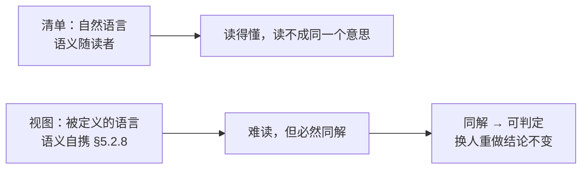
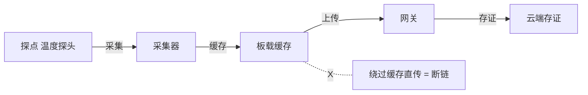
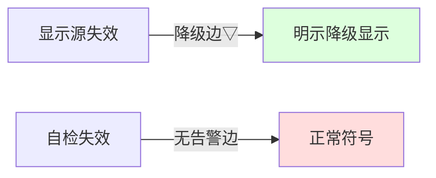
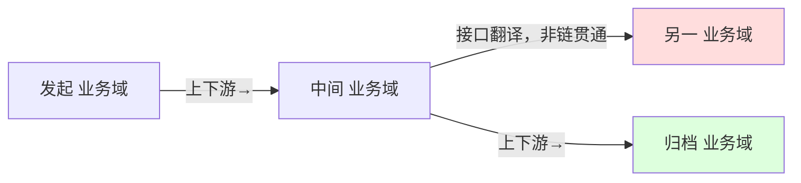
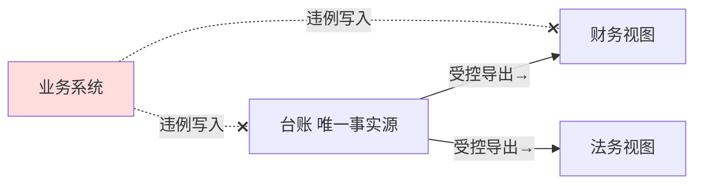

# 架构描述与架构视图价值研究报告

## —— 为什么有了清单，还必须有视图

**The Value of Architecture Description and Architecture Views: A Research Report**

> **编号**：36（研究报告稿）
> **日期**：2026-10-12
> **主题**：以四份标准正本为唯一依据，回答"**既然已有基本概念、属性与管控原则清单，为什么还必须有架构描述、尤其是有架构视图**"。**核心结论（讨论后半段收敛的正确口径）：架构视图的价值＝使架构"同解"；其原因＝自然语言 vs 被定义的语言。** 由此向下展开：同解的结果（可判定）、能力的来源（三合一）、没有现成视角时的自建方法（§8.1 七项），并以四个案例（M3／HUD／EOS／恒信）各建一个视角填实
> **依据（只用标准正本）**：**ISO/IEC/IEEE 42010:2022**（库内正本全文）｜**ISO/IEC/IEEE 42020:2019**（库内正本全文）｜**ISO/IEC/IEEE 15288:2023**（库内正本全文）｜**ISO/IEC/IEEE 42030:2019/2020**（旁证）
> **取证纪律**：本报告凡涉"视图／清单／同解／判定"的判断**只取标准正本**；本项目既有研究报告与教材**不作本报告的判据**，仅在案例设定处作**取材**并标注（〔案例〕／〔主线〕）；引外文**原文与中译并列**；案例中非取自案例设定的具体数值一律标〔示例〕
> **文档版本**：v1.0（2026-10-12 创建）→ v1.1（补齐三作用方式／§5.6 正本句／回流与复用／四问自检／附录 D 归并／三条边界）→ v1.2（核心结论更正："可判定"改为"同解"）→ **v1.3（2026-10-12 用正确结论重构：以"同解／自然语言 vs 被定义的语言"为唯一主轴重排全文，移除讨论前半段被否掉的口径与"列用途"式的章节，归入判错留痕）**
> **★ 本报告的判错留痕**：正文采用的口径，是经过多处自我纠正后、**以讨论后半段为唯一正确口径**的口径；被否掉的原判与被移除的内容集中记于 [§九](#九判错留痕本报告立论途中撤掉的论证)，不散在正文

---

## 摘要：十二条

1. **问题**：既然架构的内容（基本概念或属性、管控原则）已列成清单，为什么还必须有架构描述、尤其有架构视图？
2. **结论（一句话）**：**架构视图的价值＝使架构"同解"**——把关于这个实体的内容的"解释"，从读者的脑子里搬出来、放进公开规则，让不同的人、在不同时间读出**同一个意思**。
3. **清单为什么不够**：清单用自然语言写，语义**随读者**——读得"懂"，但读不成同一个意思。自然语言越"好读"，分歧越藏得深。
4. **视图为什么做得到**：视图用被定义的语言写，语义**自携**——模型种类定术语、记法、语法、语义（§5.2.8），谁学谁得同解。
5. **"清单更容易理解"是真的，但那是"读懂"，不是"同解"**；架构要同解，因为下游拿它做判定，判定要换人重做、结论不变。
6. **视图做的三件事（挂视角／承诺覆盖／固定约定）都归结为同一件事——被定义的语言**；"同解"是根，框定与覆盖也依赖它（规格与关切清单若不无歧义，照样各人各解）。
7. **"可判定"是"同解"的结果，不是价值本身**：正因为同解，判定才能换人重做结论不变，才能被问、被答、被复核。
8. **能力来源是三合一，不是视角一家的功劳**：架构视角（框定＋选中语言）＋模型种类／图例（定语义）＋视图（承载并覆盖内容），三者缺一不可。
9. **架构描述的价值落在视图上**：描述＝表达架构的工作产品（§3.3，架构无形而抽象、描述有形可交付），描述以视图为主要构成（§5.2.7），故描述的价值最终即视图的"同解"。
10. **正本给"为什么要描述"的那句**（42020 §5.6）：*Architectures **should be described** using a set of views and models that are complete, consistent and correct*，且完备性 *determined **relative to its intended use***——用途是完备性的尺子（故 §6.1 强制 AD 声明用途）。
11. **没有现成视角时的正解**：复用查无 → **按 §8.1 a)~g) 写规格** → 入库复用（视角是资产，视图是产物）。**自建视角＝为某一类关切定一套可同解的语言。** 四案例两种模式：M3／HUD／EOS＝链完整性（判"断没断"），恒信＝多副本一致性（判"对没对上"）。
12. **判错留痕**：讨论前半段的"使架构可判定""回答三要件""分面与同一""清单没版本／内容没结构""描述的对象是人"等口径均被后续讨论否定，正确结论是"同解／自然语言 vs 被定义的语言"——集中记于 [§九](#九判错留痕本报告立论途中撤掉的论证)。

---

## 一、前提：采信的标准与证据等级

| 标准 | 现行版 | 本轮取到的证据 | 等级 |
|---|---|---|---|
| **ISO/IEC/IEEE 42010** | **2022** | **库内正本全文**：术语 §3.x、概念模型 §5.2.x、要求 §6／§8、资料性附录 §B／§D／§E 逐条直核 | **一手（正本）** |
| **ISO/IEC/IEEE 42020** | **2019** | **库内正本全文**：§5.6、§8.4.x、§10.4.3／§10.4.4、附录 E.2／E.4 逐条直核 | **一手（正本）** |
| **ISO/IEC/IEEE 15288** | **2023** | **库内正本全文**：术语 §3.13／§3.46、§5.9、技术过程 §6.4.3~§6.4.5 逐条直核 | **一手（正本）** |
| **ISO/IEC/IEEE 42030** | **2019／2020** | 架构评估是否需要 AD（§3.2 注 1） | **旁证** |

**一条口径声明**：本报告凡涉"视图的价值／清单与视图的分野／同解"的判断，**只以 42010:2022 为尺**（连同 42020:2019 的过程侧、15288:2023 的生存周期侧）；**不引本项目既有研究报告或教材作判据**。

**案例取材声明**：四个案例的**案例设定**取自本项目案例资料（M3／HUD／恒信，文中标〔案例〕）；**EOS 的产品定义、目的、端到端业务框架、两类 PA**取自本项目主线规范（文中标〔主线〕）；其余补足性构造标〔示例〕。**案例只作填实，不作论证依据。**

---

## 二、问题

本报告回答一个问题：

> **既然架构的内容（基本概念、属性、管控原则）已经列成清单，为什么还必须有架构描述？架构描述以架构视图为主要构成，那架构视图的价值和意义又是什么？**

问题背后是一句质疑：**清单已经登记了架构的全部内容，视图凭什么不是多余的？**

先钉两个定义，再给结论。

| 词条 | 定义（正本逐字） | 归属 |
|---|---|---|
| architecture（§3.2） | *fundamental concepts or properties of an entity in its environment and governing principles for the realization and evolution of this entity and its related life cycle processes* | 内容 |
| architecture description（§3.3） | *work product used to express an architecture* | 工作产品 |

Introduction L177 把两者钉开：*Whereas an AD is a tangible work product, an architecture is **intangible and abstract**, understood through its concepts, properties and principles.*（AD 是有形的工作产品，而架构是无形而抽象的，需通过其概念、属性和原则来理解。）标准 Scope 明说 *Architectures are not the subject of this document*——它立法的对象就是描述。

三张清单登记的是定义句那两样内容（X 块＝基本概念或属性，Z 块＝管控原则），用**自然语言**写；视图是描述这一侧的部件（§3.7：*information part comprising portion of an architecture description*），用**被定义的语言**写。**这条"自然语言 vs 被定义的语言"的差别，就是全篇的轴。**

---

## 三、结论：架构视图的价值＝使架构"同解"

### 3.1 一句话

> **架构视图的价值＝使架构"同解"：把关于这个实体的内容的"解释"，从读者的脑子里搬出来、放进公开规则，让不同的人、在不同的时间，读出同一个意思。**



### 3.2 关键区分：读懂 ≠ 同解

- **清单容易"读懂"，但读不成"同一个意思"**。自然语言每一句都顺，谁都能复述大意；但也正因为是自然语言，意思不由文字定、由读者补。**自然语言越"好读"，歧义越不显形——它让分歧藏起来，而不是没有分歧。**
- **视图难"读懂"（要先学那套记号），但一旦读了，必然"同解"**。§5.2.8 说模型种类定的是"术语、记法及其语法、语义与符号体系"——语义是规则的一部分，不是读者临时补的。

**架构要的不是"读懂"，是"同解"。** 因为下游拿它做的是判定——判"我这么做合不合规"，判完要能换个人重判、结论不变。轻松读懂却各读各的，正是判定失效的温床。所以"清单更容易理解"是真的，但那是**更危险的理解**。

### 3.3 "可判定"是"同解"的结果，不是价值本身

正因为同解，判定才成为可能：同一个候选、换人重做、结论不变。**"使架构可判定"不是视图的价值，而是"同解"换来的东西**——同解之后，架构才能被问、被答、被判定、被复核。

---

## 四、为什么视图有这个能力：自然语言 vs 被定义的语言

### 4.1 媒介的差别

清单和视图，用的不是同一种媒介。**本质＝把解释从读者的脑子里搬进公开规则。** 这也正是标准从头到尾在做的事：ADF 用来 *codify* 惯例、ADL 用来 *codify* 描述（Introduction）——*codify* 就是"把解释从脑子里搬进规则"。

### 4.2 视图的三件事，都是这一件事的三个落点

视图做的三件事——**挂视角（框定关切）／承诺覆盖（shall）／固定约定（模型种类定语义）**——各自都成立，但能力**都归结为"被定义的语言"这一件事**：

| 视图做的事 | 为什么能做得到 | 正本 |
|---|---|---|
| **框定关切**（挂视角，钉死"答哪个问"） | 框定＝**预先锁定答案格式**：视角事先说死"这类问用哪些词、看哪些面、按什么记法、用什么算法核"。锁定之前一个问有一百种答法；锁定之后只有符合这套格式的才算"在答这个问" | §3.8 注 1（*"to frame"＝shape, compose, give expression*）；§3.8 注 4（视角常来自先前知识、经验与实践） |
| **覆盖可查**（承诺覆盖，漏一条即不合格） | 答案格式锁定后，视角给出**有限、显式的问题集**（它框定的那条条关切），§6.7 c) 要求覆盖"全部"——可逐条核对。清单没声明问题集，"全不全"无从说起 | §6.7 c)（shall） |
| **同解**（固定约定，换人读同义） | 模型种类把语义钉死，问的和答的共用同一套规则，谁学谁得同解。清单不钉语义，意思随人走 | §5.2.8；§8.2 |

**关键**：三件事里"同解"是**根**，另两件也依赖它——视角规格要真能"框定"，它自己就得写得无歧义（否则"框定了哪个问"各人各解）；关切清单要真能"逐条核对"，每条关切本身得无歧义（否则"覆盖了没有"各人各解）。**所以三个能力不是三件事，是"把解释从读者脑子里搬进规则"这一件事的三个落点。**

### 4.3 正本给"为什么要描述"的那一句

42020:2019 §5.6：

> *Architectures **should be described using a set of views and models** that are complete, consistent and correct. The completeness of an architecture view or model is **determined relative to its intended use**.*
> （架构应当用一组完整、一致、正确的视图与模型来描述；视图或模型的完备性，是**相对于它的预期用途**判定的。）

前半句说"描述"是 **should** 级要求，不是可选项；后半句解释了 §6.1 为什么强制 AD 声明自身预期用途——**用途就是完备性的尺子**，没有用途，就无所谓"描述完了没有"。

另有 42020 §10.4.4 首段讲"多少个视图才够"（逐字）：视图与模型的范围和种类，**应当限于**那些足以回应既定关切、问题以及用途、范围、广度、深度者。**视图不是"该有的都要有"，而是"要问的问题都有页面可问"。**

---

## 五、能力的来源与分工：三合一

能力是三样东西**合取**出来的，不是视角一家的功劳：

| 谁 | 提供什么 | 正本 |
|---|---|---|
| **架构视角** | 框定关切（对准哪类问）＋**选中**用哪套语言、哪些模型种类、哪些视图方法 | §3.8；§5.2.8（模型种类是"由其视角**标识**的"） |
| **模型种类／图例** | **语义本身**——记法、语法、语义、符号体系 | §3.15；§5.2.8 |
| **视图（架构师做的内容）** | 真有内容、真的覆盖了那些关切 | §6.7 c) |

```mermaid
flowchart TB
    VP["架构视角<br/>框定关切 ＋ 选中语言"] --> VC["视图组件（内容）"]
    MK["模型种类 / 图例<br/>定记法·语法·语义"] --> VC
    VC --> V["视图<br/>挂视角·承诺覆盖·按约定呈现"]
    V --> J["同解 → 可判定"]
    VP -.->|缺它则"不知道答哪个问"| X1["失效"]
    MK -.->|缺它则"退回自然语言歧义"| X2["失效"]
    V -.->|缺它则"无内容可判"| X3["失效"]
```

各自缺了会怎样：**有视角、有语言、但视图空着**——没有内容可判；**有内容、有视角、但没定语言**——退回自然语言，歧义照旧；**有内容、有语言、但没有视角框定**——没人知道它"回答的是哪个问"。

**视角是指挥，模型种类是词典＋语法，视图是答卷。同解是这个组合的性质，不是其中任何一件单独的性质。**

---

## 六、没有现成视角时怎么办：自建

标准把"自建视角"设计成了正规路径，不是绕路。§8.1 注 2 明说 *This document does not require any particular specifications of architecture viewpoints to be used*。

**第一步：先穷尽复用，别急着自建。** 42020 §10.4.3 注 1／注 5：先查概念化阶段有无已识别的视角，再看现成的能否照用、改或扩。可复用蓝本：RM-ODP 五视角（企业／信息／计算／工程／技术）、ISO/TS 14812 四视角、GERAM／ISO 15704 四视图、UAF／NAF 九格；以及 42020 §E.4.2 的七种常用视图（语境／概念／功能／逻辑／物理／技术／组织）。注 2 要求**尽量泛化**，使视角可复用。

**第二步：自建＝按 §8.1 a)~g) 写规格。** 这是"写一个视角"的完整清单，一行都不该少：

| # | 写什么（§8.1 逐字） | 本质 |
|---|---|---|
| a) | *any stakeholder perspectives associated with this viewpoint* | 谁这样看 |
| b) | *one or more concerns framed by this architecture viewpoint* | 答哪个问 |
| c) | *one or more aspects related to those concerns* | 看哪些面 |
| d) | *known typical stakeholders holding those concerns* | 给谁看 |
| e) | *model kinds and legends for use when constructing views* | **用哪套语言** |
| f) | *correspondence methods capturing relations within resulting views* | 怎么缝 |
| g) | *references to any sources of information about this viewpoint* | 从哪来 |

外加附录 B 模板的**名称、概述、版本**（视图靠这三样声明"受谁治理"），以及 42020 §10.4.3 d) 的**选择理据**、e) 的**用途范围**。**关键在 e)**：自建视角的核心动作，是给这一类关切**定一套可同解的语言**。

**第三步：谁写、写时留什么、复用。** 42020 §10.4.3 注 2：**最好由最熟悉问题本质和相关方关切的人来写**；写完入库、可版本化、跨项目复用。

**三条边界**：① 自建 ADF 有成本，不能随便建——先穷尽复用，再自建，而且要有理由；② **视角是资产，视图是产物**——视角入库复用，视图逐项目做；每次都重新发明视角，正是"多套话术、零件互换性归零"的病根；③ 符合性要落到对象——"符合 42010"要具体到"哪些视角规格齐备"（§4 的符合性是对 AD／ADF／ADL／视角／模型种类分别做的）。

---

## 七、四个案例

四个案例各挑一个**没有现成视角**的承重关切，走一遍 §六的自建路径。前三个是"链完整性"模式，第四个是"多副本一致性"模式。

### 7.1 案例一：M3 医疗冷链温控箱——温度数据可追溯性视角

**场景**：水忠立过两条原则——"新增传感器类型不得破坏已有追溯链路""断链即报废……全程温度可追溯"。要回应"追溯链会不会被某次改动弄断、断链能不能被检出"，现成视角没有一个管这个问（RM-ODP 信息视角管"数据是什么"，逻辑／功能视图管"数据的含义与变换"，都不管"依赖链完不完整"）。〔案例〕

**视角名：温度数据可追溯性视角（M3 Traceability Viewpoint）**

| # | 项 | 填什么 |
|---|---|---|
| a) | 相关方角度 | 质量与法规合规角度（监管审计员、冷链运营方、疫苗使用方） |
| b) | 框定的关切 | ① 数据从探头到存证全程无断点吗？② 换型号／加传感器会弄断已有链路吗？③ 断链能检出、定位、报警吗？ |
| c) | 方面体 | 数据方面（数据流、存储、时序）＋结构方面（实体与接口） |
| d) | 典型相关方 | 监管审计员、质量工程师、冷链运营方 |
| e) | 模型种类＋图例 | **数据流链模型**：节点＝产生／变换／存储点，边＝数据传递；语义＝"有边即该链段存在，无替代路径则该段为单点"；图例给符号表（探点□→采集◇→缓存○→上传△→存证▽，断点＝实线改虚叉） |
| f) | 对应方法 | 每个数据节点必须映到至少一个功能元素（功能视角）和一个物理元素（技术视角）上 |
| g) | 来源 | M3 规格"断链即报废"原始要求＋15288 §6.4.5.3＋相关冷链追溯法规 |

**判定演示**：工程师 A 换一款新型号探头（节点型号变、边没动）→ 链还在，**未破坏**；工程师 B 想绕过板载缓存直传网关（删 C→D 边）→ 实线断成虚叉，**破坏**。



**换任何人来画、来判，结论一致**——"断不断"由这套记号和语义定，不由谁的经验定。

### 7.2 案例二：民用客机平视显示器（HUD）——失效与降级视角

**场景**：35 号给 HUD 立的关键关切是"单点故障若'看起来正常'，比不显示更危险"，管控原则对应"单点故障不得误导"。要回应"任一单点故障会不会被显示成正常、降级有没有预先声明"，现成视角没有一个管"失效如何进入显示"；安全性分析标准（ARP 4761、DO-254）是**分析方法**，不是 42010 意义上的**描述视角**。〔案例〕

**视角名：失效与降级视角（HUD Failure & Degradation Viewpoint）**

| # | 项 | 填什么 |
|---|---|---|
| a) | 相关方角度 | 适航审定角度、飞行员（操作）、维修工程角度 |
| b) | 框定的关切 | ① 任一单点故障会不会产生"看起来正常"的误导显示？② 每个故障有无被检出、被声明、有预定降级路径？③ 降级状态飞行员能否看见、能否识别？ |
| c) | 方面体 | 行为方面（失效行为、降级状态机）＋信息方面（显示内容与告警） |
| d) | 典型相关方 | 适航审定员、正副驾飞行员、维修工程师 |
| e) | 模型种类＋图例 | **失效—显示映射模型**：节点＝故障点，边＝故障→显示内容的传播；语义＝"故障若无告警边、也无降级边，即'失效不可见'——判为不成立" |
| f) | 对应方法 | 每个故障源必须映到误差预算里一项（与"接口与时序视角"）；每个符号的失效表现必须在各飞行阶段有声明（与"显示内容与阶段视角"） |
| g) | 来源 | 35 号 D8（MMEL、开发保证等级）＋管控原则"单点故障不得误导／降级路径预先声明"＋ARP 4761／DO-254 分析方法引用 |

**判定演示**（判 35 号候选 A／B 之争）：



候选 B（单显示源＋双光学通路＋明示降级）——故障带**降级边** → 失效可见，**成立**；候选 A（单套＋自检降级）——自检失效**无告警边、无降级边**，直连正常符号 → "看起来正常"，**不成立**。**"失效若看起来正常比不显示更危险"就此从一句口号，变成一张谁判都一个结果的可判定视图。**

### 7.3 案例三：EOS 企业运营体系信息化平台——业务贯通视角

**场景**：EOS 的目的写得很硬——"从根本上消除信息孤岛和业务碎片化，各业务域在同一平台体系内贯通"；目标"业务贯通是设计保证（统一业务链）"。要回应"任意一条业务从发起走到归档，是否全程走同一条平台链、没落进孤岛？跨域关系是否只走三种合法关系？"，现成视角没有一个管"业务链通不通"。〔主线〕

**视角名：业务贯通视角（EOS Business-Chain Connectivity Viewpoint）**

| # | 项 | 填什么 |
|---|---|---|
| a) | 相关方角度 | 业务运营角度（产品用户／客户）＋平台治理角度（上级／监管方） |
| b) | 框定的关切 | ① 任一端到端业务是否全程走同一平台链、无孤岛断点？② 跨域关系是否只走三种合法关系（上下游／管理-被管理／支持-被支持）？③ 能力缺口是被配置绕过，还是上升为引擎需求？ |
| c) | 方面体 | 行为方面（业务流程、E2E 链）＋结构方面（业务域、PA 节点） |
| d) | 典型相关方 | 业务运营者、平台产品经理、架构治理方 |
| e) | 模型种类＋图例 | **业务链图**：节点＝架构节点类型的端到端业务，边＝三种合法关系（上下游→／管理▷／支持◇）；语义＝"任一业务从发起节点到归档节点若无边相连，即孤岛断点——判为不成立" |
| f) | 对应方法 | 每个业务节点必须映到至少一个引擎能力面＋一份配置定义（与"两类 PA 视角"）；每处能力缺口必须映到一条上升记录（与"需求分流与上升视角"） |
| g) | 来源 | 〔主线〕§2.2（端到端业务框架、E2E 三关系）＋D3"业务贯通是设计保证"＋管控原则"跨域关系限三种／能力缺口上升不许配置绕过" |

**判定演示**（判 35 号候选 B／C 之争）：



候选 C（各域各建、靠接口对接）——业务跨域靠"接口翻译"，链图上**没有合法边** → 孤岛断点，与"贯通"正面相抵，**不成立**；候选 B（双类 PA 并行＋接口契约化）——全程沿同一平台链、只走三种合法边 → **贯通成立**。

### 7.4 案例四：恒信合同审批数字化系统——事实源一致性视角

**场景**：恒信的目的——"合同审批合规、月底账目清楚对得上"；核心概念"合同＝唯一事实源、归属唯一、留痕即证据、外部只走受控导出"；目标"逐笔一致率 100%"。要回应"同一笔合同在三部门、台账、外部对账平台看到的，是不是同一笔、同一编号、同一个月？任何改动有没有受控、留痕、会不会被另一处无声改掉？"，现成视角没有一个管"多份账是不是同一份"。〔案例〕

**视角名：事实源一致性视角（恒信 Single-Source-of-Truth Viewpoint）**

| # | 项 | 填什么 |
|---|---|---|
| a) | 相关方角度 | 财务结账角度、法务合规角度、审计角度 |
| b) | 框定的关切 | ① 同一笔合同，三部门＋台账＋对账平台看到的编号／金额／所属月是否同一？② 任何字段改动是否走变更控制、留痕、且不被他处无声覆盖？③ 月底对账是否逐笔对得上（一致率 100%）？ |
| c) | 方面体 | 数据方面（字段、编号、归属、时间戳）＋结构方面（事实源与各副本、导出通道） |
| d) | 典型相关方 | 财务结账员、法务审查员、审计员、业务经办人 |
| e) | 模型种类＋图例 | **事实源—副本映射模型**：节点＝事实源（台账）与各副本，边＝受控导出（单向）／受控回写；语义＝"除台账外任何节点若有无回写边的写入路径，即'第二事实源'——判为不成立" |
| f) | 对应方法 | 每次字段改动必须映到一条审批／状态记录（与"审批与状态视角"）；每条外部导出必须映到一条受控导出契约（与"接口与边界视角"） |
| g) | 来源 | 基本概念"合同＝唯一事实源／归属唯一／留痕即证据"＋管控原则"编号单点生成／字段改动走变更控制／外部只许受控导出"＋法规留档十年 |

**判定演示**（判 35 号候选 B／C 之争）：



候选 C（各自为政＋对账平台事后核）——法务、财务、业务各写各的"账"，图上全是**违例写入（虚线红叉）** → 多个事实源，"逐笔一致率 100%"落空，与目的相抵，**不成立**；候选 B（合同台账为唯一事实源）——只有台账有写入权，其余全是单向受控导出 → **成立**。

**顺带一个实打实的回报**：35 号给恒信记过一条 known issue——"与外部对账平台**直连**，在架构描述里没有对应视图，架构未识别"。这个视角正是抓它的那张网：直连＝外部平台有了写入路径＝**第二事实源**，直接违反"外部只许受控导出"。**有了视角，这类遗漏不再是事后发现，是覆盖核对时当场显形。**

### 7.5 四案例的两种模式

| 案例 | 视角 | 判什么 | 模式 |
|---|---|---|---|
| M3 | 温度数据可追溯性视角 | 数据追溯链断没断 | **链完整性** |
| HUD | 失效与降级视角 | 失效有没有混进显示 | **链完整性** |
| EOS | 业务贯通视角 | 业务链通没通 | **链完整性** |
| 恒信 | 事实源一致性视角 | 多份账对没对上 | **多副本一致性** |

**可见自建视角的方法不挑模式**：没有现成视角时，就为这一类问写一套规格、定一套语言——无论判"断没断"还是判"对没对上"，路径是同一条：复用查无 → 按 §8.1 七项写规格 → 入库复用 → 用视图把判定落成谁判都一个结果的事实。

---

## 八、边界与引用警戒

1. **AD 合规 ≠ 架构正确**。Introduction 逐字：*This document does not explicitly address completeness or correctness regarding the inclusion of particular elements in an AD.* 它只管描述的应然属性；架构好不好，归目的与治理裁。
2. **描述的必要性是条件性的，条件是"有没有人依赖它"**。42030:2019 §3.2 注 1 明说架构评估**不要求**必须有 AD——焦点小组、专家座谈、质量研讨会上，"关于架构的足够知识在参与者身上"就够。**依赖者一出现（下游设计、采购、评审、交接、跨代复用），它就从可选变成必需。**
3. **视图 ≠ 图、≠ 必须覆盖全部、≠ 阶段交付物**。§6.8 注 2：不规定视图组件的正式程度，**非模型视图组件同样有效**；§6.7 注 3：允许刻意只覆盖实体的一部分；附录 E.2：AD 有自己的生存周期，视图活得比一个阶段长，但标准也不要求它先于架构存在（§5.3 可先可后）。

**引用警戒（42020 §E.4.2）**：正本里唯一成清单的"常用视图"是 §E.4.2（资料性）。引它须注意三处：① §E.4.2.6 把物理视图说成"提供设计解"（*provides the design solution*）——与本书"设计解归设计定义过程"（15288 §3.13／§6.4.5）相抵；② §E.4.2.5 自注逻辑／物理之分 *often somewhat subjective*；③ §E.4.2.4 自注功能视图 *not a 42010 normative requirement but would almost always be included*——**不得写成"标准要求有功能视图"**。

---

## 九、判错留痕：本报告立论途中撤掉的论证

本报告的正确口径＝**讨论后半段**收敛到的"同解／自然语言 vs 被定义的语言"。此前口径均被逐一否定，集中记于此处：

| # | 被否掉的原判 | 为何被否 | 纠正后的口径 |
|---|---|---|---|
| 1 | **"架构视图的价值＝使架构可判定"**（外加"视图＝结构＋约定"） | 把**价值**答成了**结果**，且"结构＋约定"经不起"清单也能写结构句"的反驳 | **价值＝使架构"同解"**；"可判定"是同解的结果（§三） |
| 2 | **"回应关切＝回答一个问；回答有三要件（知道问什么／可查答全／一致读法）"** | 仍是"判定／回答"框架，没到根——被追问"为什么能框定／能查全／能同解？清单不是更容易理解吗" | 三个能力都归结为**被定义的语言**（§四.2）；真正区分是**读懂 vs 同解**（§三.2） |
| 3 | **"视图的价值＝分面与同一（让一个架构被多个冲突关切方同时使用）"** | 被指"没有理解我的问题"——它答的是"为什么多个视图"，不是"视图的价值" | 撤出价值论证 |
| 4 | **"清单没有版本"** | 清单当然可以有版本、入库、基线 | 时间属性不是分界，撤 |
| 5 | **"内容没有结构"** | 清单能写"追溯链路＝探头→采集→缓存→上传→存证"这种结构句。**凡说"视图有某样东西、清单没有"的论证，只要那样东西能写成句子就废** | 分界不在内容，在**媒介** |
| 6 | **"描述的对象是人"** | §3.3 说 AD 是 *used to **express an architecture***——**表达的对象是架构**；"人"在受众侧（§3.3 注 2），且 stakeholder 是"角色、岗位、个人、组织或其类"（§3.17） | 表达对象是架构，受众是利益相关方 |

**因上述纠正而被移出正文的内容**：讨论前半段的"研发过程三个客观条件"（那是架构必要性的论据，属 35 号 §二，不属本报告）；"AD 在研发过程中的三种作用方式（依从／回流／改写）"（它回答的是"AD 起什么作用"，是被指"答错对象"的一处）；"附录 D 的 22 条用途归并"（"列用途当价值"正是第 2 条被否掉的错误，故不再单列章节）。

**最终立住的一条分界**：清单与视图的差别不在呈现形式、不在内容多少、不在版本有无，而在**媒介**——清单用自然语言（语义随读者），视图用被定义的语言（语义自携）。**把清单加上"视角＋覆盖承诺＋约定"，它就变成了视图；把这三样拿掉，视图就退化成清单。** 能力不属于"视图"这个名字，属于"被定义的语言"；视图只是"架构内容用被定义的语言、挂着视角表达出来"的标准叫法。

---

## 十、正本条号索引

| 主题 | 条款 |
|---|---|
| 架构定义（只给两样） | 42010:2022 §3.2 |
| 架构描述（表达架构的工作产品） | 42010:2022 §3.3 及注 2 |
| 架构无形而抽象 | 42010:2022 Introduction L177 |
| 架构描述元素 | 42010:2022 §3.4 注 1 |
| 架构视图（AD 的信息部件） | 42010:2022 §3.7 |
| 架构视角（一组惯例，无属概念） | 42010:2022 §3.8 及注 1／3／4 |
| 关切（对利益相关方而言具相关性或重要性的事项） | 42010:2022 §3.10 |
| 模型种类（关键特性＋建模约定） | 42010:2022 §3.15 |
| 利益相关方（角色、岗位、个人、组织或其类） | 42010:2022 §3.17 |
| 架构可以关乎元素／关系（外延，非内容） | 42010:2022 §5.2.2 |
| 视角为判定架构是否满意回应关切而设 | 42010:2022 §5.2.7 |
| 视图可导致需求被修改（回流） | 42010:2022 §5.2.7 注 2 |
| 视图组件受模型种类／图例治理，含语法语义；一组件可属多视图 | 42010:2022 §5.2.8 |
| 视图方法：建造／解读／分析（质询视图以评估性质） | 42010:2022 §5.2.10 |
| 对应关系表达并强制八种关系（组合、细化、一致性、可追溯、依赖、约束、满足、义务） | 42010:2022 §5.2.11 |
| AD 须识别所关注实体与其环境、须写明预期用途 | 42010:2022 §6.1 |
| 关切宜作疑问句 | 42010:2022 §6.4 注 3 |
| 每条关切至少被一个视角框定；视角可作合同先订；不要求任何特定视角 | 42010:2022 §6.6 及注 1／3 |
| 每个视角至少一张视图；视图须覆盖全部框定关切、带版本与已知问题；多视图描述同一架构；允许部分覆盖；视图外可有其他信息 | 42010:2022 §6.7 及注 1／2／3、EXAMPLE 2 |
| 非模型视图组件同样有效 | 42010:2022 §6.8 注 2 |
| 对应关系与对应方法、成立／违反记录 | 42010:2022 §6.9 |
| 决策与理据必录 | 42010:2022 §6.10 |
| 视角规格七项（a)~g)） | 42010:2022 §8.1 |
| 模型种类规格 | 42010:2022 §8.2 |
| 视图方法 | 42010:2022 §8.3 |
| 视角规格模板 | 42010:2022 附录 B.2 |
| AD 有自己的生存周期，可更新发新版 | 42010:2022 附录 E.2 |
| 架构即约束（收窄设计空间） | 42020:2019 附录 E.2.1 |
| 架构应当用一组完整、一致、正确的视图与模型来描述；完备性相对预期用途判定 | 42020:2019 §5.6 |
| 综合潜在解（分解是选择不是推导） | 42020:2019 §8.4.5 |
| 候选架构：Decompose, when necessary, and allocate | 42020:2019 §8.4.7 f) |
| 概念化只需描述到对预期使用者合适的程度 | 42020:2019 §8.4.8 注 1 |
| 识别或开发视角（a)~h)；注 2 泛化与最熟悉者；d) 选择理据；e) 用途范围） | 42020:2019 §10.4.3 |
| 建模产视图（e) 分配；h) 表达；i) 视图里显现的风险；j) 调和） | 42020:2019 §10.4.4 |
| 七种常用视图（资料性；§E.4.2.4 功能视图非规范要求、§E.4.2.5 逻辑／物理主观、§E.4.2.6 物理视图＝设计解） | 42020:2019 §E.4.2 |
| 系统定义（涌现） | 15288:2023 §3.46 |
| design 名词（足以支持架构的合规实现） | 15288:2023 §3.13 |
| 需求可测但不应暗示实现 | 15288:2023 §6.4.3.1 |
| 架构定义过程目的（以一致视图与模型表达） | 15288:2023 §6.4.4.1 |
| 架构定义成果含"开发架构视图与模型" | 15288:2023 §6.4.4.2 f) |
| 架构定义产物交配置管理立基线 | 15288:2023 §6.4.4 注 12 |
| 设计须与视图里定义的架构实体一致 | 15288:2023 §6.4.5.1 |
| 架构实体与系统元素代表两种不同的概念 | 15288:2023 §5.9 |
| 架构评估不要求必须有 AD | 42030:2019 §3.2 注 1 |

---

## 十一、与既有报告的接驳

- **35 号 §十三**已立"视图设计四步"（定型→建模→对齐→成件）与 V-I／V-O 清单，本报告是其**"为什么"**——四步存在的理由正是本报告 §三、§四的"同解"机制。
- **30 号 §3.2**已立"治理的实质＝可判定的符合性"，本报告把它向前推到"可判定的**前提**是同解，同解的前提是自然语言→被定义的语言"。
- **32 号 §四**已立"缺的不是视角标准，是视角规格"与八步流程（第 4 步＝按 §8.1 建视角库），本报告 §六、§七是该流程的**落地示范**（四个视角的完整七项规格）。

---
