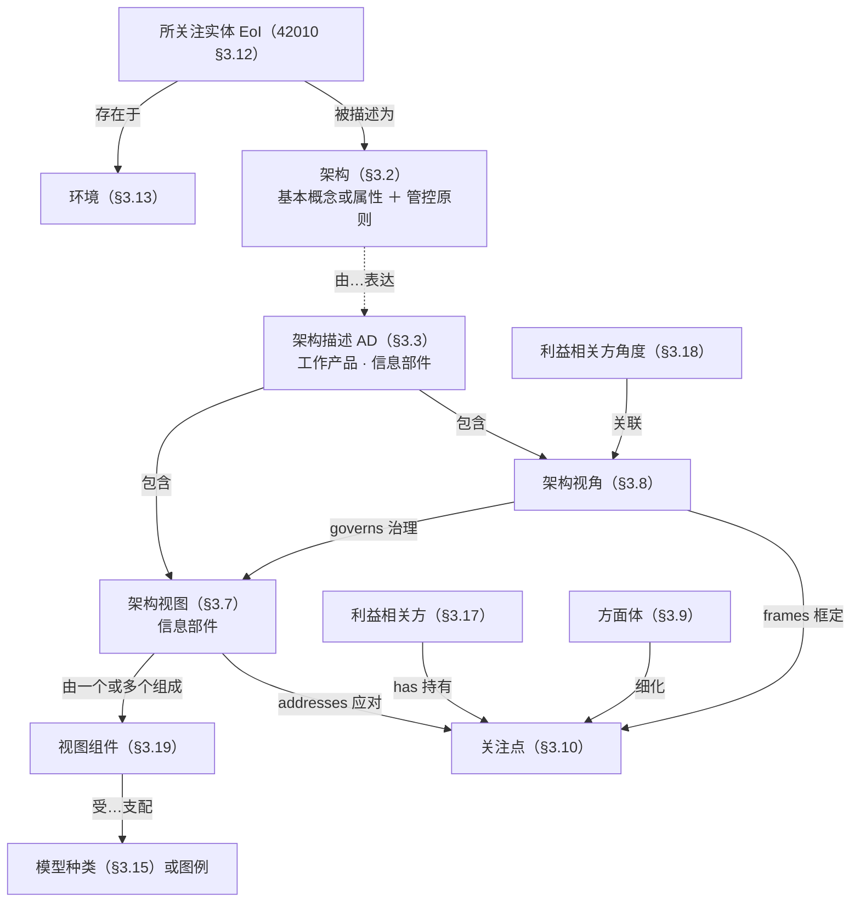
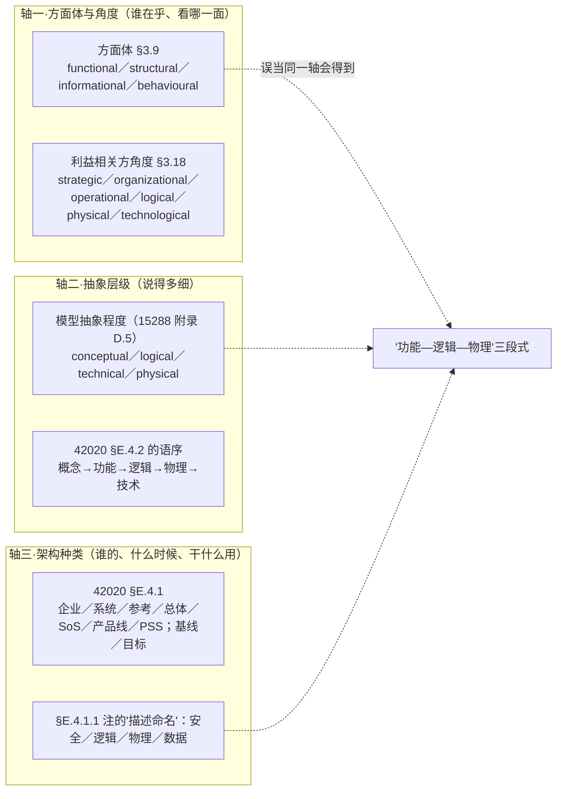
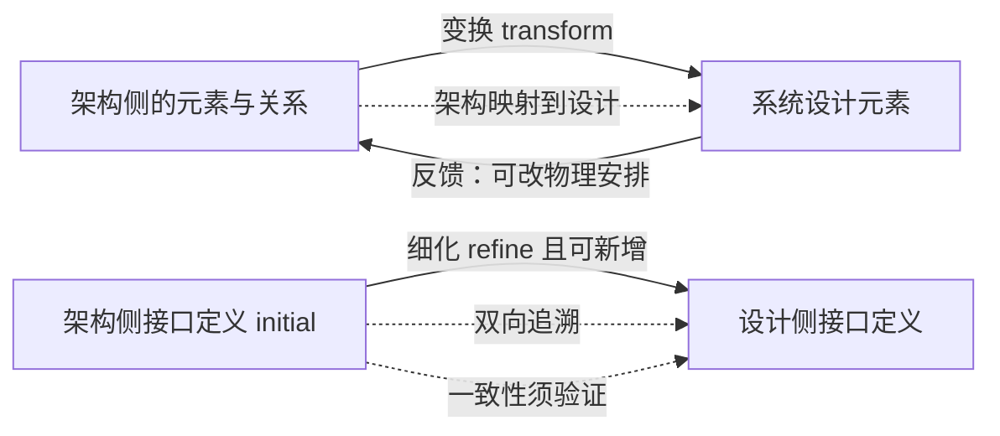
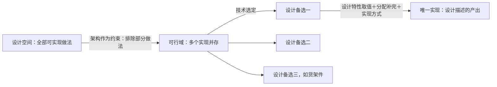
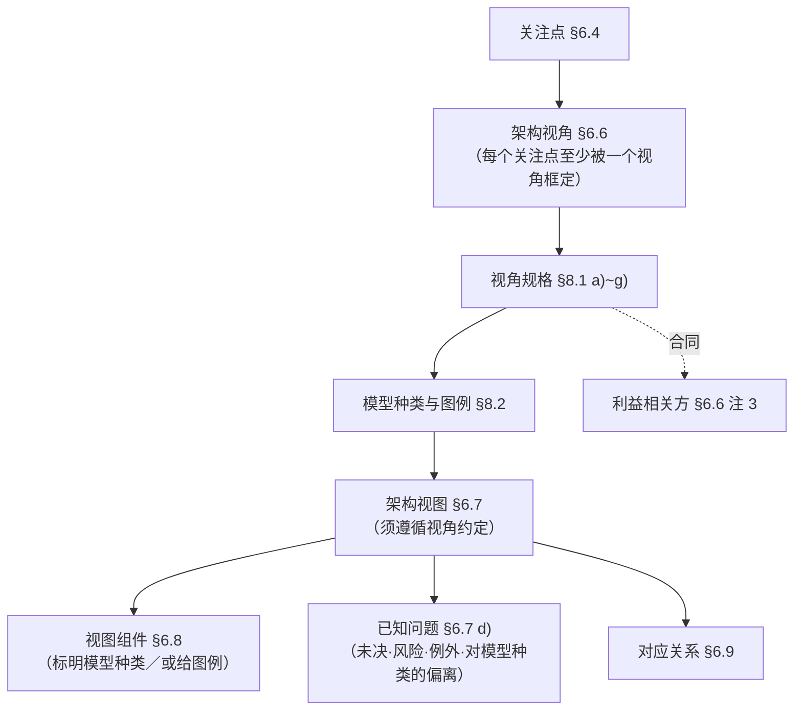
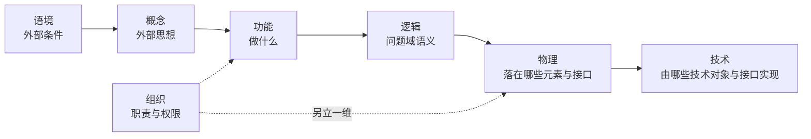
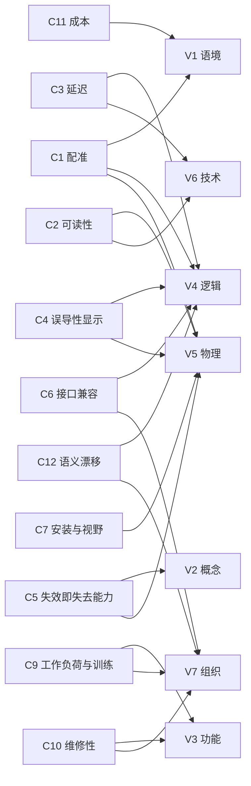
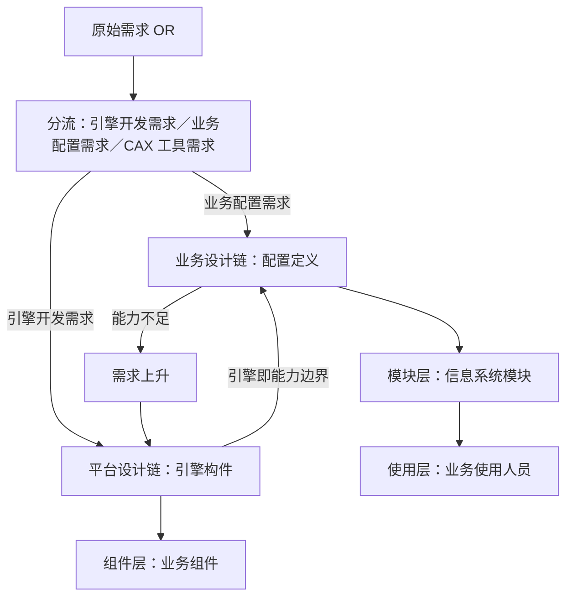
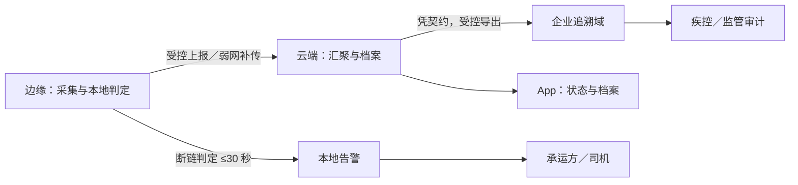
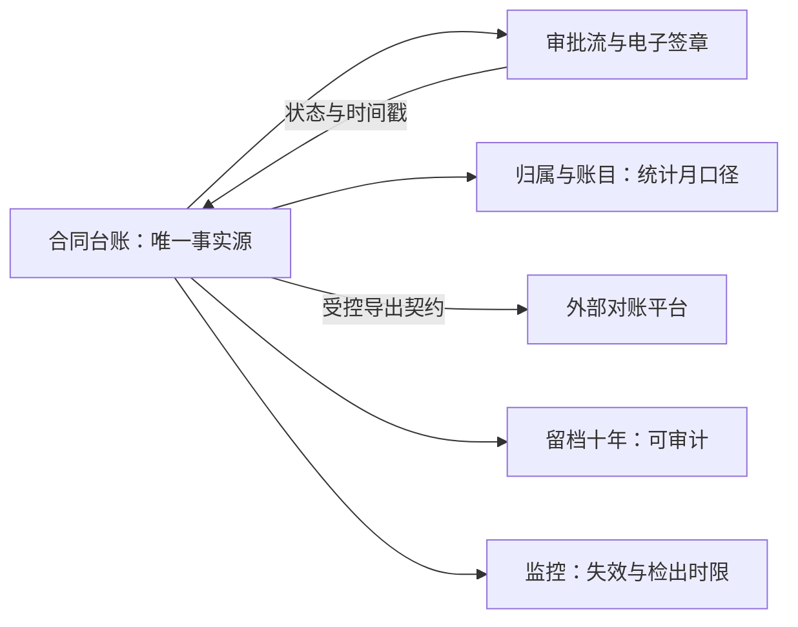

# 架构视图口径研究报告

## —— 从功能／逻辑／物理的三词定位到七类视图与三张清单（附 HUD·EOS 平台·冷链温控箱·合同审批四套示例）

**A Research Report on the Terminology and Construction of Architecture Views**

> **编号**：37（研究报告稿）
> **日期**：2026-10-13
> **主题**：以四份标准正本为唯一依据，回答七个连带问题——① 功能／逻辑／物理是不是系统架构的视图；② 物理视图里的元素与接口是什么、须符合什么条件才能落入；③ 物理视图与系统分解结构的分界；④ 物理视图与设计描述的分界与关系；⑤ 架构定到物理视图，设计空间是否收窄到唯一实现；⑥ 视图的形态与"符合视角"；⑦ 系统架构有哪些视图。并给出**基本概念／基本属性／管控原则三张清单**的标准位置，以及**四套七类视图示例**——民机平视显示器（HUD）／EOS 企业运营体系信息化平台／M3 医疗冷链温控箱／合同审批数字化系统
> **依据（只用标准正本）**：**ISO/IEC/IEEE 42010:2022**（库内正本全文）｜**ISO/IEC/IEEE 42020:2019**（库内正本全文）｜**ISO/IEC/IEEE 15288:2023**（库内正本全文）｜**ISO/IEC/IEEE 42030:2020**（旁证）
> **取证纪律**：本报告凡涉架构口径的判断**只取上述正本**；本项目既有研究报告（00~36 号）与 INCOSE SEH（手册）**不作判据**，仅在指明"曾误引之处"时点名；凡涉外文**原文与中译并列**——逐字引文一律紧随「（中译：…）」，全报告共 **83 处**（术语级英文另见[附录 B](#附录-b术语对照)，缩写与标准文件号见[附录 D](#附录-d英文缩写与文件号对照)）；凡断言"标准里没有"**先做零命中检索**；引用一律标四档——**标准逐字／标准可支持的读法／按定义句作的举例／本报告的定性**
> **配套材料**：本轮定案与挂账见 `claude-memory/progress-架构视图与物理视图讨论.md`；取证纪律的裁定见 `claude-memory/feedback-判断以标准正本为准.md`
> **文档版本**：v1.0（2026-10-13 创建）→ v1.1（同日补示例二：EOS 企业运营体系信息化平台七类视图；摘要增第 15 条；原 §十二／§十三 顺延为 §十三／§十四）→ v1.2（同日补示例三：M3 医疗冷链温控箱七类视图；摘要第 15 条改为"三个示例"；原 §十三／§十四 顺延为 §十四／§十五）→ v1.3（同日补示例四：合同审批数字化系统七类视图；摘要第 15 条改为"四个示例"；原 §十四／§十五 顺延为 §十五／§十六）→ v1.4（同日收口：题名与主题行改为四套示例；§12.13／§13.13／§14.13 三级对照表的层级与互指写明）→ v1.5（同日：示例收纳方式定案——四套留在本报告内，不拆分、后续不再增加；§十六 挂账表据此改写为 8 项）→ v1.6（同日：把四套示例的三清单迁到各例「系统需求」之后并重排小节号；迁移脚本 `.work-37/reorder-lists.js`）→ v1.7（同日：为全部英文逐字引文补「（中译：…）」共 59 处；脚本 `.work-37/add-zh.js`＋配对表 `zh-pairs.json`）→ v1.8（同日：英文残留体检——再补 24 处并修正 14 处插入位置；新增[附录 D](#附录-d英文缩写与文件号对照)；脚本 `.work-37/audit-en.js`、`add-zh-by-line.js`）→ **v1.9（同日：增补 §9.3 七类视图逐条详解——七类各给定义句逐字＋中译、框定的关切、典型组件与模型种类、封顶、常见误用、四套示例落点；原 §9.3／§9.4／§9.5 顺延为 §9.4／§9.5／§9.6，附录 D 互指同步）→ v1.10（同日应"逻辑问'问题域里这些东西是什么'不好理解"：逻辑视图条改写为"从用户／业务角度看，那些数据与变换是什么"，新增**逻辑层 vs 技术层两层写法对照表**（HUD／M3／合同审批三例），节末分工总纲同步改写）→ **v1.11（同日应"是数据转换规则或算法？"：§9.3.4 增"与'规则／算法'的分界"——域规则的语义属本层、规则的可执行形式与算法属设计定义；给两条判据，点明"表示方式映射"属技术视图与设计，并说明 §E.4.2.5 划的是"问题域语义 vs 表示方式"而非"规则 vs 算法"）→ v1.12（同日应"变换是什么、在什么条件下成立、结果归谁，怎么理解"：§9.3.4 增**"变换"要写到的三问**——各问要能回答到什么程度、三问缺一的后果，并附**四例示范表**（HUD／M3／合同审批／EOS））**
> **判错留痕**：本报告立论途中撤掉的三处越权引用，集中记于[附录 C](#附录-c判错留痕)，不散入正文

---

## 摘要：十五条

1. **三个词的位置**：**功能架构／逻辑架构／物理架构**在 42010:2022 里**零命中**；把它们作为术语处理的是 42020:2019 §0.2（"架构"前冠的是**所关注的主题**）、§E.4.1.1 注（**主语是 Descriptions**，称"架构种类"）、§E.4.2.4~.6（三种**视图**的定义句），以及 42030:2020 的 architecture 词条 Note 5（它们是**关注点**的例子，经视图与模型表达）。
2. **结论一**：三者**不是三个架构**，是同一实体的三份描述／三张视图；标准把"架构种类清单"与"架构视图清单"分作两份，三者横跨两份。
3. **结论二**：**"功能—逻辑—物理"不在同一根轴上**——functional 在 42010 里是**方面体**与**视角／视图**的名；logical、physical 是**方面体**与**利益相关方角度**的例；15288 附录 D.5 又把 conceptual／logical／technical／physical 当**模型的抽象程度**。
4. **要称其为"视图"的条件**：须有治理它的**视角规格**（42010 §3.8＋§8.1 a)~g)）；没有规格，产出的东西不构成架构视图。
5. **物理视图里的"元素"是 system element，不是"物理对象"**：库内标准 "physical object" 零命中；15288 §3.47 的示例含硬件、软件、数据、人员、过程、规程、设施、材料、自然存在的实体——**"构成部件"只是其中一支**。元素以**角色位**（被安排、被分配、对接口负责）出现，不是规格件。
6. **物理视图与系统分解结构（SBS）两族不同、无上下位**：SBS 是 **15288 §6.3.1** 任务 4)＋注 4 的四项之一（WBS／FBS／SBS／OBS），Table B.1 把它列为**项目规划过程**的人工制品；"产品分解结构（PBS）"在库内标准**零命中**。**系统结构本身不必然是层级**（§5.2），SBS 是把它组织成层级的规划台账。
7. **物理视图与设计描述是相邻两级、互为反馈**：42020 §5.6 四句（设计权衡空间最大灵活性／元素可 notional／接口详略以"传达架构意图"为界／设计向架构反馈分配·划分·对齐）；Table B.1 的 *Interface definition (**initial**)* → *Interface definition*。
8. **两侧元素与接口的关系**：元素＝**变换／映射**（15288 §6.4.5.3 b) 2)＋注 5），接口＝**细化且可新增**（b) 6)＋注 10），需求分配**跨两级补完**（b) 1)＋注 4），特性**转换**（b) 3)＋注 6），并有**双向追溯**与**反馈**（注 19；注 17）。结论：**同一批东西、两级规定、可能两份清单**；同一性靠追溯与一致性核对**维护**，不是假定。
9. **架构不会把设计空间收窄到唯一实现**：42020 §5.6（*maximum flexibility in the design tradespace*（中译：设计权衡空间具有最大的灵活性））、§E.2.1（**架构作为约束**，受"最大化可用设计空间"制衡，宜 *as design-agnostic as possible*，五条约束理由全是"避免限制"）、15288 §6.4.5.2 a)（设计定义过程的预期结果之一就是**评系统元素的设计备选**）。**架构层选定一个 ≠ 实现只剩一个。**
10. **一个系统元素可以有多个实现方案**（四种形态）；**候选方案不注在物理视图上**——记入 **AD 的决策与理由**（42010 §6.10.1／§6.10.2）与**视图的已知问题**（§6.7 d)），要在 AD 里展示则走"关注点→视角→模型种类→另一张视图＋一条对应关系"。
11. **视图是"信息部件"，不等于"图"**（§3.7／§3.14）；组件受**模型种类或图例**支配（§3.19／§6.8）；模型种类的约定可以是**语言、记法或建模技术**（§8.2 a)）；**不规定形式化程度**（§6.8 注 2）；**叙述可作组件**（§5.2.8 EXAMPLE 2）。
12. **"要给符合对应架构视角的视图"是标准判据**：§6.7 明文 *each architecture view shall adhere to the conventions of its governing architecture viewpoint*（中译：每个架构视图应遵循其管控架构视角的约定。）；视角侧先写全 §8.1 a)~g)，视图侧逐条对上 §6.7 a)~d)、§6.8、§6.9。
13. **视图清单不由标准指定**（§6.6 注 1、§8.1 注 2）；**标准自带的是 42020 §E.4.2 的七类**：语境、概念、功能、逻辑、物理、技术、组织（**七类逐条详解见 §9.3**：定义句逐字＋中译、框定的关切、典型组件与模型种类、封顶、常见误用、四套示例落点）。项目那份清单由**关切台账反推**（§6.6／§6.7／§6.9）。
14. **三张清单就是"架构"的内容本身**（42010 §3.2 定义句：**(concepts or properties) AND (governing principles)**）；概念与属性经 42020 §10.4.4 e) **分配到元素与关系**，原则管**实现与演化**（§10.4.4 f)）且**可不属于任何视图**（42010 §6.7 EXAMPLE 2）。**标准未给"基本"的判据**（权威缺口）。
15. **四个示例**：民机 HUD（设备类·安全关键，§十一）、**EOS 企业运营体系信息化平台**（平台类，§十二）、**M3 医疗冷链温控箱**（设备类·数据关键，§十三）、**合同审批数字化系统**（无形系统·流程类，§十四）。四者的承重清单侧重不同——**HUD 偏属性**（配准／时延／降级）、**EOS 偏概念与准则**（归属唯一／语义唯一／可配置优先）、**M3 概念与属性并重**（断链必告警 ＋ ±0.5℃／30 s／72 h）、**合同审批偏概念与规则**（唯一事实源／归属唯一／受控变更／留痕即证据）；四者的典型失效形态分别为**误导**、**演进失控**、**漏检**、**架构未识别**。

---

## 目录

- [一、前提：依据、证据等级与取证纪律](#一前提依据证据等级与取证纪律)
- [二、术语地基：架构、描述、视角、视图、方面体、关注点](#二术语地基架构描述视角视图方面体关注点)
- [三、第一问：功能／逻辑／物理是不是系统架构的视图](#三第一问功能逻辑物理是不是系统架构的视图)
- [四、第二问：物理视图里的元素与接口是什么](#四第二问物理视图里的元素与接口是什么)
- [五、第三问：物理视图与系统分解结构的分界](#五第三问物理视图与系统分解结构的分界)
- [六、第四问：物理视图与设计描述的分界与关系](#六第四问物理视图与设计描述的分界与关系)
- [七、第五问：架构定到物理视图，设计空间是否收窄到唯一实现](#七第五问架构定到物理视图设计空间是否收窄到唯一实现)
- [八、第六问：视图的形态与"符合视角"](#八第六问视图的形态与符合视角)
- [九、第七问：系统架构有哪些视图](#九第七问系统架构有哪些视图)
- [十、三张清单：基本概念、基本属性、管控原则](#十三张清单基本概念基本属性管控原则)
- [十一、示例一：民机平视显示器（HUD）](#十一示例一民机平视显示器hud)
- [十二、示例二：EOS 企业运营体系信息化平台](#十二示例二eos-企业运营体系信息化平台)
- [十三、示例三：M3 医疗冷链温控箱（冷链产品）](#十三示例三m3-医疗冷链温控箱冷链产品)
- [十四、示例四：合同审批数字化系统（无形系统·业务流程类）](#十四示例四合同审批数字化系统无形系统业务流程类)
- [十五、结论：本轮共识清单](#十五结论本轮共识清单)
- [十六、未决与挂账](#十六未决与挂账)
- [附录 A：本报告引用的正本条号索引](#附录-a本报告引用的正本条号索引)
- [附录 B：术语对照](#附录-b术语对照)
- [附录 C：判错留痕](#附录-c判错留痕)
- [附录 D：英文缩写与文件号对照](#附录-d英文缩写与文件号对照)

### 四套示例总览（§十一～§十四）

| 示例 | 类型 | 承重清单侧重 | 七类视图所在 | 典型失效形态 | 主要已登记缺口 |
|---|---|---|---|---|---|
| **一 民机平视显示器（HUD）** | 设备类·安全关键 | **偏属性**（配准／时延／可读性／降级） | §十一 | 失效即**误导** | 安全／信息安全／人因／保障四类视角 |
| **二 EOS 企业运营体系信息化平台** | 平台类 | **偏概念与准则**（归属唯一／语义唯一／可配置优先） | §十二 | **配置绕过引擎**（演进失控） | 运维与监测视角；开发／集成／运维三线交付物 |
| **三 M3 医疗冷链温控箱** | 设备类·数据关键 | **概念与属性并重**（断链必告警 ＋ ±0.5℃／30 s／72 h） | §十三 | **断链漏检**（数据不可信） | 制造与装配／维修与校准／安全／人因四类视角 |
| **四 合同审批数字化系统** | 无形系统·流程类 | **偏概念与规则**（唯一事实源／归属唯一／受控变更／留痕即证据） | §十四 | **架构未识别**（新接口"细化出来的"） | 对外直连未识别；孤岛可检出无落点；时钟口径；安全／运维／审计三视角 |

**四套示例共同体例**：每套固定为「目的 → 目标（带关键成功准则）→ 相关方需求 → 关切台账（四类分流）→ 系统需求 → **三张清单（基本概念 K／基本属性 P／管控原则 G）** → 七个视角（按 42010 §8.1 骨架）→ 七类视图 V1~V7（含 42020 §E.4.2.6 等定义句要点、封顶与易错）→ 跨视图对应关系与覆盖检查（含已知缺口）」，并以一幅 mermaid 收束该例的机制要点。**三张清单紧接系统需求**：先定"这份架构规定的到底是哪几样东西"，再看它们分配到哪些视角、视图与元素。**四套汇总对照见 §14.13。**

---

## 一、前提：依据、证据等级与取证纪律

### 1.1 采信的标准与证据等级

| 标准 | 现行版 | 本报告取到的证据 | 等级 |
|---|---|---|---|
| **ISO/IEC/IEEE 42010** | **2022** | 库内正本全文：术语 §3.x、概念模型 §5.2.x、要求 §6／§7／§8、附录 A／B／C／D／E／F 逐条直核 | **一手（正本）** |
| **ISO/IEC/IEEE 42020** | **2019** | 库内正本全文：术语 §3.x、总则 §0.2、§5.6、§7、§10.4.x、附录 E.2／E.4 逐条直核 | **一手（正本）** |
| **ISO/IEC/IEEE 15288** | **2023** | 库内正本全文：术语 §3.x、§5.2／§5.9、技术过程 §6.4.4／§6.4.5、项目规划 §6.3.1、附录 B Table B.1、附录 D.5 逐条直核 | **一手（正本）** |
| **ISO/IEC/IEEE 42030** | **2020** | architecture 词条 Note 5；架构评估计划内容项 | **旁证** |

### 1.2 三条取证纪律

1. **判据只取正本**；本项目研究报告（00~36 号）与 INCOSE SEH（手册，二手）**只作取料与提示**，凡结论须回条款重核并标条款号。
2. **凡断言"标准里没有"，先做零命中检索**。本报告涉及的三处零命中已实测：42010:2022 中 `functional architecture`／`logical architecture`／`physical architecture` 零命中；四份正本中 `physical object` 零命中；四份正本中 `product breakdown structure` 零命中。
3. **引用标四档**：**标准逐字**（引号＋中译）／**标准可支持的读法**（标准无原话、由多条条款推出）／**按定义句作的举例**（如 HUD）／**本报告的定性**。四档不得混写。

### 1.3 一处重要的外部件说明

"物理视角＝用于框定与**功能到物理对象的分配、以及这些物理对象之间的接口**相关的关注点"这句逐字出自 **ISO/TS 14812:2022 §3.1.4.8**；**该正本不在库**，本报告只在[附录 C](#附录-c判错留痕)说明其位置，**不作为判据**。库内可用的等价表述是 42020 §E.4.2.6（见 §四）。

---

## 二、术语地基：架构、描述、视角、视图、方面体、关注点

### 2.1 概念模型

### 2.2 定义（正本逐字＋中译）

| 词条 | 正本逐字 | 中译 |
|---|---|---|
| **architecture**（42010 §3.2；42020 §3.3；15288 §3.5） | *fundamental concepts or properties of an entity in its environment **and governing principles** for the realization and evolution of this entity and its related life cycle processes* | 实体在其环境中的基本概念或属性，以及为实现和演化该实体及其相关生存周期过程的**管控原则** |
| **architecture description**（42010 §3.3） | *work product used to express an architecture* | 用于表达架构的工作产品 |
| **architecture view**（42010 §3.7） | *information part comprising portion of an architecture description* | 包含架构描述的一部分的**信息部件** |
| **architecture viewpoint**（42010 §3.8） | *set of conventions for the creation, interpretation and use of an architecture view to **frame** one or more concerns* | 用于创建、解释和使用架构视图以**框定**一项或多项关注点的**一组惯例** |
| **aspect**（42010 §3.9） | *part of an entity's character or nature*（示例：functional, structural, informational） | 实体的特性或本质的组成部分 |
| **concern**（42010 §3.10） | *matter of relevance or importance to a stakeholder* | 对利益相关方而言具有相关性或重要性的事项 |
| **information part**（42010 §3.14） | *separately identifiable body of information that is produced, stored, and delivered for **human and machine use*** | 为供**人和机器**使用而生成、存储、交付的可单独识别的**信息体** |
| **model kind**（42010 §3.15） | *category of model distinguished by its key characteristics and **modelling conventions*** | 以其关键特性和**建模约定**相区分的模型类别 |
| **view component**（42010 §3.19） | *separable portion of one or more architecture views that is governed by the applicable **model kind or legend*** | 受适用的**模型种类或图例**支配的可分离部分 |

### 2.3 两条要点

- **42020 §3.3 注 1**：*The fundamental concepts or properties of the architecture entity are usually intended to be **embodied in the entity's components, the relationships between components, and the relationships between the entity and its environment**.*（中译：架构实体的基本概念或属性，通常意在体现于该实体的各组件、组件之间的关系，以及该实体与其环境之间的关系之中。） → 概念**体现于组件与关系**，但**体现于组件 ≠ 等于组件清单**。
- **42010 §3.8 注 1**：*"to frame" concerns means "to shape, compose, give expression to" those concerns*（中译："框定"关注点意指"塑造、组织、表达"那些关注点），用来区分"视角框定"与"视图应对"两个阶段，**类比"框定问题"与"解决问题"**。

---

## 三、第一问：功能／逻辑／物理是不是系统架构的视图

### 3.1 三个词在标准里的实际位置

| 词 | 出现处 | 标准怎么用它 |
|---|---|---|
| functional architecture、physical architecture | **42020 §0.2**：*the word architecture is prepended by **the subject of interest, not by the entity being architected***（中译：有些情形下，"架构"一词前冠以的是所关注的主题，而不是被架构的实体。） | 按**所关注的主题**命名，不是按被架构的实体命名 |
| functional architecture、physical architecture | **42030:2020** architecture 词条 **Note 5**：*Architectures can address a wide range of **concerns** expressed, for example, through architecture **views** and models, as illustrated … security architecture, functional architecture, physical architecture, resilience architecture*（中译：架构能应对范围广泛的关注点，这些关注点例如通过架构视图与模型来表达，如下列与特定种类架构相关的示例所示：安全架构、功能架构、物理架构、韧性架构等。） | 它们是**关注点**的例子，**经视图与模型表达** |
| logical architecture、physical architecture | **42020 §E.4.1.1 注**：***Descriptions** expressing a viewpoint, an aspect, an abstraction level or a perspective are sometimes called **architecture kinds**. Examples are security architecture, logical architecture and physical architecture.*（中译：用于表达某个视角、某个方面体、某个抽象层级或某个角度的描述，有时称为架构种类。示例包括安全架构、逻辑架构与物理架构。） | 主语是**描述**；它们叫**架构种类**，是**一份描述的命名** |
| 三者作为视图 | **42020 §E.4.2.4／.5／.6** 分别给出"架构的**功能视图**／**逻辑视图**／**物理视图**"定义句 | 在 E.4.2 这一节里它们是**视图** |
| 三者在 42010:2022 | **零命中**。相近处：**§6.3** 利益相关方角度例（strategic, organizational, operational, **logical**, **physical**, technological）；**§5.2.5／附录 A.4.2** 方面体例（**logical connectivity and physical connectivity**（中译：逻辑连通性与物理连通性）；aircraft AD 的 spatial／structural／functional／connectivity／taxonomic／informational／roadmap）；**§6.7 EXAMPLE 1** *views … for a **functional viewpoint*** | 在描述标准里，logical／physical 是**角度与方面体**的例，functional 是**视角／视图**的名 |

### 3.2 三条结论

1. **不是三个架构，是三份描述／三张视图。** 依据：§E.4.1.1 注的宾语是 Descriptions；§0.2 明说这类命名冠的是"所关注的主题"；42010 §3.2 的架构定义不给"多个架构"留余地。
2. **三者不在同一根轴上**（见图 2）。把三者并列成"三张视图"＝把**方面体／角度**这根轴与**抽象层级**这根轴缝成一根。
3. **要称其为"视图"，须有治理它的视角规格。** 42010 §3.8＋§6.7＋§8.1 a)~g)；无规格则产出的东西不构成架构视图。

### 3.3 三者各自框定的关切（定义句逐字＋中译）

| 视图 | 正本逐字 | 关切要点 |
|---|---|---|
| **功能视图**（§E.4.2.4） | *a view capturing the functions of the system of interest (**it is not a 42010 normative requirement** but would almost always be included). A functional architecture can be said to be the essential or organizing **functional structure**, the way **abstracted inputs are transformed into outputs** by the system to achieve its mission.*（中译：捕获所关注系统功能的视图（它不是 42010 的规范性要求，但几乎总会被包含在内）。功能架构可以说是本质性的或起组织作用的功能结构，即系统为达成其使命而将抽象化的输入转换为输出的方式。） | 系统为达成使命把抽象输入转换为输出的**功能结构**；**非规范性要求**，不能当符合性判据 |
| **逻辑视图**（§E.4.2.5） | *an **integrated model of both the system's functions and retained data**, where the abstraction level is chosen to be **directly relevant to users rather than implementation** … defines data **as it makes sense in the problem domain**, and **defers** definition of how it can be represented to other views … positions, currency amounts, or objects of user interest and **not** … XML records or database fields.*（中译：架构的逻辑视图通常是系统功能与留存数据两者的集成模型，其抽象层级的选择是使其与用户直接相关，而不是与实施相关；逻辑视图按在问题域中有意义的方式定义数据，并把数据如何表示的定义推迟到其他视图——例如按位置、货币金额或用户所关注的对象来定义，而不按 XML 记录或数据库字段来定义。） | **问题域语义**下的功能与留存数据；**表示方式显式推迟**。同条注：*often somewhat subjective and a spectrum* |
| **物理视图**（§E.4.2.6） | *an **arrangement of system elements and physical interfaces** that provides the **design solution** for a product, service or enterprise, and is intended to **satisfy logical architecture elements and system requirements**.*（中译：架构描述的物理视图是系统元素与物理接口的一种安排，它为产品、服务或企业提供设计解，并旨在满足逻辑架构元素与系统需求。） | 系统元素与物理接口的**安排**；"提供设计解"为**标准原文，照引**（其与封顶规则的关系见 §八） |

### 3.4 与另两类命名的分野

- **架构风格另立一节**：42020 **§E.4.3 Architecture styles**；§E.4.1.11 注明说 *Service-Oriented Architecture (SOA) is sometimes identified as an architecture kind but is more accurately termed an **architecture style***（中译：面向服务的架构（SOA）有时被认定为一种架构种类，但更准确地应称为一种架构风格。）。故"微服务／事件驱动／分层"属**风格**，不属上面任一根轴。
- **框架的"域／层"是组织维度，不是视角**：42010 **附录 A.4.4** 把 *domains, model kinds, perspectives, aspects, interrogatives, **levels of abstraction**, subjects of concern, phases, **layers**, **architectural tiers***（中译：领域、模型种类、角度、方面体、疑问词、抽象层级、关注主题、关注方面体、阶段、层、架构层级） 列为**结构化形式体系的"结构类别"**。
- **框架自报的视角集只能作举例**：42010 **附录 A.4.3** 以举例方式列出 UAF、ArchiMate、NAF、DoDAF、GERAM 各行名称（如 ArchiMate 含 *strategy, business, application, technology, **physical**, implementation, migration*（中译：战略／业务／应用／技术／物理／实施／迁移））——**标准只列名，未给这些视角的规格**。

### 3.5 三根轴的示意

---

## 四、第二问：物理视图里的元素与接口是什么

### 4.1 先纠词：标准用 system element，不用"物理对象"

- 四份正本中 **`physical object` 零命中**。
- 15288:2023 **§3.47 system element** 逐字：*discrete part of a system that can be implemented to fulfil specified requirements*（系统的离散部分，能加以实现以满足规定的要求）；**EXAMPLE**：*Hardware, software, data, humans, processes, procedures, facilities, materials, and naturally occurring entities or any combination.*（中译：硬件、软件、数据、人员、过程、规程、设施、材料以及自然存在的实体，或上述各项的任意组合。）
- 15288 §5.2 与引言另作枚举：*hardware elements, software elements, data, humans, processes, services, procedures, facilities, materials, and naturally occurring entities*（中译：硬件元素、软件元素、数据、人员、过程、服务、规程、设施、材料以及自然存在的实体。）。

**故："产品的构成部件"只是系统元素里的一支**（硬件那一支）；软件、数据、人员、过程、规程、设施、材料同样可以是物理视图里被"分配功能、承担接口"的元素。

### 4.2 四种"元素"名词不可串（这是本报告最常被误读的一处）

| 名词 | 出处 | 是哪一层 |
|---|---|---|
| **AD 元素** | 42010 §3.4 注 1 | **描述层**的零件（利益相关方、关注点、利益相关方角度、方面体、对应关系、视图、视图组件、视角、模型种类……） |
| **架构实体** | 42020 §3.6：*thing being considered, described, discussed, studied or otherwise addressed during the architecting effort*（中译：在架构工作中正被考虑、描述、讨论、研究或以其他方式处理的事物。） | **被架构的那个事物本身**（企业、系统、产品、服务……）——不是它的零件 |
| **system element** | 15288 §3.47 | **实现层**的离散部分 |
| **system design element** | 15288 §6.4.5.2 c) | **设计层**：构成系统的、已被设计规定的元素 |

**一处跨标准同名不同义须点明**：15288 几处 *architectural entities* 指的不是"被架构的那个事物"，而是架构所定义、要被转换进设计的那批东西——**§6.4.5.3 注 5** 的例是 *enterprise or project goals, capabilities and effects, operational activities, resource functions*（中译：企业或项目目标、能力与效果、运行活动、资源功能。）。本报告凡涉这一侧一律写"**架构侧的元素与关系**"。

### 4.3 反向：构成部件不都进物理视图

42010 **§5.2.2** 逐字：*The architecture of an entity of interest **can pertain to** any or all of the entity's: **constituent elements**; interactions or interrelationships among its elements; interactions or interrelationships with its environment; behaviour and structure; principles governing its design, use, operation and evolution.*（中译：所关注实体的架构可以关乎该实体的下列任一者或全部：构成元素；其各元素之间的交互或相互关系；与其环境的交互或相互关系；行为与结构；管控其设计、使用、运行和演进的原则。）

动词是 **pertain to（涉及／关乎）**，不是 *comprises*。**构成元素是架构"可以关乎"的对象之一，不是架构的内容清单。**

### 4.4 接口是什么

15288 **§3.19 interface** 逐字：*point at which **two or more logical, physical, or both, system elements** or software system elements **meet and act on or communicate with each other***（中译：两个或更多逻辑的、物理的或二者兼有的系统元素或软件系统元素相遇并相互作用或相互通信的点。）。

三条推论：

1. **"两个或以上"是必要条件**——元素内部的东西不是接口；
2. **类型三分**（逻辑／物理／兼有），而 42020 §E.4.2.6 只承诺 ***physical interfaces***——**物理视图覆盖的是接口的一个子集**；纯逻辑接口要进这张视图，须由视角规格框定；
3. 接口的检录**只依凭端点的身份与离散性**，**不依凭端点的规格**——这是下一节"元素是角色位"的依据。

### 4.5 模型里可以有什么（标准给的枚举）

- 42020 **§10.4.4 注 1**：*Elements in the model of the architecture will represent things that exist as particular and discrete units. They are **neither necessarily tangible objects nor visible items**.*（中译：架构模型中的元素将表示作为特定且离散单元而存在的事物；它们既不必是有形物体，也不必是可见条目。）（例：组织、设施、活动、角色、人员、技术、过程、方针、规则、原则、目标、能力、节点、链路、系统、系统元素、接口、数据元素、层、协议、硬件条目、软件条目等。）
- 15288 **§6.4.4.3 注 7**：*Models include such items as systems, system elements, interfaces, activities, roles, personnel, techniques, processes, policies, rules, principles, objectives, capabilities, nodes, links, data elements, layers, protocols, hardware items, software items.*（中译：模型包括诸如系统、系统元素、接口、活动、角色、人员、技术、过程、方针、规则、原则、目标、能力、节点、链路、数据元素、层、协议、硬件项、软件项等条目。）

### 4.6 元素与接口的准入条件（三层次）

**第一层·文件层（42010 第 6 章，不满足即不构成架构视图）**

- §6.6：AD 应包含或引用所用每个视角；每个视角规格应符合第 8 章；每个关注点应由至少一个视角框定；每个利益相关方角度应与覆盖它的视角关联。
- §6.7：**每个视图应遵循其管控视角的约定**；视图应含/引用 a) 标识与补充信息、b) **其管控视角的标识**、c) **一个或多个视图组件**（应对该视角所框定的**全部**关注点，并就该视角覆盖实体的部分或全部）、d) **已知问题**的记录。
- §6.8：视图应由一个或多个视图组件组成；组件**标明其管控模型种类**（如有）；**无模型种类时须给图例**。
- §6.9：对应关系的记录。
- §8.1：视角规格 **shall** 含 a) 利益相关方角度／b) 关注点／c) 方面体／d) 典型利益相关方／e) **模型种类与图例**／f) **对应方法**／g) 信息来源。
- §8.2：模型种类规格 **shall** 含 a) 语言·记法或建模技术的约定／b) 视图方法与对应方法／c) 版本标识／d) 信息来源。

**第二层·内容产生层（42020 §10.4.4 a)~m)；15288 §6.4.4.3 d) 注 9 a)~f)）**

- a) 按与外部实体的**接口和交互**定义架构**语境与边界**；
- b)／d) 识别**将要建模的实体种类及其关系**、以及**具体的实体与关系**；
- e) **把概念、属性、特征、行为、功能、特性或约束分配到这些实体与关系**（注 2：该分配可能已在概念化过程完成，此处核查是否仍相关、细节是否充分）；
- f) 识别**指导架构实体演进的原则与准则**；
- g)／h) 选择·适配·开发模型，**按视角由模型组成视图**；
- j) **使各模型与视图相互协调一致**。

**第三层·封顶与完整性**

- 接口与交互只定义到"**传达架构意图和理解所必需**的层级或程度"（15288 §6.4.5.3 注 10；42020 §5.6 同义）；
- **完整性相对于预期用途**判断（42020 §5.6：*The completeness of an architecture view or model is determined **relative to its intended use***（中译：架构视图或模型的完整性，相对于其预期用途来确定。））；
- 逻辑／物理的构成**带有主观性、是一段谱系**（42020 §E.4.2.5 注）。

### 4.7 三条自检（把上面条款落成提问）

| # | 提问 | 出处 |
|---|---|---|
| 1 | 这张视图有明确管控视角吗？该视角规格 a)~g) 齐备吗？ | §6.7 b)、§8.1 |
| 2 | 组件落在该视角的模型种类与图例内吗？无模型种类时给了图例吗？ | §6.8、§8.2 |
| 3 | 详细程度是否只到"传达架构意图和理解所必需"？超出的部分是否已按"已知问题／偏离"登记？ | §6.4.5.3 注 10、§6.7 d) |

---

## 五、第三问：物理视图与系统分解结构的分界

### 5.1 术语改正：从 PBS 到 SBS

- 四份正本中 **`product breakdown structure` 零命中**。
- 15288 **§6.3.1 项目规划过程**活动 a) 任务 4)：*Establish appropriate **breakdown structures***（中译：建立适当的分解结构。）；**注 4**：*Typical breakdown structures include **work breakdown structure, functional breakdown structure, system breakdown structure, and organizational breakdown structure***（中译：典型的分解结构包括工作分解结构、功能分解结构、系统分解结构和组织分解结构。）。
- 附录 B **Table B.1** 把 "**Breakdown structure / 分解结构 人工制品**" 列在 **Project planning process** 名下。
- 42020 **§7** 只把分解结构当**架构管理工作要素**的例子：*Architecture management work elements could be work breakdown structure, risk breakdown structure.*（中译：架构管理工作要素可为工作分解结构、风险分解结构。）
- 按四项命名可作如下读法（**本报告的定性**）：WBS 按**工作**、FBS 按**功能**、**SBS 按系统（元素）**、OBS 按**组织**。

**故本报告一律用"系统分解结构（SBS）"，不用 PBS**；"分解结构族＝WBS／FBS／PBS／OBS／CBS"这一五项清单出自 INCOSE SEH，**不是标准**（见附录 C）。

### 5.2 逐项对照

| 维度 | **物理视图** | **系统分解结构（SBS）** |
|---|---|---|
| 归属过程 | 系统架构定义过程（15288 §6.4.4） | **项目规划过程**（§6.3.1 任务 4)） |
| 产出物身份 | **架构描述的信息部件**（42010 §3.7）；Table B.1 列于"架构视图、视角与模型" | Table B.1 列于**项目规划过程**的"分解结构"人工制品 |
| 标准原句 | 42020 §E.4.2.6：*an arrangement of **system elements and physical interfaces** …* | 15288 §6.3.1 注 4：*Each element is described with a level of detail that is consistent with **identified risks and required visibility***（中译：每个元素都以与已识别风险和所需可见性相一致的详细程度加以描述。） |
| 元素与关系 | system elements ＋ **physical interfaces** ＋ **分配** | 只有"由哪些元素构成、层级如何组织"；**无接口** |
| 形状 | 由**视角与模型种类**决定（可树可矩阵可表） | 层级／树 |
| 服务对象 | 架构的表达与判定 | 项目策划与管理（含 WBS 创建、关键链识别、质量门禁跟踪） |
| 尺子 | 视角规格（§8.1＋附录 B.2） | 详细程度与已识别风险和所需可见性一致 |

### 5.3 两族之间的关系

**一句标准明文（42010 §6.10.1 决策记录的选择原则之一）**：

> *… that form a base for **project planning and management** (such as **work breakdown structure creation**, critical chain identification and management quality gate tracking)*（中译：构成项目策划与管理基础的（例如创建工作分解结构、关键链识别和管理质量门禁跟踪）。）

即：**记录在架构描述里的架构决策，是项目策划与管理（含 WBS 创建）的基础**——关系是"架构侧 → 规划与管理侧"的**输入关系**，不是归属关系。

### 5.4 一处必须钉住的区别：系统结构不必然是层级

15288 **§5.2** 逐字：*While Figures 1 and 2 imply a hierarchical relationship, in reality there are an increasing number of systems that, from one or more aspects, **are not hierarchical**, such as networks and other distributed systems.*（中译：图 1 与图 2 暗示了一种层级关系，但实际上有越来越多的系统从一个或多个方面看并非层级式的，例如网络与其他分布式系统。）

→ **系统结构是客观构成（可能是网络），SBS 是把它组织成层级的规划台账。**

---

## 六、第四问：物理视图与设计描述的分界与关系

### 6.1 设计描述的标准落点

| 项 | 内容 | 出处 |
|---|---|---|
| 概念 | *specification of **system elements** and their relationships, that is sufficiently complete to support a **compliant implementation of the architecture***（中译：系统元素及其关系的规格，足够完整到足以支撑对架构的一次合规实现。） | 15288 §3.13 |
| 级次 | *Design provides the detailed **implementation-level physical structure**, behaviour, temporal relationships, and other attributes of system elements.*（中译：设计提供详细的实现级物理结构、行为、时间关系以及系统元素的其他属性。） | §3.13 注 1 |
| 目的 | *to provide sufficient detailed data and information about the system and its elements to **realise the solution** in accordance with the system requirements and architecture*；*Design provides the '**implement-to**' level of the definition, such as drawings and detailed design descriptions.*（中译：提供关于系统及其元素的足够详细的数据与信息，以按照系统需求与架构实现解；设计提供"可实现级（implement-to）"的定义，例如图样与详细设计描述。） | §6.4.5.1＋注 1 |
| 产出物 | *Design baselines (design characteristics)*／***Design descriptions***／*Interface definition*／*Design reports*（中译：设计基线（设计特性）／设计描述／接口定义／设计报告） | Table B.1 |
| 实现级例 | *… such as drawings, detailed design descriptions, software code, task descriptions.*（中译：例如图样、详细设计描述、软件代码、任务描述。） | 42020 §5.6 |

### 6.2 42020 §5.6「架构与设计的关系」四句（逐字）

1. *Design … is a technical process providing sufficient details about the architecture entity and its elements to enable an implementation consistent with architecture. An effective architecture guides the design activities in such a way that it allows for **maximum flexibility in the design tradespace**.*（中译：设计是一种技术过程，它提供关于架构实体及其元素的充分细节，以支撑与架构一致的实施；有效的架构指导设计活动，其方式使设计权衡空间具有最大的灵活性。）
2. *Sometimes the elements of the architecture entity are **initially notional** until Design Definition … has occurred, since this depends on the actual design(s) to be done.*（中译：有时架构实体的元素在设计定义过程完成之前一直是概念性的，因为这取决于实际要完成的设计。）（并可据此造参考架构以传达架构意图、检查设计可行性。）
3. ***Interfaces and interactions between elements are defined at a level of detail necessary to convey the architectural intent and could be further refined in the Design Definition process.***（中译：元素之间的接口与交互，按传达架构意图所必需的详细程度来定义，并可在设计定义过程中进一步细化。）
4. *The Design Definition process provides **feedback** to the architecture processes to consolidate or confirm the concepts and properties of the architecture entity, along with the **allocation, partitioning and alignment** of architectural entities to elements that compose the architecture entity.*（中译：设计定义过程向架构过程提供反馈，以整合或确认架构实体的概念与属性，以及架构实体到构成该实体的元素的分配、划分与对齐。）

### 6.3 元素的关系：变换 → 分配补完 → 特性转换

| 关系 | 正本逐字 | 出处 |
|---|---|---|
| **变换／映射** | *Transform architectural entities and relationships into **design elements**.*（中译：将架构实体与关系转换为设计元素）（注 5：确保每个架构实体与关系**映射到适当的系统设计元素**，以确保设计应对所有架构目标） | 15288 §6.4.5.3 b) 2)＋注 5 |
| **分配补完** | *Allocate system requirements to system elements.*（中译：将系统需求分配到系统元素）（注 4：部分系统需求往往在架构定义过程中已被分配；本任务把它**补完**到应对全部系统需求与架构目标所需的程度） | §6.4.5.3 b) 1)＋注 4 |
| **特性转换** | *Transform architectural characteristics into design characteristics.*（中译：将架构特性转换为设计特性）（注 6：设计特性含功能、行为、尺寸、形状、材料、关键质量特性、数据处理结构等） | §6.4.5.3 b) 3)＋注 6 |
| 架构侧对应句 | *concepts, properties, characteristics, behaviours, functions, or constraints … are **allocated to architectural entities***（中译：对系统架构决策具有重要意义的理念、属性、特性、行为、功能或约束，被分配到架构实体。） | §6.4.4.2 c) |

### 6.4 接口的关系：细化，且设计侧可能新增

15288 **§6.4.5.3 b) 6)**：*Refine or define the interfaces between the system elements and with external entities.*（中译：细化或定义系统元素之间以及与外部实体之间的接口。）
**注 10**（本问最完整的一处表态）：

> *Interfaces are **identified and defined in the system architecture definition process to the level or extent needed for the architecture intent and understanding**. They are **refined in design definition process** based on the design characteristics, interfaces and interactions of the system element with other system elements comprising the system and with external entities, such as constituent systems of an SoS. **It is possible that additional interfaces need to be identified and defined that were not addressed in the system architecture definition process.***（中译：接口在系统架构定义过程中被识别并定义到架构意图和理解所需的层级或程度；在设计定义过程中，基于系统元素与构成系统的其他系统元素以及与外部实体之间的设计特性、接口和交互，对这些接口进行细化。可能需要识别并定义系统架构定义过程中未予处理的附加接口。）

形式证据：Table B.1 中架构定义过程给 *Interface definition (**initial**)*，设计定义过程给 *Interface definition*。

**集合关系（本报告的定性）**：架构侧＝"表达架构意图和理解所必需"的那部分；设计侧＝在其上细化并可能新增；**通常为"架构 ⊂ 设计"，但标准并不保证，双向都可能有增量**，不能拿"一一对应"去要求。

### 6.5 反馈与追溯（两条反向回路）

| 回路 | 正本要点 | 出处 |
|---|---|---|
| 设计 → 架构（概念与分配） | 设计向架构反馈，以整合或确认**分配、划分与对齐** | §6.4.5.1 注 2；42020 §5.6 |
| 设计 → 架构（物理安排） | 反馈可 *possibly **modify the physical arrangement of system elements***（中译：反馈可修改系统元素的物理安排），以获得模块化、可用性、互操作性、安全性等架构特性 | §6.4.5.3 注 17 |
| 追溯（双向） | 设计特性与**架构实体、已识别接口**、分析结果、验证方法、系统元素需求之间保持双向追溯；架构侧对应"架构实体对需求的追溯性" | §6.4.5.3 注 19；§6.4.4.2 e)、§6.4.4.3 注 11 |
| 架构 → 设计（映射） | *the new architecture will be **mapped to the design***（中译：新架构将被映射到设计） | 42020 §10.4.5 注 1 |
| 一致性核对 | *Verify the consistency of architecture work products with … **system design drawings**, concept of operations, construction drawings, user manuals…*（中译：验证架构工作产品与架构实体或其他相关所关注实体的描述与描绘（例如系统设计图、运行概念、施工图、用户手册等）之间的一致性。） | 42020 §10.4.6 d) |

### 6.6 结论：同一批、两级、可能两份清单

- **指称同一**：两侧是同一个系统里的同一批离散部分（由 §6.4.4.2 g) 的 *system elements … are defined* 与 §6.4.5.3 b) 1)、6) 的同一用词支持）。
- **规定不同**：架构侧＝安排＋分配＋接口责任；设计侧＝设计特性＋接口细化＋需求分配完成＋技术选定（§6.4.5.3 a) 2)、注 4、注 6）。
- **概念不同**：15288 **§5.9** 逐字——*an **architecture entity** … and a **system element** … represent **two different notions***。
- **同一性靠维护**：追溯（注 19；§6.4.4.3 注 11）＋一致性验证（42020 §10.4.6 d)）＋反馈（注 17）。**若两侧本就是同一份东西，这些机制都不必要。**

### 6.7 关系示意

（上图各边的标准落点：变换＝15288 §6.4.5.3 b) 2)＋注 5；细化且可新增＝b) 6)＋注 10；反馈可改物理安排＝注 17；双向追溯＝注 19；架构映射到设计＝42020 §10.4.5 注 1；一致性须验证＝42020 §10.4.6 d)。）

---

## 七、第五问：架构定到物理视图，设计空间是否收窄到唯一实现

### 7.1 结论

**不会。** 收窄的是**可行域**，不是收窄成一个点。

### 7.2 两处直接反证

**一、42020 §5.6**：*An effective architecture guides the design activities in such a way that it allows for **maximum flexibility in the design tradespace**.*（中译：有效的架构指导设计活动，其方式使设计权衡空间具有最大的灵活性。）

**二、42020 §E.2.1（第七隐喻：架构作为约束）** 逐字：

> *The present document adds a seventh metaphor: **architecture as constraint**. **The constraint is on the design space available to the design definition process.** While it is true that an architecture should be **as design-agnostic as possible** …, at the same time it is also true that there may be reasons for an architecture to constrain the design space.*（中译：本文件增加了第七种隐喻：架构作为约束；该约束施加于可供设计定义过程使用的设计空间。虽然架构宜尽可能与设计无关，但同时也确实可能存在使架构约束设计空间的理由。）
> *Architectures as constraint are **limited by the counter-balancing desire to maximize the available design space**. Within its limits, an architecture as constraint can be exhaustive and exceedingly precise.*（中译：作为约束的架构受制于最大化可用设计空间这一相互制衡的诉求；在其限度之内，作为约束的架构能是详尽无遗且极为精确的。）

**五条约束理由（全是"避免限制"）**：封闭易产生非期望涌现特性的部分；避免对实体演进的限制（避免自陷困境）；避免对实体复用的限制；避免产生不同能力平台／技术上的实现互不兼容；避免对响应未来演变需要的灵活性的限制。
同段还说：约束设计空间的需求**常由实施、验证、确认、运行等下游过程发现**，架构过程**能够响应**这些发现。

### 7.3 必须区分的两种"唯一"

| | 标准怎么说 |
|---|---|
| **架构层选定一个** | 15288 §6.4.4.1：*generate system architecture alternatives, select **one or more** alternative(s)*（中译：生成系统架构备选方案，选择一个或多个备选方案） |
| **实现层只剩一个** | 标准没有这么说；反而 42020 §8.4.6 注 2：*Tradespace is the range and extent of parameters, properties and characteristics … The tradespace **often does not include a solution that will completely satisfy** the architecture objectives and stakeholder concerns.*（中译：权衡空间是那些与满足架构目标和相关方关注点相关的参数、属性与特性的范围与广度；权衡空间往往并不包含一个能完全满足架构目标与相关方关注点的解。） |
| 设计侧仍要评备选 | 15288 §6.4.5.2 a)：*design alternatives **for system elements** are assessed*；§6.4.5.3 b) 5)：*Examine design alternatives*（中译：对系统元素的设计备选方案进行评定；考察设计备选方案） |

### 7.4 "唯一实现"还缺四项，标准全放在设计侧

| 决定实现的东西 | 标准位置 |
|---|---|
| 技术选定 | §6.4.5.3 a) 2) *Determine technologies required for each system element*（中译：确定构成系统的每个系统元素所需的技术） |
| 设计特性取值 | §6.4.5.3 b) 3)＋注 6 |
| 需求分配的补完 | §6.4.5.3 b) 1)＋注 4 |
| 实现方式（自研／采购／复用） | §6.4.5.3 b) 5)＋注 9；§5.2 *made, bought, or reused* |

### 7.5 一个系统元素的多个实现方案：四种形态

| # | 形态 | 依据 |
|---|---|---|
| 1 | **互斥的设计备选**（择一） | §6.4.5.2 a)；§6.4.5.3 b) 5)＋注 9 |
| 2 | **一个架构元素落到多个设计元素** | §6.4.5.3 b) 2)＋注 5（*mapped into the appropriate system design elements*（中译：映射到适当的系统设计元素）） |
| 3 | **同一系统内自研／货架／复用并存** | §5.2；注 9（NDI、COTS、重用既有设计、获取方提供项） |
| 4 | **多个产品变体共用同一架构** | 42020 §E.4.1.4（参考架构 *instantiated as architectures specific for individual business purposes*（中译：（参考架构）被实例化为针对个别业务目的的架构。））；§E.4.1.9（产品线架构描述表述一组产品） |

### 7.6 候选方案该记在哪（三个家＋一条通道）

| 想记什么 | 记在哪 | 出处 | 强度 |
|---|---|---|---|
| 已考虑并**否决**的备选决策及理由 | AD 的**决策记录** | 42010 §6.10.1 | should |
| 备选方案的**考虑证据与选择理由** | AD 的**理由记录** | 42010 §6.10.2（*evidence of consideration and rationale for selection of alternatives*（中译：考虑的证据以及选择备选方案的理由。）） | should |
| **尚未决**的选项、风险、例外、对模型种类的偏离 | **视图内"已知问题"** | 42010 §6.7 d)＋注 2 | **shall** |
| 关键架构决策及理由 | AD／架构过程记录 | 15288 §6.4.4.3 e) 4) | 任务项 |
| 纯设计侧选型 | 设计定义过程 | §6.4.5.2 a)；§6.4.5.3 b) 5)＋注 8、9 | 任务项 |

**要在 AD 中展示候选方案的合法通道（四步）**：① 声明为**关注点**（§6.4）；② 由**至少一个视角**框定（§6.6）；③ 写出该视角规格 a)~g)，其中 e) 给**模型种类与图例**（如"选项矩阵"）（§8.1、§8.2）；④ 产出一张**受该视角治理的视图**，物理视图里只用一条**对应关系**指过去（§6.7、§6.9.2）。
**不写在物理视图上的理由**：写进去即**偏离管控模型种类**，须按 §6.7 d) 登记；并撞 42020 §E.2.1 的 *design-agnostic* 与 15288 §6.4.5.3 注 10 的封顶；评估时按 42020 §10.4.6 c) 5) 不过。

### 7.7 设计空间的示意

（上图依据：架构作为约束＝42020 §E.2.1；技术选定＝15288 §6.4.5.3 a) 2)；设计特性取值＝注 6；分配补完＝注 4；实现方式＝注 9。）

---

## 八、第六问：视图的形态与"符合视角"

### 8.1 视图不等于"图"

| 依据 | 内容 |
|---|---|
| §3.7 | 视图＝*information part comprising portion of an architecture description*（中译：包含架构描述的一部分的信息部件。） |
| §3.14 | 信息部件＝*separately identifiable body of information … for **human and machine use***（中译：为供人和机器使用而生成、存储、交付的可单独识别的信息体） |
| §6.8 | 组件**标明其管控模型种类**（如有）；**没有模型种类时须给图例**；EXAMPLE：*a record of **expert opinion*** |
| §6.8 注 2 | *This document **does not prescribe the level of formality** of view components … **non-model-based view components can also be used effectively**.*（中译：本文件不规定 AD 中拟使用的视图组件的形式化程度……非基于模型的视图组件也能有效使用。） |
| §3.19 注 1 | *a legend is an **informal documentation of conventions***（中译：图例是对约定的非正式记录） |
| §8.2 a) | 模型种类的约定＝*definition of a **language, notation or modelling technique***（中译：语言、记法或建模技术的定义）（**语言可以是文本**，记法才是图形） |
| §5.2.8 EXAMPLE 2 | *… The functional view can also contain a **narrative** that explains how to interpret the flow diagrams in the view. **The flow diagrams are model-based while the narrative is not.***（中译：功能视图还可包含一段叙述，用以解释如何解读视图中的流图；流图是基于模型的，而叙述不是。） |

**图＝某些模型种类的记法（notation）**，以**视图组件**身份进视图；**图是常见形态，不是必要形态**。

### 8.2 判别某物是否属于视图：三步

1. 它在**架构描述（AD）**里吗？（§3.3）
2. 它受**某个视角**治理吗？（§3.7、§3.8、§3.19）
3. 它以视图组件身份**遵循视角约定**，并**标明模型种类**、或在无模型种类时**给图例**吗？（§6.8）

### 8.3 "符合对应架构视角"是可逐条核的：两张清单

**视角侧（先把合同写出来）**

| 要求 | 出处 | 强度 |
|---|---|---|
| AD 应包含或引用所用每个视角 | §6.6 | shall |
| 每个视角的规格应符合第 8 章 | §6.6 | shall |
| 每个已识别关注点应由至少一个视角框定 | §6.6 | shall |
| 每个利益相关方角度应与覆盖它的视角关联 | §6.6 | shall |
| 视角规格写明 a)~g) 七项 | §8.1 | shall |
| 模型种类规格写明 a)~d) 四项 | §8.2 | shall |

§6.6 **注 3**：*An architecture viewpoint can serve as a **contract** between architect and other stakeholders.*（中译：架构视角能充当架构师与其他利益相关方之间的契约。）

**视图侧（逐条对上）**

| 要求 | 出处 | 强度 |
|---|---|---|
| **遵循其管控视角的约定** | §6.7 | **shall** |
| 含/引用**其管控视角的标识** | §6.7 b) | shall |
| 含/引用**一个或多个视图组件**，应对该视角所框定的**全部**关注点，并覆盖实体的部分或全部 | §6.7 c) | shall |
| 含/引用**已知问题**记录（含未决问题、风险、例外、对模型种类或图例的**偏离**） | §6.7 d)＋注 2 | shall |
| 版本标识 | §6.7、§6.8 | shall |
| 组件标明模型种类并遵循视角约定；无模型种类时给图例 | §6.8 | shall |
| 记录对应关系与对应方法 | §6.9 | shall |

### 8.4 生成顺序不可颠倒

**视角规格 → 模型种类与图例 → 模型 → 视图组件 → 视图 → 覆盖与对应关系核对。** 先画图再找视角挂上去，不合格：合规对象是视角规格里写明的约定，规格没写的内容出现在视图里就是**偏离**。

### 8.5 "符合"不要求什么

1. **不要求形式化程度**（§6.8 注 2）；
2. **不要求是图**（§5.2.8 EXAMPLE 2）；
3. **不要求特定记法**（§8.2 a) 由视角规格自定）；
4. **不要求每个视图覆盖整个实体**（§6.7 注 3：范围可有意识地限定于实体的一部分）；
5. **不要求一个视角只治一张视图**（§6.7 注 1：某视角管多张视图时，**它们描述的是同一个架构**）。

### 8.6 失败模式与评估落点

- **无视角规格就出图** → 不构成架构视图；
- **有规格但组件越出模型种类** → 不是违规，是**偏离**，按 §6.7 d)＋注 2 记为已知问题（注 2：未决问题能引致要作出的决策）；
- **评估落点**：42020 §10.4.6 c) 5) *Assess whether architecture views are consistent with the selected viewpoints*（中译：评定架构视图是否与所选架构视角一致。）；同条注：**评架构描述 ≠ 评架构**（后者归 42030）。

### 8.7 准入与"符合"的示意

---

## 九、第七问：系统架构有哪些视图

### 9.1 标准不给固定清单（三处自我限制）

- 42010 **§6.6 注 1**：*This document does not require the use of any **particular** architecture viewpoints.*（中译：本文件不要求使用任何特定的架构视角。）
- 42010 **§8.1 注 2**：*does not require any particular specifications of architecture viewpoints to be used.*（中译：不要求使用任何特定的架构视角规格。）
- 42020 **§E.4.2.1**：*Typically, several such (complementary) views are formed during architecting. **Some commonly used views** are given in the following subclauses.*（中译：通常在架构工作期间会形成若干此类（互补的）视图；下面各分条款给出了一些常用的视图）
- 另：42010 **§6.8 注 2** 不规定视图组件的形式化程度。

### 9.2 标准自带的清单：42020 §E.4.2 的七类视图

| # | 视图 | 标准定义句要点（逐字关键部分） | 出处 |
|---|---|---|---|
| 1 | **语境视图** contextual | *deals with **contextual factors and drivers** including … **PESTEL** … or description of **DOTMLPFI** aspects*（中译：处理语境因素与驱动因素，例如 PESTEL 方面体，或 DOTMLPFI 方面体的描述） | §E.4.2.2 |
| 2 | **概念视图** conceptual | *provides the main ideas or concepts **from outside of the architecture** … the fundamental view … a **starting point** for further architecture efforts*（中译：提供来自架构之外的主要思想或概念；这提供了基本视图，可用作进一步架构工作的起点） | §E.4.2.3 |
| 3 | **功能视图** functional | *a view capturing the functions … the essential or organizing **functional structure** … abstracted inputs are transformed into outputs*（中译：捕获系统功能的视图；本质性的或起组织作用的功能结构；系统把抽象化的输入转换为输出）（**非规范性要求**） | §E.4.2.4 |
| 4 | **逻辑视图** logical | *integrated model of both the system's functions and retained data … **users rather than implementation** … **defers** representation to other views*（中译：（逻辑视图是）系统功能与留存数据两者的集成模型……抽象层级选在与用户相关而不是与实施相关……并把表示方式的定义推迟到其他视图。） | §E.4.2.5（＋注：主观、谱系） |
| 5 | **物理视图** physical | *arrangement of **system elements and physical interfaces** … provides the **design solution** … satisfy logical architecture elements and system requirements*（中译：系统元素与物理接口的一种安排；提供设计解；满足逻辑架构元素与系统需求） | §E.4.2.6 |
| 6 | **技术视图** technical | *technical recognizable objects that compose a systems implementation and the interfaces among them … **implementable through technologies***（中译：按构成系统实施的技术上可识别的对象及其相互之间的接口来定义；它能通过技术加以实现。） | §E.4.2.7 |
| 7 | **组织视图** organizational | *represents the **responsibilities and authorities** on all entities identified in the other enterprise views …*（中译：表示其他企业视图（过程、信息与资源）中所识别的全部实体上的职责与权限……）（引 ISO 15704，企业取向） | §E.4.2.8 |

### 9.3 七类视图逐条详解

> **共同前提（七类一律适用）**：每一类视图都须①由一个**视角**治理，该视角的规格写全 42010 §8.1 a)~g)（利益相关方角度／关注点／方面体／典型利益相关方／**模型种类与图例**／**对应方法**／信息来源）；②视图**遵循其管控视角的约定**（§6.7）；③组件标明**模型种类**，无模型种类时随附**图例**（§6.8）。下面各条的"典型视图组件"均为**举例**——真正的清单由该视角规格写定。

#### 9.3.1 语境视图 contextual（§E.4.2.2）

- **定义句（逐字）**：*The contextual view of an architecture deals with **contextual factors and drivers** including, for example, **PESTEL** (political, economic, social, technical, environmental or legal) aspects or description of **DOTMLPFI** (Doctrine, Organization, Training, Material, Leadership, Personnel, Facilities, Interoperability) aspects.*
  **中译**：架构的语境视图处理**语境因素与驱动因素**，例如 PESTEL（政治、经济、社会、技术、环境、法律）方面体，或 DOTMLPFI（条令、组织、训练、物资、领导、人员、设施、互操作性）方面体的描述。
- **框定什么关切**：这个实体**处在什么外部条件之下**——法规、市场、技术生态、运行与自然环境、既有系统格局、组织与人的条件。它回答"外部给了什么约束与机会"，**不回答系统内部怎么构成**。
- **典型视图组件与模型种类**：PESTEL 表、DOTMLPFI 矩阵、外部实体与约束清单、语境图（实体与其环境中的外部实体及接口）。
- **写到哪儿为止**：写到"外部因素、驱动与被排除的路径"为止；**不写外部系统的内部设计**。
- **常见误用**：①把它写成"项目背景介绍"（散文式罗列，无因素—后果对应）；②把外部系统的内部构造搬进来；③用 DOTMLPFI 却不改读（该框架原为防务取向，民品/民机须把条令→运行政策、组织→运营与维修单位、物资→备件与保障等逐项改读，**并把改读写进视角规格**）。
- **四套示例落点**：HUD §11.10 之 V1｜EOS §12.10 之 V1｜M3 §13.10 之 V1｜合同审批 §14.10 之 V1。

#### 9.3.2 概念视图 conceptual（§E.4.2.3）

- **定义句（逐字）**：*The conceptual view of an architecture provides **the main ideas or concepts from outside of the architecture**. This provides the fundamental view that can be used as a **starting point** for further architecture efforts.*
  **中译**：架构的概念视图提供**来自架构之外的主要思想或概念**；它给出可用作进一步架构工作**起点**的基本视图。
- **框定什么关切**：驱动这次设计的**外部思想与概念**——运行构想、人因概念、领域基本原理、能力概念、任务概念；以及"这个产品到底是什么、不是什么"的定位。
- **典型视图组件与模型种类**：运行概念（ConOps）图、能力清单、任务线程图、概念草图，加**叙述型组件**（42010 §5.2.8 EXAMPLE 2：视图里的叙述不是基于模型的组件，但合法）。
- **写到哪儿为止**：不解决"怎么实现"。判据的粗线：**说"虚像在准无穷远"属概念；说"用哪一组透镜"属物理／技术视图**。
- **常见误用**：①把概念视图当成"架构总览图"（把后面几张的内容先画一遍，导致同一信息两处画、两处不一致）；②把广告词当概念（"先进、可靠、智能"不是概念）；③缺**定位的二择**（例如"唯一手段／辅助手段""必须自建／可以外购"），导致下游保证等级与验收判据无处生根。
- **四套示例落点**：HUD §11.10 之 V2｜EOS §12.10 之 V2｜M3 §13.10 之 V2｜合同审批 §14.10 之 V2。

#### 9.3.3 功能视图 functional（§E.4.2.4）

- **定义句（逐字）**：*ISO/IEC/IEEE 42010 conformant architecture description document will normally contain a view capturing the functions of the system of interest (**it is not a 42010 normative requirement** but would almost always be included). A functional architecture can be said to be the essential or organizing **functional structure**, the way **abstracted inputs are transformed into outputs** by the system to achieve its mission.*
  **中译**：符合 42010 的架构描述文档通常会包含一个捕获所关注系统功能的视图（**它不是 42010 的规范性要求**，但几乎总会被包含在内）。功能架构可以说是本质性的或起组织作用的功能结构，即系统为达成其使命而把抽象化的输入转换为输出的方式。
- **框定什么关切**：**要做什么、由哪几项功能合成、彼此如何衔接**——把使命拆成功能结构。
- **典型视图组件与模型种类**：功能分解树、功能流图（数据流与控制流**可各作一个组件**，见 §5.2.8 EXAMPLE 2）、运行场景时序图、功能—输入输出表。
- **写到哪儿为止**：功能组织与变换为止；**"用 FPGA 还是 GPU 实现符号生成"不进这一层**。
- **常见误用**：①**拿它当符合性判据**——标准明文说它不是规范性要求；②写成"模块清单"（按实现件而非功能划分）；③功能树只到第二层就停，导致下游无法把需求分配到叶。
- **四套示例落点**：HUD §11.10 之 V3｜EOS §12.10 之 V3｜M3 §13.10 之 V3｜合同审批 §14.10 之 V3。

#### 9.3.4 逻辑视图 logical（§E.4.2.5）

- **定义句（逐字）**：*The logical view of an architecture in an architecture description is typically an **integrated model of both the system's functions and retained data**, where the abstraction level is chosen to be **directly relevant to users rather than implementation** … defines data **as it makes sense in the problem domain**, and **defers** definition of how it can be represented to other views … the logical view would define data and functional transformations in terms of **positions, currency amounts, or objects of user interest** and **not** in terms of XML records or database fields.*
  **中译**：架构描述中架构的逻辑视图通常是系统**功能与留存数据两者的集成模型**，其抽象层级选在**与用户直接相关而不是与实施相关**；它按**问题域中有意义的方式**定义数据，并把数据如何表示的定义**推迟**到其他视图——例如按位置、货币金额或用户所关注的对象来定义，而**不**按 XML 记录或数据库字段来定义。
  同条**注**：*What constitutes a logical or physical architecture is often somewhat **subjective** and a **spectrum** of such architectures can be so employed.*（构成逻辑架构或物理架构的内容往往带有一定**主观性**，因而可采用处于这一谱系上的各类此类架构。）
- **一句白话**：逻辑视图说的是"**从用户／业务的角度看，那些数据与功能变换'是什么'——先不管它们最终用什么格式、协议、表来装**"。它是"问题域的说法"，不是"实现界的说法"。
- **框定什么关切**：**问题域语义**下的数据与变换——数据是什么、由谁权威提供、谁能改、谁与谁对齐；符号/字段的语义与优先级；时序与延迟的语义分解。
- **典型视图组件与模型种类**：语义数据模型、数据所有权表、术语/符号—语义映射表、优先级规则表、场景序列图（含时序语义）。
- **两层写法对照（同一件事，逻辑层 vs 技术层）**——这是理解这一条最快的办法：
  | 例 | **逻辑层写什么**（问题域说法） | **技术层才写**（实现界说法） |
  |---|---|---|
  | HUD | 俯仰角／滚转角／偏差量是什么；由谁权威提供；哪个符号代表哪个量、何时出现 | ARINC 818 视频链路、总线消息格式、刷新率实现 |
  | M3 冷链 | "断链＝温度超出 −20℃~8℃ 且持续超过 30 秒"；温度数据归属追溯域、对外只走受控导出 | 签名/哈希链怎么算、通信制式、报文与补传协议 |
  | 合同审批 | "25 号后签的合同归下月"；合同台账是唯一事实源；逐笔一致的判定含义 | 数据库与事务、序列生成器、导出传输协议 |
- **与"规则／算法"的分界**（这一条最常被问）：**"变换"不是算法**。要分两种"规则"——
  - **域规则的语义**（判定条件＋结果＋归属，如"25 号后签归下月""断链＝超温且持续 30 秒"，**含结果归谁**）→ **属本视图**：它回答"什么条件下是什么"；
  - **规则的可执行形式与算法**（规则表达式怎么写、求值顺序、覆盖与冲突处理、算法与精度、边界与例外处理、数据结构选择）→ **不属本视图**，属设计定义（15288 §6.4.5.3 注 6 的"数据处理结构"、§6.4.5.1 注 1 的 implement-to 级）。
  - **判据两条**：①**换一种算法实现同一条规则，架构变不变？** 不变 → 算法不属架构；②**改这条规则的语义，下游会不会坏？** 会坏 → 规则语义属架构。
  - **一处易混**：若"转换规则"指的是**表示方式之间的映射**（XML↔数据库字段、编码/格式转换），那不是逻辑层的事——§E.4.2.5 明文把 *XML records or database fields* 排除在外，那属技术视图与设计。
  - **注意标准那句的对照轴**：§E.4.2.5 划的是"**问题域语义 vs 表示方式**"，不是"规则 vs 算法"；因此它**不**意味着逻辑层可以随意写算法，而是**凡写进本层的都要用问题域的话说**（位置、货币金额、业务对象）。
- **"变换"要写到的三问**（**本报告的操作化提法**，不是标准原句；三问正好对应逻辑视图的三个承重面，且都不随实现技术变化）：
  1. **是什么**——说出**输入对象、输出对象、这项变换在业务上叫什么**。说不出输入输出＝没定义；用"调用某服务／写某张表"来说＝已滑到表示方式。
  2. **在什么条件下成立**——写出两组句子：**"当……时做／不做"**（触发与前提：事件、阶段、状态、阈值口径）＋**"始终必须……"**（不变量与边界：不得跳变、不得遮挡、失效即撤除、无数据不得呈现）。
  3. **结果归谁**——回答三层"归"：**归属**（事实源是谁、谁能改）／**责任**（谁有权定义与变更这条规则与结果口径）／**去向**（结果给谁用、以何形态出去）。
  **三问缺一的后果**：缺①下游无法分配需求；缺②下游无法判合规、测试无处挂判据；缺③下游必然各写一份（多事实源），出事无人认领。
  **四例示范**：
  | 例 | 是什么（输入→输出） | 在什么条件下成立 | 结果归谁 |
  |---|---|---|---|
  | HUD | 飞行状态量与偏差 → 符号（业务叫"显示/指引"）；告警状态 → 告警符号 | 仅当数据被判定有效时才呈现；共形基准一经确立不得被改动破坏；失效即撤除或明确告警 | 符号语义归 OEM 并写死变更权属；配准基准归安装基准；优先级受适航与人因约束 |
  | M3 冷链 | 温度时间序列 → 断链事件；温度记录 → 追溯档案 | **超限持续超过阈值**才判断链（不判瞬时）；断电保温 ≥72 h；离线本地留存、恢复补传；降级不跳变 | 温度数据归属**追溯域**，对外只走受控导出；告警口径由产品与监管要求定义 |
  | 合同审批 | 签署时点 → 归属统计月；审批动作 → 审批链状态与留痕 | 25 号后签归下月；每步审批必须落状态与时间戳；留档十年 | **合同台账是唯一事实源**；对外只走受控导出；编号单点生成 |
  | EOS 平台 | 原始需求 → 三类需求（引擎／业务配置／CAX）；配置定义 → 信息系统模块 | 能力不足必须走"需求上升"、不许配置绕过；跨域关系限三种；子业务 TAB 只能取自实体关系图谱 | 主数据与实体关系图谱为唯一权威；引擎边界由引擎开发者定；配置越界按权属审批 |
- **写到哪儿为止**：**不写**报文格式、数据库字段、接口协议、前端框架——写进去就滑到技术视图了（这正是定义句划的界）。
- **常见误用**：①把"逻辑"当成"粗一点的物理"（粒度词偷换）；②数据归属不明（多个"事实源"，下游各写一份）；③**把该推迟的东西提前定了**（例如在逻辑层写死接口报文），使物理与技术视图只剩下抄写。
- **四套示例落点**：HUD §11.10 之 V4｜EOS §12.10 之 V4｜M3 §13.10 之 V4｜合同审批 §14.10 之 V4。

#### 9.3.5 物理视图 physical（§E.4.2.6）

- **定义句（逐字）**：*A physical view of the architecture description is an **arrangement of system elements and physical interfaces** that provides the **design solution** for a product, service or enterprise, and is intended to **satisfy logical architecture elements and system requirements**.*
  **中译**：架构描述的物理视图是**系统元素与物理接口的一种安排**，它为产品、服务或企业提供**设计解**，并旨在满足逻辑架构元素与系统需求。
- **框定什么关切**：功能与属性**落在哪些系统元素上**、这些元素之间的**物理接口**是什么、安装与承载安排如何。
- **典型视图组件与模型种类**：物理分解与安装图、接口框图（N² 矩阵）、部署拓扑图、光路/管路/链路布置图。
- **写到哪儿为止**：**"provides the design solution"是标准原文，照引**；但仍受"传达架构意图和理解所必需"封顶（15288 §6.4.5.3 注 10）。**型号、尺寸、材料、数量、实例数一出现，即属设计定义**（15288 §3.13 注 1、§6.4.5.3 注 6）。
- **常见误用**：①把物理视图读成"构件清单/BOM"（丢掉了**分配**与**接口**，也没了治理它的视角）；②把技术选型写进来；③元素性质搞错——物理视图的元素是 system element（15288 §3.47：硬件、软件、数据、人员、过程、规程、设施、材料、自然存在的实体），**不只有实物件**。
- **四套示例落点**：HUD §11.10 之 V5｜EOS §12.10 之 V5｜M3 §13.10 之 V5｜合同审批 §14.10 之 V5。

#### 9.3.6 技术视图 technical（§E.4.2.7）

- **定义句（逐字）**：*A technical view of the architecture description is defined in terms of **technical recognizable objects that compose a systems implementation and the interfaces among them**. It is **implementable through technologies**.*
  **中译**：架构描述的技术视图按**构成系统实施的技术上可识别的对象及其相互之间的接口**来定义；它**能通过技术加以实现**。
- **框定什么关切**：由**哪些技术门类的对象**构成实施、它们之间的接口约定是什么、哪些技术门类被允许或被排除。
- **典型视图组件与模型种类**：技术分层图、接口协议表、软硬件分配表、技术约束与禁用清单、环境与保证等级清单。
- **写到哪儿为止**：只写**门类与接口约定**；"选哪一款器件/哪个版本"属设计定义（15288 §6.4.5.3 a) 2) 确定每个系统元素所需的技术）。
- **常见误用**：①把技术视图变成选型报告（越到设计侧）；②只列技术栈不写接口约定（下游无从集成）；③与逻辑视图重复（把语义内容抄一遍）。
- **四套示例落点**：HUD §11.10 之 V6｜EOS §12.10 之 V6｜M3 §13.10 之 V6｜合同审批 §14.10 之 V6。

#### 9.3.7 组织视图 organizational（§E.4.2.8）

- **定义句（逐字）**：*The organizational view represents **the responsibilities and authorities** on all entities identified in the other enterprise views (processes, information and resources). It caters for the structure of the enterprise organization by organizing the identified organizational units into larger units such as departments, divisions, sections, etc. See ISO 15704:2000 A.3.1.5.3.2.*（同条第二段：与组织相关的方面体涉及**决策层级、职责与权限**；与运行相关的方面体涉及**作为企业资源要素的人的能力与品质**，见 ISO 15704:2000 A.3.1.1。）
  **中译**：组织视图表示**其他企业视图（过程、信息与资源）中所识别的全部实体上的职责与权限**；它按把所识别的组织单元归并为部门、分部、科室等更大单元的方式，满足企业组织的结构需要。
- **框定什么关切**：**谁负责、谁有权**——含**变更权属**（谁定基线、谁批变更、谁签符合性证据）。
- **典型视图组件与模型种类**：职责与权限表（RACI）、变更权属表、审定与采办路线图、跨主体契约图。
- **写到哪儿为止／怎么改读**：标准此条的措辞是**企业取向**的（引 ISO 15704/GERAM 的部门·分部·科室）。用到**产品**上必须改读为"**全生存周期上的责任主体**"（研制、使用、监督三侧），并**把改读写进视角规格**——否则它不构成合规的视角。
- **常见误用**：①把它当组织架构图（只画汇报关系，不写权属）；②**漏掉沉默方**（审计、监管、维修、二次开发方往往是"最易漏的关切来源"）；③不写变更权属，导致后面治理与配置管理无据。
- **四套示例落点**：HUD §11.10 之 V7｜EOS §12.10 之 V7｜M3 §13.10 之 V7｜合同审批 §14.10 之 V7。

> **一句话记住这七条的分工**：**语境**问"外面给了什么条件"，**概念**问"凭什么这么想"，**功能**问"要做什么"，**逻辑**问"从用户／业务角度看，那些数据与变换**是什么**"（**＝只谈问题域的语义，不谈用什么格式表示**；这就是它与技术视图的分界），**物理**问"落在哪些元素与接口上"，**技术**问"由哪些技术门类与接口实现"，**组织**问"谁负责、谁有权"。前六类沿抽象层级推移（与 15288 附录 D.5 把 conceptual／logical／technical／physical 列为**模型的抽象程度**互为印证），**组织视图另立一维**。

### 9.4 视角集的四路来源

**一路·RM-ODP 五视角（42010 附录 C.7，标准全文照录关切）**

| 视角 | 框定的关切 |
|---|---|
| 企业 enterprise | 系统的目的、范围与策略；系统开展的活动；关于系统的策略陈述 |
| 信息 information | *the semantics of information and information processing*（中译：ODP 系统中信息与信息处理的语义。） |
| 计算 computational | *a **functional decomposition of the system into objects which interact at interfaces***（中译：系统按在接口处交互的对象所作的功能分解。） ← "逻辑架构"一路词的经典来源 |
| 工程 engineering | 支持对象间**分布式交互**所需的机制与功能（桩、绑定件、协议、拦截器；迁移／重定位／复制／故障透明性） |
| 技术 technology | *the selection of implementable standards for the system, **their implementation and testing***（中译：为系统选择可实现的标准，以及这些标准的实施与测试。） ⚠ 偏设计侧，引用须交代 |

**二路·框架视角集（42010 附录 A.4.3，仅举例列名）**：UAF（strategic／operational／services／personnel／resources／security／projects／standards／actual resources）；ArchiMate（strategy／business／application／technology／**physical**／implementation／migration）；NAF（concepts／service specifications／**logical specifications**／resource specifications／architecture metadata）；DoDAF（capability／operational／services／systems／standards／data and information／projects）；GERAM（identity／concept／requirements／preliminary design／detailed design／implementation／operation／decommissioning）（中译：各行名称中译——UAF：战略／运行／服务／人员／资源／安全／项目／标准／实际资源；ArchiMate：战略／业务／应用／技术／物理／实施／迁移；NAF：概念／服务规格／逻辑规格／资源规格／架构元数据；DoDAF：能力／运行／服务／系统／标准／数据与信息／项目；GERAM：标识／概念／需求／初步设计／详细设计／实施／运行／退役。）。

**三路·ADF 与 ADL 家族（42010 §3.5、§3.6 EXAMPLE）**：GERAM、RM-ODP、UAF、NAF；AADL、ArchiMate、UML、SysML、UAF Profile。

**四路·方面体与利益相关方角度（§5.2.5、§6.5、附录 A.4.2；§6.3）**：方面体例（功能／结构／信息／行为／程序性；连通性——"逻辑网络与物理网络"两种描述；飞机 AD 的空间／结构／功能／连通性／分类／信息／路线图）；角度例（战略／组织／运行／**逻辑／物理**／技术）。

### 9.5 项目那份清单靠"反推"产生（五步）

1. 识别利益相关方与关注点（§6.2、§6.4）；
2. **每个关注点须被至少一个视角框定**（§6.6）；
3. **每个视角须有至少一张视图**（§6.7）；某视角管多张视图时它们描述**同一个架构**（§6.7 注 1）；
4. 每张视图须应对其视角所框定的**全部**关注点，并记录**已知问题**（§6.7 c)、d)）；
5. **反向覆盖检查**：每个角度／关注点／方面体都须被至少一张视图应对（§6.7）。

### 9.6 七类之间的关系

**前六类沿"抽象→具体"推移**（与 15288 附录 D.5 把 conceptual／logical／technical／physical 列为**模型抽象程度**互为印证）；**组织视图另立一维**（谁的职责与权限）。

---

## 十、三张清单：基本概念、基本属性、管控原则

### 10.1 标准位置

| 事项 | 依据 |
|---|---|
| 三张清单就是"架构"的内容本身 | 42010 §3.2（＝42020 §3.3；15288 §3.5）定义句：**(concepts or properties) AND (governing principles)** |
| 标准只要求"概念**或**属性"其一 | 定义句的连接词是 *or*；**分列两张清单是实践做法**（便于逐条准入与分配） |
| 概念与属性要**分配到元素与关系** | 42020 §10.4.4 e)；15288 §6.4.4.2 c)、§6.4.4.3 d) 注 9 c) |
| 管控原则管**实现与演化** | 42020 §10.4.4 f)：*Identify relevant principles and precepts that will guide **evolution** of the architecture entity.*（中译：识别将指导架构实体演进的相关原则与准则。） |
| 原则的性质＝约束设计空间 | 42020 §E.2.1（架构作为约束） |
| 三张清单**可不属于任何视图** | 42010 §6.7 EXAMPLE 2（示例含 *architecture principles, architecture patterns and architecture styles*（中译：架构原则、架构模式与架构风格）） |

### 10.2 与视图的关系

分配（§10.4.4 e)）到各视图与元素；**指不到落点的条目即架构里的空位**，按 §6.7 d) 记为已知问题。

### 10.3 一条诚实边界

**标准未给"基本（fundamental）"的判据**（权威缺口）。本报告在示例中给每条附"去掉它的后果"，属**实践用的准入说明**，不得写成标准规定。

---

## 十一、示例一：民机平视显示器（HUD）

> **示例说明**：本节是按 42020 §E.4.2 的定义句与 42010 §8.1 的视角骨架所作的**举例应用**，不是标准内容，也不引用本项目既有研究报告的结论。**所有具体数值一律留空**（HUD 的精度、视场、亮度等属**型号批准基础**，不代拟）。行业文件仅作**标题级引用**，须回原文核（见表末）。

### 11.1 目的

**在机组不转移视线（head-up）的前提下，持续提供飞行状态与制导信息，使飞机在低能见度条件下仍能完成起飞、精密进近与着陆，并提高全轨迹的控制精度与一致性；在装有视景传感器的构型上，承担传感器图像与飞行符号的叠加呈现，支持 EFVS 运行。**

### 11.2 目标（每条带关键成功准则；数值待定）

| # | 目标 | 关键成功准则 |
|---|---|---|
| G1 | 符号与外界视景的**共形精度**满足使用需要 | 配准误差 ≤〈待定〉；眼位盒内均不超限 |
| G2 | **强阳光与夜航**下均可读 | 亮度／对比度 ≥／≤〈待定〉；无不可接受眩光与鬼像 |
| G3 | **端到端延迟**不破坏操纵品质 | ≤〈待定〉ms |
| G4 | **失效不误导** | 任一失效状态不得呈现被误读为有效的信息 |
| G5 | 支持**低能见度运行**（含 EFVS 构型） | 满足相应运行批准；EFVS 构型满足视景系统 MASPS 类要求 |
| G6 | **装得上、不影响原系统** | 视野遮挡与座舱布局影响在限内；改装工时 ≤〈待定〉 |
| G7 | **可维修、可测试** | 具备 BIT 与维护接口；平均排故工时 ≤〈待定〉 |
| G8 | **环境与结构适应** | 通过环境试验相应类别；结构载荷与闪电防护满足规章 |

### 11.3 相关方需求

| # | 相关方 | 需求 |
|---|---|---|
| S1 | 飞行机组 | 可读、不干扰外界扫视；符号语义与训练体系一致；异常有明确指示 |
| S2 | 航空运营人（运行） | 最低标准降低带来运行收益（减少备降／取消）；不显著增加训练负担 |
| S3 | 航空运营人（工程与维修） | 装得上、接得通、可测试、可排故；备件与全寿命成本可控 |
| S4 | 飞机制造商（OEM／系统集成） | 与航电架构、显示管理、调光、电源、座舱布局相容；不破坏既有取证 |
| S5 | 适航当局（审定与运行） | 满足适用规章与性能标准；研制保证与安全评估证据齐备 |
| S6 | 训练机构／模拟机鉴定方 | 训练大纲与模拟机可覆盖使用与失效场景 |
| S7 | 采购与财务 | 采购价与全寿命成本可控 |

### 11.4 关切台账（后果可度量；四类分流）

| # | 关切 | 来源 | 后果 | 分流 |
|---|---|---|---|---|
| C1 | 符号与外界视景**配准不准** | 机组／适航 | 配准误差超限 → 进近偏差或接地不当 | **承重** |
| C2 | **强阳光不可读／夜间过亮** | 机组 | 可读性不足 → 使用中断或误读 | **承重** |
| C3 | **延迟过大**诱发振荡 | 机组／适航 | 延迟超限 → PIO 风险 | **承重** |
| C4 | **失效时给出误导信息** | 机组／适航 | 误读 → 未遂事件 | **承重** |
| C5 | **失效即失去能力**（若为唯一手段） | 运营人／适航 | 失效后运行能力回退 | **承重** |
| C6 | 与**既有航电接口**不兼容 | OEM | 接口不匹配 → 无法装机 | **约束** |
| C7 | 与**风挡／座舱**安装冲突、遮挡视野 | OEM／适航 | 视野遮挡超限 → 不可安装 | **约束** |
| C8 | 环境适应不足 | 适航／供应商 | 试验不通过即无法交付 | **约束** |
| C9 | 机组工作负荷与训练负担增加 | 机组／训练机构 | 训练小时数上升；误读风险 | **承重（弱）** |
| C10 | 可维修、可测试、可定位 | 维修单位 | 平均排故工时 | **承重** |
| C11 | 采购与全寿命成本、供应链 | 采购 | 总拥有成本 | **交付** |
| C12 | 符号语义随升级**漂移** | OEM／适航 | 升级后语义不一致 | **承重** |

### 11.5 系统需求（由关切导出）

| # | 系统需求 | 承自 |
|---|---|---|
| R1 | 显示精度：符号系统误差与配准误差限值 | C1 |
| R2 | 光学与光度：亮度、对比度、均匀性、鬼像抑制、透光率 | C2 |
| R3 | 时延：数据输入到符号呈现的端到端限值 | C3 |
| R4 | 完整性与误导显示防护：失效判定与呈现规则 | C4 |
| R5 | 降级与告警行为：部分失效下的降级模式与指示 | C4／C5 |
| R6 | 接口：与大气数据／惯导／FMS／显示管理／调光／电源的逻辑与物理接口 | C6 |
| R7 | 安装与视野：安装位置、眼位盒、视野遮挡限 | C7 |
| R8 | 环境与结构：温度、高度、振动、湿热、EMI、电源、闪电 | C8 |
| R9 | 人因与符号：符号集、语义、优先级、密度与工作负荷 | C9 |
| R10 | 维修性：BIT 覆盖、故障隔离到 LRU、维护接口 | C10 |
| R11 | 保证等级：按失效状态分类确定软硬件研制保证等级 | C4／C5 |
| R12 | 构型与变更：符号语义与接口变更的控制要求 | C12 |

### 11.6 基本概念清单（K1～K12）

| # | 概念 | 一句话定义 | 去掉它／不共享的后果 | 主要落点 |
|---|---|---|---|---|
| K1 | 视线不转移 head-up | 信息呈现在对外界视景的视线通路上，读取不需低头 | 退化为"座舱内另一块显示器" | V2／V4 |
| K2 | 共形 conformal | 符号与所指外界对象按视线几何**对齐**，非仅叠加 | 失去对准进近的价值 | V3／V5 |
| K3 | 眼位盒／头动盒 | 头部可移动而符号仍完整可读、配准仍有效的空间范围 | 稍一移动即丢符号或失真 | V4／V5 |
| K4 | 虚像与准直 | 符号成像于远方，与外界视景同焦面 | 反复调焦、判读延迟 | V2／V5 |
| K5 | 视场 FOV | 符号可呈现的角度范围（瞬时与总视场须分清） | 无法界定"哪些场景够用" | V4／V5 |
| K6 | 符号集与语义 | 符号形态与其代表量的映射（含出现条件与优先级） | 语义漂移，训练与手册失去锚点 | V4 |
| K7 | 制导与偏差 | 飞行指引指令与导航偏差量 | "指引"与"显示"混同，需求无法分解 | V3／V4 |
| K8 | 权威数据源 | 每个飞行量的唯一权威来源及失效替代规则 | 多源不一致时无裁决依据 | V4／V6 |
| K9 | 模式与状态 | 正常／降级／失效／自检及其**呈现规则** | 失效时呈现什么无从判定 | V3／V4 |
| K10 | 不误导性 | 出现即可被判为有效；不可判定者不得呈现 | 最危险的一类失效 | V4／V5 |
| K11 | 至接地指引 | 接地前持续给出指引 | 低能见度着陆关键能力丢失 | V2／V3 |
| K12 | 叠加视景（EFVS 构型） | 传感器图像与飞行符号的合成 | EFVS 运行能力无从建立 | V2／V6 |

### 11.7 基本属性清单（P1～P11）

| # | 属性 | 判据方向（值待定） | 去掉它的后果 | 承自 |
|---|---|---|---|---|
| P1 | 共形配准精度 | 配准误差 ≤〈待定〉；眼位盒内均不超限 | 只剩"平视显示" | C1／G1 |
| P2 | 可读性 | 强阳光与夜航下亮度／对比度 ≥／≤〈待定〉；无不可接受眩光与鬼像 | 使用中断或误读 | C2／G2 |
| P3 | 端到端时延 | ≤〈待定〉ms | 操纵诱发振荡风险 | C3／G3 |
| P4 | 不误导性 | 任一失效状态不得呈现被判为有效的信息 | 误导性失效 | C4／G4 |
| P5 | 透光与不遮挡 | 透光率 ≥〈待定〉；无阻挡性遮挡 | 妨碍外界扫视 | C1／C7 |
| P6 | 全程伴随 | 自起飞至接地／复飞持续可用 | 运行收益无法兑现 | S2／G5 |
| P7 | 座舱环境适应性 | 环境试验相应类别＋结构载荷＋电源特性 | 通不过试验即无法交付 | C8／G8 |
| P8 | 可测试与可定位 | BIT 覆盖到 LRU；平均排故工时 ≤〈待定〉 | 维修性不达标 | C10／G7 |
| P9 | 安装相容性 | 视野遮挡与眼位盒匹配在限内；改装工时 ≤〈待定〉 | 装不上或装上不可用 | C7／G6 |
| P10 | 构型稳定性 | 构型内符号语义不变；新增只许追加 | 升级后语义漂移 | C12 |
| P11 | 人机适配 | 工作负荷增量 ≤〈待定〉 | 训练与操作负担反噬收益 | C9 |

### 11.8 管控原则清单（G1～G13）

**约束实现那一侧（7 条）**

| # | 原则 | 理由 | 约束谁 | 违反后果 |
|---|---|---|---|---|
| G1 | **配准基准唯一**：安装基准与光学基准确立后，任何光学、结构、安装改动不得破坏之 | 共形性是承重属性 | 光学／结构／装配设计 | 配准超限，G1 目标落空 |
| G2 | **权威源唯一**：每个飞行量只有一个权威来源；多源不一致按**预先规定**的裁决规则 | 不误导性 | 数据接口与软件设计 | 呈现内容不可信 |
| G3 | **可判定才呈现**：凡不能被判定为有效的信息一律不呈现（撤除或明确告警） | 不误导性 | 显示逻辑与失效处理 | 误导性失效 |
| G4 | **语义只许追加**：构型内不得改义，新增符号不得改变既有含义 | 训练与手册一致性 | 软件与符号设计、航电升级 | 语义漂移（C12） |
| G5 | **控制权归机组**：亮度／对比控制权归机组，自动调光须可预期且可覆盖 | 可读性与工作负荷 | 调光与自动化设计 | 关键阶段不可读 |
| G6 | **接口变更须接口所有者批准**，且不得改变既有语义 | 接口稳定性 | OEM、供应商、系统集成 | 装机不兼容（C6） |
| G7 | **门禁制**：不满足规定环境类别、结构载荷、电源特性者不得进入构型 | 适航与交付前提 | 全部硬件／安装设计 | 环境试验不通过（C8） |
| G8 | **保证等级按失效状态分类确定**，不得以成本或进度为由降级 | 安全与审定底线 | 研制保证与安全评估 | 证据链断裂，取不到批准 |

**约束演化那一侧（6 条）**

| # | 原则 | 理由 | 约束谁 | 违反后果 |
|---|---|---|---|---|
| G9 | **符号或模式变更须与训练大纲、飞行手册同步** | 使用侧一致性 | 运行与训练接口 | 手册与训练落后于构型（C9） |
| G10 | **技术换代不改语义与基准**：光源、光学形式、处理平台换代不得改变符号语义与配准基准 | 把"实现的自由"与"架构的稳定"切开 | 技术选型与换代方案 | 换代变成换系统 |
| G11 | **基线与更改权属预先指定**：谁定基线、谁批变更、谁签符合性证据 | 构型控制可行性 | 项目管理与适航接口 | 变更失控（C12） |
| G12 | **保障能力随寿命期演进**：备件、测试设备、BIT 与排故能力须在寿命期内保持 | 可维修性不是一次性的 | 保障与维修方案 | 后期无法维持（C10） |
| G13 | **定位不得悄然改变**：唯一手段／辅助手段的定位不得未经审批而改变 | 定位一变，保证等级、训练、运行批准全变 | 全链条 | 安全论证与运行批准失效（C5） |

### 11.9 七个视角（按 §8.1 骨架）

| 视角 | 框定的关切 | 方面体 | 模型种类与图例 | 典型利益相关方 |
|---|---|---|---|---|
| 语境 | C6／C7／C12 的外部条件 | 法规·经济·技术·环境·运行 | PESTEL 表；语境图；约束清单 | OEM、适航、运营人 |
| 概念 | C1／C5／C9 的由来 | 运行·人因·光学 | 运行概念图；能力清单；任务线程 | 机组、OEM、适航 |
| 功能 | C1／C3／C4／C9 | 功能·行为 | 功能分解树；功能流图；场景时序图 | OEM、机组、适航 |
| 逻辑 | C1／C4／C6／C12 | 信息·功能·连通性 | 语义数据模型；符号语义映射表；数据所有权表 | 机组、OEM、软件方 |
| 物理 | C5／C7／C8／C10 | 结构·连通性 | 物理分解与安装图；接口框图（N²）；光路布局图 | OEM、维修、供应商 |
| 技术 | C6／C8／C10／C11 | 技术·连通性 | 技术分层图；接口协议表；软硬件分配表 | 供应商、OEM、维修 |
| 组织 | C6／C9／C10／C12 | 职责与权限 | 职责与权限表（含变更权属）；审定与采办路线图 | OEM、供应商、适航、运营人 |

### 11.10 七类视图

#### V1 语境与约束视图（治理视角：语境）

- **组件**：PESTEL 表｜DOTMLPFI 型矩阵（**民机化读法**）｜外部实体与约束清单｜语境图。
- **要点**：法规（审定基础、低能见度运行与 EFVS 运行要求、HUD 性能标准）；经济（采购与改装工日、最低标准降低带来的运行收益）；技术（显示引擎与组合器技术成熟度、与视景传感器融合的技术路线）；环境（座舱光照、温度与高度、振动）；法律／政治（双边适航、出口管制）。
- **DOTMLPFI 民机化**（标准此例是防务取向，**必须改读**并写进视角规格）：条令→运行政策与 SOP；组织→运营人与维修单位；训练→训练大纲与模拟机；物资→备件与保障；人员／设施→维修能力与测试设备；互操作→与航电、视景传感器、夜视／头盔显示的兼容。
- **封顶**：只写外部条件与被排除的路径；不写外部系统的内部设计。

#### V2 概念与运行构想视图（治理视角：概念）

- **组件**：运行概念图｜能力清单｜任务线程（进场—着陆—复飞）｜人因概念说明（叙述型组件）。
- **要点**：核心概念 **head-up ＋ conformal**；"至接地仍有指引"；运行场景（低能见度起飞、精密进近与着陆、复飞；EFVS 构型下的图像叠加）；能力（显示、指引、告警）；人因概念（眼位盒／头动盒、符号密度、认知负荷、告警优先级）；**定位二择**——HUD 作为"唯一手段"或"辅助手段"（决定 C5 与保证等级的整个走法）。
- **封顶**：不解决"怎么实现"。

#### V3 功能视图（治理视角：功能）

- **组件**：功能分解树｜功能流图（数据流与控制流**两张**，见 §5.2.8 EXAMPLE 2）｜场景时序图。
- **要点**：① 获取与校验（姿态／大气数据／无线电高度／导航与制导数据；有效性与完好性判定）；② 制导与指引计算（偏差计算、指引指令、复飞与接地阶段）；③ 符号生成（符号集、几何布局、共形配准、优先级裁决、告警）；④ 呈现（光路成像、亮度与对比度自适应、调光协调）；⑤ 模式与状态管理（正常／降级／失效与相应呈现）；⑥ 自检与维护（IBIT／PBIT、故障隔离、维护报告）；⑦ 与外部功能交互（显示管理、飞行管理、视景传感器）。
- **封顶**：不写实现技术；**本视图非规范性要求**。

#### V4 逻辑视图（治理视角：逻辑）

- **组件**：语义数据模型｜符号—语义映射表｜数据所有权表｜场景序列图（含时序与刷新语义）。
- **要点**：问题域对象（俯仰／滚转／航向、气压高度与无线电高度、指示空速与垂直速度、偏差与飞行指引指令、飞行阶段、告警状态）；每个符号**代表什么量、何时出现、以何形式呈现**；每个量的**权威来源**与**谁有权改语义**；延迟预算的**语义分解**；**优先级裁决规则**；显示内容与飞行阶段的对应。
- **封顶**：**不写** ARINC 标签号、消息周期、数据库字段、视频格式（42020 §E.4.2.5 的明文边界）。

#### V5 物理视图（治理视角：物理）

- **组件**：物理分解与安装图｜接口框图（N² 矩阵）｜光路布局图｜安装与视野包线图。
- **系统元素**：组合器／波导（combiner）、中继光学组、图像源（显示引擎）、HUD 电子组件、控制装置（模式／亮度）、安装结构件、线束与连接器；**并含"飞行员"**（15288 §3.47 明列 humans；同理可含维修规程这类 procedure 元素）。
- **物理接口**：航电总线的物理接口、供电、与座舱／风挡的机械安装接口、与调光系统的信号接口、与视景传感器的物理接口、散热／冷却接口（如需要）。
- **分配**：把 V4 的对象与 V3 的功能分配到上述元素（"共形配准"落在光学组与组合器的安装基准上；"符号生成"落在电子组件上；"亮度自适应"落在控制装置与光路驱动上）。
- **封顶**：**不写**型号、尺寸、材料、数量（属设计定义）。

#### V6 技术视图（治理视角：技术）

- **组件**：技术分层图｜接口协议表｜软硬件分配表｜技术约束与禁用清单。
- **技术对象**：光源（LED／激光／其他）、显示引擎（LCD／LCOS／DLP 等门类）、光学件门类（全息／波导／自由曲面）、图形与符号生成处理、视频链路、电源模块、总线接口、离散量、维护接口、软件（符号生成、显示管理、自检）。
- **技术接口**：视频链路与刷新率门类、总线数据链路、软件—硬件接口、维护口。
- **技术约束**：允许的技术门类与被排除项、环境试验类别、EMI 与闪电防护要求、保证等级（**按失效状态分类确定，典型为 Major 级，具体以安全评估为准**）。
- **封顶**：只写门类与接口约定。

#### V7 组织与职责视图（治理视角：组织）

- **组件**：职责与权限表（含**变更权属**）｜审定与采办路线图｜构型控制关系图。
- **研制链**：飞机制造商（系统集成与装机取证）／HUD 供应商（设备研制）／光学子供应商／软件供应商／视景传感器供应商（如装）。
- **审定链**：适航当局与授权代表；符合性证据签署权归属。
- **使用链**：运营人（运行与训练）、维修单位（持续适航）、训练机构与模拟机鉴定方。
- **权限归属（本视图要点）**：谁有权改**符号语义**、谁批**接口变更**、谁批准**构型基线**、谁签发符合性声明。
- **提醒**：标准此条措辞是**企业取向**的（引 ISO 15704/GERAM），用于产品须改读为"全生存周期上的责任组织"，**并把改读写进视角规格**。

### 11.11 覆盖检查与对应关系

**关切 → 视图（正向覆盖）**

| 关切 | 承接视图 |
|---|---|
| C1 配准 | V1＋V3＋V4＋V5 |
| C2 可读性 | V2＋V5＋V6 |
| C3 延迟 | V3＋V4＋V6 |
| C4 误导性显示 | V3＋V4＋V5 |
| C5 失效即失去能力 | V2＋V5 |
| C6 接口兼容 | V1＋V4＋V6＋V7 |
| C7 安装与视野 | V1＋V5 |
| C8 环境适应 | V1＋V5＋V6 |
| C9 工作负荷与训练 | V2＋V3＋V7 |
| C10 维修性 | V3＋V5＋V6＋V7 |
| C11 成本 | V1＋V6＋V7 |
| C12 语义漂移 | V4＋V7 |

**反向覆盖要盯的三种形态**：技术选型越界（V5／V6 出现型号·尺寸·数量）；惯例滑入（把某机型既有总线版本当架构约束）；交付关切升格（把采购价上限写成承重件）。

**跨视图对应关系（§6.9，须可判定）**：V4 的符号语义 ↔ V3 的符号生成功能 ↔ V5 的承载元素；V5 的元素与接口 ↔ V6 的接口门类与技术约束；**V5 的失效影响 ↔ 安全视图的失效状态（本例未建，属已知缺口）**；V2 的定位 ↔ V3 的降级行为 ↔ V6 的保证等级。

**已知缺口（按 §6.7 d) 登记）**：本示例按要求只建七类，**安全、信息安全、人因专项、保障与维修**四类关切只被部分承接（C4／C5／C9／C10）。按 §6.6，每个关注点须被至少一个视角框定——这四条要落地须**自建视角并写出 §8.1 a)~g) 规格**。

### 11.12 关切 ↔ 视图 覆盖示意

### 11.13 行业文件与数值（待核）

| 文件 | 本报告引用层级 |
|---|---|
| **SAE AS8055** *Minimum Performance Standard for Airborne Head Up Display*（中译：机载平视显示器最低性能标准。） | 标题级（HUD 最低性能标准） |
| **SAE ARP5287** *Optical Measurement Procedures for Airborne Head Up Display*（中译：机载平视显示器光学测量程序。） | 标题级（光学测量方法） |
| **RTCA DO-315／EUROCAE ED-179**（增强／合成／组合视景与 EFVS 的 MASPS） | 标题级 |
| **FAA AC 20-167A**（EVS／SVS／CVS／EFVS 的适航批准） | 标题级 |
| 研制保证族：ARP4754A/B、ARP4761/A、DO-178C、DO-254、DO-160G | 族级 |

**纪律**：以上**均未核原文**；写成正式交付件前须逐份取正本核对并登记。**所有数值（含 DAL 等级、各限值）一律以具体型号的批准基础为准。**

---

## 十二、示例二：EOS 企业运营体系信息化平台

> **示例说明**：本节结构同样按 42020 §E.4.2 的定义句与 42010 §8.1 的视角骨架；**EOS 的产品定义、平台目标与定位、四层架构、引擎三级＋横切、引擎清单、业务层级 L0~L6、UI 交互模型、双链与需求上升、端到端业务框架、三层工作层面、三类开发者**取材于 EOS 产品规格正本（`30-eos/00-eos-product-spec/`，文中标〔EOS 规格〕）；本项目研究报告的既有记录标〔报告取材〕；本报告自行补足处标〔示例〕。**数值与未定项一律标〈待定〉。**

### 12.1 目的〔EOS 规格〕

构建**统一的可配置运营平台**，从根本上消除传统企业信息系统各自独立建设带来的**信息孤岛**与**业务碎片化**；所有业务域（产品研制、市场、生产、售后、经营管理）在**同一平台体系内贯通**，实现数据共享与业务协同。

平台的产品形态＝**统一可配置平台**——"**以引擎为能力基础、以配置为使用方式**"；PA 分两类：**平台 PA＝软件组件**（引擎的前端 UI 组件、后端服务、数据模型、API、基础设施），**业务 PA＝结构化配置定义**（表单定义、标签页定义、台账定义、流程定义等），由引擎配置产生。〔EOS 规格 §1.1〕

### 12.2 目标

| # | 目标 | 关键成功准则 |
|---|---|---|
| G1 | **业务贯通是设计保证**（统一业务链），不是事后治理 | 贯通路径在设计上可指认（不靠点对点集成拼出） |
| G2 | **换引擎扩展与演进，不做多套接口集成** | 新增能力走引擎扩展；不因新域而新增点对点集成 |
| G3 | **数据与语义唯一**（共享主数据与实体模型） | 同一事实只有一个权威源 |
| G4 | **配置与引擎能力匹配、配置可执行** | 匹配率 100%、可执行率 100%〈口径待定〉 |
| G5 | **需求分流正确、能力缺口上升可追** | 分流正确率 100%、上升机制记录率 100%〈口径待定〉 |
| G6 | **配置项独立、可复用** | 配置项独立性 100%〈口径待定〉 |
| G7 | **角色场景与呈现可用** | 场景可完成本职业务；下钻与面包屑可用〈指标待定〉 |
| G8 | **可运维、可诊断** | 监测点、事件与 SLA 齐备（**当前为缺口**，见 12.12） |

### 12.3 相关方需求

| # | 相关方 | 需求 |
|---|---|---|
| S1 | 业务使用人员（市场／研发／生产／售后／管理） | 在本职场景内完成业务；界面与角色匹配；数据可信 |
| S2 | 业务配置者 | 能编排业务组件为信息系统模块；跨组件贯通可查 |
| S3 | 业务组件配置者 | 用引擎配置业务组件；配置与引擎能力匹配可判 |
| S4 | 引擎开发者 | 引擎边界清楚；能力缺口上升有通道、有记录 |
| S5 | 企业管理者／监管与审计（**沉默方**） | 合规与留档、可审计、可追溯 |
| S6 | 流水线开发者（上游） | 交付面清楚（设计规范／AI SKILL／产品数据各归其位） |
| S7 | 外部工具与存量系统（CAX／OA／ERP 等） | 集成边界明确；不把平台拉回点对点集成 |
| S8 | 平台运维者 | 可监测、可诊断、可发布（**交付物尚未定义**） |

### 12.4 关切台账（后果可度量；四类分流）

| # | 关切 | 来源 | 后果 | 分流 |
|---|---|---|---|---|
| C1 | **信息孤岛复发**（各域各自建、各建各的） | 管理者／业务使用者 | 数据不通 → 目的落空 | **承重** |
| C2 | **业务链断裂、贯通不可验证** | 业务使用者／审计 | 跨域业务走不通或走通不可证 | **承重** |
| C3 | **数据归属与语义不唯一** | 业务使用者／审计 | 同一事实多个版本 → 不可信 | **承重** |
| C4 | **用配置绕过引擎能力缺口** | 引擎开发者 | 引擎被架空、演进压力分散 | **承重** |
| C5 | **引擎边界划错**（能力全下沉→演进压力集中；边界过窄→表达力不足被逼回代码） | 引擎开发者 | 平台退化为代码堆 | **承重** |
| C6 | **需求上升无记录、缺口发现滞后** | 业务配置者／引擎开发者 | 缺口滞留业务侧 | **承重** |
| C7 | **跨域关系种类膨胀**（上下游／管理-被管理／支持-被支持之外的私接） | 架构角色 | 关系失控、无法核对 | **约束** |
| C8 | **配置依赖他配置的内部实现** | 业务配置者 | 改一处坏多处 | **约束** |
| C9 | **呈现与角色场景不匹配**（下钻层级、TAB 约束不适用） | 业务使用者 | 操作效率低、弃用 | **承重（弱）** |
| C10 | **主数据与实体关系图谱不一致**（子业务 TAB 越界） | 业务配置者 | 数据关系失去约束 | **承重** |
| C11 | **与存量系统／外部工具的边界与接口失控** | 集成方 | 又回到集成式 | **约束** |
| C12 | **交付物位置与责任人不清**（开发线／集成线／运维线未进入构件开发） | 流水线开发者 | 交付面悬空 | **交付**（→已知缺口） |
| C13 | **运维可诊断性不足**（监测点、事件、SLA） | 运维者 | 上线后不可运维 | **承重**（当前缺口） |
| C14 | **沉默方需求无人代言**（审计与监管、二次开发方） | — | 后期返工 | **承重（弱）** |

### 12.5 系统需求（要点）

| # | 系统需求 | 承自 |
|---|---|---|
| R1 | 贯通：统一业务链与端到端项目业务的可指认路径 | C1／C2 |
| R2 | **引擎能力面与配置产出类型的对应关系**（每个引擎 ↔ 一类配置产出） | C4／C5 |
| R3 | **需求分流与上升机制**（引擎开发需求／业务配置需求／CAX 工具需求；业务链→引擎需求） | C6 |
| R4 | 数据与语义唯一（主数据、实体关系图谱为权威） | C3／C10 |
| R5 | 配置独立性（不得依赖他配置内部实现） | C8 |
| R6 | 跨域关系限三种（上下游／管理-被管理／支持-被支持） | C7 |
| R7 | 配置与引擎匹配的校验（子业务 TAB 只能取自实体关系清单） | C10 |
| R8 | 场景编排与呈现（场景部件:输出文档＝1:1；下钻层级；面包屑；多 TAB） | C9 |
| R9 | 菜单与权限（L1~L4 菜单树；末级节点映射到 L4 场景业务） | S1／S5 |
| R10 | 与 CAX 工具及存量系统的集成边界（受控、可核对） | C11 |
| R11 | 运维可诊断性（监测点、事件、SLA） | C13 |
| R12 | 交付面（三类交付物各归其位：`00-pl4eos-spec/`／`10-pl4eos-subpd-sysdev/`／`80-pl4eos-2-eosdata/`） | C12 |

### 12.6 基本概念清单（K1～K15）〔EOS 规格〕

| # | 概念 | 一句话定义 | 去掉它／不共享的后果 | 主要落点 |
|---|---|---|---|---|
| K1 | 统一可配置平台 | 以引擎为能力基础、以配置为使用方式的一体化平台 | 退回"传统 ISV 产品集"，目的落空 | V2 |
| K2 | 以引擎为能力基础、以配置为使用方式 | 引擎提供能力，配置组装使用 | 平台退化为一堆定制代码 | V2／V3 |
| K3 | 两类 PA | 平台 PA（软件组件）／业务 PA（结构化配置定义） | 配置与构件混为一体，无法分别演进 | V2／V5 |
| K4 | 业务贯通即设计保证 | 贯通由统一业务链在设计上保证，非事后治理 | 孤岛需额外治理（正是要消除的现状） | V2／V3 |
| K5 | 统一业务链 | 跨域业务在同一链上可指认、可核对 | 贯通不可验证 | V3／V4 |
| K6 | 端到端项目业务（E2E） | 从需求提出到需求满足的完整闭环 | 跨域接口无落点 | V2／V4 |
| K7 | 三类客户与三个业务维度 | 主价值链／管理监管／支持服务 | 需求来源缺一维（尤其管理监管） | V2／V4 |
| K8 | 跨域三种关系 | 上下游／管理-被管理／支持-被支持 | 关系种类膨胀、无法核对 | V2／V4 |
| K9 | 业务层级 L0~L6 | 平台／业务系统／业务模块／构件业务／场景业务／场景部件／功能元件 | 菜单与场景装配失去层次依据 | V4 |
| K10 | 引擎三级＋横切 | 组件级场景引擎／部件级引擎／元件级实体引擎／横切菜单引擎 | 引擎分工与调用关系无法约定 | V3／V5 |
| K11 | 场景部件 : 输出文档＝1:1 | 一个窗口＝一个场景部件＝一份输出文档 | 部件与产出失去对应，配置无法核算 | V4 |
| K12 | 需求分流与上升 | 需求按来源分流；能力缺口上升为引擎需求 | 缺口滞留业务侧、引擎被动 | V3 |
| K13 | 角色场景与呈现 | 下钻与面包屑构成的场景操作形态 | 呈现与角色不匹配、弃用 | V2／V4 |
| K14 | 三层工作层面 | 流水线设计／构件开发／使用工具设计 EOS | 责任与交付面混乱 | V2／V7 |
| K15 | 引擎即能力边界 | 配置只能使用引擎已提供的能力面 | 配置越界、引擎被架空 | V2／V4／V7 |

### 12.7 基本属性清单（P1～P10）

| # | 属性 | 判据方向（值待定） | 去掉它的后果 | 承自 |
|---|---|---|---|---|
| P1 | **数据与语义唯一** | 同一事实唯一权威源；越界改写检出 100%〈口径待定〉 | 数据不可信 | C3／G3 |
| P2 | **贯通性** | 跨域业务在统一链上可指认、可核对 | 孤岛复发 | C1／C2／G1 |
| P3 | **配置—引擎匹配性** | 匹配率 100%、可执行率 100%〈待定〉 | 配置跑不起来 | G4 |
| P4 | **配置项独立性** | 独立性 100%〈待定〉；不依赖他配置内部实现 | 改一处坏多处 | C8 |
| P5 | **关系受限度** | 跨域关系类型不超过三种 | 关系失控 | C7 |
| P6 | **需求上升可追性** | 上升机制记录率 100%〈待定〉 | 缺口滞留 | C6 |
| P7 | **场景可用性** | 场景可完成本职业务；下钻与面包屑可用〈指标待定〉 | 平台被弃用 | C9 |
| P8 | **集成边界受控性** | 与外部系统／CAX 的接口受控且可核对 | 回到集成式 | C11 |
| P9 | **可运维性** | 监测点覆盖、事件检出与恢复〈指标待定，当前缺口〉 | 上线后不可运维 | C13 |
| P10 | **交付面完整性** | 三类交付物齐备且位置明确 | 交付悬空 | C12 |

### 12.8 管控原则清单（G1～G14）

**约束实现那一侧（8 条）**

| # | 原则 | 理由 | 约束谁 | 违反后果 |
|---|---|---|---|---|
| G1 | **能力缺口上升为引擎需求，不许配置绕过** | 引擎是能力边界（K15） | 业务配置者、引擎开发者 | 引擎被架空（C4） |
| G2 | **接口只定到足以传达架构意图** | 平台—业务接口天然是 should 级 | 引擎与配置接口设计 | 过度锁定，演进受阻 |
| G3 | **配置不得越界，也不得依赖他配置内部实现** | 配置独立性 | 业务配置者 | 改一处坏多处（C8） |
| G4 | **同模式共享引擎** | 避免重复造引擎 | 引擎设计 | 引擎碎片化 |
| G5 | **跨域关系限三种** | 关系可核对 | 全链条 | 关系膨胀（C7） |
| G6 | **主数据与实体关系图谱为唯一权威** | 语义唯一 | 配置与数据设计 | 数据不可信（C3／C10） |
| G7 | **资产优先：复用→改进→新增** | 一次为多次服务 | PA 分解决策 | 资产不复用、重复建设 |
| G8 | **不引入点对点集成** | 贯通是设计保证 | 集成与接口设计 | 回到集成式（C11／G2） |

**约束演化那一侧（6 条）**

| # | 原则 | 理由 | 约束谁 | 违反后果 |
|---|---|---|---|---|
| G9 | **需求分流先定，再谈落点** | 三类需求走两条链 | 需求与变更处理 | 需求落错链 |
| G10 | **交付面与责任人先定** | 三条子线未进构件开发，交付面悬空 | 流水线开发者与 EOS 开发者 | 交付物无处安放（C12） |
| G11 | **配置语义只许追加、不许改义** | 已配置模块的稳定性 | 配置变更 | 存量模块失效 |
| G12 | **引擎演进不得破坏既有配置能力面** | 配置是资产 | 引擎版本演进 | 升级即返工 |
| G13 | **菜单与权限随场景变更同步更新** | 呈现与角色一致 | 配置与权限管理 | 越权或不可达 |
| G14 | **监测点与 SLA 随新引擎、新域同步定义** | 可运维性不是一次性的 | 引擎与运维 | 上线后不可诊断（C13） |

### 12.9 七个视角（按 §8.1 骨架）

| 视角 | 框定的关切 | 方面体 | 模型种类与图例 | 典型利益相关方 |
|---|---|---|---|---|
| 语境 | C1／C7／C11／C12 的外部条件 | 法规·经济·技术·组织·互操作 | PESTEL 表；平台链图；约束清单 | 管理者、流水线开发者、集成方 |
| 概念 | C1／C2／C9 的由来 | 运行·业务·人因 | 平台定位对比表；能力—配置双层图；三维度图 | 业务使用人员、配置者、管理者 |
| 功能 | C4／C5／C6／C10 | 功能·行为·信息 | 功能分解树；双链功能流图；需求上升流程图 | 引擎开发者、配置者 |
| 逻辑 | C2／C3／C7／C8／C10 | 信息·功能·连通性 | 业务层级 L0~L6 语义模型；实体关系图谱；配置—引擎能力面对应表；数据所有权表 | 配置者、业务使用人员、审计 |
| 物理 | C5／C9／C11／C13 | 结构·连通性 | 引擎—配置部署图；接口框图（N²）；四层架构图 | 引擎开发者、运维者、集成方 |
| 技术 | C3／C11／C13 | 技术·连通性 | 技术分层图；接口协议表；监测与日志清单 | 引擎开发者、运维者 |
| 组织 | C6／C7／C12／C14 | 职责与权限 | 职责与权限表（含变更权属）；三层工作层面责任图 | 三类开发者、管理者、审计 |

### 12.10 七类视图

#### V1 语境与约束视图（治理视角：语境）

- **组件**：PESTEL 表｜平台链图｜外部实体与约束清单。
- **要点**：
  - **存量系统格局就是语境驱动因素**——传统模式为"各功能线独立产品、数据隔离、接口集成、按产品采购、孤岛需额外治理"〔EOS 规格 §1.1 对比表〕；
  - 法规与合规：数据安全与留档、审计追溯要求（来自管理监管维度）；
  - 经济：建设与演进成本、按引擎采购与升级的商务含义；
  - 技术生态：云／私有化部署形态、AI 能力接入、CAX 工具的既有格局；
  - 组织能力：三类开发者的能力结构、业务使用者的操作习惯；
  - **平台链**：A1 元流水线 → A2 EOS 流水线 → A3 EOS → B 输出产品；本平台处在"下游承接、上游产出"的位置〔EOS 规格 §1.1〕。
- **封顶**：不写存量系统与 CAX 工具的内部设计。

#### V2 概念与产品定位视图（治理视角：概念）

- **组件**：平台定位对比表（传统 ISV 模式／EOS 平台模式）｜能力—配置双层概念图｜三类客户与三个业务维度图｜三层工作层面图。
- **要点**：
  - 核心概念：**统一可配置平台**；**以引擎为能力基础、以配置为使用方式**；**引擎是配置的能力边界**〔EOS 规格 §5 双链〕；
  - **两类 PA**：平台 PA（软件组件）／业务 PA（结构化配置定义）；
  - **业务贯通是设计保证**（统一业务链）；**端到端项目业务**（从需求提出到需求满足）；
  - **三类客户与三个业务维度**：产品用户/客户→主价值链；上级/监管方→管理监管；内部员工→支持服务〔EOS 规格 §2.2.2〕；
  - **三层工作层面**：流水线设计／构件开发／使用工具设计 EOS〔EOS 规格 §2.1〕；
  - **呈现概念**：单窗全宽 → 双击下钻分屏 → 持续下钻 → 面包屑导航；**场景部件:输出文档＝1:1**〔EOS 规格 架构 §三〕。
- **封顶**：不写实现技术。

#### V3 功能视图（治理视角：功能）

- **组件**：功能分解树｜双链功能流图｜需求分流与上升流程图。
- **要点**：
  - **需求分流**：原始需求分流为**引擎开发需求／业务配置需求／CAX 工具需求**〔EOS 规格 §2.3.1、平台架构 §五〕；
  - **两条链**：平台设计链（产出引擎软件构件）／业务设计链（产出配置定义）；需求上升＝业务链发现引擎能力不足 → 上升为引擎需求 → 平台链补齐引擎 → 业务链再扩展〔EOS 规格 架构 §五〕；
  - **引擎能力面**：五类引擎（基础／流程／管理／工程／集成，共 19 个）〔EOS 规格 §1.2 引擎清单概览；完整清单见 `11-eos-engine-catalog.md`〕；
  - **配置组装**：组件层（表单/标签页/台账/流程定义…）→ 模块层（信息系统模块）；
  - **场景编排**：组件级**场景引擎**编排场景部件为多窗口场景；部件级引擎产生场景部件；元件级**实体引擎**配置实体与实体关系图谱；横切**菜单引擎**生成 L1~L4 菜单树〔EOS 规格 架构 §二〕；
  - **约束传递**：实体关系图谱 → 约束表单引擎可配置的子业务 TAB 范围〔EOS 规格 架构 §二 编排关系〕；
  - **权限与菜单**：菜单节点 CRUD ＋ 权限 ＋ 末级节点映射到 L4 场景业务；
  - **运行与自检、监测与告警**（对应 R11）。
- **封顶**：不写前端／后端实现技术。

#### V4 逻辑视图（治理视角：逻辑）

- **组件**：业务层级 L0~L6 语义模型｜实体关系图谱语义｜配置—引擎能力面对应表｜数据所有权表｜角色场景与显示区域映射表。
- **要点**：
  - **问题域对象**：业务域（L1 业务系统）／E2E 项目业务（L2 业务模块）／构件业务（L3）／场景业务（L4，端到端闭环）／场景部件（L5，一个窗口＝一份输出文档）／功能元件（L6，原子构件）〔EOS 规格 架构 §一〕；
  - **跨域三种关系**：上下游／管理-被管理／支持-被支持〔EOS 规格 §2.2.3〕；
  - **E2E 的分解来源**：从**被实现对象的系统架构**工程化推导〔EOS 规格 §2.2.4〕；
  - **语义与归属**：主数据与实体关系图谱为唯一权威；同一事实单一归属；
  - **配置独立性语义**：配置之间不依赖彼此内部实现，只依赖引擎能力面与接口契约；
  - **对应关系**：每条配置定义 ↔ 一个引擎能力面；每个引擎 ↔ 一类事务模式〔报告取材：35 号案例三视角规格示例〕；
  - **呈现语义**：角色场景 ↔ 显示区域（下钻路径、TAB 结构、面包屑层级）。
- **封顶**：**不写** API 风格、消息格式、表结构、前端框架（属技术视图与设计描述）。

#### V5 物理视图（治理视角：物理）

- **组件**：引擎—配置部署图｜接口框图（N² 矩阵）｜四层架构图。
- **系统元素**：**引擎**（软件构件：前端 UI 组件／后端服务／数据模型／API／基础设施）〔EOS 规格 §1.1〕；**配置定义**（表单／标签页／菜单／台账／字典／主数据／关系／流程／工单／进展／项目／WBS／计划／看板／xBOM／版本／追溯／集成定义等）〔EOS 规格 §1.2、`11-eos-engine-catalog.md`〕；**菜单树与权限定义**；**平台运行时与服务**；**CAX 引擎**（集成桥接节点）；**人**（四类角色：引擎开发者／业务组件配置者／业务配置者／业务使用人员）——人作为系统元素有 15288 §3.47 的依据。
- **物理接口**：引擎 ↔ 配置（能力面）；引擎 ↔ 引擎（实体关系图谱 → 子业务 TAB 约束）；平台 ↔ CAX 工具；平台 ↔ 存量系统（边界外，作 interfacing system）；客户端 ↔ 服务端；数据存储接口。
- **封顶**：不写具体产品、版本、实例数、部署节点数——**部署拓扑正本当前状态为"待填充"**（见 12.12 缺口）。
- **提醒**：标准定义句含 *provides the design solution*，照引并按封顶规则切片。

#### V6 技术视图（治理视角：技术）

- **组件**：技术分层图｜接口协议表｜部署形态与运行监测清单。
- **技术对象**：前端 UI 组件技术门类｜服务框架｜数据模型与持久化门类｜API 与集成风格门类｜**配置描述与元模型**｜身份与权限｜运行监测／日志／告警｜CAX 桥接方式｜AI 能力接入〔EOS 规格 §1.2；`15-eos-ai-capability.md`〕。
- **技术约束（对应管控原则）**：不引入点对点集成（对应 G2）；配置不得绕过引擎（对应 C4）；跨域关系限三种（对应 C7）；接口只定到"足以传达架构意图"的形状与约定，逐项取值留下游并注明出处〔报告取材：35 号案例三机制点③〕。
- **封顶**：只写门类与接口约定。

#### V7 组织与职责视图（治理视角：组织）

- **组件**：职责与权限表（RACI）｜变更权属表｜三层工作层面责任图。
- **研制与配置侧**：**引擎开发者**（引擎分析、设计、实现）｜**业务组件配置者**（用引擎配置业务组件）｜**业务配置者**（编排业务组件为模块）〔EOS 规格 §1.1 三类开发者〕；上游**流水线开发者**（交付设计规范与 AI SKILL）；**平台运维者**。
- **使用与监督侧**：业务使用人员（市场／研发／生产／售后／管理）；企业管理者；**审计与监管（沉默方）**；二次开发方（沉默方）。
- **变更权属（本视图要点）**：谁定**引擎边界**、谁批**配置越界**、谁批**需求上升**、谁是**主数据权威源**、谁批**菜单与权限**、谁负责**交付目录**（`00-pl4eos-spec/`／`10-pl4eos-subpd-sysdev/`／`80-pl4eos-2-eosdata/`）。
- **提醒**：42020 §E.4.2.8 的措辞是企业取向的，用在产品上须改读为"全生存周期上的责任组织"，并把改读写进视角规格。

### 12.11 双链与需求上升（示意）

### 12.12 覆盖检查、对应关系与已知缺口

**关切 → 视图（正向覆盖）**

| 关切 | 承接视图 |
|---|---|
| C1 孤岛复发 | V1＋V2＋V3 |
| C2 贯通不可验证 | V3＋V4 |
| C3 语义不唯一 | V4＋V6 |
| C4 配置绕过引擎 | V3＋V6＋V7 |
| C5 引擎边界划错 | V2＋V3＋V5 |
| C6 上升无记录 | V3＋V7 |
| C7 跨域关系膨胀 | V2＋V4＋V6 |
| C8 配置互相依赖 | V4＋V6 |
| C9 呈现不匹配 | V2＋V4＋V5 |
| C10 图谱不一致 | V4＋V5 |
| C11 边界接口失控 | V1＋V5＋V6 |
| C12 交付面不清 | V1＋V7 |
| C13 运维不可诊断 | V6（部分）＋**缺口** |
| C14 沉默方无代言 | V7（部分）＋**缺口** |

**跨视图对应关系（§6.9，须可判定）**：V4 的业务层级与配置语义 ↔ V3 的编排与分流功能 ↔ V5 的引擎与配置元素；V5 的引擎与接口 ↔ V6 的技术门类；V2 的定位与两类 PA ↔ V3 的双链 ↔ V7 的变更权属；V4 的实体关系图谱 ↔ V5 的子业务 TAB 约束节点。

**已知缺口（按 §6.7 d) 登记）**

1. **运维／部署／集成三线交付物未定义**——开发线、集成线、运维线的交付物与交付位置待相应子线进入构件开发阶段时定义；`30-eos-deployment/`、`40-eos-operation/` 多件当前标注"待填充"。
2. **运维可诊断性（C13）**只有部分被 V6 承接——须自建"运维与监测视角"并写规格。
3. **沉默方（C14）**的关切无代言视角（审计与监管、二次开发方）。
4. **引擎详细规格未展开**——`11-eos-engine-catalog.md` 自标"待填充"（每个引擎的输入／处理／输出、接口、数据模型待展开）；本示例只写到"门类与能力面"。
5. **部件级引擎用词两处不一致**——架构件作"表单／流程／**看板**／工单引擎"，同件另一处作"表单／流程／**指标**／工单引擎"；须校后统一。
6. **呈现结构存在两种口径**——架构件 v2.0 作"单窗全宽→下钻分屏→面包屑"，本项目报告另有"中央主工作区＋主/支撑双态＋右侧辅助栏"的写法；须对表统一。

### 12.13 两示例对照（HUD／EOS；四套汇总见 §14.13）

| 维度 | 示例一：民机 HUD（设备类） | 示例二：EOS 平台（平台类） |
|---|---|---|
| 承重清单的侧重 | **偏属性**（配准精度、时延、可读性、降级） | **偏概念与准则**（归属唯一、语义唯一、可配置优先、贯通即保证） |
| 最易漏的关切来源 | 维修单位、适航（沉默方） | 数据治理与审计、二次开发方（沉默方） |
| 物理视图的元素形态 | 实物件（光学、结构、电子）＋人 | 软件构件（引擎）＋配置定义＋人 |
| 封顶最先撞线处 | 型号、尺寸、材料 | 具体 API、表结构、部署实例 |
| 主要缺口 | 安全／信息安全／人因／保障四类视角 | 运维与监测视角；三条子线交付物 |

〔上述"设备类偏属性／平台类偏概念与准则""沉默方"两点，与本项目案例设定的既有观察一致，此处作对照引用。〕

---

## 十三、示例三：M3 医疗冷链温控箱（冷链产品）

> **示例说明**：本节结构同样按 42020 §E.4.2 与 42010 §8.1；**M3 的产品定义、系统目的、目标、需求、生存周期概念、候选与选定、三张清单**取自本项目案例设定与研究报告的既有记录（文中标〔案例〕／〔报告取材〕）；本报告自行补足处标〔示例〕。**数值凡未在案例设定中登记的一律标〈待定〉。**

### 13.1 目的〔案例〕

让疫苗在冷链运输中**一路不失活、安全送达**。

产品定义：**M3 医疗冷链温控箱**——硬件＋嵌入式＋云端＋App 一体，用于疫苗／药品 **−20℃~8℃ 宽范围**冷链运输（冷藏疫苗常见 2~8℃、冻干制品 −20℃ 冷冻，**一箱通吃**）；要求**全程温度可追溯、断链可告警**。

### 13.2 目标与需求〔案例〕

| 项 | 内容 |
|---|---|
| **目标** | ① **到站活性 ≥95%**；② **断电等异常撑到接入冷库** |
| **需求** | ① 箱温 −20℃~8℃ **偏差 ≤±0.5℃**；② **断链 30 秒内告警**；③ **断电保温 ≥72 小时** |
| 生存周期概念 | 运输车**高速抛锚 2 小时**的应急场景——由它定下"断电保温时长"这条硬需求；疾控**批次审计**；留档 |

**这条目的→目标→需求链是本项目案例设定的唯一登记处**（各章正文只取三条示范），故本节示例直接引用，不再展开推导。

### 13.3 相关方需求

| # | 相关方 | 需求 |
|---|---|---|
| S1 | 疫苗／药品采购与使用方（客户） | 到站活性达标；出事能自证（"这四个字站得住"） |
| S2 | **疾控与监管审计（沉默方）** | 批次可追溯、数据不可篡改、留档可查 |
| S3 | 承运方与司机 | 异常能立刻知道、知道该做什么；不增加操作负担 |
| S4 | 冷库与接种点 | 交接时有可信的温度档案 |
| S5 | 硬件与嵌入式开发者 | 宽温区实现路径清楚；接口（ICD）明确 |
| S6 | 云端与 App 开发者 | 数据归属与导出路径明确；弱网行为明确 |
| S7 | 测试 | 判据挂在哪一层上、怎么查得出来 |
| S8 | **制造（产线与工艺）** | 物料清单与批次追溯对得上；扩展规则产线可查 |
| S9 | 产品开发经理 | 签字有据（"参数达标"要能接到"M3 还是不是 M3"） |
| S10 | 维修与校准（**沉默方**） | 校准可复现、可记录；故障可隔离 |

### 13.4 关切台账（后果可度量；四类分流）

| # | 关切 | 来源 | 后果 | 分流 |
|---|---|---|---|---|
| C1 | **断链漏检或告警迟缓** | 客户／监管／承运方 | 失活批次数 | **承重** |
| C2 | **宽温区精度与告警口径含糊** | 客户／测试 | 判定不可复核 | **承重** |
| C3 | **跨主体追溯不闭环**（承运方／冷库／接种点各记一份） | 监管（沉默方） | 事故无法追责 | **承重** |
| C4 | **断电撑不到接入冷库** | 客户 | 到站活性不达标 | **承重** |
| C5 | **温度数据归属不清**（谁能取、谁能导） | 云端／监管 | 越权取数、责任不清 | **承重** |
| C6 | **误警／漏警失衡** | 承运方／客户 | 告警被忽略 或 真断链漏掉 | **承重** |
| C7 | **降级过程跳变**（状态跳级、显示跳变） | 云端／测试 | 下游无法据此处理 | **约束** |
| C8 | **双温区过渡区行为未定** | 嵌入式／测试 | 过渡段判定争议 | **约束** |
| C9 | **弱网／离线时数据不可自证** | 云端／监管 | 离线段数据不被采信 | **承重** |
| C10 | **固件版本当基线、批次追溯查不清** | 制造／监管 | 批次事故无法定位 | **承重** |
| C11 | **接口对不上**（通道划分 ↔ 总线分区 ↔ 失效状态） | 嵌入式／云端／测试 | 交接卡壳、集成返工 | **约束** |
| C12 | **扩展规则产线不可查** | 制造（沉默方） | 产线停线或错装 | **约束** |
| C13 | **校准与维修不可复现** | 维修（沉默方） | 校准无据、判据失效 | **承重** |
| C14 | **成本与复用**（一箱通吃 vs 专箱、物料复用） | 产品开发经理 | 总成本／复用率 | **交付** |

### 13.5 系统需求（要点）

| # | 系统需求 | 承自 |
|---|---|---|
| R1 | 温控精度：−20℃~8℃ 全区间偏差 ≤±0.5℃ | C2 |
| R2 | 断链判定与告警：本地判定 ≤30 s；告警口径与阈值明确 | C1／C2 |
| R3 | 断电保温 ≥72 h（撑到接入冷库） | C4 |
| R4 | 追溯完整性：全程温度档案完整、可跨主体核对；完整率 100% | C3／C9 |
| R5 | 数据归属：温度数据归属追溯域；导出受控 | C5 |
| R6 | 降级行为：连续性——状态不跳变 | C7 |
| R7 | 双温区：分段与过渡区行为 | C8 |
| R8 | 弱网／离线：本地留存与补传时序；离线可自证 | C9 |
| R9 | 接口：与追溯域、TMS 的契约（ICD） | C11 |
| R10 | 版本与基线：固件与批次可追溯、可冻结 | C10 |
| R11 | 制造可查：扩展规则与物料／批次对得上 | C12 |
| R12 | 校准与维修：校准可复现、判据可记录、故障可隔离 | C13 |
| R13 | 误警／漏警：两侧有界 | C6 |
| R14 | 复用与成本：物料与模块复用策略 | C14 |

### 13.6 基本概念清单（K1～K12）〔报告取材〕

| # | 概念 | 一句话定义 | 去掉它／不共享的后果 | 主要落点 |
|---|---|---|---|---|
| K1 | 宽温区运输温控单元 | 一箱覆盖 −20℃~8℃ 的运输温控单元 | 退化为专箱，商务与复用逻辑变 | V2／V4 |
| K2 | 全程可追溯、断链必告警 | 产品对客户的两条承诺 | 产品承诺落空（"这四个字站不住"） | V2／V3 |
| K3 | 断链即报废，但还能撑到接入冷库 | 断链是结果，保温是缓冲 | 只谈"报警"而不谈"撑住"，目的落空 | V2／V3 |
| K4 | 温度数据归属追溯域 | 温度数据的归属与出口唯一 | 数据被任意取用、责任不清 | V4／V7 |
| K5 | 离线可自证 | 离线段数据可被独立采信 | 离线段不被承认 | V4／V6 |
| K6 | 三段式跨域凭契约 | 边缘—云端—追溯域三段，跨段凭契约 | 靠点对点直连，责任与口径失控 | V2／V4／V7 |
| K7 | 边缘预判作为追溯机制的新输入 | 判定归属的选择（候选 B） | 退回"新的根本机制"或"全上云" | V2／V3 |
| K8 | 判定与告警口径 | 断链如何判、告警发给谁、阈值几何 | 判定不可复核 | V4 |
| K9 | 降级连续性 | 状态迁移不得跳变 | 下游无法据此处理 | V4／V6 |
| K10 | 双温区分段与过渡 | 两个温区之间如何过渡 | 过渡段判定争议 | V3／V6 |
| K11 | 版本与基线分离 | 固件版本 ≠ 基线；批次按基线追溯 | 批次追溯查不清 | V5／V7 |
| K12 | 老规矩（可查、可传） | 把判断写成规矩，换个人也查得出来 | 换人做不出来 | V7 |

### 13.7 基本属性清单（P1～P9）

| # | 属性 | 判据方向 | 去掉它的后果 | 承自 |
|---|---|---|---|---|
| P1 | 温控精度 | −20℃~8℃ 偏差 ≤±0.5℃ | 失活风险 | C2／R1 |
| P2 | 断链判定时延 | 本地判定 ≤30 s（实测 28 s、两条边界用例覆盖） | 告警太晚 | C1／R2 |
| P3 | 断电保温 | ≥72 h | 撑不到接入冷库 | C4／R3 |
| P4 | 追溯完整率 | 100%（跨主体可核对） | 事故无法追责 | C3／R4 |
| P5 | 归属唯一 | 温度数据单一归属；越权取用检出 | 数据不可信 | C5／R5 |
| P6 | 降级连续性 | 状态不跳变 | 下游无法处理 | C7／R6 |
| P7 | 误警／漏警有界 | 两侧各自 ≤〈待定〉 | 告警被忽略或漏掉 | C6／R13 |
| P8 | 校准可复现 | 校准过程可复现、可记录 | 判据失效 | C13／R12 |
| P9 | 批次可追溯 | 批次 ↔ 固件基线 ↔ 物料一致 | 批次事故无法定位 | C10／R10 |

### 13.8 管控原则清单（G1～G12）〔报告取材〕

**约束实现那一侧（7 条）**

| # | 原则 | 理由 | 约束谁 | 违反后果 |
|---|---|---|---|---|
| G1 | **归属唯一、受控导出** | 数据归属是承重概念 | 云端、对外接口 | 越权取数（C5） |
| G2 | **断链偏差必须记录** | 追溯完整率 100% 的前提 | 采集与判定实现 | 事故无据（C1／C3） |
| G3 | **温区分段过渡** | 双温区是产品定义 | 温控实现 | 过渡段判定争议（C8） |
| G4 | **连续性不跳变** | 降级须可被下游处理 | 状态机与显示 | 下游无法处理（C7） |
| G5 | **扩展规则产线可查** | 制造是沉默方，规则须落到产线能查的形式 | 规则与配置管理 | 停线或错装（C12） |
| G6 | **对外直连须经授权** | 与"归属唯一、受控导出"同源 | 接口与集成 | 绕过追溯域（C11） |
| G7 | **判据挂层明确** | 测试要问"按哪一层拆用例、判据挂在哪一层" | 需求与验证 | 判据无处可挂 |

**约束演化那一侧（5 条）**

| # | 原则 | 理由 | 约束谁 | 违反后果 |
|---|---|---|---|---|
| G8 | **固件与批次按基线冻结** | 版本≠基线 | 配置与制造 | 批次追溯失效（C10） |
| G9 | **老规矩换人可查** | 判断须可传 | 架构与文档 | 换人做不出来（K12） |
| G10 | **架构只保证形状，取值留下游并注明出处** | 接口规格管形状不管取值 | 接口与设计 | 过度锁定（C11） |
| G11 | **校准方法与判据可复现、可记录** | 维修是沉默方 | 校准与维修 | 校准无据（C13） |
| G12 | **一箱通吃与物料复用优先** | 复用即成本与交期 | 产品与供应链 | 复用率下降（C14） |

### 13.9 七个视角（按 §8.1 骨架）

| 视角 | 框定的关切 | 方面体 | 模型种类与图例 | 典型利益相关方 |
|---|---|---|---|---|
| 语境 | C3／C12／C14 的外部条件 | 法规·经济·技术·环境·运行 | 法规与场景清单；运输场景图；约束清单 | 客户、监管、承运方 |
| 概念 | C1／C4／C9 的由来 | 运行·人因·信息 | 运输场景图；三段式跨域图；能力清单 | 客户、产品开发经理、云端 |
| 功能 | C1／C2／C6／C8 | 功能·行为 | 功能分解树；温度采集与判定流图；场景时序图 | 嵌入式、云端、测试 |
| 逻辑 | C2／C3／C5／C7／C9 | 信息·功能·连通性 | 数据语义模型；数据所有权表；判定与告警语义表 | 云端、监管、测试 |
| 物理 | C4／C10／C11／C13 | 结构·连通性 | 设备分解图；接口框图（N²）；部署拓扑 | 硬件、嵌入式、制造 |
| 技术 | C7／C8／C9／C10 | 技术·连通性 | 技术分层图；接口协议表；可靠性／降级清单 | 嵌入式、云端、维修 |
| 组织 | C5／C11／C12／C14 | 职责与权限 | 职责与权限表（含变更权属）；跨主体契约图 | 客户、监管、制造、云端 |

### 13.10 七类视图

#### V1 语境与约束视图（治理视角：语境）

- **组件**：法规与运行场景清单｜运输场景图｜外部实体与约束清单。
- **要点**：医疗储运与疫苗冷链的法规与审计要求（留档、批次可查）；运输场景（长途、转仓、抛锚 2 小时、装卸交接）；跨主体格局（承运方、冷库、接种点、疾控）；环境（严寒／高温、振动、湿度、供电条件）；经济（一箱通吃 vs 专箱的商务含义）；**"断链即报废"这一行业事实**作为语境约束。
- **封顶**：不写承运方系统与追溯域的内部设计。

#### V2 概念视图（治理视角：概念）

- **组件**：运输场景图｜三段式跨域图｜能力清单。
- **要点**：
  - 核心概念：**宽温区运输温控单元**（一箱通吃）；**全程可追溯、断链必告警**；**断链即报废，但还能撑到接入冷库**；**温度数据归属追溯域**；**离线可自证**；**三段式跨域凭契约**（边缘—云端—追溯域）〔报告取材：35 号案例一〕；
  - 判定归属的概念选择：**边缘预判作为"追溯机制的新输入"**（候选 B 胜出），而非"新的根本机制"〔报告取材：35 号案例一候选与选定〕；
  - "老规矩"作为**架构定义产物**的一部分（把判断写成规矩）。
- **封顶**：不解决"怎么实现"。

#### V3 功能视图（治理视角：功能）

- **组件**：功能分解树｜温度采集与判定流图｜场景时序图。
- **要点**：采集（多路温度、时间戳、箱体与位置信息）→ **本地判定**（断链判定、阈值与口径）→ 告警（本地声光／远程通知）→ 上报与**弱网补传** → 云端汇聚与档案生成 → **批次与文档归属** → App 呈现（状态、档案、告警）→ 自检与降级 → 保温维持（断电 ≥72 h）；与追溯域、TMS 的功能交互。
- **封顶**：不写实现技术；**本视图非规范性要求**。

#### V4 逻辑视图（治理视角：逻辑）

- **组件**：数据语义模型｜数据所有权表｜判定与告警语义表｜场景序列图。
- **要点**：
  - **问题域对象**：温度、时间戳、断链事件、批次、箱体标识、运输阶段、告警等级、降级状态、校准记录；
  - **判定语义**：断链的定义、告警口径与两侧边界（误警／漏警）；
  - **归属语义**：温度数据归属**追溯域**，对外只走**受控导出**；
  - **连续性语义**：降级状态**不跳变**（层级取值由设计层定，视图只保证连续性）〔报告取材：35 号案例一机制点〕；
  - **跨主体契约语义**：与追溯域、TMS、客户的接口语义（谁给谁、给什么形状）；
  - **离线语义**：离线段数据的留存与补传时序、可自证的条件。
- **封顶**：不写报文格式、数据库字段、通信协议版本。

#### V5 物理视图（治理视角：物理）

- **组件**：设备分解图｜接口框图（N² 矩阵）｜部署拓扑图。
- **系统元素**：温度传感器（多路）、主控与固件载体、制冷／加热单元、保温结构件、电源与备电（电池）、通信模块、本地告警装置、云端服务、App；**以及人**（司机／装卸人员／冷库交接人员）——人作为系统元素有 15288 §3.47 依据。
- **物理接口**：传感器 ↔ 主控；主控 ↔ 制冷／加热单元；主控 ↔ 通信模块；电源 ↔ 备电；箱体 ↔ 运输车辆（固定与供电）；云端 ↔ 追溯域／TMS；App ↔ 云端。
- **封顶**：不写器件型号、尺寸、材料、数量——那些属设计定义（15288 §6.4.5.3 注 6）。

#### V6 技术视图（治理视角：技术）

- **组件**：技术分层图｜接口协议表｜可靠性／降级清单。
- **技术对象**：温度传感器门类、主控与实时时钟、通信制式（含弱网策略）、电源与电池管理、云端存储与消息、App 技术门类、数据不可篡改手段（签名／哈希链）、固件 OTA 与版本管理。
- **技术约束**：数据不可篡改（支撑"离线可自证"）；通信中断下的补传与去重；降级连续性；**扩展规则产线可查**；直连追溯域须经授权。
- **封顶**：只写门类与接口约定。

#### V7 组织与职责视图（治理视角：组织）

- **组件**：职责与权限表（RACI）｜变更权属表｜跨主体契约图。
- **研制侧**：硬件／嵌入式（温控硬件与固件）｜云端软件（数据采集、追溯平台）｜App｜测试｜**制造（产线与工艺）**｜供应商（压缩机等物料）。
- **使用侧**：承运方与司机｜冷库｜接种点。
- **监督侧**：**疾控与监管审计**（沉默方）｜维修与校准单位（沉默方）。
- **变更权属（本视图要点）**：谁定**温度数据归属边界**、谁批**对外直连**（受控导出）、谁定**告警口径**、谁批**扩展规则**、谁签**到站活性**的验收、批次追溯由谁负责到哪一段。
- **提醒**：42020 §E.4.2.8 是企业取向的措辞，用在产品上须改读为"全生存周期上的责任主体"，并把改读写进视角规格。

### 13.11 三段式跨域（示意）

### 13.12 覆盖检查、对应关系与已知缺口

**关切 → 视图（正向覆盖）**

| 关切 | 承接视图 |
|---|---|
| C1 断链漏检／迟告警 | V2＋V3＋V4 |
| C2 精度与告警口径 | V3＋V4＋V6 |
| C3 跨主体追溯不闭环 | V1＋V4＋V7 |
| C4 断电撑不到冷库 | V2＋V3＋V5 |
| C5 数据归属不清 | V4＋V6＋V7 |
| C6 误警／漏警 | V3＋V4 |
| C7 降级跳变 | V4＋V6 |
| C8 双温区过渡 | V3＋V6 |
| C9 离线不可自证 | V4＋V6 |
| C10 版本／批次追溯 | V5＋V6＋V7 |
| C11 接口对不上 | V5＋V7 |
| C12 扩展规则产线不可查 | V6＋V7 |
| C13 校准与维修不可复现 | V6（部分）＋**缺口** |
| C14 成本与复用 | V1＋V7 |

**跨视图对应关系（§6.9，须可判定）**：V4 的判定与归属语义 ↔ V3 的判定与上报功能 ↔ V5 的承载元素（传感器／主控／通信模块）；V5 的通道划分 ↔ V6 的技术门类与降级清单；V4 的契约语义 ↔ V7 的变更权属（谁批直连）；**"降级连续性"这条原则跨多个视图，按 §6.9.3 的对应方法清单作为一条约束记录并核其成立**〔报告取材：35 号案例一机制点②〕。

**已知缺口（按 §6.7 d) 登记）**

1. **制造与装配视角未建**——"扩展规则产线可查""物料／批次对得上"目前只由 V6／V7 部分承接，**这正是本项目案例中反复出现的沉默方关切**。
2. **维修与校准视角未建**——校准可复现（C13）只被 V6 部分承接。
3. **安全视角未建**（电气安全、锂电池、功能安全）——本示例只覆盖运行与数据侧。
4. **人因视角未建**——告警在驾驶与装卸场景下的可感知性（C6 的人因一面）。
5. **数值留待设计层**——双温区过渡阈值、弱网补传时序、降级层级取值三项，按"架构只保证形状／连续性、取值留下游并注明出处"处理。

### 13.13 三示例对照（HUD／EOS／M3；四套汇总见 §14.13）

| 维度 | 示例一 HUD（设备类·安全关键） | 示例二 EOS（平台类） | 示例三 M3 冷链（设备类·数据关键） |
|---|---|---|---|
| 承重清单侧重 | **偏属性**（配准／时延／可读性／降级） | **偏概念与准则**（归属唯一／语义唯一／可配置优先） | **概念与属性并重**（断链必告警 ＋ ±0.5℃／30 s／72 h） |
| 物理视图的元素形态 | 光学／结构／电子件＋人 | 软件构件（引擎）＋配置定义＋人 | 传感／主控／电源／通信件＋**人（司机与装卸）** |
| 最易漏的关切来源 | 维修单位、适航（沉默方） | 数据治理与审计、二次开发方（沉默方） | **制造与产线、维修与校准、疾控审计（沉默方）** |
| 封顶最先撞线处 | 型号、尺寸、材料 | 具体 API、表结构、部署实例 | 器件型号、过渡阈值、降级层级取值 |
| 主要缺口 | 安全／信息安全／人因／保障四类视角 | 运维与监测视角；三条子线交付物 | 制造与装配／维修与校准／安全／人因四类视角 |
| 跨视图对应关系的抓手 | "共形基准唯一"跨三视图，靠对应方法清单 | 实体关系图谱 ↔ 子业务 TAB 约束 | "降级连续性"跨多视图，靠对应方法清单 |

**一处分寸**：M3 的"精度 ±0.5℃"与"工艺卡校准参数差半度即试不出"是两处不同语境的口径，引用时不得混用。

---

## 十四、示例四：合同审批数字化系统（无形系统·业务流程类）

> **示例说明**：本节结构同样按 42020 §E.4.2 与 42010 §8.1；**恒信合同审批系统的系统目的、目标、需求、候选与选定、三张清单、known issues**取自本项目案例设定与研究报告的既有记录（文中标〔案例〕／〔报告取材〕）；本报告自行补足处标〔示例〕。

### 14.1 目的〔案例〕

让**合同审批合规**、**月底账目清楚对得上**。

产品定义〔案例〕：**合同审批数字化系统**——业务流程系统，覆盖**法务／财务／业务三部门审批链**，含**合同版本管理、审批流、台账**。

### 14.2 目标与需求〔案例〕

| 项 | 内容 |
|---|---|
| **目标** | ① **月底对账时间 ≤2 小时**；② **逐笔一致率 100%**；③ **电子签章审批链完整可追溯** |
| **需求** | ① **合同编号三方一致**；② **25 号后签的合同归属下个统计月**；③ **审批通过后 5 分钟内通知**；④ **审批后 5 分钟内进入下一节点**；⑤ **合同数据留档十年**（法规强制） |

### 14.3 相关方需求

| # | 相关方 | 需求 |
|---|---|---|
| S1 | 业务部门（合同发起人） | 提交顺畅、进度可见、退回原因清楚 |
| S2 | 法务审批人 | 审查依据完整（版本、附件、历史） |
| S3 | 财务审批人与结账岗 | 月底对账快、逐笔能对上 |
| S4 | **审计与内控（沉默方）** | 留痕完整、可复算、可查"改了什么、谁批准" |
| S5 | 外部对账平台（**接口对方**） | 导出内容与口径稳定、可核对 |
| S6 | IT 运维 | 可监测、可排障、发布可控 |
| S7 | 开发与测试 | 判据挂在哪一层上、怎么查得出来 |
| S8 | 产品负责人 | 上线之外，规则与数据是否真的归位 |

### 14.4 关切台账（后果可度量；四类分流）

| # | 关切 | 来源 | 后果 | 分流 |
|---|---|---|---|---|
| C1 | **编号三方不一致**（编号从哪来、谁生成） | 财务／法务／业务 | 逐笔对不上、返工 | **承重** |
| C2 | **归属规则落点不明**（"25 号后签算哪个月"在哪一层实现） | 财务 | 切月命中率下降 | **承重** |
| C3 | **审批链状态与签章不完整** | 法务／审计 | 合规风险 | **承重** |
| C4 | **数据所有权与变更控制缺失**（字段想改就改） | 财务／审计 | 追溯断裂 | **承重** |
| C5 | **版本靠"另存为 v2"、版本与基线不分** | 全部 | 查不到"当时那版" | **承重** |
| C6 | **规则与设计逻辑散在各人脑子里**（上线≠数据归位） | 运维／开发 | 换人接不上 | **承重** |
| C7 | **对外直连未经识别**（"细化出来的"） | 审计／接口对方 | 边界失控、架构未识别 | **约束** |
| C8 | **月底对账落点不明**（≤2 h 落在哪个元素上） | 财务 | 目标无法判定 | **承重** |
| C9 | **监控判据缺失**（哪些失效必须被监控、多久检出） | 运维／审计 | 失效不可发现 | **承重** |
| C10 | **"配置出来的孤岛必须可检出"无人承接** | 架构角色 | 架构目标落空 | **承重** |
| C11 | **跨系统时钟口径未定**（月末切换时点） | 财务／运维 | 切月争议 | **约束** |
| C12 | **留档十年（法规）与可审计** | 审计（沉默方） | 合规不达标 | **约束** |
| C13 | **权限与越权改写** | 审计／内控 | 数据不可信 | **承重** |
| C14 | **通知与流转时延**（各 ≤5 分钟） | 业务／法务 | 流程停摆 | **承重** |

### 14.5 系统需求（要点）

| # | 系统需求 | 承自 |
|---|---|---|
| R1 | 编号：单点生成、三方一致、可核对 | C1 |
| R2 | 归属：切月规则外置、命中可判定 | C2 |
| R3 | 审批链：每步落状态与时间戳、电子签章完整可追溯 | C3 |
| R4 | 数据所有权与受控变更：字段改动走变更控制 | C4 |
| R5 | 版本与基线分离：版本顺着流、基线垂直切 | C5 |
| R6 | 规则外置：规则不散在各人脑子里，可查可复算 | C6 |
| R7 | 对外接口：只许**受控导出**；新增接口须回架构识别 | C7 |
| R8 | 对账：月底对账 ≤2 h，逐笔一致率 100%，落点明确 | C8 |
| R9 | 监控：失效清单＋检出时限（判据） | C9 |
| R10 | 可检出性：配置出来的孤岛必须可检出 | C10 |
| R11 | 时钟口径：跨系统时间基准与切换时点 | C11 |
| R12 | 留档：十年留存、可审计、可复算 | C12 |
| R13 | 权限：越权改写可检出 | C13 |
| R14 | 通知与流转：各 ≤5 分钟 | C14 |

### 14.6 基本概念清单（K1～K10）〔报告取材〕

| # | 概念 | 一句话定义 | 去掉它／不共享的后果 | 主要落点 |
|---|---|---|---|---|
| K1 | 合同＝唯一事实源 | 审批流／版本／签章／归属皆为其受控变更 | 一致率靠反推，达不到逐笔 100% | V2／V4 |
| K2 | 归属唯一 | 一份合同只归一个统计月 | 切月争议 | V2／V4 |
| K3 | 受控变更 | 台账的每次变更受控、留痕 | 想改就改、追溯断裂 | V4／V7 |
| K4 | 版本与基线分离 | 版本顺着流、基线垂直切 | 查不到"当时那版" | V4 |
| K5 | 留痕即证据 | 每步状态与时间戳落账 | 审计无据 | V3／V5 |
| K6 | 外部只走受控导出 | 对外接口只有受控导出一种形态 | 直连绕过事实源 | V4／V6／V7 |
| K7 | 编号三方一致 | 编号单点生成、三方同一 | 逐笔对不上 | V3／V4 |
| K8 | 归属规则外置 | "25 号切月"规则不写在人脑子里 | 换人即错 | V4 |
| K9 | 规则可复算 | 同一输入任意人算出同一结果 | 判定不可复核 | V4／V7 |
| K10 | 孤岛可检出 | 配置出来的孤岛必须能被检出 | 架构目标落空 | V6（部分）＋缺口 |

### 14.7 基本属性清单（P1～P8）

| # | 属性 | 判据方向 | 去掉它的后果 | 承自 |
|---|---|---|---|---|
| P1 | 对账时长 | 月底对账 ≤2 小时 | 结账周期拉长 | C8／R8 |
| P2 | 逐笔一致率 | 100% | 账目不可信 | C1／C8 |
| P3 | 编号三方一致率 | 100% | 逐笔对不上 | C1／R1 |
| P4 | 切月命中率 | 100% | 归属争议 | C2／R2 |
| P5 | 通知与流转时延 | 各 ≤5 分钟 | 流程停摆 | C14／R14 |
| P6 | 留档完整性 | 十年留存、完整率 100%、可复算 | 合规不达标 | C12／R12 |
| P7 | 越权改写检出 | 100% | 数据不可信 | C13／R13 |
| P8 | 监控检出能力 | 失效清单齐备、检出时限达标〈待定〉 | 失效不可发现 | C9／R9 |

### 14.8 管控原则清单（G1～G10）〔报告取材〕

**约束实现那一侧（6 条）**

| # | 原则 | 理由 | 约束谁 | 违反后果 |
|---|---|---|---|---|
| G1 | **编号单点生成** | 三方一致的前提 | 编号与集成实现 | 编号事故（C1） |
| G2 | **归属规则外置** | 规则不写在人脑子里 | 业务规则实现 | 切月错误（C2） |
| G3 | **字段改动走变更控制** | 台账是唯一事实源 | 开发与需求变更 | 追溯断裂（C4） |
| G4 | **外部只许受控导出** | 边界与口径稳定 | 接口与集成 | 直连绕过（C7） |
| G5 | **审批每步落状态与时间戳** | 留痕即证据 | 流程实现 | 审计无据（C3） |
| G6 | **扩展点须可查** | 变更须可被追到 | 配置与扩展设计 | 变更失控（C10） |

**约束演化那一侧（4 条）**

| # | 原则 | 理由 | 约束谁 | 违反后果 |
|---|---|---|---|---|
| G7 | **版本与基线分离** | 版本≠基线 | 配置管理 | 查不到"当时那版"（C5） |
| G8 | **规则与设计逻辑必须写下来** | 上线≠数据归位 | 开发与架构 | 换人接不上（C6） |
| G9 | **新增对外接口须回架构识别** | 架构未识别即空白 | 需求与变更 | "细化出来的"缺口（C7） |
| G10 | **留档与销毁按法规执行** | 法规强制 | 运维与合规 | 合规风险（C12） |

### 14.9 七个视角（按 §8.1 骨架）

| 视角 | 框定的关切 | 方面体 | 模型种类与图例 | 典型利益相关方 |
|---|---|---|---|---|
| 语境 | C7／C11／C12 的外部条件 | 法规·经济·组织·运行 | 法规与结账节奏表；外部实体现状图；约束清单 | 财务、审计、外部平台 |
| 概念 | C1／C2／C5 的由来 | 业务·信息 | 合同生命周期概念图；事实源概念图；能力清单 | 财务、法务、产品负责人 |
| 功能 | C1／C3／C8／C14 | 功能·行为 | 合同生命周期图；审批与状态流图；场景时序图 | 业务、法务、财务、开发 |
| 逻辑 | C2／C4／C5／C6／C11 | 信息·功能·连通性 | 数据语义模型；归属与账目模型；数据所有权表 | 财务、审计、开发 |
| 物理 | C7／C9／C12／C13 | 结构·连通性 | 组件与部署图；接口框图（N²）；留档与受控导出通道图 | 运维、开发、外部平台 |
| 技术 | C9／C11／C13 | 技术·连通性 | 技术分层图；接口协议表；监控与时钟清单 | 运维、开发 |
| 组织 | C4／C7／C10／C12 | 职责与权限 | 职责与权限表（含变更权属）；三部门职责图 | 三部门、审计、运维 |

### 14.10 七类视图

#### V1 语境与约束视图（治理视角：语境）

- **组件**：法规与结账节奏表｜外部实体现状图｜约束清单。
- **要点**：法规与合规（**留档十年**、电子签章与审计要求）；企业财务**月末结账节奏**（时间压力集中在月初）；三部门分工与授权格局；**外部对账平台的既有格局**（它已经存在、口径已定）；内控与审计要求；"上线半年、规则散在各人脑子里"的现状作为语境事实〔案例〕。
- **封顶**：不写外部对账平台的内部设计。

#### V2 概念视图（治理视角：概念）

- **组件**：合同生命周期概念图｜事实源概念图｜能力清单。
- **要点**：
  - 核心概念：**合同＝唯一事实源**；**归属唯一**；**受控变更**；**版本与基线分离**；**留痕即证据**；**外部只走受控导出**〔报告取材：35 号案例四〕；
  - 判定归属的概念选择：候选 A（审批流为平台核心，合同是流程实例）／**候选 B（合同台账为唯一事实源，审批流／版本／签章／归属皆为其受控变更）**／候选 C（各自为政＋对账平台事后核）——**选定 B**；淘汰 A 因一致率靠反推、达不到"逐笔 100%"，淘汰 C 因与目的正面相抵〔报告取材〕。
- **封顶**：不解决"怎么实现"。

#### V3 功能视图（治理视角：功能）

- **组件**：合同生命周期图｜审批与状态流图｜场景时序图。
- **要点**：发起 → **编号生成与三方一致校验** → 审批流转（多节点、退回与重提）→ 电子签章 → 归档与留档 → 台账登记 → **归属计算（统计月口径）** → 对外**受控导出** → 通知（≤5 分钟）→ 月度对账 → **监控与告警** → 留痕与审计输出。
- **封顶**：不写实现技术；**本视图非规范性要求**。

#### V4 逻辑视图（治理视角：逻辑）

- **组件**：数据语义模型｜归属与账目模型｜数据所有权表｜场景序列图。
- **要点**：
  - **问题域对象**：合同、编号、审批节点、签章、状态、**归属期（统计月）**、金额、部门、台账条目、对账结果、留痕记录；
  - **语义**：编号"三方一致"的确切含义；**25 号切月规则**的判定语义（规则外置，可复算）；"逐笔一致"的定义；留档年限；
  - **数据所有权**：**合同台账为唯一事实源**；审批流／版本／签章／归属皆为其**受控变更**；
  - **对外**：**只走受控导出**，导出内容与口径的语义；
  - **版本与基线**：版本顺着流、基线垂直切（查得到"当时那版"）。
- **封顶**：不写字段类型、表结构、报文格式、接口协议。

#### V5 物理视图（治理视角：物理）

- **组件**：组件与部署图｜接口框图（N² 矩阵）｜留档与受控导出通道图。
- **系统元素**：**合同台账（事实源）**、审批流模块、编号生成器、签章模块、通知服务、**受控导出通道**、留档存储、监控点采集、权限与认证组件；**以及人**（发起人、法务审批人、财务审批人、业务审批人、审计人员）——人作为系统元素有 15288 §3.47 依据。
- **物理接口**：与 OA／财务／法务系统的接口；**与外部对账平台的受控导出接口**；时钟源接口；存储与备份接口；通知渠道接口。
- **封顶**：不写具体产品、版本、实例数——**待部署与运维交付物进入构件开发阶段时定义**〔报告取材〕。
- **提醒**：本视图定义句含 *provides the design solution*，照引并按封顶规则切片。

#### V6 技术视图（治理视角：技术）

- **组件**：技术分层图｜接口协议表｜监控与时钟清单。
- **技术对象**：数据库与事务、**编号序列生成**、状态机实现、签章与时间戳服务、消息与通知、导出与传输、**监控与日志**、权限与认证、**时钟同步（含跨系统时间基准）**。
- **技术约束（对应管控原则）**：编号单点生成；外部只许受控导出；审批每步落状态与时间戳；越权改写可检出；**扩展点须可查**；月末切换时点口径以统一时钟为准。
- **封顶**：只写门类与接口约定。

#### V7 组织与职责视图（治理视角：组织）

- **组件**：职责与权限表（RACI）｜三部门职责图｜变更权属表。
- **研制与运维侧**：开发｜测试｜**IT 运维**｜产品负责人。
- **使用侧**：业务部门（发起）｜法务审批人｜财务审批人｜结账岗。
- **监督侧**：**审计与内控（沉默方）**；**外部对账平台方（接口对方）**。
- **变更权属（本视图要点）**：谁定**编号规则**、谁批**归属规则变更**、谁批**字段改动**（须走变更控制）、谁批**对外接口新增**（须回架构识别）、谁负责**留档与销毁**。
- **提醒**：42020 §E.4.2.8 的措辞是企业取向的；本例取企业取向读法较自然，但仍须把读法写进视角规格。

### 14.11 事实源与受控导出（示意）

### 14.12 覆盖检查、对应关系与已知缺口

**关切 → 视图（正向覆盖）**

| 关切 | 承接视图 |
|---|---|
| C1 编号三方不一致 | V3＋V4＋V6 |
| C2 归属规则落点 | V3＋V4 |
| C3 审批链与签章 | V3＋V5 |
| C4 数据所有权与变更控制 | V4＋V7 |
| C5 版本与基线 | V4＋V7 |
| C6 规则散在各人脑子里 | V4＋V7 |
| C7 对外直连未识别 | **缺口**（须回架构补识别）＋V7 |
| C8 对账落点 | V3＋V4 |
| C9 监控判据 | V6（部分）＋**缺口** |
| C10 孤岛可检出 | **缺口**（该架构目标无人承接） |
| C11 时钟口径 | V6＋**缺口** |
| C12 留档十年 | V5＋**缺口** |
| C13 权限与越权改写 | V6＋V7 |
| C14 通知与流转时延 | V3＋V6 |

**跨视图对应关系（§6.9，须可判定）**：V4 的归属与账目语义 ↔ V3 的归属计算功能 ↔ V5 的台账与导出通道元素；V4 的"唯一事实源" ↔ V5 的元素划分 ↔ V7 的变更权属；V3 的审批状态 ↔ V6 的状态机与时间戳；**"外部只走受控导出"这条原则跨多个视图，按 §6.9.3 的对应方法清单作为一条约束记录并核其成立**。

**已知缺口（按 §6.7 d) 登记；其中三条取自本项目既有记录）**

1. **"与外部对账平台直连"在架构描述里没有对应视图——架构未识别**〔报告取材〕。处置：回架构补识别，或把衍生需求纳入需求基线；按 §6.7 d)＋注 2 记为已知问题，并按 §6.10 记入决策与理据。
2. **"配置出来的孤岛必须可检出"这条架构目标在谁身上是空的**〔报告取材〕——须补落点。
3. **月末切换时点的跨系统时钟口径未定**〔报告取材〕——须在 V4／V6 补齐。
4. **监控判据未立**（哪些失效必须被监控、多久检出）——"判据没定，不是没做完，是没法判"〔案例语〕。
5. **旧"四张架构图"为什么对不上**——三问（按哪个视角画的／框定谁的什么关切／这条关切从哪条目的来的）答不出；本例的 V1~V7 与上表即为对这三问的正面回答〔报告取材〕。
6. **安全与权限专项、运维与监测、审计与留档三类视角未建**——C13／C9／C12 目前只被部分承接。

### 14.13 四套示例对照

| 维度 | 示例一 HUD（设备·安全关键） | 示例二 EOS（平台类） | 示例三 M3 冷链（设备·数据关键） | 示例四 合同审批（无形系统·流程类） |
|---|---|---|---|---|
| 承重清单侧重 | **偏属性** | **偏概念与准则** | **概念与属性并重** | **偏概念与规则**（事实源／归属唯一／受控变更／留痕即证据） |
| 物理视图的元素形态 | 光学／结构／电子件＋人 | 软件构件＋配置定义＋人 | 传感／主控／电源／通信件＋人 | 台账／审批流／签章／导出通道等**功能构件**＋人 |
| 最易漏的关切来源 | 维修单位、适航 | 数据治理与审计、二次开发方 | 制造产线、维修校准、疾控审计 | **审计与内控、外部接口对方** |
| 封顶最先撞线处 | 型号、尺寸、材料 | 具体 API、表结构、部署实例 | 器件型号、过渡阈值、降级层级 | 字段类型、表结构、报文格式 |
| 主要缺口 | 安全／信息安全／人因／保障 | 运维与监测视角；三条子线交付物 | 制造与装配／维修与校准／安全／人因 | 对外直连未识别；孤岛可检出无落点；时钟口径；安全／运维／审计三视角 |
| 典型失效形态 | **失效即误导**（安全） | **配置绕过引擎**（演进失控） | **断链漏检**（数据不可信） | **架构未识别**（新接口"细化出来的"） |

---

## 十五、结论：本轮共识清单

### A. 方法层

**A1｜判断一律回到标准正本，研究报告只作取料、不作判据。** 四档标注：标准逐字／标准可支持的读法／按定义句作的举例／本报告的定性。凡断言"标准里没有"须先做零命中检索。

### B. 三个"XX 架构"的定性

**B1** 功能／逻辑／物理不是三个架构，是同一实体的三份描述／三张视图。
**B2** 三词在 42010:2022 里零命中；术语处理在 42020 §0.2／§E.4.1.1 注／§E.4.2.4~.6 与 42030 词条 Note 5。
**B3** 三者不在同一根轴上（方面体／角度 与 抽象层级）。
**B4** 三者各自的关切见 §3.3；功能视图**非规范性要求**；逻辑／物理的构成**带主观性、是谱系**。

### C. 物理视图里的元素与接口

**C1** 标准用词是 **system element**，不是"物理对象"；"构成部件"只是其中一支。
**C2** 反向：构成部件不都进视图（§5.2.2 的 *pertain to*）。
**C3** 元素是**角色位**，不是规格件。
**C4** 接口准入四条（两个以上；物理接口是接口的子集；外部接口须出现；深度以"传达架构意图"封顶）。

### D. 与相邻产物的分界

**D1** 术语改用 **SBS**；PBS 标准零命中；SBS 属**项目规划过程**的人工制品。
**D2** 物理视图 ↔ SBS：不同过程、不同产出物、无上下位；架构决策是项目策划与管理的基础（§6.10.1）；系统结构不必然是层级（§5.2）。
**D3** 物理视图 ↔ 设计描述：相邻两级、互为反馈；不是粗细两级。

### E. 两侧元素与接口的关系

**E1** 同一批东西、两级规定、可能两份清单（变换／分配补完／特性转换／接口细化且可新增）。
**E2** 同一性靠追溯与一致性核对**维护**。
**E3** 概念上标准把两侧分开（§5.9；AD 元素 vs system element）。

### F. 设计空间

**F1** 不会收窄到唯一实现（§5.6／§E.2.1／§6.4.5.2 a)）。
**F2** 架构层选定一个 ≠ 实现只剩一个。
**F3** "唯一实现"还缺四项，标准全在设计侧。
**F4** 一个元素可有多个实现方案（四形态）。
**F5** 候选方案记入决策与理由与已知问题，**不注在物理视图上**。
**F6** "剩下的不只是实现"：设计定义 → 实现 → 集成 → 验证 → 转换 → 确认 → 运行／维护／处置；且**实现系统元素本身是一次递归的全过程**（§5.2、§3.31）。

### G. 视图的形态与"符合"

**G1** 视图＝信息部件，**不等于图**。
**G2** 三步判别。
**G3** 准入是三装置（视角规格／模型种类与图例／对应关系）。
**G4** "符合视角"两张清单（§6.7＋§8.1＋§6.8＋§6.9）。
**G5** 封顶与完整性口径。

### H. 视图清单与三张清单

**H1** 标准不给固定清单；**42020 §E.4.2 的七类**是唯一自带清单；视角集四路来源。
**H2** 项目清单靠关切台账反推（五步）。
**H3** 三张清单＝架构内容（§3.2）；概念与属性分配到元素与关系（§10.4.4 e)）；原则管实现与演化（§10.4.4 f)）且可不属于任何视图（§6.7 EXAMPLE 2）。
**H4** 标准未给"基本"的判据（权威缺口）。

### I. 示例

**I1｜四套示例已按上述口径产出并纳入本报告**：HUD（§十一）／EOS 平台（§十二）／M3 冷链温控箱（§十三）／合同审批系统（§十四）；四套同体例，汇总对照见 §14.13，总览见目录后的「四套示例总览」。
**I2｜四套各自的承重侧重与典型失效形态**：HUD＝偏属性·失效即误导；EOS＝偏概念与准则·配置绕过引擎；M3＝概念与属性并重·断链漏检；合同审批＝偏概念与规则·架构未识别。
**I3｜各例已登记的缺口**：HUD＝安全／信息安全／人因／保障四类视角；EOS＝运维与监测视角＋三条子线交付物；M3＝制造与装配／维修与校准／安全／人因四类视角；合同审批＝对外直连未识别＋孤岛可检出无落点＋时钟口径＋安全／运维／审计三视角。
**I4｜待核事项**：HUD 的行业文件仅标题级引用待核；EOS 的部件级引擎用词（看板／指标）与呈现结构两种口径待校；M3 的"±0.5℃"与"校准差半度"不得混用。各例数值非案例登记处的一律标〈待定〉。

---

## 十六、未决与挂账

| # | 事项 | 状态 |
|---|---|---|
| 1 | **示例的收纳方式已定案（2026-10-13 用户裁）**：四套示例（§十一~§十四）**留在本报告内**，**不再拆分**为独立示例集，**后续不再增加示例** | **已定** |
| 2 | **待办·视角规格表的表格化**：四套示例现以要点形式给出七个视角（关切／方面体／模型种类／典型相关方），尚未按 42010 §8.1 a)~g) 逐项填成规格表 | 待办 |
| 3 | **行业文件取正本核对**（HUD）：AS8055／ARP5287／DO-315／ED-179／AC 20-167A | 待办 |
| 4 | **数值阈值待定**：HUD 的 P1~P11、EOS 的分流与匹配口径、M3 的误警漏警界、合同审批的监控检出时限，均须由相应评估定出 | 待定 |
| 5 | **缺口视角自建**：HUD 四类（安全／信息安全／人因／保障与维修）｜EOS（运维与监测）｜M3 四类（制造与装配／维修与校准／安全／人因）｜合同审批三类（安全与权限／运维与监测／审计与留档） | 待办 |
| 6 | **待校三处**：EOS 部件级引擎用词（看板／指标）；EOS 呈现结构两种口径；M3"±0.5℃"与"校准差半度"的口径分立 | 待办 |
| 7 | **本轮定案是否并入教材相关章**（属教材侧判断，须按逐章手册另开会话办） | 待裁 |
| 8 | **ISO/TS 14812 §3.1.4.8 正本取回**（本报告只在附录 C 提到其位置，未作判据） | 待办 |

---

## 附录 A：本报告引用的正本条号索引

| 标准 | 引用条款 |
|---|---|
| **42010:2022** | §3.2／§3.3／§3.4 注 1／§3.7／§3.8（含注 1）／§3.9／§3.10／§3.12／§3.13／§3.14／§3.15／§3.17／§3.18／§3.19（含注 1）／§5.2.2／§5.2.5／§5.2.8 EXAMPLE 2／§6.2／§6.3／§6.4／§6.5／§6.6（含注 1、注 3）／§6.7（a)~d)、注 1~3、EXAMPLE 1、EXAMPLE 2）／§6.8（含 EXAMPLE、注 1、注 2）／§6.9.1／§6.9.2／§6.10.1／§6.10.2／§8.1（a)~g)、注 2）／§8.2（a)~d)）／附录 A.4.2／A.4.3／A.4.4／附录 C.7.2~C.7.6 |
| **42020:2019** | §0.2／§3.3（含注 1）／§3.6／§3.24／§3.25／§5.6／§7（示例 2）／§8.4.6 注 2／§10.4.4（首段、a)~m)、注 1、注 2）／§10.4.5 注 1／§10.4.6（c) 5)、d) 及注）／§E.2.1／§E.4.1.1（含注）／§E.4.1.4／§E.4.1.9／§E.4.1.11 注／§E.4.2.1~§E.4.2.8／§E.4.3 |
| **15288:2023** | §3.5／§3.13（含注 1）／§3.19／§3.31／§3.47／§5.2／§5.9／§6.3.1（任务 4)、注 4）／§6.4.4.1／§6.4.4.2（c)、e)、g)）／§6.4.4.3（d) 注 7、注 9 a)~f)、e) 4)、注 11）／§6.4.5.1（含注 1、注 2）／§6.4.5.2（a)~h)、c)）／§6.4.5.3（a) 2)、b) 1)~8) 与注 4、5、6、8、9、10、11、17、19）／§6.4.7~§6.4.14／附录 B Table B.1／附录 D.5 |
| **42030:2020** | architecture 词条 Note 5；架构评估计划内容项 |

## 附录 B：术语对照

| 英文 | 中文 | 本报告用法 |
|---|---|---|
| entity of interest / EoI | 所关注实体 | 42010 §3.12 |
| architecture | 架构 | 概念或属性＋管控原则 |
| architecture description / AD | 架构描述 | 工作产品 |
| architecture view | 架构视图 | 信息部件 |
| architecture viewpoint | 架构视角 | 约定集 |
| aspect | 方面体 | 实体性格的一部分 |
| concern | 关注点 | 利益相关方在乎的事 |
| view component | 视图组件 | 受模型种类或图例支配 |
| model kind | 模型种类 | 建模约定 |
| system element | 系统元素 | 实现层的离散部分 |
| system design element | 系统设计元素 | 设计层 |
| system breakdown structure / SBS | 系统分解结构 | 项目规划过程的人工制品 |
| product breakdown structure / PBS | 产品分解结构 | **标准零命中，本报告弃用** |
| governing principles | 管控原则 | 管实现与演化 |
| design tradespace | 设计权衡空间 | 见 §7 |

## 附录 C：判错留痕

本报告立论途中撤掉的三处越权引用（起因：用户裁定"**你应该看标准，而非看研究报告**"）：

| # | 撤掉的说法 | 按标准改正 |
|---|---|---|
| 1 | "分解结构族＝WBS／FBS／PBS／OBS／CBS" | 五项清单是 **INCOSE SEH** 的；**15288 §6.3.1 注 4** 的四项是 WBS、功能分解结构、**SBS**、OBS。本报告一律用 SBS |
| 2 | 用 SEH p103"PBS 展开物理架构细节"给 PBS 定位 | SEH 是**手册（二手）**；标准侧只能说到"分解结构属项目规划过程的人工制品"（Table B.1） |
| 3 | 说 42020 §E.4.2.6"与本库口径相抵" | 该句（*provides the design solution*（中译：为产品、服务或企业提供设计解））是**标准原文**，应**照引**并注明其与封顶规则的关系（见 §八），不得用研究报告口径判它错 |

**另记一处来源说明**："物理视角＝框定'功能到物理对象的分配、以及物理对象之间的接口'"逐字出自 **ISO/TS 14812:2022 §3.1.4.8**，该正本**不在库**，本报告只作位置说明，**不作判据**；库内等价表述为 42020 §E.4.2.6。

## 附录 D：英文缩写与文件号对照

> 正文出现的英文缩写、标准编号与工具名，集中对照于此；**术语级英中对照见[附录 B](#附录-b术语对照)**。

### D.1 标准与文件号

| 编号／缩写 | 英文全称 | 中译 | 出现处 |
|---|---|---|---|
| ISO/IEC/IEEE 42010 | *Software, systems and enterprise — Architecture description* | 软件、系统与企业——架构描述 | 全篇（基准正本） |
| ISO/IEC/IEEE 42020 | *Software, systems and enterprise — Architecture processes* | 软件、系统与企业——架构过程 | 全篇（基准正本） |
| ISO/IEC/IEEE 15288 | *Systems and software engineering — System life cycle processes* | 系统与软件工程——系统生存周期过程 | 全篇（基准正本） |
| ISO/IEC/IEEE 42030 | *Architecture evaluation framework* | 架构评估框架 | 旁证 |
| ISO/TS 14812 | *Intelligent transport systems — Vocabulary* | 智能运输系统——术语 | §1.3（未取正本） |
| ISO 15704 | *Enterprise modelling and architecture requirements*（GERAM） | 企业建模与架构要求 | §3.4、§9.4、§十四 V7 |
| SAE AS8055 | *Minimum Performance Standard for Airborne Head Up Display* | 机载平视显示器最低性能标准 | §11.13 |
| SAE ARP5287 | *Optical Measurement Procedures for Airborne Head Up Display* | 机载平视显示器光学测量程序 | §11.13 |
| RTCA DO-315／EUROCAE ED-179 | *MASPS for Enhanced／Synthetic／Combined Vision Systems and EFVS* | 增强／合成／组合视景系统与 EFVS 的最低航空系统性能标准 | §11.13 |
| FAA AC 20-167A | *Airworthiness Approval of EVS, SVS, CVS and EFVS Equipment* | EVS／SVS／CVS／EFVS 设备的适航批准 | §11.13 |
| ARP4754A/B、ARP4761/A | *Guidelines for Development of Civil Aircraft and Systems*／*Safety Assessment Process* | 民用飞机与系统研制指南／安全评估过程 | §11.13 |
| DO-178C、DO-254、DO-160 | 机载软件／机载硬件／环境条件与试验程序 | 机载软件与硬件研制保证、环境鉴定 | §11.13、§11 V6 |
| TSO | *Technical Standard Order* | 技术标准规定（设备最低性能批准） | §11.13 |
| MASPS | *Minimum Aviation System Performance Standards* | 最低航空系统性能标准 | §11.13 |
| Table B.1 | 15288 附录 B「过程人工制品与信息部件示例」 | 过程人工制品与信息部件示例表 | §五、§六 |

### D.2 架构与工程术语缩写

| 缩写 | 英文全称 | 中译 |
|---|---|---|
| AD | architecture description | 架构描述 |
| ADF | architecture description framework | 架构描述框架 |
| ADL | architecture description language | 架构描述语言 |
| EoI | entity of interest | 所关注实体 |
| SoI | system-of-interest | 系统关注（所关注的系统） |
| SoS | system of systems | 系统的系统 |
| PA | product architecture | 产品架构 |
| OR／SR／BP／SysReq | original requirements／stakeholder requirements／business process／system requirements | 原始需求／相关方需求／业务流程／系统需求（本项目五层结构的层名） |
| WBS／FBS／SBS／OBS | work／functional／system／organizational breakdown structure | 工作／功能／系统／组织分解结构 |
| PBS | product breakdown structure | 产品分解结构（**本报告弃用**：库内标准零命中） |
| DAL | development assurance level | 研制保证等级 |
| LRU | line replaceable unit | 外场可更换单元 |
| ICD | interface control document | 接口控制文件 |
| BIT | built-in test | 内建自检 |
| MTBF | mean time between failures | 平均故障间隔时间 |
| COTS／NDI | commercial off-the-shelf／non-developmental item | 商用货架产品／非研制项 |
| RACI | responsible／accountable／consulted／informed | 职责与权限分配表 |

### D.3 领域与项目缩写

| 缩写 | 英文全称 | 中译 |
|---|---|---|
| HUD | head-up display | 平视显示器 |
| EFVS／EVS／SVS／CVS | enhanced／enhanced vision system／synthetic／combined vision system | 增强飞行视景系统／增强视景系统／合成视景系统／组合视景系统 |
| FOV | field of view | 视场 |
| PIO | pilot-induced oscillation | 驾驶员诱发振荡 |
| PESTEL | political, economic, social, technical, environmental, legal | 政治、经济、社会、技术、环境、法律（语境因素框架） |
| DOTMLPFI | doctrine, organization, training, material, leadership, personnel, facilities, interoperability | 条令、组织、训练、物资、领导、人员、设施、互操作性 |
| TAB | tab（界面页签） | 页签 |
| UI／API | user interface／application programming interface | 用户界面／应用编程接口 |
| CAX | computer-aided X（CAD/CAE/CAM 等） | 计算机辅助设计／工程／制造工具族 |
| xBOM／EBOM／MBOM | bill of materials（engineering／manufacturing） | 物料清单（工程／制造） |
| MRP／MRO | material requirements planning／maintenance, repair and overhaul | 物料需求计划／维护维修与大修 |
| TMS | transportation management system | 运输管理系统 |
| ISV | independent software vendor | 独立软件供应商 |
| OEM | original equipment manufacturer | 原始设备制造商（主机厂） |
| App | application | 移动／桌面应用 |
| AI SKILL | AI skill definition | AI 可执行技能定义（本项目术语） |
| E2E | end-to-end | 端到端 |
| SLA | service level agreement | 服务级别协议 |
| EMI | electromagnetic interference | 电磁干扰 |
| OTA | over-the-air | 空中下载（远程升级） |
| SBS | system breakdown structure | 系统分解结构（本报告采用的术语） |

---

## 修订记录

| 版本 | 日期 | 变更 |
|---|---|---|
| v1.0 | 2026-10-13 | 创建：七问全文＋七类视图与三张清单＋民机 HUD 全套示例＋共识清单＋判错留痕 |
| v1.1 | 2026-10-13 | 补**示例二：EOS 企业运营体系信息化平台**（目的·8 目标·8 类相关方·14 关切台账·12 系统需求·七视角·七视图 V1~V7·覆盖检查与已知缺口六条·双链示意·K1~K15／P1~P10／G1~G14·两示例对照）；示例章题改为"示例一／示例二"；摘要增第 15 条；原 §十二／§十三 顺延为 §十三／§十四 |
| v1.2 | 2026-10-13 | 补**示例三：M3 医疗冷链温控箱（冷链产品）**（目的·目标与需求·10 类相关方·14 关切台账·14 系统需求·七视角·七视图 V1~V7·三段式跨域示意·覆盖检查与已知缺口五条·K1~K12／P1~P9／G1~G12·**三套示例对照**）；摘要第 15 条改为"三个示例"；原 §十三／§十四 顺延为 §十四／§十五 |
| v1.3 | 2026-10-13 | 补**示例四：合同审批数字化系统（无形系统·业务流程类）**（目的·目标与需求·8 类相关方·14 关切台账·14 系统需求·七视角·七视图 V1~V7·事实源与受控导出示意·覆盖检查与已知缺口六条·K1~K10／P1~P8／G1~G10·**四套示例对照**）；摘要第 15 条改为"四个示例"；原 §十四／§十五 顺延为 §十五／§十六 |
| v1.4 | 2026-10-13 | **四套示例纳入收口**（本轮：把新增的三个示例 EOS／M3 冷链／合同审批与首例 HUD 一并作为本报告正式示例章）：题名与主题行改为四套示例并列；§12.13 改"两示例对照（HUD／EOS）"、§13.13 改"三示例对照（HUD／EOS／M3）"、§14.13 为"四套示例对照"，并逐级写明互指；摘要第 15 条同时点明四者的**典型失效形态**（误导／演进失控／漏检／架构未识别） |
| v1.5 | 2026-10-13 | **示例收纳方式定案**（用户裁："不用，后续不再增加示例"）：四套示例留在本报告内、**不拆分**为独立示例集、**后续不再增加**；§十六 挂账表据此改写——原"HUD 案例是否落库为独立案例件"一项结案，新列"视角规格表按 §8.1 a)~g) 表格化"为待办，并把四套各自的数值待定项、缺口视角、三处待校一并登记（合计 8 项） |
| v1.6 | 2026-10-13 | **三清单位置迁移**（用户令）：四套示例中的「基本概念清单／基本属性清单／管控原则清单」由各例末尾**迁至「系统需求」之后**，并按新顺序重排小节号——§11.6~11.8／§12.6~12.8／§13.6~13.8／§14.6~14.8 为三清单，其后依次为「七个视角」「七类视图」「示意」「覆盖检查」；目录后的「四套示例共同体例」说明同步改为新顺序并写明迁移用意；两处指向"缺口"的内部互指由 12.9 改为 12.12；**正文文字、表格、mermaid 一字未改**（迁移脚本 `.work-37/reorder-lists.js` 可按"以三清单紧随系统需求"的规则复跑） |
| v1.7 | 2026-10-13 | **英文引文补中译**（用户令："研究报告中有大量的英文，建议提供中文对照"）：按"原文与中译并列"的既定纪律，为全部**逐字引文**补「（中译：…）」**59 处**，覆盖 §三~§十的条款引文与附录 A 所涉条目；一并补入 RM-ODP 框架行名与 SAE 文件名的中译；术语级英文由[附录 B](#附录-b术语对照)承担；一处重复串（*portion of an architecture description*）人工纠正（§2.2 表已有中译列，改补至 §8.1 表）；脚本 `.work-37/add-zh.js`＋配对表 `.work-37/zh-pairs.json`（可复跑、自动报告未匹配与重复串） |
| v1.8 | 2026-10-13 | **英文残留体检与补全**（用户令："你看看是否有遗漏的英文"）：自建体检脚本 `.work-37/audit-en.js`（四类：长英文串／斜体英文片段／mermaid 图内英文／表格内英文，附录 B 段跳过），逐条核后**再补 24 处**逐字引文中译（§摘要、§三 3.1/3.4、§六 6.1/6.3/6.5、§七 7.3/7.4/7.6、§八 8.1、§九 9.1/9.2、§十 10.1、附录 C），并**修正 14 处插入位置**（行内定位脚本首轮把中译插在了加粗子片段之后，已逐处改到整段引文之后）；**新增 [附录 D：英文缩写与文件号对照](#附录-d英文缩写与文件号对照)**（D.1 标准与文件号／D.2 架构与工程术语缩写／D.3 领域与项目缩写，共约 60 条）；**体检结论**：剩余英文仅为①英文题名②§2.2 术语表（本有中译列）③缩写与文件号（已入附录 D）④mermaid 图内标签（0 处纯英文）；脚本 `.work-37/add-zh-by-line.js`＋配对表 `.work-37/zh-pairs-line2.json` |
| v1.9 | 2026-10-13 | **增补七类视图逐条详解**（用户令："需要增补对七类架构视图的详细解释"）：新增 **§9.3 七类视图逐条详解**，七类各给六项——**定义句（逐字）＋中译**、**框定的关切**、**典型视图组件与模型种类**（举例，须由视角规格写定）、**写到哪儿为止（封顶）**、**常见误用（各 2~3 条）**、**四套示例落点**（§11.10／§12.10／§13.10／§14.10 之 V1~V7）；并补"七条分工一句话"与小节首的**共同前提**（视角规格 §8.1 a)~g)、遵循视角约定 §6.7、组件标明模型种类或给图例 §6.8）；原 §9.3／§9.4／§9.5 顺延为 **§9.4／§9.5／§9.6**，摘要第 13 条与附录 D 的互指同步更新 |
| v1.10 | 2026-10-13 | **逻辑视图提法可读性修正**（用户反馈："逻辑问'问题域里这些东西是什么'，这个不好理解"）：§9.3.4 增"**一句白话**"（从用户／业务角度看那些数据与变换是什么，先不管最终用什么格式、协议、表来装）＋新增"**两层写法对照（同一件事，逻辑层 vs 技术层）**"表（HUD：符号语义 vs ARINC 818 视频链路｜M3："断链＝超温且持续 30 秒＋归属追溯域" vs 签名链与报文协议｜合同审批："25 号后签归下月＋台账为唯一事实源" vs 数据库事务与导出协议）；节末"一句话记住这七条的分工"中逻辑一条改写为"**从用户／业务角度看那些数据与变换是什么**（＝只谈问题域语义，不谈用什么格式表示）" |
| v1.11 | 2026-10-13 | **"变换是不是规则／算法"补界**（用户追问："是数据转换规则或算法？"）：§9.3.4 增"**与'规则／算法'的分界**"——**域规则的语义**（判定条件＋结果＋归属）属本层；**规则的可执行形式与算法**（表达式、求值顺序、覆盖与冲突、算法与精度、边界处理、数据结构）属设计定义（15288 §6.4.5.3 注 6、§6.4.5.1 注 1）；给**两条判据**（换算法架构变不变／改规则语义下游坏不坏）；点明"表示方式之间的映射"（XML↔字段/编码转换）属技术视图与设计；并说明 **§E.4.2.5 划的是"问题域语义 vs 表示方式"，不是"规则 vs 算法"** |
| v1.12 | 2026-10-13 | **三问落地说明**（用户追问："变换是什么、在什么条件下成立、结果归谁，怎么理解"）：§9.3.4 增"**'变换'要写到的三问**"——①**是什么**（说出输入对象／输出对象／业务名称）②**在什么条件下成立**（"当……时做／不做"＋"始终必须……"两组句子）③**结果归谁**（归属／责任／去向三层"归"）；写明**三问缺一的后果**（缺①无法分配需求／缺②无法判合规且测试无判据可挂／缺③多事实源且出事无人认领）；附**四例示范表**（HUD 符号生成｜M3 断链判定｜合同审批 归属计算｜EOS 需求分流），并声明三问为**本报告的操作化提法**（非标准原句） |
