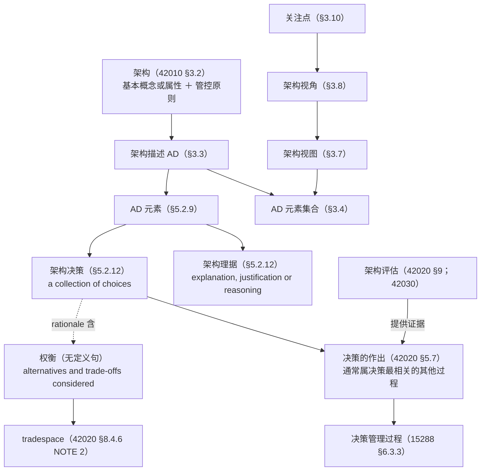
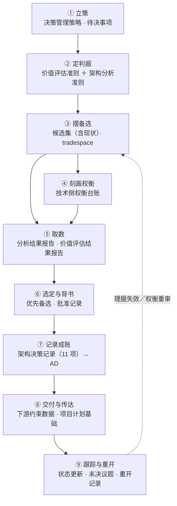

# 架构权衡与架构决策研究报告

## —— 从标准正本的定义与过程落点到决策记录装置（附现行版状态与在途修订）

**A Research Report on Architecture Trade-offs and Architecture Decisions**

> **编号**：38（研究报告稿）
> **日期**：2026-10-13
> **主题**：以标准正本为唯一依据，回答"架构权衡"与"架构决策"各是什么——① 两个词在标准里各处于什么位置（有定义还是无定义）；② 架构权衡的定义句、出现位置与三种"对"；③ 架构决策的定义句、选择对象与理据内容；④ 决策的目的·意义·价值与四条不对称；⑤ **决策与相邻概念的四组界**（架构定义／架构权衡／技术决策／项目决策）；⑥ **决策的输入与输出**（产品数据视角）；⑦ **架构目标与系统目标**、候选集的合格线；⑧ **对架构决策的误解**（概念层 14 条＋业界层制度性误解）；⑨ 决策在架构过程与决策管理过程里的落点；⑩ 决策记录与理据的标准条款（实务 ADR 的标准锚点）；⑪ 评估侧的方法装置；⑫ **四案例**（HUD／EOS 平台／M3 冷链／合同审批）；⑬ 四份标准的现行版状态与在途修订；⑭ **决策与描述的三问**——次序（决策与描述开发谁在前）、记录的先后（决策记录与描述谁先产生）、**对象与抓手**（决策握住的到底是什么）
> **依据（只用标准正本）**：**ISO/IEC/IEEE 42010:2022**（库内正本全文）｜**ISO/IEC/IEEE 42020:2019**（库内正本全文）｜**ISO/IEC/IEEE 15288:2023**（库内正本全文）｜**ISO/IEC/IEEE 42030:2019**（库内转换件，见 §1.1 源伤说明）
> **取证纪律**：本报告凡涉架构口径的判断**只取上述正本**；本项目既有研究报告与 `00-案例设定.md`／37 号示例**不作判据**，仅作取料（§十四 的案例事实即标明来源与档位）；**凡涉英文一律英中并列**（逐字引文、术语、缩写、方法名、题名同此）——逐字引文紧随「（中译：…）」，全报告 **153 处**（按「（中译：」记号计）；术语级英文另见[附录 B](#附录-b术语对照)，缩写与标准文件号见[附录 D](#附录-d英文缩写与文件号对照)；凡断言"标准里没有"**先做零命中检索**；引用一律标四档——**标准逐字／标准可支持的读法／按定义句作的举例／本报告的定性**
> **配套材料**：判错留痕见[附录 C](#附录-c判错留痕)；对架构决策的误解见 §十五；结论对第12章的取料建议见 §十七；决策的过程九步见 §十八；三问（次序／记录的先后／对象与抓手）见 §十九
> **文档版本**：v1.0（2026-10-13 创建）→ v1.1（同日增补过程九步与各环节输入／输出）→ v1.2（同日新增 §十 目的·意义·价值、§十一 四组界、§十二 输入与输出、§十三 架构目标与候选集合格线、§十四 四案例）→ **v1.3（同日纳入"对架构决策的误解"：新增 §十五（15.1 概念层 14 条／15.2 业界四张脸／15.3 五条制度性误解／15.4 三条激励来源与汉语义项错位／15.5 标准自登的业界现象／15.6 二手证据线索／15.7 收束与现场判据）；摘要增至二十三条；结论清单增至 22 条；挂账增至 12 项；原 §十五~§十八 顺延为 §十六~§十九）** → **v1.4（2026-10-13 增补三问：新增 §十九（决策与描述开发的次序／决策记录与完整描述谁先产生／决策的对象与抓手）；摘要增至二十七条；结论清单增至 26 条；挂账增至 14 项；原 §十九 顺延为 §二十；就地收窄 §4.1 一条过窄的读法，留痕见附录 C 第 5 条）** → **v1.5（同日把 §19.4 的三句提为"可带走的定名"：摘要增至二十八条、结论增至 27 条；加两条使用注——"三句属④本报告读法、引用须随句带条款号"与"单独使用时 ② 宜并回'谁定的'"）**

---

## 摘要：二十八条

1. **两个词的地位不对称**：**"架构决策"在 42010:2022 §5.2.12 有定义句**（*a collection of choices made in the overall context of an architecture*），并**是 AD 元素之一**（§5.2.9）；**"权衡（trade-off）"在四份正本里没有定义句**，只在任务句、NOTE 与关键词表里出现，其可用的定义性表述落在 **tradespace** 上（42020 §8.4.6 NOTE 2、§9.4.8 NOTE 3）。
2. **"架构决策"与"架构理据"不在术语章**：42010:2022 第 3 章只有 3.1~3.19 十九个词条，`architecture decision` 与 `architecture rationale` **不在其中**；二者的定义句在**第 5 章概念基础**（§5.2.12）。凡引"42010 §3.x 定义决策／理据"者，是把**关注点（§3.10 concern）**与**对应关系（§3.11 correspondence）**的号错记到了决策上（详见[附录 C](#附录-c判错留痕)）。
3. **权衡住在三个位置**：概念化侧 **42020 §8.4.6**（技术视角的权衡，含 tradespace 定义）、评估侧 **42020 §9.4.8**（价值视角的权衡）、评估框架侧 **42030 §4.3.1／§6.1.3 m)**（跨方案的综合权衡）。两侧**互补而不重复**（§8.4.6 NOTE 1、§9.4.8 NOTE 2）。
4. **权衡有三种"对"**：**解内（within）／解间（between）／与现状（and the status quo）**，另加"与未被提出的其他解"（§8.4.6 e) 1)2)3)）。标准给的典型清单逐字为 **cost vs performance（成本对性能）、cost vs schedule（成本对进度）、weight vs speed（重量对速度）、accuracy vs timeliness（精度对时效）、acquisition cost vs operating cost（购置成本对运行成本）、ease of use vs security（易用性对安全性）、flexibility vs predictability（灵活性对可预测性）、agility vs robustness（敏捷性对鲁棒性）、risk vs reward（风险对回报）**（§8.4.6 NOTE 4）。
5. **权衡不承诺"最优解"**：tradespace *often does not include a solution that will completely satisfy the architecture objectives and stakeholder concerns*（中译：往往并不包含能完全满足架构目标与相关方关注点的解）；42020 §9.4.5 NOTE 2 明说**权重并非必需**，目标是*把目标之间的权衡摆给相关方*，而不是*数学上定出"最佳"解*。
6. **决策是一组选择，不是一个动作**：42010 §5.2.12 的定义句把决策定义为**一组选择**，例句列出的选择对象覆盖架构概念、AD 元素、框架、分层方案、底层技术、业务组件、达成质量的战术、业务流程、模式、风格、实现技术范围、候选方案集（§5.2.12 EXAMPLE 1）。
7. **理据是决策的伴随物，且内含权衡**：*Architecture rationale records explanation, justification or reasoning about architecture decisions*（中译：架构理据记录对架构决策的解释、辩护或推理）；其内容项含 **alternatives and trade-offs considered**（中译：考虑过的备选与权衡）——**权衡由此进入决策的档案**（§5.2.12）。
8. **记录是"shall"，选择记哪些是"should"**：*An AD shall record architecture decisions considered essential…*（中译：架构描述**应**记录在其范围内被视作关键的架构决策）；被否备选**should**记；**哪些算"关键"由组织／项目自定准则**——标准给了 **13 条选择准则**（§6.10.1），但**未给"关键"的充要判据**（本报告定性，属权威缺口）。
9. **记录内容有 11 项**：唯一标识、决策陈述、决策权威或所有者、约束与假设、与关注点／方面相连、与受影响的 AD 元素相连、连到理据、与其他决策的关系、后果、时间戳（发生／批准／修改）、来源引用（§6.10.1）。
10. **理据的四处强制**：每个**关键决策**的理据是 *shall*；视角、ADF、ADL 的选择理据是 *should*；备选的考虑与选择证据是 *should*；AD 局限性的理据是 *should*（§6.10.2）。
11. **拍板通常不在架构过程里**：42020 §5.7 逐字——*Architecture-related decisions could be made in conjunction with the architecture processes, but this is usually the responsibility of some other process where the decision is most relevant*（中译：架构相关决策可与架构过程一并作出，但这通常是"决策最相关"的那个其他过程的职责）；42020 §8.4.7 NOTE 7 同旨（选择的作出可在架构过程之外，此时把候选架构连同评估一并呈给决策者）。
12. **决策权的三处落点**：治理侧（42020 §6.2 c)、§6.4.4 d)~f)：战略决策依 15288 决策管理过程办、其余决策**升级**到企业决策论坛、复核并传达）；管理侧（§7.4.2 h)、§7.4.4 k)：架构集合层面的决策同依决策管理过程办）；项目侧（15288 §6.3.3.3 a) 1)：决策管理策略**含角色、职责、问责与权限**）。
13. **决策管理过程给的是"结构化框架"**：15288 §6.3.3.1 逐字——*provide a structured, analytical framework for objectively identifying, characterizing, and evaluating a set of alternatives… and select the most beneficial course of action*（中译：提供一个结构化的分析框架，以客观识别、刻画并评估一组备选，并选出最有益的action路线）；四个结果、三项活动；系统分析过程（§6.4.6）为它供数据与敏感性分析。
14. **评估与决策分属两层**：42030 §3.4 Note 1 逐字——*A decision regarding disposition of the architecture is usually outside the scope of an AE effort*（中译：关于架构处置的决策通常不在架构评估工作范围之内），评估结果通常报给**决策者**，由其在结果与**其他因素**之上作出处置；评估报告须含 **architecture trade-offs identified and examined**（中译：已识别并已考察的架构权衡）（§8.3.1 t)）。
15. **现行版状态**：**42010:2022** 为现行版（多国 2025 年采标）；**42020:2019** 与 **42030:2019** 均已立**新项目**（ISO/IEC/IEEE **AWI 42020**、**AWI 42030**，阶段 **20.00**，生效日 **2026-05-22**，题名改为 *Enterprise, systems and software — …*）；42030 新项目摘要新增"support decision making where architectures are involved"（中译：支持涉及架构的决策）与 AI／ML、IoT、云、数字孪生等应用面；**42010 与 15288 未查到在途修订项目**。
16. **过程九步（本书读法）**：**立策 → 定判据 → 摆备选 → 刻画权衡 → 取数 → 选定与背书 → 记录成账 → 交付与传达 → 跟踪与重开**；标准只给三活动（15288 §6.3.3.3：*Prepare for decisions.*／*Analyse the decision information.*／*Make and manage decisions.*）且明许**任意顺序**（42020 §9.3）；九步的输入输出**全部是设计态纯数据**，过程共出**六件产品数据**（决策管理策略／判据与准则集／候选集与 tradespace 描述／权衡台账与两份结果报告／架构决策记录／决策台账），详见 §十八。
17. **决策的目的、意义与价值**（本报告定性）：由**四条不对称**逼出——信息不对称（作承诺时信息最不全、检验时信息最全）→ 理据记录；责任不对称（判断在个人、后果在组织）→ 权属；目标不对称（多目标互斥）→ 权衡入理据；承诺不对称（收窄设计空间收益即时、改的代价延后且高）→ 只记关键决策并留出设计空间。**目的**＝把不可逆承诺定在代价可控处、让并行成为可能、让后续选择有一致前提；**意义**＝架构的动词形态、产品数据链上的一级数据、责任链的锚点、组织可复用的判断；**价值**＝对项目／产品线／团队／供应链／客户认证／未来的自己分别兑现什么（详见 §十）。
18. **四组界**：决策↔**定义**（定义是变换、决策是取值与背书；决策进记录不改变定义的产出种类）；决策↔**权衡**（权衡给可比较性、决策给终结性，理据是钉子）；决策↔**技术决策／项目决策**（标准不给三分法，只给"决策类别"一栏；真判据是**语境／牵连面／账本**三个变量，不是"内容是否技术"）（详见 §十一）。
19. **输入与输出（产品数据视角）**：输入**五类**（判据源／约束源／备选源／证据源／程序源），输出**三层**（结论层／记录件层／下游约束层）；桩子只有两句——决策吃进四类数据，吐出**约束数据与理由数据**，全部发生在**设计态**（详见 §十二）。
20. **架构目标与候选集的合格线**：「架构目标」与「系统目标」在四份正本里**都没有词条**；架构目标＝"这份架构凭什么算立住了"的可判定表述（以关切为源、以成功准则为形、以评估准则为用），与系统目标的关系是**派生＋互相约束＋不同层**。**决策前的候选集可以含不满足关切的候选**——标准把"不完全满足"当常态（§8.4.5 NOTE 6、§8.4.6 NOTE 2），候选的合格线是"**可区分＋差距已知**"而非"满足全部关切"，**现状就是最硬的反证**（详见 §十三）。
21. **四案例同构**：HUD／EOS 平台／M3 冷链／合同审批——承重侧重（属性／概念与准则／概念与属性并重／概念与规则）、典型失效（误导／演进失控／断链漏检／架构未识别）、一处封顶（配准基准与语义只许追加／能力面与关系种类／告警口径与数据归属／事实源与受控导出）。**四例的决策形态同构：用一处封顶换一片确定性**；四种失效的级差正好是四种误判——决策没做对／封顶没守住／判定与归属没先定／**决策没被认出**（详见 §十四）。
22. **概念层误解 14 条**（分四组：决策是什么／哪些要按架构决策办／怎么做／谁拍板怎么记），病根是**把决策当名词**——当动作、当文档、当技术选型。**★ 其中 4 条已在书内登记**（改字段是小事／架构决策可以以后再说／改起来贵就算架构／架构决策是评审会上才有的），**不得当新发现**（详见 §15.1）。
23. **业界层误解（制度错，不是概念错）**：**四张脸**——管理层当会议决议、架构师当图之外的附带物、开发当代码变更、流程工具当文档产出；**五条制度性误解**——决策当交付物／决策会当决策／评审当决策／权责错配／外包给模板；**三条激励来源**——可交付物导向、个人问责缺失、节奏压迫；另有**汉语特有的义项错位**：中文"决策"自带"拍板"义，而 42010 §5.2.12 的 *decision* 说的是**一组选择**（详见 §十五）。
24. **没有"决策→描述"这条顺序**：正本唯一带 **shall** 的硬顺序是**规则先于产物**——*Each architecture view shall adhere to the conventions of its governing architecture viewpoint.*（中译：每个架构视图应遵循其管控架构视角的约定。）（42010 §6.7）；视角可充当契约，*can be made before any detailed architecting is undertaken*（中译：能在开展任何详细架构工作之前达成）（§6.6 NOTE 3）。过程活动的顺序则**不固定**：42020 §8.3 与 §10.3 两处同文 *The activities may be performed in any order that is deemed appropriate.*（中译：这些活动可按任何视为适当的顺序执行。）；而 *an AD can precede or follow architecture creation, updating or changing*（中译：架构描述可以先于或后于架构的建立、更新或变更）（§5.3）。一轮架构工作内部的读法是：**描述规则 → 候选画像与权衡空间 → 选定 → 成件与记录 → 视图显现的问题回头改架构**（详见 §19.1）。
25. **决策记录先于完整描述产生，效力后到达**：同一活动内，任务先把"规定形式"与视角定下来（§8.4.8 a)~f)），再捕获决策（g、h），最后才开发架构描述（l）；早期描述*can be little more than sketches*（中译：可能只是草图），更完整的形式在细化过程开发（§8.3 b)、§10.3 e)），AD 由模型与视图生成（§10.4.4 k)）。而**拍板通常在架构过程之外**（§5.7、§8.4.7 NOTE 7）——**记录先产生，效力随"进描述、进基线、落权属方"而来**（详见 §19.2）。
26. **决策的宾语是三类，不是"架构"，也不是"视图"**：定义句说的是 *choices made in the overall context of an architecture*（中译：在架构总体语境中所做选择的一个集合）——**架构是语境**；宾语是 *various AD elements, entity requirements, or environmental influences on the architecture*（中译：各类架构描述元素、实体要求或对架构的环境影响）（§5.2.12 第二句）。**视图只是十二类 AD 元素之一**（§5.2.9）。**抓手＝记录里的链接集**：连到关切／方面、连到受影响的 AD 元素、连到理据、与其他决策的关系、后果、三个时间戳、来源引用（§6.10.1）（详见 §19.3）。
27. **"结果要用视图表达出来"这句要改**：*An AD may include other information which is not part of any architecture view.*（中译：AD 可包含不属于任何架构视图的其他信息。）（§6.7）——其示例把**架构理由**、架构原则与跨视图的风格、视图间对应关系、领域／参考架构依据都列在视图之外；反过来，视图还是决策的**曝光面**：*Open issues can lead to decisions to be made.*（中译：未决问题能引致需要作出的决策。）（§6.7 d) NOTE 2）、*Identify risks and opportunities that have become apparent in the architecture views…*（中译：识别在架构视图中已显现的风险与机遇……）（42020 §10.4.4 i)）。故结果**分两处安放**：能进视图的进视图，进不去的按"视图之外的信息"安置（详见 §19.4）。
28. **三句可带走的定名**（§19.4 收束）：① **语境是架构，宾语是三类**——描述元素、实体要求、环境影响；决策握住的是架构的构成内容（概念、属性、管控原则）与约束它的东西。② **落款是描述里的决策与理据**——ADR 只是载体之一；一条记录要挂上关切、受影响的元素、理由与前后决策，才算挂住了上下文。③ **结果分两处安放**——能进视图的，按视角做成视图组件，使其框定的关切被逐条应对（§6.7 c)）；进不去的（理据、原则、跨视图约束、对应关系、领域／参考架构依据），按"不属于任何视图的信息"安放（§6.7 末句＋EXAMPLE 2）。**两条使用注**：**（一）档位**——三句是本书读法（④档），**不是正本原话，引用须随句带条款号**（§5.2.12／§6.10.1／§6.7）；**（二）单用**——三句连读时"谁定的"由 §19.4 末句"落权属方"承担，**若摘出来单独使用**（词条／章末带走句／表下判据），② 宜并回"谁定的"（决策权属方，§6.10.1 第 3 项）。

---

## 目录

- [一、前提：依据、证据等级、现行版状态与取证纪律](#一前提依据证据等级现行版状态与取证纪律)
- [二、术语地基：两个词在标准里的位置](#二术语地基两个词在标准里的位置)
- [三、架构权衡是什么](#三架构权衡是什么)
- [四、架构决策是什么](#四架构决策是什么)
- [五、权衡与决策的关系，以及三条不可混写的界](#五权衡与决策的关系以及三条不可混写的界)
- [六、决策在过程里的落点](#六决策在过程里的落点)
- [七、决策记录与理据：标准的"ADR 条款"](#七决策记录与理据标准的adr-条款)
- [八、评估侧的方法装置](#八评估侧的方法装置)
- [九、现行版状态：最新版与在途修订](#九现行版状态最新版与在途修订)
- [十、架构决策的目的、意义与价值](#十架构决策的目的意义与价值)
- [十一、决策与相邻概念的四组界](#十一决策与相邻概念的四组界)
- [十二、决策的输入与输出（产品数据视角）](#十二决策的输入与输出产品数据视角)
- [十三、架构目标、系统目标与候选集的合格线](#十三架构目标系统目标与候选集的合格线)
- [十四、四案例：同一决策结构在四种产品上的脸](#十四四案例同一决策结构在四种产品上的脸)
- [十五、对架构决策的误解（概念层与业界层）](#十五对架构决策的误解概念层与业界层)
- [十六、结论清单](#十六结论清单)
- [十七、与本书的接驳（取料建议，非标准判据）](#十七与本书的接驳取料建议非标准判据)
- [十八、架构决策的过程与各环节输入／输出（产品数据视角）](#十八架构决策的过程与各环节输入输出产品数据视角)
- [十九、决策与描述的三问：次序、记录的先后、对象与抓手](#十九决策与描述的三问次序记录的先后对象与抓手)
- [二十、未决与挂账](#二十未决与挂账)
- [附录 A：本报告引用的正本条号索引](#附录-a本报告引用的正本条号索引)
- [附录 B：术语对照](#附录-b术语对照)
- [附录 C：判错留痕](#附录-c判错留痕)
- [附录 D：英文缩写与文件号对照](#附录-d英文缩写与文件号对照)

---

## 一、前提：依据、证据等级、现行版状态与取证纪律

### 1.1 采信的标准与证据等级

| 标准 | 现行版 | 本报告取到的证据 | 等级 |
|---|---|---|---|
| **ISO/IEC/IEEE 42010** | **2022** | 库内正本全文：术语 §3.1~§3.19、概念基础 §5.2.1~§5.2.12、要求 §6.7／§6.10、符合性 §4、附录 A.2 逐条直核 | **一手（正本）** |
| **ISO/IEC/IEEE 42020** | **2019** | 库内正本全文：术语 §3.x、§5.6／§5.7、§6、§7、§8.2／§8.4、§9.2／§9.4、§10.4、附录 C 表 C.2／C.3、附录 E.2.1 逐条直核 | **一手（正本）** |
| **ISO/IEC/IEEE 15288** | **2023** | 库内正本全文：§5.4、技术管理过程 §6.3.3、技术过程 §6.4.4／§6.4.5／§6.4.6 逐条直核 | **一手（正本）** |
| **ISO/IEC/IEEE 42030** | **2019** | 库内转换件全文：术语 §3.4／§3.5、§4.2~§4.6、§6.1、§8.3、附录 D.2~D.4 逐条直核 | **一手（转换件）——带源伤，见 §1.1 之注** |

> **42030 源伤之注**：库内 42030 无 PDF，只有 `ISO IEC IEEE 42030-2020.docx` 及其 Markdown 转换件；该件是 **CSA 采标件**（`CSA ISO/IEC/IEEE 42030:20`，等同采用 ISO/IEC/IEEE 42030:2019）的 PDF→Word 转换产物，**条款号系从 Word 自动编号还原而来，不是版面抄录**；插图 20 幅未收录。故本报告凡引 42030 的条款号，**使用前建议对一次正版**；引文本身按库内转换件照录，未作改写。

### 1.2 四档标注

| 档 | 含义 | 本报告用法 |
|---|---|---|
| **① 标准逐字** | 正本原文，引号＋中译 | 定义句、要求句、任务句、NOTE 的实质表述 |
| **② 标准可支持的读法** | 标准无原话，由多条条款推出 | 如"权衡与决策是两件事"的界说 |
| **③ 按定义句作的举例** | 依定义句构造的例子 | 如把 42010 §5.2.12 的选择对象对到本书案例 |
| **④ 本报告的定性** | 本报告的判断、归类与建议 | 如 13 条选择准则的四组归类 |

四档不混写：正文中凡②③④处，均在句内标明。

### 1.3 零命中检索（实测）

以下"标准里没有"的断言均**先做检索**，检索范围＝库内四份正本全文：

| 检索词 | 结果 | 含义 |
|---|---|---|
| `trade-off` / `tradeoff` 作**术语词条** | 42010、42020、42030、15288 四份正本的第 3 章**均无该词条** | 权衡**无标准定义**；42020 关键词表（Keywords）列有 `tradeoff`，但关键词不是定义 |
| `architecture trade-off` 作词条 | 零命中 | 无"架构权衡"这一术语词条 |
| `architecture decision` 词条 | 42010:2022 第 3 章**零命中**；定义句在 §5.2.12 | 决策有定义，但**不在术语章** |
| `architecture rationale` 词条 | 同上 | 理据有定义，但**不在术语章** |
| `tradespace` 定义 | 42020 §8.4.6 NOTE 2、§9.4.8 NOTE 3 **两处** | 权衡的可用定义性表述落在这里 |
| `ADR` / `architecture decision record` | 四份正本**零命中** | 实务 ADR 不是标准术语；标准给的是"决策记录"的内容项与要求（§6.10） |

### 1.4 一处跨标准的措辞不一致（本报告定性）

42020 §E.2.1 说"配套文件 42010 列出六种架构的应用（隐喻）：concept／property／blueprint／literature／language／decision，本文件加第七种：architecture as constraint"；而 **42010:2022 附录 A.2 只列四种隐喻**（blueprint／literature／language／decision），另把 concept 与 property 作为**两种哲学**单列（*Architecture as concept*／*Architecture as property*）。两处不是同一口径，**引"架构即决策"这一隐喻时，以 42010:2022 附录 A.2 为准**；42020 §E.2.1 的六种说法可作为"第七种隐喻＝约束"的出处，两种计数不要缝成一条。

---

## 二、术语地基：两个词在标准里的位置

### 2.1 词位图

### 2.2 有定义的那一个：架构决策与架构理据

**42010:2022 §5.2.12**（标准逐字）：

> An architecture decision is a collection of choices made in the overall context of an architecture. These choices usually pertain to various AD elements, entity requirements, or environmental influences on the architecture.
> （中译：架构决策是在一个架构的整体语境中作出的一组选择。这些选择通常涉及各类 AD 元素、实体需求，或对该架构的环境影响。）

> Architecture rationale records explanation, justification or reasoning about architecture decisions. The rationale for a decision can include the following items: the basis for making a decision, impact on quality attributes, alternatives and trade-offs considered, potential consequences of the decision, architectural principles, and citations to sources of additional information.
> （中译：架构理据记录对架构决策的解释、辩护或推理。一个决策的理据可含下列各项：作出决策的依据、对质量属性的影响、考虑过的备选与权衡、该决策的潜在后果、架构原则，以及补充信息来源的引用。）

**位置的性质**：§5.2.12 在**第 5 章概念基础**内；42010 §5.1 说明该章"引入概念基础……第 6 至 8 章用这些概念表达要求"（标准逐字：*The concepts introduced in this clause are used in Clauses 6 to 8 to express requirements.*）。故**定义在概念章、要求在 §6.10**，两者分工不可互换。

**决策是 AD 元素之一**（§5.2.9，标准逐字）：

> The AD elements include occurrences of the following architectural concepts: stakeholder, concern, aspect, stakeholder perspective, architecture viewpoint, architecture view, model kind, legend, architecture view component, architecture decision, architecture rationale and any correspondence and correspondence method specified on those constructs.
> （中译：AD 元素包括下列架构概念的出现：相关方、关注点、方面体、相关方角度、架构视角、架构视图、模型种类、图例、架构视图组件、**架构决策**、**架构理据**，以及就这些构造所指定的任何对应关系与对应方法。）

**一个已存在的隐喻**（42010 附录 A.2，标准逐字）：

> Empirical studies have discovered four metaphors for architecture found in organizations[59]: architecture as blueprint; architecture as literature; architecture as language; architecture as decision.
> （中译：实证研究发现了组织中关于架构的四种隐喻：架构即蓝图；架构即文献；架构即语言；**架构即决策**。（源件此处有交叉引用标记 *[59]*，指其参考文献。））

该条接着说明，42010:2022 的概念基础**不预设**其中任何一种隐喻，而是与任一种同样兼容。

### 2.3 没有定义的那一个：权衡

四份正本都没有 `trade-off` 的定义句。可用的定义性表述落在 **tradespace**：

**42020 §8.4.6 NOTE 2**（标准逐字）：

> Tradespace is the range and extent of parameters, properties and characteristics that are relevant in satisfying architecture objectives and stakeholder concerns. The tradespace often does not include a solution that will completely satisfy the architecture objectives and stakeholder concerns. Tradespace analysis is used for analyzing the relevant constraints, conditions and challenges involved in large complex problems with multiple stakeholders and multiple objectives. It involves the identification and understanding of tradeoffs involved in choosing between competing solutions. Tradeoffs can be within each solution and between solutions (and the problems/opportunities they are intended to address).
> （中译：tradespace 是与满足架构目标和相关方关注点相关的参数、属性与特征的范围与幅度。tradespace 往往并不包含能完全满足架构目标与相关方关注点的解。tradespace 分析用于分析大型复杂问题中相关的约束、条件与挑战，这些问题有多个相关方与多个目标。它涉及对"在相互竞争的解之间作选择时所涉权衡"的识别与理解。权衡可以在每个解**内部**，也可以在各解**之间**（以及在它们意图应对的问题／机会之间）。）

**42020 §9.4.8 NOTE 3** 给出同义表述，措辞略有差别（*relevant in potentially satisfying*，中译：与"可能满足"相关）——**引用时按所引条款照录，不要把两处 NOTE 的措辞互相替换**。

**42020 §8.4.6 NOTE 5** 给"tradespace"的构成（标准逐字）：

> The collection of tradeoff considerations, along with the influences and interactions between solutions, is called in this document the "tradespace".
> （中译：权衡考虑事项的集合，连同各解之间的影响与相互作用，在本文件中称为"tradespace"。）

### 2.4 四个相邻词（不可与"权衡／决策"互换）

| 词 | 定义位 | 逐字（英） | 中译 | 与本章两词的关系 |
|---|---|---|---|---|
| **关注点** concern | 42010 §3.10 | matter of relevance or importance to a stakeholder | 对相关方有相关性或重要性的事项 | 权衡与决策所服务的东西；42030 §3.6 注 1 指出它与 ATAM 里的 quality attribute 相近 |
| **架构目标** architecture objective | 42020 §8.4.4 | —（任务句） | 架构要达到的东西 | 权衡是目标之间的此消彼长（§8.4.6 e)） |
| **评估准则** evaluation criteria | 42020 §9.4.3 NOTE 1 | conditions that are to be met … by the entity being assessed | 被评估实体须满足的条件 | **分两套**：价值评估准则＋架构分析准则 |
| **备选／候选** alternative／candidate | 42020 §8.4.5／§8.4.7、§9.4.7 a) | —（任务句） | 备选方案／候选架构 | 权衡的宾语，决策的输入 |

---

## 三、架构权衡是什么

### 3.1 权衡的标准落点（三处，分工不同）

| 落点 | 条款 | 视角 | 逐字要点 |
|---|---|---|---|
| **概念化侧** | 42020 §8.4.6 | **技术视角** | *This activity characterizes the solutions and tradeoffs from the technical perspective, considering aspects such as ease of realization, compatibility with other solutions, trends in the technology space, etc.*（中译：本活动从技术视角刻画各解与权衡，考虑易实现性、与其他解的兼容性、技术领域趋势等方面。） |
| **评估侧** | 42020 §9.4.8 c) | **价值视角** | *Identify and characterize tradeoffs with respect to quality attributes, stakeholder concerns, architecture concepts and properties, costs, risks and opportunities.*（中译：就质量属性、相关方关注点、架构概念与属性、成本、风险与机会，识别并刻画权衡。） |
| **评估框架侧** | 42030 §4.3.1／§6.1.3 m) | **跨方案综合** | *identify and characterize trade-offs between competing stakeholder concerns*（中译：识别并刻画相互竞争的相关方关注点之间的权衡）；§4.3.1 另说明权衡**在架构开发期间被识别与刻画，而在评估综合时可被重新审视**（标准逐字：*Architecture trade-offs are identified and characterized during architecture development. However, they can be revisited during the evaluation synthesis.*） |

两侧的**互补关系**由两条 NOTE 写死（标准逐字）：

- §8.4.6 NOTE 1：*It is complementary to architecture evaluation, which examines the proposed solutions in terms of value to stakeholders and quality attributes delivered by each solution.*（中译：它与架构评估互补——评估从"对相关方的价值"与"各解交付的质量属性"考察所提各解。）
- §9.4.8 NOTE 2：*This activity analyzes the proposed solutions in terms of value to stakeholders and quality attributes delivered by each solution. It is complementary to architecture conceptualization, which characterizes the solutions and tradeoffs from the technical perspective…*（中译：本活动从"对相关方的价值"与"各解交付的质量属性"分析所提各解。它与架构概念化互补——概念化从技术视角刻画各解与权衡……）

### 3.2 权衡的三种"对"与典型清单

**42020 §8.4.6 e)**（标准逐字）：

> Identify and characterize the tradeoffs involved in achieving the architecture objectives:
> 1) between and within proposed solutions,
> 2) between these solutions and the status quo, and
> 3) between proposed solutions and other possible solutions (i.e. those not being proposed).
> （中译：识别并刻画"为达成架构目标所涉的权衡"：① 所提各解**之间**与**内部**；② 这些解与**现状**之间；③ 所提各解与其他可能的解（即未被提出的那些）之间。）

**42020 §8.4.6 NOTE 4**（标准逐字）：

> Tradeoffs can be within each solution and between solutions. There are also tradeoffs between proposed solutions and the status quo (which can be considered as one of the alternative "solutions" to be considered). Typical tradeoffs to consider are the following: cost vs performance, cost vs schedule, weight vs speed, accuracy vs timeliness, acquisition cost vs operating cost, ease of use vs security, flexibility vs predictability, agility vs robustness, risk vs reward, etc.
> （中译：权衡可以在每个解内部，也可以在各解之间。所提各解与**现状**之间也有权衡（现状可被视作考虑中的备选"解"之一）。宜考虑的典型权衡如下：成本对性能、成本对进度、重量对速度、精度对时效、购置成本对运行成本、易用性对安全性、灵活性对可预测性、敏捷性对鲁棒性、风险对回报，等等。）

**"现状"的第二处出处**（更直接）：**42020 §9.4.7 NOTE 2**——*The status quo is sometimes one of the alternatives that could be considered.*（中译：现状有时是可被考虑的各备选之一。）

**"候选架构之间"的第三处出处**：**42020 §8.4.7 c)**——*Identify and characterize the tradeoffs between candidate architectures for each solution.*（中译：为每个解识别并刻画各候选架构之间的权衡。）

### 3.3 权衡不承诺最优解（两处硬证据）

1. **tradespace 常无完全满足解**（§8.4.6 NOTE 2，见 §2.3 逐字）。
2. **权重并非必需**（42020 §9.4.5 NOTE 2，标准逐字）：

> Weights are not absolutely required since this is nearly always a multi-objective problem, and the goal will usually be to present to the stakeholders the tradeoffs between those objectives, not necessarily to mathematically determine the "best" solution.
> （中译：权重并非绝对必需，因为这几乎总是一个多目标问题，而目标通常是把这些目标之间的权衡**摆给**相关方，而不必在数学上定出"最佳"解。）

同一 NOTE 组另给出方法余地：*At a minimum, the evaluation will assess each alternative against the objectives and criteria. It does not always need to be quantitative, and does not always need to apply measurement scales.*（中译：至少，评估会就目标与准则评估每个备选。它不必总是定量，也不必总是套用测量标度。）

### 3.4 42030 的两行口径（标准逐字）

**42030 表 1**（Assessment vs analysis comparison，中译：评估与分析的对比）中与权衡直接相关的两行：

| 特征 | 价值评估 | 架构分析 |
|---|---|---|
| **Scope**（范围） | Utility, Value, Worth, Priorities, Ranking, **Trade-offs**（效用、价值、价值量、优先次序、排序、**权衡**） | Ways & Means（手段与途径） |
| **Key items of interest**（核心关注项） | Competing Concerns, **performing tradeoffs**, achieving balance & robustness（相互竞争的关注点、**做权衡**、达成平衡与鲁棒） | Individual Concerns, determining system properties & characteristics（单个关注点、确定系统属性与特征） |

由此得一条可用的界（本报告定性）：**权衡属"判断／目的（ends）"一侧，技术分析属"事实／手段（means）"一侧**——42030 表 1 另两行写明了这一点（Results：*Passes "judgment"*（中译：通过"判断"）对 *Matters of Fact*（中译：事实问题）；Goal orientation：*Ends Objectives*（中译：目的目标）对 *Means Objectives*（中译：手段目标））。

### 3.5 权衡在概念化里的动态

**42020 §8.3 c)**（标准逐字）：

> An important aspect of architecture conceptualization is to allow the analysts, project participants and various stakeholders to understand the tradespace of potential options that can meet the objectives. … Typically, a varied and distinctive mix of architectural solution concepts can be considered in order to allow the tradeoff between various constraints and concerns.
> （中译：架构概念化的一个重要方面，是让分析人员、项目参与者与各类相关方理解"能满足目标的潜在选项的 tradespace"。……通常可以考虑一个多样而有区分度的架构解概念组合，以便在各类约束与关注点之间作权衡。）

**42020 §8.3 b)** 给节奏：早期可快速滚几轮，"若干轮快速评估与概念化之后，剩下少数可行架构值得更完整地记下来并存库"。

---

## 四、架构决策是什么

### 4.1 定义句与选择对象

定义句见 §2.2。其 **EXAMPLE 1**（标准逐字）：

> Selection of architecture concepts, choice of AD elements, selection of ADFs, choice of architecture layering scheme, choice of underlying technology, choice of business components, choice of tactics to use for achieving system qualities, choice of business processes, choice of applicable patterns, choice of style(s) to be applied, choice of range of implementation technologies or other realizations to be considered, and choice of option sets to be considered.
> （中译：架构概念的选择、AD 元素的选择、ADF 的选择、架构分层方案的选择、底层技术的选择、业务组件的选择、用于达成系统质量的战术的选择、业务流程的选择、适用模式的选择、所采用风格的选择、所要考虑的实现技术范围或其他实现方式的选择，以及所要考虑的选项集的选择。）

**读法**（②标准可支持的读法）：决策的最常出现的宾语是**做法（选择）**；这与"架构是基本概念或属性＋管控原则"（§3.2）相容——决策是**怎么挑**，概念与属性是**挑出来什么**。

**范围收窄（v1.4 订正）**：定义句第二句把宾语范围说全——*These choices usually pertain to various AD elements, entity requirements, or environmental influences on the architecture.*（中译：这些选择通常涉及各类架构描述元素、实体要求或对架构的环境影响。）故宾语是**三类：架构描述元素／实体要求／环境影响**，"做法"只是其中最常出现的一类；本条此前的写法（"不是元素与关系本身"）过窄，已按定义句收窄，留痕见[附录 C](#附录-c判错留痕) 第 5 条。三类宾语的定位与抓手另见 §19.3。

### 4.2 决策、理据与质量属性的三角

§5.2.12 的理据内容项把三者固定下来：*impact on quality attributes*（对质量属性的影响）、*alternatives and trade-offs considered*（考虑过的备选与权衡）、*potential consequences*（潜在后果）。**42020 §E.6.3** 另给一条配套读法（标准逐字）：*While tradeoff analysis techniques aid architects in prioritizing architecture quality attributes, architectural tactics describe techniques to achieve particular system characteristics or enshrine these characteristics in architecture principles.*（中译：权衡分析技术帮助架构师为架构质量属性排优先次序；架构战术则描述达成特定系统特性的技术，或把这些特性固化进架构原则。）

### 4.3 决策的两层：记录在架构里，拍板在架构外

**42020 §5.7**（标准逐字）：

> Evaluation provides evidence for decision making on architecture evolution and change. Architecture-related decisions could be made in conjunction with the architecture processes, but this is usually the responsibility of some other process where the decision is most relevant.
> （中译：评估为"架构演化与变更"的决策提供证据。架构相关决策可与架构过程一并作出，但这通常是"决策最相关"的那个其他过程的职责。）

**42020 §8.4.7 NOTE 7**（标准逐字）：

> Sometimes the selection of the architecture(s) going forward is made through decisions outside the scope of the architecture processes. In that case, the candidate architectures are presented to decision makers along with an assessment of these architectures. This might entail involvement of the Decision Management Process or the Portfolio Management Process described in ISO/IEC/IEEE 15288.
> （中译：有时"往哪个架构走"的选择是通过架构过程范围之外的决策作出的。此时，候选架构连同对这些架构的评估被呈给决策者。这可能涉及 ISO/IEC/IEEE 15288 所述的决策管理过程或组合管理过程。）

**15288 §6.3.3.1**（标准逐字）：

> The purpose of the decision management process is to provide a structured, analytical framework for objectively identifying, characterizing, and evaluating a set of alternatives for a decision at any point in the life cycle and select the most beneficial course of action.
> （中译：决策管理过程的目的是提供一个结构化的分析框架，以便在生命周期任一时点，客观地识别、刻画并评估某个决策的一组备选，并选出最有益的路线。）

### 4.4 谁有权：三处落点

| 层 | 条款 | 逐字要点 |
|---|---|---|
| **治理** | 42020 §6.2 c) | *Architecture decisions supported by rationale are made with appropriate authorities and communicated to stakeholders.*（中译：有理由支撑的架构决策由**适当的权威**作出并传达给相关方。） |
| **治理** | 42020 §6.4.4 d)~f) | 战略决策依 15288 决策管理过程办；**其他决策升级**到适当的企业决策论坛（*Elevate other decisions to the appropriate enterprise decision forum.*）；复核并传达 |
| **治理机制** | 42020 §6.4.4 a) 3) | *Establish a decision-making mechanism that minimizes or avoids potential conflicts of interests with escalation in the organization…*（中译：建立决策机制，以尽量减少或避免利益冲突，冲突无法解决时在组织内升级） |
| **管理** | 42020 §7.4.2 h)、§7.4.4 k) | 架构集合层面的决策同依 15288 决策管理过程办；架构管理对集合内各架构的决策有一致性监督（附录 G.2） |
| **项目** | 15288 §6.3.3.3 a) 1) | 决策管理策略含*roles, responsibilities, accountabilities, and authorities*（中译：角色、职责、问责与权限） |
| **记录责任** | 15288 §6.3.3.3 c) 3) | 记录、跟踪、评估并报告决策，含**问责归属与处置**，以备审计与经验学习 |

**一条容易被忽略的边界**（42020 §9.4.8 d) NOTE 4／5）：架构可能满足目标与关注点，却**不满足某项强制要求**；标准提示可考察**减免（relief）**的可能性，也可考虑**早筛**掉不满足强制项的备选以免徒耗资源。**42020 §9.4.10 f) NOTE** 另给一条实务出路：若一个高价值架构因某条需求约束"收不了口"，与相关方讨论该需求**能否放宽**、或另寻妥协（可能涉及**豁免**或**改需求**）。

---

## 五、权衡与决策的关系，以及三条不可混写的界

### 5.1 因果链（本报告定性，各环均有条款支撑）

### 5.2 权衡进入决策档案的两条写入路径

| 路径 | 条款 | 性质 |
|---|---|---|
| **架构描述侧** | 42010 §5.2.12（理据内容项含 *alternatives and trade-offs considered*（中译：考虑过的备选与权衡））＋§6.10.2（*An AD shall include or reference rationale for each essential architecture decision*（中译：架构描述应为每个关键架构决策包含或引用理据）） | **shall**（对关键决策） |
| **评估报告侧** | 42030 §8.3.1 t)：*architecture trade-offs identified and examined*（中译：已识别并已考察的架构权衡） | **shall**（评估报告内容项） |

两条路径**互不替代**：架构描述承载"这个架构为什么是这样"，评估报告承载"这次评估看过的权衡与结论"。

### 5.3 三条不可混写的界（②标准可支持的读法＋④本报告定性）

| 界 | 内容 | 依据 |
|---|---|---|
| **界一：权衡 ≠ 决策** | 权衡是把候选摆到目标／准则前看此消彼长；决策是**有权威**的一组选择并**落成记录**。权衡可以不下结论地摆着（§9.4.5 NOTE 2"摆给相关方"），决策必须落地（15288 §6.3.3.2 c)／d)） | 42020 §8.4.6／§9.4.8；42010 §5.2.12；15288 §6.3.3 |
| **界二：评估 ≠ 决策** | 评估产出判断与建议，处置决定在评估范围之外，且决策者还会用评估未考虑的其他因素 | 42030 §3.4 Note 1；42020 §9.4.9 g)（发现与建议可贡献于组织与项目决策、里程碑判定） |
| **界三：记录 ≠ 拍板** | 记录是 AD 的**要求**（§6.10 shall），它追认并固化决策；把决策写进 AD 不等于取得授权，授权出处在治理与决策管理一侧 | 42010 §6.10.1；42020 §6.2 c)／§6.4.4 |

---

## 六、决策在过程里的落点

### 6.1 架构概念化侧（42020 §8.4）

| 任务 | 逐字要点 | 产出 |
|---|---|---|
| §8.4.5 f) | *Characterize strengths, weaknesses and tradeoffs for each potential solution.*（中译：为每个潜在解刻画优势、劣势与权衡。） | 各解画像 |
| §8.4.6 e) | 三种"对"（见 §3.2） | 技术侧权衡台账 |
| §8.4.6 g) | *Formulate a roadmap for implementing the proposed solution(s).*（中译：为所提各解拟实施路线图。） | 路线图 |
| §8.4.7 c) | 候选架构之间的权衡 | 候选架构比较 |
| §8.4.8 g) | *Capture architecture decisions and architectural characteristics in the specified form.*（中译：按规定形式**捕获架构决策**与架构特征。） | 决策落纸 |
| §8.4.8 h) | *Capture key architectural concepts, properties of interest, rationales, conditions, constraints and assumptions…*（中译：捕获关键架构概念、所关注的属性、**理据**、条件、约束与假设……） | 理据与假设 |

### 6.2 架构评估侧（42020 §9.4）

| 任务 | 逐字要点 |
|---|---|
| §9.4.1 a) | *Formulate judgments to be made by architecture evaluation based on the potential decision(s) that can be supported by the architecture evaluation effort.*（中译：依据本评估工作所能支持的**潜在决策**，确定评估要作出的判断。） |
| §9.4.3 | 准则两套：价值评估准则＋架构分析准则（NOTE 1） |
| §9.4.4 | 选择或开发评估方法，并标明评估、评估与分析的**因子** |
| §9.4.5 | 测量技术与标度；权重非必需（NOTE 2） |
| §9.4.7 a) b) | 确定受评架构或备选；**剔除彼此相似、在目标与准则上不具区分度的备选** |
| §9.4.8 a) b) | 制定筛选准则、筛掉备选；NOTE 1 说明"权衡完全相同者不予考察"，并考察一组**跨度（span）tradespace** 的备选 |
| §9.4.8 c) | 就质量属性、关注点、概念与属性、成本、风险与机会刻画权衡 |
| §9.4.8 e) | *assess results of this analysis to determine, as appropriate, the best architecture(s) among the alternatives.*（中译：酌情评估分析结果，以在各备选中确定最佳架构。） |
| §9.4.9 e) g) | 形成建议；说明发现与建议如何贡献于**组织与项目决策及里程碑判定** |
| §9.4.10 e) | *Present findings and recommendations to decision makers, if relevant.*（中译：在相关时，向**决策者**呈报发现与建议。） |

### 6.3 决策管理侧（15288 §6.3.3）

| 项 | 逐字要点 |
|---|---|
| 结果 a)~d) | 识别需要备选分析的决策；评估备选路线；选定优先路线；**记录决议、决策理据与假设** |
| 活动 a) | 为决策作准备：定义决策管理策略；识别需要决策的情形与需要；让相关方参与 |
| 活动 b) | 分析决策信息：声明策略；确定期望结果与**可测选择准则**；识别**trade space 与备选**；就准则评估每个备选 |
| 活动 c) | 作出并管理决策：确定每个决策的优先备选；记录决议、理据与假设；记录、跟踪、评估并报告决策 |
| 方法（NOTE 1） | *The methods most frequently used for decision management are the trade-off study, cost-benefit analysis, engineering analysis, and problem-solving analysis (e.g., TRIZ and Kepner-Tregoe).*（中译：决策管理最常用的方法是**权衡研究**、成本效益分析、工程分析与问题求解分析（如 TRIZ 与 Kepner-Tregoe）。） |
| 与系统分析的接口 | §6.3.3.1 NOTE 2／§6.3.3.3 b) 4) NOTE 6：需要就某准则detailed 评估参数时，由**系统分析过程**作量化并给**敏感性分析**，用以确定各权衡备选的可行性 |

### 6.4 系统架构定义过程侧（15288 §6.4.4）

| 项 | 逐字要点 |
|---|---|
| §6.4.4.1 目的 | *generate system architecture alternatives, select one or more alternative(s) that address stakeholder concerns and system requirements, and express this in consistent views and models.*（中译：生成系统架构备选，选出**一个或多个**能应对相关方关注点与系统需求的备选，并在一致的视图与模型中表达之。） |
| §6.4.4.2 c) | 对**架构决策**有意义的那些概念、属性、特征、行为、功能或约束被**分配到架构实体** |
| §6.4.4.3 c) 5) | *Combine the analyses and assessments into an overall evaluation to select a preferred system architecture solution.*（中译：把分析与评估综合为一次总体评估，以选出优选的系统架构方案。） |
| §6.4.4.3 e) 4) | *Record key system architecture decisions and the rationale.*（中译：**记录关键系统架构决策与理据**。）NOTE 10 补：理据含重大备选与使能项的信息 |
| §6.4.4.3 c) NOTE 5 | 评估活动与**系统分析过程、决策管理过程**协同进行 |
| §5.4（架构与设计的分工） | *An effective architecture is as design-agnostic as possible to allow for maximum flexibility in the design trade space.*（中译：有效的架构尽可能与设计无关，以在设计权衡空间中获得最大灵活性。） |
| §6.4.5.3 NOTE 8 | 当分配下去的系统特性不易实现、或存在重大设计／实现挑战时，**跨架构与需求作权衡** |

### 6.5 治理与管理侧（42020 §6、§7；附录 C）

- **附录 C 表 C.2**（架构被各生命周期过程使用）中，`6.3.3 Decision management` 一行为：*Architecture evaluation recommendations. Identification of systems and system elements, system transition points, system attributes and measures.*（中译：架构评估建议。系统与系统元素、系统转换点、系统属性与度量的识别。）
- **附录 C 表 C.3**（架构过程使用的信息）中，`6.3.3 Decision management` 一行为：*Architecture-related decisions, decision criteria.*（中译：架构相关决策、决策准则。）
- 两条合起来说明：**架构过程与决策管理过程互为供料**——评估把建议送进决策，决策把"架构相关决策与决策准则"送回架构过程。

---

## 七、决策记录与理据：标准的"ADR 条款"

### 7.1 42010 §6.10.1（标准逐字＋中译）

> An AD shall record architecture decisions considered essential to the architecture of the entity of interest within the scope and intended purpose of the AD.
> （中译：架构描述**应**记录在其范围与既定目的内、被视作对所关注实体架构**关键**的架构决策。）

> NOTE 1 An AD expresses decisions about an architecture. Architecture rationale expresses why decisions have been chosen.
> （中译：架构描述表达关于某架构的决策；架构理据表达这些决策**为什么**被选中。）

> The AD should record alternative decisions considered and rejected and the rationale for those choices.
> （中译：架构描述**宜**记录考虑过并被否掉的备选决策，以及作此取舍的理据。）

> The organization and/or project should establish a decision recording and sharing strategy and criteria for selecting important decisions to record and support with rationale in the AD.
> （中译：组织与／或项目**宜**建立决策记录与共享策略，以及"哪些重要决策要在 AD 中记录并以理据支撑"的**选择准则**。）

**13 条选择准则**（标准逐字，英中并列；分组为本报告定性）：

| 组 | 条款逐字（英） | 中译 |
|---|---|---|
| **涉要求与基本关切** | regarding architecturally significant requirements | 关于架构显著需求的 |
| | addressing fundamental concerns (such as performance, evolvability, safety) | 应对基本关切（如性能、可演化性、安全）的 |
| | linked to requirement compliance | 与需求符合性挂钩的 |
| | linked to technical standard selection | 与技术标准选择挂钩的 |
| | linked to system vulnerability mitigation | 与系统脆弱性缓解挂钩的 |
| **代价与不可逆性** | needing a major investment of effort or time to make, implement or enforce | 需要投入大量精力或时间才能作出、实施或执行的 |
| | that are highly sensitive to changes | 对变更高度敏感的 |
| | that are likely to be costly to change | 改起来很可能代价高昂的 |
| | that result in significant capital expenditures or indirect costs | 导致重大资本支出或间接成本的 |
| **涉人与涉推理** | affecting key stakeholders or a number of stakeholders | 影响关键相关方或一批相关方的 |
| | necessitating intricate or non-obvious reasoning | 需要繁复或非显然推理的 |
| **进入下游管理与计划** | that form a base for project planning and management (such as work breakdown structure creation, critical chain identification and management quality gate tracking) | 构成项目计划与管理基础（如工作分解结构编制、关键链识别与管理、质量门判定跟踪）的 |
| | that result in the replacement of assumptions with known information | 导致以已知信息**替换假设**的 |

**11 项记录内容**（标准逐字，英中并列）：

| 序 | 条款逐字（英） | 中译 |
|---|---|---|
| 1 | unique decision identification | 决策唯一标识 |
| 2 | clear statement of decision | 决策的清晰陈述 |
| 3 | identification of decision authority or owner | 决策权威或所有者的指明 |
| 4 | identification of constraints and assumptions that influence the decision | 影响该决策的约束与假设的指明 |
| 5 | link decision to the concerns or aspects of an entity to which it pertains | 把决策连到它所涉及的关注点或实体方面 |
| 6 | link decision to AD elements affected by the decision | 把决策连到受其影响的 AD 元素 |
| 7 | link to decision rationale | 连到决策理据 |
| 8 | relationships to other decisions | 与其他决策的关系 |
| 9 | consequences of the decision (relating to other decisions) are recorded | 记录该决策的后果（涉其他决策） |
| 10 | timestamps for when the decision occurred, when approved and when modified | 该决策**发生**、**批准**与**修改**的时间戳 |
| 11 | source citations for additional information | 补充信息的来源引用 |

**两条注**（标准逐字要点）：NOTE 2 说明决策清单**不以求全为意图**；NOTE 3 说明记录被否备选及其被否理据有时很有用，例如将来该理据不再适用、而决策又必须重作之时。§6.10.1 末句另许：决策之间的关系可用**对应关系或对应方法**捕捉。

### 7.2 42010 §6.10.2（四条，标准逐字）

| 位 | 情态 | 逐字 |
|---|---|---|
| 视角选择的理据 | should | *An AD should include or reference a rationale for each architecture viewpoint selected for use (per 6.6).*（中译：架构描述宜为其所选用的每个架构视角包含或引用理据。） |
| ADF／ADL 选择的理据 | should | *An AD should include or reference a rationale for each ADF and each ADL selected for use.*（中译：宜为所选用的每个 ADF 与每个 ADL 包含或引用理据。） |
| **关键决策的理据** | **shall** | *An AD shall include or reference rationale for each essential architecture decision (per 6.10.1).*（中译：架构描述**应**为每个关键架构决策包含或引用理据。） |
| 备选的考虑与选择证据 | should | *An AD should include or reference evidence of consideration and rationale for selection of alternatives.*（中译：宜包含或引用"对各备选作过考虑"的证据及其选择理据。） |
| AD 局限性的理据 | should | *An AD should include a rationale for an AD limitation (e.g. resource problem, timing problem, and effort avoided for well-known description already covered by other ADs).*（中译：宜为 AD 的某项局限（如资源问题、时间问题，或对已被其他 AD 覆盖的众所周知描述省去的气力）给出理据。） |

另有一处与决策相关的"已知问题"入口：**42010 §6.7 d)** NOTE 2——视图的"已知问题"含未决议题、风险、例外与对治理模型种类或图例的偏离；**未决议题可导致待作决策**（标准逐字：*Open issues can lead to decisions to be made.*），例外与偏离可作为**决策结果与理据**记录（按 §6.10）。

### 7.3 与实务 ADR 的关系（④本报告定性）

| 项 | 标准给 | 标准不给 |
|---|---|---|
| 决策内容项 | 11 项内容清单（§6.10.1） | 具体模板、栏位名、字段格式 |
| 决策选择准则 | 13 条（§6.10.1） | "**关键（essential）**"的充要判据 |
| 决策关系 | 可用对应关系表达，例句含 constrains／influences／enables／triggers／forces／subsumes／refines／conflicts with／exposes／is compatible with（中译：约束／影响／使能／触发／迫使／包含／细化／冲突／暴露／相容） | 状态机（提议／接受／废弃／被取代） |
| 理据 | 内容项六项（§5.2.12）；四处 shall／should（§6.10.2） | 理据质量的分级判据 |

**一条空白**：标准要求记"关键决策"，却**未给"关键"的判据**，只给了 13 条选择准则作**坯子**。凡在实践中另立判据者（如按影响半径、信息成本、风险定级），属**本书自定**，须显式声明。

---

## 八、评估侧的方法装置

### 8.1 42030 三层（标准逐字要点）

| 层 | 条款 | 逐字要点 |
|---|---|---|
| **评估综合** evaluation synthesis | §4.3.1／§6.1 | 把**多次价值评估**的结果合并，以确定评估目标达成到什么程度；权衡在架构开发期间识别、在综合时可**重新审视** |
| **价值评估** value assessment | §4.3.2／§6.2 | 确定相关方可以期待从架构获得**多少、何种**价值；价值可定性亦可定量 |
| **架构分析** architectural analysis | §4.3.3／§6.3 | 考察架构的关键属性（安全、成本、性能等维度）与对相关方或环境的影响；**可选**——所需信息已有他源时可不做分析 |

**因子**：§6.1.4 要求每个评估因子可代表关注点、可规范化比较或整合、贡献于评估目标、可被评估方法用于生成结果；例如 cost（成本）、schedule（进度）、performance（性能）、risk（风险）（标准逐字），并提示好度量的通则是 SMART（Specific, Measurable, Accurate, Reliable and Timely；中译：具体、可测、准确、可靠、及时）。

### 8.2 附录 D 三法

| 法 | 条款 | 与权衡的关系（标准逐字要点） |
|---|---|---|
| **ATAM**（架构权衡分析方法） | §D.2 | *a framework for software architecture and design trade-offs*（中译：一个面向软件架构与设计权衡的框架）；分析情景与决策，产出**风险、非风险、敏感点与权衡点**（risks, non-risks, sensitivity points and trade-off points），并归纳为风险主题；主要评估结果是"把相关方需求置于风险之中的那些**可能有问题的架构决策**，以及它们彼此如何权衡"（§D.2.3） |
| **Method Framework 与 QUASAR** | §D.3 | 评价综合、价值评估、架构分析三层各有对应做法 |
| **AoA**（备选方案分析） | §D.4 | 就备选作分析；评估综合含跨多次价值评估的权衡考察 |

**ATAM 的一处判据式表述**（§D.2.3，标准逐字）：*The evaluation team records the discussion surrounding the architectural decision, risks, non-risks, sensitivities, trade-offs and open issues.*（中译：评估组记录围绕**架构决策**、风险、非风险、敏感点、权衡与未决议题的讨论。）

### 8.3 评估与决策的分界（再引一次，因其最常被混）

**42030 §3.4 Note 1**（标准逐字）：

> A decision regarding disposition of the architecture is usually outside the scope of an AE effort, although it could be done in conjunction with the AE effort. The AE results are often reported to a decision maker who makes the actual determination of disposition based on those results and sometimes also on other factors (3.8) not considered by the AE effort.
> （中译：关于架构处置的决策通常不在架构评估工作的范围之内，尽管它可以与评估工作一并作出。评估结果常报给决策者，由其依据这些结果、有时还依据评估未考虑的其他因素（源件交叉引用标记 *(3.8)*），作出实际的处置决定。）

---

## 九、现行版状态：最新版与在途修订

### 9.1 版本状态

| 标准 | 现行版 | 状态 | 在途修订（查得） |
|---|---|---|---|
| ISO/IEC/IEEE 42010 | **2022** | 现行；多国采标（如 GSO ISO/IEC/IEEE 42010:2025、ДСТУ ISO/IEC/IEEE 42010:2025，均等同采用 2022 版） | **未查到项目** |
| ISO/IEC/IEEE 42020 | **2019** | 现行 | **ISO/IEC/IEEE AWI 42020**，阶段 **20.00**，生效日 **2026-05-22**；题名改为 *Enterprise, systems and software — Architecture processes*（中译：企业、系统与软件——架构过程） |
| ISO/IEC/IEEE 42030 | **2019**（库内为 CSA 2020 采标件） | 现行 | **ISO/IEC/IEEE AWI 42030**，阶段 **20.00**，生效日 **2026-05-22**；题名改为 *Enterprise, systems and software — Architecture evaluation framework*（中译：企业、系统与软件——架构评估框架） |
| ISO/IEC/IEEE 15288 | **2023** | 现行 | **未查到项目** |

**AWI 阶段码 20.00 的含义**（标准项目阶段通用码）：新工作项提案获批、项目登记入委员会工作计划；**尚无委员会草案**。故就本报告全部判断而言，**判据仍以 2019／2022／2023 三版现行版为准**。

### 9.2 在途修订的两处变化点（备将来复核）

1. **题名的措辞顺位**：42020 与 42030 的 AWI 题名都把 *Enterprise* 提到最前（*Enterprise, systems and software — …*），现行版为 *Software, systems and enterprise — …*。
2. **42030 新项目摘要**新增若干表述：评估的用途清单里含 *support decision making where architectures are involved*（中译：支持涉及架构的决策）；应用面点名 AI／ML、IoT、云计算、大数据、智慧城市、智能制造、网络安全、**数字孪生**、电信、航空航天、国防等；并明确"不涉及架构能力（competencies）相关的概念与原则"。**这些是项目摘要，不是现行版条款，不能作判据用。**

---

## 十、架构决策的目的、意义与价值

> **档位**：本节为 **④本报告的定性**（论证），其锚点为 **①标准逐字**；三条词（目的／意义／价值）在本节各指一层——**目的**＝为了让什么发生；**意义**＝在哪个框架里才算数；**价值**＝对谁兑成了什么。

### 10.1 四条不对称：为什么需要"决策"这个装置

| 不对称 | 在产品研发里的形态 | 逼出的装置 | 正本锚点 |
|---|---|---|---|
| **信息不对称** | 作承诺时信息最不全，检验承诺时信息最全 | **理据记录**：把"当时的判断依据"保存到"未来的检验时刻" | 15288 §6.3.3.1 NOTE 1 逐字：*Key study data (e.g. assumptions and decision rationale) are typically managed to inform decision-makers, re-justify the decision in the future, and support future decision-making.*（中译：关键研究数据（如假设与决策理据）通常被管理起来，以告知决策者、在将来**重新证成**该决策，并支撑未来的决策。） |
| **责任不对称** | 判断由个人作出，后果由组织承担 | **权属**：决策权威或所有者＋适当权威作出并传达 | 42010 §6.10.1 第 3 项；42020 §6.2 c) |
| **目标不对称** | 成本、性能、进度、安全、可演化同时成立且互斥 | **权衡入理据** | 42010 §5.2.12（*alternatives and trade-offs considered*（中译：考虑过的备选与权衡））；42020 §8.4.6 e) |
| **承诺不对称** | 收窄设计空间的收益**即时**，改起来的代价**延后且高昂** | **只记关键决策，并留出设计空间** | 42010 §6.10.1 十三准则之 *that are likely to be costly to change*（中译：改起来很可能代价高昂的）；反向约束＝15288 §5.9 的 *as design-agnostic as possible*（中译：尽可能与设计无关）与 42020 §5.6 的 *maximum flexibility in the design tradespace*（中译：设计权衡空间的最大灵活性） |

**最根本的是第一条**：决策是"信息不全时的判断"，而它的对错要到"信息完备时"才见分晓——**架构决策的全部制度装置，本质上都为跨越这段时差**（本报告定性）。

### 10.2 目的：为了让什么发生

1. **把不可逆承诺定在"代价可控"的位置**——目的不是"让决策正确"（正确无法保证），而是让**错误可被发现、可被纠正、代价可被限制**；故标准管的是记录、理据、权属、复核（§6.10.1 十三准则里"改起来代价高昂""对变更高度敏感"各占一席）。
2. **让并行成为可能**——多专业、多供应商同时开工的前提是边界与接口被冻住，决策就是"定下来、谁也别再动"的那一下。（本报告定性：反面症状＝研发里多数"等接口"，本质是该定的决策没定。）
3. **让后续每一个选择有共同的、前后一致的前提**——42020 附录 G.2 逐字：*Architecture management has oversight over the architectural decisions for the collection of architectures to ensure their consistency.*（中译：架构管理对架构集合的架构决策有监督，以保证它们的**一致性**。）

### 10.3 意义：它在哪个框架里才算数

| 框架 | 决策在其中是什么 | 锚点 |
|---|---|---|
| **"架构"这个概念内** | 架构的**动词形态**：概念与属性是名词（长什么样），决策是它们被选定并生效的那一下；没有决策，架构停在描述，管不住下游 | 42010 §3.2（*…and governing principles for the realization and evolution of this entity…*，中译：……以及该实体实现与演化的管控原则） |
| **产品数据链上** | **一级产品数据**：与需求、架构、设计同级，是"为什么长这样"的唯一数据源 | 42010 附录 D.2 e) 4)（*architecture decisions, their rationales and implications*，中译：架构决策、其理据与影响） |
| **责任链上** | **问责的锚点** | 15288 §6.3.3.3 c) 3) NOTE 8：记录、跟踪、评估并报告决策，*in a manner that permits auditing and learning from experience*（中译：以允许审计并从经验中学习的方式） |
| **组织能力上** | 把个人经验转成**可复用的组织判断** | 42010 §6.10.1 NOTE 3（被否备选及其理由在将来理据不再适用、决策必须重作时有用） |

### 10.4 价值：对谁、兑成什么

| 受益方 | 兑现形态 | 可观察的读数 | 锚点 |
|---|---|---|---|
| 项目／研发经理 | 可并行、可排期、可设里程碑 | 接口冻结时点、等待返工的人日 | 42010 §6.10.1 第 8 准则（WBS／关键链／质量门判定跟踪） |
| 产品线／平台 | **变更边际成本**：哪些事一种产品做一次、哪些每个订单都要做 | 配置化率、每单定制工作量 | 42010 第 11、12 准则（本报告读法） |
| 设计／开发团队 | 设计空间与接口前提清楚，不必重复决策 | 返工次数、跨专业澄清轮数 | 15288 §5.9；42020 §5.6 |
| 供应链与合作方 | 技术路线、标准与供应商选择的依据 | 采购锁定时机、替代料切换代价 | 42010 第 12 准则；42020 §9.4.7 d) e) |
| 客户与认证机构 | 合规、适航、注册检验的追溯凭据 | 审查问询的响应时间 | 42010 §6.2（不符合项应以理据解释）；附录 D.2 d) |
| 未来的团队与未来的自己 | 唯一能重建"当时为何这样选"的装置 | 复原一段旧决策所需的时间 | 15288 §6.3.3.1 NOTE 1；42010 §6.10.1 NOTE 3 |

**要分清两类**：**可算的**（返工减少、变更边际成本、并行度、审查响应时间）与**不可算但可判的**（前后一致、可审计、组织记忆、授权可信）。用"减少返工 X%"这类伪精确去论证后一类，是把可判的东西伪装成可算的（本报告定性）。

### 10.5 产品研发领域的特殊性，与一条自定判据

四个条件同时在场，使决策记录成为研发领域**唯一可持续的责任与知识载体**（本报告定性）：**并行度高**（须以边界冻结为前提）、**外购比例高**（决策即路线锁定）、**验证周期长**（安全关键件与认证件不可回滚）、**平台化产品**（决策直接兑成变更边际成本）。

**三问判据（本书自定，须与 42010 §6.10.1 十三准则对表并显式声明）**：一条选择若满足任一条，即属"关键"——**（a）它一旦定了会约束下游多个专业的选择；（b）它事后改起来的代价远高于当时定它的代价；（c）别人必须知道它才能正确工作。** 对到正本：（a）≈影响关键相关方＋构成下游计划基础；（b）≈代价与不可逆一组；（c）≈与关注点／AD 元素相连及关系追溯（§6.10.1 第 5、6、8 项）。

---

## 十一、决策与相邻概念的四组界

> **档位**：本节为 **②标准可支持的读法＋④本报告的定性**；每条界均给出正本锚点。§5.3 已列"权衡≠决策／评估≠决策／记录≠拍板"三条，本节补**概念间**的四组界。

### 11.1 与架构定义

**身份不对称**：「架构定义」在正本里是**过程名**（15288 §6.4.4 *system architecture definition process*（中译：系统架构定义过程）；42020 是它的过程细化），「架构决策」是**概念名**（42010 §5.2.12）。

| # | 关系 | 内容 | 锚点 |
|---|---|---|---|
| 1 | **包含** | 定义是过程，决策是过程里的选择动作；15288 §6.4.4.1 目的句三动词 *generate … select one or more … and express*（中译：生成……选出一个或多个……并表达），"select" 即决策站位 | 15288 §6.4.4.1；§6.4.4.3 NOTE 1（活动 b)~d) 对应 42020 三核心过程） |
| 2 | **宾语** | 定义的产出正是决策的宾语之一：§5.2.12 EXAMPLE 1 首项即 *Selection of architecture concepts*（中译：架构概念的选择） | 42010 §5.2.12 |
| 3 | **分层** | 定义产出＝基本概念或属性＋管控原则（内容侧）；决策与理据＝**AD 元素**（描述侧）。*An AD expresses decisions about an architecture.*（中译：架构描述表达关于某架构的决策。）**决策进记录不改变定义的产出种类** | 42010 §3.2／§5.2.9／§6.10.1 NOTE 1 |
| 4 | **时序** | 定义多轮迭代；决策在概念化阶段即被捕获；**拍板通常在定义之外** | 42020 §8.3 b)、§8.4.8 g)；§5.7；§8.4.7 NOTE 7 |

**标准自己的分工**：15288 §5.9 NOTE 2 逐字——*Practices, conventions, principles, and concepts for system architecture definition are specified by the ISO/IEC/IEEE 420x0 family of standards. ISO/IEC/IEEE 42020 provides architecture processes…; ISO/IEC/IEEE 42030 provides an architecture evaluation framework…; and ISO/IEC/IEEE 42010 provides key principles and concepts for describing an architecture.*（中译：系统架构定义的做法、惯例、原则与概念由 ISO/IEC/IEEE 420x0 族规定——42020 给过程、42030 给评估框架、42010 给描述的原则与概念。）

**本书口径的接缝（定案脊柱四环）**：①判断 → ②立成概念·属性·原则 → ③**选定并背书** → ④下游必须依据它；**ch11（定义）走到②，③＝架构决策（ch12），④＝描述与治理（ch13／ch16）**。压成一句：**定义给出"可选项"，决策把它定成一个；没有③，②只是三张清单，管不住下游；没有②，③无从选起。**

**三条不许混**：把决策当定义（"选了 A 方案"＝"架构就是 A"）→ 锁死设计空间、越界到设计；把定义当决策（出清单不留痕）→ 违 §6.10.2 的 shall；把决策塞进定义产出（三张清单加第四类）→ 内容侧与描述侧缝成一条。

### 11.2 与架构权衡

**方向**：**权衡是决策的输入，决策是权衡的落点**。正向是硬要求——理据内容项含 *alternatives and trade-offs considered*（中译：考虑过的备选与权衡）且关键决策的理据是 **shall**（§6.10.2），故**理据里不写权衡＝该 shall 未兑现**；反向——决策冻结权衡的某个状态，**改决策＝重开权衡**（42030 §4.3.1 权衡可在评估综合时被重新审视；42010 §6.10.1 NOTE 3 理据失效时决策须重作）。

**过程上各占一段**：权衡在 42020 §8.4.6（技术侧）与 §9.4.8（价值侧）；而 **trade space 与备选的识别也在决策管理过程内**（15288 §6.3.3.3 b) 3) *Identify the trade space and alternatives.*，中译：识别权衡空间与备选。）。

**五个不对称**：① 决策有定义句、权衡无（可用的是 tradespace）；② 权衡答"此消彼长得到什么失去什么"，决策答"取哪一条、谁背书"；③ 权衡在"解 ↔ 目标／关注点"之间，决策的对象是做法；④ **权衡可以没有结论**（§9.4.5 NOTE 2：把权衡摆给相关方即可，权重非必需），**决策必须有结论**（15288 §6.3.3.2 c) 选定优先路线）；⑤ 权衡便宜可反复可定性，决策昂贵且收窄设计空间。

**互为条件**：权衡无决策 → 选择留给下游或分析瘫痪（42030 §3.4 Note 1：处置不在评估范围）；决策无权衡 → 理据缺项，且备选无法区分，选择退化为偏好。**一句话机制：权衡是筛子的刃，决策是筛子的柄**（§9.4.7 b)、§9.4.8 b) NOTE 1、§9.4.8 e)）。

**三处易混边界**：① **"暂不决定"不是决策**——落点是未决议题（42010 §6.7 d) NOTE 2）；② **"现状照旧"是备选之一**（§9.4.7 NOTE 2、§8.4.6 NOTE 4），不能以"没决策"逃掉；③ 对象不同但有两个交点——§8.4.7 c) 候选架构间的权衡；§5.2.12 EXAMPLE 1 的 *choice of option sets to be considered*（中译：所要考虑的选项集的选择），即**"把谁摆上桌"本身就是一条决策**。

### 11.3 与技术决策、项目决策

**零命中检索**：四份正本**都不给这三个词下定义**；`technical decisions` 见于 15288 §5.7.5 与 §6.4.2，`project decisions` 见于 42020 §9.4.9 g) 与 15288 §6.3.4 注，`project decision makers`（中译：项目决策者）见于 42030 §D.2.1。标准唯一的制度接口是 15288 §6.3.3.3 a) 1) NOTE 1——决策管理策略须含 *the identification of decision categories and a prioritization scheme*（中译：决策类别与优先排序方案的识别）：**分类要你做，分法不替你定**；故三分法＝本书自定（须显式声明）。

| | 架构决策 | 技术决策 | 项目决策 |
|---|---|---|---|
| **语境** | 一个架构的整体语境（42010 §5.2.12） | 某个解／元素的实现与可行性 | 交付承诺：范围-进度-成本-资源-风险 |
| **判据** | 13 条选择准则（§6.10.1） | 技术性能、关键质量特性、可生产性 | 成本影响、进度影响、项目约束、法规影响、风险（15288 §6.3.3.1 NOTE 1） |
| **制度化形态** | 关键决策＋理据，进 AD | 设计描述与设计分析 | **决策门**：15288 §5.5 *They give rise to the primary decision gates of the life cycle.*（中译：它们产生生命周期的主要决策门。） |
| **记录去处** | **AD**（§5.2.9／§6.10） | 设计描述与分析报告（§6.4.5） | 项目计划、状态与里程碑记录（§6.3.3.3 c) 3)） |
| **谁拍** | 适当权威（42020 §6.2 c)），战略级可升级（§6.4.4 e)） | 设计与开发执行层 | 项目管理层（15288 §6.3.2 任务 4)） |

**真判据＝三个变量，不是"内容是否技术"**：42010 §5.2.12 EXAMPLE 1 同时含 *choice of underlying technology*（中译：底层技术的选择）与 *choice of business processes*（中译：业务流程的选择），故按内容分域分不出来。真分界：① **语境**；② **牵连面**（架构＝下游多专业的选择空间；技术＝本元素；项目＝范围／进度／成本／资源）；③ **账本**（改它要重开谁的账）。

**三条关系**：**同源**（一个决策事件常是三者的切片；42030 §D.2.1 一条链上三种角色同时在场）；**互为输入**（架构→技术：划定设计空间（§5.2.12 的 *choice of range of implementation technologies…*）；技术→架构：设计定义过程反馈分配、划分与对齐（15288 §6.4.5.3／42020 §5.6）；架构→项目：构成 WBS／关键链／质量门的基础（§6.10.1 第 8 准则）；项目→架构：成本进度资源进评估判据）；**权属分层**。三条**共用同一个决策管理过程**（15288 §6.3.3）——**过程一个，类别不同。**

**一条分派判据（本书自定）**：这条决策若错了，要重开的是"下游多专业前提"→**架构**；"本元素实现"→**技术**；"交付承诺"→**项目**。

---

## 十二、决策的输入与输出（产品数据视角）

> **档位**：输入输出清单为 **①标准逐字** 的归拢（②），产品数据定位为 **④本报告的定性**（以第7章六类数据与两域三态口径为底）。

### 12.1 输入：五类

| 类 | 内容 | 锚点 |
|---|---|---|
| **判据源** | 关注点／关切；架构目标与关键成功准则 | 42010 §3.10／§6.4；42020 §8.4.4 |
| **约束源** | 架构显著需求；强制项与法规；项目约束（成本／进度／资源）；环境影响；**别处已作的决策** | 42010 §6.10.1 第 1 准则；42020 §9.4.3 a)；15288 §6.3.3.1 NOTE 1；42010 §5.2.12；**15288 §6.4.2**（*implementation decisions made elsewhere in the system structure*，中译：系统结构中别处作出的实现决策） |
| **备选源** | 候选架构；tradespace；现状；未被提出的解——来路是相关架构／既有资产／模式与战术 | 42020 §8.4.7；§8.4.6 NOTE 2；§9.4.7 NOTE 2；§8.4.6 e) 3)；§8.4.5 b) c) |
| **证据源** | 系统分析结果与敏感性分析；评估的发现与建议；先前评估留下的建议 | 15288 §6.4.6 与 §6.3.3.3 b) 4) NOTE 6；42020 §9.4.9；42010 §6.2 |
| **程序源** | 决策管理策略（角色／职责／问责／权限＋决策类别与优先排序）；决策权威 | 15288 §6.3.3.3 a) 1)；42010 §6.10.1 第 3 项 |

### 12.2 输出：三层

| 层 | 内容 | 锚点 |
|---|---|---|
| **结论层** | 选定的优先路线；决议＋理据＋假设 | 15288 §6.3.3.2 c) d) |
| **记录件层** | AD 里的决策与理据（十一项）；评估报告里的权衡；决策的跟踪与报告 | 42010 §5.2.9／§6.10；42030 §8.3.1 t)；15288 §6.3.3.3 c) 3) |
| **下游约束层** | 分配到架构实体的特性；实现技术范围与设计空间；接口与边界；项目计划基础；回流为需求与约束 | 15288 §6.4.4.2 c)；42010 §5.2.12；42020 §5.6；42010 §6.10.1 第 8 准则；15288 §6.4.2 |

**关键差别**：前两层是"账"，第三层是"效果"——**决策真正的输出不是那条结论，而是下游自由度的改变**（本报告定性）。

### 12.3 从产品数据看：三个定位

以第7章口径为底（产品数据六类＝需求／设计／制造／质量／服务／管理；两域三态＝信息域·物理域 × 设计态（纯数据）／制造态（数据＋实物）／使用态（实物＋实况））：

1. **态：全部在设计态，是纯数据。** 架构决策不产实物，只产两类数据——**约束数据**（下游必须依据的）与**理由数据**（为什么这么约束的）；**只有约束数据，下游只能服从；只有理由数据，下游无法执行。**
2. **类：输入跨四类，输出主属两类，对下游变成另外两类。** 输入跨需求类／设计类／质量类／管理类；输出主属**设计类**（AD 里的决策与理据）＋**管理类**（决策台账与里程碑判定基础）；对下游则转为需求类与设计类的**约束数据**。
3. **角色：产品数据里的"关系节点"。** 决策记录把关切与需求（输入）连到架构元素与做法（输出）——42010 §6.10.1 第 5、6、7、8 项要的正是这四根连线，§6.9 的对应关系是机制。**它是产品数据图谱里的"一跳"**；同时是**上游约束数据**，按"流水线上流动的是产品数据、缺陷沿流动放大"的口径，决策记录缺一项，下游偏差会被复制。

### 12.4 两处最容易做错

1. **把输出写成"结论句"，只有输出、没有输入**——"采用方案 A"这种写法等于理据里的 *basis* 与 *alternatives and trade-offs considered* 两项皆空；按数据质量五尺，坏在**可信度**并连带坏在**完整性**；标准上即 §6.10.2 的 shall 未兑现。
2. **把输入当输出——把关切、需求原文抄进决策记录**——输入应**连过去（link）**，不是**搬过来（copy）**；抄进来就有了两份真值源，坏的是**一致性**与**现时性**（§6.10.1 第 10 项的时间戳正为管现时性）。

---

## 十三、架构目标、系统目标与候选集的合格线

> **档位**：零命中与逐字引文为 **①**；"架构目标＝……"的归拢句、"去掉它的后果即反面表述"、两种准入的区分与一句话判据为 **④本报告的定性**。

### 13.1 架构目标是什么

**零命中检索**：四份正本**第 3 章都没有 `objective` 词条**，也没有 `architecture objective` 词条；`system objectives` 全库仅 15288 §6.4.2 NOTE 7 一处。→ **「架构目标」不是被定义的标准术语，而是过程里被确立的东西**（42020 §8.4.4 活动名 *Establish architecture objectives and critical success criteria*，中译：确立架构目标与关键成功准则；同句亦见于 15288 §6.4.4.3 b) 2)）。

| 串 | 出处 | 是谁的目标 |
|---|---|---|
| enterprise／mission／business objectives、organizational goals and objectives | 42020 §6.4.3、附录 G.1 | **上层**：企业、使命、组织 |
| **architecture objectives** | 42020 §5.4／§8.2 b)／§8.4.4／§8.4.6 e)／§9.1／§9.4.7 i)；15288 §6.4.4.3 b) 2) | **架构**：这份架构 |
| **architecture collection objectives** | 42020 §6.4.3／§7.2 | **集合**：治理与管理层面（**不是单个架构的目标**） |

**可用定义性表述**：42020 §5.4 逐字——*Conceptualization specifies the objectives of the architecture and the quality measures that can be used in the assessment of its value. … These architecture objectives are based on the problem/opportunity identification and definition that occurs in this process.*（中译：概念化规定了架构的目标，以及可用于评估其价值的质量度量；这些架构目标基于本过程中发生的问题／机会识别与定义。）；§8.2 b) 成果逐字——*Architecture objectives that address the key stakeholder concerns are established.*（中译：应对关键相关方关注点的架构目标被确立。）；§8.4.4 任务 f) 逐字——*Identify and define architecture objectives that address the problem(s) and opportunities with respect to the stakeholder concerns, requirements or quality attributes, or that take advantage of identified opportunities.*（中译：识别并定义架构目标——它们就相关方关注点、需求或质量属性应对问题与机会，或利用已识别的机会。）

**归拢（本报告定性）**：**架构目标＝"这份架构凭什么算立住了"的可判定表述：以关键相关方关切为源、以关键成功准则为形、以评估准则为用。**

### 13.2 与系统目标的三条关系

1. **派生**：系统目标在上，架构目标由它＋关切派生（§8.4.4 的位置在"刻画问题空间"之后、"合成潜在解"之前）。另须分清 **ends objectives（目的目标·问题侧）** 与 **means objectives（手段目标·解侧）**（§8.4.4 NOTE 2、§8.4.6 h) NOTE 7）——**架构目标横跨两侧**。
2. **互相约束**：架构目标不得与系统目标相抵（案例：合同审批候选 C′ 因"与目的正面相抵"被淘汰）；反向，系统目标要经架构目标检验可行性——§8.2 e) 逐字：*Tradeoffs among architecture objectives and feasibility limitations are identified…*（中译：架构目标与**可行性限制**之间的权衡被识别……）。
3. **不同层**：

| | 系统目标 | 架构目标 |
|---|---|---|
| 主语 | 系统／产品（用户要的结果） | 这份架构（概念／属性／原则要守住什么） |
| 判据形态 | 结果值（活性 ≥95%、对账 ≤2 h） | 守住与否（挂到 K／P／G 上）＋可转评估准则 |
| 兑现时点 | 交付与使用期 | 设计与演化期 |
| 谁定 | 业务方／用户／组织（架构师有质询权、无改写权） | 架构师确立并请相关方确认（§8.4.4；§9.4.3 g)） |

**判别尺三问**：① 主语是谁？② 能不能挂到 K／P／G 上（"去掉它的后果"写得出来吗）？③ 是否必须先定一个取值才可判（若是，那是属性值／评估准则，不是目标本身）。

**★ 一条操作化**：37 号四套示例的 K／P／G 三张清单，**每行都带"去掉它／不共享的后果"一列——那一列就是架构目标的反面表述**（保住它＝达成架构目标）。故本书**不必为"架构目标"另立一张表**，它就住在 K／P／G 的"去掉它的后果"栏里。

**三条常见误读**：① 把系统目标抄成架构目标（→ 不可判定）；② 把**架构集合目标**（治理层）当单个架构的目标；③ 把关键成功准则当目标本身——42020 把两者放在同一条活动（§8.4.4）里，关系是**目标 → 准则**（准则让目标可判），不是同义。

### 13.3 候选集的合格线：可以含"不满足关切"的候选

**答：可以，而且标准把"不完全满足"当作常态。**

| # | 依据（标准逐字） |
|---|---|
| 1 | 42020 §8.4.5 NOTE 6——*The solution might not be addressing the entire problem or all aspects of the problem. Therefore, it is important to understand where the solutions fall short and the tradeoffs that are to be considered when choosing among alternative solutions.*（中译：解可能并不应对整个问题或问题的所有方面；因此重要的是理解各解**在哪里差一截**，以及在备选之间作选择时要考虑的权衡。）同组 NOTE 5（每个解可有不同目的陈述）、NOTE 9（各解可能应对问题的不同方面） |
| 2 | 42020 §8.4.6 NOTE 2——*The tradespace often does not include a solution that will completely satisfy the architecture objectives and stakeholder concerns.*（中译：tradespace 往往并不包含能**完全满足**架构目标与相关方关注点的解。） |
| 3 | 42020 §9.4.8 b) NOTE 1——筛选判据**不是"是否满足"**：*Alternatives that don't "highlight" the tradeoff criteria are screened. Two alternatives that present the exact same tradeoffs are not examined. A set of alternatives that "span" the tradespace is also examined.*（中译：不"凸显"权衡准则的备选会被筛掉；权衡完全相同的两条不予考察；还会考察一组"跨越"tradespace 的备选。） |

**三条硬约束**：① **差距必须已知**（§8.4.5 f) 刻画优劣势与权衡；§8.4.6 c) 6) *Determine remaining gaps or shortfalls after implementing the proposed solutions.*，中译：确定实施所提各解之后仍然剩下的缺口或不足。）；② **必须可区分**（§9.4.7 b) 剔除的是"彼此相似且不具区分度"者；备选不够时还要再造——§9.4.7 a) NOTE 3）；③ **强制项另算**——可以留（§9.4.8 d) NOTE 5：*It is sometimes better to eliminate … earlier … However, it could also be helpful to see how far off these are from meeting the mandates and imperatives.*，中译：有时宜早筛掉不满足强制项的备选……然而，看看它们离满足强制项还差多远也可能有助益。），但**要选它就得走减免／豁免／改需求**（§9.4.8 d) NOTE 4；§9.4.10 f) NOTE）。**"能不能留"与"能不能选"是两件事。**

**两条结构性要点**：① **完整性是"集合"的性质，不是"个体"的性质**——§8.4.5 d) 要求审"问题因—缓解策略"关系以 *assure the completeness of the potential solution(s)*（中译：确保潜在解的完备性），而 NOTE 6 明说单个解可以只应对一部分；② **现状天然是"不满足关切"的候选**（否则不必改它），标准仍要求把它摆上桌（§9.4.7 NOTE 2、§8.4.6 NOTE 4）——**这是最硬的反证**。

**与本书 ch11 口径对接**：ch11 的候选**四道准入**（有类可归·有物可依·有径可循·**有辨可评**）里，"有辨可评"正是 §9.4.7 b)／§9.4.8 b) 的"可区分"要求——**四道准入没有一条是"满足全部关切"，本书口径与标准自洽，不需要改**。另须分清**两个"准入"**：

| | 内容准入 | 候选准入 |
|---|---|---|
| 判什么 | 哪些内容够格进三张清单 | 哪条方案够格摆上桌 |
| 判据 | **目的必要性（承重测试）**〔ch11 已定〕 | **有类可归·有物可依·有径可循·有辨可评** |
| 不过关的后果 | 不进架构（是设计的事） | 不上桌（连被否的资格都没有） |

**反面风险三条**：① **凑数的假备选**（straw man）——与其他候选不具区分度，且被否理由也是假的，将来"理据失效、决策必须重作"时拿不回来用（§6.10.1 NOTE 3）；② **用"不满足者"占位，掩盖"根本没有可行解"**——正解是回上游改需求或议减免（§9.4.10 f) NOTE）；③ **把不满足强制项者当正常候选比**——应先筛（§9.4.8 d) NOTE 5）。

**一句话判据（本报告定性）**：候选的合格线是"**可区分 ＋ 差距已知（差在哪、差多少、能否补）**"，不是"满足全部关切"；**若候选都满足全部关切，就不存在权衡，也就不需要架构决策了**。

---

## 十四、四案例：同一决策结构在四种产品上的脸

> **档位**：案例事实取自本书材料——**HUD／EOS／M3／合同审批的 K／P／G 与关切需求**取自报告 37 号 §十一~§十四〔报告取材〕；**M3／恒信的目的·目标·需求**取自 `00-案例设定.md`〔案例，唯一登记处〕。**本节为 ③按定义句作的举例＋④本报告的定性**，不引本项目报告作判据；**数值凡未登记者一律〈待定〉**。

### 14.1 四例对照总表

| 维度 | 一 民机 HUD | 二 EOS 企业运营体系信息化平台 | 三 M3 医疗冷链温控箱 | 四 恒信合同审批数字化系统 |
|---|---|---|---|---|
| **类型** | 设备类·安全关键 | 平台类 | 设备类·数据关键 | 无形系统·流程类 |
| **目的（系统侧）** | 不转移视线持续提供飞行状态与制导信息，支持低能见度运行 | 构建统一可配置运营平台，消除信息孤岛与业务碎片化 | 让疫苗一路不失活、安全送达 | 让合同审批合规、月底账目清楚对得上 |
| **承重侧重** | **属性**（配准／时延／不误导） | **概念与准则**（引擎-配置二分／贯通即设计保证／语义唯一） | **概念与属性并重**（断链必告警＋±0.5℃／30 s／72 h） | **概念与规则**（唯一事实源／归属唯一／受控变更／留痕即证据） |
| **典型失效** | **误导** | **演进失控**（配置绕过引擎） | **断链漏检**（数据不可信） | **架构未识别** |
| **一处封顶** | 配准基准（G1）／语义只许追加（G4） | 能力面（K15／G1）／关系种类（G5） | 告警口径（K8）／数据归属（K4／G1） | 事实源（K1）／受控导出（K6／G4） |

### 14.2 四例的架构决策清单

**HUD**（输入取自其关切与需求 C1／C4／C5／C6／C12／R1／R4／R6／R11）

| 决策陈述（一组选择） | 权衡（取此舍彼） | 落点 |
|---|---|---|
| 定位二择：作"唯一手段"还是"辅助手段" | 运行收益 ↔ 保证等级与降级安排 | R11；G13 |
| 不误导性的实现路数：唯一权威源＋可判定才呈现 | **可用性 ↔ 不误导（安全）** | K8／K10／P4／G2／G3 |
| 共形基准确立后不可破坏 | 后续改装自由度 ↔ 承重属性稳定 | P1／G1 |
| 语义与实现分离：语义只许追加，技术换代不改语义与基准 | 技术迭代自由度 ↔ 训练与手册一致性 | K6／P10／G4／G10 |
| 接口变更须接口所有者批准且不改语义 | 供应商改进空间 ↔ 装机兼容 | G6 |
| 保证等级按失效状态分类确定，不得以成本或进度降级 | 成本进度 ↔ 审定底线 | G8／R11 |

**EOS 平台**

| 决策陈述 | 权衡 | 落点 |
|---|---|---|
| 统一可配置平台而非传统 ISV 产品集 | 抽象投入与自由度收敛 ↔ 一次为多次服务 | K1／K2／K3／G7 |
| 能力边界封顶：配置只能用引擎已提供的能力面，缺口上升为引擎需求 | **演进压力集中 ↔ 表达力** | K15／G1／P3／G4 |
| 贯通即设计保证，不引入点对点集成 | 前期统一链成本 ↔ 后期集成与治理成本 | K4／K5／K6／G8 |
| 语义唯一与只增不改：主数据与实体关系图谱为唯一权威 | 配置者自由度 ↔ 存量模块稳定与数据可信 | K8／P1／G6／G11 |
| 缺口上升的闸门：需求先分流、后谈落点 | 业务响应速度 ↔ 引擎边界权威 | K12／P6／G9 |
| 关系种类封顶：跨域关系只限三种 | 表达力 ↔ 可核对性 | K8／P5／G5 |

**M3 冷链**

| 决策陈述 | 权衡 | 落点 |
|---|---|---|
| 一箱通吃（−20℃~8℃）而非专箱 | 复用与商务 ↔ 精度／成本／复杂度 | K1／G12 |
| 两条承诺："全程可追溯、断链必告警"＋"断链即报废，但还能撑到接入冷库" | 只谈告警 ↔ 告警＋保温缓冲（**缓冲时长由此定成硬需求 72 h**） | K2／K3／P3／R3 |
| 数据归属唯一、受控导出（不一致**以采集端为准**） | 取用便利 ↔ 责任清晰与可审计 | K4／K5／P5／G1／G6 |
| 三段式跨域凭契约，不点对点直连 | 集成便利 ↔ 责任与口径可控 | K6／G6 |
| 判定与告警口径＋降级连续性（状态不跳变） | **误警 ↔ 漏警**（两侧各有界） | K8／K9／P2／P6／G2／G4 |
| 版本与基线分离：固件版本 ≠ 基线 | 变更自由度 ↔ 批次可追溯 | K11／P9／G8 |

**恒信合同审批**

| 决策陈述 | 权衡 | 落点 |
|---|---|---|
| 事实源二择：**合同台账＝唯一事实源**（淘汰"审批流为核心"与"各自为政＋事后对账"） | 以流程为中心的实现便利 ↔ 逐笔可核对 | K1／G3 |
| 归属唯一＋规则外置可复算（一份合同只归一个统计月） | 规则写进代码的省事 ↔ 换人可查、判定可复核 | K2／K8／K9／P4／G2 |
| 编号单点生成、三方一致 | 各自编号的自治 ↔ 逐笔对得上 | K7／P3／G1 |
| 受控变更＋版本与基线分离 | 改起来快的便利 ↔ 查得到"当时那版" | K3／K4／G3／G7 |
| 外部只走受控导出；新增对外接口须回架构识别 | 直连的集成便利 ↔ 边界与口径稳定 | K6／G4／G9 |
| 留痕即证据＋规则与设计逻辑必须写下来 | 口头与脑内规则的灵活 ↔ 审计有据、换人接得上 | K5／G5／G8 |

### 14.3 四例各一条决策记录的填法（同一张十一项表，四种内容）

| 字段（依 42010 §6.10.1） | HUD·不误导性 | EOS·能力边界封顶 | M3·数据归属唯一 | 恒信·事实源二择 |
|---|---|---|---|---|
| 唯一标识 | `AD-HUD-007` | `AD-EOS-002` | `AD-M3-004` | `AD-HX-001` |
| 决策陈述 | 每个飞行量唯一权威源；不可判定为有效者不呈现 | 能力在引擎、使用方式在配置；缺口上升为引擎需求 | 温度数据归追溯域；采集端归固件、上传端归云端；不一致以采集端为准；导出受控 | 合同台账为唯一事实源，审批流／版本／签章／归属皆为其受控变更 |
| 权威／所有者 | OEM 显示与航电架构负责人 | 平台架构负责人（引擎边界） | 产品架构负责人（数据归属） | 产品负责人＋三方共签 |
| 约束与假设 | 适航性能标准与运行批准为强制项 | 引擎开发资源与节奏；假设能力面可枚举 | 疾控批次审计为强制项；假设弱网下本地留存可靠 | 留档十年为法规强制；假设三方编号规则可收敛到单点 |
| 连关切／方面 | C4 失效即误导；方面"完整性" | C4 配置绕过引擎／C5 边界划错 | C5 归属不清／C9 离线不可自证 | C1 编号三方不一致／C8 对账落点不明 |
| 连 AD 元素 | K8／K10／P4／G2／G3／R4 | K2／K15／P3／G4／R2 | K4／K5／P5／G1／G6／R5／R8 | K1／K3／P2／G3／R1／R8 |
| 连理据 | 不误导性为承重属性；误导性失效后果等级最高 | 引擎即能力边界；绕过即架空；边界过宽则压力集中 | 归属唯一是承重概念；离线不可自证即追溯断链 | 逐笔 100% 一致率只有单一事实源上可判；事后对账与目的相抵 |
| 与其他决策的关系 | constrains 构型与变更控制；与接口权属相容 | constrains 需求分流；依赖"配置语义只许追加" | constrains 对外接口；依赖三段式契约 | constrains 编号单点生成；受制于受控导出 |
| 后果 | 约束显示逻辑与失效处理设计；软件保证等级上升 | 配置者不得越界；引擎演进不得破坏既有配置能力面 | 云端不得越权导出；离线补传时序须自证 | 字段改动走变更控制；对外接口形态被限定 |
| 被否备选 | （该例侧重"呈现规则"取舍，备选记于评估报告） | （记于引擎边界方案比较） | （记于"新机制／全上云／边缘预判"三候选） | **审批流为核心（一致率靠反推）；各自为政＋事后对账（与目的相抵）** |
| 时间戳 | 发生／批准／修改三枚 | 同左 | 同左 | 同左 |
| 来源引用 | 适航规章与性能标准；安全评估（待核） | EOS 产品规格 §1.1；平台链与双链图 | M3 老规矩第一条；R5／R8 | 合同生命周期概念图；R1／R8 |

**读表要点**：**同一条标准要求（十一项），在四种产品上填出的是四套内容**；四例里唯一"被否备选"栏填得实的是恒信（因 37 号 §14.10 V2 已登记三条候选与淘汰理由）——这恰好说明 **§6.10.1 那句 *should record alternative decisions considered and rejected*（中译：宜记录考虑过并被否掉的备选决策）在实务中是最容易被留空的一栏**。

### 14.4 四例的同构与"四种误判"

**同构**：**四例的决策形态一致——用一处封顶换一片确定性。** HUD 封配准基准与语义；EOS 封能力面与关系种类；M3 封告警口径与数据归属；恒信封事实源与对外接口形态。

**四种失效形态正好是四种误判**（本报告定性）：

| 案例 | 失效 | 对应的误判 |
|---|---|---|
| HUD | 误导 | 决策**没做对**（该封的没封） |
| EOS | 演进失控 | 封顶**没守住**（记录了却不执行） |
| M3 | 断链漏检 | 判定与归属**没先定**（把口径问题留到运行时） |
| 合同审批 | 架构未识别 | **决策没被认出**（"细化出来的"） |

第四种最值得警惕，因为它不违反任何一条既有判断——**它违反的是"先认出这是决策"**。这也正是本节与本报告 §十一（四组界）互为表里的地方：**分不清那四组界，就会出现三种典型误判——把架构决策当"细化"、当"技术问题"、当"改个字段"。**

---

## 十五、对架构决策的误解（概念层与业界层）

> **档位**：误解的**判定**为 **④本报告的定性**；每条误解所对应的**正本口径**为 **①标准逐字**（引文随附中译）。**★ 其中 4 条已在书内登记**（`03-架构师是个怎样的物种/19-附录.md` 概念档案·架构决策 ⑧ 误区与误解表第 12 行、`00-案例设定.md` 第12章行）——**不得当新发现**，本节只把它们与标准口径对齐并归位。§15.5 的业界证据为**二手、标题级**，不作判据。

### 15.1 概念层：14 条误解，分四组

**A 关于"决策是什么"**（病根：把决策当**动作**）

| # | 误解 | 正本口径 | 后果 |
|---|---|---|---|
| 1 | "决策就是拍板那一下／一句结论" | §5.2.12：决策是 *a collection of choices*（中译：**一组选择**）；§5.2.9：它是 **AD 元素**（可命名、可追溯） | 只留结论句，牵连对象与理据皆空——违 §6.10.2 的 shall |
| 2 | "架构决策是架构定义/架构设计的第四样产出" | §3.2 的产出只有两样（基本概念或属性＋管控原则）；决策与理据属**描述侧** | 三张清单里塞第四类，内容侧与描述侧缝成一条 |
| 3 | "架构决策＝技术选型" | §5.2.12 EXAMPLE 1 同时含 *choice of underlying technology*（底层技术的选择）与 *choice of business processes*（业务流程的选择）；标准只给"决策类别"一栏（15288 §6.3.3.3 a) 1)） | 漏掉非技术承重决策（EOS 的关系种类封顶、合同审批的归属规则外置）；或误纳"很贵但无关目的"的项〔书内已登记为"误纳"〕 |

**B 关于"哪些要按架构决策办"**

| # | 误解 | 正本口径 | 后果 |
|---|---|---|---|
| 4 | **"改个字段是小事／架构决策可以以后再说"〔书内已登记〕** | §6.10.1 十三准则（架构显著需求、代价高、对变更敏感） | 恒信"合同数据结构想改就改"、M3"数据所有权随意改" |
| 5 | **"改起来贵的选择都算架构决策"〔书内已登记〕** | 不可逆只是**代理**（本报告 §10.5 三问判据）；真准入＝目的必要性 | 两类失真：**漏判**（不贵却承重，如"日志须可被外部审计员独立读取"）／**误纳**（很贵却与目的无关） |
| 6 | "暂不决定＝不处理" | 合法落点是**未决议题**（42010 §6.7 d) NOTE 2：*Open issues can lead to decisions to be made.*，中译：未决议题可导致待作的决策。） | 缺口消失，日后当新问题重来 |
| 7 | "现状不用摆上桌" | §9.4.7 NOTE 2：*The status quo is sometimes one of the alternatives that could be considered.*（中译：现状有时是可被考虑的各备选之一。） | "什么都不做"成了未经权衡的默认选项 |
| 8 | "决策越少越好／越多越好" | 15288 §5.9 的 *as design-agnostic as possible*（尽可能与设计无关）；42020 §5.6 的 *maximum flexibility in the design tradespace*（设计权衡空间的最大灵活性）；shall 只管 essential（关键的） | 过密压死设计空间；过疏各自为政 |

**C 关于"怎么做"**

| # | 误解 | 正本口径 | 后果 |
|---|---|---|---|
| 9 | "权衡＝决策" | §9.4.5 NOTE 2：把权衡**摆给**相关方即可，权重非必需；42030 §3.4 Note 1：处置不在评估范围 | 评估会开完就算决策了，无人背书 |
| 10 | "必须选出最优解" | §8.4.6 NOTE 2：tradespace 常无完全满足解；§9.4.8 e) 的 *as appropriate* | 为求"数学最优"过度投入，或把多目标压成单指标（伪精确） |
| 11 | "候选必须先满足全部关切才配上桌" | §8.4.5 NOTE 6：解可能不应对整个问题或所有方面，关键是知道**差在哪** | 桌上只剩"都差不多"的假备选，权衡消失 |
| 12 | "不满足强制项的直接删掉" | §9.4.8 d) NOTE 5：可以留，看它离满足还差多远；要选它走减免（NOTE 4）或议需求放宽（§9.4.10 f) NOTE） | 失去议减免的机会，或把不可选者当可选者比 |
| 13 | "判据在解的技术优劣上" | 判据在问题侧（目的与关切）；**两套尺子不可混**（§8.4.4 NOTE 2 的 ends objectives／§8.4.6 h) NOTE 7 的 means objectives） | 拿技术先进当架构正确 |

**D 关于"谁拍板、怎么记"**

| # | 误解 | 正本口径 | 后果 |
|---|---|---|---|
| 14 | "记下来就算拍板了" | 授权在治理一侧（42020 §6.2 c)：由**适当权威**作出并传达）；42030 §3.4 Note 1：评估不含处置 | 记录被当成批准，责任悬空 |
| 15 | "架构决策是架构师一个人拍的" | §8.4.6 NOTE 1：创造者未必精确，**这两件事常由不同人做**；15288 §6.3.3.3 a) 3)：让相关方参与 | 一个人扛全部判断，或决策无人认领 |
| 16 | "集体负责／无需署名的所有者" | §6.10.1 第 3 项：**决策权威或所有者**；15288 策略含 roles／responsibilities／accountabilities／authorities（角色／职责／问责／权限） | 无人负责即无人守 |
| 17 | "所有决策都写进 ADR" | §6.10.1 的 shall 只管 essential；技术决策进设计描述、项目决策进计划与里程碑（本报告 §11.3） | 架构台账变流水日志，看不出哪条是架构前提 |
| 18 | "记录是给审计/评审看的形式" | 15288 §6.3.3.1 NOTE 1 的三用途（告知决策者、**在将来重新证成**、支撑未来决策）；42010 §6.10.1 NOTE 3 | 记录沦为合规动作，判断不入档 |
| 19 | "写结论就够，理由可以后补" | §6.10.2：**每个关键决策的理据是 shall**，且理据必含备选与权衡（§5.2.12） | 将来无法 re-justify，只好重作 |
| 20 | "被否备选不用记" | §6.10.1：*The AD should record alternative decisions considered and rejected…*（中译：宜记录考虑过并被否掉的备选决策……） | 理据失效时无从复起 |
| 21 | "写了就冻结、不能改" | §6.10.1 第 10 项含**修改**时间戳；42010 §6.10.1 NOTE 3 与 42030 §4.3.1 给重开机制 | 记录与事实脱节，越记越假 |
| 22 | "决策都在架构过程里产生并拍定" | §5.7：*…this is usually the responsibility of some other process where the decision is most relevant.*（中译：……这通常是"决策最相关"的那个其他过程的职责。）；§8.4.7 NOTE 7 | 架构过程被当决策终点，跨界决策无人接 |
| 23 | "决策的产出就是那份文档" | 输出三层（本报告 §12.2）：真正的效果在**下游约束层** | 记完就完，没人守——EOS"配置绕过引擎"的机理 |

**★ 两条常被当误解的辨析**（书内已登记）：**架构决策 ≠ 架构风格**（微服务/事件驱动是"套路"）；**也不等于"画架构图时做的决定"**——**它藏在每个"改个字段"里**。

### 15.2 业界层：同一句话，四个角色四种理解

| 角色 | 业界口头说法 | 其实把它当成了 | 正本口径 |
|---|---|---|---|
| **管理层** | "架构决策要慎重，上会定" | **会议决议** | 决策＝一组选择＋有权者＋记录（§5.2.12／§6.10.1）；会议只是载体之一 |
| **架构师** | "先把图画出来，决策后面再说" | **图之外的附带物** | 决策与理据**是 AD 元素**（§5.2.9）；画图不产生决策 |
| **开发** | "这个我改个字段就行" | **一次代码变更** | 改字段可能是数据模型级的架构决策〔书内已登记〕 |
| **流程／工具** | "ADR 写了吗？这个季度几篇？" | **文档产出** | shall 只管 essential；记录的价值在 *re-justify the decision in the future*（中译：在将来重新证成该决策）（15288 §6.3.3.1 NOTE 1） |

### 15.3 业界的五条"制度性误解"（不是概念错，是制度错）

1. **把决策当交付物**——以 ADR 数量、台账美观度当绩效。正本：记录是手段（15288 §6.3.3.1 NOTE 1）；§6.10.1 NOTE 2 明说**清单不以求全为意图**。**症状：写的都是小事，大事在群里口头定了。**
2. **把决策会当决策**——会议开了＝决策完成。正本：由**适当权威**作出并传达（42020 §6.2 c)）；治理决策还须升级与复核（§6.4.4 d)~f)）。**症状：会而不决、决而不记、记而不署名。**
3. **把架构评审当决策**——评审通过＝决策生效。正本：评估产出判断与建议，**处置在评估范围之外**（42030 §3.4 Note 1）。**症状：评审之前的走廊共识才是真决策，而它没有记录。**
4. **决策权与责任错配**——知道细节的人无权、有权的人不见细节；架构师沦为"决策文书的抄写员"或"背锅人"。正本：§6.10.1 第 3 项；15288 策略含问责与权限；§8.4.6 NOTE 1（常由不同人做）。
5. **把决策外包给工具与模板**——ADR 工具链、Wiki 模板、工单流。正本：标准给的是**内容项与关系项**，不给模板（本报告 §7.3）。**症状：模板齐了、判断没了。**

**另两条业界高发型**：⑥ **平台／配置型产品里，决策在"配置"里悄悄发生**（EOS 的"配置绕过引擎"）——决策被误当使用方式；⑦ **跨组织决策无归属**（供应商／客户／第三方接口）——用"细化出来的"把它盖住（合同审批案例的失效形态）。

### 15.4 三条激励来源，与一条汉语特有的错位

**激励来源**（本报告定性）：① **可交付物导向**——文档、图、代码可验收，判断不能验收，于是把决策做成"可数的产物"；② **个人问责缺失**——集体决策免责，于是无人署名；③ **节奏压迫**——迭代要求"先做出来再说"，于是决策被推到**无法再推**的时刻，而那时代价最高。

**★ 汉语特有的错位**：中文"**决策**"自带"拍板、定案"的义项，而 42010 §5.2.12 的 *decision* 说的是**一组选择**——**同一个词，中文听成动作、英文说的是对象**。本书 T-74 把"架构决策"定名为"选错了要花大代价才能改对的选择"（并注明三标志是**代理**、准入看目的必要性），正是对这个错位的处置。

### 15.5 标准自己登记的业界现象（可直接引）

| 锚点 | 内容 | 读法 |
|---|---|---|
| 42010 附录 A.2 | *architecture as blueprint／literature／language／decision*（中译：架构即蓝图／文献／语言／**决策**） | **业界对架构的想象本身分四种**；误解常源于只取一种——把它当蓝图的人，自然不把决策算作架构的一部分 |
| 42020 §E.2.1 | 第七种隐喻：*architecture as constraint*（中译：架构即**约束**） | 约束是"决策"的孪生表述 |
| 42020 附录 H | 标准与 TOGAF／PEAF／GERAM／DoDAF 的映射 | **行业框架里"决策"没有统一位置**，业界无处安放它 |
| 15288 §6.3.3.3 a) 1) | 策略须含**决策类别**与优先排序 | 业界普遍缺这一栏，故**既不筛也不分** |
| 42010 §6.10.1 | 13 条选择准则 | 业界普遍没有判据，结果**要么全记、要么不记** |

### 15.6 业界证据线索（二手、标题级，未核原文，不作判据）

| 线索 | 指向 |
|---|---|
| *Busting Software Architecture Beliefs: A Survey on Success Factors in Architecture Decision Making*（SEAA 2016，[IEEE](https://ieeexplore.ieee.org/document/7592774)｜[CSDL](https://stc.computer.org/csdl/proceedings-article/seaa/2016/2820a042/12OmNAle6Ki)） | 业界对"架构决策成功要素"的认知存在系统性偏差 |
| *Architecture Decision Records in Practice: An Action Research Study*（2024，[ACM](https://dl.acm.org/doi/abs/10.1007/978-3-031-70797-1_22)） | ADR 在真实项目里的落地阻力 |
| *Architecture Decision Records: Adoption, Impact, and Developer Engagement in Open-Source Software*（ICSA 2026，[IEEE](https://ieeexplore.ieee.org/document/11613073)） | ADR 的采纳率与开发者参与度 |
| Thoughtworks：*Software architecture decisions: who should be involved?*（Andrew Harmel-Law，[链接](https://www.thoughtworks.com/insights/blog/architecture/software-architecture-decisions-andrew-harmel-law)） | "谁该参与"是业界分歧最大的一问 |

**纪律**：以上四份**正文/摘要本轮均未取到**（页面受限），只作线索登记；写成正式交付件前须逐份取原文核并登记。

### 15.7 收束，与一条现场判据

**业界的误解不是"不懂标准"，而是四个角色把决策分别理解成会议、图纸、代码和文档**——四者都不是正本说的"**一组选择＋一份牵连＋一条理由＋一个署名**"（42010 §5.2.12 ＋ §6.10.1 十一项）。

**一句现场判据**：会议散了、图纸归档了、代码合了、模板填了——此时问"**这条决策谁署名？改它要重开谁的账？**"，答不上来，就是误解现场。

---

## 十六、结论清单

1. **决策有定义、权衡没有**——决策与理据的定义句在 42010:2022 §5.2.12（概念章），不在术语章；权衡无定义句，其定义性表述落在 tradespace（42020 §8.4.6 NOTE 2／§9.4.8 NOTE 3）。
2. **决策＝一组选择**，最常出现的宾语是做法（概念、框架、分层、技术、战术、模式、风格、实现范围、选项集）；**宾语范围是三类**——架构描述元素、实体要求、环境影响（§5.2.12 第二句），"做法"只是其中最常出现的一类。
3. **理据是决策的伴随物**，六项内容项里明确含 *alternatives and trade-offs considered*——**权衡由理据进入决策档案**。
4. **权衡有三对＋一**：解内、解间、与现状、与未被提出的其他解；典型清单九组（成本对性能……风险对回报）。
5. **权衡不承诺最优**：tradespace 常无完全满足解；权重非必需；目标是"摆给相关方"。
6. **两侧互补**：概念化侧从技术视角刻画权衡，评估侧从价值视角刻画权衡，互为补充（两条 NOTE 互指）。
7. **筛选有明文动作**：剔除彼此相似、在目标与准则上无区分度的备选；权衡完全相同者不予考察；考察一组跨越 tradespace 的备选。
8. **拍板通常在架构过程之外**（42020 §5.7、§8.4.7 NOTE 7），落在决策管理过程（15288 §6.3.3）或组合管理过程。
9. **决策权三处落点**：治理（企业决策论坛／升级）、管理（架构集合层面）、项目（决策管理策略含权限与问责）。
10. **记录是强制、记哪些是自定**：AD **shall** 记关键决策；被否备选、视角／框架／语言的选择理据为 **should**；13 条选择准则，但**无"关键"的判据**。
11. **记录内容 11 项**，含唯一标识、决策权威／所有者、连到关注点与 AD 元素、连到理据、与其他决策的关系、后果、三个时间戳、来源引用。
12. **评估报告 must 含已识别并已考察的权衡**（42030 §8.3.1 t)）；**评估不含处置决定**（§3.4 Note 1）。
13. **三法可引**：ATAM（敏感点／权衡点／风险主题）、QUASAR、AoA；ATAM 的一手出处是 42030 附录 D.2（并注明 ATAM 为 CMU 注册商标，标准引用不构成背书）。
14. **一处跨标准计数不一致**：42020 §E.2.1 说 42010 列六种隐喻，42010:2022 附录 A.2 列四种（concept／property 另作两种哲学）；引"架构即决策"以 42010 附录 A.2 为准。
15. **现行版与在途**：判据以 42010:2022／42020:2019／15288:2023／42030:2019 为准；42020 与 42030 已有 AWI 项目（阶段 20.00，生效日 2026-05-22），尚无可引的草案内容。

**以下五条为 §十~§十四 的追加结论（档位＝②标准可支持的读法／④本报告的定性）**：

16. **决策的制度装置由四条不对称逼出**（信息／责任／目标／承诺），目的是把不可逆承诺定在代价可控处、让并行成为可能、让后续选择有一致前提；其价值必须按受者说（可算的与不可算但可判的分开）。
17. **四组界**：决策**不是**定义的产出内容（决策与理据是 AD 元素，进记录不改变产出种类）；决策与权衡是"终结性 ↔ 可比较性"的互补，权衡由理据进入决策档案（shall）；架构／技术／项目三类决策的真判据是**语境、牵连面、账本**三个变量，不是"内容是否技术"。
18. **决策吃进五类、吐出三层**；从产品数据看，它全部发生在**设计态**，只产出**约束数据与理由数据**，并在数据图谱上充当把关切与需求连到架构元素的**一跳关系节点**。
19. **"架构目标"与"系统目标"都不是标准术语**（零命中）；两者的关系是派生＋互相约束＋不同层，判别尺是"主语／能否挂到 K／P／G／能否必须先定取值"三问。
20. **候选集可以含不满足关切的候选**（标准把不完全满足当常态）；合格线是"可区分＋差距已知"，**现状即最硬反证**；"能不能留"与"能不能选"分属两件事。

**以下两条为 §十五 的追加结论**：

21. **概念层误解可以归位而不必新增论断**：14 条里 4 条书内已登记、其余 10 条均由正本条款直接判错；四条一组的病根是同一个——**把决策当名词**（当动作／当文档／当技术选型），而正本把它当"一组选择＋一份牵连＋一条理由＋一个署名"。
22. **业界误解的治理含义**：五条制度性误解（决策当交付物／决策会当决策／评审当决策／权责错配／外包给模板）都把**手段顶替了本体**；三条激励来源解释了它们为何顽固。故对第12章而言，**"误解"块不是修辞，而是判据的反面清单**——写决策章若不点名"会议、图纸、代码、模板"这四个替身，读者仍会把它们当决策。

**以下五条为 §十九 的追加结论**：

23. **没有"决策→描述"这条顺序**：唯一带 **shall** 的硬顺序是"规则先于产物"（42010 §6.7；§6.6 NOTE 3 视角可作契约先订）；过程活动顺序不固定（42020 §8.3／§10.3 两处同文"可按任何视为适当的顺序执行"），且 AD 可先于或后于架构的建立（42010 §5.3）。一轮架构工作内部的读法：**描述规则 → 候选画像与权衡空间 → 选定 → 成件与记录 → 视图里的问题回头改架构**。
24. **记录先产生，效力后到达**：同一活动内先把"规定形式与视角"定下（§8.4.8 a)~f)），再捕获决策（g、h），最后才开发描述（l）；更完整的描述在细化过程才成形（§8.3 b)、§10.3 e)），AD 由模型与视图生成（§10.4.4 k)）；而**拍板通常在架构过程之外**（§5.7、§8.4.7 NOTE 7），**先写下的记录不等于先生效**。
25. **决策的对象是三类，抓手是链接集**：**架构是语境，不是宾语**（§5.2.12 首句）；宾语＝架构描述元素／实体要求／环境影响（第二句）；**视图只是十二类 AD 元素之一**（§5.2.9）。抓手＝记录里的链接集——连到关切／方面、连到受影响的 AD 元素、连到理据、与其他决策的关系、后果、三个时间戳、来源引用（§6.10.1）。视图在决策流程里占三个位置：**曝光面**（§6.7 d) NOTE 2、42020 §10.4.4 i)）、**表达面**（§6.7 c)），以及**它罩不住的那一档**（§6.7 末句＋EXAMPLE 2）。
26. **"结果要用架构视图表达出来"应改为"分两处安放"**：能进视图的按视角做成视图组件；进不去的（架构理由、架构原则与跨视图风格、视图间对应关系、领域／参考架构依据）按"不属于任何视图的信息"安置。配套判据：**决策在内容上生效、在账上留痕、在视图上显影**，三样缺一各有其病（详见 §19.4）。
27. **三句可带走的定名**（§19.4）：① **语境是架构，宾语是三类**（描述元素／实体要求／环境影响）；② **落款是描述里的决策与理据**（ADR 只是载体之一，一条记录要挂上关切、受影响的元素、理由与前后决策）；③ **结果分两处安放**（能进视图的进视图；进不去的按"不属于任何视图的信息"安置）。**两条使用注**：三句属**④本报告读法、非正本原话**，引用须随句带条款号；**单独使用时 ② 宜并回"谁定的"**（决策权属方，§6.10.1 第 3 项）。

---

## 十七、与本书的接驳（取料建议，非标准判据）

> 本节的档位为 **④本报告的定性**：它是"哪条正本给第12章哪一节当锚点"的取料建议，不是对教材任何既有判断的裁决。

### 17.1 第12章锚点建议（按入口文件已冻结的块与节）

| 章内落点 | 可用正本锚点 |
|---|---|
| `12.2 权衡是把候选摆到尺子前` | 42020 §8.4.6 NOTE 2／NOTE 5（tradespace）；§8.4.6 e)＋NOTE 4（三对＋典型清单）；§8.4.5 f)；§9.4.3 NOTE 1（准则两套） |
| `12.3 筛与选` | 42020 §9.4.7 a) b)（候选与剔除相似）；§9.4.8 a) b)＋NOTE 1（筛选、跨度 tradespace）；§9.4.8 d) NOTE 4／5（强制项与早筛）；§9.4.8 e)；42030 §4.3.1（权衡可在综合时重审） |
| `12.4 排序与时机` | 42010 §5.2.12 EXAMPLE 1（选择对象）；§6.10.1 的 13 条选择准则；15288 §6.3.3.3 a) 1)（策略与权限）；42020 §8.3 b)（早期快速滚轮）与 §9.4.10 f) NOTE（需求放宽与豁免） |
| `12.5 记录：决策与理据` | 42010 §5.2.12（定义句与理据六项）；§5.2.9（决策与理据是 AD 元素）；§6.10.1（shall／should＋11 项）；§6.10.2（四条）；§6.7 d) NOTE 2（未决议题可导致待作决策）；42030 §8.3.1 t) |
| 章首与收束 | 42020 §5.7（拍板在架构过程外）；42030 §3.4 Note 1（评估不含处置决定）；42010 附录 A.2（架构即决策） |
| 附录 A「架构权衡」立户 | §2.3（tradespace 定义句）＋§3.1／§3.4（三落点、两行口径） |

### 17.2 两处待更正的出处（本轮查出）

| 现有表述 | 正本实况 | 建议 |
|---|---|---|
| 入口文件写"正本：**42010:2022 §3.10／§3.11**（decision／rationale）" | §3.10 是 **concern（关注点）**，§3.11 是 **correspondence（对应关系）**；`architecture decision`／`architecture rationale` **在第 3 章无词条**，定义句在 **§5.2.12** | 改挂 **§5.2.12**（定义）＋**§6.10.1／§6.10.2**（要求）；`§5.2.9` 可作"决策与理据属 AD 元素"的出处 |
| 入口文件写"「现状照旧」摆上桌（**§8.4.6 NOTE 3**）" | §8.4.6 NOTE 3 是**协调（harmonization）**；"现状作为备选之一"的明文出处是 **§9.4.7 NOTE 2**，"与现状的权衡"在 **§8.4.6 e) 2) 与 NOTE 4** | 改挂 **§9.4.7 NOTE 2**（首选）＋**§8.4.6 NOTE 4** |

### 17.3 相邻章的连带（本报告附带查出，供后续各章取用）

- **第11章**：§8.4.8 g) h) 是"概念、属性、原则与**决策**在概念化阶段就被捕获"的正本出处；与 ch11 已定的"三张清单"不冲突（清单是内容侧，决策是选择侧）。
- **第13章**：§6.7 d) NOTE 2 给"未决议题→待作决策→例外与偏离作为决策结果与理据记录"的链条，可作为"架构描述里为什么要有决策与理据"的一手依据；§5.2.9 给"决策与理据是 AD 元素"的位置。**另三处接口见 §19**：① `13.2` 的顺序口径可补 **§5.3**（描述可以先于或后于架构的建立、更新或变更）作锚点（§19.1(c)；见 §20 挂账 13）；② `13.2` 末节"不属于任何视图的信息"与 §19.3(d)／§19.4 同源（§6.7 末句＋EXAMPLE 2）；③ 本章"决策与理据在描述里的位置"与 §19.2 的"记录先产生、效力后到达"是同一件事的两面。
- **第12章**：§19.2 给 `12.5` 记录块一处补强——**记录先于完整架构描述产生，效力随进描述、进基线、落权属方而来**（§8.4.8 g)→l)、§5.7、§8.4.7 NOTE 7、§6.10.1 第 3 项）。
- **第15／16章**：42020 §6.2 c)、§6.4.4 d)~f)、§7.4.2 h)、§7.4.4 k) 给治理与管理的决策权与升级路径；42020 附录 G.1／G.2 给两者的分工措辞。
- **第14章**：15288 §5.4 的 *design-agnostic as possible*（中译：尽可能与设计无关）与 §6.4.5.3 NOTE 8 的"跨架构与需求作权衡"，可用于"架构与设计两级各做哪种权衡"的分界。

---

## 十八、架构决策的过程与各环节输入／输出（产品数据视角）

> **档位声明（先行）**：**标准不给一条名为"架构决策过程"的流水线**。15288:2023 §6.3.3.3 把决策管理摊成三个活动——*Prepare for decisions.*（中译：为决策作准备。）／*Analyse the decision information.*（中译：分析决策信息。）／*Make and manage decisions.*（中译：作出并管理决策。）；42020:2019 §9.4 把架构评估摊成十个活动；42010:2022 §6.10 只管记录。**下面的九步是把这三处摊平后的一种读法（④本报告的定性）**，不是标准规定的顺序——42020 §9.3 逐字明许：*The activities may be performed in any order that is deemed appropriate.*（中译：这些活动可按认为合适的任何顺序执行。）

### 18.1 九步与各环节的输入／输出产品数据

产品数据类别按第7章六类口径取相关的四类（**需求类／设计类／质量类／管理类**）；**态一律为设计态（纯数据）**，因为架构决策不产出实物。

| 步 | 环节 | 输入产品数据（类别） | 输出产品数据（类别·去向） | 正本锚点 |
|---|---|---|---|---|
| **①** | **立策** （Prepare） | 组织与项目方针；既有决策台账；风险与机会清单（管理类） | **决策管理策略**（角色／职责／问责／权限＋**决策类别与优先排序**）；**待决事项陈述**（管理类） | 15288 §6.3.3.3 a) 1) 2) |
| **②** | **定判据** | 关切台账（42010 §6.4）；架构目标与关键成功准则（42020 §8.4.4）；强制项与法规（§9.4.3 a)）；项目约束（15288 §6.3.3.1 NOTE 1） | **价值评估准则＋架构分析准则**两套；**决策准则与阈值**；**判据—关切追溯表**（质量类／管理类） | 42020 §9.4.3 NOTE 1；15288 §6.3.3.3 b) 2) |
| **③** | **摆备选** | 相关架构与既有资产；现状基线；模式与战术；未被提出的解（设计类／管理类） | **候选集（含现状）**；**tradespace 描述**；**剔除记录**（设计类） | 15288 §6.3.3.3 b) 3)；42020 §8.4.5 b) c)、§9.4.7 a) b)、§9.4.8 a) b) 与 NOTE 1 |
| **④** | **刻画权衡** | 候选集；两套准则 | **技术侧权衡台账**（解内／解间／与现状）；**价值侧权衡台账**（质量属性／关切／概念属性／成本／风险／机会）（质量类／设计类） | 42020 §8.4.6 e) 与 NOTE 4、§9.4.8 c)；42030 §4.3.1 |
| **⑤** | **取数** | 候选与权衡；度量与标度；信息源 | **架构分析结果报告**（含敏感性、精度与不确定性）；**价值评估结果报告**（质量类） | 42020 §9.4.4／§9.4.5／§9.4.7 k) l) m)；15288 §6.4.6、§6.3.3.3 b) 4) NOTE 6 |
| **⑥** | **选定与背书** | 两份结果报告；准则；权属与权限 | **选定的优先备选**；**协议／批准记录**（含升级记录）（管理类） | 15288 §6.3.3.3 c) 1)、§6.4.4.3 e) 2)；42020 §6.2 c)、§6.4.4 d)~f) |
| **⑦** | **记录成账** | 以上全部 | **架构决策记录**（唯一标识／陈述／权威／约束与假设／连关切／连 AD 元素／连理据／关系／后果／三个时间戳／来源引用）→ **入 AD**；**评估报告**（含已识别并已考察的权衡）（设计类→AD；质量类→报告） | 42010 §5.2.12／§6.10.1／§6.10.2／§5.2.9；42030 §8.3.1 t)；15288 §6.3.3.3 c) 2) 3)、§6.4.4.3 e) 4) |
| **⑧** | **交付与传达** | 决策记录 | **传达记录**；**下游约束数据**（特性分配／接口与边界／实现技术范围）；**项目计划基础**（WBS／关键链／质量门判定）；**基线候选清单**（设计类／管理类） | 42020 §6.4.4 f)、§10.4.7；15288 §6.4.4.2 c)、§6.4.4.3 e) 6)、§6.3.2 任务 4) |
| **⑨** | **跟踪与重开** | 决策台账；验证与运行反馈；新信息 | **决策状态更新**（发生／批准／修改时间戳）；**未决议题**（暂不决定时的合法落点）；**重开记录**（管理类） | 15288 §6.3.3.3 c) 3)；42030 §4.3.1；42010 §6.10.1 NOTE 3、§6.7 d) NOTE 2 |

### 18.2 数据流

**三条读图要点**：**④ 与 ⑤ 是两套尺子**（技术侧与价值侧，见 §3.1）；**⑥ 不是 ⑤ 的自动结论**（评估出"最佳"是判断，处置是决定，42030 §3.4 Note 1）；**⑨ 可回边到 ③**（权衡可在评估综合时被重新审视，42030 §4.3.1）。

### 18.3 过程产出的六件产品数据

| 件 | 类别 | 归谁 | 去向 | 锚点 |
|---|---|---|---|---|
| **决策管理策略** | 管理类 | 组织／项目 | 约束后续每一次决策的严谨度与权属 | 15288 §6.3.3.3 a) 1) |
| **判据与准则集** | 质量类 | 评估者／架构师 | 进评估计划与报告；可复用入库 | 42020 §9.4.3／§9.4.4 |
| **候选集与 tradespace 描述** | 设计类 | 架构师 | 进 AD 的"所要考虑的选项集"；是权衡的输入 | 42020 §8.4.6 NOTE 2／§8.4.7 |
| **权衡台账与两份结果报告** | 质量类 | 评估者 | 评估报告必含权衡；可复用为行业经验 | 42030 §8.3.1 t)；42020 §9.4.7 l) m) |
| **架构决策记录** | 设计类 | 架构师（AD 的 shall） | 入 AD；成为"下游必须依据"的约束数据 | 42010 §6.10.1／§5.2.9 |
| **决策台账** | 管理类 | 项目 | 跟踪、审计与经验学习；配时间戳 | 15288 §6.3.3.3 c) 3)；42010 §6.10.1 第 10 项 |

### 18.4 四处换手（数据不换手，链就断）

1. **判据**由业务方与相关方定（关切与目标不在架构师手里）。
2. **备选与权衡**由架构师与领域专家做——42020 §8.4.6 NOTE 1 明说这两件事常由不同人做：*some who are very creative and innovative might not be as analytical and as precise as needed during the characterization activity.*（中译：有些极富创造力与创新性的人，在刻画活动所需的分析性与精确性上未必够。）
3. **拍板**由有权者作（42020 §6.2 c)），必要时**升级**到企业决策论坛（§6.4.4 e)）；且这一步**可以在架构过程之外**（§5.7）。
4. **记录**落在架构师身上（42010 的 shall 是对 AD 提的）；**未决**则进未决议题（§6.7 d) NOTE 2），不占决策记录。

### 18.5 本节三条声明

① **九步是本书读法**，标准只给三活动（15288 §6.3.3.3）且明许任意顺序（42020 §9.3）；② **⑥ 与 ⑤ 分属两层**——评估不含处置（42030 §3.4 Note 1）；③ **"暂不决定"不写成决策**——落未决议题（42010 §6.7 d) NOTE 2）。

## 十九、决策与描述的三问：次序、记录的先后、对象与抓手

> **档位与来历**：本节回答三个相连的问题——**① 架构决策与架构描述开发的次序；② 架构决策记录与架构描述谁先产生；③ 决策的对象或抓手是不是架构视图**。三问的答案由正本条款直接给出（①标准逐字／②标准可支持的读法）；其中第三问附带把 §4.1 的一条旧读法收窄（v1.4 订正，留痕见[附录 C](#附录-c判错留痕) 第 5 条）。

### 19.1 次序：没有"决策→描述"这条顺序，唯一的硬顺序是"规则先于产物"

**（a）硬顺序只有一条——规则先于产物**（①标准逐字）：

> Each architecture view shall adhere to the conventions of its governing architecture viewpoint.
> （中译：每个架构视图应遵循其管控架构视角的约定。）（42010:2022 §6.7）

> An architecture viewpoint can serve as a contract between architect and other stakeholders. … This contract agreement can be made before any detailed architecting is undertaken to reduce or avoid surprises.
> （中译：架构视角能充当架构师与其他利益相关方之间的契约。……此项契约约定能在开展任何详细架构工作之前达成，以减少或避免意外。）（42010:2022 §6.6 NOTE 3）

配套一处是 42020:2019 §8.4.1 c)：*Establish the architecture description framework(s) to be used throughout the architecting effort for developing the views and models of the architecture…*（中译：建立在整个架构工作期间用于开发该架构的视图与模型的架构描述框架……）——**描述框架的建立属于概念化工作的准备与计划阶段**。

**（b）过程活动的顺序正本不固定**（①标准逐字，两处同文）：

> The activities may be performed in any order that is deemed appropriate.
> （中译：这些活动可按任何视为适当的顺序执行。）（42020:2019 §8.3 首段、§10.3 首段）

> The views in an architecture description can be created in any of the architecture processes. However, the more complete and refined set of views are generally created in the Architecture Elaboration process.
> （中译：架构描述中的架构视图能在任一架构过程中创建。然而，更完整、更精细的架构视图集一般在架构细化过程中创建。）（42020:2019 §10.3 e)）

**（c）描述可以在架构之前，也可以在架构之后**（①标准逐字）：

> During the entity of interest life cycle, an AD can precede or follow architecture creation, updating or changing.
> （中译：在所关注实体的生存周期内，架构描述可以先于或后于架构的建立、更新或变更。）（42010:2022 §5.3）

**（d）"描述在后"是常态，不是规则**（①标准逐字）：42020:2019 §8.3 b) 说早期架构描述 *can be little more than sketches*（中译：可能只是草图），若干轮快速评估与概念化之后只剩下少数值得以更完整形式记录的可行架构，*A more complete form of architecture description would be developed in the Architecture Elaboration process.*（中译：更完整的架构描述形式将在架构细化过程中开发。）；细化的收口任务是 §10.4.4 k)：*Generate or modify the architecture description based on relevant models and views.*（中译：基于相关模型与视图，生成或修改架构描述。）

**一轮架构工作内部的读法**（②标准可支持的读法）：**描述规则（视角、框架、记法）→ 候选画像与权衡空间 → 选定 → 成件与记录 → 视图显现的问题回头改架构与决策**。它与 15288:2023 §6.4.4.1 目的句的三段同构——*generate system architecture alternatives, select one or more alternative(s) …, and express this in consistent views and models*（中译：生成系统架构备选方案，选择一个或多个……并在一致的视图与模型中表达该架构）：**"生成"是描述性的活，"选择"是决策，"表达"是成件**。

**一处名分**（①标准逐字＋零命中检索）：**正本里没有"架构描述开发"这条过程名**。42020:2019 的过程是治理（§6）、管理（§7）、概念化（§8）、评估（§9）、细化（§10）、使能（§11）；"开发描述"拆在两处——概念化的 §8.4.8（任务 a)~l)，收口于 l)：*Develop an architecture description consisting of relevant viewpoints, views, models, model correspondences…*（中译：开发由相关架构视角、架构视图、模型与模型对应关系构成的架构描述……））与细化的 §10.4.3／§10.4.4（识别或开发视角、开发模型与视图）。问"谁在前"之前，先要指明说的是哪一段。

### 19.2 记录的先后：记录先产生，效力后到达

把"记录"拆成三段，先后各不相同（三段皆一手）：

| 段 | 正本落点 | 先后 |
|---|---|---|
| **记录约定** | §8.4.8 a)~f)：先定视图与模型的用途与使用者、目的范围广度深度、关键方面体、相关方与关注点、表达形式、使能因素（视角、框架、模板、工具） | **最先**——g) 要求"以**规定形式**捕获决策"，规定形式在这之前定 |
| **决策的捕获与成文** | §8.4.8 g) h)（以规定形式捕获架构决策与架构特征、关键概念、属性、理据、条件、约束与假设）**先于** l)（开发架构描述）；§8.3 b)（草图先于完整描述） | **记录先于完整描述** |
| **进 AD、入基线** | §6.10.1（AD **shall** 记录关键决策）；§5.7／§8.4.7 NOTE 7（拍板常在架构过程之外）；§6.10.1 第 3 项（决策权属方或决策责任人） | **效力在后**——进描述、进基线、落权属方，才对下游构成约束 |

**分情形的答案**（②标准可支持的读法）：

| 若"架构描述"指 | 谁先产生 | 依据 |
|---|---|---|
| 完整、可交付、可入库的那一份 | **决策记录先** | §8.4.8 g)→l)；§8.3 b)；§10.3 e)；§10.4.4 k) |
| 最早的描述框架与视角（契约） | **描述先** | §6.6 NOTE 3（契约可先订）；§5.4.2 NOTE 1（框架里的选择本身即决策） |
| 架构本体 | **都不必在前** | §5.3（描述可以先于或后于架构的建立、更新或变更） |
| 独立的 ADR 文件 | 通常先于受控描述，**但不等于先生效** | 正本无 ADR 词条（§1.3）；记录要求落在 AD（§6.10.1） |

**一句判据**（④本报告的定性）：**记录先产生，效力后到达。**

### 19.3 对象与抓手：宾语是三类，抓手是链接集，视图只是其中一个位置

**（a）架构是语境，不是宾语**（①标准逐字）：定义句首句 *a collection of choices made in the overall context of an architecture*（中译：在架构总体语境中所做选择的一个集合）；第二句才说宾语——*These choices usually pertain to various AD elements, entity requirements, or environmental influences on the architecture.*（中译：这些选择通常涉及各类架构描述元素、实体要求或对架构的环境影响。）（§5.2.12）

**（b）视图只是十二类 AD 元素之一**（①标准逐字）：§5.2.9 列举 *stakeholder, concern, aspect, stakeholder perspective, architecture viewpoint, architecture view, model kind, legend, architecture view component, architecture decision, architecture rationale and any correspondence…*（中译：利益相关方、关注点、方面体、利益相关方角度、架构视角、架构视图、模型种类、图例、视图组件、架构决策、架构理由，以及任何对应关系……）。EXAMPLE 1 的十二种选择里，只有"AD 元素的选择"在名义上罩得住视图，其余十一项落在概念、框架、分层、技术、组件、战术、业务流程、模式、风格、实现范围、选项集上。

**（c）抓手在记录里，是一组链接**（①标准逐字）：§6.10.1 的十一条中，后七条全是链接——*link decision to the concerns or aspects of an entity to which it pertains*（中译：将该决策链接到其所涉实体的关注点或方面体）／*link decision to AD elements affected by the decision*（中译：将该决策链接到受该决策影响的 AD 元素）／*link to decision rationale*（中译：链接到决策理由）／*relationships to other decisions*（中译：与其他决策的关系）／后果的记录／*timestamps for when the decision occurred, when approved and when modified*（中译：决策作出、获批和修改的时间戳）／*source citations for additional information*（中译：附加信息的来源引用）。第二条是关键：**"受该决策影响的 AD 元素"是一个槽位，视图只是可能填进去的一类**。关系类型示例为 *constrains, influences, enables, triggers, forces, subsumes, refines, conflicts with, exposes, and is compatible with*（中译：约束、影响、使能、触发、强制、包含、细化、与…冲突、暴露以及与…兼容）。

**（d）视图在决策流程里的三个位置**（①标准逐字）：

| 位置 | 条款 | 说的什么 |
|---|---|---|
| **曝光面** | §6.7 d) NOTE 2：*Open issues can lead to decisions to be made.*（中译：未决问题能引致需要作出的决策。）；42020 §10.4.4 i)：*Identify risks and opportunities that have become apparent in the architecture views and modify the architecture…*（中译：识别在架构视图中已显现的风险与机遇，并酌情修改架构……） | 视图让问题显形，回头改架构与决策 |
| **表达面** | §6.7 c)：*one or more view components that address all of the concerns … framed by its governing architecture viewpoint*（中译：一个或多个视图组件，它们应对其管控架构视角所框定的全部关注点） | 关切怎么被应对，要在视图里看得见 |
| **罩不住的那一档** | §6.7 末句：*An AD may include other information which is not part of any architecture view.*（中译：AD 可包含不属于任何架构视图的其他信息。）＋EXAMPLE 2（所关注实体的概览、架构原则、跨视图的架构模式与风格、领域／参考架构依据、视图间对应关系、**架构理由**） | 有一大档内容按定义不在任何视图里 |

**（e）唯一接近"对象是描述件"的一处**（①标准逐字）：§5.4.2 NOTE 1——*Particular architecture decisions are made in ADFs: selection of stakeholders and related concerns, specific aspects and stakeholder perspectives. An ADF will structure ADs according to these decisions.*（中译：特定的架构决策是在架构描述框架中作出的：利益相关方及相关关注点的选择、特定方面体和利益相关方角度。ADF 将按照这些决策来构造架构描述。）；42020 §10.4.3 把"基于关切选择、适配或开发视角与模型种类"立为一项过程活动。**但这里的对象是框架与视角（规则），仍不是视图（产物）**；顺序上还是"规则先订、产物后造"。

**（f）把视图当决策对象的两处代价**（④本报告的定性）：① **漏判**——不在图上现形的决策被放过（分层方案、归属唯一、日志须可被外部审计员独立读取、"同一份合同任何一张表里折算结果必须一致"）；② **无家可归**——理据、原则、跨视图约束、被否备选无处登记（§6.7 末句与 EXAMPLE 2 正是给这一档留的位置）。

### 19.4 一条常见三句表述的逐句判，与它的修正版

**常见表述**：① 架构决策的对象是架构；② 记录在架构决策记录中；③ 结果要用架构视图表达出来。

| 句 | 判定 | 依据与改法 |
|---|---|---|
| ① 对象是架构 | **差一个词** | 架构是**语境**，宾语是三类（§5.2.12 两句连读）。若"架构"指架构的构成内容（基本概念或属性＋管控原则），口语可过，表述须改 |
| ② 记录在架构决策记录中 | **名分要正** | 正本无 *architecture decision record* 词条（§1.3 已检索）；要求落在 **AD**（§6.10.1 shall／§6.10.2 shall），ADR 是**载体形态之一**；记录的对象不止结论，还有理据、被否备选、权属方、时间戳等 |
| ③ 结果要用架构视图表达 | **需改** | §6.7 末句＋EXAMPLE 2：AD 可含不属于任何视图的信息（**含架构理由**）；反向上视图还是决策的曝光面（§6.7 d) NOTE 2、§10.4.4 i)）——不是单向的"结果→视图" |

**修正版三句——可带走的定名**（④本报告的定性；**引用须随句带条款号**）：

1. **语境是架构，宾语是三类**——描述元素／实体要求／环境影响；决策握住的是架构的构成内容（概念、属性、管控原则）与约束它的东西。
2. **落款是描述里的决策与理据**——ADR 只是载体之一；一条记录要挂上关切、受影响的元素、理由与前后决策，才算挂住了上下文。
3. **结果分两处安放**——能进视图的，按视角做成视图组件，使其框定的关切被逐条应对（§6.7 c)）；进不去的（理据、原则、跨视图约束、对应关系、领域／参考架构依据），按"不属于任何视图的信息"安放（§6.7 末句＋EXAMPLE 2）。

> **单用注**：三句连读时，"谁定的"由本节末句"落权属方"承担（§6.10.1 第 3 项）；**若把三句摘出来单独使用**（作词条、章末带走句或表下判据），② 宜并回"**谁定的**"，否则四要件会读成三要件——而"这一栏空的决策，等于没人认领"（§6.10.1 第 3 项）也就没了着落。

**一句判据**（④本报告的定性）：**决策在内容上生效、在账上留痕、在视图上显影——三样缺一各有其病。**

| 缺哪样 | 病灶 |
|---|---|
| 只有内容，没有账 | 后来者重新发现"当初为什么这么定"，付信息恢复成本（§10.1 信息不对称） |
| 只有账，没有内容落点 | 记录成孤条，下游没有可依据的东西 |
| 内容与账齐，没有视图 | 关切未被逐条应对，AD 不满足 §6.7；不同的人读不出同一个意思 |

**还差一步**（①标准逐字）：**拍板常在架构过程之外**（§5.7、§8.4.7 NOTE 7），故"结果表达出来了"之后还须**进描述、进基线、落权属方**（§6.10.1 第 3 项），才对下游构成约束。

### 19.5 本节与 §4.1、结论 2 的口径统一

§4.1 旧读法（"宾语是做法，不是元素与关系本身"）与 §5.2.12 第二句相抵，v1.4 已就地收窄（§4.1 补一段、结论 2 改写），留痕见[附录 C](#附录-c判错留痕) 第 5 条。**三类宾语的定名以此为准：架构描述元素／实体要求／环境影响。**

---

## 二十、未决与挂账

| 序 | 事项 | 性质 |
|---|---|---|
| 1 | **42030 条款号回正版核对** | 库内 42030 的条款号为 Word 自动编号还原所得；本报告引用其 §3.4／§4.3.1／§4.5／§6.1.3／§8.3.1／附录 D.2 处，建议取正版 PDF 复核一次 |
| 2 | **AWI 42020／42030 跟踪** | 两个项目现处 20.00；一旦进入 CD 阶段须复核本报告中所有 42020／42030 条款号与措辞（尤其 §6.10 相邻的 42010 是否同步修订，未查到项目） |
| 3 | **"关键决策"判据的表述** | 标准无判据；本书若立判据（影响半径／信息成本／风险等），须显式声明为本书自定，并说明与 13 条选择准则的对应关系 |
| 4 | **ADR 栏位与标准 11 项的映射** | 入口文件待裁项之一（是否按 §6.10 与 §5.2.12 重排旧六问）；本报告 §7 已备好映射底料，落点由该章阶段一定夺 |
| 5 | **42020 §E.2.1 与 42010 附录 A.2 的隐喻计数** | 两处不一致；本报告 §1.4 已判"引架构即决策以 42010 为准"，若教材或报告库他处引了"六种隐喻"须同批改口径 |
| 6 | **42030 §4.2／附录 A 的价值与质量论述未展开** | 本轮只取与权衡、决策直接相关处；"价值（value）"与"质量属性"的完整口径未收，如后续章需要须另起一轮 |
| 7 | **库外方法文献** | Parnell《Trade-off Analytics》（2017）、Kepper-Tregoe／TRIZ 等属标准**书目**所列，正本不在库；本报告只作"标准点名"记录，未作取用 |
| 8 | **架构目标／系统目标口径待核** | `00-案例设定.md` 的 M3／恒信"目标"是**系统目标**口径；37 号四套示例的"目标"是**架构目标**口径。两者并存不算错（正是两层分野的现场），但若要全书齐一，宜在各处标明是哪一层。**未裁定** |
| 9 | **"老规矩"与 ch12 §12.5 的分工声明** | 案例圣经把"老规矩"立在 **ch11**（暗线站），而决策与理据的系统做法属 **ch12 §12.5**；需一句分工声明（老规矩＝案例物件／三条已定决策的书面化）。**未裁定** |
| 10 | **四案例对照是否入 ch12 入口文件** | 本报告 §14.1（四例对照总表）与 §14.4（四种误判）已备底料；是否压成一张对照表放进入口文件作阶段一读解底本，由使用方定 |
| 11 | **四例数值一律〈待定〉** | HUD 的 P1~P11、EOS 的匹配率口径、M3 的误警／漏警界、合同审批的监控检出时限，均须由相应评估定出（与 37 号 §十六 挂账对应） |
| 12 | **业界证据线索待核** | §15.6 四份（SEAA 2016／ADR 行动研究 2024／ICSA 2026／Thoughtworks 一文）**均只取到标题级**，正文与摘要本轮未取到；写入正式交付件前须逐份取原文核并登记 |
| 13 | **ch13 §13.2 顺序口径是否补 §5.3 锚点** | ch13 现稿的顺序口径用 42010 §6.7 shall／§6.6 NOTE 3 与 42020 §10.3 e)／§10.4.4 i)，**未用 §5.3**（描述可以先于或后于架构的建立、更新或变更）；该章阶段七已收口、未提交，补与不补由该章定 |
| 14 | **"架构描述开发"一段的名分是否进教材 ch13** | 本节 §19.1 末段：正本无此过程名，"开发描述"拆在 42020 §8.4.8 与 §10.4.3／§10.4.4。教材 ch13 现稿主线为"关切→视角→视图→组件"，是否补一句名分与落点，待该章定 |

---

## 附录 A：本报告引用的正本条号索引

### A.1 ISO/IEC/IEEE 42010:2022

| 条号 | 内容 | 本报告落点 |
|---|---|---|
| §3.2 | architecture 定义句 | §2.1 |
| §3.3 | architecture description | §2.1 |
| §3.4／§3.7／§3.8 | AD 元素／架构视图／架构视角（术语定位） | §19.3 |
| §3.7／§3.8 | 视图／视角 | §2.1 |
| §3.10 | concern | §2.4 |
| §3.11 | correspondence | §2.4、§17.2 |
| §4 | 五种符合性主张 | §2.2（定位） |
| §5.2.9 | AD 元素（含决策与理据；十二类元素的列举） | §2.2、§17.3、§19.3 |
| §5.2.12 | 架构决策与架构理据的定义句（含宾语三类的第二句） | §2.2、§4.1、§4.2、§5.2、§19.3 |
| §5.3 | 生存周期中的架构描述：AD 可先于或后于架构的建立、更新或变更 | §19.1、§19.2 |
| §5.4.2 NOTE 1 | ADF 中作出的架构决策（相关方、关注点、方面体、角度） | §19.3 |
| §6.6 NOTE 3 | 视角充当契约，可在任何详细架构工作之前达成 | §19.1、§19.2 |
| §6.7 | 视图应遵循其管控视角的约定（shall）；视图应含视图组件与已知问题；**AD 可含不属于任何视图的信息**（末句＋EXAMPLE 2） | §19.1、§19.3、§19.4 |
| §6.7 d) NOTE 2 | 已知问题、未决议题与决策结果 | §7.2、§17.3、§19.3 |
| §6.10.1 | 决策记录（shall／should、13 条准则、11 项内容，含七条链接） | §7.1、§19.2、§19.3 |
| §6.10.2 | 理据记录（四条） | §7.2 |
| 附录 A.2 | 四种隐喻（含 architecture as decision） | §2.2、§1.4、§10 |
| §6.2 | 不符合项应以理据解释；先前评估建议须被考虑 | §10.4、§12.1 |
| §6.9 | 对应关系与对应方法（决策与 AD 元素之间的连线机制） | §12.3 |
| 附录 D.2 d) e) 4) | AD 的用途：支持知情决策；记录决策、其理据与影响 | §10.3、§10.4 |

### A.2 ISO/IEC/IEEE 42020:2019

| 条号 | 内容 | 本报告落点 |
|---|---|---|
| §5.6 | 架构与设计的关系（设计权衡空间） | §6.4 |
| §5.7 | 架构适配；评估为决策供证据；拍板归其他过程 | §4.3、§5.3、§17.1 |
| §6.2 c) | 治理结果：有理由的决策由适当权威作出并传达 | §4.4 |
| §6.4.4 | 作出架构治理决策（含升级与决策机制） | §4.4、§6.5 |
| §7.4.2 h)／§7.4.4 k) | 管理侧决策依 15288 决策管理过程 | §4.4、§6.5 |
| §8.2 d) e) | 概念化结果：关键权衡被理解、目标与可行性限制间的权衡被识别 | §3.1 |
| §8.3 首段／b) | 活动顺序不固定（可按任何视为适当的顺序执行）；早期描述可能只是草图，更完整的形式在细化过程开发 | §19.1、§19.2 |
| §8.4.1 c) | 准备与计划阶段建立架构描述框架 | §19.1 |
| §8.4.8 a)~l) | 先定表达形式与使能因素（a~f），再捕获决策与理据（g、h），最后开发架构描述（l） | §6.1、§17.3、§19.2 |
| §8.3 b) c) | 早期快滚、tradespace 的可理解性 | §3.5 |
| §8.4.5 f) | 刻画各解优劣势与权衡 | §6.1 |
| §8.4.6 | 刻画各解与 tradespace（NOTE 2／4／5；e) 三对） | §2.3、§3.2、§3.3 |
| §8.4.7 c)／NOTE 7 | 候选架构间权衡；选择可在架构过程之外 | §3.2、§4.3 |
| §8.4.8 g) h) | 捕获架构决策与理据 | §6.1、§17.3 |
| §9.2 c) | 评估结果：成本、风险、机会与权衡被理解且有据 | §3.1 |
| §9.4.1 a) | 依据潜在决策拟定评估判断 | §6.2 |
| §9.4.3 NOTE 1 | 评估准则两套 | §2.4、§6.2 |
| §9.4.5 NOTE 2 | 权重非必需；摆权衡而非求最优 | §3.3、§5.3 |
| §9.4.7 a) b)／NOTE 2 | 候选与现状；剔除相似备选 | §3.2、§6.2 |
| §9.4.8 | 筛选与权衡刻画、选最佳 | §3.1、§5.3、§6.2 |
| §9.4.8 d) NOTE 4／5 | 强制项、减免与早筛 | §4.4、§17.1 |
| §9.4.9 e) g) | 建议与决策、里程碑判定的关系 | §5.3、§6.2 |
| §9.4.10 e) f) NOTE | 呈报决策者；需求放宽与豁免 | §4.4、§6.2 |
| §10.3 首段／e) | 活动顺序不固定；视图可在任一架构过程创建，更完整精细者在细化过程 | §19.1 |
| §10.4.3 | 识别或开发架构视角（选择、适配或开发，并捕获选择理由） | §19.3 |
| §10.4.4 i)／k) | 视图中显现的风险与机遇→修改架构；由模型与视图生成或修改 AD | §19.2、§19.3 |
| §E.2.1 | 第七种隐喻：架构即约束；六种隐喻的计数 | §1.4、§10 |
| §E.6.3 | 权衡分析技术 vs 架构战术 | §4.2 |
| 附录 C 表 C.2／C.3 | 与决策管理过程的互供 | §6.5 |
| 附录 G.1／G.2 | 治理与管理分工 | §17.3 |
| Keywords | 含 tradeoff | §1.3 |
| §5.4 | 概念化规定架构目标与质量度量；架构目标基于问题／机会识别与定义 | §13.1 |
| §8.2 b) | 概念化结果：应对关键关注点的架构目标被确立 | §13.1 |
| §8.4.4（含任务 f)、NOTE 2／3） | 确立架构目标与关键成功准则；ends／means objectives 之分 | §13.1、§13.2、§10.1 |
| §8.4.5 d) e) j) 与 NOTE 5／6／9 | 解的完备性（集合级）；各解可只应对问题的一部分 | §13.3 |
| §8.4.6 c) 6)／h) NOTE 7 | 确定剩余缺口；解侧成功准则＝means objectives | §13.3、§13.2 |
| §8.4.7 NOTE 3 | 关键特征来自关切、需求、质量属性与架构目标 | §13.2 |
| §9.4.7 a) NOTE 3 | 备选不足时须生成更多 | §13.3 |
| §9.4.8 d) | 强制项是否满足的评估；减免的可能 | §13.3 |
| 附录 G.2 | 架构管理对架构决策的一致性监督 | §10.2 |

### A.3 ISO/IEC/IEEE 15288:2023

| 条号 | 内容 | 本报告落点 |
|---|---|---|
| §5.4 | 架构与设计分工；trade space 最大灵活性 | §6.4、§17.3 |
| §6.3.3 | 决策管理过程（目的／结果／活动／方法） | §4.3、§5.3、§6.3 |
| §6.4.4.1 | 系统架构定义过程目的（生成备选、选出、表达——三段与"描述规则→候选→选定→成件"同构） | §6.4、§19.1 |
| §6.4.4.2 c) | 对架构决策重要的概念属性被分配到架构实体 | §6.4 |
| §6.4.4.3 c)／e) | 评估活动（与决策管理协同）；记录关键决策与理据 | §6.4 |
| §6.4.5.2／§6.4.5.3 NOTE 8 | 设计备选；跨架构与需求的权衡 | §6.4、§17.3 |
| §6.4.6 | 系统分析过程（为决策供数据与敏感性分析） | §6.3 |
| §5.7.5 | 技术过程降低由**技术决策与行动**产生的风险 | §11.3 |
| §5.9（含 NOTE 2） | 架构聚焦适用性／可行性／合意性；架构与设计的 trade space；420x0 族分工 | §10.1、§11.1 |
| §6.3.2 任务 4) | 授权项目推进到下一里程碑、决策门或事件 | §11.3 |
| §6.3.3.1 NOTE 1 | 决策判据清单（成本／进度／项目约束／法规／技术性能／质量特性／风险）与方法（含权衡研究） | §11.3、§4.3 |
| §6.3.3.2 | 决策管理四结果（含选定优先路线、记录理据与假设） | §4.3、§11.2 |
| §6.3.3.3 a) 1) | 决策管理策略含**决策类别**与优先排序、角色职责问责权限 | §11.3 |
| §6.3.3.3 c) 3) 与 NOTE 8 | 记录、跟踪、评估并报告决策（可审计、可学习） | §10.3 |
| §6.4.2 | 约束来源含"系统结构中别处作出的实现决策"与"管理决策／技术决策" | §11.3、§12.1 |

### A.4 ISO/IEC/IEEE 42030:2019

| 条号 | 内容 | 本报告落点 |
|---|---|---|
| §3.4 | 架构评估定义；Note 1 决策不在评估范围内 | §8.1、§8.3 |
| §3.5 | 架构评估框架定义；ATAM／QUASAR／AoA 举例 | §8.1 |
| §4.3.1 | 评估综合；权衡在开发期识别、综合时可重审 | §3.1、§8.1 |
| §4.3.2／§4.3.3 | 价值评估／架构分析 | §8.1 |
| §4.5 表 1 | 评估与分析对比（含 Trade-offs 行） | §3.4 |
| §4.6 | 评估因子 | §8.1 |
| §6.1.3 m) | 识别并刻画竞争性关注点之间的权衡 | §3.1 |
| §6.1.4 | 评估因子要求（SMART 提示） | §8.1 |
| §8.3.1 t) | 评估报告须含已识别并已考察的权衡 | §5.2、§10 |
| 附录 D.2 | ATAM（敏感点／权衡点／风险主题） | §8.2 |
| 附录 D.3／D.4 | QUASAR；AoA | §8.2 |
| §D.2.1 | 项目决策者给出业务驱动，架构决策随之细化 | §11.3 |

---

## 附录 B：术语对照

| 英 | 中 | 出处 |
|---|---|---|
| architecture decision | 架构决策 | 42010 §5.2.12 |
| architecture rationale | 架构理据 | 42010 §5.2.12 |
| architecture view | 架构视图 | 42010 §3.7 |
| architecture viewpoint | 架构视角 | 42010 §3.8 |
| AD element | 架构描述元素 | 42010 §3.4／§5.2.9 |
| known issues | 已知问题 | 42010 §6.7 d) |
| trade-off／tradeoff | 权衡 | 无定义句（42020 Keywords、任务句、NOTE） |
| tradespace | 权衡空间／tradespace | 42020 §8.4.6 NOTE 2、§9.4.8 NOTE 3 |
| alternative／candidate architecture | 备选／候选架构 | 42020 §8.4.5／§8.4.7 |
| evaluation criteria | 评估准则 | 42020 §9.4.3 |
| value assessment | 价值评估 | 42030 §4.3.2 |
| architectural analysis | 架构分析 | 42030 §4.3.3 |
| evaluation synthesis | 评估综合 | 42030 §4.3.1 |
| sensitivity point／trade-off point | 敏感点／权衡点 | 42030 §D.2 |
| status quo | 现状 | 42020 §9.4.7 NOTE 2、§8.4.6 NOTE 4 |
| decision authority／owner | 决策权威／所有者 | 42010 §6.10.1 |
| decision management process | 决策管理过程 | 15288 §6.3.3 |
| trade-off study | 权衡研究 | 15288 §6.3.3.1 NOTE 1 |
| essential architecture decision | 关键架构决策 | 42010 §6.10.1 |
| architecture objective | 架构目标 | **无词条**；42020 §8.4.4／§8.2 b)／§5.4（过程用语） |
| system objectives | 系统目标（合称） | **无词条**；15288 §6.4.2 NOTE 7 一处 |
| ends objectives／means objectives | 目的目标／手段目标 | 42020 §8.4.4 NOTE 2／§8.4.6 h) NOTE 7 |
| architecture collection objectives | 架构集合目标 | 42020 §6.4.3／§7.2 |
| decision categories | 决策类别 | 15288 §6.3.3.3 a) 1) |
| decision gate | 决策门 | 15288 §5.5 |
| technical decisions | 技术决策 | 15288 §5.7.5／§6.4.2 |
| project decisions | 项目决策 | 42020 §9.4.9 g)；15288 §6.3.4 注 |
| mandates and imperatives | 强制项 | 42020 §9.4.3 a) |

---

## 附录 C：判错留痕

本轮查出并已在本报告改正者五处，集中列此，不散入正文：

1. **决策与理据的出处误挂（实质）**：旧记录把 `architecture decision`／`architecture rationale` 的出处挂在 **42010 §3.10／§3.11**；正本第 3 章无此二词条，§3.10 为 **concern**、§3.11 为 **correspondence**，二者的定义句在 **§5.2.12**（要求句在 §6.10）。本报告 §2.2／§17.2 已按正本重挂。
2. **"现状作为备选"的出处误挂**：旧记录挂 **§8.4.6 NOTE 3**；正本该 NOTE 讲的是**协调（harmonization）**，"现状"的明文出处是 **§9.4.7 NOTE 2**，权衡层面的表述在 **§8.4.6 e) 2) 与 NOTE 4**。本报告 §3.2／§17.2 已改正。
3. **跨标准的隐喻计数不一致**：42020 §E.2.1 称 42010 列六种隐喻，42010:2022 附录 A.2 只列四种并把 concept／property 作两种哲学。两处计数不同源，本报告 §1.4 已判引"架构即决策"以 42010:2022 为准。
4. **42030 源件性质**：库内 42030 系 CSA 采标件的 PDF→Word 转换产物，**条款号为还原所得**，插图缺失 20 幅。本报告凡引 42030 条款号者，均已在 §1.1 与 §20 挂账"用前对正版"。
5. **§4.1 的宾语读法过窄（v1.4 订正）**：§4.1 与结论 2 原写"决策的宾语是做法，**不是元素与关系本身**"，把 §5.2.12 EXAMPLE 1 的举例当成了定义；定义句第二句给的是三类宾语——*various AD elements, entity requirements, or environmental influences on the architecture*（中译：各类架构描述元素、实体要求或对架构的环境影响）。已就地收窄（§4.1 补一段、结论 2 改写、§19.3 立三类定名）。**同族提醒**：EXAMPLE 只是举例，不当定义用。

---

## 附录 D：英文缩写与文件号对照

| 缩写 | 全称 | 中译 | 出现处 |
|---|---|---|---|
| AD | architecture description | 架构描述 | 42010 §3.3 |
| AD element | architecture description element | 架构描述元素 | 42010 §3.4／§5.2.9 |
| ADF | architecture description framework | 架构描述框架 | 42010 §3.5 |
| ADL | architecture description language | 架构描述语言 | 42010 §3.6 |
| AE | architecture evaluation | 架构评估 | 42030 §3.4 |
| AoA | Analysis of Alternatives | 备选方案分析 | 42030 附录 D.4 |
| ATAM | Architecture Tradeoff Analysis Method | 架构权衡分析方法 | 42030 附录 D.2 |
| EoI | entity of interest | 所关注实体 | 42010 §3.12 |
| MOE／MOP | Measure of Effectiveness／Measure of Performance | 效能度量／性能度量 | 42030 表 1 |
| QUASAR | （方法名） | — | 42030 附录 D.3 |
| SoS | system of systems | 体系（系统之系统） | 42020 §6.4.4 NOTE 3 |
| ISO/IEC/IEEE 42010:2022 | Software, systems and enterprise — Architecture description | 软件、系统与企业——架构描述 | 正本 |
| ISO/IEC/IEEE 42020:2019 | Software, systems and enterprise — Architecture processes | 软件、系统与企业——架构过程 | 正本 |
| ISO/IEC/IEEE 42030:2019 | Software, systems and enterprise — Architecture evaluation framework | 软件、系统与企业——架构评估框架 | 正本（CSA 2020 采标件） |
| ISO/IEC/IEEE 15288:2023 | Systems and software engineering — System life cycle processes | 系统与软件工程——系统生命周期过程 | 正本 |
| AWI 42020／AWI 42030 | Approved Work Item（新工作项） | 已批准工作项 | 项目库（阶段 20.00，生效日 2026-05-22） |
