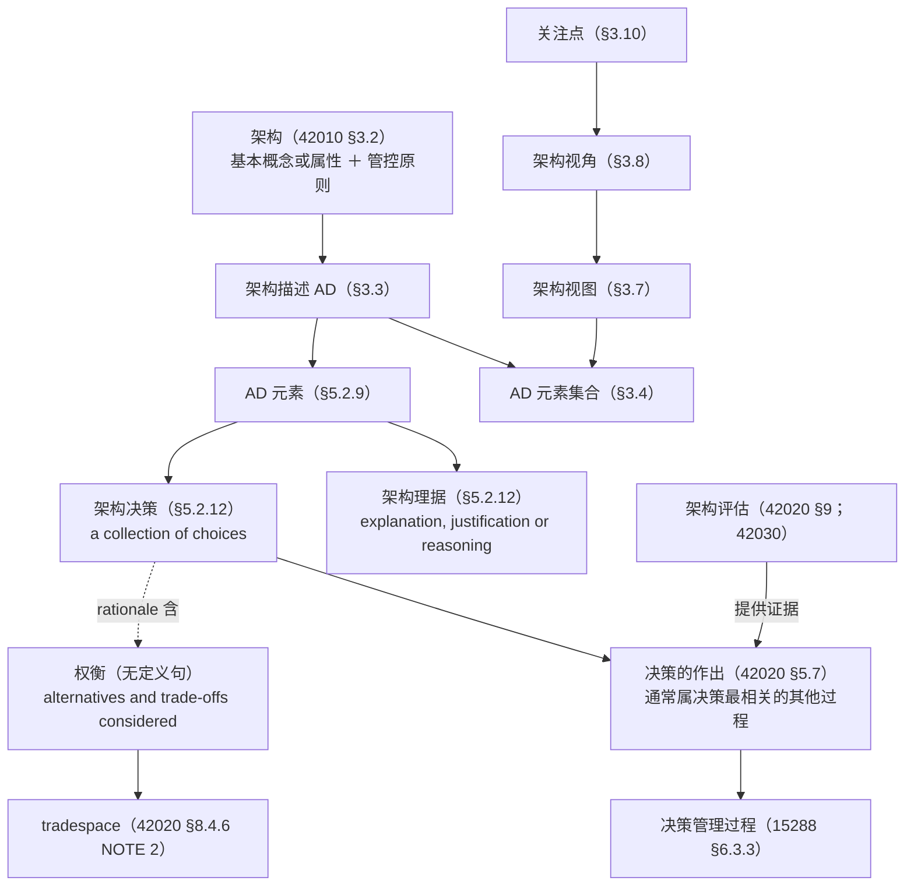
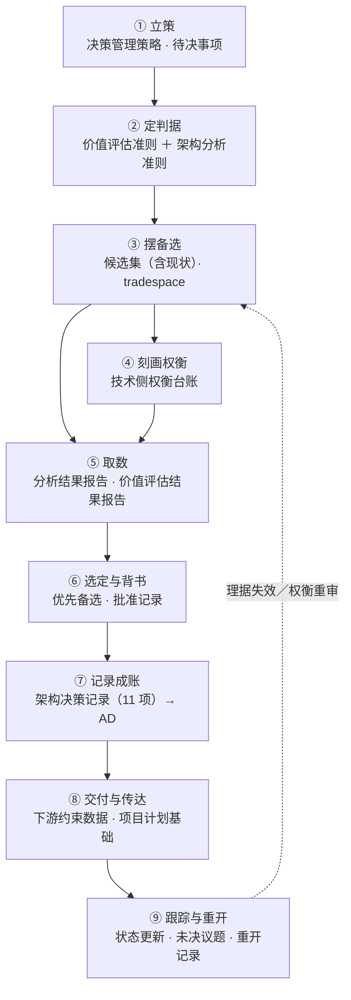

# 架构权衡与架构决策研究报告

## —— 从标准正本的定义与过程落点到决策记录装置（附现行版状态与在途修订）

**A Research Report on Architecture Trade-offs and Architecture Decisions**

> **编号**：38（研究报告稿）
> **日期**：2026-10-13
> **主题**：以标准正本为唯一依据，回答"架构权衡"与"架构决策"各是什么——① 两个词在标准里各处于什么位置（有定义还是无定义）；② 架构权衡的定义句、出现位置与三种"对"；③ 架构决策的定义句、选择对象与理据内容；④ 二者的关系与三条不可混写的界；⑤ 决策在架构过程与决策管理过程里的落点；⑥ 决策记录与理据的标准条款（实务 ADR 的标准锚点）；⑦ 评估侧的方法装置；⑧ 四份标准的现行版状态与在途修订
> **依据（只用标准正本）**：**ISO/IEC/IEEE 42010:2022**（库内正本全文）｜**ISO/IEC/IEEE 42020:2019**（库内正本全文）｜**ISO/IEC/IEEE 15288:2023**（库内正本全文）｜**ISO/IEC/IEEE 42030:2019**（库内转换件，见 §1.1 源伤说明）
> **取证纪律**：本报告凡涉架构口径的判断**只取上述正本**；本项目既有研究报告（00~37 号）与 INCOSE SEH（手册）**不作判据**，仅在指明"曾误引之处"时点名；**凡涉英文一律英中并列**（逐字引文、术语、缩写、方法名、题名同此）——逐字引文紧随「（中译：…）」，全报告 **74 处**；术语级英文另见[附录 B](#附录-b术语对照)，缩写与标准文件号见[附录 D](#附录-d英文缩写与文件号对照)；凡断言"标准里没有"**先做零命中检索**；引用一律标四档——**标准逐字／标准可支持的读法／按定义句作的举例／本报告的定性**
> **配套材料**：判错留痕见[附录 C](#附录-c判错留痕)；本轮结论对第12章的取料建议见 §11
> **文档版本**：v1.0（2026-10-13 创建）→ **v1.1（2026-10-13 增补 §十二 架构决策的过程与各环节输入／输出：九步／数据流图／六件产品数据／四处换手／三条声明；摘要增第 16 条，原 §十二 未决与挂账顺延为 §十三）**

---

## 摘要：十六条

1. **两个词的地位不对称**：**"架构决策"在 42010:2022 §5.2.12 有定义句**（*a collection of choices made in the overall context of an architecture*），并**是 AD 元素之一**（§5.2.9）；**"权衡（trade-off）"在四份正本里没有定义句**，只在任务句、NOTE 与关键词表里出现，其可用的定义性表述落在 **tradespace** 上（42020 §8.4.6 NOTE 2、§9.4.8 NOTE 3）。
2. **"架构决策"与"架构理据"不在术语章**：42010:2022 第 3 章只有 3.1~3.19 十九个词条，`architecture decision` 与 `architecture rationale` **不在其中**；二者的定义句在**第 5 章概念基础**（§5.2.12）。凡引"42010 §3.x 定义决策／理据"者，是把**关注点（§3.10 concern）**与**对应关系（§3.11 correspondence）**的号错记到了决策上（详见[附录 C](#附录-c判错留痕)）。
3. **权衡住在三个位置**：概念化侧 **42020 §8.4.6**（技术视角的权衡，含 tradespace 定义）、评估侧 **42020 §9.4.8**（价值视角的权衡）、评估框架侧 **42030 §4.3.1／§6.1.3 m)**（跨方案的综合权衡）。两侧**互补而不重复**（§8.4.6 NOTE 1、§9.4.8 NOTE 2）。
4. **权衡有三种"对"**：**解内（within）／解间（between）／与现状（and the status quo）**，另加"与未被提出的其他解"（§8.4.6 e) 1)2)3)）。标准给的典型清单逐字为 **cost vs performance（成本对性能）、cost vs schedule（成本对进度）、weight vs speed（重量对速度）、accuracy vs timeliness（精度对时效）、acquisition cost vs operating cost（购置成本对运行成本）、ease of use vs security（易用性对安全性）、flexibility vs predictability（灵活性对可预测性）、agility vs robustness（敏捷性对鲁棒性）、risk vs reward（风险对回报）**（§8.4.6 NOTE 4）。
5. **权衡不承诺"最优解"**：tradespace *often does not include a solution that will completely satisfy the architecture objectives and stakeholder concerns*（中译：往往并不包含能完全满足架构目标与相关方关注点的解）；42020 §9.4.5 NOTE 2 明说**权重并非必需**，目标是*把目标之间的权衡摆给相关方*，而不是*数学上定出"最佳"解*。
6. **决策是一组选择，不是一个动作**：42010 §5.2.12 的定义句把决策定义为**一组选择**，例句列出的选择对象覆盖架构概念、AD 元素、框架、分层方案、底层技术、业务组件、达成质量的战术、业务流程、模式、风格、实现技术范围、候选方案集（§5.2.12 EXAMPLE 1）。
7. **理据是决策的伴随物，且内含权衡**：*Architecture rationale records explanation, justification or reasoning about architecture decisions*（中译：架构理据记录对架构决策的解释、辩护或推理）；其内容项含 **alternatives and trade-offs considered**（中译：考虑过的备选与权衡）——**权衡由此进入决策的档案**（§5.2.12）。
8. **记录是"shall"，选择记哪些是"should"**：*An AD shall record architecture decisions considered essential…*（中译：架构描述**应**记录在其范围内被视作关键的架构决策）；被否备选**should**记；**哪些算"关键"由组织／项目自定准则**——标准给了 **13 条选择准则**（§6.10.1），但**未给"关键"的充要判据**（本报告定性，属权威缺口）。
9. **记录内容有 11 项**：唯一标识、决策陈述、决策权威或所有者、约束与假设、与关注点／方面相连、与受影响的 AD 元素相连、连到理据、与其他决策的关系、后果、时间戳（发生／批准／修改）、来源引用（§6.10.1）。
10. **理据的四处强制**：每个**关键决策**的理据是 *shall*；视角、ADF、ADL 的选择理据是 *should*；备选的考虑与选择证据是 *should*；AD 局限性的理据是 *should*（§6.10.2）。
11. **拍板通常不在架构过程里**：42020 §5.7 逐字——*Architecture-related decisions could be made in conjunction with the architecture processes, but this is usually the responsibility of some other process where the decision is most relevant*（中译：架构相关决策可与架构过程一并作出，但这通常是"决策最相关"的那个其他过程的职责）；42020 §8.4.7 NOTE 7 同旨（选择的作出可在架构过程之外，此时把候选架构连同评估一并呈给决策者）。
12. **决策权的三处落点**：治理侧（42020 §6.2 c)、§6.4.4 d)~f)：战略决策依 15288 决策管理过程办、其余决策**升级**到企业决策论坛、复核并传达）；管理侧（§7.4.2 h)、§7.4.4 k)：架构集合层面的决策同依决策管理过程办）；项目侧（15288 §6.3.3.3 a) 1)：决策管理策略**含角色、职责、问责与权限**）。
13. **决策管理过程给的是"结构化框架"**：15288 §6.3.3.1 逐字——*provide a structured, analytical framework for objectively identifying, characterizing, and evaluating a set of alternatives… and select the most beneficial course of action*（中译：提供一个结构化的分析框架，以客观识别、刻画并评估一组备选，并选出最有益的action路线）；四个结果、三项活动；系统分析过程（§6.4.6）为它供数据与敏感性分析。
14. **评估与决策分属两层**：42030 §3.4 Note 1 逐字——*A decision regarding disposition of the architecture is usually outside the scope of an AE effort*（中译：关于架构处置的决策通常不在架构评估工作范围之内），评估结果通常报给**决策者**，由其在结果与**其他因素**之上作出处置；评估报告须含 **architecture trade-offs identified and examined**（中译：已识别并已考察的架构权衡）（§8.3.1 t)）。
15. **现行版状态**：**42010:2022** 为现行版（多国 2025 年采标）；**42020:2019** 与 **42030:2019** 均已立**新项目**（ISO/IEC/IEEE **AWI 42020**、**AWI 42030**，阶段 **20.00**，生效日 **2026-05-22**，题名改为 *Enterprise, systems and software — …*）；42030 新项目摘要新增"support decision making where architectures are involved"（中译：支持涉及架构的决策）与 AI／ML、IoT、云、数字孪生等应用面；**42010 与 15288 未查到在途修订项目**。
16. **过程九步（本书读法）**：**立策 → 定判据 → 摆备选 → 刻画权衡 → 取数 → 选定与背书 → 记录成账 → 交付与传达 → 跟踪与重开**；标准只给三活动（15288 §6.3.3.3：*Prepare for decisions.*／*Analyse the decision information.*／*Make and manage decisions.*）且明许**任意顺序**（42020 §9.3）；九步的输入输出**全部是设计态纯数据**，过程共出**六件产品数据**（决策管理策略／判据与准则集／候选集与 tradespace 描述／权衡台账与两份结果报告／架构决策记录／决策台账），详见 §十二。

---

## 目录

- [一、前提：依据、证据等级、现行版状态与取证纪律](#一前提依据证据等级现行版状态与取证纪律)
- [二、术语地基：两个词在标准里的位置](#二术语地基两个词在标准里的位置)
- [三、架构权衡是什么](#三架构权衡是什么)
- [四、架构决策是什么](#四架构决策是什么)
- [五、权衡与决策的关系，以及三条不可混写的界](#五权衡与决策的关系以及三条不可混写的界)
- [六、决策在过程里的落点](#六决策在过程里的落点)
- [七、决策记录与理据：标准的"ADR 条款"](#七决策记录与理据标准的adr-条款)
- [八、评估侧的方法装置](#八评估侧的方法装置)
- [九、现行版状态：最新版与在途修订](#九现行版状态最新版与在途修订)
- [十、结论清单](#十结论清单)
- [十一、与本书的接驳（取料建议，非标准判据）](#十一与本书的接驳取料建议非标准判据)
- [十二、架构决策的过程与各环节输入／输出（产品数据视角）](#十二架构决策的过程与各环节输入输出产品数据视角)
- [十三、未决与挂账](#十三未决与挂账)
- [附录 A：本报告引用的正本条号索引](#附录-a本报告引用的正本条号索引)
- [附录 B：术语对照](#附录-b术语对照)
- [附录 C：判错留痕](#附录-c判错留痕)
- [附录 D：英文缩写与文件号对照](#附录-d英文缩写与文件号对照)

---

## 一、前提：依据、证据等级、现行版状态与取证纪律

### 1.1 采信的标准与证据等级

| 标准 | 现行版 | 本报告取到的证据 | 等级 |
|---|---|---|---|
| **ISO/IEC/IEEE 42010** | **2022** | 库内正本全文：术语 §3.1~§3.19、概念基础 §5.2.1~§5.2.12、要求 §6.7／§6.10、符合性 §4、附录 A.2 逐条直核 | **一手（正本）** |
| **ISO/IEC/IEEE 42020** | **2019** | 库内正本全文：术语 §3.x、§5.6／§5.7、§6、§7、§8.2／§8.4、§9.2／§9.4、§10.4、附录 C 表 C.2／C.3、附录 E.2.1 逐条直核 | **一手（正本）** |
| **ISO/IEC/IEEE 15288** | **2023** | 库内正本全文：§5.4、技术管理过程 §6.3.3、技术过程 §6.4.4／§6.4.5／§6.4.6 逐条直核 | **一手（正本）** |
| **ISO/IEC/IEEE 42030** | **2019** | 库内转换件全文：术语 §3.4／§3.5、§4.2~§4.6、§6.1、§8.3、附录 D.2~D.4 逐条直核 | **一手（转换件）——带源伤，见 §1.1 之注** |

> **42030 源伤之注**：库内 42030 无 PDF，只有 `ISO IEC IEEE 42030-2020.docx` 及其 Markdown 转换件；该件是 **CSA 采标件**（`CSA ISO/IEC/IEEE 42030:20`，等同采用 ISO/IEC/IEEE 42030:2019）的 PDF→Word 转换产物，**条款号系从 Word 自动编号还原而来，不是版面抄录**；插图 20 幅未收录。故本报告凡引 42030 的条款号，**使用前建议对一次正版**；引文本身按库内转换件照录，未作改写。

### 1.2 四档标注

| 档 | 含义 | 本报告用法 |
|---|---|---|
| **① 标准逐字** | 正本原文，引号＋中译 | 定义句、要求句、任务句、NOTE 的实质表述 |
| **② 标准可支持的读法** | 标准无原话，由多条条款推出 | 如"权衡与决策是两件事"的界说 |
| **③ 按定义句作的举例** | 依定义句构造的例子 | 如把 42010 §5.2.12 的选择对象对到本书案例 |
| **④ 本报告的定性** | 本报告的判断、归类与建议 | 如 13 条选择准则的四组归类 |

四档不混写：正文中凡②③④处，均在句内标明。

### 1.3 零命中检索（实测）

以下"标准里没有"的断言均**先做检索**，检索范围＝库内四份正本全文：

| 检索词 | 结果 | 含义 |
|---|---|---|
| `trade-off` / `tradeoff` 作**术语词条** | 42010、42020、42030、15288 四份正本的第 3 章**均无该词条** | 权衡**无标准定义**；42020 关键词表（Keywords）列有 `tradeoff`，但关键词不是定义 |
| `architecture trade-off` 作词条 | 零命中 | 无"架构权衡"这一术语词条 |
| `architecture decision` 词条 | 42010:2022 第 3 章**零命中**；定义句在 §5.2.12 | 决策有定义，但**不在术语章** |
| `architecture rationale` 词条 | 同上 | 理据有定义，但**不在术语章** |
| `tradespace` 定义 | 42020 §8.4.6 NOTE 2、§9.4.8 NOTE 3 **两处** | 权衡的可用定义性表述落在这里 |
| `ADR` / `architecture decision record` | 四份正本**零命中** | 实务 ADR 不是标准术语；标准给的是"决策记录"的内容项与要求（§6.10） |

### 1.4 一处跨标准的措辞不一致（本报告定性）

42020 §E.2.1 说"配套文件 42010 列出六种架构的应用（隐喻）：concept／property／blueprint／literature／language／decision，本文件加第七种：architecture as constraint"；而 **42010:2022 附录 A.2 只列四种隐喻**（blueprint／literature／language／decision），另把 concept 与 property 作为**两种哲学**单列（*Architecture as concept*／*Architecture as property*）。两处不是同一口径，**引"架构即决策"这一隐喻时，以 42010:2022 附录 A.2 为准**；42020 §E.2.1 的六种说法可作为"第七种隐喻＝约束"的出处，两种计数不要缝成一条。

---

## 二、术语地基：两个词在标准里的位置

### 2.1 词位图

### 2.2 有定义的那一个：架构决策与架构理据

**42010:2022 §5.2.12**（标准逐字）：

> An architecture decision is a collection of choices made in the overall context of an architecture. These choices usually pertain to various AD elements, entity requirements, or environmental influences on the architecture.
> （中译：架构决策是在一个架构的整体语境中作出的一组选择。这些选择通常涉及各类 AD 元素、实体需求，或对该架构的环境影响。）

> Architecture rationale records explanation, justification or reasoning about architecture decisions. The rationale for a decision can include the following items: the basis for making a decision, impact on quality attributes, alternatives and trade-offs considered, potential consequences of the decision, architectural principles, and citations to sources of additional information.
> （中译：架构理据记录对架构决策的解释、辩护或推理。一个决策的理据可含下列各项：作出决策的依据、对质量属性的影响、考虑过的备选与权衡、该决策的潜在后果、架构原则，以及补充信息来源的引用。）

**位置的性质**：§5.2.12 在**第 5 章概念基础**内；42010 §5.1 说明该章"引入概念基础……第 6 至 8 章用这些概念表达要求"（标准逐字：*The concepts introduced in this clause are used in Clauses 6 to 8 to express requirements.*）。故**定义在概念章、要求在 §6.10**，两者分工不可互换。

**决策是 AD 元素之一**（§5.2.9，标准逐字）：

> The AD elements include occurrences of the following architectural concepts: stakeholder, concern, aspect, stakeholder perspective, architecture viewpoint, architecture view, model kind, legend, architecture view component, architecture decision, architecture rationale and any correspondence and correspondence method specified on those constructs.
> （中译：AD 元素包括下列架构概念的出现：相关方、关注点、方面体、相关方角度、架构视角、架构视图、模型种类、图例、架构视图组件、**架构决策**、**架构理据**，以及就这些构造所指定的任何对应关系与对应方法。）

**一个已存在的隐喻**（42010 附录 A.2，标准逐字）：

> Empirical studies have discovered four metaphors for architecture found in organizations[59]: architecture as blueprint; architecture as literature; architecture as language; architecture as decision.
> （中译：实证研究发现了组织中关于架构的四种隐喻：架构即蓝图；架构即文献；架构即语言；**架构即决策**。（源件此处有交叉引用标记 *[59]*，指其参考文献。））

该条接着说明，42010:2022 的概念基础**不预设**其中任何一种隐喻，而是与任一种同样兼容。

### 2.3 没有定义的那一个：权衡

四份正本都没有 `trade-off` 的定义句。可用的定义性表述落在 **tradespace**：

**42020 §8.4.6 NOTE 2**（标准逐字）：

> Tradespace is the range and extent of parameters, properties and characteristics that are relevant in satisfying architecture objectives and stakeholder concerns. The tradespace often does not include a solution that will completely satisfy the architecture objectives and stakeholder concerns. Tradespace analysis is used for analyzing the relevant constraints, conditions and challenges involved in large complex problems with multiple stakeholders and multiple objectives. It involves the identification and understanding of tradeoffs involved in choosing between competing solutions. Tradeoffs can be within each solution and between solutions (and the problems/opportunities they are intended to address).
> （中译：tradespace 是与满足架构目标和相关方关注点相关的参数、属性与特征的范围与幅度。tradespace 往往并不包含能完全满足架构目标与相关方关注点的解。tradespace 分析用于分析大型复杂问题中相关的约束、条件与挑战，这些问题有多个相关方与多个目标。它涉及对"在相互竞争的解之间作选择时所涉权衡"的识别与理解。权衡可以在每个解**内部**，也可以在各解**之间**（以及在它们意图应对的问题／机会之间）。）

**42020 §9.4.8 NOTE 3** 给出同义表述，措辞略有差别（*relevant in potentially satisfying*，中译：与"可能满足"相关）——**引用时按所引条款照录，不要把两处 NOTE 的措辞互相替换**。

**42020 §8.4.6 NOTE 5** 给"tradespace"的构成（标准逐字）：

> The collection of tradeoff considerations, along with the influences and interactions between solutions, is called in this document the "tradespace".
> （中译：权衡考虑事项的集合，连同各解之间的影响与相互作用，在本文件中称为"tradespace"。）

### 2.4 四个相邻词（不可与"权衡／决策"互换）

| 词 | 定义位 | 逐字（英） | 中译 | 与本章两词的关系 |
|---|---|---|---|---|
| **关注点** concern | 42010 §3.10 | matter of relevance or importance to a stakeholder | 对相关方有相关性或重要性的事项 | 权衡与决策所服务的东西；42030 §3.6 注 1 指出它与 ATAM 里的 quality attribute 相近 |
| **架构目标** architecture objective | 42020 §8.4.4 | —（任务句） | 架构要达到的东西 | 权衡是目标之间的此消彼长（§8.4.6 e)） |
| **评估准则** evaluation criteria | 42020 §9.4.3 NOTE 1 | conditions that are to be met … by the entity being assessed | 被评估实体须满足的条件 | **分两套**：价值评估准则＋架构分析准则 |
| **备选／候选** alternative／candidate | 42020 §8.4.5／§8.4.7、§9.4.7 a) | —（任务句） | 备选方案／候选架构 | 权衡的宾语，决策的输入 |

---

## 三、架构权衡是什么

### 3.1 权衡的标准落点（三处，分工不同）

| 落点 | 条款 | 视角 | 逐字要点 |
|---|---|---|---|
| **概念化侧** | 42020 §8.4.6 | **技术视角** | *This activity characterizes the solutions and tradeoffs from the technical perspective, considering aspects such as ease of realization, compatibility with other solutions, trends in the technology space, etc.*（中译：本活动从技术视角刻画各解与权衡，考虑易实现性、与其他解的兼容性、技术领域趋势等方面。） |
| **评估侧** | 42020 §9.4.8 c) | **价值视角** | *Identify and characterize tradeoffs with respect to quality attributes, stakeholder concerns, architecture concepts and properties, costs, risks and opportunities.*（中译：就质量属性、相关方关注点、架构概念与属性、成本、风险与机会，识别并刻画权衡。） |
| **评估框架侧** | 42030 §4.3.1／§6.1.3 m) | **跨方案综合** | *identify and characterize trade-offs between competing stakeholder concerns*（中译：识别并刻画相互竞争的相关方关注点之间的权衡）；§4.3.1 另说明权衡**在架构开发期间被识别与刻画，而在评估综合时可被重新审视**（标准逐字：*Architecture trade-offs are identified and characterized during architecture development. However, they can be revisited during the evaluation synthesis.*） |

两侧的**互补关系**由两条 NOTE 写死（标准逐字）：

- §8.4.6 NOTE 1：*It is complementary to architecture evaluation, which examines the proposed solutions in terms of value to stakeholders and quality attributes delivered by each solution.*（中译：它与架构评估互补——评估从"对相关方的价值"与"各解交付的质量属性"考察所提各解。）
- §9.4.8 NOTE 2：*This activity analyzes the proposed solutions in terms of value to stakeholders and quality attributes delivered by each solution. It is complementary to architecture conceptualization, which characterizes the solutions and tradeoffs from the technical perspective…*（中译：本活动从"对相关方的价值"与"各解交付的质量属性"分析所提各解。它与架构概念化互补——概念化从技术视角刻画各解与权衡……）

### 3.2 权衡的三种"对"与典型清单

**42020 §8.4.6 e)**（标准逐字）：

> Identify and characterize the tradeoffs involved in achieving the architecture objectives:
> 1) between and within proposed solutions,
> 2) between these solutions and the status quo, and
> 3) between proposed solutions and other possible solutions (i.e. those not being proposed).
> （中译：识别并刻画"为达成架构目标所涉的权衡"：① 所提各解**之间**与**内部**；② 这些解与**现状**之间；③ 所提各解与其他可能的解（即未被提出的那些）之间。）

**42020 §8.4.6 NOTE 4**（标准逐字）：

> Tradeoffs can be within each solution and between solutions. There are also tradeoffs between proposed solutions and the status quo (which can be considered as one of the alternative "solutions" to be considered). Typical tradeoffs to consider are the following: cost vs performance, cost vs schedule, weight vs speed, accuracy vs timeliness, acquisition cost vs operating cost, ease of use vs security, flexibility vs predictability, agility vs robustness, risk vs reward, etc.
> （中译：权衡可以在每个解内部，也可以在各解之间。所提各解与**现状**之间也有权衡（现状可被视作考虑中的备选"解"之一）。宜考虑的典型权衡如下：成本对性能、成本对进度、重量对速度、精度对时效、购置成本对运行成本、易用性对安全性、灵活性对可预测性、敏捷性对鲁棒性、风险对回报，等等。）

**"现状"的第二处出处**（更直接）：**42020 §9.4.7 NOTE 2**——*The status quo is sometimes one of the alternatives that could be considered.*（中译：现状有时是可被考虑的各备选之一。）

**"候选架构之间"的第三处出处**：**42020 §8.4.7 c)**——*Identify and characterize the tradeoffs between candidate architectures for each solution.*（中译：为每个解识别并刻画各候选架构之间的权衡。）

### 3.3 权衡不承诺最优解（两处硬证据）

1. **tradespace 常无完全满足解**（§8.4.6 NOTE 2，见 §2.3 逐字）。
2. **权重并非必需**（42020 §9.4.5 NOTE 2，标准逐字）：

> Weights are not absolutely required since this is nearly always a multi-objective problem, and the goal will usually be to present to the stakeholders the tradeoffs between those objectives, not necessarily to mathematically determine the "best" solution.
> （中译：权重并非绝对必需，因为这几乎总是一个多目标问题，而目标通常是把这些目标之间的权衡**摆给**相关方，而不必在数学上定出"最佳"解。）

同一 NOTE 组另给出方法余地：*At a minimum, the evaluation will assess each alternative against the objectives and criteria. It does not always need to be quantitative, and does not always need to apply measurement scales.*（中译：至少，评估会就目标与准则评估每个备选。它不必总是定量，也不必总是套用测量标度。）

### 3.4 42030 的两行口径（标准逐字）

**42030 表 1**（Assessment vs analysis comparison，中译：评估与分析的对比）中与权衡直接相关的两行：

| 特征 | 价值评估 | 架构分析 |
|---|---|---|
| **Scope**（范围） | Utility, Value, Worth, Priorities, Ranking, **Trade-offs**（效用、价值、价值量、优先次序、排序、**权衡**） | Ways & Means（手段与途径） |
| **Key items of interest**（核心关注项） | Competing Concerns, **performing tradeoffs**, achieving balance & robustness（相互竞争的关注点、**做权衡**、达成平衡与鲁棒） | Individual Concerns, determining system properties & characteristics（单个关注点、确定系统属性与特征） |

由此得一条可用的界（本报告定性）：**权衡属"判断／目的（ends）"一侧，技术分析属"事实／手段（means）"一侧**——42030 表 1 另两行写明了这一点（Results：*Passes "judgment"*（中译：通过"判断"）对 *Matters of Fact*（中译：事实问题）；Goal orientation：*Ends Objectives*（中译：目的目标）对 *Means Objectives*（中译：手段目标））。

### 3.5 权衡在概念化里的动态

**42020 §8.3 c)**（标准逐字）：

> An important aspect of architecture conceptualization is to allow the analysts, project participants and various stakeholders to understand the tradespace of potential options that can meet the objectives. … Typically, a varied and distinctive mix of architectural solution concepts can be considered in order to allow the tradeoff between various constraints and concerns.
> （中译：架构概念化的一个重要方面，是让分析人员、项目参与者与各类相关方理解"能满足目标的潜在选项的 tradespace"。……通常可以考虑一个多样而有区分度的架构解概念组合，以便在各类约束与关注点之间作权衡。）

**42020 §8.3 b)** 给节奏：早期可快速滚几轮，"若干轮快速评估与概念化之后，剩下少数可行架构值得更完整地记下来并存库"。

---

## 四、架构决策是什么

### 4.1 定义句与选择对象

定义句见 §2.2。其 **EXAMPLE 1**（标准逐字）：

> Selection of architecture concepts, choice of AD elements, selection of ADFs, choice of architecture layering scheme, choice of underlying technology, choice of business components, choice of tactics to use for achieving system qualities, choice of business processes, choice of applicable patterns, choice of style(s) to be applied, choice of range of implementation technologies or other realizations to be considered, and choice of option sets to be considered.
> （中译：架构概念的选择、AD 元素的选择、ADF 的选择、架构分层方案的选择、底层技术的选择、业务组件的选择、用于达成系统质量的战术的选择、业务流程的选择、适用模式的选择、所采用风格的选择、所要考虑的实现技术范围或其他实现方式的选择，以及所要考虑的选项集的选择。）

**读法**（②标准可支持的读法）：决策的宾语是**做法（选择）**，不是元素与关系本身；这与"架构是基本概念或属性＋管控原则"（§3.2）相容——决策是**怎么挑**，概念与属性是**挑出来什么**。

### 4.2 决策、理据与质量属性的三角

§5.2.12 的理据内容项把三者固定下来：*impact on quality attributes*（对质量属性的影响）、*alternatives and trade-offs considered*（考虑过的备选与权衡）、*potential consequences*（潜在后果）。**42020 §E.6.3** 另给一条配套读法（标准逐字）：*While tradeoff analysis techniques aid architects in prioritizing architecture quality attributes, architectural tactics describe techniques to achieve particular system characteristics or enshrine these characteristics in architecture principles.*（中译：权衡分析技术帮助架构师为架构质量属性排优先次序；架构战术则描述达成特定系统特性的技术，或把这些特性固化进架构原则。）

### 4.3 决策的两层：记录在架构里，拍板在架构外

**42020 §5.7**（标准逐字）：

> Evaluation provides evidence for decision making on architecture evolution and change. Architecture-related decisions could be made in conjunction with the architecture processes, but this is usually the responsibility of some other process where the decision is most relevant.
> （中译：评估为"架构演化与变更"的决策提供证据。架构相关决策可与架构过程一并作出，但这通常是"决策最相关"的那个其他过程的职责。）

**42020 §8.4.7 NOTE 7**（标准逐字）：

> Sometimes the selection of the architecture(s) going forward is made through decisions outside the scope of the architecture processes. In that case, the candidate architectures are presented to decision makers along with an assessment of these architectures. This might entail involvement of the Decision Management Process or the Portfolio Management Process described in ISO/IEC/IEEE 15288.
> （中译：有时"往哪个架构走"的选择是通过架构过程范围之外的决策作出的。此时，候选架构连同对这些架构的评估被呈给决策者。这可能涉及 ISO/IEC/IEEE 15288 所述的决策管理过程或组合管理过程。）

**15288 §6.3.3.1**（标准逐字）：

> The purpose of the decision management process is to provide a structured, analytical framework for objectively identifying, characterizing, and evaluating a set of alternatives for a decision at any point in the life cycle and select the most beneficial course of action.
> （中译：决策管理过程的目的是提供一个结构化的分析框架，以便在生命周期任一时点，客观地识别、刻画并评估某个决策的一组备选，并选出最有益的路线。）

### 4.4 谁有权：三处落点

| 层 | 条款 | 逐字要点 |
|---|---|---|
| **治理** | 42020 §6.2 c) | *Architecture decisions supported by rationale are made with appropriate authorities and communicated to stakeholders.*（中译：有理由支撑的架构决策由**适当的权威**作出并传达给相关方。） |
| **治理** | 42020 §6.4.4 d)~f) | 战略决策依 15288 决策管理过程办；**其他决策升级**到适当的企业决策论坛（*Elevate other decisions to the appropriate enterprise decision forum.*）；复核并传达 |
| **治理机制** | 42020 §6.4.4 a) 3) | *Establish a decision-making mechanism that minimizes or avoids potential conflicts of interests with escalation in the organization…*（中译：建立决策机制，以尽量减少或避免利益冲突，冲突无法解决时在组织内升级） |
| **管理** | 42020 §7.4.2 h)、§7.4.4 k) | 架构集合层面的决策同依 15288 决策管理过程办；架构管理对集合内各架构的决策有一致性监督（附录 G.2） |
| **项目** | 15288 §6.3.3.3 a) 1) | 决策管理策略含*roles, responsibilities, accountabilities, and authorities*（中译：角色、职责、问责与权限） |
| **记录责任** | 15288 §6.3.3.3 c) 3) | 记录、跟踪、评估并报告决策，含**问责归属与处置**，以备审计与经验学习 |

**一条容易被忽略的边界**（42020 §9.4.8 d) NOTE 4／5）：架构可能满足目标与关注点，却**不满足某项强制要求**；标准提示可考察**减免（relief）**的可能性，也可考虑**早筛**掉不满足强制项的备选以免徒耗资源。**42020 §9.4.10 f) NOTE** 另给一条实务出路：若一个高价值架构因某条需求约束"收不了口"，与相关方讨论该需求**能否放宽**、或另寻妥协（可能涉及**豁免**或**改需求**）。

---

## 五、权衡与决策的关系，以及三条不可混写的界

### 5.1 因果链（本报告定性，各环均有条款支撑）

### 5.2 权衡进入决策档案的两条写入路径

| 路径 | 条款 | 性质 |
|---|---|---|
| **架构描述侧** | 42010 §5.2.12（理据内容项含 *alternatives and trade-offs considered*（中译：考虑过的备选与权衡））＋§6.10.2（*An AD shall include or reference rationale for each essential architecture decision*（中译：架构描述应为每个关键架构决策包含或引用理据）） | **shall**（对关键决策） |
| **评估报告侧** | 42030 §8.3.1 t)：*architecture trade-offs identified and examined*（中译：已识别并已考察的架构权衡） | **shall**（评估报告内容项） |

两条路径**互不替代**：架构描述承载"这个架构为什么是这样"，评估报告承载"这次评估看过的权衡与结论"。

### 5.3 三条不可混写的界（②标准可支持的读法＋④本报告定性）

| 界 | 内容 | 依据 |
|---|---|---|
| **界一：权衡 ≠ 决策** | 权衡是把候选摆到目标／准则前看此消彼长；决策是**有权威**的一组选择并**落成记录**。权衡可以不下结论地摆着（§9.4.5 NOTE 2"摆给相关方"），决策必须落地（15288 §6.3.3.2 c)／d)） | 42020 §8.4.6／§9.4.8；42010 §5.2.12；15288 §6.3.3 |
| **界二：评估 ≠ 决策** | 评估产出判断与建议，处置决定在评估范围之外，且决策者还会用评估未考虑的其他因素 | 42030 §3.4 Note 1；42020 §9.4.9 g)（发现与建议可贡献于组织与项目决策、里程碑判定） |
| **界三：记录 ≠ 拍板** | 记录是 AD 的**要求**（§6.10 shall），它追认并固化决策；把决策写进 AD 不等于取得授权，授权出处在治理与决策管理一侧 | 42010 §6.10.1；42020 §6.2 c)／§6.4.4 |

---

## 六、决策在过程里的落点

### 6.1 架构概念化侧（42020 §8.4）

| 任务 | 逐字要点 | 产出 |
|---|---|---|
| §8.4.5 f) | *Characterize strengths, weaknesses and tradeoffs for each potential solution.*（中译：为每个潜在解刻画优势、劣势与权衡。） | 各解画像 |
| §8.4.6 e) | 三种"对"（见 §3.2） | 技术侧权衡台账 |
| §8.4.6 g) | *Formulate a roadmap for implementing the proposed solution(s).*（中译：为所提各解拟实施路线图。） | 路线图 |
| §8.4.7 c) | 候选架构之间的权衡 | 候选架构比较 |
| §8.4.8 g) | *Capture architecture decisions and architectural characteristics in the specified form.*（中译：按规定形式**捕获架构决策**与架构特征。） | 决策落纸 |
| §8.4.8 h) | *Capture key architectural concepts, properties of interest, rationales, conditions, constraints and assumptions…*（中译：捕获关键架构概念、所关注的属性、**理据**、条件、约束与假设……） | 理据与假设 |

### 6.2 架构评估侧（42020 §9.4）

| 任务 | 逐字要点 |
|---|---|
| §9.4.1 a) | *Formulate judgments to be made by architecture evaluation based on the potential decision(s) that can be supported by the architecture evaluation effort.*（中译：依据本评估工作所能支持的**潜在决策**，确定评估要作出的判断。） |
| §9.4.3 | 准则两套：价值评估准则＋架构分析准则（NOTE 1） |
| §9.4.4 | 选择或开发评估方法，并标明评估、评估与分析的**因子** |
| §9.4.5 | 测量技术与标度；权重非必需（NOTE 2） |
| §9.4.7 a) b) | 确定受评架构或备选；**剔除彼此相似、在目标与准则上不具区分度的备选** |
| §9.4.8 a) b) | 制定筛选准则、筛掉备选；NOTE 1 说明"权衡完全相同者不予考察"，并考察一组**跨度（span）tradespace** 的备选 |
| §9.4.8 c) | 就质量属性、关注点、概念与属性、成本、风险与机会刻画权衡 |
| §9.4.8 e) | *assess results of this analysis to determine, as appropriate, the best architecture(s) among the alternatives.*（中译：酌情评估分析结果，以在各备选中确定最佳架构。） |
| §9.4.9 e) g) | 形成建议；说明发现与建议如何贡献于**组织与项目决策及里程碑判定** |
| §9.4.10 e) | *Present findings and recommendations to decision makers, if relevant.*（中译：在相关时，向**决策者**呈报发现与建议。） |

### 6.3 决策管理侧（15288 §6.3.3）

| 项 | 逐字要点 |
|---|---|
| 结果 a)~d) | 识别需要备选分析的决策；评估备选路线；选定优先路线；**记录决议、决策理据与假设** |
| 活动 a) | 为决策作准备：定义决策管理策略；识别需要决策的情形与需要；让相关方参与 |
| 活动 b) | 分析决策信息：声明策略；确定期望结果与**可测选择准则**；识别**trade space 与备选**；就准则评估每个备选 |
| 活动 c) | 作出并管理决策：确定每个决策的优先备选；记录决议、理据与假设；记录、跟踪、评估并报告决策 |
| 方法（NOTE 1） | *The methods most frequently used for decision management are the trade-off study, cost-benefit analysis, engineering analysis, and problem-solving analysis (e.g., TRIZ and Kepner-Tregoe).*（中译：决策管理最常用的方法是**权衡研究**、成本效益分析、工程分析与问题求解分析（如 TRIZ 与 Kepner-Tregoe）。） |
| 与系统分析的接口 | §6.3.3.1 NOTE 2／§6.3.3.3 b) 4) NOTE 6：需要就某准则detailed 评估参数时，由**系统分析过程**作量化并给**敏感性分析**，用以确定各权衡备选的可行性 |

### 6.4 系统架构定义过程侧（15288 §6.4.4）

| 项 | 逐字要点 |
|---|---|
| §6.4.4.1 目的 | *generate system architecture alternatives, select one or more alternative(s) that address stakeholder concerns and system requirements, and express this in consistent views and models.*（中译：生成系统架构备选，选出**一个或多个**能应对相关方关注点与系统需求的备选，并在一致的视图与模型中表达之。） |
| §6.4.4.2 c) | 对**架构决策**有意义的那些概念、属性、特征、行为、功能或约束被**分配到架构实体** |
| §6.4.4.3 c) 5) | *Combine the analyses and assessments into an overall evaluation to select a preferred system architecture solution.*（中译：把分析与评估综合为一次总体评估，以选出优选的系统架构方案。） |
| §6.4.4.3 e) 4) | *Record key system architecture decisions and the rationale.*（中译：**记录关键系统架构决策与理据**。）NOTE 10 补：理据含重大备选与使能项的信息 |
| §6.4.4.3 c) NOTE 5 | 评估活动与**系统分析过程、决策管理过程**协同进行 |
| §5.4（架构与设计的分工） | *An effective architecture is as design-agnostic as possible to allow for maximum flexibility in the design trade space.*（中译：有效的架构尽可能与设计无关，以在设计权衡空间中获得最大灵活性。） |
| §6.4.5.3 NOTE 8 | 当分配下去的系统特性不易实现、或存在重大设计／实现挑战时，**跨架构与需求作权衡** |

### 6.5 治理与管理侧（42020 §6、§7；附录 C）

- **附录 C 表 C.2**（架构被各生命周期过程使用）中，`6.3.3 Decision management` 一行为：*Architecture evaluation recommendations. Identification of systems and system elements, system transition points, system attributes and measures.*（中译：架构评估建议。系统与系统元素、系统转换点、系统属性与度量的识别。）
- **附录 C 表 C.3**（架构过程使用的信息）中，`6.3.3 Decision management` 一行为：*Architecture-related decisions, decision criteria.*（中译：架构相关决策、决策准则。）
- 两条合起来说明：**架构过程与决策管理过程互为供料**——评估把建议送进决策，决策把"架构相关决策与决策准则"送回架构过程。

---

## 七、决策记录与理据：标准的"ADR 条款"

### 7.1 42010 §6.10.1（标准逐字＋中译）

> An AD shall record architecture decisions considered essential to the architecture of the entity of interest within the scope and intended purpose of the AD.
> （中译：架构描述**应**记录在其范围与既定目的内、被视作对所关注实体架构**关键**的架构决策。）

> NOTE 1 An AD expresses decisions about an architecture. Architecture rationale expresses why decisions have been chosen.
> （中译：架构描述表达关于某架构的决策；架构理据表达这些决策**为什么**被选中。）

> The AD should record alternative decisions considered and rejected and the rationale for those choices.
> （中译：架构描述**宜**记录考虑过并被否掉的备选决策，以及作此取舍的理据。）

> The organization and/or project should establish a decision recording and sharing strategy and criteria for selecting important decisions to record and support with rationale in the AD.
> （中译：组织与／或项目**宜**建立决策记录与共享策略，以及"哪些重要决策要在 AD 中记录并以理据支撑"的**选择准则**。）

**13 条选择准则**（标准逐字，英中并列；分组为本报告定性）：

| 组 | 条款逐字（英） | 中译 |
|---|---|---|
| **涉要求与基本关切** | regarding architecturally significant requirements | 关于架构显著需求的 |
| | addressing fundamental concerns (such as performance, evolvability, safety) | 应对基本关切（如性能、可演化性、安全）的 |
| | linked to requirement compliance | 与需求符合性挂钩的 |
| | linked to technical standard selection | 与技术标准选择挂钩的 |
| | linked to system vulnerability mitigation | 与系统脆弱性缓解挂钩的 |
| **代价与不可逆性** | needing a major investment of effort or time to make, implement or enforce | 需要投入大量精力或时间才能作出、实施或执行的 |
| | that are highly sensitive to changes | 对变更高度敏感的 |
| | that are likely to be costly to change | 改起来很可能代价高昂的 |
| | that result in significant capital expenditures or indirect costs | 导致重大资本支出或间接成本的 |
| **涉人与涉推理** | affecting key stakeholders or a number of stakeholders | 影响关键相关方或一批相关方的 |
| | necessitating intricate or non-obvious reasoning | 需要繁复或非显然推理的 |
| **进入下游管理与计划** | that form a base for project planning and management (such as work breakdown structure creation, critical chain identification and management quality gate tracking) | 构成项目计划与管理基础（如工作分解结构编制、关键链识别与管理、质量门判定跟踪）的 |
| | that result in the replacement of assumptions with known information | 导致以已知信息**替换假设**的 |

**11 项记录内容**（标准逐字，英中并列）：

| 序 | 条款逐字（英） | 中译 |
|---|---|---|
| 1 | unique decision identification | 决策唯一标识 |
| 2 | clear statement of decision | 决策的清晰陈述 |
| 3 | identification of decision authority or owner | 决策权威或所有者的指明 |
| 4 | identification of constraints and assumptions that influence the decision | 影响该决策的约束与假设的指明 |
| 5 | link decision to the concerns or aspects of an entity to which it pertains | 把决策连到它所涉及的关注点或实体方面 |
| 6 | link decision to AD elements affected by the decision | 把决策连到受其影响的 AD 元素 |
| 7 | link to decision rationale | 连到决策理据 |
| 8 | relationships to other decisions | 与其他决策的关系 |
| 9 | consequences of the decision (relating to other decisions) are recorded | 记录该决策的后果（涉其他决策） |
| 10 | timestamps for when the decision occurred, when approved and when modified | 该决策**发生**、**批准**与**修改**的时间戳 |
| 11 | source citations for additional information | 补充信息的来源引用 |

**两条注**（标准逐字要点）：NOTE 2 说明决策清单**不以求全为意图**；NOTE 3 说明记录被否备选及其被否理据有时很有用，例如将来该理据不再适用、而决策又必须重作之时。§6.10.1 末句另许：决策之间的关系可用**对应关系或对应方法**捕捉。

### 7.2 42010 §6.10.2（四条，标准逐字）

| 位 | 情态 | 逐字 |
|---|---|---|
| 视角选择的理据 | should | *An AD should include or reference a rationale for each architecture viewpoint selected for use (per 6.6).*（中译：架构描述宜为其所选用的每个架构视角包含或引用理据。） |
| ADF／ADL 选择的理据 | should | *An AD should include or reference a rationale for each ADF and each ADL selected for use.*（中译：宜为所选用的每个 ADF 与每个 ADL 包含或引用理据。） |
| **关键决策的理据** | **shall** | *An AD shall include or reference rationale for each essential architecture decision (per 6.10.1).*（中译：架构描述**应**为每个关键架构决策包含或引用理据。） |
| 备选的考虑与选择证据 | should | *An AD should include or reference evidence of consideration and rationale for selection of alternatives.*（中译：宜包含或引用"对各备选作过考虑"的证据及其选择理据。） |
| AD 局限性的理据 | should | *An AD should include a rationale for an AD limitation (e.g. resource problem, timing problem, and effort avoided for well-known description already covered by other ADs).*（中译：宜为 AD 的某项局限（如资源问题、时间问题，或对已被其他 AD 覆盖的众所周知描述省去的气力）给出理据。） |

另有一处与决策相关的"已知问题"入口：**42010 §6.7 d)** NOTE 2——视图的"已知问题"含未决议题、风险、例外与对治理模型种类或图例的偏离；**未决议题可导致待作决策**（标准逐字：*Open issues can lead to decisions to be made.*），例外与偏离可作为**决策结果与理据**记录（按 §6.10）。

### 7.3 与实务 ADR 的关系（④本报告定性）

| 项 | 标准给 | 标准不给 |
|---|---|---|
| 决策内容项 | 11 项内容清单（§6.10.1） | 具体模板、栏位名、字段格式 |
| 决策选择准则 | 13 条（§6.10.1） | "**关键（essential）**"的充要判据 |
| 决策关系 | 可用对应关系表达，例句含 constrains／influences／enables／triggers／forces／subsumes／refines／conflicts with／exposes／is compatible with（中译：约束／影响／使能／触发／迫使／包含／细化／冲突／暴露／相容） | 状态机（提议／接受／废弃／被取代） |
| 理据 | 内容项六项（§5.2.12）；四处 shall／should（§6.10.2） | 理据质量的分级判据 |

**一条空白**：标准要求记"关键决策"，却**未给"关键"的判据**，只给了 13 条选择准则作**坯子**。凡在实践中另立判据者（如按影响半径、信息成本、风险定级），属**本书自定**，须显式声明。

---

## 八、评估侧的方法装置

### 8.1 42030 三层（标准逐字要点）

| 层 | 条款 | 逐字要点 |
|---|---|---|
| **评估综合** evaluation synthesis | §4.3.1／§6.1 | 把**多次价值评估**的结果合并，以确定评估目标达成到什么程度；权衡在架构开发期间识别、在综合时可**重新审视** |
| **价值评估** value assessment | §4.3.2／§6.2 | 确定相关方可以期待从架构获得**多少、何种**价值；价值可定性亦可定量 |
| **架构分析** architectural analysis | §4.3.3／§6.3 | 考察架构的关键属性（安全、成本、性能等维度）与对相关方或环境的影响；**可选**——所需信息已有他源时可不做分析 |

**因子**：§6.1.4 要求每个评估因子可代表关注点、可规范化比较或整合、贡献于评估目标、可被评估方法用于生成结果；例如 cost（成本）、schedule（进度）、performance（性能）、risk（风险）（标准逐字），并提示好度量的通则是 SMART（Specific, Measurable, Accurate, Reliable and Timely；中译：具体、可测、准确、可靠、及时）。

### 8.2 附录 D 三法

| 法 | 条款 | 与权衡的关系（标准逐字要点） |
|---|---|---|
| **ATAM**（架构权衡分析方法） | §D.2 | *a framework for software architecture and design trade-offs*（中译：一个面向软件架构与设计权衡的框架）；分析情景与决策，产出**风险、非风险、敏感点与权衡点**（risks, non-risks, sensitivity points and trade-off points），并归纳为风险主题；主要评估结果是"把相关方需求置于风险之中的那些**可能有问题的架构决策**，以及它们彼此如何权衡"（§D.2.3） |
| **Method Framework 与 QUASAR** | §D.3 | 评价综合、价值评估、架构分析三层各有对应做法 |
| **AoA**（备选方案分析） | §D.4 | 就备选作分析；评估综合含跨多次价值评估的权衡考察 |

**ATAM 的一处判据式表述**（§D.2.3，标准逐字）：*The evaluation team records the discussion surrounding the architectural decision, risks, non-risks, sensitivities, trade-offs and open issues.*（中译：评估组记录围绕**架构决策**、风险、非风险、敏感点、权衡与未决议题的讨论。）

### 8.3 评估与决策的分界（再引一次，因其最常被混）

**42030 §3.4 Note 1**（标准逐字）：

> A decision regarding disposition of the architecture is usually outside the scope of an AE effort, although it could be done in conjunction with the AE effort. The AE results are often reported to a decision maker who makes the actual determination of disposition based on those results and sometimes also on other factors (3.8) not considered by the AE effort.
> （中译：关于架构处置的决策通常不在架构评估工作的范围之内，尽管它可以与评估工作一并作出。评估结果常报给决策者，由其依据这些结果、有时还依据评估未考虑的其他因素（源件交叉引用标记 *(3.8)*），作出实际的处置决定。）

---

## 九、现行版状态：最新版与在途修订

### 9.1 版本状态

| 标准 | 现行版 | 状态 | 在途修订（查得） |
|---|---|---|---|
| ISO/IEC/IEEE 42010 | **2022** | 现行；多国采标（如 GSO ISO/IEC/IEEE 42010:2025、ДСТУ ISO/IEC/IEEE 42010:2025，均等同采用 2022 版） | **未查到项目** |
| ISO/IEC/IEEE 42020 | **2019** | 现行 | **ISO/IEC/IEEE AWI 42020**，阶段 **20.00**，生效日 **2026-05-22**；题名改为 *Enterprise, systems and software — Architecture processes*（中译：企业、系统与软件——架构过程） |
| ISO/IEC/IEEE 42030 | **2019**（库内为 CSA 2020 采标件） | 现行 | **ISO/IEC/IEEE AWI 42030**，阶段 **20.00**，生效日 **2026-05-22**；题名改为 *Enterprise, systems and software — Architecture evaluation framework*（中译：企业、系统与软件——架构评估框架） |
| ISO/IEC/IEEE 15288 | **2023** | 现行 | **未查到项目** |

**AWI 阶段码 20.00 的含义**（标准项目阶段通用码）：新工作项提案获批、项目登记入委员会工作计划；**尚无委员会草案**。故就本报告全部判断而言，**判据仍以 2019／2022／2023 三版现行版为准**。

### 9.2 在途修订的两处变化点（备将来复核）

1. **题名的措辞顺位**：42020 与 42030 的 AWI 题名都把 *Enterprise* 提到最前（*Enterprise, systems and software — …*），现行版为 *Software, systems and enterprise — …*。
2. **42030 新项目摘要**新增若干表述：评估的用途清单里含 *support decision making where architectures are involved*（中译：支持涉及架构的决策）；应用面点名 AI／ML、IoT、云计算、大数据、智慧城市、智能制造、网络安全、**数字孪生**、电信、航空航天、国防等；并明确"不涉及架构能力（competencies）相关的概念与原则"。**这些是项目摘要，不是现行版条款，不能作判据用。**

---

## 十、结论清单

1. **决策有定义、权衡没有**——决策与理据的定义句在 42010:2022 §5.2.12（概念章），不在术语章；权衡无定义句，其定义性表述落在 tradespace（42020 §8.4.6 NOTE 2／§9.4.8 NOTE 3）。
2. **决策＝一组选择**，选择对象是做法（概念、框架、分层、技术、战术、模式、风格、实现范围、选项集），不是元素与关系本身。
3. **理据是决策的伴随物**，六项内容项里明确含 *alternatives and trade-offs considered*——**权衡由理据进入决策档案**。
4. **权衡有三对＋一**：解内、解间、与现状、与未被提出的其他解；典型清单九组（成本对性能……风险对回报）。
5. **权衡不承诺最优**：tradespace 常无完全满足解；权重非必需；目标是"摆给相关方"。
6. **两侧互补**：概念化侧从技术视角刻画权衡，评估侧从价值视角刻画权衡，互为补充（两条 NOTE 互指）。
7. **筛选有明文动作**：剔除彼此相似、在目标与准则上无区分度的备选；权衡完全相同者不予考察；考察一组跨越 tradespace 的备选。
8. **拍板通常在架构过程之外**（42020 §5.7、§8.4.7 NOTE 7），落在决策管理过程（15288 §6.3.3）或组合管理过程。
9. **决策权三处落点**：治理（企业决策论坛／升级）、管理（架构集合层面）、项目（决策管理策略含权限与问责）。
10. **记录是强制、记哪些是自定**：AD **shall** 记关键决策；被否备选、视角／框架／语言的选择理据为 **should**；13 条选择准则，但**无"关键"的判据**。
11. **记录内容 11 项**，含唯一标识、决策权威／所有者、连到关注点与 AD 元素、连到理据、与其他决策的关系、后果、三个时间戳、来源引用。
12. **评估报告 must 含已识别并已考察的权衡**（42030 §8.3.1 t)）；**评估不含处置决定**（§3.4 Note 1）。
13. **三法可引**：ATAM（敏感点／权衡点／风险主题）、QUASAR、AoA；ATAM 的一手出处是 42030 附录 D.2（并注明 ATAM 为 CMU 注册商标，标准引用不构成背书）。
14. **一处跨标准计数不一致**：42020 §E.2.1 说 42010 列六种隐喻，42010:2022 附录 A.2 列四种（concept／property 另作两种哲学）；引"架构即决策"以 42010 附录 A.2 为准。
15. **现行版与在途**：判据以 42010:2022／42020:2019／15288:2023／42030:2019 为准；42020 与 42030 已有 AWI 项目（阶段 20.00，生效日 2026-05-22），尚无可引的草案内容。

---

## 十一、与本书的接驳（取料建议，非标准判据）

> 本节的档位为 **④本报告的定性**：它是"哪条正本给第12章哪一节当锚点"的取料建议，不是对教材任何既有判断的裁决。

### 11.1 第12章锚点建议（按入口文件已冻结的块与节）

| 章内落点 | 可用正本锚点 |
|---|---|
| `12.2 权衡是把候选摆到尺子前` | 42020 §8.4.6 NOTE 2／NOTE 5（tradespace）；§8.4.6 e)＋NOTE 4（三对＋典型清单）；§8.4.5 f)；§9.4.3 NOTE 1（准则两套） |
| `12.3 筛与选` | 42020 §9.4.7 a) b)（候选与剔除相似）；§9.4.8 a) b)＋NOTE 1（筛选、跨度 tradespace）；§9.4.8 d) NOTE 4／5（强制项与早筛）；§9.4.8 e)；42030 §4.3.1（权衡可在综合时重审） |
| `12.4 排序与时机` | 42010 §5.2.12 EXAMPLE 1（选择对象）；§6.10.1 的 13 条选择准则；15288 §6.3.3.3 a) 1)（策略与权限）；42020 §8.3 b)（早期快速滚轮）与 §9.4.10 f) NOTE（需求放宽与豁免） |
| `12.5 记录：决策与理据` | 42010 §5.2.12（定义句与理据六项）；§5.2.9（决策与理据是 AD 元素）；§6.10.1（shall／should＋11 项）；§6.10.2（四条）；§6.7 d) NOTE 2（未决议题可导致待作决策）；42030 §8.3.1 t) |
| 章首与收束 | 42020 §5.7（拍板在架构过程外）；42030 §3.4 Note 1（评估不含处置决定）；42010 附录 A.2（架构即决策） |
| 附录 A「架构权衡」立户 | §2.3（tradespace 定义句）＋§3.1／§3.4（三落点、两行口径） |

### 11.2 两处待更正的出处（本轮查出）

| 现有表述 | 正本实况 | 建议 |
|---|---|---|
| 入口文件写"正本：**42010:2022 §3.10／§3.11**（decision／rationale）" | §3.10 是 **concern（关注点）**，§3.11 是 **correspondence（对应关系）**；`architecture decision`／`architecture rationale` **在第 3 章无词条**，定义句在 **§5.2.12** | 改挂 **§5.2.12**（定义）＋**§6.10.1／§6.10.2**（要求）；`§5.2.9` 可作"决策与理据属 AD 元素"的出处 |
| 入口文件写"「现状照旧」摆上桌（**§8.4.6 NOTE 3**）" | §8.4.6 NOTE 3 是**协调（harmonization）**；"现状作为备选之一"的明文出处是 **§9.4.7 NOTE 2**，"与现状的权衡"在 **§8.4.6 e) 2) 与 NOTE 4** | 改挂 **§9.4.7 NOTE 2**（首选）＋**§8.4.6 NOTE 4** |

### 11.3 相邻章的连带（本报告附带查出，供后续各章取用）

- **第11章**：§8.4.8 g) h) 是"概念、属性、原则与**决策**在概念化阶段就被捕获"的正本出处；与 ch11 已定的"三张清单"不冲突（清单是内容侧，决策是选择侧）。
- **第13章**：§6.7 d) NOTE 2 给"未决议题→待作决策→例外与偏离作为决策结果与理据记录"的链条，可作为"架构描述里为什么要有决策与理据"的一手依据；§5.2.9 给"决策与理据是 AD 元素"的位置。
- **第15／16章**：42020 §6.2 c)、§6.4.4 d)~f)、§7.4.2 h)、§7.4.4 k) 给治理与管理的决策权与升级路径；42020 附录 G.1／G.2 给两者的分工措辞。
- **第14章**：15288 §5.4 的 *design-agnostic as possible*（中译：尽可能与设计无关）与 §6.4.5.3 NOTE 8 的"跨架构与需求作权衡"，可用于"架构与设计两级各做哪种权衡"的分界。

---

## 十二、架构决策的过程与各环节输入／输出（产品数据视角）

> **档位声明（先行）**：**标准不给一条名为"架构决策过程"的流水线**。15288:2023 §6.3.3.3 把决策管理摊成三个活动——*Prepare for decisions.*（中译：为决策作准备。）／*Analyse the decision information.*（中译：分析决策信息。）／*Make and manage decisions.*（中译：作出并管理决策。）；42020:2019 §9.4 把架构评估摊成十个活动；42010:2022 §6.10 只管记录。**下面的九步是把这三处摊平后的一种读法（④本报告的定性）**，不是标准规定的顺序——42020 §9.3 逐字明许：*The activities may be performed in any order that is deemed appropriate.*（中译：这些活动可按认为合适的任何顺序执行。）

### 12.1 九步与各环节的输入／输出产品数据

产品数据类别按第7章六类口径取相关的四类（**需求类／设计类／质量类／管理类**）；**态一律为设计态（纯数据）**，因为架构决策不产出实物。

| 步 | 环节 | 输入产品数据（类别） | 输出产品数据（类别·去向） | 正本锚点 |
|---|---|---|---|---|
| **①** | **立策** （Prepare） | 组织与项目方针；既有决策台账；风险与机会清单（管理类） | **决策管理策略**（角色／职责／问责／权限＋**决策类别与优先排序**）；**待决事项陈述**（管理类） | 15288 §6.3.3.3 a) 1) 2) |
| **②** | **定判据** | 关切台账（42010 §6.4）；架构目标与关键成功准则（42020 §8.4.4）；强制项与法规（§9.4.3 a)）；项目约束（15288 §6.3.3.1 NOTE 1） | **价值评估准则＋架构分析准则**两套；**决策准则与阈值**；**判据—关切追溯表**（质量类／管理类） | 42020 §9.4.3 NOTE 1；15288 §6.3.3.3 b) 2) |
| **③** | **摆备选** | 相关架构与既有资产；现状基线；模式与战术；未被提出的解（设计类／管理类） | **候选集（含现状）**；**tradespace 描述**；**剔除记录**（设计类） | 15288 §6.3.3.3 b) 3)；42020 §8.4.5 b) c)、§9.4.7 a) b)、§9.4.8 a) b) 与 NOTE 1 |
| **④** | **刻画权衡** | 候选集；两套准则 | **技术侧权衡台账**（解内／解间／与现状）；**价值侧权衡台账**（质量属性／关切／概念属性／成本／风险／机会）（质量类／设计类） | 42020 §8.4.6 e) 与 NOTE 4、§9.4.8 c)；42030 §4.3.1 |
| **⑤** | **取数** | 候选与权衡；度量与标度；信息源 | **架构分析结果报告**（含敏感性、精度与不确定性）；**价值评估结果报告**（质量类） | 42020 §9.4.4／§9.4.5／§9.4.7 k) l) m)；15288 §6.4.6、§6.3.3.3 b) 4) NOTE 6 |
| **⑥** | **选定与背书** | 两份结果报告；准则；权属与权限 | **选定的优先备选**；**协议／批准记录**（含升级记录）（管理类） | 15288 §6.3.3.3 c) 1)、§6.4.4.3 e) 2)；42020 §6.2 c)、§6.4.4 d)~f) |
| **⑦** | **记录成账** | 以上全部 | **架构决策记录**（唯一标识／陈述／权威／约束与假设／连关切／连 AD 元素／连理据／关系／后果／三个时间戳／来源引用）→ **入 AD**；**评估报告**（含已识别并已考察的权衡）（设计类→AD；质量类→报告） | 42010 §5.2.12／§6.10.1／§6.10.2／§5.2.9；42030 §8.3.1 t)；15288 §6.3.3.3 c) 2) 3)、§6.4.4.3 e) 4) |
| **⑧** | **交付与传达** | 决策记录 | **传达记录**；**下游约束数据**（特性分配／接口与边界／实现技术范围）；**项目计划基础**（WBS／关键链／质量门判定）；**基线候选清单**（设计类／管理类） | 42020 §6.4.4 f)、§10.4.7；15288 §6.4.4.2 c)、§6.4.4.3 e) 6)、§6.3.2 任务 4) |
| **⑨** | **跟踪与重开** | 决策台账；验证与运行反馈；新信息 | **决策状态更新**（发生／批准／修改时间戳）；**未决议题**（暂不决定时的合法落点）；**重开记录**（管理类） | 15288 §6.3.3.3 c) 3)；42030 §4.3.1；42010 §6.10.1 NOTE 3、§6.7 d) NOTE 2 |

### 12.2 数据流

**三条读图要点**：**④ 与 ⑤ 是两套尺子**（技术侧与价值侧，见 §3.1）；**⑥ 不是 ⑤ 的自动结论**（评估出"最佳"是判断，处置是决定，42030 §3.4 Note 1）；**⑨ 可回边到 ③**（权衡可在评估综合时被重新审视，42030 §4.3.1）。

### 12.3 过程产出的六件产品数据

| 件 | 类别 | 归谁 | 去向 | 锚点 |
|---|---|---|---|---|
| **决策管理策略** | 管理类 | 组织／项目 | 约束后续每一次决策的严谨度与权属 | 15288 §6.3.3.3 a) 1) |
| **判据与准则集** | 质量类 | 评估者／架构师 | 进评估计划与报告；可复用入库 | 42020 §9.4.3／§9.4.4 |
| **候选集与 tradespace 描述** | 设计类 | 架构师 | 进 AD 的"所要考虑的选项集"；是权衡的输入 | 42020 §8.4.6 NOTE 2／§8.4.7 |
| **权衡台账与两份结果报告** | 质量类 | 评估者 | 评估报告必含权衡；可复用为行业经验 | 42030 §8.3.1 t)；42020 §9.4.7 l) m) |
| **架构决策记录** | 设计类 | 架构师（AD 的 shall） | 入 AD；成为"下游必须依据"的约束数据 | 42010 §6.10.1／§5.2.9 |
| **决策台账** | 管理类 | 项目 | 跟踪、审计与经验学习；配时间戳 | 15288 §6.3.3.3 c) 3)；42010 §6.10.1 第 10 项 |

### 12.4 四处换手（数据不换手，链就断）

1. **判据**由业务方与相关方定（关切与目标不在架构师手里）。
2. **备选与权衡**由架构师与领域专家做——42020 §8.4.6 NOTE 1 明说这两件事常由不同人做：*some who are very creative and innovative might not be as analytical and as precise as needed during the characterization activity.*（中译：有些极富创造力与创新性的人，在刻画活动所需的分析性与精确性上未必够。）
3. **拍板**由有权者作（42020 §6.2 c)），必要时**升级**到企业决策论坛（§6.4.4 e)）；且这一步**可以在架构过程之外**（§5.7）。
4. **记录**落在架构师身上（42010 的 shall 是对 AD 提的）；**未决**则进未决议题（§6.7 d) NOTE 2），不占决策记录。

### 12.5 本节三条声明

① **九步是本书读法**，标准只给三活动（15288 §6.3.3.3）且明许任意顺序（42020 §9.3）；② **⑥ 与 ⑤ 分属两层**——评估不含处置（42030 §3.4 Note 1）；③ **"暂不决定"不写成决策**——落未决议题（42010 §6.7 d) NOTE 2）。

## 十三、未决与挂账

| 序 | 事项 | 性质 |
|---|---|---|
| 1 | **42030 条款号回正版核对** | 库内 42030 的条款号为 Word 自动编号还原所得；本报告引用其 §3.4／§4.3.1／§4.5／§6.1.3／§8.3.1／附录 D.2 处，建议取正版 PDF 复核一次 |
| 2 | **AWI 42020／42030 跟踪** | 两个项目现处 20.00；一旦进入 CD 阶段须复核本报告中所有 42020／42030 条款号与措辞（尤其 §6.10 相邻的 42010 是否同步修订，未查到项目） |
| 3 | **"关键决策"判据的表述** | 标准无判据；本书若立判据（影响半径／信息成本／风险等），须显式声明为本书自定，并说明与 13 条选择准则的对应关系 |
| 4 | **ADR 栏位与标准 11 项的映射** | 入口文件待裁项之一（是否按 §6.10 与 §5.2.12 重排旧六问）；本报告 §7 已备好映射底料，落点由该章阶段一定夺 |
| 5 | **42020 §E.2.1 与 42010 附录 A.2 的隐喻计数** | 两处不一致；本报告 §1.4 已判"引架构即决策以 42010 为准"，若教材或报告库他处引了"六种隐喻"须同批改口径 |
| 6 | **42030 §4.2／附录 A 的价值与质量论述未展开** | 本轮只取与权衡、决策直接相关处；"价值（value）"与"质量属性"的完整口径未收，如后续章需要须另起一轮 |
| 7 | **库外方法文献** | Parnell《Trade-off Analytics》（2017）、Kepper-Tregoe／TRIZ 等属标准**书目**所列，正本不在库；本报告只作"标准点名"记录，未作取用 |

---

## 附录 A：本报告引用的正本条号索引

### A.1 ISO/IEC/IEEE 42010:2022

| 条号 | 内容 | 本报告落点 |
|---|---|---|
| §3.2 | architecture 定义句 | §2.1 |
| §3.3 | architecture description | §2.1 |
| §3.7／§3.8 | 视图／视角 | §2.1 |
| §3.10 | concern | §2.4 |
| §3.11 | correspondence | §2.4、§11.2 |
| §4 | 五种符合性主张 | §2.2（定位） |
| §5.2.9 | AD 元素（含决策与理据） | §2.2、§11.3 |
| §5.2.12 | 架构决策与架构理据的定义句 | §2.2、§4.1、§4.2、§5.2 |
| §6.7 d) NOTE 2 | 已知问题、未决议题与决策结果 | §7.2、§11.3 |
| §6.10.1 | 决策记录（shall／should、13 条准则、11 项内容） | §7.1 |
| §6.10.2 | 理据记录（四条） | §7.2 |
| 附录 A.2 | 四种隐喻（含 architecture as decision） | §2.2、§1.4、§10 |

### A.2 ISO/IEC/IEEE 42020:2019

| 条号 | 内容 | 本报告落点 |
|---|---|---|
| §5.6 | 架构与设计的关系（设计权衡空间） | §6.4 |
| §5.7 | 架构适配；评估为决策供证据；拍板归其他过程 | §4.3、§5.3、§11.1 |
| §6.2 c) | 治理结果：有理由的决策由适当权威作出并传达 | §4.4 |
| §6.4.4 | 作出架构治理决策（含升级与决策机制） | §4.4、§6.5 |
| §7.4.2 h)／§7.4.4 k) | 管理侧决策依 15288 决策管理过程 | §4.4、§6.5 |
| §8.2 d) e) | 概念化结果：关键权衡被理解、目标与可行性限制间的权衡被识别 | §3.1 |
| §8.3 b) c) | 早期快滚、tradespace 的可理解性 | §3.5 |
| §8.4.5 f) | 刻画各解优劣势与权衡 | §6.1 |
| §8.4.6 | 刻画各解与 tradespace（NOTE 2／4／5；e) 三对） | §2.3、§3.2、§3.3 |
| §8.4.7 c)／NOTE 7 | 候选架构间权衡；选择可在架构过程之外 | §3.2、§4.3 |
| §8.4.8 g) h) | 捕获架构决策与理据 | §6.1、§11.3 |
| §9.2 c) | 评估结果：成本、风险、机会与权衡被理解且有据 | §3.1 |
| §9.4.1 a) | 依据潜在决策拟定评估判断 | §6.2 |
| §9.4.3 NOTE 1 | 评估准则两套 | §2.4、§6.2 |
| §9.4.5 NOTE 2 | 权重非必需；摆权衡而非求最优 | §3.3、§5.3 |
| §9.4.7 a) b)／NOTE 2 | 候选与现状；剔除相似备选 | §3.2、§6.2 |
| §9.4.8 | 筛选与权衡刻画、选最佳 | §3.1、§5.3、§6.2 |
| §9.4.8 d) NOTE 4／5 | 强制项、减免与早筛 | §4.4、§11.1 |
| §9.4.9 e) g) | 建议与决策、里程碑判定的关系 | §5.3、§6.2 |
| §9.4.10 e) f) NOTE | 呈报决策者；需求放宽与豁免 | §4.4、§6.2 |
| §E.2.1 | 第七种隐喻：架构即约束；六种隐喻的计数 | §1.4、§10 |
| §E.6.3 | 权衡分析技术 vs 架构战术 | §4.2 |
| 附录 C 表 C.2／C.3 | 与决策管理过程的互供 | §6.5 |
| 附录 G.1／G.2 | 治理与管理分工 | §11.3 |
| Keywords | 含 tradeoff | §1.3 |

### A.3 ISO/IEC/IEEE 15288:2023

| 条号 | 内容 | 本报告落点 |
|---|---|---|
| §5.4 | 架构与设计分工；trade space 最大灵活性 | §6.4、§11.3 |
| §6.3.3 | 决策管理过程（目的／结果／活动／方法） | §4.3、§5.3、§6.3 |
| §6.4.4.1 | 系统架构定义过程目的（生成备选、选出、表达） | §6.4 |
| §6.4.4.2 c) | 对架构决策重要的概念属性被分配到架构实体 | §6.4 |
| §6.4.4.3 c)／e) | 评估活动（与决策管理协同）；记录关键决策与理据 | §6.4 |
| §6.4.5.2／§6.4.5.3 NOTE 8 | 设计备选；跨架构与需求的权衡 | §6.4、§11.3 |
| §6.4.6 | 系统分析过程（为决策供数据与敏感性分析） | §6.3 |

### A.4 ISO/IEC/IEEE 42030:2019

| 条号 | 内容 | 本报告落点 |
|---|---|---|
| §3.4 | 架构评估定义；Note 1 决策不在评估范围内 | §8.1、§8.3 |
| §3.5 | 架构评估框架定义；ATAM／QUASAR／AoA 举例 | §8.1 |
| §4.3.1 | 评估综合；权衡在开发期识别、综合时可重审 | §3.1、§8.1 |
| §4.3.2／§4.3.3 | 价值评估／架构分析 | §8.1 |
| §4.5 表 1 | 评估与分析对比（含 Trade-offs 行） | §3.4 |
| §4.6 | 评估因子 | §8.1 |
| §6.1.3 m) | 识别并刻画竞争性关注点之间的权衡 | §3.1 |
| §6.1.4 | 评估因子要求（SMART 提示） | §8.1 |
| §8.3.1 t) | 评估报告须含已识别并已考察的权衡 | §5.2、§10 |
| 附录 D.2 | ATAM（敏感点／权衡点／风险主题） | §8.2 |
| 附录 D.3／D.4 | QUASAR；AoA | §8.2 |

---

## 附录 B：术语对照

| 英 | 中 | 出处 |
|---|---|---|
| architecture decision | 架构决策 | 42010 §5.2.12 |
| architecture rationale | 架构理据 | 42010 §5.2.12 |
| trade-off／tradeoff | 权衡 | 无定义句（42020 Keywords、任务句、NOTE） |
| tradespace | 权衡空间／tradespace | 42020 §8.4.6 NOTE 2、§9.4.8 NOTE 3 |
| alternative／candidate architecture | 备选／候选架构 | 42020 §8.4.5／§8.4.7 |
| evaluation criteria | 评估准则 | 42020 §9.4.3 |
| value assessment | 价值评估 | 42030 §4.3.2 |
| architectural analysis | 架构分析 | 42030 §4.3.3 |
| evaluation synthesis | 评估综合 | 42030 §4.3.1 |
| sensitivity point／trade-off point | 敏感点／权衡点 | 42030 §D.2 |
| status quo | 现状 | 42020 §9.4.7 NOTE 2、§8.4.6 NOTE 4 |
| decision authority／owner | 决策权威／所有者 | 42010 §6.10.1 |
| decision management process | 决策管理过程 | 15288 §6.3.3 |
| trade-off study | 权衡研究 | 15288 §6.3.3.1 NOTE 1 |
| essential architecture decision | 关键架构决策 | 42010 §6.10.1 |

---

## 附录 C：判错留痕

本轮查出并已在本报告改正者四处，集中列此，不散入正文：

1. **决策与理据的出处误挂（实质）**：旧记录把 `architecture decision`／`architecture rationale` 的出处挂在 **42010 §3.10／§3.11**；正本第 3 章无此二词条，§3.10 为 **concern**、§3.11 为 **correspondence**，二者的定义句在 **§5.2.12**（要求句在 §6.10）。本报告 §2.2／§11.2 已按正本重挂。
2. **"现状作为备选"的出处误挂**：旧记录挂 **§8.4.6 NOTE 3**；正本该 NOTE 讲的是**协调（harmonization）**，"现状"的明文出处是 **§9.4.7 NOTE 2**，权衡层面的表述在 **§8.4.6 e) 2) 与 NOTE 4**。本报告 §3.2／§11.2 已改正。
3. **跨标准的隐喻计数不一致**：42020 §E.2.1 称 42010 列六种隐喻，42010:2022 附录 A.2 只列四种并把 concept／property 作两种哲学。两处计数不同源，本报告 §1.4 已判引"架构即决策"以 42010:2022 为准。
4. **42030 源件性质**：库内 42030 系 CSA 采标件的 PDF→Word 转换产物，**条款号为还原所得**，插图缺失 20 幅。本报告凡引 42030 条款号者，均已在 §1.1 与 §13 挂账"用前对正版"。

---

## 附录 D：英文缩写与文件号对照

| 缩写 | 全称 | 中译 | 出现处 |
|---|---|---|---|
| AD | architecture description | 架构描述 | 42010 §3.3 |
| AD element | architecture description element | 架构描述元素 | 42010 §3.4／§5.2.9 |
| ADF | architecture description framework | 架构描述框架 | 42010 §3.5 |
| ADL | architecture description language | 架构描述语言 | 42010 §3.6 |
| AE | architecture evaluation | 架构评估 | 42030 §3.4 |
| AoA | Analysis of Alternatives | 备选方案分析 | 42030 附录 D.4 |
| ATAM | Architecture Tradeoff Analysis Method | 架构权衡分析方法 | 42030 附录 D.2 |
| EoI | entity of interest | 所关注实体 | 42010 §3.12 |
| MOE／MOP | Measure of Effectiveness／Measure of Performance | 效能度量／性能度量 | 42030 表 1 |
| QUASAR | （方法名） | — | 42030 附录 D.3 |
| SoS | system of systems | 体系（系统之系统） | 42020 §6.4.4 NOTE 3 |
| ISO/IEC/IEEE 42010:2022 | Software, systems and enterprise — Architecture description | 软件、系统与企业——架构描述 | 正本 |
| ISO/IEC/IEEE 42020:2019 | Software, systems and enterprise — Architecture processes | 软件、系统与企业——架构过程 | 正本 |
| ISO/IEC/IEEE 42030:2019 | Software, systems and enterprise — Architecture evaluation framework | 软件、系统与企业——架构评估框架 | 正本（CSA 2020 采标件） |
| ISO/IEC/IEEE 15288:2023 | Systems and software engineering — System life cycle processes | 系统与软件工程——系统生命周期过程 | 正本 |
| AWI 42020／AWI 42030 | Approved Work Item（新工作项） | 已批准工作项 | 项目库（阶段 20.00，生效日 2026-05-22） |
