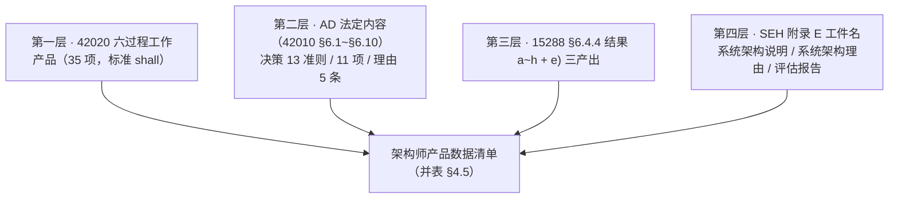

# 架构师职责与产品数据研究报告

## —— 从架构工作定义、生存周期过程到产品数据与审核责任（附过程级参与记号）

**A Research Report on the Architect's Responsibilities and Product Data**

> **编号**：39（研究报告稿）
> **日期**：2026-10-13
> **主题**：以标准正本＋INCOSE《系统工程手册》第五版（同版同年二手）为唯一依据，回答七问——① **架构师的职责是什么**（角色定义、架构工作定义、过程职责、权责边界）；② **他负责开发哪些产品数据**（标准与手册直接给得出的总账）；③ **他负责哪些产品数据的审核**（"审核"在标准里对应的五个动作、三个方向、对象与产出）；④ **在系统生存周期十三个过程里，各以什么形态参与**（过程级责任矩阵及参与记号）；⑤ **没有架构工作会坏在哪**（缺位分析：四种情形、逐项后果、九个可观察症状、最小补救）；⑥ **架构师需要具备哪些能力**（动作 7／判断 4／组织 6 三层 ＋ 本书底座六项）；⑦ **从工程师到架构师怎么提升**（逐能力练法、起点决定功课、六件练不成的事、90 天最小计划，附四案例举例）。**前四问是"是什么"，后三问是"缺了怎样、要什么、怎么长"。**
> **依据（只用标准正本与同版同年二手）**：**ISO/IEC/IEEE 42010:2022**（库内正本全文）｜**ISO/IEC/IEEE 42020:2019**（库内正本全文）｜**ISO/IEC/IEEE 15288:2023**（库内正本全文）｜**ISO/IEC/IEEE 42030:2019**（经 15288 §5.9 注 2 与 SEH 转述引用，本报告未直引其条款号）｜**INCOSE《系统工程手册》第五版中文版**（`20241014-系统工程手册5.0中文版.pdf`，同版同年二手，凡涉 SEH 的结论均为本次实测）
> **取证纪律**：本报告凡涉架构口径的判断只取上述依据；**本项目既有研究报告与教材只作对照与线索，不作判据**（§七 的对照表已逐条标明性质）；**凡涉英文一律英中并列**（逐字引文、术语、缩写、方法名、题名同此），逐字引文紧随「（中译：…）」；**照录不译者三类**——标准条款标签（NOTE／EXAMPLE／shall／should／may）、标准文件号与缩写、本报告自编记号；凡断言"标准里没有"**先做零命中检索**；引用一律标四档——**标准逐字／标准可支持的读法／按定义句作的举例／本报告定性**
> **配套材料**：结论清单见 §十一；未决与挂账见 §十二；**§八~§十 为分析三节**（缺位／能力／提升），均由前六节推演而来、不作判据；正本条号索引见[附录 A](#附录-a本报告引用的正本条号索引)；术语对照见[附录 B](#附录-b术语对照)；过程级参与记号见[附录 C](#附录-c过程级参与记号定义与判据)；缩写与文件号见[附录 D](#附录-d英文缩写与文件号对照)；本轮的自我更正留痕见[附录 E](#附录-e判错留痕)
> **文档版本**：v1.0（2026-10-13 创建）→ **v1.1（同日增补三节并顺延编号）**：新增 **§八 缺位分析**（没有架构工作会坏在哪）、**§九 架构师需要具备哪些能力**（三层能力＋底座）、**§十 从工程师到架构师：练法与验收**（逐能力练法／起点功课／反模式／90 天计划／四案例举例）；**摘要增至三十三条；结论清单增至 31 条；挂账增至 11 项；原 §八~§九 顺延为 §十一~§十二**。三节均为**推演与建议**（依据一律回到 §一~§六），四案例举例取自本书案例设定与报告 38 号 §十四，**只作举例、不作判据**。

---

## 摘要：三十三条

1. **标准里没有"架构师职责表"这一物，这是全篇的方法前提。** 42010 与 42020 立的是 `architecting`（架构工作）与六个架构过程；15288 立的是过程（§6.4.4 系统架构定义过程）；三者都管"做什么、出什么"，**不管"谁做"**。角色分配留在过程的裁剪与应用那一层（42020 §5.8、附录 A）。凡把某份职责表写成"标准规定架构师应……"，都是越界。
2. **唯一给出角色定义的是《系统工程手册》**（SEH 5.0 术语表）：**系统架构师＝负责系统架构的人员、团队或组织，协调工程工作以解决复杂问题并监督其实施**。其源流手册自陈为 Maier 与 Rechtin（2009）"为系统架构师的新角色提供指导"。
3. **这个定义划出三处边界**：① 责任主体可以是**人、团队或组织**——"架构师"是职责，不是头衔；② 职责对象是"**系统架构**"这一物本身；③ 定义内含**协调**与**监督实施**两个动作——不是"画图"。
4. **架构工作的七动词是职责骨架**（42010:2022 §3.1 ＝ 42020:2019 §3.2，同一句）：*conceiving, defining, expressing, documenting, communicating, certifying proper implementation of, maintaining and improving*（中译：构想、定义、表达、编制文档、沟通、证实其正确实施、维护和改进），且**贯穿所关注实体的整个生存周期**。这一句同时否掉两种读法：架构师不是只干一段，也不是画完就走。
5. **标准里唯一把动作明确挂到 "the architect"（架构师）名下的地方，是"证实正确实施"**：42020 §3.2 注 2 逐字——证实架构的正确实施"有时被表述为**架构师向客户或用户作出的正式声明**，即所构建的系统满足可投入使用准则"。因此**"认证／符合性把关"是标准原文的架构师职责**，且天然带一份产品数据（正式声明）。
6. **过程职责由 15288 §6.4.4 的五个活动给出**：准备（a）、概念化（b）、评估（c）、细化（d）、管理结果（e）。**15288 §6.4.4.3 注 1** 是接线句：活动 b)~d) 对应 42020 的**三个核心过程**（概念化、评估、细化）——所以"架构定义"这一格的活，是三个过程的量，不是一步。
7. **治理与管理不是架构师的个人职责，是组织职责**。42020 附录 G.1：架构治理"**通常在组织的较高层级执行**"，向治理委员会问责，其权威机构"有时称为'**设计权威机构**（Design Authority）'"；附录 G.2 切了一刀——**架构管理关注的是管理架构，而不是架构工作的各项活动**。架构师在这一层的标准位置只有一句：15288 §6.4.4.3 e) 3)"为组织的架构治理与架构管理工作提供支持"。
8. **四件架构师不负责的事**：① **不定义目的与任务**（15288 §6.4.4 把过程定位为 *transforms … into*；问题空间由业务或任务分析过程识别定义，§6.4.4.3 b)1) 注 3）；② **不独占拍板权**（42020 §5.7：与架构有关的决策"通常是决策最为相关的某个其他过程"的职责；42010 §6.10.1 要求记录"决策权属方或决策责任人"）；③ **不产设计定义的产物**（15288 §3.13 design 名词义＝*specification of system elements and their relationships*，中译：系统元素及其关系的规格，归 §6.4.5）；④ **不批准架构自身的变更**（受治理与管理过程的指令与监督，42020 §5.7、§6、§7）。
9. **架构师产品数据的第一层（最硬、最全）是 42020 六个过程的 `shall be produced` 工作产品，共 35 项**：治理 4、管理 6、概念化 6、评估 4、细化 7、使能 8。其中**核心三过程 17 项**才是"架构工作"的直接产出。
10. **第二层是架构描述的法定内容**（42010 §6.1~§6.10 十组）：标识与概述、利益相关方、利益相关方角度、关注点、方面体、架构视角、架构视图、视图组件、对应关系、**架构决策与理由**。
11. **决策与理由这一组有三张单子**：**13 条选择准则**（该记哪些决策）、**11 项记录信息**（记录时写什么）、**5 条理由要求**（理由覆盖什么，其中"每项必不可少的架构决策的理由"是 *shall*，其余为 *should*）。
12. **第三层是 15288 §6.4.4 的结果与产出**：结果 a)~h)；e) 管理结果的任务里含**记录关键架构决策及其理由**、**维护双向追溯**、**提供已选定用于基线的关键人工制品**——这三条最常被漏。
13. **第四层是 SEH 附录 E 直接命名的工件**：**系统架构说明**（System Architecture Description，含"目的、系统特性、约束，以及设计决策和理由；识别架构利益相关方及其与架构有关的关切"）、**系统架构理由**（System Architecture Rationale：架构选择、技术/技术系统元素选择、系统需求与架构实体之间分配的理由）、系统架构评估报告、系统架构定义记录/工件、系统架构定义报告、系统架构定义策略/方法。手册另明说：该过程"**最终生成一个系统架构描述**"，且"**系统架构描述应被视为一个动态工件**"。
14. **一处口径必须声明**：SEH 的"系统架构说明"依 ISO/IEC/IEEE 15289:2019 把"**设计决策和理由**"也收进来——手册**不在架构工件与设计工件之间切得那么干净**；本报告所采的架构/设计分野是 **15288 §6.4.5 的过程归属切法**。两种切法都可用，混用即出错。
15. **中文"审核"在标准里对应五个不同动作**：**评审**（review，SEH §2.1.4 引 24748-8/15288.2 定义）、**审计**（audit，查"产品是否符合已发布的产品配置信息"）、**评估**（evaluation/assessment，42020 §9 ＋ 42030 三件事）、**认证／符合性把关**（certifying proper implementation，42010 §3.1）、**验证**（verification，15288 §6.4.9，架构描述是被验证对象之一）。混着说，就会把"评审席位"讲成"签字权"。
16. **他审别人的范围由 42020 §6.4.5 注 4 说死**：该注称访问按架构描述构建的实体，是为验证其符合治理指令确立的义务，且"**仅检查架构的符合性可能不够充分，因为架构特征可能未能恰当转化为该实体的设计或运行**"。所以符合性把关必须**顺转化链扫到设计层与运行层**，不是只看架构文件。
17. **别人也审他，且标准明列两处**：15288 §6.4.9 的验证过程"识别任何人工制品（如系统需求、**架构描述**或设计描述）中的异常"；§6.4.11 注 2 称确认"也适用于在系统定义与实现过程中产生的人工制品（如需求、**架构**、设计、设计特性或系统元素）"。**SEH 给了现成的 AD 评审四判据**：对架构描述进行评估，确保其"符合架构的初衷，并具备**适用性、正确性、完整性和一致性**"。
18. **架构师在过程评审里没有标准赐予的固定席位**。SEH §2.1.4 的技术评审参与者名单（项目经理、首席系统工程师/首席工程师、评审或审计主席、记录员、采购方代表、供应方代表、项目验证与确认负责人、**其他技术负责人**）**未单列"系统架构师"**；评审席位由组织分配，其制度化形态即 42020 附录 G.1 的"设计权威机构"。凡写"架构师是各评审的常设评审人"，须标为本书主张。
19. **评审 ≠ 决策，三处依据**：42020 §5.7（决策通常归其他过程）、42010 §6.10.1（记录须写决策权属方或责任人）、15288 §6.4.4.3 e)2)（收口动词是"**取得一致意见**（obtain agreement）"，不是批准）。故架构师交出的审核形态是**发现与建议、检查记录、偏差与处置记录、条件性合规声明**。
20. **生存周期过程级职责，只用四个记号就能写清**：**接收输入**（该过程交给他、他须接住）／**开发输出**（他编制并对其正确性负责）／**出意见**（他判断别人的东西，不签放行）／**—**（未要求）。四个记号各有判据，见[附录 C](#附录-c过程级参与记号定义与判据)。
21. **十三个过程里只有一格是"开发输出"意义上的主责**：**架构定义**（＝42020 三核心过程之和）；其余为**出意见**（设计定义、实现、集成、验证、确认）、**接收输入**（转换、运行支持、退役的全部或大部）与**开发输出**（业务与任务分析、相关方需要与需求定义、系统需求定义、系统分析、运行支持、退役的架构侧那一份）。
22. **三条判据可判任何一格**：① **规定权**——这一步是否在规定"它是什么"（架构实体在其环境中的基本概念或属性 ＋ 管控原则）；② **依据关系**——这一步的产物是否必须"依据架构／与架构一致"；③ **回声关系**——这一步会不会产出"回改架构"的东西（约束、变更、派生需求、证据）。三条判据的依据分别是架构定义句（42010 §3.2／42020 §3.3）、15288 §3.13＋§6.4.5.3 b)1)b)2)、42020 §5.7 与 15288 §6.4.10/§6.4.12/§6.4.13/§6.4.14 的"约束反馈"任务。
23. **最容易被漏的三格**：**确认**（标准把架构列为确认对象）、**验证**（架构描述在验证对象内）、**转换与退役对架构的回馈**（§6.4.10.3 任务 4)、§6.4.14.3 任务 2) 均明文要求"识别来自本过程的约束与目标，以纳入系统需求、架构或设计"）。**最容易被夸大的是**实现/集成/运行/退役的"架构师批准"——标准无一处给此权。
24. **产品数据与过程两张矩阵必须用两套记号**（这是本节最实用的一条）：**产品数据责任矩阵**量的是**工件归谁**（主责／批准·终责／评审把关／参与／—）；**过程参与矩阵**量的是**过程中的形态**（接收输入／开发输出／出意见／—）。对接口径：产品数据表的"评审把关"＝过程表的 `出意见`＋被审身份；"参与"＝过程表任一方向的物（有物才算参与）。两表共用一个"参与"，即读不懂。
25. **报告与教材对照后的四处实差**：① ch18 现表"**系统元素分配说明**"应改——分配与"转化为设计元素"是**设计定义过程**的任务（15288 §6.4.5.3 b)1)b)2)）；② 五格标准工作产品在现有清单里缺（架构评估报告／分析结果／价值评定结果、质量模型、问题空间定义报告、架构目标与关键成功准则、符合性正式声明、基线候选物）；③ "系统基本概念和基本属性清单""《系统目的或任务理解确认单》""四职责（理解／澄清／质疑／守护）""三粒度责任矩阵"在标准里**没有对应工件名**，须标为本书凝练；④ SEH 的架构工件比本书"架构侧"更宽，两处并读须先声明切法。
26. **本轮的记号修订留痕三条**（详见[附录 E](#附录-e判错留痕)）：① "给／收"作记号时**主语与方向未显式**，可被读反，已改为"**接收输入／开发输出**"（主语自明）；② "开发输出·编"的"**·编**"是赘字——"开发输出"本就含"他编制"，真正要分的是**能不能定**，故拆为"开发输出"与"**出意见**"两个动词；③ "**受检**"不单立记号，并入"接收输入"（验证与确认交到他手上的就是异常报告与确认结果），其身份信息以括注保留。
27. **缺位的后果可以逐项对上产出**：标准不认职位、只认活——42010 第 3 章**没有 `architect` 词条**（只有 §3.1 architecting），唯一角色定义在 SEH 术语表。缺位分四种情形——**真空／头衔型／兼岗／隐性架构**；其中**头衔型最危险**，因为它把缺失伪装成完成（只做了七动词里的第三个"表达"）。逐项后果见 §8.3、症状见 §8.4。
28. **七个动词每一个都对应一组"没有别人会替你产出"的东西**：候选集、基本概念或属性与管控原则、架构描述、关注点台账、符合性检查、演化与债务、决策与理据；另有三条硬产出——**追溯、未处理项与不符合项声明、基线候选物**。缺位就是这些集体缺位，最先坏掉的不是图，是**判据与归属**（§8.2、§8.3）。
29. **能力＝能不能把那七件事跑起来、能不能交出那些产出、能不能立住那些判据**：标准与手册**都不列"架构师能力清单"**（SEH 只给硬技能示例——需求分析、架构评估、风险管理——与软技能若干）。本报告给出三层：**动作 7（对七动词）／判断 4（准入·权衡·顺序·走法）／组织 6（协调·监督·复用·治理素养·领导力·取舍）**，另加本书的底座六项（§九）。
30. **判断层四条各有标准落点**：**准入**的依据是定义句两样内容与"分配到架构实体"（15288 §6.4.4.2 c)）；**权衡**的四件方法是标准点名的——*trade-off study／cost-benefit analysis／engineering analysis／problem-solving analysis*（中译：权衡研究／成本效益分析／工程分析／问题求解分析，如 TRIZ、Kepner-Tregoe）（15288 §6.3.3.1 注 1）；**顺序**的依据是 42010 §6.10.1 的 13 条准则（它管"要不要记"，不管"算不算架构"）；**走法**的依据是 42020 E.3.1 六种起点与 E.3.2 七种途径（§9.4）。
31. **标准承认有一类能力只能从经验来**：`heuristics`（启发式方法）"**源自经验**"且"**并非所有启发式都适用于所有情形**"（42020 E.3.3.5）；另有三种可复用机制——**参考架构**（可*instantiated and specialized*，中译：被实例化并加以特化）、**架构模式**、**战术**（tactics，中译：战术，达成特定系统特性或将其固化于架构原则的原始技术）。练法因此是"**用一次、记一条、标适用条件**"（§10.1、§10.4）。
32. **提升的判据是产出与可接住，不是学时**：四把尺＝**母词尺**（知道自己在七动词哪一环）、**准入尺**（拿掉它还能达成目的吗）、**换手尺**（换个人能不能接着做）、**符合性尺**（查过实现符不符合架构吗）；六件练不成的事里最隐蔽的两件是"**只做表达**"（画图匠式）与"**判断不出纸面**"（老规矩换人做不出来）（§9.6、§10.7）。
33. **起点决定功课**：全新开发练"立判据与取材"、产品线新产品练"实例化并特化"、遗留演进练"不变量识别与增量路径"、遗留革命练"边界与迁移"、增量启动练"**给后续步骤留选项**"（42020 E.3.1.2~E.3.1.7）；本报告另给一个 **90 天最小计划**与**组织侧三件前提**（§10.6、§10.8、§10.9）。

---

## 目录

- [一、前提：依据、证据档位与三条读法纪律](#一前提依据证据档位与三条读法纪律)
- [二、架构师是谁：唯一的角色定义与它划出的边界](#二架构师是谁唯一的角色定义与它划出的边界)
- [三、职责的骨架：三处来源与四件不负责的事](#三职责的骨架三处来源与四件不负责的事)
- [四、产品数据：四层总账与一份并表](#四产品数据四层总账与一份并表)
- [五、审核：五个动作、三个方向、一张对象表](#五审核五个动作三个方向一张对象表)
- [六、生存周期过程级职责：十三个过程与四个记号](#六生存周期过程级职责十三个过程与四个记号)
- [七、与报告库及教材的对照（非判据）](#七与报告库及教材的对照非判据)
- [八、缺位分析：没有架构工作，会坏在哪](#八缺位分析没有架构工作会坏在哪)
- [九、架构师需要具备哪些能力](#九架构师需要具备哪些能力)
- [十、从工程师到架构师：练法与验收（附四案例举例）](#十从工程师到架构师练法与验收附四案例举例)
- [十一、结论清单](#十一结论清单)
- [十二、未决与挂账](#十二未决与挂账)
- [附录 A：本报告引用的正本条号索引](#附录-a本报告引用的正本条号索引)
- [附录 B：术语对照](#附录-b术语对照)
- [附录 C：过程级参与记号（定义与判据）](#附录-c过程级参与记号定义与判据)
- [附录 D：英文缩写与文件号对照](#附录-d英文缩写与文件号对照)
- [附录 E：判错留痕](#附录-e判错留痕)

---

## 一、前提：依据、证据档位与三条读法纪律

### 1.1 依据与档位

本报告的依据只有一份清单：

| 依据 | 库内形态 | 档位 |
|---|---|---|
| ISO/IEC/IEEE 42010:2022《软件、系统与企业——架构描述》 | 中英文对照正本全文 | 一手 |
| ISO/IEC/IEEE 42020:2019《软件、系统与企业——架构过程》 | 中英文对照正本全文 | 一手 |
| ISO/IEC/IEEE 15288:2023《系统与软件工程——系统生存周期过程》 | 中英文对照正本全文 | 一手 |
| ISO/IEC/IEEE 42030:2019《软件、系统与企业——架构评估框架》 | 未直引；仅经 15288 §5.9 注 2 与 SEH p153 转述 | 转述 |
| INCOSE《系统工程手册》第五版中文版（SEH 5.0） | 库内 PDF 全文（413 页），本次实测解析 | **同版同年二手**（与 15288:2023 同年，符合"依据位"规则第 1 条） |

**INCOSE SEH 5.0 为什么可以进依据位**：本项目既定规则把依据位限定为四类——标准正文；官方摘要／官方词汇站／官方目录；**同版同年二手**；标准发布机构或权威团体的公开文件。SEH 5.0（2023-07 中文版）与 15288:2023 同年，属第二类之外的第三类，可用，但**须标明性质**，且其转述不能覆盖标准正本。

### 1.2 第一条纪律：标准不分配角色

这是本报告最重要的一条方法前提，也是全篇结论的边界。

- **42010:2022** 规定的是架构描述的**内容与规格**（第 6~8 章）与概念基础（第 5 章），不规定谁写；
- **42020:2019** 规定的是**六个架构过程**（第 6~11 章）的目的、结果、活动、任务与工作产品，并在 §5.8 与附录 A 讲**过程的裁剪与实例化**——谁执行留在此处；
- **15288:2023** 规定的是**系统生存周期过程**，每项给"目的—预期结果—活动与任务—产出"，同样不分配角色。

因此，凡"架构师负责 X"的表述，本报告都按下面的四档标注来源，读者可逐条检验：

| 档位 | 含义 | 例 |
|---|---|---|
| **标准逐字** | 标准/手册原文直接写着 | "certifying proper implementation"；SEH 的角色定义 |
| **标准可支持的读法** | 由标准条文推出，需标推理链 | "架构师在需求侧是评审者而非编制者" |
| **按定义句作的举例** | 由定义句套到具体情境 | "关切清单由架构师台账化" |
| **本报告定性** | 本报告为回答方便所作的分档与命名 | 四记号、三条判据、五档归纳 |

### 1.3 第二条纪律：报告库只作对照

本项目既有研究报告与教材的结论**不作本报告的判据**，只在 §七 作对照，并逐条标明"对得上／报告有标准无／须改／须补／须标本书主张"。凡对照中出现的分歧，一律回到标准正本复核后落笔。

### 1.4 第三条纪律：英中并列与零命中检索

凡涉英文一律英中并列：逐字引文紧随「（中译：…）」；术语作"英文（中译）"；缩写首现给中文全称＋英文全称。凡断言"标准里没有某词"，先在该正本内做零命中检索再写。

---

## 二、架构师是谁：唯一的角色定义与它划出的边界

### 2.1 唯一的角色定义（SEH 5.0 术语表）

> **系统架构师**：负责系统架构的人员、团队或组织，协调工程工作以解决复杂问题并监督其实施。
> ——SEH 5.0 中文版术语表（PDF p397）

手册自陈其源流（PDF p41）：

> Maier 与 Rechtin（2009）的开创性工作……他们的动机在于为**系统架构师的新角色**提供指导，这个角色是**负责协调工程工作，以制定解决复杂问题的方案并监督其实施的个人或团队**。

### 2.2 三点读法（标准可支持的读法）

1. **责任主体是人、团队或组织**——"架构师"首先是一种**职责**，不是头衔。这解释了为什么小组织里治理、管理、使能三个过程的活常常落在同一个架构师头上（42020 §6、§7、§11 的工作产品由组织侧主责，但组织小则同人兼任）。**这是组织事实，不是标准分配。**
2. **职责对象是"系统架构"这一物**（架构实体在其环境中的基本概念或属性 ＋ 实现与演化的管控原则，42020 §3.3／42010 §3.2），不是"架构描述"这份文件。可交付、可签发、可逐条评审的是 AD（工作产品，42010 §3.3）；架构本身无形而抽象。
3. **定义里含两个动作**：**协调**（coordinate）与**监督实施**（oversee implementation）。"监督实施"与 42010 §3.1 的 *certifying proper implementation* 同向，是标准体系里两处独立表述互相印证的地方。

### 2.3 标准里唯一把动作挂到 "the architect" 名下的地方

42020 §3.2 注 2（架构工作词条的注）：

> *Certifying the proper implementation of an architecture is sometimes captured as a formal statement by the architect to the client or user that the system, as built, meets the criteria as ready for use.*
> （中译：证实架构的正确实施，有时被表述为**架构师向客户或用户作出的正式声明**，即所构建的系统满足可投入使用准则。）

三处可直接用的结论：① "符合性把关"是标准原文的架构师职责，不是引申；② 它的典型产物是一份**面向客户或用户的正式声明**；③ 它与"投入使用准则"挂钩——把关不是内部自娱，是对外交付的一环。

---

## 三、职责的骨架：三处来源与四件不负责的事

### 3.1 架构工作的七个动词（42010:2022 §3.1 ＝ 42020:2019 §3.2）

> *conceiving, defining, expressing, documenting, communicating, certifying proper implementation of, maintaining and improving an architecture throughout the life cycle of an entity of interest*
> （中译：在所关注实体的整个生存周期内，对架构进行构想、定义、表达、编制文档、沟通、证实其正确实施、维护和改进）

七个动词即七条职责，且在生存周期内**持续**。两处常被读掉的细节：**communicating（沟通）**是一个独立动词，不是"写文档"的附属；**maintaining and improving（维护与改进）**把架构师钉在演化上，与后文治理侧的"演化治理"接上。

### 3.2 过程职责：15288 §6.4.4 的五个活动

| 活动 | 标准原任务（择要） |
|---|---|
| **a) 准备（Prepare）** | 识别架构工作需为其提供输入的关键里程碑与决策；定义架构定义策略；**为支持组织的架构治理与架构管理工作做准备并作出规划**；规划并取得使能系统与服务 |
| **b) 概念化（Conceptualise）** | 表征问题空间；**建立架构目标与关键成功准则**；在解空间综合潜在解；**表征解与权衡空间**；构建候选架构；捕获架构概念与属性；与其他架构对齐；协调预期用户对架构的使用 |
| **c) 评估（Evaluate）** | 确定评估目标与准则、方法与准则整合、收集并评审评估信息；**分析架构概念与属性并评定架构的价值**；综合为总体评估以**选择优选的系统架构解**；基于评定结果表征架构；形成发现与建议；捕获并沟通评估结果 |
| **d) 细化（Elaborate）** | 识别或开发架构视角、模型种类与图例；开发模型与视图；**初步接口定义**；关系对齐；评定细化；协调使用 |
| **e) 管理结果（Manage results）** | 监视/评定/控制；**就架构定义取得一致意见**；为组织的架构治理与管理提供支持；**记录关键的系统架构决策及其理由**；**维护系统架构的追溯性**；**提供已选定用于基线的关键人工制品** |

**接线句（15288 §6.4.4.3 注 1，逐字中译）**：系统架构定义过程的活动 b) 至 d) 对应于 ISO/IEC/IEEE 42020 中的**三个核心过程**；以下每项活动之下的任务对应于各 42020 架构过程中的活动。

### 3.3 六个架构过程与"核心三过程"的分野（42020）

| 过程 | 定位 | 工作产品数（§6.5~§11.5） |
|---|---|---|
| §6 架构治理（Architecture Governance） | 组织侧；对**架构集合**的监督与问责 | 4 |
| §7 架构管理（Architecture Management） | 组织侧；管理架构的实施与演进，**不管架构工作的活动** | 6 |
| **§8 架构概念化（Conceptualization）** | **核心**：刻画问题空间、确立架构目标、综合解、刻画权衡空间、形成候选 | 6 |
| **§9 架构评估（Evaluation）** | **核心**：分析、价值评定、评估综合 | 4 |
| **§10 架构细化（Elaboration）** | **核心**：视角与模型种类、视图与模型、**架构描述** | 7 |
| §11 架构使能（Enablement） | 组织侧；能力、服务、资源与模板 | 8 |

**读法**：架构师的"主责区"是第 8、9、10 三行（17 项工作产品）；第 6、7、11 行是组织侧的产品，架构师以支持与执行身份参与（15288 §6.4.4.3 e) 3)）。**过程顺序不具规定性**：42020 附录 A.2.2 明说过程排序 *does not imply any prescriptive order*（中译：并不意味任何规定性的顺序）。

### 3.4 治理与管理：组织职责，架构师的支持位

- **治理**（42020 附录 G.1）：架构治理是一致的管理、协调的标准与方针、恰当的指导、统一的过程和适当的决策权所必需的；它"**通常在组织的较高层级执行**"，对业务单元、项目群、项目提供监督；"宜由某个组织权威机构负责检查各项活动是否按照这些原则执行。该权威机构有时称为'**设计权威机构**（Design Authority）'"。
- **管理**（42020 附录 G.2）："架构管理关注的是**管理架构，而不是架构工作的各项活动**"；它不管架构的开发，管的是架构在设计、构建、部署、运行、维护、退役中的**演进与实施**；它向治理提供计划与状态。
- **架构师的位置**（15288 §6.4.4.3 e) 3)，标准逐字）：*Provide support to organizational architecture governance and architecture management efforts.*（中译：为组织的架构治理与架构管理工作提供支持。）
- **一次可用的对表**：本书与报告库常写"方向权属组织层、内容权属架构师"。**标准没有这句话**；标准说的是层级（治理在组织较高层级）与问责对象（向治理委员会问责），以及"设计权威机构"这一制度角色。该二分应标为**本书主张**。

### 3.5 四件不负责的事

| 不负责 | 依据 |
|---|---|
| **不定义目的与任务** | 15288 §6.4.4 把过程定位为转换（*transforms … into*）：把相关架构、组织与项目的方针与指令、生存周期概念与约束、利益相关方关注点与需求、系统需求与约束，**转化为**系统的基本概念或属性与管控原则；问题/机会空间由业务或任务分析过程识别与定义（§6.4.4.3 b)1) 注 3 明说与业务或任务分析过程协同完成） |
| **不独占拍板权** | 42020 §5.7："与架构有关的决策可结合架构过程作出，但这通常是**决策最为相关**的某个其他过程的职责"；42010 §6.10.1 要求决策记录写"**决策权属方或决策责任人**（identification of decision authority or owner）" |
| **不产设计定义的产物** | 15288 §3.13（design，名词）：*specification of system elements and their relationships, that is sufficiently complete to support a compliant implementation of the architecture*（中译：系统元素及其关系的规格，其完整程度足以支撑对架构的符合性实现）——元素与关系的**规格**归 §6.4.5 设计定义过程 |
| **不批准架构自身的变更** | 架构自身的演进与变更受治理与管理过程的指令与监督（42020 §5.7、§6、§7）；架构师给理由与证据 |

### 3.6 三条判据（本报告定性，用于逐格判断）

| 判据 | 问什么 | 依据 |
|---|---|---|
| **规定权** | 这一步是否在"**规定它是什么**"（实体在其环境中的基本概念或属性 ＋ 管控原则）？ | 42010 §3.2／42020 §3.3；15288 §6.4.4 |
| **依据关系** | 这一步的产物是否必须"**依据架构／与架构一致**"？ | 15288 §3.13；§6.4.5.3 b)1)b)2) |
| **回声关系** | 这一步会不会产出"**回改架构**"的东西（约束、变更、派生需求、证据）？ | 15288 §6.4.4.3 e)4)；§6.4.10.3 4)、§6.4.12.3 2)、§6.4.13.3 3)、§6.4.14.3 2)；42020 §5.7 |

三条判据分别决定三种档位：**主责／评审把关／提供输入·接收反馈**。全生存周期只有一格落在"主责"。

---

## 四、产品数据：四层总账与一份并表

### 4.1 第一层：42020 六个过程的工作产品（标准逐字，`shall be produced`）

| 过程 | 工作产品（英中并列） |
|---|---|
| §6 架构治理 | architecture governance plan（架构治理计划）／architecture governance directives and guidance（架构治理指令与指导）／architecture governance compliance status report（架构治理符合性状态报告）／architecture collection objectives（架构集合目标） |
| §7 架构管理 | architecture management plan（架构管理计划）／architecture management status report（架构管理状态报告）／architecture management work instructions and guidance（架构管理作业指导书与指南）／architecture management charter（架构管理章程）／execution plan（执行计划）／execution status report（执行状态报告） |
| **§8 概念化** | architecture conceptualization plan（架构概念化计划）／architecture conceptualization status report（状态报告）／**problem space definition report（问题空间定义报告）**／**architecture objectives（架构目标）**／**quality model（质量模型）**／**architecture views and models（架构视图与模型）** |
| **§9 评估** | architecture evaluation plan（架构评估计划）／**architecture evaluation report（架构评估报告）**／**architecture value assessment results（架构价值评定结果）**／**architecture analysis results（架构分析结果）** |
| **§10 细化** | architecture elaboration plan（架构细化计划）／architecture elaboration status report（状态报告）／**architecture viewpoints（架构视角）**／**model kinds（模型种类）**／**architecture views（架构视图）**／**architecture models（架构模型）**／**architecture descriptions（架构描述）** |
| §11 使能 | architecture enablement plan（架构使能计划）／status report（状态报告）／architecture framework（架构框架）／architecture viewpoint（架构视角）／catalog of enabling capabilities（使能能力目录）／catalog of enabling services（使能服务目录）／catalog of enabling resources（使能资源目录）／architecture work product templates（架构工作产品模板） |

**两处注（均标准逐字义）**：
- §8.5 注：早期阶段"有时重要的是敏捷而迅速地概念化许多备选架构。其中一些早期架构描述不过是一些草图"；更完整的形式在细化过程开发。
- §10.5 注：视角、模型种类、视图与模型通常由概念化或细化过程开发；若做成**通用化**供多个架构工作使用，可改由**使能过程**生成。

### 4.2 第二层：架构描述的法定内容（42010 §6.1~§6.10）

十组内容要件：标识与概述（§6.1）、利益相关方（§6.2）、利益相关方角度（§6.3）、关注点（§6.4）、方面体（§6.5）、架构视角（§6.6）、架构视图（§6.7）、视图组件（§6.8）、对应关系（§6.9）、**架构决策与理由（§6.10）**。

**§6.2 里两样评审第一眼就要看的**：
- AD **应包含**"对已知资源限制或其他约束的陈述，这些限制或约束使该 AD 未能处理已识别的利益相关方和架构考量因素"；
- "**应识别不符合项，并给出理由予以说明**"（*Non-conformances shall be identified and explained with rationales*）。

**§6.10.1 的三张单子**：

**（一）该记哪些决策——13 条选择准则**：涉及架构上重要的要求；作出、实施或强制执行需要大量精力或时间；影响关键利益相关方或若干利益相关方；应对基本关注点（如性能、可演化性、安全性）；需要复杂或非显而易见的推理；对变更高度敏感；变更代价可能高昂；构成项目策划与管理基础（如创建工作分解结构、关键链识别、质量门禁跟踪）；导致以已知信息替换假设；导致重大资本支出或间接成本；与需求符合性相关联；与技术标准选择相关联；与系统脆弱性缓解相关联。

**（二）记录时写什么——11 项**：决策的唯一标识；对决策的清晰陈述；**决策权属方或决策责任人**；影响该决策的约束和假设；链接到所涉关注点或方面体；链接到受影响的 AD 元素；链接到决策理由；与其他决策的关系；该决策的后果；决策作出、获批和修改的时间戳；附加信息的来源引用。

**（三）理由记录——5 条（§6.10.2）**：为使用而选择的**每个架构视角**的理由（should）；选用的**每个 ADF 与 ADL** 的理由（should）；**每项必不可少的架构决策**的理由（**shall**）；考虑备选方案的证据与选择理由（should）；**AD 局限性的理由**（should，如资源问题、时间问题，以及因其他 AD 已涵盖而省去的投入）。

**一处限定**：§6.10.1 注 2 明说"决策清单并非意在穷尽"。

### 4.3 第三层：15288 §6.4.4 的结果与产出

**结果 a)~h)**：问题空间针对关键利益相关方关注点、语境与角度被细化；架构与适用方针、指令、目标、约束对齐；对架构决策有意义的概念、属性、特性、行为、功能或约束被分配到架构实体；已识别的关注点被架构应对；架构元素对关键相关方需求与系统需求的可追溯性建立；系统的架构视图与模型被开发；**系统元素及其彼此之间的接口得到定义**；使能系统或服务可用。

**e) 管理结果的三条硬产出**：记录关键架构决策与理由（注 10：理由包括有关主要备选方案与使能因素的信息）；维护双向追溯（注 11：架构实体（模型、视图、视角）↔ 需求（含已分配、已分解、已派生）、接口定义、分析结果、验证方法或技术；如有可能，也追到相关方关注点）；提供已选定用于基线的关键人工制品（注 12：本过程识别基线候选对象，随后交给配置管理）。

### 4.4 第四层：SEH 附录 E 直接命名的工件

| 工件 | 手册释义（逐字中译） |
|---|---|
| **系统架构说明**（System Architecture Description） | 对目标系统的基本概念，包括其目的、系统特性（如可行性、性能、安全性和互操作性）、约束，**以及设计决策和理由**。识别架构利益相关方和这些利益相关方与架构有关的关切。（据 ISO/IEC/IEEE 15289:2019 调整） |
| **系统架构理由**（System Architecture Rationale） | 对**架构选择**、**技术/技术系统元素选择**以及**系统需求和架构实体之间的分配**的理由 |
| 系统架构评估报告 | 提供系统架构评估的结果，包括评估准则 |
| 系统架构定义记录/工件 | 与系统架构定义相关的数据、信息或知识的永久性、可读形式 |
| 系统架构定义报告 | 为了与相关方沟通系统架构定义活动的状态、结果和成果所准备的报告 |
| 系统架构定义策略/方法 | 执行系统架构定义所需的方法、时间安排、资源以及特定的考虑事项 |

**手册另给的四处（PDF pp. 133~138／印刷页 133~138）**：
- 该过程"**最终生成一个系统架构描述**，供项目、组织、其他机构和各种利益相关方使用"；"**系统架构描述应被视为一个动态工件**，以反映不断变化的期望以及我们对系统解决方案理解的演化"；
- 架构活动产生的"**项目视图和其他相关视图**"通常反过来指导 PMP（项目管理计划）与 SEMP（系统工程管理计划）；
- 细化活动含"**初步接口定义**"，"包括系统内部元素之间的接口以及与系统边界外实体的外部接口"；
- 对架构描述的评估须确保其"**符合架构的初衷，并具备适用性、正确性、完整性和一致性**"。

**一处口径声明（重要）**：SEH 的"系统架构说明"把"设计决策和理由"收进来了（其来源标为 15289）。**手册不在架构工件与设计工件之间切得那么干净**。本书所采的架构/设计分野是 **15288 §6.4.5 的过程归属切法**（设计＝元素及其关系的规格）。两种切法并存可以，混用不行。

### 4.5 并表：架构师产品数据清单（三档，标性质）

标注：`标`＝标准/手册直接给；`书`＝本书或报告库的凝练（标准无对应工件名）；`组`＝组织侧主责，架构师支持或执行。

| # | 产品数据 | 依据 | 性质 |
|---|---|---|---|
| 1 | 架构定义策略与方法 | 15288 §6.4.4.3 a)2)；42020 §8.5 概念化计划／§10.5 细化计划 | 标 |
| 2 | 关键里程碑与决策清单 | 15288 §6.4.4.3 a)1) | 标 |
| 3 | 问题空间定义报告 | 42020 §8.5 | 标 |
| 4 | 质量模型 | 42020 §8.5 | 标 |
| 5 | 架构目标与关键成功准则 | 15288 §6.4.4.3 b)2)；42020 §8.5 | 标 |
| 6 | 利益相关方 × 关注点台账 | 42010 §6.2／§6.4 | 标 |
| 7 | 候选架构集（每条带目的陈述） | 15288 §6.4.4.3 b)5)；42020 §8.4.5 e) | 标 |
| 8 | 权衡空间与候选×判据矩阵 | 15288 §6.4.4.3 b)4)；42020 §8.4.6 | 标 |
| 9 | 架构评估计划／评估报告／分析结果／价值评定结果 | 42020 §9.5 | 标 |
| 10 | **架构描述 AD**：视角规格、视图、模型、视图组件、对应关系 | 42010 §6.6~§6.9；42020 §10.5 | 标 |
| 11 | **架构决策记录（ADR）与理由** | 42010 §6.10；15288 §6.4.4.3 e)4) | 标 |
| 12 | 初步接口定义 | 15288 §6.4.4.3 d)；SEH p151 | 标 |
| 13 | 架构追溯（双向） | 15288 §6.4.4.3 e)5) | 标 |
| 14 | 基线候选物与架构基线 | 15288 §6.4.4.3 e)6)；42020 附录 E.2.2（基线架构作为评审的同步关键点） | 标 |
| 15 | **架构符合性检查记录与正式声明** | 42010 §3.1 *certifying*；42020 §3.2 注 2；42010 附录 D.2 o) | 标 |
| 16 | 架构定义状态报告 | 42020 各过程"状态报告"；SEH 附录 E | 标 |
| 17 | 未处理项与不符合项声明（含理由） | 42010 §6.2 | 标 |
| 18 | 评审问题的处置记录 | 42020 §9.4 h) | 标 |
| 19 | 系统基本概念和基本属性清单 | 无对应工件名；由 42010 §3.2 定义句拆出 | 书 |
| 20 | 《系统目的或任务理解确认单》 | 无对应工件名；标准只到"识别相关方与关注点" | 书 |
| 21 | 派生需求清单／演化路线图／技术债台账 | 标准无此命名；派生需求可经 §6.4.3 注 23 追溯 | 书 |
| 22 | 架构治理计划、治理指令与指导、符合性状态报告、架构集合目标 | 42020 §6.5 | 组 |
| 23 | 架构管理计划、章程、作业指导与指南、执行计划与状态 | 42020 §7.5 | 组 |
| 24 | 架构框架、使能能力/服务/资源目录、工作产品模板 | 42020 §11.5 | 组 |

**参与或支持、非个人主责的另一侧**：系统需求、集成、验证与确认、部署与运维（系统工程师侧，本书读法）。

### 4.6 一张四层的关系图

---

## 五、审核：五个动作、三个方向、一张对象表

### 5.1 五个动作的辨析（先把词拆开）

| 动作 | 定义与依据 | 管什么 |
|---|---|---|
| **评审/审查**（review） | SEH §2.1.4 引 ISO/IEC/IEEE 24748-8/IEEE 15288.2：技术评审是"在系统生命周期中的逻辑过渡点进行的一系列系统工程活动，通过这些活动，**使用双方达成一致的标准，评估[项目]的进展是否符合技术要求**" | 进展与阶段的达标 |
| **审计**（audit） | 同处：审计是"对**过程、产品定义信息、需求符合性验证文档**的详细审核，以及对产品本身的详细检查，以确认产品是否满足已要求的特性，**或产品是否符合已发布的产品配置信息**" | 与已发布配置信息的一致性 |
| **评估**（evaluation/assessment） | 42020 §9；42030（15288 §5.9 注 2：*performing architectural analysis, value assessment, and evaluation synthesis*，中译：执行架构分析、价值评定与评估综合） | 架构值不值、够不够 |
| **认证/符合性把关**（certifying proper implementation） | 42010 §3.1；42020 §3.2 注 2（架构师向客户或用户的正式声明） | 实现是否"按架构" |
| **验证**（verification） | 15288 §6.4.9：*identifies the anomalies in any artefact (e.g. system requirements, architecture description, or design description)*（中译：识别任何人工制品（如系统需求、架构描述或设计描述）中的异常） | 人工制品本身对不对 |

**四者的关系一句话**：**评审是场子，评估是方法，认证是结论，审计是查配置，验证是查制品。**

### 5.2 方向一：他审别人——符合性把关扫到哪一层

**核心依据（42020 §6.4.5 任务 d) 与注 4，标准逐字中译）**：

> d) 允许适当职权者直接访问按设计构建的实体，该设计基于架构的架构描述，以验证其符合治理指令所确立的义务。
> **注 4**：此种访问是为了能够验证系统、企业、软件项、服务或其他种类的架构实体符合治理指令所确立的义务。**仅检查架构的符合性可能不够充分，因为架构特征可能未能恰当转化为该实体的设计或运行**（*Merely checking the architecture for conformance could be insufficient since the architectural features could lack proper translation into design or operation of the entity.*）。

42010 附录 D.2 同旨：o) AD 的一项用途是"**确立对实现进行符合某一架构的认证的准则**"；p) 是"作为对外部、项目群、项目或组织特定方针……的符合性机制"。

**为什么必须扫到设计层**：15288 §3.13 说设计的完整程度要"足以支撑**对架构的符合性实现**"；§6.4.5.3 b) 的任务 1)、2) 正是"把**架构实体与关系**转化为设计元素""把**架构特性**转化为设计特性"。转化做得对不对，只有架构侧能判——这是评审席位的来源。

**他审的对象清单**：

| 审核对象 | 依据 | 动作与产出 |
|---|---|---|
| **设计定义产物**（模块详细定义、技术方案、设计特征） | 15288 §6.4.5.3 b)1)b)2)、§3.13；42020 §6.4.5 注 4 | 符合性把关 → 符合性检查记录、偏差处理记录 |
| **技术选型是否违背管控原则** | 42020 §8.4.7；42010 §6.10.2 | 评审意见 → 违背项与理由留痕 |
| **接口定义与接口实现** | 15288 §6.4.4.3 d)、§6.4.5 注 10 | 评审＋裁决建议 → 接口变更裁决记录、ICD |
| **集成/验证/确认计划是否覆盖架构要求** | 15288 §6.4.4.3 e)5)；SEH p151 | 评审 → 追溯核查意见 |
| **实现的符合性** | 42020 §6.4.5 d)；42010 §D.2 o) | 认证 → 符合性证据、条件性合规声明 |
| **需求中与架构相关者** | 15288 §6.4.4.3 b)1) 注 3；42010 §6.2／§6.4 | **评审/参与，不是主审** |
| **治理指令在项目里的落实** | 42020 §6.4.5 c)e)、§6.4.6 | 支持/执行 → 符合性状态报告（组织侧主责） |

### 5.3 方向二：别人审他——架构自己是被审对象

- **15288 §6.4.9**：验证过程识别任何人工制品（含**架构描述**）中的异常；§6.4.9.2 e)：提供"已实现的系统满足需求、**架构**与设计"的客观证据。
- **15288 §6.4.11 注 2**：确认"也适用于在系统定义与实现过程中产生的人工制品（如需求、**架构**、设计、设计特性或系统元素）"。
- **SEH 的 AD 评审四判据**（pdf p151）：对架构描述进行评估，确保其"**符合架构的初衷**，并具备**适用性、正确性、完整性和一致性**"。
- **42010 §6.1~§6.10 就是"法定内容 ＋ 可评条件"**：视角须有理由、视图须有视角、对应关系须记录、决策与理由须记录、**不符合项须识别并说明理由**。
- **架构师在这一向的职责不是"通过"，是"让架构可评"**：给理由（§6.10.2 五条）、给备选被考虑的证据、给局限性理由、准备评审材料，并按 15288 §6.4.4.3 e)2)"就架构定义取得一致意见"。
- **一处现场细节**：42020 §9.4 j) 要求评估更新时"**与发起人、架构师及其他有关方一道评审变更**"——架构师既是被评方，也是评审参与方。

### 5.4 方向三：过程评审里的席位

- **SEH §2.1.4 的代表性技术评审清单**：可选的系统评审（ASR）、系统需求评审（SRR）、系统功能评审（SFR）、初步设计评审（PDR）、关键设计评审（CDR）、测试准备情况评审（TRR）、功能配置评审（FCA）、系统验证评审（SVR）、生产准备情况评审（PRR）、物理配置评审（PCA）；NASA 一栏另有任务概念评审（MCR）、任务定义评审（MDR）、系统定义评审（SDR）、系统集成评审（SIR）、运行准备情况评审（ORR）、飞行准备评审（FRR）、任务准备情况评审（MRR）等。
- **良好实践（择要）**："为每次评审和审计**建立明确的进入和退出标准**"；"**确定准备、实施和接受每次评审的角色和责任**"；"邀请主题专家（SMEs）和独立评审人员参与"；"对出现的所有问题**明确记录责任和截止日期**"。
- **参与者名单**：项目经理；首席系统工程师／首席工程师／主要工程师；评审或审计主席；记录员；采购方代表；供应方代表；项目验证与确认负责人；**其他技术负责人**。
- **如实说**：名单里**没有单列"系统架构师"**——他落在"其他技术负责人"这一类。**评审席位是组织分配的，不是标准赐予的**；其制度化形态即 42020 附录 G.1 的"设计权威机构"。
- **项目侧的过程依据**：15288 §6.3.2（项目评定与控制过程）任务 7)"开展所需的管理评审与技术评审、审计与检查"（注 5 引 ISO/IEC/IEEE 24748-8）。

### 5.5 一条必须写死的分界：评审 ≠ 决策

- 42020 §5.7：与架构有关的决策"通常是决策最为相关的某个其他过程"的职责；
- 42010 §6.10.1：记录须写"决策权属方或决策责任人"；
- 15288 §6.4.4.3 e)2)：收口动词是"**取得一致意见**（obtain agreement）"，不是批准；
- 42020 §9.4 g)：评估的产出是"**形成发现与建议**（findings and recommendations）"。

**结论**：架构师交出的审核形态是**意见、检查记录、偏差与处置记录、条件性合规声明**——除非组织另授予他"设计权威机构"的身份，否则他不签发。

### 5.6 审核对象总表

| # | 审核对象 | 依据 | 他的动作 | 产出 | 性质 |
|---|---|---|---|---|---|
| 1 | 架构描述 AD（视角/视图/模型/对应关系/决策与理由） | 42010 §6、§6.10；SEH p151 四判据 | 备材料、受评、修改 | AD、理由、局限性理由、不符合项声明 | 标 |
| 2 | 候选架构与权衡空间 | 15288 §6.4.4.3 c)；42020 §9.4 | 评（含被评） | 评估报告、分析结果、价值评定结果 | 标 |
| 3 | 需求中与架构相关者 | 42010 §6.2／§6.4；15288 §6.4.4.3 b)1) 注 3 | 评审/参与 | 关切清单、架构约束输入 | 标 |
| 4 | 设计定义产物 | 15288 §6.4.5.3 b)1)b)2)、§3.13；42020 §6.4.5 注 4 | 符合性把关 | 符合性检查记录、偏差处理记录 | 标 |
| 5 | 接口定义与接口实现 | 15288 §6.4.4.3 d)、§6.4.5 注 10 | 评审＋裁决建议 | 接口变更裁决记录、ICD | 标 |
| 6 | 集成/验证/确认计划与报告 | 15288 §6.4.4.3 e)5)；SEH p151 | 评审 | 意见、追溯核查 | 标 |
| 7 | 实现的符合性（按设计构建的实体） | 42020 §6.4.5 d)；42010 §D.2 o) | 认证／声明 | 符合性证据、条件性合规声明 | 标 |
| 8 | 治理指令在本项目的落实 | 42020 §6.4.5 c)e)、§6.4.6 | 支持／执行 | 符合性状态报告 | 组 |
| 9 | 架构自身的变更 | 42020 §5.7、§6、§7 | 发起＋出理由 | 架构变更申请、影响分析 | 标 |
| 10 | 架构基线 | 42020 附录 E.2.2；15288 §6.4.4.3 e)6) | 提名候选、受控 | 基线候选物 | 标 |

---

## 六、生存周期过程级职责：十三个过程与四个记号

### 6.1 这一节回答什么

把架构师放回 15288:2023 技术过程的横轴（§6.4.1~§6.4.14，共十四项；本报告按讨论口径合并为十三项：**转移**＝§6.4.10 转换过程 Transition，**运行支持**＝§6.4.12 运行 ＋ §6.4.13 维护），逐过程给出参与形态。

### 6.2 四个记号（本报告定性；判据见[附录 C](#附录-c过程级参与记号定义与判据)）

| 记号 | 含义 |
|---|---|
| **接收输入** | 该过程交给他、他必须接住的东西。是**责任上的接收**，不是时间上的先后——15288 §5.9 明说这几件事迭代且并行 |
| **开发输出** | 他编制、并对正确性负责的东西（缺了它，该过程跑不动；内容是他说了算） |
| **出意见** | 他判断**别人**的东西（评审、符合性判断），**不签放行** |
| **—** | 标准与组织都未要求 |

**为什么"开发输出"与"出意见"必须分成两个动词**：AD 与"符合性检查意见"不是一类东西——前者他能定，后者只能提。三条依据同指这一界：42020 §5.7、42010 §6.10.1、15288 §6.4.4.3 e)2)。若一律写作"开发输出"，读者会认为他对自己的意见也有定夺权，本书"评审通过 ≠ 决策作出"（ch8）这一句就被抹掉了。

**其它两项写法上的定则（本轮修订结果）**：
- 记号只写"接收输入/开发输出"六个字，**主语自明、方向自明**（主语是架构师），不需再加箭头；
- 不用"·编/·意"这类后缀——"开发输出"本就含"他编制"，真正要分的是"**能不能定**"，用两个动词即可。

### 6.3 十三个过程的架构师参与形态

| # | 过程（15288:2023） | 系统架构师 |
|---|---|---|
| 1 | **业务与任务分析** §6.4.1 | 接收输入：优选解类｜开发输出：问题空间的架构视图（能力/运行/用户视图） |
| 2 | **相关方需要与需求定义** §6.4.2 | 接收输入：相关方需要与需求｜开发输出：关切清单、利益相关方×角度台账 |
| 3 | **系统需求定义** §6.4.3 | 接收输入：派生需求回流｜开发输出：架构侧对需求的反约束｜出意见：需求对架构的充分性 |
| 4 | **设计定义** §6.4.5 | 接收输入：分配/划分/对齐的整合或确认｜开发输出：架构实体与关系、架构特性、接口定义｜出意见：符合性 |
| 5 | **架构定义** §6.4.4 | **开发输出（主责）**（＝42020 三核心过程之和） |
| 6 | **系统分析** §6.4.6 | 接收输入：分析结果（含备选架构评定）｜开发输出：分析命题与判据 |
| 7 | **实现** §6.4.7 | 接收输入：实现偏差｜开发输出：架构约束｜出意见：符合性 |
| 8 | **集成** §6.4.8 | 开发输出：接口定义、架构对集成顺序的约束｜出意见：接口问题 |
| 9 | **验证** §6.4.9 | 接收输入：异常与验证证据（来源含对架构描述的审查）｜开发输出：验证方法与判据｜出意见：方案覆盖性 |
| 10 | **转换（转移）** §6.4.10 | 接收输入：转换约束 |
| 11 | **确认** §6.4.11 | 接收输入：确认结果（来源含对架构的确认）｜出意见：确认参与 |
| 12 | **运行支持**（运行 §6.4.12 ＋ 维护 §6.4.13） | 接收输入：运行/维护反馈｜开发输出：架构对运维的约束与演化原则 |
| 13 | **退役（处置）** §6.4.14 | 接收输入：处置约束｜开发输出：处置的架构侧约定（数据归档、能力迁移、替换路径） |

### 6.4 逐格的依据（同序）

| # | 依据 |
|---|---|
| 1 | 15288 §6.4.1 注 12：解空间刻画"往往调用系统架构定义过程，针对某一用户架构视角产出架构视图（如能力视图、项目群视图、运行视图、用户或人的视图）"；§6.4.4.3 b)3) 注 4：业务或任务分析过程为解空间建立优选的备选解类 |
| 2 | 42010 §6.2（AD 应识别持有基本关注点的利益相关方）、§6.3（角度与持有者的关联）、§6.4（关注点识别）；15288 §6.4.2.1（含法律、法规、环境限制与伦理价值） |
| 3 | 15288 §6.4.3.1（要求宜不暗示任何特定实现）；§6.4.3 注 18（确认系统需求是对其他过程**尤其是架构与设计**必要且充分的输入）；注 23（双向追溯含已分配、已分解、已派生需求） |
| 4 | 15288 §6.4.5.1 注 2（设计定义过程向架构定义过程反馈，以整合或确认架构实体到系统元素的分配、划分与对齐）；§6.4.5.3 b)1)b)2)；注 8（跨架构与需求作权衡）；§3.13 |
| 5 | 15288 §6.4.4 全文；§6.4.4.3 注 1（b)~d) 对应 42020 三核心过程） |
| 6 | 15288 §6.4.6.1（服务对象含"备选架构或系统元素的评定"）；§6.4.4.3 c) 注 5（评估与系统分析、决策管理协同）；§6.4.6 注 10（分析结果与所支持决策／所提供理由的对象之间保持追溯，如系统需求值、备选架构） |
| 7 | 15288 §6.4.7.1（把需求、架构与设计转化为行动；结果满足需求、**架构**与设计）；§6.4.7.3 任务 2)（识别来自实现的约束以纳入需求、架构或设计） |
| 8 | 15288 §6.4.8 注 3（集成策略排序"依据系统需求与**系统架构定义**的优先级，聚焦于接口"）；§6.4.8.3 任务 3)（识别来自集成的约束与目标，以纳入系统需求、架构或设计） |
| 9 | 15288 §6.4.9.1（识别任何人工制品含**架构描述**的异常）；§6.4.9.2 e)（满足需求、**架构**与设计的客观证据）；§6.4.4.3 e)5) 注 11（架构实体↔验证方法或技术的追溯） |
| 10 | 15288 §6.4.10.3 任务 4)（识别来自转换的系统约束与目标，以纳入系统需求、**架构**或设计） |
| 11 | 15288 §6.4.11 注 2（确认也适用于人工制品：需求、**架构**、设计、设计特性或系统元素） |
| 12 | 15288 §6.4.12.3 任务 2)、§6.4.13.3 任务 3)（识别来自运行／维护的约束与目标，以纳入系统需求、架构或设计）；§6.4.13 注 18（适应性、增加性、完善性维护动作通常涉及需求、架构或设计的变更，可能需要另立项目）；42020 §5.7（架构适配） |
| 13 | 15288 §6.4.14.3 任务 2)（识别来自处置的约束与目标，以纳入系统需求、**架构**与设计特性）；42020 §3.3（管控原则覆盖"该实体及其相关生存周期过程的实现与演化"） |

### 6.5 五档归纳

- **主责（开发输出）**：**架构定义**一格。而这一格是三核心过程之和。
- **评审把关（出意见）**：设计定义、实现、集成、验证；确认算半格（出意见 ＋ 被确认）。
- **提供输入（开发输出，但物交给别的过程）**：业务与任务分析、相关方需要与需求定义、系统需求定义、系统分析、运行支持、退役。
- **接收反馈**：系统分析、设计定义、转换、运行支持、退役（都要"回改架构"的判断权）。
- **基本不主责执行**：转换、运行支持、退役，以及实现／集成／验证的执行本身——执行归系统工程师一线，架构师在"是否符合架构"这一层。

### 6.6 三个最容易搞错的地方

1. **最容易漏的是确认。** 本书（ch8）判词是"确认对用途"，读者容易顺势把架构师排除在确认之外；标准恰恰把架构列为确认对象（15288 §6.4.11 注 2），他在场且是**被确认的一方**。
2. **最容易夸大的是实现/集成/运行/退役的"架构师批准"。** 这四项标准里没有一处给架构师批准权；他只有"约束下发 ＋ 符合性把关 ＋ 收反馈"三件事。
3. **最容易漏的是转换与退役对架构的回馈。** §6.4.10.3 任务 4) 与 §6.4.14.3 任务 2) 都明文要求"识别来自本过程的约束与目标，以纳入系统需求、**架构**或设计"——这两句把部署现场与退役处置正式接进架构的输入端。

### 6.7 三角色过程级矩阵（本书读法，非标准）

**先声明**：标准不分配角色，下表"系统工程师／模块工程师"两列采自本书读法（与产品数据责任矩阵同源），**只作对表用**；系统架构师一列的依据见 §6.3~§6.4。

| 过程 | 系统架构师 | 系统工程师 `书` | 模块工程师 `书` |
|---|---|---|---|
| 业务与任务分析 | 接收输入＋开发输出（架构视图） | 主责 | — |
| 相关方需要与需求定义 | 接收输入＋开发输出（关切台账） | 主责 | 参与 |
| 系统需求定义 | 接收输入＋开发输出＋出意见 | 主责 | 参与 |
| 设计定义 | 接收输入＋开发输出＋出意见 | 主责 | 主责（模块级） |
| **架构定义** | **开发输出（主责）** | 参与（取得一致意见） | — |
| 系统分析 | 接收输入＋开发输出 | 主责 | 参与 |
| 实现 | 接收输入＋开发输出＋出意见 | 主责 | 主责（模块级） |
| 集成 | 开发输出＋出意见 | 主责 | 参与 |
| 验证 | 接收输入＋开发输出＋出意见 | 主责 | 主责（模块级） |
| 转换（转移） | 接收输入 | 主责 | 参与 |
| 确认 | 接收输入＋出意见 | 主责 | 参与 |
| 运行支持 | 接收输入＋开发输出 | 主责 | 主责（模块级） |
| 退役（处置） | 接收输入＋开发输出 | 主责 | 参与 |

### 6.8 两套矩阵的记号不能通用（本报告最实用的一条）

| 矩阵 | 量的对象 | 记号集 |
|---|---|---|
| **产品数据责任矩阵**（本书既有） | **工件**归谁 | 主责／批准·终责／评审把关／参与／— |
| **过程参与矩阵**（本节） | **过程**里他站哪 | 接收输入／开发输出／出意见／— |

**对接口径**：产品数据表的"评审把关"＝过程表的 `出意见` ＋ 被审身份；"参与"＝过程表任一方向的物（**有物才算参与**）；"主责"＝过程表的 `开发输出`。**两表共用一个"参与"、或把"评审把关"当成一个动作，就读不懂**——这正是本节四记号要解决的问题。

---

## 七、与报告库及教材的对照（非判据）

**纪律**：本节全部内容**不作判据**，只为取料与修订提供线索；凡涉标准口径，以第一至六节为准（**§八~§十 是据此推演的分析与建议，同样不作判据**）。

### 7.1 对得上的

| 报告侧说法 | 本报告对应结论 |
|---|---|
| ch18 §18.4.6 十三项产品数据、13 号 §7.5.1 二十二项，主干与标准工作产品重合 | §4.5 清单 |
| "文档是载体，决策与理由（rationale）才是灵魂" | 42010 §6.10（决策 11 项 ＋ 理由 5 条）；15288 §6.4.4.3 e)4) |
| "架构符合性把关是矩阵没画出来的那层" | 42010 §3.1 *certifying proper implementation*；42020 §3.2 注 2；42020 §6.4.5 注 4 |
| 产品数据责任矩阵里架构师那一列"评审"位（系统详细定义/技术方案/集成测试/验证确认/模块级全部） | §6.3 第 4、7、8、9、11 行；依据 15288 §6.4.5.3 b)1)b)2) ＋ 42020 §6.4.5 注 4 |

### 7.2 报告有、标准无（须标"本书凝练"）

| 报告侧物件 | 标准侧状况 |
|---|---|
| 四职责（理解／澄清／质疑／守护） | 标准只到"识别利益相关方与关注点"（42010 §6.2／§6.4）与"与业务或任务分析协同"（15288 §6.4.4.3 b)1) 注 3）；四职责无对应条文 |
| 《系统目的或任务理解确认单》 | 无对应工件名；"业务方签字确认目的"这一工件形态是本书凝练 |
| 系统基本概念和基本属性清单 | 42020 §8.5 工作产品无此名；系由 42010 §3.2 定义句拆出的登记表 |
| 三粒度责任矩阵（系统架构师／系统工程师／模块工程师） | 标准按过程与实体分层，不做这三格分工 |
| 框架定义、派生需求清单、演化路线图、技术债台账、架构健康度指标 | 标准工作产品无此命名（派生需求可经 §6.4.3 注 23 追溯） |
| "方向权属组织层、内容权属架构师" | 标准只说治理层级与问责对象（42020 附录 G.1）与"设计权威机构"，无此二分 |

### 7.3 须改的一处（具体）

**ch18 §18.4.6 表的"系统元素分配说明"（该行在 §18.4.6 小结句里又复现一次）**：须分两半看——**分配到架构实体**确在架构侧（15288 §6.4.4.2 c)：对系统架构决策具有重要意义的概念、属性、特性、行为、功能或约束**被分配到架构实体**）；而**把系统需求分配到系统元素**与**把架构实体与关系转化为设计元素**是**设计定义过程**的任务（§6.4.5.3 b)1)、b)2)）。ch18 现题面作"把架构特性'划分、对齐、分配'到**系统元素**"，落点在设计侧，故须改：或改题面为"**架构实体与关系、架构特性（设计定义的输入）**"，或整行移交设计章。

### 7.4 须补的六格（标准明文、现有清单缺）

1. **架构评估报告／分析结果／价值评定结果**（42020 §9.5）——现有清单只有"架构权衡报告"；
2. **质量模型**（42020 §8.5）；
3. **问题空间定义报告**（42020 §8.5）；
4. **架构目标与关键成功准则**（15288 §6.4.4.3 b)2)；42020 §8.5）——ch11 有、ch18 清单无；
5. **符合性正式声明**（42020 §3.2 注 2）——正文提过把关，未入清单；
6. **未处理项与不符合项声明（含理由）／基线候选物**（42010 §6.2；15288 §6.4.4.3 e)6)）。

### 7.5 须标"本书主张"的两处

1. **"架构师是各评审的常设评审人"**——SEH §2.1.4 参与者名单未单列系统架构师（§5.4）；
2. **架构侧与设计侧的切法**——本书采 15288 §6.4.5 的过程归属切法，而 SEH 的"系统架构说明"依 15289 更宽（§4.4），两处并读须先声明。

### 7.6 报告之间的记号冲突

产品数据责任矩阵（工件视角）与本节过程参与矩阵（过程视角）**记号不同源**，已见 §6.8；两张表并置时须各写表头定义，并以 §6.8 的对接口径相连。

### 7.7 取料建议（不作判据）

- **ch18**：新增一节"架构师在生存周期过程里的位置"（本报告 §6.3~§6.4 表 ＋ 四记号声明）；§18.4.6 表按 §7.3／§7.4 修订并标性质档；"评审/评估/认证/审计"四分辨析一段（本报告 §5.1）。
- **ch8（评审章）**：加一条交叉指针至"评审 ≠ 决策"（§5.5），不重复立论。
- **培训单元十八**：加两页表——"标准给的架构师产品数据总账"（§4.1＋§4.2）与"架构师审核对象表"（§5.6），正反两面。
- **术语侧**：若采本报告四记号，须在产品数据矩阵与过程矩阵的表头各写一次定义，避免同名异义。

---

## 八、缺位分析：没有架构工作，会坏在哪

> **本节性质**：**推演**。前六节给的是"标准要求发生什么、产出什么"；本节把这些要求**反过来读**——某一项不发生，对应哪一组产出消失、组织里接着坏在哪。凡引条款均为 §一~§六 已核者。

### 8.1 先问准：标准不认职位，只认活

42010:2022 第 3 章术语列（§3.1 architecting 起至 §3.19）**没有 `architect` 词条**；42020:2019 与 15288:2023 同样按过程规定"做什么、出什么"，不分配角色（§1.2）。唯一给出角色定义的是 SEH 术语表（§2.1）。

**因此"没有架构师"本身不是缺陷。缺陷是：那七件事没人做、或做了没产出、或产出没有判据。** 这句是本节的判据起点。

### 8.2 四种情形，后果不同

| 情形 | 实质 | 后果特征 |
|---|---|---|
| **A 真空** | 无岗位，也没人做架构工作 | 问题**显性**：一问三不知，通常会被发现并补人 |
| **B 头衔型** | 有岗位或有头衔，无对应能力 | 问题**隐性**：以为做完了，实际只做了七动词里的第三个。**最危险**（§8.5） |
| **C 兼岗** | 系统工程师或技术负责人兼 | 取决于能力；风险在"压力下他护住的是交付还是结构" |
| **D 隐性架构** | 各团队各按默认做法分摊 | 架构**存在但查无此人**：变更无归属、治理无对象（42020 附录 G 对架构集合作用，对象不成立即落空） |

### 8.3 缺位总表：缺哪个动词，少哪组产出，坏在哪

| 缺的动词／产出 | 少了什么 | 组织里接着发生什么 | 依据 |
|---|---|---|---|
| **构想**（conceiving） | 候选架构集 | 只剩一条路："做不做这个方案"取代了"这几种它是什么里选哪个"；问题被降格成实现问题 | 15288 §6.4.4.3 b)5)；42020 §8.4.7；§9.4.7 b)、§9.4.8 注 1（看不出差别的候选不予考察） |
| **定义**（defining） | 基本概念或属性 ＋ 管控原则 | 没人规定"这个实体是什么、必须怎么造怎么变"，下游各按自己理解造 | 42010 §3.2；15288 §6.4.4.2 c)（重要概念、属性、约束**分配到架构实体**） |
| **表达与记录**（expressing／documenting） | 架构描述（视角、视图、模型、对应关系） | 没有可签收、可评审、可入库、可冻结的标的；评审只能对着图说话 | 42010 §3.3、§6.1~§6.9 |
| **沟通**（communicating） | 关注点台账与利益相关方角度 | 关键关注点无人应答；评审开成读文档会 | 42010 §6.2／§6.3／§6.4 |
| **认证**（certifying） | 符合性检查记录与声明 | **架构特征未能恰当转化为设计或运行**而无人发现；设计与实现悄悄偏离 | 42020 §6.4.5 注 4（反面）；42010 §3.1、附录 D.2 o) |
| **维护与改进**（maintaining and improving） | 架构基线、演化路线图、技术债台账 | 演进靠局部最优累积；三种侵蚀力量无人对抗 | 42020 §5.7；本书 ch14／ch16 的"三种侵蚀力量"（**本书读法**） |
| **决策与理据**（42010 §6.10 的 shall） | 架构决策记录 | 决策无署名、无理由，将来**无法重新证成**；被否备选与理由丢失 | 42010 §6.10.1 及注 3；15288 §6.4.4.3 e)4)、§6.3.3.1 注 1（*re-justify the decision in the future*，中译：在将来重新证成该决策） |
| **追溯** | 需求↔架构↔接口↔验证方法的双向链 | 改一处不知牵连何处；影响分析靠"谁熟谁估" | 15288 §6.4.4.2 e)、§6.4.4.3 e)5) 注 11 |
| **未处理项与不符合项声明** | 资源限制与约束的书面说明、不符合项及理由 | 盲区不可见："我们没处理什么"没人写下来 | 42010 §6.2（shall） |
| **基线候选物** | 交配置管理的候选人工制品 | 配置管理无对象；"设计依从的是哪一版架构"答不上 | 15288 §6.4.4.3 e)6) 注 12 |

**读法**：这十行里**没有一行是别人的活**。系统工程师产需求、集成、验证、确认；模块工程师产模块定义与实现；**架构描述、决策与理据、接口契约、架构基线、符合性判断，只有架构工作能产**——缺位就是这十行集体缺位。

### 8.4 九个可观察症状（现场体检用）

1. 评审会上问不出"这条决定的**决策权属方**是谁、改它要重开谁的账"（42010 §6.10.1 第 3 项缺失）。
2. 需求评审通过了，没人能答"那这个实体是什么"（§3.2 两样内容无人立）。
3. 接口靠口头或私聊约定；接口控制文档（ICD）没有，或早已过期（15288 §6.4.4.3 d) 初步接口定义无人做）。
4. 同一个问题在三个团队有三种解法，而且**没人知道有三种**（候选集与权衡空间不存在）。
5. 变更影响分析靠经验估计，没有追溯可查（15288 §6.4.4.3 e)5)）。
6. 老项目的决策复用不上，同样的坑再踩一次（理据未记录，无法重新证成）。
7. 上线后爆出来的问题集中在**接缝处**（本书 ch17 的四类接缝）——接缝无人负责。
8. 架构目标写不出来，只有功能清单；于是"值不值得这么干"没有判据。
9. **技术债没有台账，只有事故在记账**（演化类产出缺位）。

### 8.5 为什么"头衔型"比真空更危险

1. **真空是显性缺口**：一问三不知，组织会补人、会停下来。
2. **头衔型是隐性缺口**：他把七动词里的"表达"当成了全部——画了图、写了文档，就以为架构做完了。42010 §3.1 的链条里，表达只是第三个，后面还有记录、沟通、**认证**、维护与改进。
3. **名义专责与实际产出脱钩**：他背着"架构的成立与守持"这个专责，却交不出可评的产出（理据、备选证据、局限性理由，42010 §6.10.2），于是**评审无从对质、治理无对象**（42020 §6.4.5 的符合性评定对着架构集合做）。现场话就是：**"架构被默认了，却查无此人。"**
4. **组织本该评这一项**：15288 §6.3.2.2 b) 明文要求"**角色、职责、问责、职权和资源的充分性得到评定**"——而多数组织只评进度与成本。

### 8.6 最小补救七条（不一定要设岗位）

1. **架构描述进评审入口条件**——没有可签收的那份（含视角、视图、决策与理由），评审不成立（42010 §6.10 是 shall）。
2. **决策记录写全 11 项**，其中"决策权属方或决策责任人"不得空（42010 §6.10.1）。这一栏空着的组织，等于没有架构决策。
3. **符合性把关挂到设计评审的出口**，且扫到**设计层与运行层**，不只扫架构文件（42020 §6.4.5 注 4）。
4. **先补最便宜的三件**：关注点台账、决策记录、接口契约（书里最扎眼的两处漏项正是 ICD 与 ADR）。
5. **明确"设计权威机构"**（42020 附录 G.1 的 Design Authority，中译：设计权威机构）——把评审权的制度形态定下来，而不是靠资历。
6. **允许兼职，但要求"换帽子"**：小团队里治理、管理、使能的活常落在同一人头上（42020 §5.8 允许裁剪），但**角色分离 ≠ 人员分离**——做每个决定时要清楚自己戴的是哪顶帽子。
7. **验收用一句判据**："换个人拿着这套产品数据，能接着做下去、接着演进吗？"

---

## 九、架构师需要具备哪些能力

> **本节性质**：**推演＋本书对照**。标准与手册都不给"能力清单"，本节由"要产出什么"反推"要会什么"；凡属本书凝练者逐条标出。

### 9.1 标准不列能力清单；能力只能由产出反推

- 42010／42020／15288 无"架构师能力"条款；
- SEH 只在两处擦到边：**硬技能示例**（需求分析、架构评估、风险管理）与**软技能**（影响同事、激励团队、解决冲突）（PDF p335）。

因此本报告给的定义式是：**能力＝能不能把那七件事跑起来、能不能交出那些产出、能不能立住那些判据。** 这与本书"能力最终体现在产品数据上"同源。

### 9.2 第 0 层 底座：六项（**本书凝练**，第 9 章）

① 科学素养｜② 方法论素养｜③ 实践能力｜④ 职业伦理｜⑤ 工程判断｜⑥ 可复现意识。

另有一处已于 2026-10-12 修订：本书原把"⑦ 识别后果严重的决策""⑩ 判断不可逆性"列为增量能力，现**降为代理**（它们是排序与分诊的抓手，不在能力位上）；增量改按"架构师真正加进去的四件事"重做（给每个候选写目的陈述／把手段立成概念与原则／适配与调和／把"现状"也摆上桌）。

### 9.3 第 1 层 动作能力：把 architecting 七动词跑起来（`标`）

| # | 能力 | 具体会做什么 | 依据 | 可判的落点 |
|---|---|---|---|---|
| 1 | **构想** | 从偏好解类、既有解、模式／战术／启发式里**综合**出候选——动词是 synthesize／identify，不是 invent | 15288 §6.4.4.3 b)3)b)5)；42020 §8.4.5 b)c)6)、E.3.3 | 候选集（每条带目的陈述） |
| 2 | **定义** | 把"这个实体是什么"立成两样内容：基本概念或属性 ＋ 管控原则 | 42010 §3.2；15288 §6.4.4.2 c) | 基本概念和基本属性清单、管控原则 |
| 3 | **表达与记录** | 选／改／开发视角与模型种类，组视图，记对应关系 | 42010 §6.6~§6.9、§8.1；42020 §10.4.3~§10.4.4 | 架构描述（视角规格、视图、模型、对应关系） |
| 4 | **沟通** | 按关注点给对的那一面——SEH 原话："系统架构师就应该提供系统的**成本架构视图**与之进行沟通" | 42010 §6.2／§6.3；SEH p221 | 关注点台账、视图用途说明 |
| 5 | **认证** | 把架构要求变成可核的符合性判据，并**扫到设计与运行层** | 42010 §3.1、附录 D.2 o)；42020 §6.4.5 注 4 | 符合性检查记录、条件性合规声明 |
| 6 | **维护与改进** | 识别演化驱动力、管住不变量、记账技术债 | 42020 §5.7；15288 §6.4.12.3 任务 2)、§6.4.13.3 任务 3) | 演化路线图、架构基线、技术债台账 |
| 7 | **决策与理据** | 写得全 11 项记录内容与五条理由 | 42010 §6.10.1／§6.10.2（**shall**）；15288 §6.4.4.3 e)4) | 架构决策记录（ADR） |

### 9.4 第 2 层 判断能力：能不能**定得准**（`标`）

| 能力 | 具体会做什么 | 依据 |
|---|---|---|
| **准入判断**（什么是"基本"） | 拿"对目的必要且充分"当尺子；知道不可逆性一类只是**代理**，管排序不管准入 | 15288 §6.4.4.1（transforms 定位）、§6.4.4.2 c)；42020 §8.4.4 f) h)。**"拿掉它还能达成目的吗"这一句式是本书形式化** |
| **权衡判断** | 会摆权衡空间、会立判据、认得"往往并不存在完全满足关切的那一个解"；权重并非必需 | 42020 §8.4.6 与注 2；§9.4.5 注 2；§9.4.8；15288 §6.3.3.1 注 1（trade-off study、cost-benefit analysis、engineering analysis、problem-solving analysis，如 TRIZ、Kepner-Tregoe） |
| **顺序与风险判断** | 判得出哪些决策值得正式记、值得早做；高不可逆的早做 | 42010 §6.10.1 的 **13 条选择准则**（它是一把"要不要记"的尺子）；本书"不可逆只是排序与时机" |
| **走法判断** | 按系统的复杂性、新颖程度、实现机制、需求不确定性选择架构工作途径（正向／自底向上／中间向外／由外向内／逆向／自顶向下／之字形） | 42020 E.3.2；起点策略六情形见 E.3.1.2~E.3.1.7 |

### 9.5 第 3 层 组织能力：SEH 角色定义里的那两个动作（`标`，领导力一项为**库外·二手**）

| 能力 | 具体会做什么 | 依据 |
|---|---|---|
| **协调** | 把系统工程实践者、领域专家、主题专家、其他利益相关方拉到一张桌上并达成共识 | SEH p149；42020 §8.4.10 |
| **监督实施** | 查实现符不符合架构，并把结论制度化 | 42010 §3.1；42020 §6.4.5 d) 与注 4 |
| **复用判断** | 先穷尽复用（框架／模式／参考架构），再自建视角——自建"需要有合理理由，因为涉及额外工作" | SEH p278；42020 §8.4.5 注 3 |
| **治理素养** | 知道方向权与内容权各在哪、自己的批准位到哪、哪些事必须升级 | 42020 附录 G.1、§5.7；15288 §6.4.4.3 e)3) |
| **技术领导力** | 无正式职权，靠可信度让人自愿跟随 | INCOSE 列为系统工程师核心能力（**库外·二手**，经附录 D R-15 转引） |
| **冲突取舍** | 对冲突利益（性能 vs 质量特性、分布式 vs 集中、新技术 vs 商用现货）有处置办法 | SEH p152（该过程"常用方法和建议"） |

### 9.6 四把尺子（验收用）

1. **母词尺**：我知道自己正在七动词链的哪一环吗？（只做表达＝链断在半路）
2. **准入尺**：把这条内容拿掉，这个实体还能达成它的目的吗？（本书形式化）
3. **换手尺**：换个人拿着我负责的产品数据，能接着做下去、接着演进吗？
4. **符合性尺**：我查过实现符不符合架构吗？（42010 §3.1）；架构描述本身好不好，另有一条现成的四判据：**符合初衷、适用、正确、完整一致**（SEH p151）。

### 9.7 一条边界

**本节能力清单不改变一个事实：不设"架构师"岗位也可以。** 标准要的是动作与产出发生（§8.1）。所以清单的正确读法是**产出清单的反面**——§8.3 那张表里少掉的每一行，都对应这里缺的一项能力。

---

## 十、从工程师到架构师：练法与验收（附四案例举例）

> **本节性质**：**建议**。标准不讲个人成长；本节把 §九 的能力逐条落成"在现有岗位上就能做"的动作，并给验收物。举例部分取自 `00-案例设定.md` 与报告 38 号 §十四，**只作举例、不作判据**。

### 10.1 三句破题

1. **能力不长在课本上，长在"换轨的任务"上**——七动词里，工程师岗位天然只覆盖"表达"与部分"定义、记录"，剩下几环要靠主动找机会做一遍。
2. **判据是产出，不是知识**——"学过了"不算；能不能交出一份换个人接得住的产出才算。
3. **有一类能力只能从经验来**：启发式方法"源自经验"，且"并非所有启发式都适用于所有情形"（42020 E.3.3.5）。所以练法是**用一次、记一条、标适用条件**；可复用的三种机制是参考架构（可实例化并特化）、架构模式、战术。

### 10.2 动作能力练法（对 §9.3 七条）

| 能力 | 怎么练（就用你手上的活） | 交什么 | 拿什么验 |
|---|---|---|---|
| **构想** | 下次接到需求先别写方案：写**三张"它是什么"卡**（每张＝一句目的陈述＋两三条概念或属性＋一条管控原则），取材按四种机制并标明出处 | 三张卡＋取材说明 | 能不能说清"这几种差在哪、差多少"（42020 §9.4.7 b)、§9.4.8 注 1） |
| **定义** | 拿一个熟透的模块／子系统，写 3~5 条基本概念或属性 ＋ 1~2 条管控原则；每条附一句**承重测试**论证 | 一张登记表 | 每条能不能一路指回目的（追溯链） |
| **表达与记录** | 给一份现有文档补**一张视角规格**（按 42010 §8.1／附录 B 字段）；**先复用、再自建** | 视角规格＋一张视图 | 视图与视角是否一致、对应关系有没有记（§6.7／§6.9） |
| **沟通** | 挑一个**从没被满足的关注点**（成本／安全／运维／法规），为它做一页视图，拿去问那个关注点的主人 | 该视图＋反馈记录 | 他能不能拿这张图做判断（SEH p221） |
| **认证** | 从架构里挑一条约束，写下"**怎么查**"（判据＋证据形态），挂到下一次设计评审里**真查一遍** | 符合性检查记录＋偏差处置 | 是否扫到设计与运行层（42020 §6.4.5 注 4） |
| **维护与改进** | 写**三行技术债台账**（借的原因／当前的利息／还款计划）＋一份"哪些不变"的不变量清单＋一条演化驱动力记录 | 台账＋不变量清单 | 拿 13 条准则量一量：哪些决策值得早做（42010 §6.10.1） |
| **决策与理据** | 把最近一次技术决策**补成 ADR**，11 项写全（重点补"决策权属方"与三个时间戳），再补五条理由里缺的那些 | 一份 ADR | 一个不知道当时情况的人读完，能不能知道为什么这么定 |

### 10.3 判断能力练法（对 §9.4 四条）

- **准入**：拿承重测试过一遍你所在层的需求与约束；**把"不可逆"从准入位上摘出去**（它只管排序与时机）。
- **权衡**：用标准点名的四件方法之一跑一次**真实**选择（权衡研究／成本效益分析／工程分析／问题求解分析），画出权衡空间与"候选×判据"矩阵（42020 §8.4.6）。
- **顺序与风险**：用 13 条准则给手上 10 个决策排序，挑一个高不可逆的**早做**，且**只做够用的版本**——早期可以快、可以糙，若干轮后再把少数值得的完整记下来（42020 §8.3 注 b)）。
- **走法**：先判自己的情形属于哪一种起点，再**换一种途径**试一次（E.3.1、E.3.2）。

### 10.4 组织能力练法（对 §9.5 六条）

- **协调**：主动主持一次跨专业澄清会，对象就是"利益相关方×角度"那张台账，产出共识材料（SEH p149）。
- **监督实施**：**申请一个评审席位**（哪怕从记录员起）；按 SEH §2.1.4 良好实践来：定进入与退出准则、请独立评审人、给每个问题写责任与截止日期。
- **复用判断**：建一个自己的"模式与战术"小库，**用一次记一条，并标注适用条件**（E.3.3.5）。
- **治理素养**：画出你组织里方向权与内容权各落在谁手上、有没有"设计权威机构"；把一件该升级的事**真的升级一次**。
- **技术领导力**：让别人**因为你的判断受益过一次**——可信度是唯一货币，积累慢、消耗快。
- **冲突取舍**：把一次冲突利益的处置写下来（SEH p152 的清单）。

### 10.5 底座六项练法（**本书凝练**）

| 底座 | 练法 |
|---|---|
| ① 科学素养 | **预测对账**：先写下预测（容量、时延、故障率），再实测，记差额与原因 |
| ② 方法论素养 | **转化链**：把一次判断写成"输入→判断→产出"的可复用步骤，让别人照着能走 |
| ③ 实践能力 | **强度光谱**：同一件事，从"我能做"练到"我能带人做"再到"我能定标准" |
| ④ 职业伦理 | **能力不中性**：每一步多问一句"这一步对谁有害、谁来兜" |
| ⑤ 工程判断 | **三步闭环**：判—验—改，每次都留下"当时依据什么" |
| ⑥ 可复现意识 | **换人复现**：请没参与过的人照你的记录做一遍，他卡住的地方就是还没显性化的地方 |

### 10.6 起点决定功课（42020 E.3.1 六种策略情形）

| 起点 | 该重点练的 |
|---|---|
| 全新开发（greenfield，中译：绿地途径） | **立判据与取材**——没有先例可依，判据得自己立 |
| 产品线中新产品 | **实例化并特化**——把既有架构通用化再特化出新解 |
| 遗留系统演进 | **不变量识别＋增量路径**——老的不能扔，得先认清哪些不能动 |
| 遗留系统革命 | **边界与迁移**——要脱离旧系统，但还得跟它接口 |
| 增量式启动 | **给后续步骤留选项**——标准原话："既制定初始步骤，也针对后续步骤制定选项" |
| 产品线式启动 | **通用化解与可变元素**——产出供未来不定数量相关系统使用的解 |

（本书把来路收敛为"**三种来路，三种功课**"，落第 18 章 §18.4.3——收敛本身是**本书读法**。）

### 10.7 六件练不成的事（反模式）

1. **只做"表达"**——画了图、写了文档，以为架构做完了（画图匠式）。
2. **什么都管**——把专责当终责，成了瓶颈，重要决策反而没精力。
3. **对重要的事不决策**——"对不重要的事不决策是好的架构决策"，反面就是第一宗罪。
4. **远离实现**——长期不碰实现，理论开始悬空。
5. **判断不出纸面**——手艺留在脑子里，换个人做不出来；这不是能力高，是不可复现。
6. **只学不产**——读了一堆标准，交不出一份 ADR、一张视角规格。

### 10.8 一个 90 天最小计划（**本报告建议**）

| 阶段 | 做什么 | 验收物 |
|---|---|---|
| 1~30 天 | 补 3 份 ADR（11 项写全）＋1 张视角规格＋1 张承重测试清单 | 三份能读懂的决策档案 |
| 31~60 天 | 跑 1 次权衡研究（真选择）＋1 次符合性检查（扫到设计与运行）＋1 次跨专业澄清会 | 权衡报告、符合性检查记录、共识材料 |
| 61~90 天 | **独立主持一次架构评审**，材料四件齐：架构描述、决策记录、权衡报告、局限与未处理项声明 | 过"换人接住"测试 |

### 10.9 组织侧三件（只靠个人硬长，能力留不住）

1. **给可练的活**：不必等大项目，一个小范围也能练全链（一张视图＋一条管控原则＋一份 ADR 即完整一轮）。
2. **给评审席位与门禁**：把"符合性把关"与"决策记录"变成流程入口条件（42010 §6.10 本就是 shall）。
3. **给复盘与留痕**：反过来，**若组织只数 ADR 篇数、只数图的数量，就会把能力练成文书**——这正是"可交付物导向／个人问责缺失／节奏压迫"三条激励来源在起作用。

### 10.10 举例（四案例）

> **来源与档位**：案例事实取自 `00-案例设定.md` 与报告 38 号 §十四（四例对照与决策清单），**只作举例，不作判据**；凡引标准处一律回到 §一~§六。

#### 10.10.1 一条线走完：M3 冷链的"断链必告警"

| 环节 | 现场做什么 | 产出 |
|---|---|---|
| **构想** | 不直接写告警方案，先摆两种"它是什么"：只谈"全程可追溯、断链必告警"／还是**再加一条**"断链即报废，但还能撑到接入冷库"——这一摆，**保温缓冲时长被推成硬需求 72 h** | 两张候选卡＋各自取舍 |
| **定义** | 把"断链必告警"立成属性；把"数据归属唯一、受控导出（不一致**以采集端为准**）"立成管控原则 | 属性与管控原则登记 |
| **表达与记录** | 为"判定与告警口径"出一张视图，写明状态不跳变、**误警与漏警两侧各有界** | 视图＋视角规格 |
| **沟通** | 给测试的李旭、云端的董勐**各一页视图**——他们的原话是"我不知道是固件负责还是传感器负责""接口契约没定，我不知道存哪个字段、由谁触发" | 视图＋契约 |
| **认证** | 照着"以采集端为准"去查：改一处采集时间戳，看云端追溯记录是否仍与采集端一致 | 符合性检查记录 |
| **维护与改进** | 记一条"固件版本 ≠ 基线"（变更自由度 ↔ 批次可追溯） | 不变量清单＋债务台账 |
| **决策与理据** | 把上面这套选择写成 ADR，11 项写全 | 决策档案 |

**要害**：现场原做法是"直接干、接口契约没写过"——七动词跑到 3 就以为跑完了；换上架构师的做法，是把 4~7 补上，**每一补都留下可签收的东西**。

#### 10.10.2 动作能力两例

**（一）构想能力｜恒信"事实源二择"**：工程师式做法是选最省事的实现路径（以审批流为核心，流程引擎本来就在）；架构师那一步是摆三条候选并各写一句目的陈述——① **合同台账＝唯一事实源**、② 审批流为核心、③ 各自为政＋事后对账，再按"能不能区分"淘汰后两条。产出＝候选集＋淘汰理由；验收＝能不能说清取舍（"以流程为中心的实现便利 ↔ 逐笔可核对"）。依据 42020 §8.4.5、§9.4.7 b)。

**（二）认证能力｜M3"以采集端为准"**：工程师式做法是文档里写了就交差；架构师那一步是把它翻成**可查的东西**——"改一处采集时间戳，看云端追溯记录是否仍与采集端一致"，写进下一次设计评审的检查项并真查一遍。依据 42020 §6.4.5 注 4、42010 §3.1。

#### 10.10.3 判断能力两例

**（一）准入｜HUD"共形基准确立后不可破坏"**：常见错法是"因为它改起来最贵所以最架构"——**贵不是准入判据**。架构师那一步是用承重测试过一遍：**把这条拿掉，还能不能"不转移视线地持续提供飞行状态与制导信息"？** 拿掉不成立才准入；贵只用来排序与时机。依据 42010 §3.2、15288 §6.4.4.2 c)。

**（二）权衡｜EOS 平台"能力边界封顶"**：把边界定成"配置只能使用引擎已提供的能力面，缺口上升为引擎需求"，取舍是"**演进压力集中 ↔ 表达力**"，并写下残余风险（业务响应变慢）与补偿闸门（需求先分流、后谈落点）。依据 15288 §6.3.3.1 注 1、42020 §8.4.6。

#### 10.10.4 组织能力两例

**（一）协调与沟通｜M3 的接口契约**：原来口头约定，于是测试定不出用例、云端不知道该存哪个字段；架构师那一步是按关注点供视图（测试那一面给"判定在哪个元素上、边界用例是什么"，云端那一面给"谁触发、存哪个字段、以谁为准"）。依据 SEH p221、42010 §6.2／§6.4。

**（二）监督实施｜恒信设计评审的"加戏一处"**：设计描述里多出一处架构未授权的依赖（查 1）、架构目标"配置出来的孤岛必须可检出"没人承担（查 3）、"什么算破坏性变更"停在〈待定〉（查 7）；架构师不翻脸，而是认领——"**这条不是违规，是我的架构没识别**"，处置两条路：回架构补识别，或把衍生需求纳入需求基线；结论填**条件性合规**（带补项、责任方、期限）。依据 42020 §6.4.5 注 4、§9.4。

#### 10.10.5 反例对照：同一件事的两种做法

| 场景 | 画图匠式（表面像架构师） | 架构师式 | 差别在哪 |
|---|---|---|---|
| 恒信设计评审 | 问"新增的直连在架构描述哪张视图上"，答"**细化出来的**"——当场当细节补掉 | 回架构补识别，或把这条衍生需求纳入需求基线，留下归属与理由 | 前者**没认出这是一条架构决策** |
| 水忠的接口规格 | 老规矩写在纸上，判断留在脑子里；模块级没有成文测试方案 | 把规格写成设计层能用的形式——"**它管的是形状，不管你的取值**"，取值由设计定并注明出处 | 前者换个人做不出来（不可复现） |
| 万辉的四张图 | 图最全、文档最厚 | 图下面要有决定：决策记录、符合性把关、被否备选与理由 | 前者只做了七动词的第三个 |

对应的判词是：**万辉缺①④⑥，水忠缺②⑥**。

#### 10.10.6 把练法落到具体两个人身上

**万辉（恒信，流程类系统）——功课是从"表达"补到"定义＋认证"**：① 把"配置出来的孤岛必须可检出"**落到承担者**；② 把"什么算破坏性变更"从〈待定〉**定成判据**；③ 为数据归属与对外接口形态各写一份"**怎么查**"，挂进下次评审。三条做完，他手上就有了过去没有的产出：承担者清单、判据、检查记录。

**水忠（冰链，模块岗位做架构活）——功课是把老规矩显性化、体系化**：① 把接口规格写成**视角规格＋接口契约**（关注点、模型种类、对应方法写清）；② 补一份模块级测试方案；③ 用**换人复现**当验收。这一条已在他身上演过一次：**他的接口规格第一次被设计层拿去用**，取值有了出处。

---

## 十一、结论清单

1. 标准与手册**都不按角色分配职责**；"架构师职责"只能由架构工作定义、过程活动与产出推出，并须标出档位。
2. 唯一的角色定义在 SEH 5.0 术语表；其三个要点是"人/团队/组织"、"对象是系统架构"、"含协调与监督实施"。
3. 架构工作的七动词是职责骨架，且贯穿整个生存周期。
4. "认证／符合性把关"是标准原文的架构师职责，其典型产物是对客户或用户的**正式声明**。
5. 15288 §6.4.4 的 b)~d) 对应 42020 三核心过程，"架构定义"是三个过程的量。
6. 治理与管理是**组织职责**；架构师的位置是"支持"（15288 §6.4.4.3 e)3)），其评审权的制度形态是"设计权威机构"。
7. 四件不负责的事：不定义目的、不独占拍板、不产设计定义的产物、不批准架构自身变更。
8. 产品数据总账四层：42020 六过程 35 项工作产品（核心三过程 17 项）；AD 法定内容十组＋决策/理由三张单子；15288 §6.4.4 结果与三产出；SEH 附录 E 六类工件。
9. 架构工件的切法有两种（15288 §6.4.5 过程归属切法；SEH/15289 更宽的工件切法），用前必须声明用哪一种。
10. 中文"审核"对应五个动作：评审、审计、评估、认证、验证；不拆开就会把"评审席位"讲成"签字权"。
11. 他审别人的范围由 42020 §6.4.5 注 4 限定：必须扫到设计层与运行层。
12. 别人也审他：架构描述在验证对象内（15288 §6.4.9），架构在确认对象内（§6.4.11 注 2），SEH 另给 AD 四判据。
13. 评审席位由组织分配，标准未给架构师固定席位。
14. 评审 ≠ 决策；架构师的审核产出是意见与记录，不是放行。
15. 过程级职责用四记号（接收输入／开发输出／出意见／—）即可写清，主语是架构师。
16. 十三个过程里只有"架构定义"是主责；把关落在设计定义、实现、集成、验证（确认半格）。
17. 转换与退役对架构有正式回馈通道（§6.4.10.3 4)、§6.4.14.3 2)），最易漏。
18. "架构师批准实现/集成/运行/退役"最易夸大，标准无此权。
19. 产品数据矩阵与过程矩阵必须两套记号，并以 §6.8 的口径对接。
20. 报告侧须改一处（ch18 系统元素分配）、补六格、标两处本书主张，并声明两种切法。
21. 本报告记号经两轮修订定稿：主语自明（接收输入／开发输出）、动词分权（开发输出／出意见）、受检并入接收输入。
22. 全部结论可按"标准逐字／标准可支持的读法／按定义句作的举例／本报告定性"四档复核；凡引英文均已英中并列。
23. **缺位分析的第一句是判据起点**：标准不认职位、只认活（42010 第 3 章无 `architect` 词条），所以"没有架构师"本身不是缺陷——缺陷是那七件事没人做、或做了没产出、或产出没有判据。
24. **缺位分四种情形**（真空／头衔型／兼岗／隐性架构），其中**头衔型最危险**：它把缺失伪装成完成；组织本该按 15288 §6.3.2.2 b) 评"角色、职责、问责、职权和资源的充分性"，多数组织只评进度与成本。
25. **缺位的十行后果表**（§8.3）里没有一行是别人的活；缺位最先坏掉的不是图，是**判据与归属**。九个症状（§8.4）里最有诊断力的三个是：问不出决策权属方、接口靠口头、技术债只有事故在记账。
26. **能力＝能不能把那七件事跑起来、能不能交出那些产出、能不能立住那些判据**；标准与手册都不列能力清单，本报告给三层——**动作 7／判断 4／组织 6**，另加本书底座六项（§九）。
27. **判断层四条各有标准落点**：准入（定义句两样内容＋分配到架构实体）、权衡（标准点名的四件方法）、顺序（13 条准则管"要不要记"）、走法（E.3.1 六起点／E.3.2 七途径）。
28. **经验类能力有标准背书**：启发式方法源自经验且并非全都适用（E.3.3.5）；可复用机制三类——参考架构（可实例化并特化）、架构模式、战术。
29. **提升的判据是产出与可接住**：四把尺（母词／准入／换手／符合性）；六件练不成的事里，**只做表达**与**判断不出纸面**最隐蔽。
30. **起点决定功课**：六种策略情形各有其功课；本报告另给 90 天最小计划与组织侧三件（可练的活／评审席位与门禁／复盘与留痕）。
31. **三节分析都不改变"不设岗位也可以"**：§八~§十 是把 §一~§六 的要求反过来读与往前推，**不作判据**；凡与标准口径冲突，一律回到 §一~§六 与正本。

---

## 十二、未决与挂账

| 序 | 事项 | 性质 |
|---|---|---|
| 1 | **SEH 页号口径** | 本报告 SEH 引用以 PDF 页为准（部分附印刷页）；若要与既有报告（32 号等）的引法统一，须定一次页号标注规则 |
| 2 | **42030 未直引** | 本报告涉 42030 处均经 15288 §5.9 注 2 与 SEH p153 转述；若后续章节需要 42030 的条款级引用，须先核正版（库内件为 CSA 采标转换件，条款号系还原所得） |
| 3 | **"设计权威机构"的组织形态** | 标准只给名称与职责（42020 附录 G.1）；它与架构师角色的兼任/分离，属组织设计问题，本报告不裁定 |
| 4 | **四记号是否推广到全书** | 本报告定四记号；是否据此统一 ch18／ch8／培训单元十八的表述，待教材侧裁 |
| 5 | **报告侧修订的批次归属** | §7.3／§7.4／§7.5 的条目须按"报告连带随章落实"并入各章开工单，不另开批 |
| 6 | **与既有报告的记号冲突** | 产品数据矩阵（工件视角）与过程矩阵（过程视角）并存；若两表要并读，须同批补对接口径一句 |
| 7 | **SEH 转述与正本的边界** | SEH 属同版同年二手，可入依据位；凡 SEH 与标准正本并读处，本报告一律以正本为准，并已在 §4.4 就"架构工件切法"标出唯一一处实质差异 |
| 8 | **能力清单的分档待裁** | §九 三层能力中，动作 7 与组织 6 有条款落点（`标`）；判断 4 与底座 6 中各有本书形式化／凝练处（已逐条标出）。是否按此重排教材 ch18 §18.2.3 的十项清单，**待教材侧裁** |
| 9 | **组织侧三件的前提性** | §10.9 三条（可练的活／评审席位与门禁／复盘与留痕）属组织设计问题，本报告只给判据、不给方案——与第 3 项（设计权威机构的组织形态）同源 |
| 10 | **举例所用案例事实的档位** | §10.10 全部取自 `00-案例设定.md` 与报告 38 号 §十四（四例对照与决策清单）；本报告**只作举例**，未逐条回正本核（72 h、以采集端为准、能力面封顶、共形基准等均为案例设定事实） |
| 11 | **"三种来路"的收敛** | 42020 E.3.1 给**六种**策略情形；本书收敛为"三种来路，三种功课"（ch18 §18.4.3）。收敛口径属**本书读法**，教材侧若用须标 |

---

## 附录 A：本报告引用的正本条号索引

### A.1 ISO/IEC/IEEE 42010:2022

| 条号 | 内容 | 本报告落点 |
|---|---|---|
| §3.1 | architecting 定义句（七动词） | §3.1、§2.3 |
| §3.2 | architecture 定义句 | §2.2、§3.6、§7.2 |
| §3.3 | architecture description（工作产品） | §2.2、§4.5 |
| §4 | 五种符合性主张 | §1.2 |
| §6.1 | AD 标识与概述（含作者、评审者、批准权威等示例） | §4.2 |
| §6.2 | 利益相关方识别；资源限制陈述；**不符合项须以理由说明** | §4.2、§4.5、§5.3 |
| §6.3／§6.4 | 利益相关方角度／关注点识别 | §4.2、§6.3 第 2 行 |
| §6.5~§6.9 | 方面体／视角／视图／视图组件／对应关系 | §4.2、§4.5 |
| §6.10.1 | 决策记录：shall／should、**13 条选择准则**、**11 项记录信息**、注 2 | §4.2、§5.5 |
| §6.10.2 | 理由记录五条（含"每项必不可少决策的理由"为 shall） | §4.2、§5.3 |
| 附录 D.2 o) | AD 用途：确立对实现进行符合架构的认证的准则 | §5.2、§5.6 |
| 附录 D.2 p) | AD 用途：作为对政策与治理原则的符合性机制 | §5.2 |
| 附录 D.2 q) | AD 用途：作为实体生存周期内评审、分析与评估的依据 | §5.3 |
| 引言 | AD 的用途含 review、evaluation、decision support | §5.1 |

### A.2 ISO/IEC/IEEE 42020:2019

| 条号 | 内容 | 本报告落点 |
|---|---|---|
| §3.2 | architecting 定义句；**注 2：认证＝架构师向客户或用户的正式声明** | §2.3、§3.5 |
| §3.3 | architecture 定义句（含管控原则） | §2.2、§6.4 第 13 行 |
| §4.2／§4.3 | 符合性途径与三种主张（结果／活动／工作产品） | §1.2 |
| §5.3 | 治理与管理过程概览 | §3.4 |
| §5.4 | 三核心过程与交互 | §3.3 |
| §5.5 | 使能过程 | §3.3 |
| §5.6 | 架构与设计的关系 | §4.4 |
| §5.7 | 架构适配；**拍板通常是别的过程的职责** | §3.5、§5.5、§6.4 第 12 行 |
| §5.8／附录 A | 过程应用、裁剪与实例化（角色分配留此层） | §1.2、§3.3 |
| 附录 A.2.2 | 过程排序不意味规定性顺序 | §3.3 |
| §6.4.5 c)e) 与注 4 | 监视并评定符合性；**仅检查架构的符合性可能不够** | §5.2、§5.6 |
| §6.4.6 | 评审治理指令与指导的实施 | §5.2、§5.6 |
| §6.5 | 治理工作产品 4 项 | §4.1 |
| §7.5 | 管理工作产品 6 项 | §4.1 |
| §8.4.1~§8.4.10 | 概念化十项活动 | §3.2、§4.1 |
| §8.5 | 概念化工作产品 6 项（含问题空间定义报告、架构目标、质量模型） | §4.1、§4.5、§7.4 |
| §9.4 g) h) j) | 形成发现与建议；捕获评审问题处置；评估更新时与发起人、架构师等评审变更 | §5.3、§5.5、§4.5 |
| §9.5 | 评估工作产品 4 项（评估报告、分析结果、价值评定结果） | §4.1、§4.5、§7.4 |
| §10.5 | 细化工作产品 7 项（含架构描述）＋ 通用化可使能过程产出的注 | §4.1 |
| §11.4.4 注 2 | 事件＝里程碑、评审、审计、关键决策点、质量门；控制＝检查单、进入/退出准则 | §5.4 |
| §11.5 | 使能工作产品 8 项 | §4.1 |
| 附录 E.2.2 | 基线架构作为评审与引用的同步关键点 | §4.5、§5.6 |
| 附录 G.1 | 治理在组织较高层级；**设计权威机构** | §3.4、§5.4、§7.2 |
| 附录 G.2 | 架构管理管理架构而非架构工作的活动 | §3.4 |
| §8.3 注 b) | 早期阶段迅速敏捷地概念化许多备选（可只是草图）；若干轮后剩下少数值得完整记录 | §8.5 注、§10.1、§10.3 |
| §8.3 注 c) | 让分析人员与各类利益相关方理解潜在选项的权衡空间 | §9.4 权衡 |
| §8.3 注 d) | 候选架构能派生自既有架构集合或其他来源 | §9.3 第 1 行 |
| §8.3 注 f) | 相关指令与强制性要求（*mandates and imperatives*）作为候选驱动因素 | §9.3 第 1 行、附录 B |
| §8.4.5 b)c)6)e) | 取材三路：既有解／问题缓解策略与模式·战术·启发式／为每个解写目的陈述 | §9.3 第 1 行、§10.2 |
| §9.4.7 b)、§9.4.8 注 1 | 相似且不提供区分者剔除；权衡完全相同的两条不予考察 | §8.3、§9.3 第 1 行、§10.2 |
| E.3.1.2~E.3.1.7 | 六种架构工作策略情形（全新开发／产品线新产品／遗留演进／遗留革命／增量启动／产品线启动） | §9.4 走法、§10.6 |
| E.3.2.1 | 途径按形成架构的起点分类；选取取决于复杂性、新颖程度、实现机制与需求不确定性 | §9.4 走法、§10.3 |
| E.3.3.2~E.3.3.5 | 可复用机制：参考架构（**实例化并特化**）／架构模式／战术／启发式（**源自经验、非全都适用**） | §9.3、§9.5、§10.1 |

### A.3 ISO/IEC/IEEE 15288:2023

| 条号 | 内容 | 本报告落点 |
|---|---|---|
| §3.13 | design（名词）：元素及其关系的规格，支撑对架构的符合性实现 | §3.5、§5.2 |
| §5.9 | 概念与系统定义；架构与设计的分工；420x0 族分工（注 2） | §1.1、§5.1、§6.2 |
| §6.3.2 | 项目评定与控制过程（任务 7：开展管理评审与技术评审、审计与检查；注 5） | §5.4 |
| §6.3.3 | 决策管理过程（结构化框架、四结果、三活动） | §3.5 |
| §6.4.1 | 业务或任务分析过程；注 12（解空间刻画调用架构定义过程产出用户视角视图） | §6.3 第 1 行、§6.4 |
| §6.4.2 | 相关方需要与需求定义过程（含法规、环境限制、伦理价值） | §6.3 第 2 行 |
| §6.4.3 | 系统需求定义过程；注 18（对架构与设计的充分性）、注 23（派生需求追溯） | §6.3 第 3 行、§6.4 第 3 行 |
| §6.4.4.1 | 系统架构定义过程目的（生成备选／选择／表达）；转换定位 | §3.2、§3.5 |
| §6.4.4.2 | 过程结果 a)~h) | §4.3 |
| §6.4.4.3 注 1 | 活动 b)~d) 对应 42020 三核心过程 | §3.2、§3.3 |
| §6.4.4.3 a) | 准备五项任务 | §4.5 |
| §6.4.4.3 b) | 概念化八项任务；b)1) 注 3、b)3) 注 4、b)4)、b)5) | §4.5、§6.4 |
| §6.4.4.3 c) | 评估八项任务；注 5（与系统分析、决策管理协同） | §3.2、§6.4 第 6 行 |
| §6.4.4.3 d) | 细化五项任务（含初步接口定义） | §4.5、§5.6 |
| §6.4.4.3 e) | 管理结果六项任务；e)2) 取得一致意见；e)3) 支持治理与管理；e)4) 记录决策与理由（注 10）；e)5) 追溯（注 11）；e)6) 基线候选物（注 12） | §3.2、§4.3、§4.5、§5.5、§6.4 |
| §6.4.5.1 注 2 | 设计定义过程向架构定义过程反馈（分配、划分、对齐） | §6.4 第 4 行 |
| §6.4.5.3 b)1)b)2) | 把架构实体与关系转化为设计元素；把架构特性转化为设计特性 | §3.5、§5.2、§7.3 |
| §6.4.5 注 8 | 跨架构与需求作权衡 | §6.4 第 4 行 |
| §6.4.5 注 10 | 接口在架构过程定义到架构意图所需程度，设计定义过程细化 | §5.2、§5.6 |
| §6.4.6.1 与注 10 | 系统分析目的（含备选架构评定）；分析结果与所支持决策的追溯 | §6.4 第 6 行 |
| §6.4.7.1／§6.4.7.3 | 实现过程目的（结果满足需求、架构与设计）；约束反馈 | §6.3 第 7 行 |
| §6.4.8 注 3 | 集成策略依据系统需求与系统架构定义的优先级，聚焦接口 | §6.3 第 8 行、§6.4 第 8 行 |
| §6.4.9.1／§6.4.9.2 e) | 验证识别人工制品（含架构描述）异常；提供满足需求、架构与设计的客观证据 | §5.3、§6.3 第 9 行 |
| §6.4.10.3 任务 4) | 识别来自转换的约束以纳入需求、架构或设计 | §6.4 第 10 行、§6.6 |
| §6.4.11 注 2 | 确认适用于人工制品（含架构） | §5.3、§6.3 第 11 行 |
| §6.4.12.3 任务 2) | 识别来自运行的约束以纳入需求、架构或设计 | §6.4 第 12 行 |
| §6.4.13.3 任务 3)、注 18 | 维护约束反馈；适应性/增加性/完善性维护通常涉及架构变更 | §6.4 第 12 行 |
| §6.4.14.3 任务 2) | 识别来自处置的约束以纳入需求、架构与设计特性 | §6.4 第 13 行、§6.6 |
| §6.3.2.2 b) | 角色、职责、问责、职权和资源的**充分性得到评定** | §8.5 |
| §6.3.3.1 注 1 | 决策方法（权衡研究／成本效益分析／工程分析／问题求解分析，如 TRIZ、Kepner-Tregoe）；记录以在将来**重新证成**该决策 | §8.3、§9.4、§10.3 |

### A.4 INCOSE《系统工程手册》第五版中文版（SEH 5.0）

| 位置 | 内容 | 本报告落点 |
|---|---|---|
| 术语表（PDF p397） | **系统架构师**定义 | §2.1 |
| PDF p41 | Maier 与 Rechtin（2009）：系统架构师角色源流 | §2.1 |
| PDF p60~p62（§2.1.4） | 技术评审与审计的定义、评审机会六项、良好实践、参与者名单、代表性评审清单 | §5.1、§5.4 |
| PDF p133~p138（§2.3.5.4） | 系统架构定义过程：概述、描述、五活动、常用方法与建议、详细说明 | §3.2、§4.4、§6.4 |
| PDF p136 | 初步接口定义；AD 评估四判据（初衷＋适用性、正确性、完整性、一致性）；与验证确认结合 | §4.4、§5.3 |
| PDF p137 | 管理结果：记录决策与理由；建立治理机制含角色、职责、权限；协调架构审查达成共识；维护双向可追溯性 | §4.4 |
| PDF p138 | 架构评估（42030 三件事）；架构描述、架构框架、架构考虑、架构实体类型；系统架构与系统设计之分 | §1.1、§4.4 |
| 附录 E（PDF p407~p408） | 系统架构说明／系统架构理由／系统架构评估报告／系统架构定义记录·工件／报告／策略·方法 | §4.4 |
| PDF p277~p278（§3.2.5） | 架构框架定义（引 42010）；架构治理与管理两层次；架构评估三步骤（ATAM/MFESA）；自建视角须有理由 | §3.4、§4.4 |
| PDF p335 | **硬技能示例**（需求分析、架构评估、风险管理）与**软技能**（影响同事、激励团队、解决冲突） | §9.1 |
| PDF p149 | 该过程"需要架构师、系统工程实践者以及相关领域的专家、主题专家和其他利益相关方的参与" | §9.5、§10.4 |
| PDF p152 | 该过程"常用方法和建议"（含冲突利益的处置：性能与质量特性、分布式与集中控制、新技术与商用现货） | §9.5、§10.4 |
| PDF p221 | 架构视点例：*系统架构师就应该提供系统的成本架构视图与之进行沟通* | §9.3 第 4 行、§10.4、§10.10.4 |

---

## 附录 B：术语对照

| 英 | 中 | 出处 |
|---|---|---|
| architect | 架构师 | SEH 术语表（"架构师 参见系统架构师"） |
| system architect | 系统架构师 | SEH 术语表（PDF p397） |
| architecting | 架构工作 | 42010 §3.1；42020 §3.2 |
| architecture | 架构 | 42010 §3.2；42020 §3.3 |
| architecture description／AD | 架构描述／AD | 42010 §3.3 |
| architecture description element | 架构描述元素 | 42010 §3.4 |
| architecture viewpoint／view | 架构视角／架构视图 | 42010 §3.8／§3.7 |
| view component | 视图组件 | 42010 §3.19 |
| model kind | 模型种类 | 42010 §3.15 |
| correspondence | 对应关系 | 42010 §3.11 |
| concern | 关注点 | 42010 §3.10 |
| stakeholder perspective | 利益相关方角度 | 42010 §3.18 |
| architecture decision | 架构决策 | 42010 §5.2.12 |
| architecture rationale | 架构理由（理据） | 42010 §5.2.12 |
| certifying proper implementation | 证实（架构的）正确实施／符合性把关 | 42010 §3.1；42020 §3.2 注 2 |
| architecture governance | 架构治理 | 42020 §6；附录 G.1 |
| architecture management | 架构管理 | 42020 §7；附录 G.2 |
| architecture conceptualization／evaluation／elaboration | 架构概念化／评估／细化 | 42020 §8／§9／§10 |
| architecture enablement | 架构使能 | 42020 §11 |
| work product | 工作产品 | 42020 §3.26 |
| baseline architecture | 基线架构 | 42020 附录 E.2.2 |
| design definition | 设计定义 | 15288 §6.4.5 |
| system architecture definition | 系统架构定义 | 15288 §6.4.4 |
| system analysis | 系统分析 | 15288 §6.4.6 |
| transition | 转换（转移） | 15288 §6.4.10 |
| validation／verification | 确认／验证 | 15288 §6.4.11／§6.4.9 |
| disposal | 处置（退役） | 15288 §6.4.14 |
| Design Authority | 设计权威机构 | 42020 附录 G.1 |
| System Architecture Description | 系统架构说明 | SEH 附录 E（PDF p408） |
| System Architecture Rationale | 系统架构理由 | SEH 附录 E（PDF p408） |
| technical review／audit | 技术评审／审计 | SEH §2.1.4 |
| architecting strategy | 架构工作策略 | 42020 E.3.1 |
| architecting approach | 架构工作途径 | 42020 E.3.2 |
| reference architecture | 参考架构 | 42020 E.3.3.2 |
| architectural pattern | 架构模式 | 42020 E.3.3.3 |
| tactic | 战术 | 42020 E.3.3.4 |
| heuristic | 启发式方法（源自经验；非全都适用） | 42020 E.3.3.5 |
| trade-off study | 权衡研究 | 15288 §6.3.3.1 注 1 |
| cost-benefit analysis | 成本效益分析 | 15288 §6.3.3.1 注 1 |
| mandates and imperatives | 强制项（相关方针、法规与标准） | 42020 §8.3 注 f) |
| greenfield | 绿地（全新开发） | 42020 E.3.1.2 |

---

## 附录 C：过程级参与记号（定义与判据）

| 记号 | 一句话判据 | 他实际做什么 | 依据 | 反例（不属此记号） |
|---|---|---|---|---|
| **接收输入** | 该过程交给他、他必须接住 | 接收并做影响评估（必要时发起架构变更） | 15288 §6.4.10.3 4)、§6.4.12.3 2)、§6.4.13.3 3)、§6.4.14.3 2) | "他只是在场听"——无物可接即不写 |
| **开发输出** | 没他这份东西就不存在 | 编制，并对正确性负责 | 15288 §6.4.4；42020 §8.5／§9.5／§10.5 | 评审意见——见下一行 |
| **出意见** | 他不签放行，但意见必须闭环 | 评审、符合性判断，出发现与建议 | 42020 §9.4 g) h)；42010 §3.1；42020 §6.4.5 注 4 | 批准——架构师在标准里无此格 |
| **—** | 标准与组织都未要求 | —— | —— | 把"参与"当默认值 |

**统一口径三条**：
1. **主语是该列角色**（本节即系统架构师），四个记号共用一个主语；换角色列时另写表头。
2. **有物才算参与**——箭头方向由动词自带（接收输入＝物进来；开发输出＝物出去），不另加记号。
3. **不写"参与"这类含糊词**；不改用"·编/·意"这类后缀（"开发输出"本就含编制；要分的是能否定）。

**被并入的旧记号（留痕）**：初版曾设"**受检**"（他的产物是本过程的审查对象）——按上表第 1 条并入"接收输入"，其身份信息以括注保留（如"接收输入：异常与验证证据（**来源含对架构描述的审查**）"）。

---

## 附录 D：英文缩写与文件号对照

| 缩写 | 全称 | 中译 | 出现处 |
|---|---|---|---|
| AD | architecture description | 架构描述 | 42010 §3.3 |
| ADL | architecture description language | 架构描述语言 | 42010 §3.6 |
| ADF | architecture description framework | 架构描述框架 | 42010 §3.5 |
| ADR | architecture decision record | 架构决策记录 | 实务用语；标准侧对应 42010 §6.10 |
| ICD | interface control document | 接口控制文档 | 实务用语；标准侧对应接口定义 |
| SEH | INCOSE Systems Engineering Handbook | INCOSE 系统工程手册 | 依据（同版同年二手） |
| SEMP | systems engineering management plan | 系统工程管理计划 | SEH （PDF p133） |
| PMP | project management plan | 项目管理计划 | SEH （PDF p133） |
| SoI | system of interest | 系统关注（SoI） | 15288 §3.48 |
| EoI | entity of interest | 所关注实体 | 42010 §3.12 |
| SRR／PDR／CDR／TRR／FCA／PCA | system requirements review／preliminary design review／critical design review／test readiness review／functional configuration audit／physical configuration audit | 系统需求评审／初步设计评审／关键设计评审／测试准备情况评审／功能配置评审／物理配置评审 | SEH §2.1.4 |
| ATAM | Architecture Tradeoff Analysis Method | 架构权衡分析方法 | SEH （PDF p278） |
| MFESA | Method Framework for Engineering System Architectures | 工程系统架构方法框架 | SEH （PDF p278） |
| ISO/IEC/IEEE 42010:2022 | Software, systems and enterprise — Architecture description | 软件、系统与企业——架构描述 | 正本 |
| ISO/IEC/IEEE 42020:2019 | Software, systems and enterprise — Architecture processes | 软件、系统与企业——架构过程 | 正本 |
| ISO/IEC/IEEE 42030:2019 | Software, systems and enterprise — Architecture evaluation framework | 软件、系统与企业——架构评估框架 | 转述引用 |
| ISO/IEC/IEEE 15288:2023 | Systems and software engineering — System life cycle processes | 系统与软件工程——系统生存周期过程 | 正本 |

---

## 附录 E：判错留痕

本轮讨论中，本报告自身的写法更正三处，集中列此，不散入正文：

1. **"给／收"作记号时主语与方向未显式**：初版用"给：X／收：X"表示物之流向，未声明主语，可被读成"该过程给架构师"。**改正**：统一为"**接收输入**（该过程交给他）/ **开发输出**（他交给该过程）"，六个字主语自明、方向自明，不再需要箭头或视角声明。
2. **"开发输出·编"的"·编"是赘字**：初版在"开发输出"后加"编／意"后缀以区分权属。**"开发输出"本就含"他编制"**，真正要分的是"**能不能定**"。**改正**：去掉后缀，拆为两个动词——**开发输出**（他编制、对正确性负责）与**出意见**（他判断别人的东西，不签放行）。这一改同时保住了"评审 ≠ 决策"的分界。
3. **"受检"不必单立记号**：初版设"受检"以标记"他的产物是本过程的审查/验证/确认对象"。**改正**：并入"接收输入"（验证与确认交到他手上的就是异常报告与确认结果），身份信息以括注保留在验证、确认两格（"来源含对架构描述的审查"/"来源含对架构的确认"），记号集由六个收敛为四个。

另附本轮**方法侧的两次自我约束**，一并留痕：

4. **"标准不分配角色"这条前提一开始并未写在最前**：讨论过程中曾出现"架构师负责/批准"一类表述，事后回核标准，确认标准与手册均不按角色分配职责。**改正**：立为报告第一条纪律（§1.2），此后所有职责表述按四档标注来源。
5. **SEH 的角色定义一度被当作"职责清单"使用**：该定义是**角色边界**（负责谁、协调什么、监督什么），不是**任务清单**。**改正**：任务清单改由 15288 §6.4.4 五活动与 42020 六过程推出（§3.2~§3.3），SEH 定义只用于立边界（§2）。
