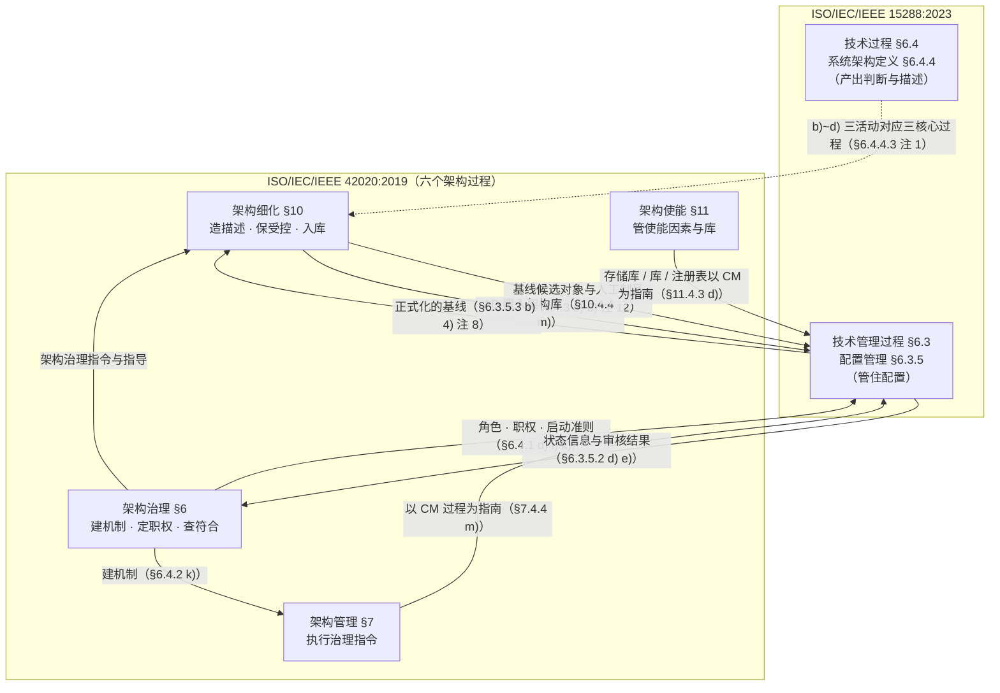
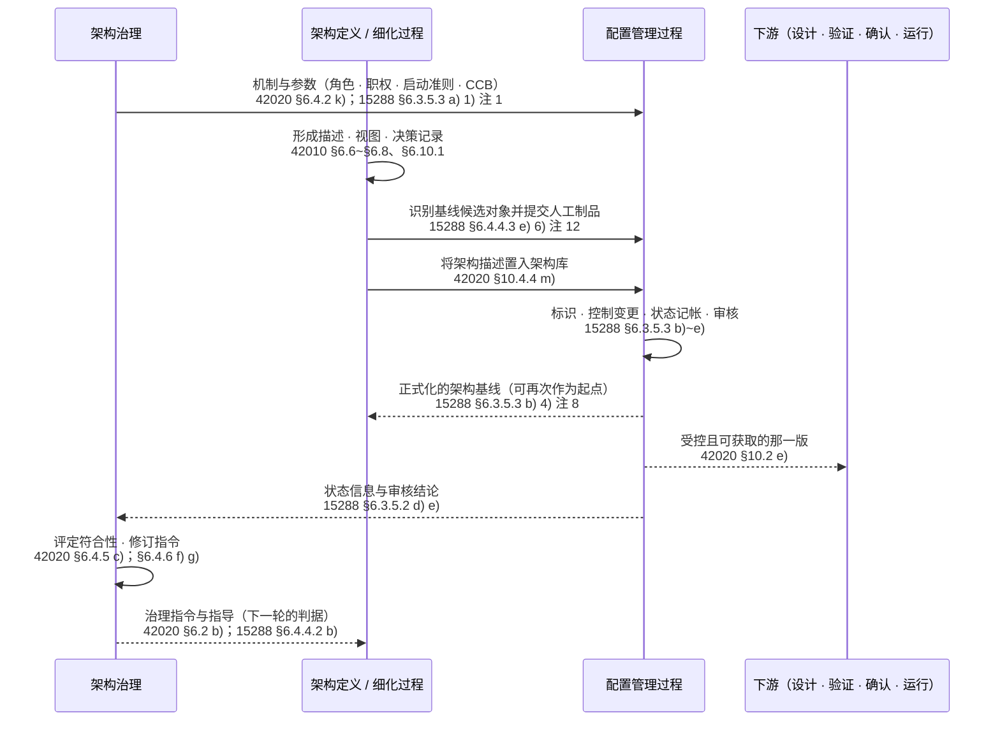
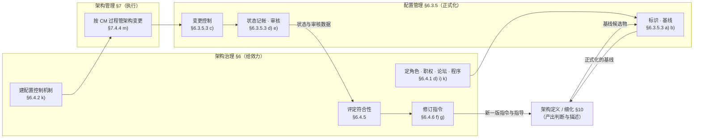
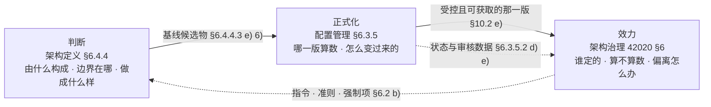
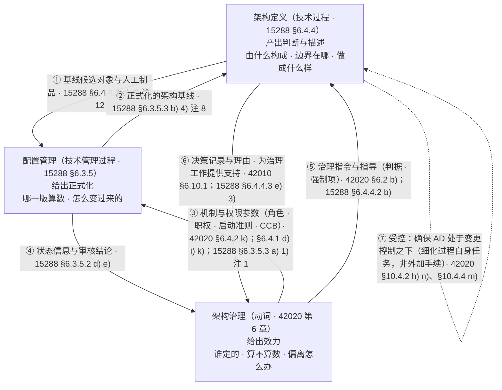
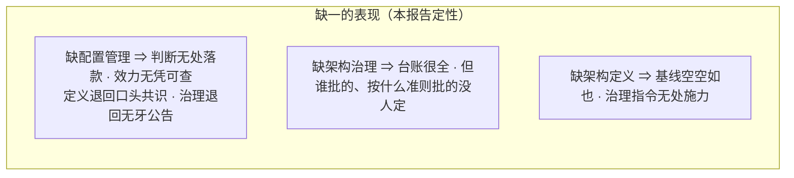
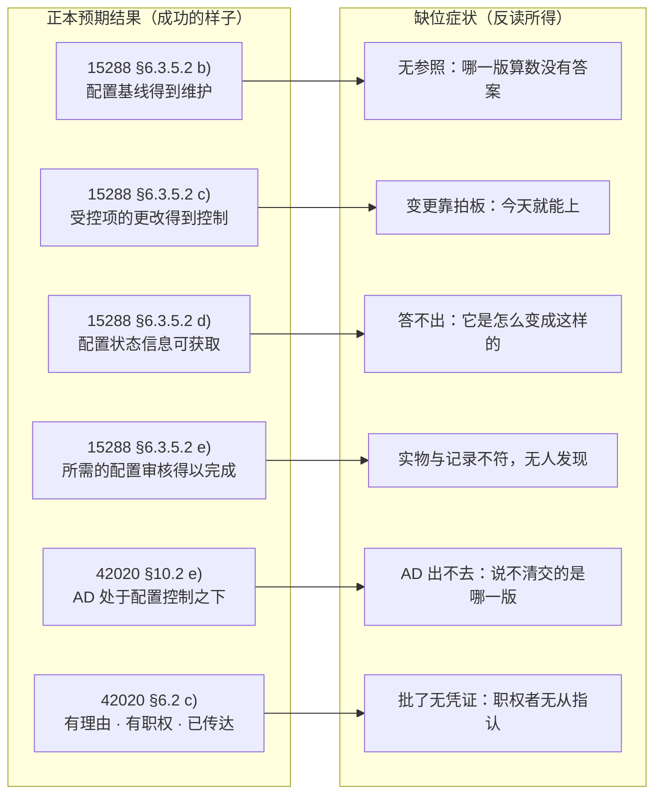
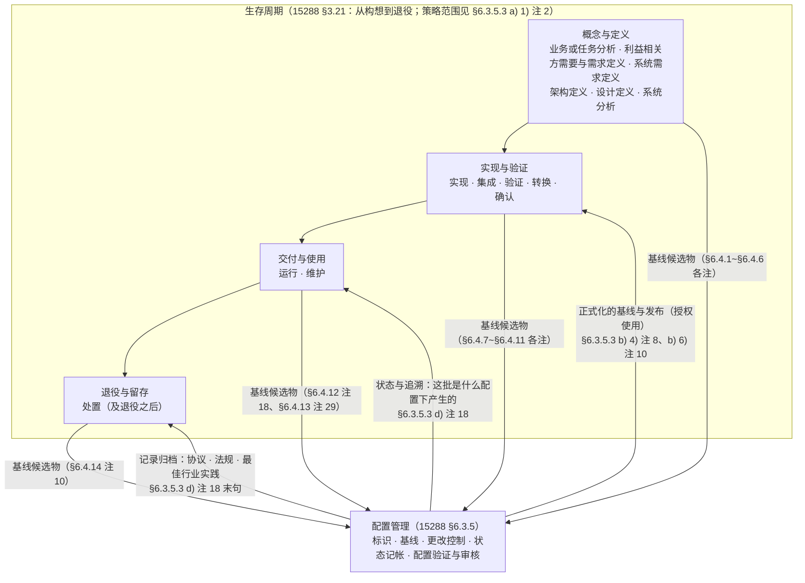

# 配置管理作用研究报告

## —— 对架构定义与架构治理（动词）的关系、作用与缺位后果，附产品全生存周期

**A Research Report on the Role of Configuration Management for Architecture Definition, Architecture Governance and the Product Life Cycle: Relations, Effects, and the Consequences of Absence**

> **编号**：41（研究报告稿）
> **日期**：2026-10-15
> **主题**：以标准正本为唯一依据，回答四问——① **配置管理与架构定义、架构治理（作为动词）是什么关系**；② **配置管理对架构定义与架构治理的作用是什么**；③ **不做配置管理，架构定义与架构治理会遇到什么问题**；④ **配置管理对产品全生存周期起什么作用**。前两问以"正本的预期结果"为落点：关系落在**谁供料、谁正式化、谁给效力**，作用落在**过程内被点名要求的动作**；第三问用**反读法**从预期结果倒推（§七）；第四问以**十四个技术过程的"供料口"**与**作用随阶段的迁移**作答（§十一）。另附**实物对证**一处（SEH 5.0 所指 Therac-25）与**本库四案复用**（HUD · EOS · 冷链 · 合同审批，转引自 40 号报告，只作对照不作判据）。
> **依据（一手正本在库）**：**ISO/IEC/IEEE 15288:2023**（库内中英文对照正本全文；§3.8 基线、**§6.3.5 配置管理过程**、§6.4.4 系统架构定义过程）｜**ISO/IEC/IEEE 42010:2022**（库内中英文对照正本全文；§5.3 生存周期中的 AD、§6.6~§6.8 版本标识、**§6.10 决策与理由的记录**）｜**ISO/IEC/IEEE 42020:2019**（库内中英文对照正本全文；**§6 架构治理过程**、§7 架构管理过程、§10 架构细化过程、§11 架构使能过程、附录 E.4.1.6）｜**ISO 9000:2026**（库内中英文对照正本全文；§3.10.8~§3.10.12 配置家族术语）。
> **系统工程手册（二手，同版同年，逐处标页码）**：**INCOSE《系统工程手册》5.0 中文版**（2023-07，413 页 PDF 在库；其页脚印页码与 PDF 页序不同，本报告一律标**印页码**）——§2.3.4.5 配置管理过程（印 p103–108）、§2.3.5.4 系统架构定义过程（印 p133、p137）、印 p244（安全与审计轨迹）、印 p258（接口受配置控制）、印 p262（架构治理与管理）、印 p335–336（Therac-25 案例）、附录术语（印 p387、p390–391）。**该手册为二手，只作同版同年的印证与案例来源，不作判据。**
> **库外来源（标"库外来源·不可核"，只作指引不作判据）**：配置管理的专门标准族——**ISO 10007**、**IEEE Std 828**、**SAE EIA-649C**、**SAE ARP4754A**、**GEIA HB 649**、**MIL-HDBK-61B**、**STANAG 4427**、**NIST SP 800-53／SP 800-128**。其名与用途出自 15288:2023 §6.3.5.3 a) 1) 注 3 与 SEH 5.0（印 p103、p105）的指引条，本库无正本。
> **取证纪律**：本报告凡涉配置管理、架构定义、架构治理的口径判断**只取上述正本**；**本子项目既有研究报告与教材只作对照与线索，不作判据**；**凡涉英文一律英中并列**（逐字引文、术语、缩写、方法名、题名同此），逐字引文紧随「（中译：…）」；照录不译者三类——标准条款标签（NOTE／EXAMPLE／shall／should／can）、标准文件号与缩写、本报告自编记号；凡断言"标准里没有"**先做零命中检索**。
> **证据档位四档（沿用 39／40 号口径）**：**标准逐字**（原文直接写着）／**标准可支持的读法**（由条文推出，标推理链）／**按定义句作的举例**（由定义句套具体情境）／**本报告定性**（为回答方便所作的分档与命名）。
> **配套材料**：摘要见下（**四十五条**）；**§二 三者位阶**、**§三 配置管理与架构定义的关系**、**§四 配置管理对架构定义的作用**、**§五 配置管理与架构治理的关系与作用**、**§六 合并判据（含 §6.6 一个词的答案：正式化）**、**§七 缺位反读**、**§八 实物对证**、**§九 结论**、**§十 方法教训**、**§十一 配置管理对产品全生存周期的作用**、**§十二 未决问题与挂账**；正本条号索引见[附录 A](#附录-a本报告引用的正本条号索引)；术语对照见[附录 B](#附录-b术语对照)；取证清单与边界见[附录 C](#附录-c取证清单与边界)；判错留痕见[附录 D](#附录-d判错留痕)。七幅图（Mermaid）：位阶图（§2.4）、供料—正式化—效力时序图（§3.7）、治理—管理—配置管理回路图（§5.7）、合并判据图（§6.3）、**三者关系总图与"三者缺一的表现"图（§6.5，本报告第一图）**、缺位反读图（§7.6）；**另加"全生存周期图"（§11.6）**，共八幅。
> **文档版本**：**v1.0（2026-10-15 创建）**——三问来自 2026-10-15 用户连续三轮提问（关系 → 作用 → 缺位后果），三轮均为口头作答 → **v1.1（同日补第四问与新增 §十一：配置管理对产品全生存周期的作用，含 §11.2 十四技术过程供料表与 §11.6 全生存周期图）** → **v1.2（同日纳定名：新增 §6.6「一个词的答案：正式化」——配置管理的职责一词为"正式化"，并立定名纪律：不用"守护者／保险丝／看门人／存档"等自造名）**。

---

## 摘要：四十五条

### 一、对象与方法（1~7）

1. **三问有同一个落点：正本的"预期结果"。** 关系问"谁供料、谁正式化、谁给效力"，落到 15288 §6.4.4.3 e) 6) 与 §6.3.5.3 b) 4) 注 8；作用问"过程内有没有被点名要求"，落到 42020 §10.4.2 h) 与 n)；缺位问"哪几条预期结果不成立"，落到 15288 §6.3.5.2 a)~f)、42020 §10.2 e)/f)/h)、§6.2 c)/e)、§7.2 d)。**缺配置管理不是"少一个可选项"，是若干条预期结果不成立——即过程未成功执行。**
2. **反读法是本报告的主方法**（§七）：把正本写好的"成功即应如此"逐条取反，得到"缺位症状"清单。此法有两个前提——① 预期结果与活动是**分层**的（活动 shall／任务 should，见 42020 §6.3 与 §10.3）；② 反读只用于**诊断**，不用于**判据**（症状清单是启发式，判据仍回条款）。
3. **"不做配置管理"必须分成两种**（这是全部结论的前提）：**① 全无**——无标识、无基线、无变更控制、无状态记帐、无审核；**② 有版本管理、无配置管理**——版本号有、提交有、流程走过，但没有"批准＋冻结＋作参照"的基线，没有影响评定，没有状态记帐，没有配置审核。**②更常见，症状更有欺骗性：查得清改到第几步，查不清哪一版算数。**
4. **三份正式标准各出一段，拼起来才是完整的作用链**（§二）：15288 说"架构定义交料、配置管理正式化"；42020 架构侧说"细化过程自己确保 AD 受控、收口入库"；42020 治理侧说"治理建机制、管理按过程执行"；SEH 5.0 补一句日常形态——配置识别里要"确定在何处需要独立的配置控制（治理），并指定配置项（CIs）"（印 p104）。
5. **配置管理在 15288 里是"技术管理过程"，不是"技术过程"**：§6.3.5 位于 §6.3 Technical management processes（技术管理过程），与架构定义 §6.4.4（技术过程）**同级不同类**。这一条决定了二者的关系不是前后工序，而是**供料与正式化**（§2.1）。
6. **配置管理与架构治理在 42020 里也被分置两章**：治理在第 6 章，管理在第 7 章；"建配置控制机制"是治理的任务（§6.4.2 k)），"按 15288 配置管理过程管变更"是管理的任务（§7.4.4 m)）（§2.2）。
7. **口径纪律一条**：**"配置控制管理机制"（§6.4.2 k)）≠"配置管理过程"（15288 §6.3.5）**。前者是治理要建立的**机制**（谁有权、走什么手续、边界在哪），后者是被引为指南的**过程**。混说会把"治理建制度"读成"治理干配置管理的活"。

### 二、三者位阶（8~11）

8. **架构定义**（15288 §6.4.4）产出的是**判断与描述**。目的句逐字：*The purpose of the system architecture definition process is to generate alternative system architectures, select one or more that satisfy the stakeholder concerns and system requirements, and express them in consistent views and models.*（中译：系统架构定义过程的目的是生成系统架构的不同方案，选择一个或多个能够满足利益相关方关切和系统需求的方案，并以一致的视图和模型表达。）
9. **配置管理**（15288 §6.3.5）管的是**配置**。目的句逐字：*The purpose of the configuration management process is to manage system and system element configurations over their life cycle.*（中译：配置管理过程的目的是在系统与系统元素的生存周期内管理其配置。）其后的两句把"管理"说全：*Managing includes establishing and maintaining consistency, integrity, traceability, and control. Configurations include products and their product configuration information.*（中译：管理包括建立并保持一致性、完整性、可追溯性与控制。配置包括产品及其产品配置信息。）
10. **架构治理**（42020 §6）管的是**在组织范围内对架构的管理与控制所依循的规程与取向**：附录 G.1（资料性）逐字——*Architecture governance is the practice and orientation by which architectures are managed and controlled at an organization-wide level.*（中译：架构治理是在组织范围内对架构进行管理和控制所依循的规程与取向。）
11. **一个有标准依据的三分**（本报告定性，落点皆为正本）：**架构定义产出判断**（§6.4.4.1 目的句）／**配置管理给出正式化**（§6.3.5.3 b) 4) 注 8）／**架构治理给出效力**（42020 §6.2 c)：*Architecture decisions supported by rationale are made with appropriate authorities and communicated to stakeholders.*，中译：有理由支撑的架构决策由具有适当职权者作出，并传达给利益相关方。）。

### 三、配置管理与架构定义的关系（12~18）

12. **供料与正式化的分工是标准明写的**：15288 §6.3.5.3 b) 4) 注 8 逐字——*The content for the baselines is developed through the technical processes, but is formalised at a point in time through the configuration management process. Baselines form the basis for the next change.*（中译：基线的内容通过技术过程形成，但通过配置管理过程在某一时点予以正式化。基线构成下一次更改的基础。）**关键动词是 formalised，不是 archived。**
13. **架构定义只"提名"候选对象，不发证**：§6.4.4.3 e) 6) *Provide key artefacts that have been selected for baselines.*（中译：提供已选定用于基线的关键人工制品。）；注 12 逐字——*The configuration management process is used to establish and maintain configuration items and baselines. The system architecture definition process identifies candidates for the baseline and then provides the artefacts to configuration management.*（中译：使用配置管理过程建立并维护配置项与基线。系统架构定义过程识别基线的候选对象，随后将人工制品提供给配置管理。）**同一句式在设计定义（§6.4.5 注 20）、验证（§6.4.9 注 17）、确认（§6.4.11 注 17）等处重复出现**——这是全技术过程的通例。
14. **架构描述本身被要求处于配置控制之下**：42020 §10.2 e) 把它写进**架构细化的预期结果**——*Architecture description is under configuration control and made available to all relevant parties.*（中译：架构描述处于配置控制之下，并提供给所有相关方。）同源要求见 §3.19 注 1（*Repository items should be under configuration control.*，中译：存储库中的条目宜处于配置控制之下。）与 §11.4.3 c)、d)（使能因素变更、存储库与库注册表，以 CM 过程为指南）。
15. **"确保 AD 受控"是架构细化过程自己的任务，不是外加的手续**：42020 §10.4.2 h) *Ensure that the architecture description is under proper change control.*（中译：确保架构描述处于适当的变更控制之下。）；n) *Manage changes to the architecture descriptions, views and models using the Configuration Management process in ISO/IEC/IEEE 15288 as a guide.*（中译：以 ISO/IEC/IEEE 15288 中的配置管理过程为指南，管理架构描述、视图与模型的变更。）另见 §10.4.4 m) *Place architecture description in the architecture repository.*（中译：将架构描述置入架构库。）
16. **描述件天然是可配置管理的对象**：42010 §6.6 要求每个架构视角、§6.7 每个架构视图、§6.8 每个视图组件 *shall include version identification as specified by the organization and/or project*（中译：应包含由组织和／或项目规定的版本标识）；§6.10.1 要求决策记录宜含**唯一标识**、*identification of decision authority or owner*（中译：决策权属方或决策责任人的标识）与 *timestamps for when the decision occurred, when approved and when modified*（中译：决策作出、获批和修改的时间戳）。**有标识、有权属、有时间戳，即配置项三件特征。**
17. **顺序上不设"决策→描述"的硬次序**：42010 §5.3 逐字——*During the entity of interest life cycle, an AD can precede or follow architecture creation, updating or changing.*（中译：在所关注实体的生存周期内，架构描述可以先于或后于架构的建立、更新或变更。）42020 §10.3 同旨：*The activities may be performed in any order that is deemed appropriate.*（中译：这些活动可以按任何被认为适当的顺序执行。）**配置管理的贡献不在排序，在"哪一版算数"有落点。**
18. **架构基线是"给定时间点所定义的架构"，其用途是同步**：42020 附录 E.4.1.6 逐字——*Baseline architecture is the definition of the architecture being defined for a given point of time. They serve as synchronization key-points for review and provision of architectures as references.*（中译：基线架构是为给定时间点所定义的架构的定义。它们充当同步关键点，用于架构的评审以及将架构作为参考予以提供。）

### 四、配置管理对架构定义的作用（19~23）

19. **给判断一个原点**：ISO 9000:2026 §3.10.12 配置基线＝*approved configuration information that establishes the characteristics of a product or service at a point in time that serves as reference for activities throughout the life cycle*（中译：经批准的配置信息，它确定产品或服务在某一时间点上的特性，并作为该产品或服务生命周期内各项活动的参照）。**没有原点，"从哪变起"说不出口**——42010 §5.3 允许 AD 先于或后于架构，正因为有版本可指认。
20. **给迭代、并发、递归一个交点**：架构定义在多个层级递归、与技术过程并发（15288 §5.9 与 42020 §10 同旨）。15288 §6.3.5.1 的四词（一致性、完整性、可追溯性与控制）就是这件事的判据形式；SEH 5.0 的说法更直观——"配置管理，包括变更管理，**协调了系统的成熟过程**"（印 p105）。
21. **给"交得出去"补上另一半**：42020 §10.2 e) 的两半——**受控**（under configuration control）与**可获取**（made available to all relevant parties）。前者由配置管理保证，后者由"置入架构库"落地（§10.4.4 m)＋§3.19 注 1）。
22. **给追溯链一个可核的锚**：15288 §6.4.4.3 e) 5) 要求维护系统架构的追溯性，注 11 把追溯对象写全——*bi-directional traceability is maintained between the architectural entities (models, views, and viewpoints) to the requirements …, interface definitions, analysis results, and verification methods or techniques*（中译：在架构实体（模型、视图和视角）与需求、接口定义、分析结果以及验证方法或技术之间维护双向追溯性）。**追溯在单一快照里成立容易，跨轮成立要靠基线。**
23. **给决策记录一个效力形式的落法**：42010 §6.10.1 的十一项记录信息里，**唯一标识、权属方、三个时间戳**这三项只有在"记录本身也受控"时才可引用、可追溯；同条注 3 明说：*Sometimes recording rejected alternatives and their rationale for rejection is useful, e.g. when in the future the rationale no longer applies and the decisions are necessary.*（中译：有时记录被否决的备选方案及其否决理由是有用的，例如当该理由在将来不再适用而相关决策成为必要时。）**无留痕，就只剩每次重新吵一遍。**

### 五、配置管理与架构治理（动词）的关系与作用（24~29）

24. **治理的一项法定动作就是建配置控制机制**：42020 §6.4.2（监视、评定和控制架构治理活动）k) 逐字——*Establish configuration control management mechanism to govern the changes in the architecture collection.*（中译：建立配置控制管理机制，以管控架构集合中的变更。）**这是"治理如何管住变更"的正本出处。**
25. **执行不写在治理章，写在管理章**：§7.4.4（执行架构集合的管理）m) 逐字——*Manage changes to the architectures using the Configuration Management process in ISO/IEC/IEEE 15288 as a guide.*（中译：管理架构的变更，以 ISO/IEC/IEEE 15288 中的配置管理过程为指南。）**建机制归治理，按过程执行归管理。**
26. **治理给配置管理提供"权限参数"，配置管理不自己产生权限**：15288 §6.3.5.3 a) 1) 注 1 规定 CM 策略须含 a) *roles, responsibilities, accountabilities, and authorities*（中译：角色、职责、问责与职权）、b) 纳入配置管理的项的更改管理（处置、访问、发布与控制）、e) *the criteria or events for commencing configuration control*（中译：启动配置控制并维护配置基线的准则或事件）、g) *any planned configuration control boards*（中译：任何已计划的配置控制委员会）。这些参数的**来源**在治理侧：42020 §6.4.1 d) 建立角色、职责、问责、职权和组织结构；i) 建立治理论坛；k) 定义用于识别、管理、审计和分发治理决策相关信息的程序。SEH 5.0 一句话点破："**确定在何处需要独立的配置控制（治理），并指定配置项（CIs）**"（印 p104）。
27. **"谁批准基线"不在配置管理里回答**：15288 §6.3.5.3 b) 5) 只要求 *Obtain applicable stakeholder agreement to establish a baseline.*（中译：取得适用利益相关方的同意以建立基线。），注 9 借项目评定与控制过程达成一致。**标准把权力问题留给治理，把记录问题留给配置管理。**
28. **配置管理给治理三份供给**：① **状态数据**——配置状态记帐（ISO 9000:2026 §3.10.11：*formalized recording and reporting of configuration information, the status of proposed changes and the status of the implementation of approved changes*，中译：对配置信息、所提议更改的状态以及已批准更改的实施状态进行的正式记录和报告。；15288 §6.3.5.3 d)）；② **核查结论**——配置验证与审核（FCA／PCA，15288 §6.3.5.3 e) 注 22）；③ **效力留痕**——注 18：*The rationale for the baselines and releases and associated authorizations in configuration data are generally recorded.*（中译：基线、发布以及配置数据中相关授权的理由通常予以记录。）
29. **治理指令自身也要走变更管理**：42020 §6.4.6 f) *Identify and select the changes to be made to the architecture governance directives and guidance.*／g) *Incorporate the changes into the architecture governance directives and guidance.*（中译：识别并选择拟对架构治理指令与指导作出的变更／将这些变更纳入架构治理指令与指导。）；§6.3 实施条还要求 *The organization should store organization policies and procedures to facilitate widespread access, enable auditing and encourage future reuse.*（中译：组织宜保存组织策略与程序，以便于广泛获取、支持审计并鼓励未来复用。）工作产品见 §6.5 四项与 §7.5 六项。**治理的产出本身也是配置项。**

### 六、缺位反读（30~34）

30. **15288 §6.3.5.2 六条预期结果逐条反读，就是六个症状**：a) 配置得到管理 → 配置散在各处、无单一事实来源；b) 配置基线得到维护 → 无参照，"哪一版算数"没有答案；c) 受控项的更改得到控制 → 变更靠拍板，"今天就能上"；d) 配置状态信息可获取 → 答不出"它是怎么变成这样的"；e) 所需的配置审核得以完成 → 实物与记录不一致无人发现；f) 系统发布得到批准 → 未经验证确认的改动进使用。
31. **架构定义侧六条后果**：① 42020 §10.2 e) 与 f) 两条预期结果**直接落空**（f) 逐字：*Architecture description continues to be aligned with changes to the architecture entity during its development.*，中译：在架构实体开发期间，架构描述持续与架构实体的变更保持一致。）；② 无原点，"变了"说不出口；③ 决策记录退化为散记，引用不了、追不了；④ 多架构、多层级、并发时无法对齐（§10.2 h)、§6.2 e) 不可验证）；⑤ 供料无人接收，基线记忆落回个人；⑥ **手册自己指的实物后果**——SEH 5.0 逐字："不充分的配置管理会增加产品风险——请参阅第6.1节关于 Therac-25 案例的示例"（印 p103）。
32. **架构治理侧五条后果**：① §6.4.2 k) 那条最要紧的任务无法执行（机制缺位＝对架构集合的变更无抓手）；② 符合性失去基准——§6.4.5 c) 无从判"符合哪一版"，d) 的实体层访问若描述与被审实体版本不对应则结论无效（注 4 已警告：*Merely checking the architecture for conformance could be insufficient…*，中译：仅检查架构的符合性可能不够充分，因为架构特征可能未能恰当转化为该实体的设计或运行。）；③ §6.2 c) 三要素（有理由支撑／适当职权者作出／传达给利益相关方）缺了留痕这一环；④ 治理指令自身失去版本（§6.4.6 f)/g) 与 §6.3 实施条无法兑现，决议随时间衰减）；⑤ 失去数据源与度量（§7.2 d)、附录 B.2.1、§6.5 符合性状态报告均依赖配置状态记帐与审核）。
33. **四类缺位形态各有其"最先坏掉的一处"**（本报告定性，症状各有正本对应）：**无标识**最先坏在**引用**（指不认某一条决策或某一版视图）；**无基线**最先坏在**参照**（评审与验证找不到对象）；**无变更控制**最先坏在**影响评定**（改动的波及范围无人算，15288 §6.3.5.3 c) 2) 注 14 的 *impact assessment* 缺位）；**无状态记帐与审核**最先坏在**追责与发现**（答不出"怎么变成这样的"，也无人核对实物与记录）。
34. **缺位不等于没写文档**：文档写了一屋子，无基线、无变更控制、无审核，同样是缺位——**文档多不等于配置清**；反之，做配置管理也不等于用工具：git／PLM 是手段，"批准·冻结·作参照"那个动作长在流程与权限里（ISO 9000:2026 §3.10.12"approved"，15288 §3.8"formally approved version … formally designated and fixed"）。

### 七、结论与方法教训（35~40）

35. **一句话回答三问**：**架构定义产出判断，配置管理把它正式化，架构治理给它效力。** 配置管理不做判断、不赋权，它买到的是**可复现**——"它应该是什么／它实际是什么／它是怎么变成这样的"任何时刻答得出（15288 §6.3.5.2 b)、c)、d) 三格）。
36. **一条可通用于任何项目的缺位体检**（本报告定性，把上表压成五问）：① **原点在不在**（本次讨论的"那一版"指得出来吗）② **改动走了什么手续**（和改一个字段是同一套手续吗）③ **状态答得出吗**（它是怎么变成这样的）④ **实物与记录核过吗**（谁在核、多久核一次）⑤ **谁批的、凭哪一版**（有署名与时间戳吗）。五问任一为空，缺位即已发生。
37. **配置管理与架构定义、架构治理三者的分工表**（本报告定性，落点皆正本）：

   | 事 | 谁做 | 正本落点 |
   |---|---|---|
   | 定内容、做权衡、下判断 | 架构定义（细化／概念化／评估） | 15288 §6.4.4.1；42020 §8／§9／§10 |
   | 提名基线候选对象、把人工制品交出去 | 架构定义 | 15288 §6.4.4.3 e) 6) 注 12 |
   | 标识、控制变更、状态记帐、审核、批准发布 | 配置管理 | 15288 §6.3.5.3 b)~e) |
   | 把内容在某一时点正式化 | 配置管理 | 15288 §6.3.5.3 b) 4) 注 8 |
   | 建配置控制管理机制 | 架构治理 | 42020 §6.4.2 k) |
   | 定角色、职权、CCB、启动配置控制的准则 | 架构治理（CM 策略据此写） | 42020 §6.4.1 d) i) k)；15288 §6.3.5.3 a) 1) 注 1 |
   | 按 CM 过程管理架构的变更 | 架构管理 | 42020 §7.4.4 m) |
   | 确保 AD 处于变更控制之下、置入架构库 | 架构细化过程自身 | 42020 §10.4.2 h)、§10.4.4 m) |
   | 判"算不算数"、查符合性、处置偏离 | 架构治理 | 42020 §6.2 c)、§6.4.5、§6.4.6 |

38. **本轮方法教训三条**（详见 §十）：① **反读法只用于诊断**——预期结果是"成功的样子"，反读得到的是症状清单，判据仍须回条款；② **"两套审计"不得混说**——配置审核（对实物与记录一致）与治理的符合性评定（对指令遵循）对象不同，互相顶替即误读（§5.5）；③ **二手手册的页码必须标对**——SEH 的印页码与 PDF 页序差 15，本报告一律标印页码并注明（附录 C）。
39. **正本还给了一处"地位"表述：配置管理本身被 42020 列为一种"使能能力"。** §5.5 的 EXAMPLE 逐字——*Enabling capabilities include, among other things, procedures, methods, tools, frameworks, architecture viewpoints, work product templates, decision support systems, storage, configuration management and reference models.*（中译：使能能力包括程序、方法、工具、框架、架构视角、工作产品模板、决策支持系统、存储、配置管理和参考模型等。）**它是 EXAMPLE 级（资料性举例），不得读成要求**；但与 §11.4.3 c)、d) 把 CM 过程引为指南一处，共同说明**配置管理在架构侧的地位是"使能"而不是"某一步"**（§2.5）。
40. **裁剪允许，但"记录"与"决策"两个动作不能裁掉**：15288 附录 A（规范性）注 1 逐字——*Tailoring is not a requirement for conformance to this document. In fact, tailoring is not permitted if a claim of "full conformance" is to be made.*（中译：裁剪不是符合本文件的一项要求。事实上，如果拟作出"完全符合"的声明，则不允许裁剪。）而裁剪过程的任务仍要求 a) **识别并记录**影响裁剪的情况（十项，含"角色、职责、问责与职权"）、c) 获取受影响的各方的输入、d) **按照决策管理过程作出裁剪决策**（§A.2.3）。⇒ **最小可用集可以裁，但"记录"与"决策"这两个动作本身无从豁免**（标准可支持的读法）——见 §7.7。

### 八、产品全生存周期（41~44）

41. **"全生存周期"写在配置管理的目的句里**：15288 §6.3.5.1 *…to manage system and system element configurations over their life cycle*（中译：在系统与系统元素的生存周期内管理其配置）；而"生存周期"本身的定义是 *evolution of a system, product, service, project or other human-made entity from conception through retirement*（15288 §3.21，中译：系统、产品、服务、项目或其他人工实体从构想到退役的演化）。策略的覆盖范围另有注：*The strategy covers the life of the system, or the extent of the contract, as appropriate.*（§6.3.5.3 a) 1) 注 2，中译：该策略视情况涵盖系统的寿命，或合同的范围。）SEH 5.0 说得最直白——**"在系统生命周期开始时启动配置管理过程，并持续到系统退役为止"**（印 p105）。
42. **十四个技术过程、十四个供料口**：15288 §6.4.1~§6.4.14 **每一个**技术过程下都有同一句式——"识别基线的候选对象，随后将人工制品提供给配置管理"（各条注，全文见 §11.2 表）。**配置管理是十四路汇一的那一点**，因此也是**唯一能对全过程一致性负责的过程**（§6.3.5.1 四词：一致性、完整性、可追溯性与控制）。
43. **作用随阶段迁移：从"控制"转向"取证"**——概念与定义期以防"改乱"为主（基线与更改控制）；实现、交付、使用与维护期以"答得出这批是什么配置下产生的"为主（状态记帐与配置审核）；退役期以留"证据"为主（**配置记录在系统生存周期内予以维护，然后考虑协议、相关法规或最佳行业实践予以存档**，§6.3.5.3 d) 注 18 末句）。**产品越长寿，配置记录的存活期越要长于产品本身**。
44. **两道横贯全程的闸：发布与审核**——**发布**＝*authorise the use of a system or system element for a specific purpose, with or without restrictions*（§6.3.5.3 b) 6) 注 10，中译：授权将系统或系统元素用于特定目的，可带限制或不带限制。），且发布通常包含一组须经验证或确认的更改（注 11）；**审核**＝功能配置审核（FCA）与物理配置审核（PCA），并"**以建立产品基线**"（§6.3.5.3 e) 4) 注 22）。

### 九、一个词的答案（45）

45. **配置管理的职责，一个词：正式化**（formalise／formalization）——*The content for the baselines is developed through the technical processes, but is **formalised** at a point in time through the configuration management process.*（15288 §6.3.5.3 b) 4) 注 8，中译：基线的内容通过技术过程形成，但通过配置管理过程在某一时点予以正式化。）"正式化"含**获批＋冻结＋作参照**三件（§3.8；ISO 9000:2026 §3.10.12）；**对设计、对架构、对治理是同一个动作，只是宾语不同**（§6.6）。不用"守护者／保险丝／看门人／存档"等自造名。

---

## 目录

- [一、前提：依据、档位与三条读法纪律](#一前提依据档位与三条读法纪律)
- [二、三者位阶：一张图先立准](#二三者位阶一张图先立准)
- [三、配置管理与架构定义：五重关系](#三配置管理与架构定义五重关系)
- [四、配置管理对架构定义的作用](#四配置管理对架构定义的作用)
- [五、配置管理与架构治理（动词）：机制、参数、数据与自演进](#五配置管理与架构治理动词机制参数数据与自演进)
- [六、合并判据：判断—正式化—效力](#六合并判据判断正式化效力)
- [七、缺位反读：不做配置管理会怎样](#七缺位反读不做配置管理会怎样)
- [八、实物对证](#八实物对证)
- [九、结论](#九结论)
- [十、方法教训](#十方法教训)
- [十一、配置管理对产品全生存周期的作用](#十一配置管理对产品全生存周期的作用)
- [十二、未决问题与挂账](#十二未决问题与挂账)
- [附录 A　本报告引用的正本条号索引](#附录-a本报告引用的正本条号索引)
- [附录 B　术语对照](#附录-b术语对照)
- [附录 C　取证清单与边界](#附录-c取证清单与边界)
- [附录 D　判错留痕](#附录-d判错留痕)

---

## 一、前提：依据、档位与三条读法纪律

### 1.1 依据清单与档位

| 依据 | 版本 | 本报告用处 | 档位 |
|---|---|---|---|
| ISO/IEC/IEEE 15288:2023《系统与软件工程——系统生存周期过程》 | 2023（库内中英文对照正本全文） | §3.8 基线；**§6.3.5 配置管理过程**（目的／六条预期结果／五项活动）；§6.4.4 系统架构定义过程（预期结果与活动 e)）；§6.4.5／§6.4.9／§6.4.11 的基线候选物注 | **一手正本** |
| ISO/IEC/IEEE 42010:2022《软件、系统与企业——架构描述》 | 2022（库内中英文对照正本全文） | §5.3 AD 的生存周期位置；§6.6~§6.8 版本标识；**§6.10 决策与理由的记录** | **一手正本** |
| ISO/IEC/IEEE 42020:2019《软件、系统与企业——架构过程》 | 2019（库内中英文对照正本全文） | §3.4 架构集合／§3.5 AD／§3.19 存储库；**§6 架构治理**（§6.2、§6.3、§6.4.1~§6.4.6、§6.5）；**§7 架构管理**（§7.2、§7.4.4、§7.5）；**§10 架构细化**（§10.2、§10.3、§10.4.2、§10.4.4、§10.5）；§11.4.3；附录 E.4.1.6；附录 G.1 | **一手正本** |
| ISO 9000:2026《质量管理体系——基础和术语》 | 2026（库内中英文对照正本全文） | §3.10.8 配置／§3.10.9 配置项／§3.10.10 配置信息／§3.10.11 配置状态纪实／§3.10.12 配置基线 | **一手正本** |
| INCOSE《系统工程手册》5.0 中文版 | 2023-07（库内 PDF，413 页） | §2.3.4.5 配置管理过程；§2.3.5.4 系统架构定义过程；印 p244／p258／p262；印 p335–336 Therac-25；附录术语 | **二手（同版同年）** |
| 配置管理专门标准族：ISO 10007／IEEE Std 828／SAE EIA-649C／ARP4754A／GEIA HB 649／MIL-HDBK-61B／STANAG 4427／NIST SP 800-53／SP 800-128 | 各版不等 | 只作指引与范围提示 | **库外来源·不可核** |

**依据的两处结构说明**：

1. **15288 与 42020 的关系是标准自己写明的**：15288 §6.4.4.3 注 1 逐字——*Activities b) through d) of the system architecture definition process correspond to the three core processes in ISO/IEC/IEEE 42020.*（中译：系统架构定义过程的活动 b) 至 d) 对应于 ISO/IEC/IEEE 42020 中的三个核心过程。）故本报告讲"架构定义"时，**15288 给过程骨架、42020 给活动细则**，两者不冲突。
2. **配置管理没有"架构版"**：42020 只把 CM 过程**引为指南**（§7.4.4 m)、§11.4.3 c)、d)），不另行定义一套架构配置管理；架构集合层面的那件事被写成治理的一项任务（§6.4.2 k)）。**这一点决定了本报告 §五 的结构。**

### 1.2 三条读法纪律

**纪律一：凡问"作用"，先问"这条是不是写在过程里"。** 本报告把"作用"分两档：**过程内被点名要求的动作**（如 42020 §10.4.2 h)、n)）与**由预期结果推出的必要条件**（如"无原点则 42010 §5.3 的先后关系无从表述"）。前者是硬要求（shall／should 级），后者标"标准可支持的读法"。**两档不得混说。**

**纪律二：缺位分析用反读法，且必须回到预期结果。** 反读的对象是**预期结果**（outcomes），不是活动（activities）——原因在 42020 §6.3 与 §10.3：**活动是 shall 级、任务是 should 级**；若从任务反读，会把"推荐做法未做"说成"过程失败"。**从预期结果反读，得到的才是"过程未成功执行"这一档结论。**

**纪律三：不拿本库件当判据。** 本报告涉 40 号报告的四案（HUD／EOS／冷链／合同审批）与教材案例（冰链 M3／恒信合同审批系统）之处，**一律标为转引或举例**；凡与正本冲突，以正本为准。

### 1.3 三组易混口径（先立准，后面不再重复）

| 易混对 | 正本口径 | 落点 |
|---|---|---|
| **配置** vs **配置项** | 配置＝在配置信息中规定的产品／服务的相互关联的功能特性与物理特性；配置项＝配置之中满足某一最终使用功能的实体 | ISO 9000:2026 §3.10.8、§3.10.9 |
| **配置控制管理机制** vs **配置管理过程** | 前者是治理要建立的机制（42020 §6.4.2 k)）；后者是被引为指南的过程（15288 §6.3.5） | §6.4.2 k)、§7.4.4 m) |
| **配置审核** vs **符合性评定** | 前者核"实物与记录是否一致"（15288 §6.3.5.3 e)）；后者核"是否遵循治理指令"（42020 §6.4.5） | §6.3.5.3 e)、§6.4.5 |

**一处译名提醒**：ISO 9000:2026 的 `configuration` 家族，国标旧译为**技术状态**（技术状态项／技术状态信息／技术状态基线）；本库统一作**配置**系（正本译注已声明）。引用国标时须留意。

---

## 二、三者位阶：一张图先立准

### 2.1 15288 侧：技术过程 vs 技术管理过程

15288 第 6 章把过程分四族：§6.1 协议过程、§6.2 组织项目使能过程、**§6.3 技术管理过程**、**§6.4 技术过程**。**配置管理在 §6.3.5（技术管理过程），架构定义在 §6.4.4（技术过程）。**

这一位阶差异有三个直接后果：

1. **不是前后工序**。技术过程之间是流程关系（需求→架构→设计→实现…），技术管理过程是**横切**的：15288 每个技术过程的注里都有同一句式——"识别基线的候选对象，随后将人工制品提供给配置管理"。架构定义只是众多供料方之一。
2. **配置管理管的是"配置"，不是"架构"**。目的句里没有"架构"二字（§6.3.5.1），它管的是**系统与系统元素的配置**。**架构之所以进入配置管理的视野，是因为架构建模产物与描述属于"配置项"的候选**（§6.3.5.3 b) 1) 注 5 逐字：*Items subject to configuration management usually include requirements, models, product and system elements, services, and baselines.*，中译：受配置管理约束的项通常包括需求、模型、产品与系统元素、服务以及基线。）。
3. **它是"管理"，因此有策略、有资源、有职责**。§6.3.5.3 a) 把"准备配置管理"列为第一项活动，其注 1 列九项策略内容——**角色、职责、问责、职权**（a)）、**更改管理（含处置、访问、发布、控制）**（b)）、**需建立的必要基线**（c)）、**存储与介质**（d)）、**启动配置控制并维护基线的准则或事件**（e)）、**审核策略**（f)）、**更改管理（含 CCB、常规与紧急更改请求、规程）**（g)）、**利益相关方之间的协调**（h)）。

### 2.2 42020 侧：治理、管理、细化、使能四过程的分置

42020 规定六个架构过程（§5.4 与各章）：**架构治理 §6**、**架构管理 §7**、架构概念化 §8、架构评估 §9、**架构细化 §10**、**架构使能 §11**。与配置管理发生关系的是四处，且**分工明确**：

- **治理**建机制（§6.4.2 k)）；
- **管理**按 CM 过程管架构变更（§7.4.4 m)）；
- **细化**自己确保 AD 受控、把 AD 置入架构库（§10.4.2 h)、§10.4.4 m)）；
- **使能**管架构过程使能因素的变更与存储库（§11.4.3 c)、d)）。

**这四处合起来，就是"配置管理在架构侧的四个落点"**；四处都是"以配置管理过程为指南"或"处于配置控制之下"，**没有一处是"由配置管理过程替代"**。

### 2.3 三者的对象不同：判断 / 配置 / 效力

- **架构定义的对象是"架构"**（概念、属性、基本结构、管控原则与描述）；
- **配置管理的对象是"配置"**（配置信息所规定的功能与物理特性，及其配置项与基线）；
- **架构治理的对象是"架构集合"**（由组织持有、作为整体受治理与管理的一组架构——42020 §3.4 定义句逐字：*group of architectures held by an organization that is subject to governance and management by the organization as a whole*，中译：由组织持有、并作为整体受该组织治理与管理的一组架构）。

### 2.4 位阶图

**读图一处提醒**：图中"治理 → 配置管理"这条边（角色／职权／启动准则）**不是治理直接指挥配置管理**，而是**治理定参数、配置管理策略据此编写**——参数写进 CM 策略的是项目与组织，落点在 15288 §6.3.5.3 a) 1) 注 1。

### 2.5 一处地位表述：配置管理在架构侧是"使能"

42020 §5.5（架构使能过程）的 EXAMPLE 把 configuration management 列在"使能能力"里（原文见摘要第 39 条）。**这一处的读法有分寸**：

- 它是 **EXAMPLE 级**（资料性举例），**不是要求**——不得据此说"标准要求把配置管理当使能物"；
- 它与 §11.4.3 c)、d)（以 CM 过程为指南管理使能因素的变更、管理存储库／库／注册表）**方向一致**；
- 结论（**标准可支持的读法**）：**配置管理在架构侧的地位是"使能"**——它不占六个架构过程中的任何一个位置，而是被四个过程分别引用的**支撑手段**。这一点解释了本报告 §五 的结构：**配置管理在架构侧的落点分散在治理、管理、细化、使能四处，每处都只被"引用"，不被"承担"。**

---

## 三、配置管理与架构定义：五重关系

### 3.1 关系一：供料与正式化（硬关系，两条注）

**正本**：15288 §6.3.5.3 b) 4) 注 8＋§6.4.4.3 e) 6) 与注 12（原文见摘要第 12、13 条）。

**读法**：这条关系是**单向供料、双向结果**——架构定义把候选对象交出去，配置管理把正式化的基线交回来。**"正式化"包含三件事**：**获批**（ISO 9000:2026 §3.10.12 的 *approved*；15288 §3.8 的 *formally approved version … formally designated and fixed*）、**冻结**（在生存周期内的特定时刻固定）、**作参照**（*serves as reference for activities throughout the life cycle*）。

**一处必须分清的边界**：15288 §6.3.5.3 b) 5) 的"取得适用利益相关方的同意"用的是 *agreement*，不是 *approval*；注 9 指明用项目评定与控制过程达成一致。**故"同意建立基线"这一步在正本里属项目层面的一致行动；"谁有权批准"要到治理侧找（见 §5.3）。**

### 3.2 关系二：受控与可获取（预期结果级）

**正本**：42020 §10.2 e)（架构描述处于配置控制之下并提供给所有相关方）＋§3.19 注 1（存储库条目宜处于配置控制之下）＋§11.4.3 c)、d)。

**读法**：这是**预期结果**级的表述，分量比任务级重——**假若不成立，即"架构细化过程未成功实施"**。它同时给出两半：**受控**（版本、变更、状态、审核）与**可获取**（相关方拿得到）。**两半缺一都不算完成**：只受控不可获取，等于锁在柜子里；只可获取不受控，等于人手一份不同版本。

### 3.3 关系三：描述天然是可配置管理的对象（形式要件）

**正本**：42010 §6.6、§6.7、§6.8（视角／视图／视图组件的版本标识）＋§6.10.1（决策记录十一项）。

**读法**：42010 用 shall 级要求给描述件装上**版本标识**，用 should 级要求给决策记录装上**唯一标识、权属方、时间戳**。**这些字段正是配置项成立的形式要件**（对照 ISO 9000:2026 §3.10.9 配置项与 §3.10.10 配置信息）。故：**不是"配置管理额外要求架构描述受控"，而是架构描述按其自身标准就长成了可受控的样子。**

### 3.4 关系四：无序——AD 可先于或后于架构

**正本**：42010 §5.3（AD can precede or follow architecture creation, updating or changing）＋42020 §10.3（活动可按任何被认为适当的顺序执行）。

**读法**：这条关系的作用是**排除一种常见误解**——不能把"配置管理"理解成"架构工作完成之后的归档步骤"，也不能把"先写描述再定架构"当成违规。**正本只关心"哪一版算数、怎么变过来的"，不关心先后。**

### 3.5 关系五：过程内的硬要求（这一条最容易被漏）

**正本**：42020 §10.4.2 h)、n)＋§10.4.4 m)。

**读法**：这三条把配置管理**写进了架构细化过程自己的任务表**——h) 确保 AD 处于适当的变更控制之下；n) 以 CM 过程为指南管理 AD、视图与模型的变更；m) 把 AD 置入架构库。**故"架构定义要不要管配置管理"这个问法本身是错的：正本已经规定它自己就管。**

### 3.6 五重关系总表

| # | 关系 | 正本落点 | 档位 | 一句话 |
|---|---|---|---|---|
| 1 | 供料与正式化 | 15288 §6.3.5.3 b) 4) 注 8；§6.4.4.3 e) 6) 注 12 | 标准逐字 | 内容由技术过程形成，CM 在某一时点正式化 |
| 2 | 受控与可获取 | 42020 §10.2 e)；§3.19 注 1；§11.4.3 c) d) | 标准逐字 | 不受控或不公开，细化即未成功 |
| 3 | 描述天然可受控 | 42010 §6.6~§6.8；§6.10.1 | 标准逐字 | 版本标识与决策记录字段＝配置项形式要件 |
| 4 | 无序 | 42010 §5.3；42020 §10.3 | 标准逐字 | CM 不管先后，只管哪一版算数 |
| 5 | 过程内硬要求 | 42020 §10.4.2 h) n)；§10.4.4 m) | 标准逐字 | 确保受控、按 CM 管变更、置入架构库 |

### 3.7 供料—正式化—效力时序图

### 3.8 三处常见误读与正解

| 误读 | 正解 | 正本 |
|---|---|---|
| "配置管理是架构工作完成之后的归档步骤" | **并行贯穿**：AD 可先于或后于架构的建立、更新或变更；且"确保 AD 受控"是细化过程自己的任务 | 42010 §5.3；42020 §10.4.2 h)、n) |
| "架构定义只管交文档，受控是配置管理的事" | 架构定义只"**提名**"候选对象（交料），正式化在配置管理——**但"AD 处于配置控制之下"仍是细化过程的预期结果之一**，细化过程自己也须"确保受控" | 15288 §6.4.4.3 e) 6) 注 12；42020 §10.2 e)、§10.4.2 h) |
| "配置管理做完了，架构就算数了" | 算不算数由**治理**给（有理由支撑的决策由具有适当职权者作出并传达）；配置管理只提供正式化的落点与凭证 | 42020 §6.2 c)；15288 §6.3.5.3 b) 5) |

**三处误读的共同根**：把配置管理当成"某一步"或"某个角色"。正本给它的位置是**横向的、使能性的**（§2.5），因此**它既不在架构定义之后，也不代替治理的裁决**。

### 3.9 一处零命中发现：42010 不管配置控制

**检索**：在库内 42010:2022 中英文对照正本全文检索 `configuration control` 与 `配置控制`——**零命中**；检索 `configuration management`／`配置管理`——命中两处，**均为顺带提及**：一处是 §6.1 架构描述的标识与概述示例（*version control information; configuration management information and references*，中译：版本控制信息；配置管理信息和引用文件）；另一处是 AD 用途举例（*as guide to operational and infrastructure support and configuration management*，中译：作为运行与基础设施支持以及配置管理的指南）。

**读法**（标准可支持的读法）：**42010 不规定"配置控制"这件事**。它只规定描述件必须带**版本标识**（§6.6~§6.8）、决策记录宜含**唯一标识／权属方／三个时间戳**（§6.10.1）。**"谁来控制、怎么控制、控制到什么程度"，由 42020（§6.4.2 k)、§7.4.4 m)、§10.2 e)、§10.4.2 h) n)）与 15288（§6.3.5）给。**

**用途**：凡遇"架构标准是不是也管配置管理"之问，据此可答——**描述标准管"描述里有什么字段"，过程标准管"这份描述受不受控"，生存周期标准管"配置怎么被管"，三者分工不重叠。**

---

## 四、配置管理对架构定义的作用

### 4.1 作用一：给判断一个原点（可指认）

**机制**：把"某一时点的一组配置信息"变成**经批准、被固定、可作参照**的基线（ISO 9000:2026 §3.10.12；15288 §3.8）。

**没有它会发生什么**：所有涉及"变"的表述失去参照系。正本对此有一句几乎像为这件事写的话——42020 附录 E.4.1.6：基线架构"充当同步关键点，用于架构的评审以及将架构作为参考予以提供"。

**可核的问句**：**"上一版是哪一版？谁批的？什么时候？"** 三问任一答不出，原点即不存在。

### 4.2 作用二：给迭代、并发、递归一个交点

**机制**：技术过程在层级上递归、在时间上并发（15288 §6.4.4.3 注 1 与 42020 §10 同旨；SEH 5.0："配置管理，包括变更管理，协调了系统的成熟过程"，印 p105）。

**没有它会发生什么**：多层级同时改时，"父架构哪一版"没有答案，分配与追溯失去共同对象；SEH 5.0 描述的"设计会随分析、影响评定与权衡研究的推进而持续成熟"（印 p105）这一过程**无人协调**。

**可核的问句**：**"上下游各自在改的，是同一版吗？"**

### 4.3 作用三：补上"交得出去"的另一半

**机制**：42020 §10.2 e) 的两半——受控 ＋ 可获取；落地动作是把 AD 置入架构库（§10.4.4 m)），而库条目宜处于配置控制之下（§3.19 注 1）。

**没有它会发生什么**：描述即使内容完备，也交不出去——收件人无法确认"拿到的是不是最新的、算不算数的那一份"。**这正是"交得出去的工作产品"里"交得出去"的配置管理那一半**（另一half 是描述内容本身的质量，属 42010 的十组法定内容）。

**可核的问句**：**"把这份描述发给一个没参与的人，他能不能确认自己拿的是算数的那一版？"**

### 4.4 作用四：给追溯与决策记录一个可核的锚

**机制**：15288 §6.4.4.3 e) 5) 与注 11（架构实体↔需求／接口／分析结果／验证方法的双向追溯）；42010 §6.10.1 的十一项记录信息。

**没有它会发生什么**：追溯在单次快照内成立、跨轮失效；决策记录成为散记，被否决的备选方案与理由在理由失效后无法复检（§6.10.1 注 3）。

**可核的问句**：**"三年前的这条决策，现在还能查到是谁、为什么、当时否掉了什么吗？"**

### 4.5 四个作用与正本落点对照

| 作用 | 正本落点 | 缺位后的首个症状 |
|---|---|---|
| 原点（可指认） | 15288 §3.8、§6.3.5.3 b) 4) 注 8；ISO 9000:2026 §3.10.12；42020 E.4.1.6 | "改了什么"说不出口 |
| 交点（并发可对齐） | 15288 §6.3.5.1；42020 §10.2 h)；SEH 印 p105 | 上下游各改一版，谁都不认 |
| 交接面（交得出去） | 42020 §10.2 e)、§10.4.4 m)、§3.19 注 1 | 收到的人无法确认版本与效力 |
| 锚（追溯与决策可核） | 15288 §6.4.4.3 e) 5) 注 11；42010 §6.10.1 | 追溯跨轮失效、旧决策无法复检 |

### 4.6 五项活动 × 两侧作用的分解矩阵

15288 §6.3.5.3 的五项活动，逐一落到"对架构定义的作用"与"对架构治理的作用"（**本报告定性**，每格落点皆正本）：

| 配置管理活动（15288 §6.3.5.3） | 对架构定义的作用 | 对架构治理的作用 |
|---|---|---|
| **a) 准备配置管理** | 事先约定架构产物的标识规则、需建立的基线种类、启动配置控制的准则或事件（注 1 b) c) e)） | 把治理的角色、职权、CCB 与报告要求落成 CM 策略（注 1 a) g)；来源见 42020 §6.4.1 d) i) k)） |
| **b) 配置标识** | 给视角、视图、模型、决策记录唯一标识，使"引用某一条"成为可能（注 7） | 使"这条变更属不属于受治理范围"可判（SEH 印 p104：确定在何处需要独立的配置控制并指定配置项） |
| **c) 配置更改管理** | 变更走"请求—影响评定—评审批准—跟踪"的路径（注 13~16），架构内容不被就地改掉 | 使治理建的机制（§6.4.2 k)）有执行体；变更后的保留原则可查；更改理由有处可留（注 17） |
| **d) 配置状态记帐** | 答得出"它是怎么变成这样的"（注 18：允许向前向后追溯） | 供给符合性评定与治理报告的数据（42020 §6.4.5 c)、§7.2 d)） |
| **e) 配置验证与审核** | 核对实物与记录（as-built 与配置信息）是否一致（注 22：FCA／PCA） | 为实体层符合性核验提供旁证（42020 §6.4.5 d)） |

**矩阵读法**：**同一项活动在两侧的作用不同但同源**——左侧作用都在"内容可指认"，右侧作用都在"效力可核查"。**故配置管理不是"为架构定义服务"或"为治理服务"，而是同时为两侧提供同一件东西：可复现。**

---

## 五、配置管理与架构治理（动词）：机制、参数、数据与自演进

### 5.1 治理建机制：§6.4.2 k)

**正本**：42020 §6.4.2 k) *Establish configuration control management mechanism to govern the changes in the architecture collection.*（中译：建立配置控制管理机制，以管控架构集合中的变更。）

**位置**：它在"监视、评定和控制架构治理活动"这项活动（§6.4.2，共 11 条任务）的**末位**，前十条分别是监视法规与方针变化（c)）、治理度量（d)）、风险与机会（e)）、确保其他过程正确使用指令（f)）、按报告要求报告（g)）、评定与控制治理工作（h)）、决策管理（i)）、风险管理（j)）。**这一位置本身有信息量：它被放在"控制"这一族里，是治理唯一以"配置控制"为名的任务。**

**一处结构发现**（本报告定性）：**k) 是"机制"而非"过程"**——42020 让治理**建**这个机制，而把"按 CM 过程管理架构变更"交给管理（§7.4.4 m)）。**若把 k) 读成"治理自己做配置管理"，就会与 §7.4.4 m) 重复授权。**

**与治理其他环节的咬合**：机制建起来后，治理的符合性评定（§6.4.5）与指令修订（§6.4.6 f)/g)）才有对象。

### 5.2 管理按过程执行：§7.4.4 m)

**正本**：42020 §7.4.4 m)（原文见摘要第 25 条）。同族还有 §11.4.3 c)、d)（使能因素变更、存储库／库／注册表）。

**读法**：42020 对"架构的变更"给了一个明确的执行归属——**由架构管理按 15288 的配置管理过程办**。故在架构成熟的组织里，**"这次架构改版算不算数、走什么手续"应当能在 CM 策略里查到**（15288 §6.3.5.3 a) 1) 注 1 的九项内容）。

### 5.3 治理给配置管理提供"权限参数"

**参数清单（15288 §6.3.5.3 a) 1) 注 1）**：角色／职责／问责／职权（a)）；更改管理含处置、访问、发布、控制（b)）；需建立的必要基线（c)）；存储位置与介质（d)）；**启动配置控制并维护基线的准则或事件**（e)）；审核策略与职责（f)）；更改管理含 CCB 与常规／紧急请求（g)）；利益相关方协调（h)）。

**参数来源（42020 治理侧）**：§6.4.1 d) 建立角色、职责、问责、职权和组织结构；e) 建立与之一致的治理组织结构；i) 建立治理论坛；j) 用职责矩阵确保职责适当分配；k) 定义用于识别、管理、审计和分发治理决策相关信息的程序。

**一句 SEH 的原话**（二手）：配置识别活动里要"**确定在何处需要独立的配置控制（治理），并指定配置项（CIs）**"（印 p104）。**这句话把"配置标识"与"治理边界"接在了一起**——哪些项需要独立控制（跨部门、跨供应商、涉法规），是治理要判的事。

### 5.4 配置管理给治理的三份供给

| 供给 | 内容 | 正本落点 | 治理拿它做什么 |
|---|---|---|---|
| **状态数据** | 配置信息、所提议更改的状态、已批准更改的实施状态 | ISO 9000:2026 §3.10.11；15288 §6.3.5.3 d) | §6.4.5 c) 监视管理计划与状态、评定符合性；§7.2 d) 评定架构集合目标达成 |
| **核查结论** | 功能配置审核（FCA）／物理配置审核（PCA）结果 | 15288 §6.3.5.3 e) 注 22 | §6.4.5 d) 实体层符合性核验的旁证 |
| **效力留痕** | 基线、发布及相关授权的理由 | 15288 §6.3.5.3 d) 注 18 | §6.2 c) "有理由支撑…由具有适当职权者作出…传达给利益相关方"的凭证 |

### 5.5 两种审计不可互替

| | 配置审核 | 治理的符合性评定 |
|---|---|---|
| 问的问题 | 实物与记录一致吗（as-built 与配置信息） | 是否遵循了治理指令与指导 |
| 正本 | 15288 §6.3.5.3 e)（FCA／PCA） | 42020 §6.4.5 c)、e) |
| 对象 | 配置项、基线、发布 | 架构集合、管理计划、实体 |
| 结论去向 | 措施项处置（§6.3.5.3 e) 5)） | 指令修订与上报（§6.4.6 f)/g)） |

**注 4 的分量**（§6.4.5 d)）：*Merely checking the architecture for conformance could be insufficient since the architectural features could lack proper translation into design or operation of the entity.*（中译：仅检查架构的符合性可能不够充分，因为架构特征可能未能恰当转化为该实体的设计或运行。）**这句话同时说明：符合性评定的落点在实体层，而"描述↔实体"能对得上，前提是描述与实体各自可指认——那正是配置管理的事。**

### 5.6 治理指令自身的版本

**正本**：42020 §6.4.6 f)、g)（识别并选择变更、把变更纳入指令与指导）；§6.3 实施条（保存组织策略与程序以便于获取、支持审计、鼓励复用）；工作产品四项（§6.5：治理计划／治理指令与指导／治理符合性状态报告／架构集合目标）与架构管理六项（§7.5：管理计划／管理状态报告／管理作业指导书与指南／管理章程／执行计划／执行状态报告）。

**读法**：治理的产出**也是配置项**。**治理指令若不版本化，"符合性"就没有可比对的基准**——评定对象会随时间漂移。这是治理最容易忽略、也最致命的一处缺位。

### 5.7 治理—管理—配置管理回路图

### 5.8 架构侧十一处落点原文对照（供逐字核）

下表把本报告 §三、§五 用到的"配置管理在架构侧的落点"一次列全，**英文逐字与库内中译并列**，并标该处要求的性质：

| 条款 | 英文逐字 | 中译（库内对照版） | 性质 |
|---|---|---|---|
| 42020 §6.4.2 k) | Establish configuration control management mechanism to govern the changes in the architecture collection. | 建立配置控制管理机制，以管控架构集合中的变更。 | 治理任务 |
| 42020 §7.4.4 m) | Manage changes to the architectures using the Configuration Management process in ISO/IEC/IEEE 15288 as a guide. | 管理架构的变更，以 ISO/IEC/IEEE 15288 中的配置管理过程为指南。 | 管理任务 |
| 42020 §10.2 e) | Architecture description is under configuration control and made available to all relevant parties. | 架构描述处于配置控制之下，并提供给所有相关方。 | **预期结果** |
| 42020 §10.4.2 h) | Ensure that the architecture description is under proper change control. | 确保架构描述处于适当的变更控制之下。 | 细化任务 |
| 42020 §10.4.2 n) | Manage changes to the architecture descriptions, views and models using the Configuration Management process in ISO/IEC/IEEE 15288 as a guide. | 以 ISO/IEC/IEEE 15288 中的配置管理过程为指南，管理架构描述、视图与模型的变更。 | 细化任务 |
| 42020 §10.4.4 m) | Place architecture description in the architecture repository. | 将架构描述置入架构库。 | 细化任务 |
| 42020 §11.4.3 c) | Manage changes to the architecture process enablers using the Configuration Management process in ISO/IEC/IEEE 15288 or ISO/IEC/IEEE 12207 as a guide. | 以 ISO/IEC/IEEE 15288 或 ISO/IEC/IEEE 12207 中的配置管理过程为指南，管理架构过程使能因素的变更。 | 使能任务 |
| 42020 §11.4.3 d) | Manage the architecture repositories, libraries and registries using the Information Management, Knowledge Management and Configuration Management processes in ISO/IEC/IEEE 15288 or ISO/IEC/IEEE 12207 as a guide. | 管理架构存储库、架构库与架构注册表，以信息管理、知识管理和配置管理过程为指南，这些过程见 ISO/IEC/IEEE 15288 或 ISO/IEC/IEEE 12207。 | 使能任务 |
| 42020 §3.19 注 1 | Repository items should be under configuration control. | 存储库中的条目宜处于配置控制之下。 | 术语注（should 级） |
| 15288 §6.4.4.3 e) 6) | Provide key artefacts that have been selected for baselines. | 提供已选定用于基线的关键人工制品。 | 架构定义任务 |
| 15288 §6.4.4.3 e) 6) 注 12 ＋ §6.3.5.3 b) 4) 注 8 | The system architecture definition process identifies candidates for the baseline and then provides the artefacts to configuration management. ／ The content for the baselines is developed through the technical processes, but is formalised at a point in time through the configuration management process. | 系统架构定义过程识别基线的候选对象，随后将人工制品提供给配置管理。／ 基线的内容通过技术过程形成，但通过配置管理过程在某一时点予以正式化。 | 注（说明机制） |

**用途**：① 教材侧凡涉"架构侧的配置管理"处，引此表可一次核到逐字；② 凡遇"配置管理是不是架构定义的一步"之争，**看"性质"列**——十一处里只有两处是预期结果／任务级的"确保受控"，没有一处把配置管理写成架构定义的下一活动。

---

## 六、合并判据：判断—正式化—效力

### 6.1 一句话

> **架构定义产出判断，配置管理把它正式化，架构治理给它效力。**

三句话各有正本落点，且**互不可替**：

- **判断**（15288 §6.4.4.1 目的句：生成方案、选择、表达）；
- **正式化**（15288 §6.3.5.3 b) 4) 注 8：内容由技术过程形成，由 CM 在某一时点正式化；ISO 9000:2026 §3.10.12：经批准的配置信息，作为参照）；
- **效力**（42020 §6.2 c)：有理由支撑的架构决策由具有适当职权者作出，并传达给利益相关方）。

### 6.2 三句话的边界（各自"做不到"什么）

| | 做得到 | 做不到 |
|---|---|---|
| 架构定义 | 想清楚、写清楚、给出方案与理由 | 决定"算不算数"；决定"由谁批准" |
| 配置管理 | 标识、冻结、控制变更、记状态、做审核 | 产生架构内容；做权衡判断；赋予权力 |
| 架构治理 | 建机制、定职权、给效力、查符合、处置偏离 | 替架构定义做技术判断；替配置管理做日常执行 |

### 6.3 合并判据图

### 6.4 三者的"缺一"表现（本报告定性）

- **缺配置管理**：判断无处落款，效力无凭可查——**定义退回口头共识，治理退回无牙公告**；
- **缺架构治理**：配置管理只能记录、不能裁决——**台账很全，谁批的、按什么准则批的，没人定**；
- **缺架构定义**：配置管理与治理都**没有内容可管**——基线里空空如也，指令无处施力。

### 6.5 三者关系总图（本报告第一图）

**读图四句**：

1. **六条边里没有一条是"先后"**——①②是供料与回复，③④是参数与数据，⑤⑥是判据与理由。三者之间是**环状交换**，不是流水线。
2. **每条边都有条款可核**——凡遇"这一步该谁做"的争议，回到该边的条款号即可。
3. **③这条边必须读准**：治理给的是**参数**（角色、职权、启动配置控制的准则、CCB 的安排），不是治理替配置管理干活；**执行侧另有一处**——架构管理以 15288 的配置管理过程为指南管理架构的变更（42020 §7.4.4 m)）。**"配置控制管理机制"（治理建）≠"配置管理过程"（管理按它执行）。**
4. **⑦是自环**：架构细化过程**自己**被要求"确保 AD 处于适当的变更控制之下"并管理其变更——**配置管理不是架构工作做完之后才来的一道手续。**

**三者缺一的表现**（§6.4 的图说版）：

### 6.6 一个词的答案：正式化

**若问"配置管理的职责是什么"，只给一个词：正式化（formalise／formalization）。**

**正本依据**（15288 §6.3.5.3 b) 4) 注 8，逐字）：*The content for the baselines is developed through the technical processes, but is **formalised** at a point in time through the configuration management process.*（中译：基线的内容通过技术过程形成，但通过配置管理过程在某一时点予以**正式化**。）

**"正式化"在正本里含三件**（15288 §3.8；ISO 9000:2026 §3.10.12）：**获批**（*formally approved*／*approved configuration information*）、**冻结**（*formally designated and fixed at a specific time*）、**作参照**（*serves as reference for activities throughout the life cycle*）。**三件缺一即不成立**——只批不冻，下一轮无从对照；只冻不批，改它不需要任何人点头。

**三侧是同一个动作，只是宾语不同**：

| 侧 | 谁形成内容 | 配置管理做什么 | 落成什么 |
|---|---|---|---|
| **设计** | 设计定义过程（15288 §6.4.5） | 把它**正式化** | "哪一版设计算数" |
| **架构** | 架构定义／细化过程（§6.4.4；42020 §10） | 把它**正式化** | "交得出去的那一版"（42020 §10.2 e)） |
| **治理** | 治理的决策与指令（42020 §6） | 给效力**留下可核的凭证** | "谁批的、什么时候"（42020 §6.2 c)；42010 §6.10.1） |

**为什么不是另外三个近似词**：**"基线"**是**产物**，不是职责；**"可复现"**是**效果**；**"留痕"**只覆盖状态记帐一项活动（§6.3.5.3 d)）。**"正式化"是标准自己用的那个动词**，也是唯一一个能把五项活动（准备／标识／更改管理／状态记帐／验证与审核）收在一个词里的说法。

**定名纪律（本报告立）**：凡述"配置管理的职责／作用"，用**正式化**；**不用**"守护者""保险丝""看门人""存档"等自造名——**自造名会把"批准＋冻结＋作参照"这一整套动作压成一个比喻，读的人以为懂了，做的时候一样不会做**（同 40 号报告废弃"防单方面变更"一名的理由）。

---

## 七、缺位反读：不做配置管理会怎样

### 7.1 方法与两种"不做"

**方法**（§1.2 纪律二）：反读对象是**预期结果**，不是活动。正本写好的"成功即应如此"，逐条取反即得症状清单。**理由**：活动层是 shall、任务层是 should（42020 §6.3、§10.3），从任务反读会把"推荐做法未做"误升为"过程失败"。

**两种"不做"**（§1.1 摘要第 3 条）：

- **① 全无**：连标识都没有——最彻底，症状也最直白。
- **② 有版本管理、无配置管理**：**本文重点**。它有版本号、有提交历史、有发布节奏，**缺的是"批准·冻结·作参照"这个动作以及围绕它的三件事**（影响评定、状态记帐、配置审核）。**它的典型症状是"两问能答、一问不能答"**：能答"改到第几步"（版本），不能答"哪一版算数"（基线）。教材第15章要推翻的直觉正在此处（该判断出自本子项目内部，非标准判据）。

### 7.2 15288 §6.3.5.2 六条预期结果的逐条反读

| 正本预期结果（15288 §6.3.5.2） | 缺位症状 | 最先被谁发现 |
|---|---|---|
| a) 系统与系统元素的配置得到管理 | 配置散在各处，无单一事实来源 | 集成与验证阶段（各人手上版本不同） |
| b) 配置基线（包括已批准的配置）得到维护 | 无参照——"哪一版算数"没有答案 | 评审与设计启动时 |
| c) 纳入配置管理的项的更改得到控制 | 变更靠拍板，"今天就能上" | 变更实施后（波及面外溢） |
| d) 配置状态信息可获取 | 答不出"它是怎么变成这样的" | 审计、事故复盘时 |
| e) 所需的配置审核得以完成 | 实物与记录不一致，无人发现 | 交付验收、监管检查时 |
| f) 系统发布得到批准 | 未经验证确认的改动直接进使用 | 运行阶段（现场） |

### 7.3 架构定义侧的六条后果

1. **两条预期结果直接落空**（42020 §10.2 e)、f)）——不是"质量差一点"，而是**细化过程未成功实施**。
2. **没有原点，"变了"说不出口**（§6.3.5.3 b) 4) 注 8 的 formalised 缺位；ISO 9000:2026 §3.10.12 不成立）。
3. **决策记录退化为散记**（42010 §6.10.1 的唯一标识、权属方、时间戳无挂靠；注 3 意义上的"复检被否决备选"无法执行）。
4. **多架构、多层级、并发时无法对齐**（42020 §10.2 h)、§6.2 e) 不可验证；15288 §6.4.4.2 e) 的追溯跨轮失效）。
5. **供料无人接收**（15288 §6.4.4.3 e) 6) 注 12 的链条断裂；基线记忆落回个人，人员一动即断）。
6. **实物后果**（SEH 5.0 自陈）：**"不充分的配置管理会增加产品风险"**（印 p103），并指 Therac-25（详见 §8.1）。

### 7.4 架构治理侧的五条后果

1. **最要紧的那条任务无法执行**（42020 §6.4.2 k)：机制缺位＝对架构集合的变更无抓手）。
2. **符合性失去基准**（§6.4.5 c) 无从判"符合哪一版"；d) 的实体层核验若描述与被审实体版本不对应，结论无效）。
3. **§6.2 c) 三要素塌方**（"有理由支撑""适当职权者作出""传达给利益相关方"缺留痕这一环）。
4. **治理指令自身失去版本**（§6.4.6 f)/g) 与 §6.3 实施条无法兑现；决议随时间衰减）。
5. **失去数据源与度量**（§7.2 d)、附录 B.2.1、§6.5 符合性状态报告均依赖状态记帐与审核）。

### 7.5 四类缺位形态与"最先坏掉的一处"

| 缺位形态 | 正本对应活动（15288 §6.3.5.3） | 最先坏掉的一处 | 一句自检 |
|---|---|---|---|
| 无标识 | b) 配置标识 | **引用**——指不认某一条决策或某一版视图 | "上一轮讨论的是哪一版？" |
| 无基线 | b) 4) 定义基线 | **参照**——评审与验证找不到对象 | "上一版谁批的？什么时候？" |
| 无变更控制 | c) 配置更改管理 | **影响评定**（注 14 的 *impact assessment*） | "这次改动波及哪些下游？" |
| 无状态记帐与审核 | d)、e) | **追责与发现** | "它是怎么变成这样的？谁核过实物？" |

### 7.6 缺位反读图

### 7.7 裁剪：可以裁到什么程度，什么不能裁

**先立正本口径**（15288 附录 A，规范性）：

- **可以裁**，但代价是符合性声明的档位：*Tailoring is not a requirement for conformance to this document. In fact, tailoring is not permitted if a claim of "full conformance" is to be made.*（中译：裁剪不是符合本文件的一项要求。事实上，如果拟作出"完全符合"的声明，则不允许裁剪。）若声明"裁剪符合"，则**用裁剪过程执行裁剪**（A.1 注 1、A.2）。
- **裁剪本身要留痕**：A.2.3 a) **识别并记录**影响裁剪的情况（十项，含第 9 项"系统整个生存周期中的角色、职责、问责与职权"与第 5 项"安全性、安全、隐私、易用性、可用性等完整性问题"）；c) 获取受裁剪决策影响的各方的输入；d) **按照决策管理过程作出裁剪决策**。42020 侧的裁剪另在规范性附录 A（并须给出裁剪理由，见 40 号报告 §3.9，本报告未另核）。

**由预期结果倒推出的"最小可用集"四条底线**（**本报告定性**）：

| # | 底线 | 对应预期结果 |
|---|---|---|
| 1 | **有一份可指认的被批准版本**（哪怕只有一份） | 15288 §6.3.5.2 b)；ISO 9000:2026 §3.10.12 |
| 2 | **变更走一条写下来的路**（哪怕只是一页纸） | 15288 §6.3.5.2 c)；§6.3.5.3 c) |
| 3 | **状态答得出"怎么变成这样的"**（哪怕只是一张表） | 15288 §6.3.5.2 d)；§6.3.5.3 d) |
| 4 | **实物与记录被核过**（哪怕只是抽查） | 15288 §6.3.5.2 e)；§6.3.5.3 e) |

**结论**：**a) 准备配置管理可以极简，b)~e) 四条不能一起省**——省掉任一条，对应的预期结果即不成立（§7.2）。**但"记录"与"决策"这两个动作本身无从豁免**：裁剪决定要留痕、要按决策管理过程作出（附录 A.2.3 a) d)）——**这是"裁剪"与"不做"的分界线。**

**一句给读者的落地判据**：**可以没有工具、没有人专职、没有委员会；不能没有"哪一版算数"和"谁改的、为什么"。**

---

## 八、实物对证

> **本节的取证性质**：§8.1 为一手正本（15288）指引、二手手册（SEH 5.0）叙述的**公开案例**；§8.2 转引自本子项目 40 号报告（本库件，**只作对照不作判据**）；§8.3 列取证边界。

### 8.1 Therac-25（SEH 5.0 自陈的"配置管理不充分"案例）

**引子（SEH 5.0，印 p103，逐字）**：配置管理"确保产品配置的稳定性、完整性、可追踪性以及受控性。在整个产品生命周期中，配置管理提供持久的准确性、信任和可追溯性……**不充分的配置管理会增加产品风险——请参阅第6.1节关于 Therac-25 案例的示例**"。

**案例事实（SEH 5.0，印 p335–336，摘录）**：

- 对象：双模式医疗直线加速器 Therac-25，1982 年商业化；**其软件由 Therac-20 的软件开发而来，后者又源自 Therac-6**（SEH 称为棕地／遗留系统开发）。
- 硬件联锁的取消：先前型号有独立电路监控光束状态与防止过量辐射；**Therac-25 决定不复制这些硬件联锁，因为软件已经执行状态检查**——软件承担的安全责任因此远大于前代。
- 后果：**1985 至 1987 年间六起患者遭受巨大辐射过量，其中三起死亡**；SEH 称该案"在许多列表中被评为十大最严重的软件相关事件之一"。
- **结论句（本报告最看重的一句）**："这些错误在概念和早期开发阶段被引入……起点（来自 Therac-6 的软件）是一个**文档不良的产品**，除了原始软件开发者之外没有人能够理解其逻辑（Leveson 和 Turner，1993）。"
- **问题再现**：SEH 指出"2007 年基于新 LINAC 的放射治疗机器引入时因类似原因导致类似死亡事件"。

**与本报告的关系（标准可支持的读法）**："文档不良"正对应本报告 §7.3 第 2、3、5 条——**基线内容未形成可用的配置信息、追溯链断裂、知识落回个人**。SEH 把该案挂在配置管理节下，即承认这条因果链。**须标明的边界**：SEH 是二手手册，其叙述是案例转述；本案的一手来源为 Leveson 与 Turner（1993）与 Jacky（1989），**本库无该两文正本**。

### 8.2 四案复用（转引自 40 号报告，只作对照）

40 号报告以四案对证架构治理，其中与配置控制机制直接相关的格子如下（**本表只摘 CM 相关格，判据仍回正本**）：

| 案 | 该案"配置控制机制"（42020 §6.4.2 k) 的位置） | 现象（40 号报告原文摘） |
|---|---|---|
| **HUD**（平视显示器，治理完全在墙外） | 有，形态是**适航保留原则** | "已批准者必须继续满足原批准的全部要求"；加装 EFVS 不是"在既有架构上加一层"，而是"在一个已被批准过的架构上做增量" |
| **EOS**（平台，治理完全在墙内） | 有，形态是**版本号＋提交号＋双远端推送** | 四处落地：规范版本号；git 提交号并回填；双远端推送；"正文未经确认不落库、不提交" |
| **冷链**（温控箱，治理一半在外一半在内） | 有，形态是**重新验证**与"测点位置不得随意变动、每年校准、改造后重新验证" | "验证的对象是冻结的配置" |
| **合同审批**（治理外有内有、都不在位） | **缺**（该案最要紧的缺项） | 自陈原话："**代码能回滚。台账和财务不跟代码一起回滚。**" |

**四案合起来的一句话**（本报告定性，转引）：**"配置控制机制"这条任务，在四案中被三种不同形态实现（批准保留／版本与提交／重新验证），而被第四案整条缺失——缺的形态是"只有单向流程，没有可回退的参照"。**

**六例 × 四类缺位形态的对照**（教材两例为**本子项目设定**，四案为**转引**）：

| 例 | 最突出的缺位形态（§7.5） | 该例自陈／转引的症状 |
|---|---|---|
| 冰链 M3（教材设定） | **无基线**（有版本号、无批准冻结） | 疾控问"这批记录是哪一版固件采的"，答"v2.1／v2.2／v2.3 都标着"——**查得清改到第几步，查不清哪一版算数** |
| 恒信合同审批（教材设定） | **无变更控制**（无影响评定） | "代码能回滚。台账和财务不跟代码一起回滚。" |
| HUD（转引 40 号） | **无**（有；形态＝批准保留） | "已批准者必须继续满足原批准的全部要求" |
| EOS（转引 40 号） | **无**（有；形态＝版本号＋提交号＋双远端） | "正文未经我确认不落库、不提交" |
| 冷链（转引 40 号） | **无**（有；形态＝改造后重新验证） | "验证的对象是冻结的配置" |
| 合同审批（转引 40 号） | **无变更控制机制**（42020 §6.4.2 k) 整条缺） | "数据治理平台五百万……桨还是那把桨" |

**对照的读法**：**缺位不是"做得差"，是"某一类动作根本不存在"**——冰链缺的是"批准＋冻结"这一档动作，恒信缺的是"影响评定"这一档动作，合同审批缺的是"机制"这一整层。**三类缺位的修复代价依次递增**：补一个基线动作是流程问题；补影响评定是习惯问题；补机制是权力与组织问题。

**与教材案例的对照**：教材书的冰链 M3（固件升级后追溯不清"这批记录是哪一版固件采的"）属摘要第 3 条的**②型**（有版本号、无基线）；恒信合同审批系统（编号规则被财务、台账、审计、电子签章四个下游引用，改了不可回滚）属**变更控制与影响评定缺位**。两例均为本子项目设定，**不作判据**。

### 8.3 取证边界

1. **配管的专门标准不可核**：ISO 10007、IEEE Std 828、SAE EIA-649C、ARP4754A、GEIA HB 649、MIL-HDBK-61B、STANAG 4427、NIST SP 800-53／800-128——**本库无正本**，本报告只引其名与用途（出自 15288 §6.3.5.3 a) 1) 注 3 与 SEH 印 p105 的指引条）。
2. **SEH 为二手**：其页码为**印页码**（PDF 页序＝印页码＋15，例：印 p103＝PDF p118），本报告已逐处标注。
3. **四案证据转引**：HUD／EOS／冷链／合同审批的取证清单与边界见 40 号报告附录 C，本报告不重复取证。

---

## 九、结论

1. **位阶**：架构定义是 15288 **技术过程**（§6.4.4）；配置管理是 15288 **技术管理过程**（§6.3.5）；架构治理是 42020 **第 6 章**（架构管理在第 7 章）。三者同级不同类。
2. **配置管理与架构定义的关系是"供料—正式化"**：架构定义识别基线候选对象并交出人工制品（15288 §6.4.4.3 e) 6) 注 12）；配置管理在某一时点把它正式化（§6.3.5.3 b) 4) 注 8）。
3. **架构描述按 42020 的预期结果必须处于配置控制之下并可获取**（§10.2 e)）；不该受控或不可获取，即细化过程未成功。
4. **"确保 AD 受控"是架构细化过程自己的任务**（§10.4.2 h)、n)），收口动作是置入架构库（§10.4.4 m)），而库条目宜处于配置控制之下（§3.19 注 1）。
5. **架构描述天然是可配置管理的对象**：42010 给视角、视图、视图组件装上版本标识（§6.6~§6.8），给决策记录装上唯一标识、权属方与三个时间戳（§6.10.1）。
6. **顺序不由配置管理决定**：AD 可先于或后于架构的建立、更新或变更（42010 §5.3）；42020 §10.3 允许活动按任何适当顺序执行。
7. **配置管理与架构治理的关系是"机制—执行"分置**：治理建配置控制管理机制（42020 §6.4.2 k)），架构管理按 15288 的 CM 过程管架构变更（§7.4.4 m)）。**"配置控制管理机制"≠"配置管理过程"。**
8. **治理给配置管理提供权限参数**（角色、职权、启动准则、CCB）：来源在 42020 §6.4.1 d) i) k)，落点在 15288 §6.3.5.3 a) 1) 注 1。
9. **"谁批准基线"不在配置管理里回答**：15288 §6.3.5.3 b) 5) 只要求取得适用利益相关方同意；权力问题归治理（42020 §6.2 c)）。
10. **配置管理给治理三份供给**：状态数据（ISO 9000:2026 §3.10.11；15288 §6.3.5.3 d)）、核查结论（FCA／PCA，e)）、效力留痕（注 18）。
11. **两种审计不可互替**：配置审核核"实物与记录一致"；治理的符合性评定核"是否遵循指令"。
12. **治理的产出自身也是配置项**：指令与指导的变更须纳入（§6.4.6 f)/g)），策略与程序须保存以支持审计与复用（§6.3 实施条）。
13. **配置管理对架构定义的作用四点**：给判断一个原点；给迭代、并发、递归一个交点；补上"交得出去"的另一半（受控＋可获取）；给追溯与决策记录一个可核的锚。
14. **配置管理对架构治理的作用四点**：是 §6.4.2 k) 那条任务的执行体；给"效力"一个落款位；给符合性评定供给数据；使治理指令自身可版本化演进。
15. **合并判据**：**架构定义产出判断，配置管理把它正式化，架构治理给它效力。**
16. **缺位不是"少一个可选项"，是若干条预期结果不成立**：15288 §6.3.5.2 b)~f)、42020 §10.2 e)/f)、§6.2 c)/e)、§7.2 d) 皆属此列。
17. **配置管理不做什么**：不产生架构内容、不做权衡判断、不赋予权力。它买到的只有**可复现**。
18. **两种"不做"必须分开**：全无（无标识／无基线／无变更控制／无状态与审核）与**有版本管理无配置管理**；后者症状为"查得清改到第几步，查不清哪一版算数"。
19. **一条五问体检**（本报告定性）：原点在不在／改动走了什么手续／状态答得出吗／实物与记录核过吗／谁批的凭哪一版。
20. **缺位诊断表**：见 §7.2（六条反读）与 §7.5（四类缺位形态与最先坏掉的一处）。
21. **全生存周期性写在配置管理的目的句里**：它在"系统与系统元素的生存周期内管理其配置"（15288 §6.3.5.1），而生存周期＝从构想到退役的演化（§3.21）；策略范围"涵盖系统的寿命，或合同的范围"（§6.3.5.3 a) 1) 注 2）。
22. **十四个技术过程全部向配置管理供料**（§6.4.1~§6.4.14 各注；§11.2 表）——**它是全生存周期上的唯一"收料口"**，也是全过程一致性的唯一责任点（§6.3.5.1 四词）。
23. **作用随阶段迁移**：概念与定义期以基线与更改控制为主；实现、交付、使用与维护期以状态记帐与追溯为主；退役与留存期以记录归档为主（§11.3）。**按定义期的用法去设计配置管理，使用期必然答不上话。**
24. **记录必须比产品活得久**：配置记录在生存周期内维护，其后按协议、相关法规或最佳行业实践存档（§6.3.5.3 d) 注 18 末句）；架构描述甚至可能在实体退役后继续产生（42010 §5.3 注 1）。**产品越长寿，这一条越要紧。**
25. **一个词的答案：正式化**——配置管理的职责，若只用一词，就是 **formalise（正式化）**：内容由各技术过程形成，配置管理在某一时点把它正式化（15288 §6.3.5.3 b) 4) 注 8）；含**获批＋冻结＋作参照**三件（§3.8；ISO 9000:2026 §3.10.12）。**对设计、对架构、对治理是同一个动作，宾语不同**（§6.6）。

---

## 十、方法教训

### 10.1 教训一：反读法只用于诊断，不用于判据

反读是把**预期结果**取反，得到症状清单。它的效力边界在于：症状清单**是启发式**——"出现某个症状"不等于"必然缺配置管理"（可能是别的过程缺失）。**判据仍须回条款**。本报告的处理办法：每条症状均给出正本落点，凡属推理者标"标准可支持的读法"。

### 10.2 教训二：预期结果与活动分层，反读要选对层

42020 §6.3 与 §10.3 都写明：**活动 shall、任务 should**。若从任务反读，会把"推荐做法未做"说成"过程失败"——**层级选错，结论就夸大一级**。本报告一律从预期结果反读，正是为避免这一放大。

### 10.3 教训三：两套审计与两组"符合性"极易混说

"配置审核"（15288 §6.3.5.3 e)）与"符合性评定"（42020 §6.4.5）在中文里都像"检查"，但**对象、依据、结论去向全不同**（§5.5 表）。本报告凡涉二者处，一律写全条款号。

### 10.4 教训四（附）：二手手册的页码与页序必须标对

SEH 5.0 中文版 PDF 的**印页码与 PDF 页序相差 15**（例：印 p103＝PDF p118；印 p262＝PDF p277）。本报告一律标**印页码**并注明换算，理由是**读者按纸质书页翻得到**。非本手册一例，凡引用带页码的二手件均适用。

---

## 十一、配置管理对产品全生存周期的作用

> 本段回答第四问。**落点与前几段同法**：先立正本对"生存周期"的口径，再看标准把供料口开在哪些地方，最后按段落看作用如何迁移。

### 11.1 先把"全生存周期"立准

- **生存周期**（15288 §3.21，逐字）：*evolution of a system, product, service, project or other human-made entity from conception through retirement*（中译：系统、产品、服务、项目或其他人工实体从构想到退役的演化）。**注意它的两个端点：构思（conception）与退役（retirement）——不含"退役之后"，但配置记录要管到退役之后**（见下）。
- **配置管理的目的句里就带着生存周期**（§6.3.5.1）：*The purpose of the configuration management process is to manage system and system element configurations over their life cycle.*（中译：配置管理过程的目的是在系统与系统元素的生存周期内管理其配置。）**这是"配置管理天然是全生存周期过程"的第一手依据**——不必另外论证。
- **策略的覆盖范围**（§6.3.5.3 a) 1) 注 2）：*The strategy covers the life of the system, or the extent of the contract, as appropriate.*（中译：该策略视情况涵盖系统的寿命，或合同的范围。）**这一句给了裁剪的正当性**：合同制的产品可以按合同范围定，自研长寿命产品按系统寿命定。
- **手册的直白表述**（SEH 5.0 印 p105）：**"在系统生命周期开始时启动配置管理过程，并持续到系统退役为止。"**
- **记录比产品活得久**：*Configuration records are maintained through the system life cycle and then archived taking into account agreements, relevant legislation, or best industry practice.*（§6.3.5.3 d) 注 18 末句，中译：配置记录在系统生存周期内予以维护，然后考虑协议、相关法规或最佳行业实践予以存档。）42010 §5.3 注 1 同旨：只要对该概念仍有兴趣，**即使实体退役后架构描述仍会继续产生**，并可按组织方针搁置或废弃。

### 11.2 十四个技术过程，十四个供料口

**本表是本段最硬的一处证据**：15288 在**每一个**技术过程下都写了同一句"识别基线的候选对象，随后将人工制品提供给配置管理"——**即整条技术过程链的每一站都在向配置管理供料**。

| # | 技术过程（15288） | 该过程交给配置管理的基线候选物（正本注） |
|---|---|---|
| 1 | §6.4.1 业务或任务分析 | （注 20 未列示例） |
| 2 | §6.4.2 利益相关方需要与需求定义 | **利益相关方需要、利益相关方需求与运行概念**（注 33） |
| 3 | §6.4.3 系统需求定义 | **系统需求**（注 24） |
| 4 | §6.4.4 系统架构定义 | （注 12 未列示例；本报告 §三 已详） |
| 5 | §6.4.5 设计定义 | （注 20 未列示例） |
| 6 | §6.4.6 系统分析 | **分析结果或报告**（注 11） |
| 7 | §6.4.7 实现 | **系统元素**（注 13） |
| 8 | §6.4.8 集成 | **集成策略**（注 12） |
| 9 | §6.4.9 验证 | **验证策略**（注 17） |
| 10 | §6.4.10 转换 | **转换策略**（注 20） |
| 11 | §6.4.11 确认 | **确认策略**（注 17） |
| 12 | §6.4.12 运行 | （注 18 未列示例） |
| 13 | §6.4.13 维护 | **维护计划与生存周期保障计划**（注 29） |
| 14 | §6.4.14 处置 | **处置计划与记录**（注 10） |

**读表三句**：

1. **不是"架构与设计才供料"**——从最初的业务或任务分析，到最后的处置，**每一站都是供料方**。若只把配置管理理解成"管代码／管图纸"，就把这条链的十四分之十三丢掉了。
2. **越靠后的过程，交出来的越不是"产品"，而是"策略与计划"**——集成策略、验证策略、转换策略、确认策略、维护计划、生存周期保障计划、处置计划与记录。**这些东西同样是配置项**：策略变了，整套活动就变了。
3. **配置管理只有收料，没有自己的"内容产出"**——§6.3.5.1 的四词（一致性、完整性、可追溯性与控制）说明它负责的**不是内容，而是内容之间的一致性**。**十四路汇一的那一点，就是它。**

### 11.3 按生存周期段落看作用（本报告定性，落点皆正本）

| 段落 | 该段的主要问题 | 配置管理给什么 | 缺位症状 |
|---|---|---|---|
| **概念与定义**（业务或任务分析 → 设计定义、系统分析） | "想要的"能不能固定下来、逐层说得清 | 需求基线、架构与设计基线；标识与版本；决策理由留痕（42010 §6.10.1） | 需求—架构—设计之间只靠人记；"上一版是什么"答不出 |
| **实现与验证**（实现 → 集成 → 验证 → 转换 → 确认） | 造出来的与定下来的对不对得上 | 配置项标识；更改控制（含影响评定）；**发布**（授权使用）；**FCA／PCA 以建立产品基线** | as-built 与 as-designed 对不上而无人发现；改动就地生效 |
| **交付与使用**（运行、维护） | "这一件／这一批是在什么配置下产生的、怎么变成这样的" | 状态记帐与追溯；维护计划与生存周期保障计划入基线；变更走技术过程并经验证确认（§6.3.5.3 c) 注 16） | 现场答不出固件／配方是哪一版；维护与设计脱钩 |
| **退役与留存**（处置，及退役之后） | 证据与知识留不留得住 | 处置计划与记录入基线候选；**记录按协议、法规或最佳行业实践存档**（注 18 末句）；AD 可能在实体退役后仍继续产生（42010 §5.3 注 1） | 退役即失忆：合规追溯、再研制、事故复盘的原始依据全无 |

**一处术语提醒**：业内常说的 **as-designed／as-built／as-maintained（设计态／制造态／维护态）三态并非标准术语**（出自 PLM／STEP 数据管理实践，本子项目教材沿用）；正本对应的表述是"配置信息与实际产品之间的一致性"（SEH 5.0 印 p103 引 SAE-EIA 649C）。**引用时须标明来源不同。**

### 11.4 三件横贯全程的事：发布、留存、审核

1. **发布（release）**：目的句逐字——*The purpose of a release is to authorise the use of a system or system element for a specific purpose, with or without restrictions.*（§6.3.5.3 b) 6) 注 10，中译：发布的目的是授权将系统或系统元素用于特定目的，可带限制或不带限制。），例如用于试验或运行使用；且 *Releases generally include a set of changes… verified or validated through the verification and validation processes.*（注 11，中译：发布通常包含一组更改……通过验证过程和确认过程加以验证或确认。）。**发布是配置管理在全生存周期的"放行闸"**——对应 §6.3.5.2 f)（系统发布得到批准）。
2. **留存（retention／archive）**：§6.3.5.3 a) 2) 要求为纳入配置管理的项以及配置管理人工制品与数据**定义存档和检索途径**，注 4 补一句 *This includes data retention procedures that need to be aligned with the information management process.*（中译：这包括需要与信息管理过程保持一致的数据留存规程。）；再加注 18 末句的"按协议／法规／最佳实践存档"。**留存期不是项目自己拍的数字**——报告 40 号已核到"合同数据留档十年"的出处是国家档案局令第 10 号，且那是**法定最低档**（转引，本报告未另核）。
3. **审核（audit）**：FCA（聚焦功能与性能能力）与 PCA（聚焦系统对运行信息部件与配置信息部件的符合性），任务文本写明"**执行配置及配置管理验证活动与审核，以建立产品基线**"（§6.3.5.3 e) 4) 注 22）。**审核不是一次性的验收动作**：§6.3.5.3 e) 1) 要求"识别对配置及配置管理验证活动与审核的需要"，即**按需分布在整个生存周期**。

### 11.5 三条在全生存周期上成立的规律（本报告定性）

1. **一对一多**：**十四个技术过程都是供料方，配置管理是唯一收料方**——因此它是**全过程一致性的唯一责任点**（§6.3.5.1）。这也解释了为什么"配置管理做得好不好"常常要等到集成、交付、审计才暴露：**它的问题总是先在别人那里发作。**
2. **作用迁移**：**越靠后，配置管理越从"控制"转向"取证"**——定义期防"改乱"，使用期答"什么配置下产生的"，退役期留"证据"（§11.3 表）。**同一个过程，在不同阶段被要求拿出不同的东西**；只按定义期的用法去设计配置管理，使用期必然答不上话。
3. **寿命不对等**：**配置记录的存活期必须长于产品本身**（注 18 末句；42010 §5.3 注 1）。产品越长寿（飞机、医疗设备、基础设施、平台软件），这一条越要紧；SEH 5.0 的"**数字线程**"正是为此——*数字线程建立了不同配置领域之间的通信路径……以形成特定系统或产品及其元素的一致配置*（印 p106）。

### 11.6 全生存周期图

**读图一句**：图上四条"供料"边都从各段指向配置管理，三条"回流"边只指向中后段——**这不是画法取巧，是正本的事实**：供料是每一站都做（§11.2 表），而"发布、状态、归档"本来就是中后段才需要的东西。

---

## 十二、未决问题与挂账

### 12.1 本报告未决的七问

1. **架构基线与"三种正式基线"的分界**：本报告只立"基线架构＝给定时间点所定义的架构的定义"（42020 附录 E.4.1.6）与配置基线的一般定义（ISO 9000:2026 §3.10.12）。**"功能基线／分配基线／产品基线"三档本轮未在正本中核**——其出处属库外（MIL-STD-973／EIA-649 等，17 号报告 §七 已标"库外来源·不可核"）。
2. **"谁当架构侧的配置控制委员会"没有正本明写**：15288 §6.3.5.3 a) 1) 注 1 g) 只说"任何**已计划的**配置控制委员会"；42020 §6.4.1 提供治理机构五要素（角色职权／组织结构／论坛／职责矩阵），附录 G.1 给出组织权威的称谓 **Design Authority（设计权威机构）**（资料性）。**二者的接法——设计权威机构是否即架构侧的 CCB——本轮未取到正本明写，标待核。**
3. **一份 CM 策略如何同时承载架构与产品**：15288 §6.3.5.3 a) 1) 只要求"定义配置管理策略"（可独立成文，也可并入系统工程管理计划，SEH 印 p104）；**架构侧的四个落点（§6.4.2 k)、§7.4.4 m)、§10.4.2 h) n)、§11.4.3 c) d)）如何在同一份策略里落位，本报告只给关系不给模板。**
4. **配置管理专门标准的可核化**：ISO 10007／IEEE Std 828／SAE EIA-649C 等**本库无正本**，本报告只能引其名与用途（15288 §6.3.5.3 a) 1) 注 3；SEH 印 p105）。**若要把 §7.7 的最小可用集从"倒推"升级为"有正本判据"，须先入库至少 ISO 10007。**
5. **四案的配置管理取证缺口**：HUD／EOS／冷链／合同审批的 CM 相关证据均为**转引 40 号报告**，本报告未重新取证；合同审批案"台账不跟代码回滚"一句的原始证据边界见 40 号附录 C。
6. **记录留存期限的法规面未另核**：§6.3.5.3 d) 注 18 只说"考虑协议、相关法规或最佳行业实践"；本报告 §11.4 引的"档案保管期限三档（永久／30 年／10 年）"系**转引 40 号报告所核的国家档案局令第 10 号**，**本轮未回正本另核**。凡教材侧涉"留档 N 年"处，须以该令原文为准。
7. **"阶段"取值未定**：15288 定义生存周期模型为"能组织为阶段（§3.43）的过程与活动框架"（§3.22），但**具体的阶段划分不在 15288 内**（其在 ISO/IEC/IEEE 24748-1，**库外来源·不可核**）。故本报告 §11.3 的四个段落是**本报告为叙述所作的分段**，不是标准的阶段名——**引用时不得当作标准阶段**。

### 12.2 下一步可做的三件事

1. **入库配置管理专门标准**（至少 ISO 10007）——把 §7.7 的四条底线与 §5.3 的权限参数接上专门正本。
2. **按章落实连带**——见 [`../claude-memory/pending-align-textbook-to-41.md`](../claude-memory/pending-align-textbook-to-41.md)（A 级＝ch15 配置管理／ch16 治理；B＝ch14；C＝ch13／ch11／ch17／ch18／训侧）。
3. **反读法外推**——同一方法可用于 42020 §6.2（治理）、§7.2（管理）、§11.2（使能）与 15288 §6.4.4.2（架构定义）：**四处都做一遍，就得到一份"架构侧全过程的缺位症状表"**（本报告只做了配置管理这一侧的 §6.3.5.2）。

---

## 附录 A　本报告引用的正本条号索引

### A.1 ISO/IEC/IEEE 15288:2023

| 条号 | 内容 | 本报告用处 |
|---|---|---|
| §3.8 | **baseline 基线**（*formally approved version of a configuration item … formally designated and fixed*） | §4.1、§7.5 |
| §3.21／§3.22 | **life cycle 生存周期**（从构想到退役的演化）／life cycle model（能组织为阶段的过程与活动框架） | §11.1、§12.1 |
| §6.3.5.3 a) 1) 注 2 | **策略涵盖系统的寿命，或合同的范围** | §11.1 |
| §6.3.5.3 a) 2) 与注 4 | 为受控项与 CM 人工制品与数据**定义存档和检索途径**；数据留存规程须与信息管理过程一致 | §11.4 |
| §6.3.5.3 b) 6) 注 10／注 11 | **发布＝授权将系统或系统元素用于特定目的**；发布通常包含一组须经验证或确认的更改 | §11.4 |
| §6.3.5.3 e) 4) 注 22 | 执行配置验证与审核，**以建立产品基线**（FCA／PCA） | §11.4 |
| §6.4.1~§6.4.14 各过程的"基线候选物"注 | **十四个技术过程全部向配置管理供料**（示例：运行概念／系统需求／分析结果／集成策略／验证策略／确认策略／维护计划与生存周期保障计划／处置计划与记录） | §11.2 |
| §6.3.5.1 | 配置管理过程的目的（管理包括一致性、完整性、可追溯性与控制；配置包括产品及其产品配置信息） | §2.1、§4.2 |
| §6.3.5.2 a)~f) | 六条预期结果 | §7.2、§9 |
| §6.3.5.3 a) 1) 注 1 a)~h) | **CM 策略九项内容**（角色职权／更改管理／基线／存储／启动准则／审核策略／CCB／协调）；注 3 为专门标准指引 | §2.1、§5.3 |
| **§6.3.5.3 b) 4) 注 8** | **基线内容由技术过程形成、由 CM 在某一时点正式化** | §3.1、§4.1 全文核心 |
| §6.3.5.3 b) 5) 与注 9 | 取得适用利益相关方同意以建立基线（用项目评定与控制过程） | §3.1、§5.3 |
| §6.3.5.3 b) 1) 注 5 | 配置项通常包括需求、模型、产品与系统元素、服务以及基线 | §2.1 |
| §6.3.5.3 c) 2) 注 14 | 更改的影响评定 | §7.5 |
| §6.3.5.3 c) 注 12／注 15／注 17 | 配置控制（=更改管理）／CCB／记录更改理由是良好实践 | §5.4 |
| §6.3.5.3 d) 注 18 | 基线、发布及相关授权的理由通常予以记录 | §5.4 |
| §6.3.5.3 e) 注 20~22 | 配置验证与审核；FCA／PCA；与验证过程协同 | §5.4、§5.5 |
| §6.4.4.1 | 系统架构定义过程的目的（生成／选择／表达） | §2.3、§6.1 |
| §6.4.4.2 b) | 架构与适用方针、指令、目标和约束的对齐 | §2.2 |
| §6.4.4.2 e) | 架构元素对需求的可追溯性 | §7.3 |
| §6.4.4.3 注 1 | 活动 b)~d) 对应 42020 三个核心过程 | §1.1、§2.4 |
| §6.4.4.3 a) 3) | 为支持组织的架构治理与架构管理工作做好准备并作出规划 | §2.2 |
| §6.4.4.3 e) 3) | 为组织的架构治理与架构管理工作提供支持 | §2.2 |
| **§6.4.4.3 e) 6) 与注 12** | **提供已选定用于基线的关键人工制品；架构定义识别基线候选对象并交给配置管理** | §3.1 全文核心 |
| §6.4.4.3 e) 5) 与注 11 | 维护系统架构的双向追溯性 | §4.4 |
| §6.4.5 注 20／§6.4.9 注 17／§6.4.11 注 17 | 设计定义／验证／确认各自的同款"供料给配置管理"注 | §3.1 |
| **附录 A（规范性）A.1 注 1／A.2.3 a) c) d)** | **裁剪不是符合性要求；完全符合不允许裁剪**；裁剪任务须**识别并记录**影响情况、获取受影响方输入、**按决策管理过程作出裁剪决策** | §7.7 |

### A.2 ISO/IEC/IEEE 42010:2022

| 条号 | 内容 | 本报告用处 |
|---|---|---|
| §5.3 | AD 是架构工作的工作产品；**可先于或后于架构的建立、更新或变更** | §3.4、§4.1 |
| §5.3 注 1 | **只要对该概念仍有兴趣，实体退役后 AD 仍会继续产生**，可按组织方针搁置或废弃 | §11.1 |
| §6.6 | 架构视角的纳入；**每个视角应含组织／项目规定的版本标识** | §3.3 |
| §6.7 | 架构视图的包含；**每个视图应含版本标识** | §3.3 |
| §6.8 | 视图组件的包含；**每个视图组件应含版本标识** | §3.3 |
| **§6.10.1** | **决策记录**（应记录必不可少决策；13 条选择准则；**11 项记录信息**含唯一标识、权属方、三个时间戳；注 3 被否决备选的用处） | §3.3、§4.4 |
| §6.10.2 | 理由记录 | §4.4 |

### A.3 ISO/IEC/IEEE 42020:2019

| 条号 | 内容 | 本报告用处 |
|---|---|---|
| §3.4 | **architecture collection 架构集合**（受组织整体治理与管理的一组架构） | §2.3 |
| §3.5 | architecture description 架构描述＝用于表达架构的工作产品 | §3.2 |
| §3.19 注 1 | **存储库中的条目宜处于配置控制之下** | §3.2、§3.5 |
| §5.5 与 EXAMPLE | 架构使能：**使能能力示例含 configuration management（配置管理）**；存储库、库与注册表为关键使能因素 | §2.5 |
| §6.2 a)~f) | 架构治理六条预期结果（含 **c) 有理由支撑的决策由适当职权者作出并传达**） | §6.1、§7.4 |
| §6.3 实施 | 活动 shall／任务 should；**宜保存组织策略与程序以便于获取、支持审计、鼓励复用** | §5.6、§10.2 |
| §6.4.1 d) e) f) i) j) k) | 治理准备：角色与职权、组织结构、指导原则与指令、治理论坛、职责矩阵、治理决策信息的识别与审计程序 | §5.3、§5.6 |
| **§6.4.2 k)** | **建立配置控制管理机制，以管控架构集合中的变更** | §5.1 全文核心 |
| §6.4.5 c) 与 d) 注 4 | 监视管理计划与状态、评定符合性；实体层访问与"仅查架构符合性可能不够" | §5.4、§5.5、§7.4 |
| §6.4.6 f) g) | 识别并选择对指令与指导的变更；**将这些变更纳入指令与指导** | §5.6 |
| §6.5 | 治理工作产品四项 | §5.6 |
| §7.2 d) | 监视并评定架构集合目标的达成 | §5.4、§7.4 |
| **§7.4.4 m)** | **管理架构的变更，以 15288 中的配置管理过程为指南** | §5.2 全文核心 |
| §7.5 | 管理工作产品六项 | §5.6 |
| **§10.2 e)** | **架构描述处于配置控制之下并提供给所有相关方** | §3.2、§4.3 |
| §10.2 f) | 架构描述持续与架构实体的变更保持一致 | §7.3 |
| §10.2 h) 与注 | 架构与其他相关架构的一致性；一致性是治理与管理的共同责任 | §7.3 |
| §10.3 | 活动可按任何适当顺序执行 | §3.4 |
| **§10.4.2 h)** | **确保架构描述处于适当的变更控制之下** | §3.5、§4.3 |
| **§10.4.2 n)** | **以 15288 配置管理过程为指南，管理架构描述、视图与模型的变更** | §3.5 全文核心 |
| **§10.4.4 m)** | **将架构描述置入架构库** | §3.2、§4.3 |
| §10.5 | 细化工作产品七项（含架构描述） | §3.2 |
| §11.4.3 c) d) | 以 CM 过程为指南管理使能因素变更；管理存储库、库与注册表 | §3.2 |
| **附录 E.4.1.6** | **基线架构**（给定时间点所定义的架构；充当同步关键点） | §3.6、§4.1 |
| 附录 G.1（资料性） | 架构治理的定义句与内涵 a)~d)；Design Authority | §2.3 |

**一处更正提示**：本库既有记忆与 ch15 入口文件曾把"基线架构……同步关键点"记为 **42020 附录 E.2.2**；正本实测 **E.2.2 为"架构解决方案概念"**（正本行 6222），该句在 **E.4.1.6**（正本行 6584–6596）。详见附录 D.1。

### A.4 ISO 9000:2026

| 条号 | 内容 | 本报告用处 |
|---|---|---|
| §3.10.8 configuration 配置 | 在配置信息中规定的产品／服务的相互关联的功能特性与物理特性 | §1.3 |
| §3.10.9 configuration item 配置项 | 配置之中满足某一最终使用功能的实体 | §3.3 |
| §3.10.10 configuration information 配置信息 | 关于产品或服务的设计、实现、验证、运行和支持的要求 | §3.3 |
| §3.10.11 configuration status accounting 配置状态纪实 | 对配置信息、所提议更改的状态以及已批准更改的实施状态的正式记录和报告 | §5.4、§7.4 |
| **§3.10.12 configuration baseline 配置基线** | **经批准的配置信息，确定某一时间点上的特性，作为生命周期内各项活动的参照** | §4.1 |

### A.5 INCOSE SEH 5.0 中文版（二手，标印页码）

| 位置 | 内容 | 本报告用处 |
|---|---|---|
| §2.3.4.5（印 p103–108） | 配置管理过程：目的引 [6.3.5.1]；"配置管理是一种技术管理过程……（SAE-EIA 649C）"；三条"有助于确保"；**"不充分的配置管理会增加产品风险"并指 Therac-25**；策划九项；**"确定在何处需要独立的配置控制（治理），并指定配置项（CIs）"**；"配置管理，包括变更管理，协调了系统的成熟过程"；专门标准指引；敏捷 CM 五实践；数字线程 | §2.1、§4.2、§5.3、§8.1 |
| §2.3.5.4（印 p133、p137） | 系统架构定义过程：目的引 [6.4.4.1]；"组织层面的架构治理活动将通过发布架构治理指导为系统架构定义过程提供额外指导"；"系统架构描述应被视为一个动态工件"；管理侧任务（记录理由、**建立实现架构治理指令的机制（角色、职责、权限）**、建立管理机制、管理架构描述的维护与演化） | §2.2、§3.3 |
| 印 p105／p106 | **"在系统生命周期开始时启动配置管理过程，并持续到系统退役为止"**；**数字线程**建立不同配置领域之间的通信路径，以形成系统或产品及其元素的一致配置 | §11.1、§11.5 |
| 印 p244 | 安全专家"需要在关键决策时在场……并在**审计轨迹**中记录关键信息" | §7.5 |
| 印 p258 | 接口控制文档（ICD）受配置控制；**建立接口需求、接口定义、架构与设计的基线后，CM 持续管理和控制接口需求与定义** | §3.2 |
| 印 p262 | **"架构管理，在项目合同的框架内执行治理指令"**；管理活动"向治理层报告治理指令和协议的应用情况及其理由" | §5.2 |
| 印 p335–336 | Therac-25 案例（背景／方法／结论："文档不良的产品"；六起事故三起死亡；2007 年再现） | §8.1 |
| 附录术语（印 p387、p390–391） | 配置管理记录／工件、配置管理报告、配置管理策略／方法、配置管理系统、**配置验证和评审报告（"确保充分的追溯性、控制和可见性"）**；项目报告与项目策略族含配置管理各项 | §5.4 |

---

## 附录 B　术语对照

| 中文 | 英文 | 出处 | 备注 |
|---|---|---|---|
| 配置 | configuration | ISO 9000:2026 §3.10.8 | 国标旧译"技术状态" |
| 配置项 | configuration item | ISO 9000:2026 §3.10.9 | 常简称 CI |
| 配置信息 | configuration information | ISO 9000:2026 §3.10.10 | |
| 配置状态纪实 | configuration status accounting | ISO 9000:2026 §3.10.11 | 15288 §6.3.5.3 d) 作 status accounting |
| 配置基线 | configuration baseline | ISO 9000:2026 §3.10.12 | |
| 基线 | baseline | 15288:2023 §3.8 | 源 IEEE Std 828-2012 |
| 配置管理（过程） | configuration management（process） | 15288:2023 §6.3.5 | 技术管理过程 |
| 配置控制 | configuration control | 15288:2023 §6.3.5.3 c) 注 12 | "更改管理"的别称 |
| 配置控制管理机制 | configuration control management mechanism | 42020:2019 §6.4.2 k) | **治理建立**，非过程 |
| 配置控制委员会 | configuration control board（CCB） | 15288:2023 §6.3.5.3 a) 1) 注 1 g)、c) 注 15 | |
| 功能配置审核／物理配置审核 | functional／physical configuration audit（FCA／PCA） | 15288:2023 §6.3.5.3 e) 注 22 | |
| 架构描述 | architecture description（AD） | 42020:2019 §3.5；42010:2022 | 工作产品 |
| 架构集合 | architecture collection | 42020:2019 §3.4 | 治理与管理的对象 |
| 基线架构 | baseline architecture | 42020:2019 附录 E.4.1.6 | **非 E.2.2** |
| 架构治理 | architecture governance | 42020:2019 附录 G.1（资料性）；过程正本在 §6 | |
| 架构管理 | architecture management | 42020:2019 §7 | |
| 架构细化 | architecture elaboration | 42020:2019 §10 | 产出并维护 AD |
| 架构存储库 | architecture repository | 42020:2019 §3.19 | 条目宜处于配置控制之下 |
| 影响评定 | impact assessment | 15288:2023 §6.3.5.3 c) 2) 注 14 | |
| 追溯性 | traceability | 15288:2023 §6.4.4.3 e) 5) 注 11 | 双向 |

---

## 附录 C　取证清单与边界

### C.1 一手正本（库内，可直接核对）

- `ISO IEC IEEE 15288 2023-中英文对照版.md`（§3.8、§6.3.5、§6.4.4 全文）
- `ISO_IEC_IEEE 42010 2023-中英文对照版.md`（§5.3、§6.6~§6.10）
- `ISO-IEC-IEEE 42020 2019-中英文对照版.md`（§3.4、§3.5、§3.19、§6、§7、§10、§11.4.3、附录 E.4.1.6、附录 G.1）
- `ISO 9000-2026-质量管理基础和术语-中英文对照版.md`（§3.10.8~§3.10.12）

### C.2 二手（同版同年，标印页码）

- `20241014-系统工程手册5.0中文版.pdf`（413 页）——本报告抽取件存 `.work-cm/`：`seh_cm.txt`（§2.3.4.5 全节）、`seh_archgov2.txt`（架构治理与接口页）、`seh_therac.txt`（Therac-25 案例页）；抽取脚本 `seh_scan.py`、`seh_dump.py`、`seh_dump2.py`、`seh_therac.py`。
- **页码口径**：印页码 ＝ PDF 页序 − 15（印 p103 ＝ PDF p118；印 p262 ＝ PDF p277；印 p336 ＝ PDF p351）。

### C.3 库外·不可核（只作指引）

ISO 10007｜IEEE Std 828｜SAE EIA-649C｜SAE ARP4754A｜GEIA HB 649｜MIL-HDBK-61B｜STANAG 4427｜NIST SP 800-53｜NIST SP 800-128｜Leveson & Turner（1993）｜Jacky（1989）｜ISO 21500／21505｜ISO 31000｜ISO/IEC/IEEE 15939（测量过程，15288 注中引用）。

### C.4 本库件（只作对照与线索）

- 40 号《架构治理研究报告——从名词与动作到四案对证》（四案取证清单见其附录 C）
- 39 号《架构师职责与产品数据研究报告》（过程级责任矩阵）
- 38 号《架构权衡与架构决策研究报告》（决策记录装置）
- 37 号《架构视图口径研究报告》；35 号《架构定义与视图设计研究报告》；17 号《设计与开发边界及三层基线治理研究报告》；04 号《配置管理概念研究报告》
- 教材书 `03-架构师是个怎样的物种/00-案例设定.md`（冰链 M3／恒信合同审批系统）

---

## 附录 D　判错留痕

### D.1 条款号误记：基线架构的出处

**经过**：本子项目 2026-10-14 的 39 号随章影响补记与记忆索引曾记"基线架构……充当同步关键点"出自 **42020 附录 E.2.2**。

**查证**：正本逐处核对——**E.2.2 是"架构解决方案概念（Architecture solution concepts）"**（正本行 6222）；该句在 **E.4.1.6 基线架构（Baseline architecture）**（正本行 6584–6596）。

**处置**：① 本报告一律按 **E.4.1.6** 引；② 该更正已登记入 `claude-memory/pending-cm-archdef-governance.md` 与 `claude-memory/MEMORY.md`，**ch15 入口文件与记忆索引两处待改，随下次记忆回填一并办**；③ 教训入册——**附录条的号最容易凭印象挂；凡引附录号，先回正本读标题行。**

### D.2 二手页码口径：SEH 印页码与 PDF 页序差 15

**经过**：本轮初查时曾按 PDF 页序拟引（如"Therac-25 在 p350"）。

**查证**：手册页脚印页码与 PDF 页序系统相差 15（印 p335 ＝ PDF p350）。

**处置**：本报告一律标**印页码**，并在附录 C.2 写明换算；教训入 §10.4。

### D.3 称法更正："两问"实为"三问"

**经过**：本轮前两问成稿后，记忆索引曾记"两问"。

**查证**：2026-10-15 用户续问第三问（不做配置管理会怎样），三问同源同批。

**处置**：索引与挂账件均已改记"三问"，并把第三问的倒推清单补入挂账件 §四（本报告即其成稿）。

---

## 参考文献与关联件

**标准正本（库内）**

- ISO/IEC/IEEE 15288:2023《系统与软件工程——系统生存周期过程》中英文对照版（`ISO IEC IEEE 15288 2023-中英文对照版.md`）
- ISO/IEC/IEEE 42010:2022《软件、系统与企业——架构描述》中英文对照版（`ISO_IEC_IEEE 42010 2023-中英文对照版.md`）
- ISO/IEC/IEEE 42020:2019《软件、系统与企业——架构过程》中英文对照版（`ISO-IEC-IEEE 42020 2019-中英文对照版.md`）
- ISO 9000:2026《质量管理体系——基础和术语》中英文对照版（`ISO 9000-2026-质量管理基础和术语-中英文对照版.md`）

**系统工程手册（二手，同版同年）**

- INCOSE《系统工程手册》5.0 中文版，2023-07（`20241014-系统工程手册5.0中文版.pdf`）

**本项目关联件**

- 40 号《架构治理研究报告——从名词与动作到四案对证》（§6.4.2 k) 的发现与四案对证）
- 39 号《架构师职责与产品数据研究报告》（角色与产品数据四层总账）
- 38 号《架构权衡与架构决策研究报告》（决策记录装置）
- 37 号《架构视图口径研究报告》；35 号《架构定义与视图设计研究报告》；17 号《设计与开发边界及三层基线治理研究报告》；04 号《配置管理概念研究报告》
- 教材书 `03-架构师是个怎样的物种/00-案例设定.md`（案例圣经）
- 挂账件 `claude-memory/pending-cm-archdef-governance.md`（本报告三问的原始挂账与倒推清单）
- 随章取料单 `claude-memory/pending-align-textbook-to-41.md`（本报告对教材书各章的连带）

**工作件（本报告写作期间产生，未入库）**

- `.work-cm/`——SEH 5.0 抽取文本与抽取脚本（清单见附录 C.2）

---

## 本轮关联改动（工作记录）

**本报告为一次性成稿，正文与书侧文件一字未改。** 本轮另有两处**记忆侧**改动：

- **新增** `claude-memory/pending-cm-archdef-governance.md`——三问的结论骨架、E.4.1.6 更正、三项待决（是否出 41 号报告／锚点是否入 ch15·ch16 取料单／`.work-cm/` 是否留档）与第三问的倒推清单。
- **索引更新** `claude-memory/MEMORY.md`——新增本主题一行，并随第三问改记"三问"。

**教材侧连带未启动**：本报告对教材书第 15 章（配置管理）、第 16 章（架构治理）的取料影响，按本子项目规矩写成随章取料单（`claude-memory/pending-align-textbook-to-41.md`），**不提前预改、不单独立批**，随该两章重写时一并落实。

---

**报告完**
