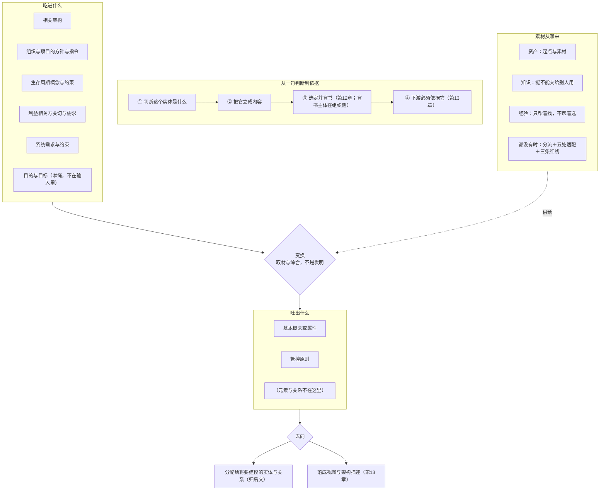

# 第11章 架构定义：把判断变成判据

## 11.1 引言

「架构」这个词说准了，下一个问题立刻就到：它是怎么来的。

上一章把架构说成了两样内容——实体在其环境中的基本概念或属性，加上管住这个实体怎么实现、怎么演化的管控原则。这两样内容不会自己长出来。有人得把它们立出来，还得让后面的人非照它办不可。本章讲的就是这件事：**架构定义**。

行业里这件事常被说成"开始做架构设计"。这句话里有两处偏移。一处把定义说成了设计——设计是另一样工作，在换手点的另一侧，归第14章。另一处把定义说成了一次落笔：好像架构师坐下来写一份文档，写完，架构就有了。真正发生的事比这具体：有一组东西送进来，有一组东西留下来，中间有几步要走。

先把入口和出口看清。

### 11.1.1 误解现场

冰链科技，同一间会议室，隔了一周。这回水忠带了东西来：一张图、一页选型对比、一页手写的老规矩。

图是上一章那张四层方块图，他新加了两处标注。选型对比是"边缘预判"这件事放在哪里：箱内算，还是上报之后云端算，各写了一栏利弊。那页老规矩是散会之后他一个人补的，字迹很挤——温度数据归谁管、断链就算失效、固件升级不许搞坏已经出厂的箱子。

"这次准备得比上次齐。"水忠说，"图有了，选型有了，规矩也写了。这次总该算是把架构定下来了吧。"

文正先开口，他关心的是能不能往下走："预判这件事跑在硬件上还是云端上？"

水忠："两个方案都列了，还没定。"

文正："那你们打算什么时候定？"

水忠："看情况。"

文正："还有一个问题——这么改完，M3 还是 M3 吗？"

三个问题，一个都答不上来。会议室里没人觉得意外：上一周也是这么散的。

李旭补了一句："我该验的东西在哪？"

董勐那边也接了一句，是复读那条老规矩："温度数据归追溯平台管——这条我记着。可这条线，是谁划的？"

水忠把那张图、那页选型、那页老规矩收起来的时候说："我是从需求出发的。"

这句话听着没问题。问题就在这句话里：他收到的东西不止一份需求，他能交出去的东西也不该是一张图。

### 11.1.2 本章要回答什么

读完本章，你应该能回答：

1. 架构定义吃进去的到底是什么？为什么说"收到一份需求"把入口说小了？
2. 目的与目标算输入吗？如果不算，它们站在哪、以什么身份说话？
3. 送进来的东西，是不是都会变成架构内容？没变成的那些去了哪？
4. 需求与架构，究竟谁规定谁？"双向的必要且充分"是什么意思？
5. 这一步的动词为什么是"变换"，而不是"汇总"或者"整理"？
6. 留下来的是哪几样内容？它们在标准里的位置由哪一条定？
7. 清单和架构描述是一回事吗？
8. 元素与关系在这条链上住在哪？产出里为什么没有它们？
9. 一句判断凭什么变成别人非依不可的依据？中间少哪一步会塌？
10. 这一步走到哪里为止？选定和背书归谁，表达成件归谁？
11. 候选是从哪来的？"我想到了"和"这是一个候选"差在哪？
12. 手上没有资产、没有经验的时候，架构还做不做得出？哪几条线不许踩？

### 11.1.3 本章的骨架

先把骨架立起来，后面几节都挂在它上面。

一句主张：架构定义不是"给架构下定义"，是一次**看得见进出口**的变换。

入口那一句：送进来的是相关架构、组织与项目的方针与指令、生存周期概念与约束、利益相关方关切与需求、系统需求与约束。这句话出自 ISO/IEC/IEEE 15288:2023 §6.4.4.1 的目的句。

还有一样不在其中：目的是准绳，也就是上游给的业务或任务目标，它不是输入。而架构目标与关键成功准则是这一步要立的产物。

出口那一句：留下来的是基本概念或属性，加上管控原则。它们会落成清单，不是一份描述。

中间那一句：这一步靠**取材与综合**，不是发明。同一个问题，可以立成"箱内算"，也可以立成"云端算"，两条都成立。

还有一句是收尾的。这两样内容要成为下游必须依据的东西，四个环节缺一不可：先判断"这个实体是什么"，再把它立成内容，再经选定与背书，最后下游必须依据它。本章只走到第二环。

骨架立完，本章接着往下走。先看吃进什么、吐出什么、中间加什么，这是入口、出口与中间那一步；再看一句判断凭什么让人非依不可，那是中间那条链，也是本章停步的地方；最后看素材从哪来，即供给，以及一样都没有的时候怎么办。

## 11.2 吃进什么，吐出什么，中间加什么

先把这一进一出两件事说准。本章后面所有判断都压在这一进一出上：入口不清，"把范围收窄"就没有对象；出口不明，"依据"就立不起来。

### 11.2.1 吃进去的不只是一份需求

"我是从需求出发的"——这句话对了一半。需求确实在输入里，但输入不止需求。

标准把入口写得很具体。ISO/IEC/IEEE 15288:2023 §6.4.4.1 的目的句逐字：

> *This process transforms related architectures (e.g. strategic, enterprise, reference, and SoS architectures), organizational and project policies and directives, life cycle concepts and constraints, stakeholder concerns and requirements, and system requirements and constraints into the fundamental concepts and properties…*

（中译：这一过程把相关架构（例如战略、企业、参考与体系之体系架构）、组织与项目的方针与指令、生存周期概念与约束、利益相关方关切与需求，以及系统需求与约束，变换为……基本概念与属性……）

动词的宾语是五样东西，需求只占其中两样。另外三样根本不是需求：

- 相关架构：战略架构、企业架构、参考架构、体系之体系架构。它们是上一轮架构工作的产物，这一轮直接拿来当起点。
- 组织与项目的方针与指令：治理方向、管理指南、适用政策与标准。它们规定的是"这件事得按什么规矩做"。
- 生存周期概念与约束：运营概念、保障概念这一类东西。它们给出场景与边界。

水忠那句"我是从需求出发的"，把入口说小了三样。这三样他当天其实都碰过：公司的固件升级规程就是方针与指令；客户那句"冷链运输全程不许断"背后是运营概念；隔壁产线跑了两年的追溯做法就是一份参考架构。他一件都没当成输入。

第二样要单独说一句。组织与项目的方针与指令，给的是规矩；这是治理在这一步给出的头一样东西。它还有一样是效力，那一侧不走输入这一路，见 11.3.1。

**还有一样不在那五样里：目的与目标。**

它们不是被"送进来"的，它们是准绳。标准把这件事放在另一处动作里。那处动作先刻画问题空间，再定架构目标与关键成功准则（15288:2023 §6.4.4.3 b)1)、b)2)）。换句话说，**架构目标是产物，不是输入**。42020:2019 §8.4.4 f) 的动作是"识别并定义架构目标，使其在利益相关方关注点、需求或质量属性方面应对问题和机会"。

这条区分有实际后果。把目的当输入，等于承认"目的早就写好了，我只是照着执行"；把它当准绳，才是"这一次要做到哪一步，得由我定"。

最后立一条边界，它防的是最容易混的一件事：**架构内容不是需求的一个分支**。需求按需求的判据验，架构内容按架构的准入判据验——就是上一章那条承重测试。两样东西各有各的合格条件，不能互相收编。

### 11.2.2 架构相关的留下，其余各有去向

入口看清了，接着看留下来的那一部分是哪些。送进来的东西不会原样变成架构内容。标准在这里用了两个字：相关。

15288:2023 §6.4.4.2 e) 要的是一条可追溯的线，从系统架构元素追到关键架构相关（*key architecturally-relevant*）的利益相关方需求与系统需求。这句话的重心在那个限定词上：不是所有需求都架构相关。

于是在这一步，每一条需求都要过一道问：

> 这条需求，是不是只有在"这个实体是什么"定下来之后才判得了？

是，它就进架构侧；不是，它就不进。这条问法是本书对标准那句话的操作化——标准只要求建立"关键架构相关"那条可追溯的线，怎么判出"相关"是本书补的。

判完之后，需求有三条去向，哪一条都不许是"消失"：

- **落成架构内容**：它变成了某一则基本概念、某一条基本属性，或者某一条管控原则。
- **被既有架构覆盖**：上一轮架构工作已经把它管住了（参考架构、企业架构里就是这么定的），这一次不必重立。
- **不在架构层承接**：它归设计定义或者实现去管。比如"这个按钮按下后 200 毫秒内出结果"，它不改变"这个实体是什么"，归下游。

水忠那次会上遇到的一个问题正好是个样本：文正问"温度数据上传间隔从 1 分钟改成 5 分钟，影响什么"。这个间隔不进架构内容——改它，M3 还是 M3。但它也不是"没关系"：它落在第三类，要去设计层承接。上一章那张图之所以答不上来，恰恰是因为图上没有说清哪一层管这件事。

去向还有一个硬要求：**可追**。每条需求最后停在哪一格，要能倒查回去。42010:2022 §6.2 要求架构描述里写一份未处理项声明，把没回应的利益相关方与关切、资源限制、不符合项连同理由一并记下——这正是"不许消失"在标准里的着落。

同一个判据在恒信那边也出现过。合同审批系统里，法务提了一条："单笔超过五十万的合同要自动加一道复核。"这条进不进架构内容？

按那句问法过一遍：它是不是只有在"这个实体是什么"定下来之后才判得了？不是。五十万这个数、加一道复核这个动作，都不改变"这个系统是什么"；改这个阈值，系统还是这个系统。它落在第三条去向：不在架构层承接，去设计层与流程配置里管。

紧接着法务又提了另一条："同一份合同在任何一张表里，金额的折算结果必须一致。"这条不一样。它指向的不是某个动作，而是"这个系统是什么"——一个多事实源的系统和一个单事实源的系统是两回事。它进架构内容，而且很可能长成一条管控原则。

两条需求挨着提出来，一条进、一条不进，靠的不是谁更贵、谁听起来更严重，靠的是同一句问法。

### 11.2.3 需求与架构：双向的必要且充分

第 11.2.1 节说输入里需求只占两样，这一节说这两样与架构之间的关系有多紧。标准给的是一个双向的判据。

15288:2023 §6.4.3.3 NOTE 18 逐字：

> *Feedback helps ensure that the specified system requirements have been adequately **captured and expressed**. **Confirmation is made that** they are a necessary and sufficient response to stakeholder requirements and a necessary and sufficient input to other processes, in particular architecture and design.*

（中译：反馈有助于确保规定系统需求已被充分捕获并表达；并确认它们既是对利益相关方需求的必要且充分的回应，也是对其他过程——特别是架构与设计——的必要且充分的输入。）

两头都要"必要且充分"，这句话的分量在两个方向上不一样。

一头是"对它上游"：系统需求是不是对利益相关方需求的必要且充分回应。不必要，就是多做了——要求里写进了没人要的东西；不充分，就是漏了——该覆盖的没覆盖。这一头失效，后果是**做的不是该做的事**。

另一头是"对它下游"：系统需求是不是架构的必要且充分输入。不充分，架构就答不全，没法据它立内容；不必要，架构里就会多出没有需求来源的东西。这一头失效，后果是**架构答不全、设计里多出东西**。

还有一句限定，管的是输入长什么样。15288:2023 §6.4.3.1 说需求定义过程"产生一组可测的系统需求"，而且这些需求"**不应蕴含任何特定的实现**"（*should not imply any specific implementation*）。

这两条合起来，正是下一节"变换"的前提。如果需求不许指定实现，那么"怎么实现"就必须有人来定——定它的人就是架构定义这一步。反过来说，如果需求已经把实现写死了，这一步就无事可做：它只剩抄一遍。

### 11.2.4 变换：同一批输入，能立出不同架构

现在看中间那个动词。标准给的词是 *transforms*——**变换**。不是 collect（汇总），也不是 summarize（整理）。

为什么是变换？因为变换必然做选择。同一句"要能提前告警"，可以变成"箱内算"，也可以变成"上报之后云端算"，两条都成立。标准不管选哪一条，它只要求把选出来的那一条立成内容。

先看留下来的是什么。

定义句给的是两样。实体在其环境中的基本概念或属性，加上管住这个实体怎么实现、怎么演化的管控原则（ISO/IEC/IEEE 42010:2022 §3.2）。42020:2019 §8.2 c) 把概念化的成果说成同一件事：*key concepts and properties, and the principles guiding its formulation, application and evolution*。

定义句里那个连接词是"或"——**概念或属性，取其一即可**。把概念与属性分列成两份清单，是实践里的做法：逐条准入方便，逐条分配也方便。这一点要说清楚，因为"分列"是本书与多数团队的整理习惯，不是标准的要求。

再看它们后面去哪。

标准把去向写得很清楚。42020:2019 §10.4.4 e) 的动作是：

> *Allocate relevant concepts, properties, characteristics, behaviors, functions, features or constraints to the entities and relationships to be modeled.*

（中译：把相关概念、属性、特征、行为、功能、特性或约束，分配给将要建模的实体与关系。）

注意它分配的对象是**实体与关系**。这一步在本书的链上属于后文——本章只把去向交代清楚，不在本章执行分配。同一节的 NOTE 2 还补了一句重要的话：这个分配可能已经在概念化过程里做过了；若是，细化侧只核查它是否仍然相关、细节是否够用。所以"分配归后文"这句话要说得准：标准没有强制这次分配必须留到后文，概念化过程里就可以做。

管控原则管什么，标准另有一句。§10.4.4 f) 的动作是：

> *Identify relevant principles and precepts that will guide evolution of the architecture entity.*

（中译：识别将指导架构实体演进的相关原则与准则。）

这一句只管演化那一半。"实现"那一半在定义句里：§3.2 说的是 *for the realization and evolution*。两处合起来，才是"管住它怎么实现、怎么演化"。引用时分清这一点，不然会把半句当成整句。

最后是一条诚实边界。

> **标准没有给"什么算基本"的判据。**

定义句里那个"基本"（*fundamental*）是整句里分量最重、也最容易被一带而过的词。上一章已经说明：标准确实没给这条判据，本书那条承重测试是形式化，不是标准条文。本章承上，不重立、不重证。

顺带说清一件事，它防的是越界：这几份清单可以不属于任何视图。42010:2022 §6.7 的 EXAMPLE 2 把"架构原则、架构模式与架构风格"列进了"不在任何视图之内的信息部件"——这是示例，不是要求，但它足以说明清单与视图不是一回事。

## 案例进展①｜冰链：水忠把判断写成老规矩

散会那天下午，水忠没画图。他先问了自己一句：我到底要把什么写下来。

他想起上一章那句话：写下的不是"决定的集合"，而是一句涵义加一组原则。于是他打开一个空白文档，写下标题"M3 老规矩"，然后一行一行往下写。

第一行他写的是涵义的正面回答：

> M3 是一台**从装箱到交付全程可追溯**的医疗冷链温控箱；温控是它的手段，可追溯是它的目的。

下面接了三段，每段一个规矩，都从上面那句话里读得出来。

温度数据归谁管。采集端归固件，上传端归云端；两边各自记录时间戳，对不上时以采集端为准。他补了一句为什么："数据归属不定，追溯链就有两个源头。"

断链就是失效。他写这条的时候停了一下，把它念出声："从装货到交付，链条上任何一段缺失，这次运输就算失效——不管箱内温度多漂亮。凭什么？凭上面那句涵义：M3 卖的是可追溯，温控只是手段。拿掉可追溯，它就不是它了。"

升级不许毁掉已出厂的箱子。新增传感器类型不得破坏已有的追溯链路，新固件必须能读旧批次的记录。

写完三段，他停下来看了一遍，发现自己做了一件跟以前不同的事：这一次，他没有先画图，也没有列选型；他是先把"它是什么"写下来，再从这句话里推出规矩。图可以后画，选型后选——但这两样以前都是起点，今天成了后来的事。

那份文档他存了，一共一页。文件名不叫"架构"，叫"M3 老规矩"。

### 11.2.5 架构师写目的陈述，立概念与原则

到这里可以回答一个常被问的问题：这一步既然只是"变换"，那架构师到底做了什么？是不是把上游给的东西整理一遍？

不是。整理不产生内容。这一步真正往里加的东西有四样。

给每个候选写一句目的陈述。42020:2019 §8.4.5 e) 的动作是 *Formulate purpose statement(s) for each potential solution*，其 NOTE 5 补了一句：每个解可能有不同的目的陈述。也就是说，"这个方案是为了解决什么"不是从需求里抄来的，是写出来的。

把手段立成概念与原则。解空间里找到的做法要提升成内容：它是什么，这是概念；它必须守什么，这是原则。42020:2019 §8.4.7 与 E.3.3.4 把它写作 *enshrine these characteristics in architecture principles*——把特征供进原则里。

适配与调和。既有做法不能照搬。42020:2019 E.3.3.2 的动词是 *instantiated and specialized*，也就是实例化并特化；§8.4.6 NOTE 3 又补了 *harmonization*，说的是几件模式或战术一起用时，得调和到眼前这个局面上。

"什么都不改"也列成一条候选。42020:2019 §9.4.7 NOTE 2 明写：*The status quo is sometimes one of the alternatives that could be considered*。"什么都不改"本身就是一条候选，它得跟别的候选一起被看见、一起被比较。

这四样里，前三样是往里加内容，第四样是把"现状"摆上桌。四样都不是靠整理能得到的。

这四样在冰链那边各有一个画面。

目的陈述。水忠给"边缘预判"和"追溯链新输入"各写了一句，两句不一样，这是关键；写成一样，说明他其实只有一个方案（例见案例进展②）。

把手段立成概念与原则。他写下的"断链就是失效"不是一句需求，而是一条原则：它管的是演化，将来新增什么功能，都不许让链路有空档，不只是这一次的实现。

适配与调和：他引用产线给的口径时，把槽位的粒度从行级提到版本级。这一步不是抄，是调。

"什么都不改"那一条是他最后补的，逼着另外两个方案回答一句——你比现在好在哪。

### 11.2.6 产出到哪儿为止

这一节的出口要点清：留下来的只有基本概念或属性，加上管控原则，再没有第三样。

它们的去向也说到了。概念与属性后面会被分配给将要建模的实体与关系，管控原则管演化那一面。两处动作分别见 42020:2019 §10.4.4 e) 与 §10.4.4 f)。那一步在本书的链上归后文。本章把清单立出来，就到这里。

再划两条界，它们防的是两种最常见的越界。

第一条：元素与关系不在产出里。

它们的含义写在 42020:2019 §3.3 的注 1 里，措辞是"通常意指体现于"（*usually intended to be embodied in*）。这是注释级措辞，没有术语地位。另一半也得说：架构可以关乎结构。42010:2022 §5.2.2 逐字列出架构可涉及的诸项（正本共列五项），里面就有行为与结构（*behaviour and structure*）。这是外延，不是产出；本章不切分元素、不连接关系，也不论哪些连接断不得。

另有一个词要钉住：**架构实体**。它指被架构的那个事物，不是架构的组成部分。15288:2023 §5.9 有一段写明，架构实体与系统元素"代表两种不同的概念"（*two different notions*）。这一句术语注不能省——省掉，读法就退回到把架构当成元素与关系的那个年代。

第二条：清单不是描述。

清单属内容侧，视图属描述侧。本章交出去的是清单；把内容按视角落成视图、写成一份架构描述，是第13章的活。标准在这里留了余地：那几份清单可以不属于任何视图。出处是 42010:2022 §6.7 EXAMPLE 2。所以有一条分寸必须记住——**"清单写完"不等于"描述有了"**。清单是内容的表达，不是架构；描述是把这份内容交给别人的那种说法。

还有一笔账要在这里落下：这几份清单在第7章的账上也找得着。产品数据有设计态、制造态、使用态三种存在（第7章 §7.3.2），设计态里没有实物，**开发产品 ≡ 开发产品数据**；本章立出来的基本概念或属性、管控原则这几份清单，就是**设计态产品数据**里内容侧的那一支——是数据，不是实物，也还不是一份描述。这一笔交代过，题面里"产品数据"四个字才算落地。至于它怎么按视角落成视图、写成一份交得出去的描述，仍归第13章。

还有一句留在这里，它属管控原则对下游的约束，不属架构内容：**关系是成本。** 两个部分之间要是全互联，牵动就成片；"能不加的关系就不加"这一条可以立成一条管控原则，交给下游去守。至于关系怎么分类、怎么降耦、怎么契约化，那是设计定义过程的活，归第14章。

## 11.3 一句判断，凭什么让人非依不可

入口和出口看清了，看中间这一段路。一句判断停在一个人脑子里的时候，谁也不必依它；要让别人非依它不可，中间有几步不能省。这一块讲这几步，也讲清本章走到哪一步为止。

### 11.3.1 判断怎么才不只是意见

标准给这一步的动作是生成备选、选定、表达三件事（15288:2023 §6.4.4.1 目的句）。本书把它拆成一条更细的线，看一句判断怎么一步步变成依据：

① 判断"这个实体是什么" → ② 把它立成内容 → ③ 选定并背书 → ④ 下游必须依据它。

四个环节，缺哪一个都走不通：

| 缺哪一环 | 会怎样 |
|---|---|
| 缺① | 没有可划的界 |
| 缺② | 别人没法引用、没法评审、没法判定 |
| 缺③ | 它只是"架构师的个人意见" |
| 缺④ | 各做各的 |

这四个"缺"不是假设，冰链那间会议室里各有一个样本。

缺①的样本是水忠画的那个框："边缘预判模块"悬在固件层和云端层之间，他自己都答不出它算哪一端。界没划清，后面没有一处判得了。

缺②的样本是李旭那句问话："我该验的东西在哪？"老规矩只在几个人脑子里，没有一处可以引用、可以评审、可以判定。

缺③的样本是"我们打算做成那样"——一句话没被选定、没人背书，下一个人接手就能改。

第三环要再说细一层。它是两件事挤在一个环里，不是一个人做两下。

**选定**是判断：在几条走法里，哪一条最合目的。它归架构过程，依据就是本章立的那一条。

背书是另一回事。它承诺的不是"这条更优"，是"这条就这么办了，后果我担"。所以它能依靠的凭据不是判据，是职权。职权不能自授——架构师自己给不出这一环。标准把这一步的动词写成"取得一致意见"（*obtain agreement*）：15288:2023 §6.4.4.3 e) 2)，说明它是去向别人要一个答复，不是自己写一个结论。

判定与授权分家，原因就在这：算得清优劣的人不承担后果，承担后果的人才有资格点头。这一步的展开归第12章；至于那位有职权者是谁、按什么程序点头，是组织职能的事，归第16章。

缺④的样本是图里那根"温度数据"的箭头：董勐那边以为重连逻辑在固件，而固件是水忠自己写的，他知道里面没有。两边在图里各找各的依据，接缝就断在这里。

这里有一处必须替标准说清。这条链是**本书自己归的读法**。正本给的是另外三样。四个活动是准备、概念化、评估、细化（15288:2023 §6.4.4.3 a)~d)）；三个核心过程是概念化、评估、细化（42020:2019 §8、§9、§10）；另有架构治理与架构管理两个并行过程（42020 §6、§7）——**它们与本章是并行关系，不是本章的下一步**（两者的展开在下篇，治理见第16章）。读法与正本不冲突，但它是读法，不是条文。

**本章只走到第二环。**①与②合起来，就是标准里的前三步：定要支撑哪些决策、把关切变成判据、取材并综合候选。③里的评估与筛选归第12章；④连同表达成件归第13章。

为什么不一次走完？因为这一步的边界不在"做完了没有"，在它交给下一站的是什么：本章交出去的是摆好的候选和它们各自的目的陈述，不是选定的那一个。

另一面也说一句。标准把"项目那份视图清单"的产生写成一条反推的路。关切由视角框定，每个视角至少有一张视图，每张视图要应对它那个视角框定的全部关切并记下已知问题。

这条路最后一步是反向查一遍，看是不是每个关切都被至少一个视角框定、被至少一张视图应对了。这条路的出处是 42010:2022 §6.6 与 §6.7。那几步落在描述侧，归第13章。本章这条链跟它方向相反，用的是同一批货：关切进来，内容出去。

### 11.3.2 先定要支撑哪些决策

这一步在标准里叫准备（*Prepare*）。它产出的不是架构内容，是"这一次怎么做"。15288:2023 §6.4.4.3 a) 列了几件事：

| 标准动作 | 白话 |
|---|---|
| 识别关键里程碑与决策 | 这次定出来的东西，要供哪几个决策用 |
| 给出架构定义的策略 | 走法与做到多深 |
| 为架构治理与架构管理工作做好准备并作出规划 | 谁来批、谁来守，什么时候过闸 |
| 识别并规划所需的使能系统或服务 | 建模工具、配置库、测试台这些支撑 |
| 取得对这些使能系统或服务的访问权 | 上面那些东西要真的能用 |

第一件最容易被跳过，也最要紧：**这次的定义是给谁用的**。同一份需求，供"要不要立项"用和供"这一版能不能投产"用，做到多深完全不一样。不先问这一句，后面所有"细化到什么程度"的争论都没有准绳可依。

第二件是策略——走法与做到多深。走法不止一条。从问题空间往前推、从既有架构往回接、从中间往外扩，都在标准的可选里（42020:2019 E.3.2 共列七种，此处只举三种）。做法不同，取材也不同。

剩下三件是支撑：谁批、谁守、手上有没有工具。它们不产出内容，但没有它们，前两件落不了地。

第三件那一行要补一句边界：它的展开不归本章。谁批、什么时候过闸，一半归第12章（决策权与时机），一半归第16章（治理机构与程序）。

水忠那天缺的正是第一件，而且缺得很典型。他带了三样东西进会议室，没一样是"这次要支撑哪些决策"的产物：他不知道这一版是给产线看的还是给客户看的，也就不知道该细到什么程度，于是图、选型、老规矩三样都只做了一半。

### 11.3.3 关切怎么变成判据

这一步在标准里是概念化的第一件事，但它的第一句是个否定句：不要重做问题空间。

15288:2023 §6.4.4.3 b)1) 的动作是"刻画问题空间"，其 NOTE 3 立刻补了一句：这件事是与业务或任务分析过程一起做的，那个过程负责识别并定义问题或机会的空间。也就是说，问题空间在那里已经刻画过一遍，这一步不重做，只在架构这一侧把它细化。

细化的产物是两样：**可判的质量度量**，和**架构目标与关键成功准则**。

42020:2019 §8.4.3 i) 的动作是"识别并排序（正本原词 *prioritize*）与这些利益相关方关切相关的质量度量，把它们用作架构开发与评估的基础"。注意"排序"两个字：关切进了清单不是就完了，它们要按重要程度排出来。

42020:2019 §8.4.4 接着给出目标的写法。识别并定义架构目标，使其在利益相关方关切、需求或质量属性方面应对问题与机会（f)）；定义关键成功准则，用来评定问题在多大程度上得到解决，并为备选方案的探索与选择提供依据（h)）；必要时把成功准则转成评估准则（j)）。

这里有一处最容易混的地方，值得单独说：**关切本身不是判据，判据是目的。**

关切说的是"谁在乎什么"——客户在乎链条不断，产线在乎造得出来，运维在乎修得起。它给出的是判据生效的现场，不是判据本身。真正拿来筛东西的判据仍然只有一个：把这一条内容拿掉，这个实体还能达成它的目的吗。关切的作用是让这条判据有地方用——没有关切，你连"目的有没有达成"都没法量。

分清这一层，两个常见的失效就有了名字：

- **查漏**：某个关切没有任何条目承接。客户在乎断链，可老规矩里没有一条管它。
- **查滥**：某条目只服务一个关切，且不承重。为了某位领导的一句话，专门立一条谁都不会违反的原则。

水忠那份老规矩正好一漏一滥。漏的是"客户怎么知道链条没断"——那份一页纸里没有一条管告知；滥的是他原本想加的"显示界面必须用蓝色"，既不影响目的，也没人会违反。

### 11.3.4 候选从哪来

目标和准则有了，接下来是找解。这一步的动词最容易被说错。

标准用的词是 *Synthesize potential solution(s) in the solution space*（15288:2023 §6.4.4.3 b)3)），也就是在解空间里综合出潜在解。42020:2019 §8.4.5 的动作清单是三件：识别既有解、识别问题缓解策略、为每个潜在解写出目的陈述。正本里前两件同用 *Identify*，第三件用 *Formulate*。

**动词是综合、识别、写出，不是发明。**这句话有两层意思：一层是"你不需要天才"；另一层更要紧，解不是凭空来的，它有来路。

来路有三条。

一条是上游给的偏好解类。15288:2023 §6.4.4.3 b)3) NOTE 4 写明：业务或任务分析过程已经定下了偏好解类，潜在解是在类内被识别与分析的。类的边界不在架构师手里——他在类内找解。

一条是既有解与既有架构。42020:2019 §8.4.5 b) 的动作是识别既有解；同节的 NOTE 1 补了一句：已经跑过的做法是天然候选，"什么都不改"也在其中。

一条是模式、战术与启发式。42020:2019 §8.4.5 c) 6) 的动作是识别相关的架构模式、启发式与战术。它们是组合规则与基本手段，可实例化、可特化。

三条来路各给一样东西：类给边界，既有解给素材，模式战术给手段。找完还要做一件标准明确要求的事，就是**为每个候选写一句目的陈述**（§8.4.5 e)）。它的 NOTE 5 说得很清楚——每个解可能有**不同的**目的陈述。

这句话的分量在"写"字上。候选之间真正的差别，往往不在技术而在目的：这一个是为了少花钱，那一个是为了少出事。目的陈述写不出来，说明这个候选还没想清楚，它只是"我觉得可以"。

有一处数量上的误会值得先说清。标准确实要求候选得"够"。数量、种类、跨度三者都要够（42020:2019 §9.4.7 NOTE 3）；评估时若判定候选的数目、种类或跨度不够，可以要求再造。但"够"从来不是"多"。

真正管住这件事的，是下一节要立的四条准入要求：过得了的就是候选，过不了的多摆一条只是多花时间。冰链那边三条候选，恒信那边也三条，都不是因为三这个数吉利，是因为各自的来路不同——一条来自上游给的偏好解类，一条来自既有做法，一条是"什么都不改"。来路不重复，权衡空间才铺得开；来路重复，摆五条也只是同一条候选的五个说法。

### 11.3.5 什么样的想法才算候选

列出来的想法不会都算候选。标准给了两组要求，合起来可以落成四项检查。

辨得开。权衡完全相同的两条，标准说不予考察（42020:2019 §9.4.8 NOTE 1）；彼此相似、提供不了区分的那一条，剔除（§9.4.7 b)）。两条候选在权衡空间上分辨不出差别，多摆一条只是多花时间。

可追溯。用了哪件既有解、哪个模式，要能指出来；更要紧的是**适配理由写没写**。42010:2022 §6.10 要求架构决策连同理据一起记录：§6.10.1 管决策记录，§6.10.2 管理据记录。用了别人的东西而不写为什么适用，等于把一件没验证过的做法直接搬进来。

把这两条展开，就是四项检查：

| 检查 | 问什么 |
|---|---|
| 有类可归 | 它落在上游给的偏好解类里吗？ |
| 有物可依 | 它用了哪件既有解、参考架构、模式或战术？适配理由写了吗？ |
| 有径可循 | 它是既有做法的实例化与特化，还是"我以前都这么干"？ |
| 有辨可评 | 它跟别的候选在权衡空间上辨得开吗？ |

**四项全过＝候选；任何一项不过，它就是一个"想法"。**这个区分不是文字游戏：候选要进后面的评估，想法要退回去接着想。

看一个过不去的样本。恒信那边有人提过一条："把审批流的每一步都做成可配置的规则。"听着很像个方案。四项检查一条条过：

有类可归：上游给的偏好解类里没有"规则引擎"这一类，它悬着。有物可依：用了哪个既有解？答"没有，我们自己设计"，于是适配理由也无从谈起。有径可循：它既不是既有做法的实例化，也不是特化，它是从零发明。有辨可评：它跟"现状照旧"分辨得开吗？分辨得开，这一项过了。

四项过了一项，它就是一个想法，不是候选。想法不是没用——它是往后找候选的线索。把它当候选摆进评估，会占掉一条权衡空间的位置，还让评审把时间花在"这个要不要做"上，而不是"这几个哪个更好"上。

### 11.3.6 概念、属性和原则从哪来

那几样内容不是从上游现成搬过来的。三样的来历各不相同，各有一句话。

**概念是幸存下来的。**一个实体身上可以说的概念很多，能进架构的只是极少数——它们经历了一轮又一轮的取舍，最后活下来。活下来的理由只有一个：去掉它，这个实体就不再是它自己。

**属性是涌现出来的。**这一点有正本支撑。15288:2023 §3.46 给"系统"的定义逐字是：

> *arrangement of parts or elements that together exhibit a stated behaviour or meaning that the individual constituents do not.*

（中译：各部分或各元素的安排，它们合在一起呈现出单个构成部分所不具备的既定行为或意义。）

整体呈现的东西，零件单独不呈现——这就是涌现。架构要管的那几条属性，恰恰是这一类：它们不由任何一件部件保证，只能由这个实体整体保证。所以它们必须在架构这一层被立出来，往下分是分不出来的。

**管控原则是自加的。**它不是从任何一条需求里读出来的。42020:2019 §8.4.7 与 E.3.3.4 的动词是 *enshrine*——把特征供进原则里。需求说"要可追溯"，原则说"新增传感器类型不得破坏已有的追溯链路"；后一句是前一句在这一轮的具体化，它是加进去的，不是抄出来的。

三句话合起来，正好回答"这一步到底加了什么"：它让一批概念幸存、让一批属性现形、再亲手补上几条原则。

## 案例进展②｜冰链：先写目的陈述，再摆候选

水忠最后还是把选型那一页重新做了一遍。这回他先写目的陈述，再摆候选。

他的目的陈述只有一句：在箱子落地的第一时间就知道这次运输能不能签收。

第一版他写了三行：一句目的陈述，两条候选。

**候选甲：边缘预判。**箱内算，实时判定，异常当场报警。目的陈述写的是"把判断留在现场，不依赖网络"。

**候选乙：追溯机制的新输入。**把预判结果当成追溯链上的一条记录，判定仍然在云端做。目的陈述写的是"复用已有的追溯链，不新增一条并行机制"。

写到这里他卡了一下——因为两条都成立，而且第一条更"高级"。他差一点就顺手把甲留下、把乙删掉。

李旭正好路过，看了一眼他摊在桌上的三行，指出一处："甲这条，你写的是'边缘预判'——它落在哪个偏好解类里？用到了哪件既有解？"

水忠答不上来。他查了一圈：公司内部没人做过，也没有现成的模式或战术可依。

李旭说："那按四项检查过一遍，它四项里只过一项。过不了的，只能叫想法，不叫候选；标准对权衡完全一样的两条根本不予考察，§9.4.8 的注里写着。想法是往后找候选的线索，不能直接摆到评估桌上。"

乙那条不一样：追溯链是现有的，往里面加一类输入是既有做法的实例化，可追溯。

于是他没删甲，改了甲的写法，把它写成一条候选，并注明它的来路与代价：新硬件、新固件、产线要重排测试。然后他补了第三条。

**候选丙：现状照旧。**什么都不改，继续用现在这套。他一开始觉得这条不用写——"照旧"算什么方案。但标准里写着它是候选之一，他还是写了，目的陈述留空，后面用准则来判。

三条候选摆出来，他自己看了一分钟，说了一句："原来我不是在选一个方案，我是在写三个不同的打算。"

## 11.4 素材从哪来

入口、出口和中间那条链都讲完了，还剩一个问题：那几样内容是拿什么做出来的。架构师手上不可能什么都没有——他总有些旧解可参、有些做法可循、有些经验可用。这一块讲这三样各占什么位置，以及一样都没有的时候怎么办。

### 11.4.1 资产：起点与素材

组织里有形的、可以拿来就用的东西，在标准里各有一个名字：相关架构、架构仓库、参考架构、模式、战术、既有解。它们是这一步的起点与素材。

起点与素材这两个词的分量不一样。起点是说，很多架构工作不是从白纸开始的——上一轮的结论、隔壁型号的做法、行业里公开的参考架构，都可以直接拿来当第一版候选的底子。素材是说，拿来之后不能照抄。

标准在这里的动词是 *instantiated and specialized*，也就是实例化并特化（42020:2019 E.3.3.2）。把它落到你这个实体上，再按你的局面改。照抄的后果很具体——参考架构是给一类实体定的，它管的是那一类共有的东西；你的实体独有的那部分，它一个字都没说。

用了就要说明为什么适用。42010:2022 §6.10 要求架构决策连同理据一起记录（§6.10.1 决策记录／§6.10.2 理据记录）。在这里它多一层分量：把一件既有做法搬进你的架构，正是这样一项要记的决策。**适配理由写没写**，是"用了资产"与"被资产用了"的分界。

资产还有两种偏差要防。一种是可能缺失。新领域的项目手上真没有可参的东西，42020:2019 E.3.1.2 讲的就是这种极端情形，正本里写作 *no prior system*。另一种是不该沿用。旧资产在那儿，但这次的意图是彻底离开它；E.3.1.5 给的名字是 *legacy revolution*，说的是遗产还在，可从赞助方到团队都打算跟它划清界限。有资产不等于要用资产。

参考架构怎么特化，看一个具体的动作。行业里常见的一份参考架构会写"每个数据源要有唯一的归属方"——这是一条原则。

搬到 M3 上，它变不成原话。M3 的数据源不止一个，箱内传感器、云端记录、产线的批次表各算一路；"唯一归属方"要落到"哪一段数据归哪一方"上，最后写成"采集端归固件，上传端归云端，对不上时以采集端为准"。同一条原则，在行业那份参考架构和 M3 上长出两句不同的话——中间那一步就是特化。

"不该沿用"也有样本。水忠上一代产品留下的那份固件升级规矩是："新固件必须兼容上一代硬件。"这一代 M3 换了主控，旧硬件的兼容要求不但用不上，还挡路——它会把选型限制在一个已经停产的芯片上。这条资产不是坏的，它只是不属于这一轮。分清"这条规矩错了"和"这条规矩不合这一轮"，正是重判资产可用性那一步要做的事。

### 11.4.2 知识：能不能交给别人用

第二样不是实物，是想事情的形式。标准把这一类叫 *enablers*，也就是使能项。它们是视角、模型种类、建模方法、模板、元模型、框架（42020:2019 §8.4.8 f)）。

它们的用处不在内容本身，在让内容长成可复用、可交接的样子。同一个判断，用散文写下来和用一套视角规格写下来，区别不在这份文件本身，在下一个团队能不能接着用。

所以这类东西的评价标准只有一条：能不能交给别人用。标准把这件事写得很直白。这些使能项可以放进组织的仓库，供其他架构工作使用（§8.4.8 f) NOTE 2）。放不进仓库、只能留在某个人电脑里的东西，不算这一类。

这条标准很实用。水忠那页老规矩里，"温度数据归谁管"是知识；"这块硬件我熟"不是知识，它是水忠的经验，交不出去。

可交接与交不出去，差别落在一个具体动作上：别人拿到它，能不能不问你就往下做。

水忠那页老规矩里，"温度数据归谁管"这一条可交接。新来的人读到它，知道去哪一端找数据、以谁的时间戳为准，可以照着往下做，不必再把水忠叫来。"断链就是失效"也可交接，因为它说的是判据（链条断没断），不是做法（用什么字段判）。

交不出去的样子也常见：一张画得极漂亮的时序图，上面只标着"上报"，没写谁发、发什么、什么条件下发。作者在场时人人都懂；作者一走，它就成了一幅画。**判据不是"写没写下来"，是"别人能不能接着用"。**

还有一类东西也归这里，而且最容易被当成私产：**视角规格**。一次架构工作里立起来的视角——这个视角框定哪些关切、用什么模型种类表达、按什么惯例读——是可以写下来、可以直接给别人用的。写下来它就成了组织的知识；只留在某个人脑子里，它就只是那个人的习惯。

所以这一节真正要问的问题是：这一次做完，你给组织留下了什么可以拿走的东西？一页老规矩、一份视角规格、一套命名与分层的约定，都算。**留下的东西越多，下一次的起点就越高。**

### 11.4.3 经验：只帮着找，不帮着选

第三样是经验。标准给的正式名字是启发式（heuristics），定义是"架构工作的指导方针"，并明说它们来自经验（*derived from experience*，42020:2019 E.3.3.5）。

启发式在标准里跟参考架构、模式、战术是平级的（E.3.3.1 把它们并列），各有各的用处。它们在生成那一环最有用：想不出候选的时候，经验告诉你"这类问题以前是这么解开的"，一下就能起个头。

但它们有一处界限必须钉住：**不充当选定判据。**

同一条启发式前面还有一句限定。不是所有启发式在所有情形下都适用（*Not all heuristics apply in all circumstances*）。选定阶段的判据是评估准则、强制项与关切，不是"我以前都这么干"。

**经验最容易出错的位置，恰好在"选"那一环。**想候选的时候用经验，是本事；挑候选的时候用经验，是把偏好偷渡成理由。这两种用法看起来都是"凭经验"，位置差一环，性质完全不同。

水忠那句"我一直这么干"，用在找候选上是资历，用在选定上就是话术。它回答的是"我以前怎么做的"，而不是"这次为什么该这么做"。

经验在选定环出错的完整样本，恒信那边有一个。万辉上一轮做过一个审批系统，用的是"流程引擎加表单配置"这条路，做成了。这一次他一看需求，也是审批、也要留痕，当场就说："还是流程引擎，我熟。"

这句话的问题不在判断本身（流程引擎也许真的合适），而在它出现的位置。它出现在候选还没摆完的时候，于是后面所有的评估都成了给这个结论找理由：选它，再补两行权衡，再写一句"符合上一轮经验"。他省下的不是时间，是把别的候选摆上桌的机会。

正确的用法是：把他那句"我熟"放在生成那一环。它帮着快速写出第一版候选，还帮着预判哪里有坑。到了选定那一环，判据换成评估准则、强制项与关切；他还是可以发言，但发言的内容得是"这个方案在准则 X 上得几分"，不是"我熟"。

### 11.4.4 资产稀缺时怎么办

有一类项目，叫新领域——手上没有可用资产，团队也没做过同类的事。这时候架构还做不做？

先回答一句：**资产多少不改变这件事有没有，只改变怎么做。**标准没有把"资产不足"列为可以不做架构的条件，它把不同情形分成几种，各给不同的走法。分流的依据写在 42020:2019 E.3.1.1 的引入句里：

> *The approach which should be adopted depends upon the complexity of the system of interest, its novelty, realization mechanisms and/or the uncertainty in the stakeholder needs.*

（中译：应当采用的走法取决于所关注系统的复杂性、它的新颖程度、实现机制，以及利益相关方需要的不确定性。）

按这几个因素分，常见的有四种情形：

| 情形 | 标准里的样子 | 资产状况 | 架构工作的要点 |
|---|---|---|---|
| 全新开发 | *no prior system*，一切全新（E.3.1.2） | 几乎为零 | 从问题空间往前推 |
| 产品线启动 | 要建的是一条产品线，不是单个系统（E.3.1.7） | 几乎没有，但要一次抽共性 | 架构一次为多次服务 |
| 遗产革新 | 旧系统在，但意图是彻底离开（E.3.1.5） | 有资产，但不打算沿用 | 重判资产可用性 |
| 增量启动 | 不确定"什么最合适"，且不确定性很大（E.3.1.6） | 少且不确定 | 产出后续步骤的选项 |

> **正本全数与本书取法**：42020:2019 **E.3.1 共六种情形**——E.3.1.2 全新开发／E.3.1.3 产品线中的新产品／E.3.1.4 遗留系统演进／E.3.1.5 遗留系统革命／E.3.1.6 增量式启动／E.3.1.7 产品线式启动。本节取其中四种；另两种（**产品线中的新产品**、**遗留系统演进**）**手上有资产**——前者"已有能力与技术相近的既有系统"，后者"遗留系统存在，且不能被弃置"——不在"资产稀缺"这个题目下。

第三种和第四种最容易混为一谈。遗产革新是有资产不用，要防的是被旧做法拖回去；增量启动是没把握，标准给的处方是"拥抱这种不确定性，先给出初始步骤，同时给出后续步骤的选项，把已知与未知的不确定性都算进去"（E.3.1.6）。

情形不同，适配的地方也不同，可以归成五处：

- 走法从"资产优先"改成"前向为主"。
- 取材换来源：专家、技术扫描、模式扫描、风险评估。
- 输出加两件：决策与理据从可选变承重；"后续步骤的选项"本身成为架构内容的一部分。
- 迭代策略换：评估前置、细化工期推后，并把"现状照旧"列进候选。
- 收窄的口径也要调。

收窄口径这一条再往下引，就是三条红线，它们要落在这一节。

- **不许拿"没资产"当不写架构的理由。**缺资产改变的是取材方式与细化深浅，不改变有无。标准明许架构里的元素初始可以是概念性的（*notional*），接口只定义到"足以传达架构意图"为止（42020:2019 §5.6）。
- **不许把参考架构当答案。**正本的动作是实例化并特化；用了就必须写适配理由。
- **不许把"不熟"写成"不该"。**一条界划下去的理由，得是"它威胁目的"，不能是"我们不熟悉它"。

所以有一句话要写下来，每次划界的时候问一遍：这一条界，是因为它威胁目的，还是因为我们不熟？说不出理由的界，就不该划。

还有一条连带也值得记：**资产稀缺时的架构工作，本身就在补资产。**这一轮立起来的视角规格、模型种类、接口契约范本、模式与战术，都可以回流到组织仓库里供下一次用（42020:2019 §8.4.8 f) NOTE 2）。第一次做的人多花的时间，有一部分是在给后来的人铺路。

### 11.4.5 认知反转

本章要反转的直觉只有一个：架构是"画"出来的。

在第一间会议室里，他做的每件事都符合这个直觉。他画了一张图，图上有四层方块和一根箭头；又在图上新加了两处标注；还把这件事叫作"做架构设计"。整套动作里，唯一没有发生的事是：没有人问过"这个实体是什么"，也没有人把答案写下来。

于是没有可划的界（他答不出"边缘预判模块"算哪一端），没有可引用的内容（李旭找不到该验的东西），没有可背书的定案（"我们打算做成那样"），也没有可以立得住的依据（董勐和水忠在图里各找各的）。四个环节全空。

第二间会议室里，他做的事少得多：一页纸，一句涵义，三条规矩。可这一次，四个环节里的前两个活了——有一句"它是什么"，有三条从这句话里读得出来的规矩。他没有画图，架构反而第一次有了形状。

这就是反转：**架构不是画出来的，是定义出来的。**画图属于后面的表达，归第13章；定义这一步做的是另一件事——把送进来的东西变换成几样内容，再把它们立成能被别人依据的样子。

反转还有一半，藏得更深：**这一步不是整理，是加东西。**整理不产生内容，而这一步必须产生内容：它要把概念、属性、原则这三样立起来；它要给每个候选写一句目的陈述，要把既有做法适配到眼前这个局面上。上游给的东西再全，也换不出这几样。

所以"架构定义"这四个字读起来像个语义动作，做起来却是一次有输入、有产出、有次序、有归属的变换。它吃进的东西比"需求"多，吐出来的东西比"清单"少——只有那几样内容，而且它们还得有人定、有人背书，下游才非依不可。

章末那句话是永兵说的。他把工牌从脖子上摘下来放在桌上，说："咱们做了这么多年 M3，怎么被问到‘它是什么’，一句话都说不上来。"

## 案例进展③｜恒信：万辉先列关切，图一笔没画

恒信那边，万辉把上一轮的"四张图，四个对不上"贴在工位上，贴了两个月。

这次合同审批系统要改一处：法务要求所有金额字段加上"本币折算口径"这一栏。上一轮他是直接开画——四张图同时铺开，谁先画完谁算数。这一次他没动笔。

他先做的事是列关切。他在一张纸上写了三行。

- 法务：口径必须唯一，同一个合同在任何一张表里折算结果一致。
- 财务：折算率有生效日期，跨期合同要能看到当时的口径。
- 法务：录入时不能要求录入的人记住口径代码。

三行写完他看了一眼，发现第二行跟第一行挨得很近，第三行其实是一句需求而不是关切，它说的是"界面该怎么做"，那是设计的事。他把第三行划掉，改成"录入的人不需要懂折算规则"。

然后他去找素材。他没有去翻架构文档，那里没有可用的东西。他去翻了两样：上一轮项目留下的追溯表模板，一份同类的既有解；集团层面那份数据口径管理规定，一份方针与指令。

两样东西他都用了，各写了一句适配理由。

"用追溯表模板，是因为它已经把'金额、口径、时间'这条链的槽位留好了；特化点是把生效日期从行级提到版本级——这是对模板的改动，得记下来。"

"用集团口径规定，是因为它定的折算顺序与本系统一致；特化点是它只管年度报表，本系统要管到单笔合同——这一条差异也得记。"

他把这两句念给了会上的徐漾听。

徐漾问了那句他每次都会问的话："你用的这件既有做法，适配理由写在哪？"万辉指了指纸上那两段："写在这儿了——用了别人的东西，就得把理据一起记下来；用了别人的东西不写清楚它为什么适用，等于把一件没验证过的做法直接搬进来，下一轮谁都不知道它凭什么留在这儿。"

写完这两句，他才开始摆候选。三个候选里有一个是"现状照旧"——继续用现在这套人工核对。他没删它，理由写得很直白：另外两个方案都要改数据模型，而这个方案的成本最低，得摆在一起比。

那天他一笔没画。他自己也没想到，"不画图"这件事，对他来说才是这一轮最大的变化。

## 小结

本章讲的是架构定义这个动作本身。

它的入口比"一份需求"要宽：送进来的是相关架构、组织与项目的方针与指令、生存周期概念与约束、利益相关方关切与需求、系统需求与约束；目的与目标不在其中，它们是准绳。它的出口比"一份描述"要窄：留下来的只有基本概念或属性，加上管控原则；元素与关系不在产出里，描述也不是。

中间那一段的动词是变换，不是汇总，也不是整理。变换必然做选择，而这个动作真正往里加的有四样：给每个候选写一句目的陈述、把手段立成概念与原则、把既有做法适配到眼前、把"现状"也摆到桌上。

那几样内容要成为下游必须依据的东西，中间有四个环节：判断"这个实体是什么"、把它立成内容、选定并被背书、下游必须依据它。本章只走到第二环——选定与筛选归第12章，表达成件归第13章。

供给这一步的三样东西位置不同：资产是起点与素材，知识是能交给别人用的形式，经验只帮着找、不帮着选。三样都没有的时候，架构照样要做——只是取材的方式和细化的深浅要换，还有三条线不许踩。

一句话收口：架构定义不是给架构下定义，是把输入立成基本概念与属性、管控原则这几样内容，并且立到别人非依它不可。

## 附录

### A 本章概念总图

### B 本章的能力级

**第 ③ 级为主**

用第1章 §1.4.4 那把尺子量一下：本章以第 ③ 级为主。架构定义不再是一次落笔或一次整理，而是能推演"少哪一环会塌"的那条链。

- **表征**——本章把哪几个词说准：架构定义（是一个动作，不是给架构下定义）／输入（不止需求；目的与目标不在其中）／关键架构相关（不是所有需求都架构相关）／变换（不是汇总、不是整理）／清单与描述（一个是内容侧，一个是描述侧）／资产·知识·经验（三样位置不同）／资产稀缺（本书取四种情形，正本 E.3.1 共六种）。
- **图式**——本章给出哪个可识别的结构：吃进什么 → 变换 → 吐出什么 → 下游必须依据它这条链；需求进架构的三条去向；候选的四项检查（有类可归／有物可依／有径可循／有辨可评）；三样素材各占一位、都不构成最终根据。
- **心智模型**——本章给出哪个能推演的机制：同一份输入可以变换出不同架构（变换必然做选择）；一条需求该往哪去，看它是否只有在"这个实体是什么"定下来之后才判得了；缺资产改变取材方式与细化深浅，不改变有无；经验偏差正好发生在"选"那一环。
- **解释框架**——本章不建此级；由第17、18章承担。

> 收束句：**能答全四问，才算拥有**——这一次变换吃进什么、吐出什么，现在你能自己判了。

### C 自查 · 这些说法对吗？

1. "架构定义就是给架构下一个定义。"——**错**。那是第10章做完的事。架构定义是一个动作：有输入、有产出、有次序、有归属。
2. "我是从需求出发的，所以我的输入就是需求。"——**不准确**。需求只占输入里的两样；另有相关架构、方针与指令、生存周期概念与约束三样。缺了这三样，入口就小了。
3. "目的和目标当然也是输入，谁做架构不看目的？"——**错**。它们不在输入里，它们是**准绳**。架构目标与关键成功准则本身就是这一步的产物。
4. "送进来的需求最后都会变成架构内容。"——**错**。只有关键架构相关的那一部分会。其余的各有去向：被既有架构覆盖，或者不在架构层承接，但它们都不许消失。
5. "架构定义就是把需求整理一遍、汇总一下。"——**错**。动词是变换：同一批输入可以立成不同的架构，变换必然做选择。整理不产生内容。
6. "先有需求，需求决定架构，所以是单向的。"——**不准确**。这一段是双向的：系统需求既要对利益相关方需求作出必要且充分的回应，又要成为对架构的必要且充分输入。两个方向都有失效形态。
7. "基本概念、基本属性、管控原则这三样，是标准要求分开列的。"——**错**。定义句的连接词是"或"——概念或属性，取其一即可。分列两张是实践做法，便于逐条准入与分配。
8. "标准规定了什么叫'基本'。"——**错**。标准没有给这条判据，本书那条承重测试是形式化，不是条文。
9. "清单写完了，架构描述就有了。"——**错**。清单属内容侧，描述属描述侧。把内容按视角落成视图、写成一份描述，是第13章的事。
10. "元素与关系是架构的第三样内容。"——**错**。架构可以关乎结构，但那是外延不是产出；它们的规格归设计定义过程。另外要分清：**架构实体**指被架构的那个事物，与系统元素是两回事。
11. "这一步既是变换，那架构师只是把上游的东西整理一下。"——**错**。这一步往里加四样：给每个候选写目的陈述、把手段立成概念与原则、把既有做法适配到眼前、把"现状"也摆上桌。
12. "有一句判断就够了。"——**不成立**。判断要成为依据，中间有四个环节：判断、立成内容、选定并背书、下游必须依据它。缺任何一个都走不通。
13. "候选就是我能想到的方案。"——**不准确**。候选要过四项检查：有类可归、有物可依、有径可循、有辨可评。任何一项不过，它只是一个"想法"。
14. "参考架构拿过来就能用。"——**错**。正本的动作是实例化并特化；用了不写适配理由，等于把没验证过的做法直接搬进来。
15. "经验丰富就是优势，选的时候也该听老手的。"——**错**。经验（启发式）在生成那一环最有用，**不充当选定判据**；经验偏差恰好发生在"选"那一环。它回答的是"我以前怎么做的"，不是"这次为什么该这么做"。
16. "手上没有资产，这个架构就没法做。"——**错**。缺资产改变取材方式与细化深浅，不改变有无。三条红线：不许拿"没资产"当不写架构的理由、不许把参考架构当答案、不许把"不熟"写成"不该"。

### D 练习

1. 拿一份你手上的输入清单，逐项放到它该在的位置：哪些是相关架构，哪些是方针与指令，哪些是生存周期概念，哪些是利益相关方关切与需求，哪些是系统需求。**目的与目标在不在清单里**？在的话，把它挪出去——它是准绳，不是输入。
2. 挑十条你们项目的需求，逐条判去向：落成架构内容、被既有架构覆盖、还是不在架构层承接。判据只有一句：这条需求是不是只有在"这个实体是什么"定下来之后才判得了。
3. 对上面归到"不在架构层承接"的那几条，各写出它该去哪一层。写不出来的，说明它其实可能没人管。
4. 拿一次你们做完的架构活动体检：判断、立成内容、选定并背书、下游必须依据它。四个环节缺了哪一个？缺的那个，在会上是怎么被绕过去的？
5. 找三条你们团队说"必须遵守"的规矩，各问一句：它是从哪条需求或目的读出来的？读不出来的，它可能是一条该立的管控原则，也可能只是一句习惯。
6. 把你正在做的系统里能想到的候选列出来，逐条过四项检查。哪几条过不了"有物可依"（用没用什么、适配理由写没写）？哪几条过不了"有辨可评"（跟别的候选分辨得开吗）？
7. 把"现状照旧"写成一条正式候选，也给它写一句目的陈述。写不出来，说明你还没认清现状在保什么。
8. 给一个候选写三句话：它是什么，即概念；它必须守什么，即原则；它为什么适用，即适配理由。三句里哪一句最难写？
9. 想一想你们团队最靠经验的那位同事：他的经验在找候选时帮上了什么忙，又在挑候选时帮了什么倒忙？举一个具体的例子。
10. 如果你的项目属于"资产稀缺"那一类，先给自己分流：是全新开发、产品线启动、遗产革新，还是增量启动？按这个情形，五处适配里哪几处要动？
11. 每划一条界，写一句理由：这一条界，是因为它威胁目的，还是因为我们不熟？把你最近划的三条界拿来试一遍。
12. 挑一句你们团队常说的话，比如"我们是微服务架构""这个必须用云原生"，问它四个问题：它说清"这个实体是什么"了吗？它是一条概念、一条属性还是一条原则？它去掉之后，这个实体还能达成目的吗？它凭什么管住下游？

（答案要点见书末附录，与训练教材题卡同源）

### E 参考文献

标准

- R-04 ISO/IEC/IEEE 42010:2022 —— 架构定义（§3.2：实体的基本概念或属性＋实现与演化的管控原则；连接词为 *or*）；架构可以关乎的五类（§5.2.2，含 *behaviour and structure*）；未处理项声明（§6.2）；关切由视角框定（§6.6）；每个视角至少一张视图、视图应对其视角框定的全部关切并记已知问题、反向覆盖（§6.7，含 EXAMPLE 2"不在任何视图之内的信息部件"）；架构决策与理据的记录（§6.10，含 §6.10.1 记录取舍准则）
- R-05 ISO/IEC/IEEE 42020:2019 —— 概念化过程的动作（§8.2 c) 成果句；§8.4.3 i) 识别并排序质量度量；§8.4.4 f) h) j) 架构目标、关键成功准则、评估准则；§8.4.5 b) c)6) e) 识别既有解／模式战术启发式／为每个候选写目的陈述；§8.4.6 NOTE 3 调和；§8.4.7 立概念与原则；§8.4.8 f) NOTE 2 使能项入组织仓库）；评估侧判据（§9.4.7 b)、§9.4.8 NOTE 1）；细化侧去向（§10.4.4 e) 把相关概念、属性等分配给将要建模的实体与关系——其 NOTE 2 明许该分配可在概念化过程完成；§10.4.4 f) 识别将指导架构实体演进的原则与准则）；架构与设计的关系（§5.6）；架构即约束（E.2.1）；走法与资产稀缺（E.3.1.1~E.3.1.7、E.3.2、E.3.3.1~E.3.3.5，含 *instantiated and specialized* 与 *derived from experience*、"Not all heuristics apply in all circumstances"）
- R-102 ISO/IEC/IEEE 15288:2023 —— 系统架构定义过程的目的句与输入（§6.4.4.1：*transforms* 与相关架构、组织与项目的方针与指令、生存周期概念与约束、利益相关方关切与需求、系统需求与约束）；成果里的关键架构相关可追溯性（§6.4.4.2 e)）；四个活动与其任务（§6.4.4.3 a)1)~5) 准备、b)1) 刻画问题空间＋NOTE 3、b)2) 定架构目标与关键成功准则、b)3) 综合潜在解＋NOTE 4 偏好解类）；系统需求侧形态（§6.4.3.1 可测且不蕴含特定实现）；双向的必要且充分（§6.4.3.3 NOTE 18）；系统的定义（§3.46，涌现的出处）；设计（名词）的定义（§3.13，元素与关系的规格归设计）；架构实体与系统元素是两种不同的概念（§5.9）
- R-103 ISO 9000:2026 —— 规定的需求是明示的需求（§3.5.1 注 2：*A specified requirement is one that is stated*）
- R-85 ISO/IEC/IEEE 42030:2019（库内为 CSA 等同采用件）—— 架构评估以规定的评估目标为基准（§3.4）；本章只用它划"评估与筛选取第12章"的边界，不入论据
