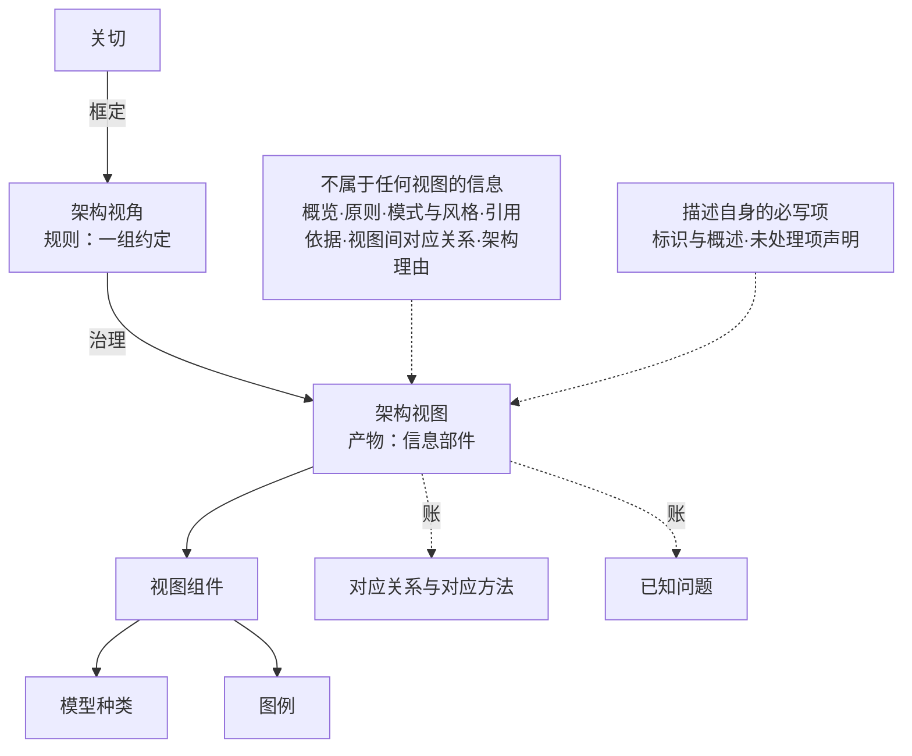

# 第13章 架构描述：把架构定义交出去

## 13.1 引言

上一章把"凭什么定下来的是这一个"办完了：几条候选摆进同一个空间，按目的筛，选定并记下来。可定下来还不等于交得出去。定下来的东西如果只在一摞图里、只在几个人的脑子里，后面的人接不住，评审也无从下手。

本章办的就是这件事：把这份内容与这些决定，做成一件别人能照着做、又查得下去的东西。标准给这件东西起了个名字：**架构描述**。

### 13.1.1 误解现场

恒信合同审批平台的架构评审会，万辉是主讲。他准备了一摞图，一共十五张：业务流程、系统分层、部署拓扑、数据流向这几路各若干幅，另有几张临时补的界面草图。

产品开发经理满海先问："数据归属唯一在哪张图上？"

万辉翻了翻，指着数据流向那一幅："这张。"

玉杰接着问："一份合同从发起到归档，跑在哪几张图上？中间哪些环节要盯着？"

万辉把三张图并排摊开，讲了两分钟，讲到第三张时自己停了一下。三张图上的泳道名各不相同。

黄程问的是第三句："这版能不能保证月底对账？"

万辉说："这个得看数据那边怎么落。"

会议室安静了几秒。徐漾把手里那张纸推过去，问了三个问题：这摞图，每一张是按哪个视角画的？它框定的是谁的什么关切？这条关切又是从哪一条目的来的？

三个问题，一个也没答上。

万辉不是没画。每一张图他都下了功夫。问题在于，他画的是一摞图，交出去的也还是一摞图。

这一天，同一间屋子里，"描述"被认成了四样别的东西。

有人想的是"图上那个数对不对"，描述在他那里就是一张能看的图。也有人按平时的习惯画图，画法在他那里是一套个人习惯。还有人想的是"关切先放放，版本得上"，关切在他那里是可以跳过的一步。更有人想的是"交上来就算落了地"，描述在他那里是一件交差的材料。

四样都不是标准说的那件东西：一份把内容按约定写全、让人读得出同一个意思的信息部件。

今天这件事，问题不在"万辉该不该画图"。图画得不差，需求也是真的。问题在另一个地方：**凭什么说这一份交得出去**。一摞图交出去，评审只能猜；一份描述交出去，评审能查。查的是承诺过的那几样东西有没有到位。

### 13.1.2 本章要回答什么

读完本章，下面这些问题你应当答得出来：

1. 一摞图和一份描述，差在哪一样东西上？
2. 架构描述是什么？它凭什么能签收、能入库、能版本化？
3. 为什么说"架构本身无形"？有形的是哪一份？
4. 视角和视图，一个是规则一个是产物，这条界怎么划？
5. 内容都写全了，为什么还要视图？"同解"是什么意思？
6. 一份合格的视角规格，要写全哪几样？
7. 视角从哪来？现成的用不上时，怎么自己定一个？
8. 图与视图是什么关系？
9. 关切是被谁框定的，又被谁应对？
10. 一份视图自己该带什么？视图之间对不上，该改哪里？
11. 常用的视图有哪几类？每一类写到哪儿为止？
12. 交出去之前，拿什么对账？缺了哪一条不算齐？

上面这些问题合起来答的是一件事，就是架构定义交出去的那一份是什么、凭什么算交得出去。题面问"架构定义的可交付物"，答法分两半。一半是把里面有什么逐件点清（视角、视图、组件、账，加不在视图里的一档）；另一半是逐件给出判据，说清每一样凭什么算到位。清点不是跑题，清点正是"可交付物"这四个字的内容。

题面里"架构定义"四个字取的是宽义：把"定内容"（第11章那一步）与"把它表达、记录下来"算作一次工作的两半——42010:2022 §3.1 那一串动词里就有这两个：*defining* 与 *expressing, documenting*（中译：定义；表达、成文）。按严格义，本章干的是后半段那件事：把已经立成的内容表达、记录成一份能签收的描述。所以本章交出去的"可交付物"是**架构描述**，不是架构本身（术语见附录 A T-213）。

### 13.1.3 本章的骨架

本章要钉的只有两件：架构描述，以及它里面的规则与产物。描述是工作产品（42010:2022 §3.3：*work product used to express an architecture*，中译：用来表达某个架构的工作产品），它是唯一能被评审、被验证、被基线化、被交出去的那一样东西。

描述里面的规则叫架构视角（§3.8：一组惯例，定义句见 `13.3.1`），产物叫架构视图（§3.7：信息部件，定义句见 `13.4.1`）。两件的关系一句话说清：**视角是规则，视图是产物**。规则先订，产物后造。

本章的骨架是一条链。关切由视角框定，视图按它那个视角的约定把关切应对掉；视图由视图组件组成，组件要么标明模型种类、要么给出图例。链的末端挂着一份账：对应关系、对应方法与已知问题，以及不在任何视图里的那些信息。

链上最容易断的地方是这几下：**把图当描述**（图只是视图组件的一种形态）；先画图、再回头找视角挂上去（生成顺序颠倒）；**把清单当描述**（内容写全了，"怎么读"还没写下来）。

判据只有一条，与前两章同源：描述交得出去，不在它把内容写全了，在它把"怎么读"写成了公开规则，让不同的人、不同的时间读出同一个意思。这条要求不高，但它是硬要求。没有写下来的读法，换个人读就换一个意思。

由这条判据，推出本章要守的几件事。第一件关于规则：视角不是画图习惯，它是一组能写全、能版本化、能复用的约定；正本给它开了一串该写的条目，缺了其中几样，产出的东西就不成其为视图。

第二件关于顺序：先订规则，再造产物。视角可以在任何详细架构工作开始之前先订，这正是它的用处；反过来，先出图、再找某个视角把图挂上去，不合格。

第三件关于账：一份描述交出去之前要能对账。动笔之前手上该有什么，交件之前该交出什么，出现分歧时改哪里。这三样在 `13.6` 各有一处交代（逐条出处见各行），缺一条不算齐。

## 案例进展①｜恒信：贴不上视角的图

评审会第二天，徐漾没开会。她给万辉递了三张白纸，只在页眉各写了一个词：关切、视角、对账。

"你自己填。第一栏写关切：谁要什么，这条关切从哪条目的来。第二栏写视角：图按哪套约定画的，那套约定管什么、不管什么。第三栏写账：每条关切落到哪张视图上、拿什么去对。填得出来，说明你的图有主；填不出来，说明它们各自为政。"

万辉坐了一下午。

第一张纸好办。满海要的是月底对账不出岔，黄程要的是审批链查得到人，法务要的是合同档案留得住，审计要的是出事追得到人。他写了六行，写到第七行停住了——那一行写的是"平台运维可诊断"，可他一时说不出这条关切从哪条目的来。

第二张纸不好办。他得给每一行关切配一个视角，还要写下这个视角管什么、不管什么。写到一半他忽然发现，自己那摞图里有一张贴不上去。

那张是流程总览。它画得最早：几条泳道横贯全页，每个节点都带编号。可它不对应任何一份约定，只是他为了讲清楚画的一张目录页。

"这张怎么办？"他把纸推给徐漾。

徐漾看了一眼："它不假。判它是不是视图，就问三句：它在一份描述里吗，在；它受某个视角治理吗，不受；它的组件标了模型种类、或者给了图例吗，都没有。三句过不去，它是一张目录页。目录页可以留着，但它进不了账。"

第三张纸最难。对账表要一行行对下去：关切对到目标，目标对到准则，准则对到内容，内容对到落在哪张视图，再对到依据的决策。写到第七行，他停住了："平台运维可诊断"那条关切，落到视图上没有着落。

玉杰那天正好路过。他指着空着的那一格："这条我以前提过三次，没人记——我以为说过了就算数。现在它有行了：关切对到目标、目标对到准则、内容对到视图，中间断在哪一环，表上看得见。"

万辉把那张流程总览从"视图"那一摞里抽出来，放到"附录"那一摞。"我以为写全了就算交出去了。"他说，"原来交出去的不是一摞图，是一份读法。"他心里那点数出来了：十五张图，能上账的十一张。贴不上的四张里，一张是流程总览，另三张是他凭习惯画的示意图。

## 13.2 架构描述是什么

上一节那摞图，缺的不是功夫，是身份。它没有说清自己是哪一件东西：是内容，还是承载内容的那份东西；是规则，还是产物；是给自己看的草稿，还是给别人读的件。这一节先把身份立准，再看这份件由什么构成。

### 13.2.1 一份工作产品，不是架构本身

架构本身没有形态。它是一份内容。实体在其环境中的基本概念或属性，加上管住这个实体的实现与演化的管控原则。第10章把这一层说完了，本章不重讲。要紧的是另一句：这份内容交不出去。它有形态的那一面，叫架构描述。

标准给描述的定义句很短：*work product used to express an architecture*（中译：用来表达某个架构的工作产品）。三个词都算数。"工作产品"说的是身份。它是一件做出来的东西，可以签收，可以入库，可以版本化，可以被人引用。"用来表达"说的是它与架构的关系。它是表达者，不是被表达的那份内容。"架构"说的是它表达的是**什么**。架构本身无形、描述有形，这两样不许混为一谈。

这条界有一处最实用：能签收的、能入库的、能版本化的，永远是描述，不是架构。评审的对象是它，基线的对象是它，交接的也是它。所以本章后面讲的每一样东西（视角、视图、组件、账），都是在讲这份件里有什么，不是在讲架构本身有什么。

### 13.2.2 一份描述由什么构成

标准给的结构是分层的：一个架构描述包含一个或多个架构视图，而一个架构视角管控其中一个或多个视图。往下一层，视图由视图组件组成，组件受模型种类或图例管辖。

把它拆开，是规则层与产物层。规则层是架构视角：一组惯例，用来创建、解释与使用某个视图。产物层是架构视图，也就是从一组关注点的角度表达某实体之架构的信息部件。视图再往下一层是视图组件：视图的可分离构成部分，可以跨视图复用。

在这条链的最前面，还站着一个词：关切。标准中译作"关注点"（§3.10），也就是对利益相关方而言具有相关性或重要性的事项。它不在这两层里，却是这两层的宾语：视角框定它，视图应对它。前面的章节两次预告过这个词的立户归本章，这里给出。

规则层与产物层之间不是修辞关系。"视角治理视图"在标准里是一条可核的要求：*Each architecture view shall adhere to the conventions of its governing architecture viewpoint*（中译：每个架构视图应遵循其管控架构视角的约定）。读到"治理"两个字，可以当场问一句：治理谁、按什么治。答案都在这条句子里。

除了规则层与产物层，这份件里还有一样容易被漏掉的东西：账。这笔账分三处记：对应关系清单、对应方法与一致性；标准对这三样各有要求，`13.4.4` 一样一样说。视图内部还要记下已知问题：未决项、风险、例外，以及偏离模型种类或图例的地方。

最后还有一档不在这两层里：描述可以包含不属于任何视图的信息，标准举了六样例子。这一档留给 `13.2.5`，那里一样一样说。

### 13.2.3 规则先订，产物后造

标准把这个先后写下来了，不是流程习惯。视角可以先订：*An architecture viewpoint can serve as a contract between architect and other stakeholders… This contract agreement can be made before any detailed architecting is undertaken*（中译：架构视角能充当架构师与其他利益相关方之间的契约……此项契约约定能在开展任何详细架构工作之前达成）。这句话的分量在"契约"二字：规则先谈好，后面才不必反复返工。

顺序的另一头是义务：视图必须遵循其管控视角的约定。所以生成的方向是从视角到视图；反过来，先把图画出来、再找一个视角挂上去，不合格。

这里要拦住一个容易走偏的读法：规则先订，不等于"决策做完才准动笔"。架构细化的活动，标准明说"可以按任何被认为适当的顺序执行"；而且架构描述里的视图"能在任一架构过程中创建"，只是更完整、更精细的那一套一般在细化过程里造。更直接的一条是：视图里显现出来的风险与机遇，回头要改架构（标准写的两个动作，见 `13.4.5` 那条链的末段）。

最直白的一条在生存期那一段：架构描述可以先于或后于架构的建立、更新或变更（42010 §5.3）。这句话的意思是，描述不是等架构定了再补的档案，它也可以先立起来、回头管着架构怎么定。本章就有一个现成的现场：视角是先订下来的规则，架构还没细做，它已经在管事了。

所以第12章讲决策、本章讲描述这个次序，是本书的**换手次序**，不是施工令；同一件架构工作里，两章的活来回穿插。

还有一处要并排说清：决策与理据不在视图里，也不需要先在视图里变成图。标准把架构决策与架构理由列为架构描述元素，它们与视图并排待在描述里；而不属于任何视图的那一档（见 `13.2.5`），明确包含架构理由。第12章把决策是什么说完了，本章只给它们在描述里占的位置。

再补一句时间的先后：标准的做法是先定这份描述给谁看、按什么形式写，再捕获决策，最后才把整份描述开发出来（42020 §8.4.8）；也就是说，**决策记录往往比完整的描述先出生**。出生早不等于算数早：它要等到写进这份描述、再进了组织收件的库、"谁定的"那一栏有人署名，下游才必须依据它。

所以顺序上是三句话：**规则先订，产物后造**；订完不是定死，视图里显现的问题回头改架构；决策记录与视图并排，各占一处。

### 13.2.4 为什么非有视图不可

看到这里，有一个质疑该冒出来了：内容不是都写全了吗？如果基本概念、属性、原则都有了，视角与视图不是重复劳动吗？

答案不在"视图更直观"。答案在于内容与读法是两件事。内容可以写全，但"怎么读"还在各人脑子里。同一段文字，五个人读出来五个意思。这不是读者不认真，是自然语言的性质。

标准把这一层点得很准：一个视角的规格，就是为创建、解释、呈现和分析视图而确立约定；它把造视图要用的那套词汇与使用指南，交到创建、解释或使用视图的那些人手上。

换句话说，视角把"怎么读"从各人脑子里搬到了公开规则上。搬上去以后，不同的人、不同的时间读出来是同一个意思，这就是本章说的同解。

有一处替代说法要挡住：把描述的价值说成"使架构可判定"。可判定是同解的结果，不是价值本身。先把读法写成公开规则，判定才谈得上。另一处是"分面加同一"：那说的是描述的组织方式，不是它为什么值得要。

也要说清这条论证的边界：同解管的是**读法**能不能对齐，不管内容对不对。内容对不对，判据在目的那一侧，前两章已经立过。描述这一侧能提供的，是"读得出同一个意思"。

### 13.2.5 不属于任何视图的信息

标准给这一类留了位置：所关注实体的概览、架构原则、跨视图适用的架构模式与架构风格、引用的架构依据（例如领域架构或参考架构）、视图之间的对应关系、以及架构理由。这是一个示例，不是要求，但它指出了一件事：一份合格的描述，是"视图"加上"视图之外那一档"合起来的。

除了上面那一档，还有两样最常被漏掉。这两样都是描述自身的必写项，上面那六样例子里并没有它们。先是**标识与概述**（§6.1）：这份描述是哪一份、什么状态、谁写的、谁评审的、谁批准的、改过几轮。没有它，一份描述进不了库，也说不清是哪一版。

再是**未处理项与不符合项的声明**（§6.2 末两句）：本该处理而没能处理的关注点与相关方，要写明原因，也就是已知的资源限制或其他约束；不符合项要识别出来，并给出理由说明。这一条最容易被当成客套话，其实它决定一份描述能不能被信任：它交代的不是做了什么，是没做什么、以及为什么。

还有一格不在上面那一档里，也要单独说：记录决策时要写下"决策权属方或决策责任人的标识"。这一格不是一个格式要求，它是**治理在描述里的落款位**（本书读法）。当时若根本没有一个有权者存在，这一格就是空的，而且补不回来：事后补上去的名字，不是当时拍板的人。

所以描述里有什么，答案一句话：有规则，有产物，有账，另有一档不在视图里。四样齐了，这份件才交得出去，也才查得下去。

## 13.3 视角：从惯例到规格

上一节把规则层与产物层立住了：规则层是视角，产物层是视图。这一节专门看规则那一层。一组惯例是什么，它管什么用，写到什么程度算写全，从哪来，怎么定出来，又怎么用起来。

### 13.3.1 视角是一组约定

标准给视角的定义句里没有"工作产品"，也没有"信息部件"，给的是一句关于约定的话：*set of conventions for the creation, interpretation and use of an architecture view to frame one or more concerns*（中译：为创建、解释与使用某个架构视图以框定一项或多项关注点而设立的一组惯例）。这句话里没有属概念，本书照写，不替它补一个标准没写的身份。

它容易与三样东西混。

一是**立场**。标准另有一个词叫利益相关方角度（§3.18）：*way of thinking about an entity of interest, especially as it relates to concerns*（中译：思考所关注实体的方式，特别是就其与关注点相关而言）。角度是关切的来源，视角是框定关切的规则：一个是"谁怎么看"，一个是"按什么读"。

二是**视图**。视角是规则，视图是产物，上一节已经分开。

三是**画图习惯**。习惯是各人一套、说不全的；视角是一组能写全、能版本化、能复用的约定。二者最大的差别就在"写不写得全"。

视角的惯例记在它自己的规格里。这一层很实用：惯例一旦写进规格，视角就可以有版本、可以入库、可以被别的工作复用。所以这一块后面说的"写全"，说的都是把规格写全。

视角不是凭空划出来的。标准给了一条线索（§5.2.7 注 1）：关切、利益相关方角度与方面体，可以作为视角的组织基础。三样各有分工：关切就是 `13.2.2` 立过的那一项；角度是思考实体的方式；方面体是"实体特性的一部分"（§3.9），标准给的例子是功能、结构、信息，它是关切的细化，而这些细化出来的方面体，正是用来确立视角约定的东西。

这里顺带说清一处常见的混用：有些框架把企业架构分成业务、数据、应用、技术几块，那几块是描述分区（本书命名）的维度，不是视角。按标准，视角要有规格；拿一个域名去写规格，写不出来。这一处只点一句，展开在 `13.5`。

### 13.3.2 视角的目的与用途

视角要办两件事，两件都是标准写死的。

第一件是**框定关切**：依据标准（§6.6），每条已识别的关切，都应至少由一个架构视角来框定。换句话说，一条关切如果没有任何视角管它，它在这份描述里就没有位置。

第二件是**治理视图**：一个架构视角管控一个或多个架构视图。视角是规则，规则得有人听。它管的就是将要被造出来的那些视图。

由此有三层意义。

一是分离关切，同时保住整体。标准在附录里把这件事说得很直白：把架构描述组织为受视角管控的视图，提供了一种基于利益相关方分离关注点的机制，同时提供对整个实体的整体视图。既要分开看，又要合起来是一件事。这是视角这个装置的全部用意。

二是把读法写进公开规则。这一条 `13.2.4` 已经立过，不重复。

三是**可复用**：视角不是一次性的，它可以在别的工作里再用。

视角有五个用处（本书归拢；五处出处分见 §6.6 注 3、§5.2.7、§B.2.6 注、§B.2.4、§B.2.8）。

其一，它可以充当契约：架构师与其他利益相关方就记法与表示约定达成一致，而且这件事可以在任何详细架构工作开始之前做，以减少或避免意外。

其二，它给出造视图的词汇。视角规格（记录这套惯例的那份件）提供的关键建模资源，确立的正是构建各视图所用的词汇；用标准的话说，它交出 AD 元素、语法与语义、使用指南与方向。

其三，它让人判断这个视角对当前这个实体合不合用：规格里写清关切、角度与方面体，架构师与其他人凭这几样就能判。

其四，它事先说明自己不适合什么。规格里还要列出这个视角不适用的问题种类。对某些被过度使用的视角来说，这一条最有用。

其五，它给出对应方法：视角或它的模型种类所定义的那一套，能跨视图组件、跨一份描述内的视图、也能跨几份描述使用。

### 13.3.3 一份规格该写什么

标准对视角规格给了一串要求，写全了才算合格。该写的是这几样：与本视角相关的利益相关方角度；由本视角框定的一个或多个关注点；与这些关注点相关的一个或多个方面体；持有这些关注点的已知典型利益相关方；构造视图时使用的模型种类与图例；捕获视图内及视图组件之间关系的对应方法；以及对本视角任何信息来源的引用。

在这串要求之外，还有一条"宜"：规格宜标识用于创建、解释或分析受本视角管控的视图的**视图方法**，以及一个或多个模型种类。另外，每个图例都要为它所记载的视图组件的解释给出指南。

模型种类自己也有规格要求：它所依据的约定（例如语言、记法或建模技术）、相关的视图方法与对应方法、版本标识、信息来源。记法可以有三种走法：给一个元模型、给一个供人填写的模板、或者援引一门已有的建模语言。

标准还附了一份模板，照着填就满足上面的要求：名称、概述、关注点（含不适用的问题种类）、角度、方面体、典型相关方、对应方法、模型种类规格、视图方法、示例、注、来源。这份模板的价值在于它把"写全"变成了一件可照着做的事。

标准对规格还给了三个词，过不了就不算合格：完整、精确、可验证。三个词一起看，意思是这份规格换个人拿去用，应当产得出同一个东西。

这里有一处本书的归并要标明：上面那串要求，标准写的是七项，外加一条"宜"。本书把它们连同名称、出处、版本并作一张表来教；表末那一行"必需的模型、元素、关系、约束与属性"是本书加的，正本里没有，内容出自附录 B.2.9.2（实体、属性、关系与约束）。标注在此，表里不删。

### 13.3.4 视角的来源与复用

先说一句要紧的：正本不规定任何特定的视角。标准明确写了"本文件不要求使用任何特定的架构视角"，也不要求任何特定的视角规格。所以每个项目的那份视角清单，都得自己给出来。

给出来有四条路。

一是标准自带的框架视角集。开放分布式处理的参考模型给了五个视角：企业、信息、计算、工程、技术，而且每个视角都有自己的视角语言；标准附录里还以举例方式列了若干框架的视角集。

二是业界已有的视角目录。标准附录点了名：有的按视图类型分，有的给出四加一的视图模型，有的给出功能、信息、并发、开发、部署、运行这样一套目录，还有社区维护的视角库。这些都可以拿来用。

三是架构描述框架与架构描述语言。一个描述框架的核心内容，本身就是一套预定义的视角库；用框架的人，视角的来路就在框架里。

四是按组织基础自定：回到关切、角度与方面体这三样上去切。标准给的方面体例子是结构、行为、功能、计划（§6.5 EXAMPLE）；角度例子是战略、组织、运行、逻辑、物理、技术（§6.3 EXAMPLE）。

四条路里，前三条是复用，第四条才是自建。所以纪律是：先穷尽复用，再谈自建。

还有一处要挡住：标准附录里"常用的视图"那一份清单，列的是视图，不是视角清单。两者不许混。这些视图各自的治理视角，是另一件事。

### 13.3.5 视角怎么定出来

标准把"识别或开发架构视角"单列为一项活动，下面列了该做的事：基于关注点选择、适配或开发视角与模型种类；识别架构细化信息的预期用户；

建立或识别拟用的架构框架；捕获选择框架、视角、模板、元模型与模型种类的理由；定义拟开发的每个模型与视图的目的和范围；

选择、修改或开发支撑性的建模方法与工具；选择、开发或修改架构框架、建模模板与元模型；以及选择、修改或开发相关的元模型规格与模板。

这一项活动还带三条提醒。其一，相关视角可能已在概念化过程里识别或开发过，所以先检查能不能原样用，还是需要改一改。其二，视角管控将要创建的视图，最好由最熟悉问题性质与那些关注点的人来开发，而且尽可能把它泛化，好用在别处。其三，如果开发规模较大，交给架构使能过程去做，并把它放进架构库，作为组织标准。

把模板的次序用起来，可以照着走：先写关切与"不适用"那一栏；再挂上角度与方面体；再点出典型相关方；再配模型种类与图例；再写视图方法与对应方法；最后补名称、概述、版本与来源。

这一轮做完，交出来的是四样（**本书归拢**）：视角规格（§10.4.3 a)）、模型种类规格与图例、选择理据（§10.4.3 d)）、以及用途范围（§10.4.3 e)）。

最后一句要紧：这一步交出来的是一件**规则**，不是这份描述的产物。规则能先订，这正是 `13.2.3` 那个次序的用处。

### 13.3.6 视角怎么用

用起来的第一步是纳入：描述应当包含或引用其中所使用的每个视角，每个视角都要有版本标识，而且规格要合乎前面的要求。

第二步是拿它造视图：视图按视角由一个或多个视图组件组成；组件标明其管控的模型种类（如果有），没有模型种类时给出图例。

第三步是查：每个视图都要遵循它那个视角的约定；评估时还要问一句"视图是否与所选视角一致"。这一条是视角这条规则真正落地的地方。规则定了没人查，等于没定。

第四步是记：当视角被选用并应用时，把实际的相关方与这个视角所框定的关注点之间的关联记下来。

第五步是往外走：把视角泛化，交给架构使能过程，放进架构库，作为组织标准。

还有一句边界：视角规格可以单独使用，可以作为架构描述的一部分，也可以作为描述框架或描述语言规格的一部分。

所以"从惯例到规格"这条路，走出来是五步：纳入、造视图、查、记、入库。前三步管这一次，后两步管下一次。

## 13.4 视图：关切怎么被应对

规则那一层讲完了。这一节看产物那一层：视图是什么，它由什么组成，关切是怎么被它一条条应对掉的，一份视图自己该带什么，怎么造出来，造完又怎么用。

### 13.4.1 视图是一个信息部件

标准给视图的定义句是：*information part comprising portion of an architecture description*（中译：包含架构描述的一部分的信息部件）。属概念是信息部件，不是工作产品。工作产品是描述，视图是描述的一部分。

这句短定义有三处要分开（**本书分法**）。

一是视图不是架构。架构是那份内容，视图是它在描述里的一个零件。标准给的例子最省事：一个信息视图或数据视图，里面装着概念数据模型、数据管理模型、数据访问模型，以及把这些零件连起来的对应关系。

二是视图不是图，下一节专说。

三是视图不是视角。视角是规则，视图是产物；一张视图恰有一个治理它的视角，而一个视角可以管一张以上的视图。

数量上有三条：一份描述包含一个或多个视图；所使用的每个视角至少有一张视图；一个视角管着多张视图时，这些视图描述的是同一个架构。

### 13.4.2 图只是组件的一种形态

视图不是一个整块，它由一个或多个视图组件组成，组件按它的管控视角来组织。组件是视图里可分离的那一部分，而且可以属于不止一张视图。

组件分两路。一路是基于模型的：它标明自己的模型种类，模型种类给出的是这类模型的约定。另一路不基于模型：那就得配一份图例。图例是对约定的非正式记录，用来说明这个组件里的记号怎么读。

这里最要紧的一句是标准明写的：本文件不规定视图组件的形式化程度；有形式化语义与语法的模型式组件能少一些歧义，但非模型式组件同样能有效使用。

标准给的例子很实在：一张功能视图里可以同时放数据流图、控制流图，再放一段说明怎么读这两张图的叙述；流图基于模型，叙述不基于模型，它们都是这个视图的组件。而那张数据流图还能同时是另一个信息安全视图的一部分。

所以有一句话要记住：图是视图组件里最显眼的一种形态，不是视图本身。清单、表格、一段决策记录，同样可以是组件。

### 13.4.3 框定与应对：一次分工

标准用一对动词把这两层的关系说清了：*It is used to distinguish the stages of framing concerns by a viewpoint from addressing those concerns in a resulting view. This is analogous to the distinction between "framing a problem" and "solving that problem".*（中译：用它区分"由视角框定关注点"这一阶段与"在所得架构视图中应对那些关注点"这一阶段；这类似于"框定问题"与"解决那个问题"的区分。）

这一对词把责任分干净了：框定是视角的事，应对是视图的事。

接下来是义务，全是标准写死的要求：每个已识别的关注点，应由至少一个视角框定；每个已识别的利益相关方角度、关注点与方面体，应由至少一个视图按其管控视角予以应对；每个视图都要遵循它那个视角的约定。

应对到什么程度，标准也写明了：一个或多个视图组件，要应对其管控视角所框定的全部关注点，并就该视角而言覆盖所关注实体的部分或全部。后一半同样重要：标准允许一个视图有意只覆盖实体的某一部分，有时是依指令，有时是时间与资源有限，有时是这次架构工作的范围本来就窄。

应对得怎么样，要留下可查的痕迹。视图要记录它内部的已知问题：未决项、风险、例外，以及对管控模型种类或图例的偏离。标准还附了一句提醒：未决的问题会引致需要作出的决策，而例外与偏离可以记载为决策的结果与理由。除此之外，还有对应关系、对应方法与一致性这几笔账，下一节一样一样说。

还有一条要记住：一个视图可以应对一条以上的关切。

反过来说，什么样的情形叫"写下来了但没应对"？三种：视图没有治理它的视角；组件不服务于该视角框定的任何关切；视图之间对不上，却没有一条对应关系。三种都是账上的漏洞。

### 13.4.4 一份视图该带什么

标准对每个视图列了该包含或引用什么：标识与补充信息（按组织和项目的规定）、它的管控架构视角的标识、一个或多个视图组件（应对该视角框定的全部关注点，并覆盖所关注实体的部分或全部）、以及该视图内已知问题的记录。另有一条单独的要求：每个视图要有版本标识。

组件那层也有要求：一个视图按它的管控视角由一个或多个组件组成；每个组件要有版本标识；组件要标明它的管控模型种类（如果有），并遵循管控视角的约定；没有管控模型种类时，要给出图例。

模型种类与图例各自要交代的，是同一组内容（§5.2.8）：预期用途、术语、记法及其语法与语义、符号体系。换句话说，一个组件要能被人读懂，先得说清这套记号是干什么用的、每个符号什么意思。

在此之外，描述里还要带齐这几样：一份架构描述元素对应关系清单（每条要标识参与其中的元素）；一份对应方法清单（并记下每一条成立还是被违反）；一份一致性分析（以及任何已知的不一致）。

### 13.4.5 视图怎么造出来

标准把"开发架构的模型与视图"列成一项活动，里面的动作连成一条链。对每个视角，先按它与外部实体的接口和交互定义语境与边界，以此确定这个视角的目的与范围。再识别将要建模的实体种类及其关系。然后修改与所选框架关联的元模型与视图模板。

再识别将要建模的具体实体与它们之间的关系。接着把相关的概念、属性、特征、行为、功能、特性或约束分配到这些实体与关系上。这一步标准注明，它可能已经在概念化过程里做过，这里只是核查并补足细节。再识别指导架构实体演进的原则与准则。再选择、适配或开发模型。最后按已识别的视角，由模型组成视图。

后半段是收尾：识别在视图中已显现的风险与机遇，并酌情修改架构；使各模型与视图相互协调一致；基于它们生成或修改描述；按开发生存周期各阶段的反馈修改描述；最后把描述放进架构库。

这条链（正本 42020 §10.4.4 a)~m) 十三项）在本章归成四步（**本书归拢**）：定型、建模、对齐、成件，与附录 B 的"视图设计四步"同指。其中定型一步的产出物是视角规格，`13.3` 已经讲透，这里只留一句回指。

造视图还有一样工具：视图方法。标准把它分成三类：构建方法（怎么开始、下一步做什么，或者给出这类视图的模板）、解释方法（利益相关方与其他使用者怎么读懂它）、分析方法（检查、推理、变换、预测、应用和评估）。视图方法要在模型种类、视角、描述语言或描述框架的规格里写清楚。

最后是一条次序纪律（**本书归拢**，正本无此单句）：先订视角规格，再定模型种类与图例，再造模型、组件与视图，最后核对覆盖与对应关系。这个次序不可颠倒。先把图画出来、再回头找视角挂上去，不合格。

### 13.4.6 视图怎么用

视图造出来是给人读的。标准在讲视角那一处已经点明：视角规格交出的约定，是供创建、解释或使用视图的人用的。所以读，是它的第一个用场。

第二个用场是查。四条可以照着做：查视图与所选视角是否一致；查覆盖，看该视角框定的关切有没有全部落到组件上、实体有没有覆盖到；查一致性与对应关系；再拿 `13.6` 那份自检表逐条过一遍。

第三个用场是拿它办事。

标准附录把架构描述的用途列了一长串，与视图直接相关的有：作为设计与开发活动的依据。作为分析与评估架构备选实现的依据。作为开发与维护文档；支持技术与投资方面的决策并降低风险。作为仿真、系统生成与分析工具的输入；在开发、生产、部署、运行与维护各方之间沟通。

作为采办文件与合同谈判的依据。作为运行与基础设施支持以及配置管理的指南；确立实现对架构符合性的认证准则。作为对外部与组织特定方针的符合性机制；以及全生存周期评审、分析与评估的依据。

第四个用场是改。按反馈修改描述，并让它处于适当的变更控制之下。描述、视图与模型的变化，按配置管理过程来管（42020:2019 §10.4.2 n)）。哪一版被选定并冻结，那是基线的事，归第15章。

第五个用场是交：描述放进架构库，协调预期用户的使用，并留下交付与使用记录。

最后一句边界：这份描述交出去，接住它的是另一份描述——设计描述；两者是什么关系、架构对设计起什么作用，下一章说。

## 案例进展②｜冰链：老规矩缺一份规格

水忠的一页老规矩（"M3 老规矩"），第11章写过：抬头一句"从装箱到交付全程可追溯"，底下三条：温度数据归谁管、断链就是失效、升级不许毁掉已出厂的箱子。

小陈问："水师傅，这三条我照着做没问题。可'断链'怎么算？探头报一次超限就算，还是要持续多久？"

水忠说："这还用问？断链是事件，不是读数——探头报一次超限只是一个读数，得持续了才算。"

小陈说："那我按十秒算一次断链，行不行？这页上没写，我只能自己猜。"

水忠愣了一下——他心里那条线是三十秒，这一页上没写。他写下的是三条判断，从没写过刻度。

文正路过，听了半句："你这不是三条规矩，是一份没写规格的视角。约定得写进规格：关切、角度、方面体、模型种类与图例、对应方法——缺一样，别人就复现不出你那三条判断。"

水忠没听过"视角规格"这个词，但听懂了。他照模板往下填：名称写"接口视角"；关切三条：断链要判得准、出事追得到、升级不弄坏已出厂的箱子；角度照抄运行、逻辑、物理，方面体填信息。

填到"模型种类与图例"那一栏，是董勐替他补的：温度时间序列的记法与符号表，水忠在用，从没起过名。填到"对应方法"那一栏，他停住了。逸人过来，补了一句："扩展规则也得让产线查得到，这一条要写进规格。"水忠加了进去。

李旭从后面经过："这栏怎么了？"

"对应方法这一栏，我从来没写过。"水忠说。

李旭说："你说给我听就行——温度记录跟装箱单怎么对上，对应方法就写这个。"

水忠说："一批货一个箱号：温度记录按箱号挂到装箱单上。中途换了承运方，箱号不变、记录不断——对应关系就挂在这个号上。"

李旭说："这些规矩，除了你还有谁按同一套办法查得出来？"他停了一下："这就是对应方法。规格里专门有这一栏，写的是组件之间、视图之间怎么对上；不写下来，换个人就对不成一样。写下来。"

水忠写下了他的第一条对应方法。这一栏填完，规格成形了——它是**接口视角规格**，下一步是把它挂进项目 ADF（架构描述框架）。他抬头说："原来我一直用的是自己的一套读法——脑子里那条线是三十秒；写进规格，它跟探头上那条线才是同一条。"

## 13.5 常用的几类视图

标准不规定该出哪几类视图，但也不让这件事没有着落。ISO/IEC/IEEE 42020:2019 自带了一份"常用视图"的清单（附录 E.4.2），另有一件更要紧的东西：一个项目该出哪几类，可以从关切反推。这一节先把这两样说清，再一类一类看过去。

### 13.5.1 标准只给了几个例子

42010 在这件事上很克制，三处都写明了：不要求任何特定的架构视角（§6.6 注 1）、不要求任何特定的视角规格（§8.1 注 2）、不规定视图组件的形式化程度（§6.8 注 2）。前两条 `13.3.4` 已引，第三条 `13.4.2` 已引。42020 那边同样克制：附录 E 在正本里标为资料性，那份清单的原话也只是"下面各分条款给出了一些常用的视图"（§E.4.2.1）。

那份清单列了七类：语境、概念、功能、逻辑、物理、技术、组织；给的是常见做法，不是要求。

它们之间不是并列的一排，而是沿两条线摆开：语境、概念、功能、逻辑、物理、技术这一路沿着抽象层级推移，从外部条件，到外部思想，到要做什么，到问题域里那些数据与变换是什么，到落在哪些元素和接口上，再到由哪些技术门类实现。

组织视图不在这条线上，它问的是谁负责、谁有权。并起来看，前面那一路说的是"说得多细"，组织说的是"算谁的"。这两句都是**本书的归拢**，标准只给了那几条的名称与说明。

每一类各问一句话：语境问外面给了什么条件；概念问凭什么这么想；功能问要做什么；逻辑问从用户与业务的角度看，那些数据与变换是什么；物理问落在哪些元素和接口上；技术问由哪些技术门类与接口实现；组织问谁负责、谁有权。

至于一个项目到底该出哪几类，做法是反推：先识别相关方与关切；再让每条关切至少被一个视角框定；每个视角至少有一张视图；每张视图要应对它那个视角框定的全部关切，并记下已知问题；最后反向核一遍：每个角度、每条关切、每个方面体，都要至少被一张视图应对。走完这几步，那份清单是从关切里推出来的，不是抄来的。

最后一句：这几类各自的治理视角，要按 `13.3` 的办法去定；`13.3.4` 挡过的那一处混用在这里同样管用。它是视图清单，不是视角清单。

下面几节各管一类。想知道某一类写到哪儿为止、或者它容易怎么错，去它自己那一节。还要交代一句：以下各节里的"定义句"照引正本，"应对的关切、典型组件与模型种类、写到哪儿为止、常见误用"四项都是**本节归拢**，正本 §E.4.2.2~§E.4.2.8 只给了每条的名称与说明（PESTEL、DOTMLPFI 两组例子除外）。

### 13.5.2 语境视图：外部给了什么条件

语境视图处理的是语境因素与驱动因素，标准举的例子是 PESTEL 那一组（政治、经济、社会、技术、环境、法律）方面体，或者 DOTMLPFI 那一组（条令、组织、训练、物资、领导、人员、设施、互操作性）方面体的描述。

它应对的关切是：这个实体处在什么外部条件之下，要看的是法规、市场、技术生态、运行与自然环境、既有系统格局、组织与人的条件。

典型的组件与模型种类有：PESTEL 表、DOTMLPFI 矩阵、外部实体与约束清单、语境图，后者画的是这个实体与它环境中的外部实体及接口。

它写到"外部因素、驱动与被排除的路径"为止，不写外部系统的内部设计。

常见误用有三种：把它写成项目背景介绍，通篇罗列，没有因素与后果的对应；把外部系统的内部构造搬进来；用 DOTMLPFI 却不改读。那一组原本是防务取向，用在民品上，条令要读成运行政策、组织要读成运营与维修单位、物资要读成备件与保障，改读要做，还要把改读写进视角规格。

恒信那边，语境视图上真正管用的不是"互联网加""数字化"这类词，而是三条能追后果的条件：电子签章平台只认它自己那套编号规则；合同归档要满足档案年限；月底对账要在两小时内对完。

### 13.5.3 概念视图：凭什么这么想

概念视图提供来自架构之外的主要思想或概念；标准说它给出的是 *the fundamental view*（中译"基本视图"），可以用作进一步架构工作的起点。这里的"基本"说的是"可作起点"，与定义句里量架构内容的那个"基本"不是一回事（见 `13.4.6` 末那句边界）。

它应对的关切是：驱动这次设计的那些外部思想与概念，包括运行构想、人因概念、领域基本原理、能力概念、任务概念，以及这个产品到底是什么、不是什么这一定位。

典型组件与模型种类：运行概念图、能力清单、任务线程图、概念草图，还可以有叙述型组件。

有一条判据可以拿来定它写到哪儿为止：说"虚像在准无穷远"，属概念；说"用哪一组透镜"，已经落到物理与技术视图。

常见误用三种：把它当成架构总览图，把后面几张的内容先画一遍，结果是同一信息两处画、两处不一致；把广告词当概念，先进、可靠、智能都不是概念；缺定位的二择，例如唯一手段还是辅助手段、必须自建还是可以外购，缺了这一条，下游的保证等级与验收判据无处生根。

冰链 M3 的概念视图上只有两句话："温度数据归属追溯域，对外只走受控导出"；"断链是事件，不是读数"。后面几张图都是从这两句里推出来的。至于"智能、可靠"那类话，水忠一句没写。

### 13.5.4 功能视图：要做什么

功能视图捕获所关注系统的功能。标准在定义句旁边带了一句要紧的限定：功能视图不是规范性要求，但几乎总会被包含在内。功能架构可以说是本质性的、起组织作用的功能结构，也就是系统为达成使命而把抽象化的输入转换为输出的方式。

它应对的关切是：要做什么、由哪几项功能合成、彼此怎么衔接。

典型组件与模型种类：功能分解树、功能流图（数据流与控制流可以各作一个组件）、运行场景时序图、功能与输入输出对照表。

它写到功能组织与变换为止；用哪种器件实现符号生成，不进这一层。

常见误用三种：拿它当符合性判据，而标准明说它不是规范性要求；写成模块清单，按实现件而不是按功能划分；功能树只到第二层就停，下游无从把需求分配到叶节点。

恒信的功能树上，"合同发起—审批—签署—归档—对账"是一条，权限校验是横切在上面的一条。当时有人提议按模块画，满海挡了："我不管它落在哪个模块，我只问一件事从哪进、从哪出。"

### 13.5.5 逻辑视图：业务上它是什么

逻辑视图通常是系统功能与留存数据两者的集成模型，它的抽象层级选在"与用户直接相关，而不是与实施相关"；它按问题域中有意义的方式定义数据，而把数据如何表示的定义推迟到其他视图，例如按位置、金额或用户所关注的对象来定义，而不按数据库字段来定义。

它应对的关切是问题域语义下的数据与变换：数据是什么、由谁权威提供、谁能改、谁与谁对齐。

同一件事，在逻辑层与技术层的写法不同。逻辑层写"25 号之后签的合同归下个月"，技术层才写数据库事务与报文格式。这个对照可以当成一条判据（**本书给的一条界**）：写到业务语义为止是逻辑层，写到表示方式就是技术层。

本书把这一层要写的东西压成三问，这三问是本书的操作化提法，不是标准原句。一，是什么：说出输入对象、输出对象，以及这项变换在业务上叫什么；说不出输入输出就等于没定义，用调用某个服务、写某张表来说，已经滑到表示方式。二，在什么条件下成立：写出当什么时做什么、不做什么，以及始终必须如何这两组句子。

三，结果归谁。回答三层归：归属，事实源是谁、谁能改；责任，谁有权定义与变更这条规则；去向，结果给谁用、以什么形态出去。三问缺一，后果各不相同：缺第一问，下游无法分配需求；缺第二问，下游判不了合规、测试无处挂判据；缺第三问，下游必然各写一份，出事无人认领。

它不写报文格式、数据库字段、接口协议、前端框架。写进去就滑到技术视图了。另有一条限定注要带上：构成逻辑架构或物理架构的内容，往往带有一定主观性，这一谱系上的各类做法都能用。

常见误用三种：把逻辑当成粗一点的物理，这是把粗细换了名字；数据归属不明，出现多个事实源，下游各写一份；把该推迟的东西提前定了，例如在逻辑层写死接口报文，使物理与技术视图只剩下抄写。

恒信那条最典型："25 号后签的合同归下月"，它是判断，不是算法；谁定的、能不能改、改了谁受影响，都比"用什么表达式写"更要紧。至于它最后落成数据库里哪个字段，那是技术视图的事。

### 13.5.6 物理视图：落在哪些元素上

物理视图是系统元素与物理接口的一种安排，标准说它为产品、服务或企业提供设计解，并旨在满足逻辑架构元素与系统需求。"提供设计解"那几个字是标准原文，照引。但这里要加一条限定：它出自资料性附录，而本书把设计解的归属放在设计定义那一侧。

它应对的关切是：功能与属性落在哪些系统元素上、这些元素之间的物理接口是什么、安装与承载怎么安排。

典型组件与模型种类：物理分解与安装图、接口框图、部署拓扑图、光路与管路与链路的布置图。

界线划在一个地方：型号、尺寸、材料、数量、实例数一出现，就属于设计定义。物理视图写到这道线之前为止。

另有一处要钉住：这里说的系统元素，按标准是硬件、软件、数据、人员、过程、规程、设施、材料以及自然存在的实体，不只有实物件。

常见误用三种：把物理视图读成构件清单，丢掉了分配与接口，也丢了治理它的视角；把技术选型写进来；元素性质认错，只当它是实物。

冰链的物理视图上，箱体、探头、通信模块、平台四样各有位置与接口。写到这儿够了；再往下写选哪一款探头、箱壁多厚，那就是设计定义。

### 13.5.7 技术视图：由哪些技术实现

技术视图按构成系统实施的技术上可识别的对象及它们之间的接口来定义；标准说它能通过技术加以实现。

它应对的关切是：由哪些技术门类的对象构成实施、它们之间的接口约定是什么、哪些技术门类被允许或被排除。

典型组件与模型种类：技术分层图、接口协议表、软硬件分配表、技术约束与禁用清单、环境与保证等级清单。

它只写门类与接口约定；选哪一款器件、哪个版本，属设计定义。

常见误用三种：把技术视图变成选型报告，管到了设计侧；只列技术栈不写接口约定，下游无从集成；与逻辑视图重复，把语义内容又抄一遍。

恒信的技术视图上写的是门类与接口约定：审批走哪一类消息，对账数据走哪一类通道，哪些外部服务允许接入。用哪一家的消息中间件，他没写，那是设计。

### 13.5.8 组织视图：谁负责，谁有权

组织视图表示其他企业视图（过程、信息与资源）中所识别的全部实体上的职责与权限；它把所识别的组织单元归并为部门、分部、科室等更大单元，以此满足企业组织的结构需要。同一处还说：与组织相关的方面体涉及决策层级、职责与权限。

它应对的关切是：谁负责、谁有权；其中包含变更权属，也就是谁定基线、谁批变更、谁签符合性证据。

典型组件与模型种类：职责与权限表、变更权属表、审定与采办路线图、跨主体契约图。

标准这一条的措辞是企业取向的。用到产品上必须改读成全生存周期上的责任主体，覆盖研制、使用与监督三侧。这一层改读要写进视角规格；规格里不交代它，这份规格就不算合规。

常见误用三种：把它当组织架构图，只画汇报关系不写权属；漏掉沉默方（维修、监管、审计、法务、二次开发方，两条线各不同）；不写变更权属，后面的治理与配置管理便无据可依。

冰链这张表上，最容易被漏的是那几个沉默方：审计部门、监管部门、维修方。他们不在会议室里，却是"出了事找谁"的答案。

一类一类走完，回到这一块开头那句话：这份清单是例子，不是要求。真正决定出哪几类的，是你手上那份关切清单。

## 13.6 对账：缺哪一条都不算齐

前面几节把描述里有什么说完了。这一节换一个角度：交出去之前，拿什么对账。两份单子、一张自检表，加一次反转。三样都是本书的归拢。标准给的是散在各处的条款；三样各自的出处，落在各自那一节末尾的一行里。

### 13.6.1 动笔之前，手上该有什么

入口这一侧，要摆齐十样东西。

一，一份关切清单，含相关方角度与方面体。二，相关方清单与他们的持有关系，关注点与相关方之间是多对多的。三，实体及其环境、它的预期用途、这次工作的范围与深度。四，待表达的架构内容——基本概念或属性与管控原则，这时还没有分配到视图上。

五，可复用的视角与模型种类、图例、视图方法。六，架构描述框架与它的元模型。七，建模模板、元模型规范与工具。八，要建模的实体与关系的种类。九，对账与验证的需要：谁看、看什么。十，上一轮留下的约束与未处理项。

这十样的出处，按上面的序号：一 §6.4／§6.3／§6.5；二 §6.2＋§6.4 注 1；三 §6.1（含"预期用途"那句）／42020 §10.4.3 e)；四 42020 §10.4.4 e)、f)／§3.2；五 §3.8／§8.1（含第二段的"宜"）／§8.2／§8.3；六 §3.5／§7.1＋42020 §10.4.3 c)；七 42020 §10.4.3 f)~h)；八 42020 §10.4.4 b)；九 42020 §10.4.3 b)＋§10.4.1 a)、b)；十 §6.2＋§6.1 注 1。

其中两处要说明白。第二条里，相关方清单出自 §6.2，而"多对多"那一句出自 §6.4 注 1，两句分挂。第十条里，"上一轮留下的约束"对得上 §6.2 的资源限制与约束那一句，而"未处理项"标准没有单立，是本书归拢进来的。这一条既是本单的输入，也是本单要盯的东西。

这十样是入口条件：缺了前四样，动笔就是凭印象；缺了第五到第七样，得先造工具；缺了第十样，上一轮的坑会原样再踩一遍。

### 13.6.2 交件之前，该交出什么

出口这一侧，是十二样。

一，视角规格，写全标准那串条目，外加视图方法。二，模型种类规格与图例。三，架构视图，含标识与补充信息、治理它的视角、视图组件、已知问题，以及版本标识。四，视图组件，含版本与治理它的模型种类；组件可以跨视图复用。五，架构描述元素对应关系清单。

六，对应方法清单，以及每一条成立还是违反的记录。七，一致性分析，以及已知的不一致。八，视角、框架与模板的选择理据。九，视图与模型的用途、范围与深浅。十，视图中的已知问题：未决项、风险、例外、对偏离的说明。十一，描述里不属于任何视图的那些信息。十二，交付与使用记录、反馈回写。

这十二样的出处，按上面的序号：一 §8.1；二 §8.2；三 §6.7（含 a)）；四 §6.8；五 §6.9.2；六 §6.9.3 注 1；七 §6.9.1；八 42020 §10.4.3 d)；九 42020 §10.4.3 e)；十 §6.7 d)；十一 §6.7 EXAMPLE 2；十二 42020 §10.5＋§8.4.10。

另有两样也必须一并交，它们不在上面十二样里，却是描述自身的必填项：一是**标识与概述**（§6.1），二是**未处理项与不符合项的声明**（§6.2 末两句）。后者要写清哪些关切与相关方没能处理、为什么，不符合项还要连理由一起列出来。`13.2.5` 已经把这两样说全；放在这里，是作为交件账的两行说明。

还有一格要单独提：记录决策时的"决策权属方或决策责任人的标识"（§6.10.1）。它在正本里列的是"宜考虑"的那一组，不是硬要求；可它是账上唯一连着人的一格。治理在描述里落款的地方，定义与后果都见 `13.2.5`。

这十二样是出口条件：对不上的，不算交件。

### 13.6.3 自检：逐条问一遍

这张表是照着打的：一行一问，过不去就回去补。

1. 每条关切，有没有至少一个视角框定它？
2. 每个相关方角度、每条关切、每个方面体，有没有至少一张视图应对它？
3. 每个视角有没有至少一张视图？这些视图是否遵守该视角的约定？
4. 每个视图写明治理它的视角了吗？有版本标识吗？
5. 每个视图组件写明治理它的模型种类了吗？不基于模型的组件带图例了吗？
6. 对应关系清单在不在？每条参与的元素写明了吗？
7. 对应方法列了吗？每条是否成立、或者把已知的违反都记下来了吗？
8. 已知的不一致与视图内的已知问题记了吗？
9. 视角、框架与模板的选择理据记了吗？
10. 视图的用途、范围与深浅写了吗？有没有说明它是有意只覆盖一部分？
11. 未处理的关切与相关方，写明资源限制或约束了吗？

这张表要跟章末那份自查分开：这十一条是对描述的自检，拿一份现成的东西来量；章末那份是对你自己的自查，问的是概念有没有拿准。两者不许混。

这十一问的出处，按上面的序号：一 §6.6；二 §6.7；三 §6.7 注 1；四 §6.7 a)、b) 与版本句；五 §6.8；六 §6.9.2；七 §6.9.3 注 1；八 §6.9.1 与 §6.7 注 2；九 42020 §10.4.3 d)；十 §6.7 c) 注 3；十一 §6.2 末两句。

十一条全过，描述站得住；有哪一条过不去，回去补哪一条，不必重来。

### 13.6.4 认知反转

本章开头那间会议室里的困惑，到这儿可以点名了。它由四层错位叠成。

第一层，把图当描述。图是视图组件里最显眼的一种形态，交图不等于交描述。

第二层，把清单当描述。清单是内容的表达；描述要把内容按公开规则写成可共同读的件。内容写全了，读法还没写下来。

第三层，把"写全了"当"读得一样"。写全是对自己说的，读得一样是对别人说的，一份描述的价值正在后者。

第四层，把"写下来"当"定死了"。写下来是为了查得下去、改得留痕，不是把话钉死。

把这四层错位翻过来，就是本章立的那几句：规则先订、产物后造；关切由视角框定、由视图应对；一份描述交得出去，靠的是把读法写成公开规则，不是把内容写全。再往前一步：那些账不只是让人查得下去，也是治理落下名字的地方。

回到全书那条线上。第10章问"架构是什么"，本章问"架构定义交出去的是哪一份、凭什么算交得出去"。两问合起来，后面那几章要办的事才谈得上：设计依从的是哪一版、基线冻的是哪一份、交接用的是哪一件。

这个反转真正要留下的，不在"学会了几个词"，而在换一副眼光看同一件事：一摞图与一份描述，差的不是精细程度，是**有没有把读法写在纸上**。写下来，别人才接得住；接得住，那些账才查得下去；查得下去，名字才落得下。

## 案例进展③｜恒信：交件前对一遍账

万辉的三张纸填完了，视角清单也补齐了。徐漾说："别急着交。动笔之前手上该有什么、交件之前该交出什么，各有一张单子；一条一条对过去，对不上的不算交件。"

第一张单子对的是手上该有的东西。十条里有两条他手上没有：一条是"上一轮留下的约束与未处理项"，也就是上一版合同平台遗留的两个未处理接口，他一次都没在这次描述里提过；一条是"对账与验证的需要"：谁来查、查什么，他没写。他把这两样补进了描述的开头。

第二张单子对的是该交出的东西。十二样里他缺两样：一是标识与概述，他一个字没写；二是未处理项声明，那两个遗留接口，他在上一栏才补进来，还没写清"为什么不处理"。

写到这一步，他在记录里翻出一条卡住的地方。四件决策里有一件是"历史数据怎么迁移"，当时拍板的人不在评审现场。记录里"决策权属方"那一格，是空的。

他问徐漾："决策权属方这一格，我填谁？"

徐漾说："当时是谁拍的板？那一格是决策权属方，写的得是拍板的人。"

万辉想了半天："当时是满海在会上说的……可那不算批，决策记录里没有他的署名。"

"那就空着。"徐漾说，"记录里那一栏是决策权属方，写的是谁拍的板——它是治理在描述里落款的地方。当时没有有权者，它就空着；事后补一个名字上去，那不是当时拍板的人，反倒把记录做假了。"

十一问那条自检，万辉逐条过了一遍。第一问卡住了：有两条关切没有落到任何视角上，一条是"平台运维可诊断"，一条是"月底对账怎么算"。前一条的目的他这回填上了：出了事运维查不出原因，对账与留档的承诺都落不了地。他给它配了运维视角，后一条并进了逻辑视图的对账语义里。

交件那天，他把两份单子和那张自检表一起放进了架构库。满海问他："怎么还有一条空着的？"

万辉说："那不是漏。未处理项声明里写的就是这个——本该处理而没能处理的，连原因一起写下来。这一格空着，是当时确实没人定，不是今天没人填。"

## 小结

本章只办了一件事：把交出去的那一份说清楚。

它是工作产品：能签收、能入库、能版本化的，是它，不是架构本身。它的构成是：规则层是视角，产物层是视图与它下面的组件，外加一份账，也就是对应关系、对应方法与已知问题；另有一档不在任何视图里，像标识与概述、未处理项声明，以及决策的记录。

视角那一层讲的是"从惯例到规格"。视角是一组约定，它框定关切、治理视图；一份合格的规格要写全，写全了才能版本化、能入库、能复用。视角从四条路来：标准自带的框架视角集，业界的视角目录，描述框架与描述语言，以及按关切、角度与方面体自定。先穷尽复用，再谈自建。

视图那一层讲的是"关切怎么被应对"。视角框定，视图应对；视图由一个或多个组件组成，组件要么标明模型种类，要么给出图例。图是最显眼的那一种组件，但它不是视图。

常用的视图有七类：语境、概念、功能、逻辑、物理、技术、组织。从语境到技术沿抽象层级推移，组织另立一维。每一类都给了定义、典型组件、写到哪儿为止，以及常见误用。最容易滑出去的两处，是逻辑视图滑到技术层、物理视图滑到设计定义。

交件之前，拿两份单子与一张自检表对账：动笔之前手上该有什么，交件之前该交出什么，十一条哪一条过不去就回去补哪一条。

本章开头那四层错位，翻过来只剩两句要紧的：规则先订、产物后造；关切由视角框定、由视图应对。再往上说一层，描述交得出去，靠的是把读法写成公开规则，那正是 `13.1.3` 立的判据；而那些账，既是查得下去的凭据，也是治理落下名字的地方。

恒信那边，万辉最后放进架构库的不是一摞图，是三张纸加一份描述：关切台账、视角清单、对账表。记录里"决策权属方"那一格空着，他没有补：那一格是治理落下名字的地方，当时确实没人定。

后来有人问他，这份描述跟那摞图差在哪。他说："图是画给自己看的。这一份，是拿来对账的。"

## 附录

### A 本章概念总图

一句话读这幅图：关切由视角框定，视图按视角应对关切；视图由组件组成，组件要么有模型种类、要么有图例；账挂在一旁，视图之外还有一档。

### B 本章的能力级

用第1章 §1.4.4 那把尺子量一下：本章以第 ③ 级为主。描述不再是一摞图，而是能推演"读法不写下来，换个人就读出另一个意思"的那份件。

- **表征**：描述侧那八个词——架构描述＝工作产品，架构视角＝一组约定，架构视图＝信息部件，视角规格、视图组件、模型种类、图例、架构描述框架；并把三对近邻分开：架构与架构描述、视角与视图、视图与图。
- **图式**：规则层与产物层的组织链（外加一份账）；"框定到应对"这条机制链；常用视图的分工与推移；视图设计四步。
- **心智模型**：描述的价值在同解——把"怎么读"从各人脑子里写进公开规则；框定与应对是一次分工；规则先订、产物后造，而且这不是瀑布；有账可查，账是治理落下名字的地方。
- **解释框架**：本章不建（归第17、18章）。

能答全四问，才算拥有。一份描述交出去，别人读得出同一个意思、查得下去、也追究得到人。

### C 自查 · 这些说法对吗？

1. "架构描述就是那摞图。"——错。图只是视图组件里最显眼的一种形态；描述是信息部件，图进不了账就不算。
2. "架构本身有形态，能签收的是架构。"——错。能签收、能入库、能版本化的是描述。
3. "视角是一种立场。"——错。立场是利益相关方角度；视角是一组惯例。
4. "内容都写全了，视图是重复劳动。"——错。内容与读法是两件事；读法没写下来，五个人读出五个意思。
5. "视角规格写个大意就行。"——错。写全了才能版本化、能复用；缺项产出的东西不成其为视图。
6. "一条关切可以谁也不管。"——错。每条关切至少由一个视角框定，再由至少一张视图应对。
7. "先画图，再找视角挂上去也行。"——错。生成顺序不可颠倒。
8. "视图里的组件必须是模型。"——错。非模型式组件带一份图例即可，标准不规定形式化程度。
9. "功能视图是标准强制要求的。"——错。标准明说它不是规范性要求，但几乎总会被包含。
10. "决策权属方那一格空着，事后补个名字就行。"——错。补上去的名字，不是当时拍板的人。

### D 练习

1. 拿你们最近一份叫"架构"的文档，问三个问题：它在描述里吗？它受某个视角治理吗？它的组件标了模型种类或给了图例吗？
2. 找一份现成的视角规格，逐项数标准要求的那串条目，指出缺哪几项，并说出缺了会怎样。
3. 把一份文档里的图挑出来，逐张判它是视图还是视图组件；再看它能不能同时进另一张视图。
4. 按模板的次序写一份视角规格，只写一页；写完自查一句：换个人拿着它，能不能产出同一张图。
5. 取一张你手上的视图，把它的组件分成"基于模型"与"不基于模型"两堆，给不基于模型的那一堆写图例。
6. 用本章十一条自检量一份现成的描述，把过不去的条目列出来，并标出每一条归哪一步补。
7. 挑一个具体系统，用反推那几步列出它该出哪几类视图；再指出哪一类你们从来没用过，为什么。
8. 翻一翻你们的决策记录，"决策权属方"那一格填的是谁？如果空着，说清为什么空。

### E 参考文献

**ISO/IEC/IEEE 42010:2022**（架构描述）：§3.2、§3.3、§3.4、§3.7（含 EXAMPLE）、§3.8（含注 1~注 3）、§3.9（含 EXAMPLE）、§3.10、§3.14、§3.15、§3.16、§3.18、§3.19（含注 1 与 EXAMPLE）；§5.2.2、§5.2.7（含注 1）、§5.2.8（含 EXAMPLE 2）、§5.2.9、§5.2.10、§5.2.11、§5.2.12；§6.1（含注 1）、§6.2、§6.3、§6.4（含注 1）、§6.5（含 EXAMPLE）、§6.6（含注 1、注 3）、§6.7（含 a)~d)、注 1~注 3 与 EXAMPLE 2）、§6.8（含注 2）、§6.9.1~§6.9.3（含注 1）、§6.10.1、§6.10.2；§7.1、§7.2；§8.1（含注 2 与第二段）、§8.2、§8.3；附录 A（A.1）、附录 B（B.2、B.3）、附录 C.7、附录 D（D.2）。

**ISO/IEC/IEEE 42020:2019**（架构过程）：§8.4.8~§8.4.10；§10.3（含 e)）、§10.4.1~§10.4.4、§10.4.6（含 c) 5)）、§10.4.7、§10.5；附录 E.4.2（§E.4.2.1~§E.4.2.8）。

**ISO/IEC/IEEE 15288:2023**（系统生存周期过程）：§3.13、§3.47、§6.4.4.1、§6.4.5。

**R-36** Nygard, M. *Documenting Architecture Decisions*（2011）——决策记录的业界起源，只作线索。
