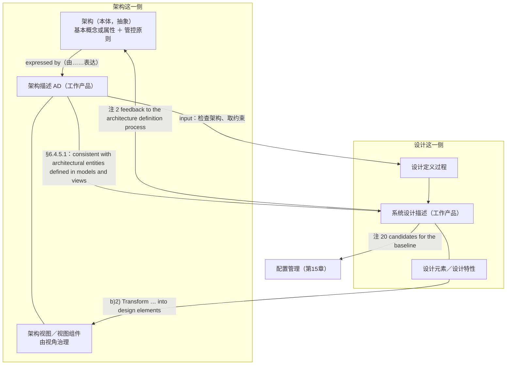

# 第14章 架构与设计：种类不是粒度

## 14.1 引言

上一章把"架构描述是什么、怎么交得出去"办完了：视角是规则，视图是产物，两本账加一次对账，缺哪一条都不算齐。本章接的是它留在桌上的最后一句话：这份描述交出去，接住它的是另一份描述，也就是设计描述。这两份描述之间是什么关系？架构对设计，到底起了什么作用？

工程现场对这个问题有一个现成的答案，而且人人都会说：架构是粗一点的设计，我们只是把它做细，本章要办的，就是这一句话，它听着像常识，其实把两件不同的事压成了一件。压错了地方，后面每一步都跟着错：图里塞满大词，设计里长出没人认领的东西，两边都以为对方在管。

### 14.1.1 误解现场

恒信合同平台的系统设计评审，开在架构基线冻结之后。

万辉交出了他的架构描述。十五张图那一关已经过去了，这一版是真正对过账的：视角有规格、关切有台账、元素有清单。签字那天他说了一句："架构这一站，走完了。"

接手的是设计组，小白坐在投影前，讲合同签署链的系统设计描述：配置引擎怎么配、签署链怎么编排、扩展点怎么留。讲到第二十分钟，玉杰抬起头。

"我问一个运维的问题。"玉杰说，"你的设计里，哪些失效必须被监控、多久检出——这句话在哪儿？"

小白翻到监控那一节："我们设计了监控组件。"

"组件我看见了。"玉杰说，"我问的是**判据**：漏了什么算漏，多久算迟。你这条设计特性，取值和依据在哪一栏？"

黄程接着问："业务方那句话——'月底账目对得上'。你的设计里，这句话落在哪个元素上？"

小白指着事件总线："编排层保证顺序——**设计元素**层面保证。"

"那是**设计元素**在保证顺序。"黄程说，"我问的是业务方那句'月底账目对得上'，落在哪个元素上，出了偏差谁发现、按哪条判据发现？"

徐漾最后问的是万辉："你这版设计里，新增了一条'与外部对账平台直连'，这条在架构描述的哪张视图上？"

小白愣了一下："这个……是设计细化出来的。"

"细化出来的，"徐漾重复了一遍，"还是新长出来的？"

万辉和小白对视了一眼，两个人都想到了同一句话，那句话在两家公司都有人说过，而且说得理直气壮：架构不就是粗一点的设计吗？我们只是把它做细。

徐漾把笔放下："这句话我听过十年，它错在两处——第一，架构和设计不是粗细之别，是两类工作；第二，做细的时候长出来的新东西，如果没人认领，它就不在任何人的账上。"

会议室安静了几秒，今天这件事，问题不在小白答得对不对，那三问，他每一问都答了一半。问题在他脑子里的那张图上：他把架构和设计摆在同一条线上，架构是上半段、设计是下半段，中间只隔着一个"细"字。 只要这条线还在，那三问就都答不上。

### 14.1.2 本章要回答什么

读完本章，下面这些问题你应当答得出来：

1. 架构定义与设计定义，凭什么说是两类工作，而不是同一件事的粗细两版？ 2. 同一个 *design*，为什么在标准里有两个意思？这个双义与"架构＝粗一点的设计"是什么关系？

3. 有效的架构为什么要"尽可能不依赖于设计"？这条要求保护的到底是什么？ 4. 需求能不能推出架构？"必要且充分的输入"与"原料"差在哪儿？

5. 架构交到设计手上，第一步的动作是什么？为什么它不是"把架构发下去"？ 6. 两条转化加一条分配，转的是哪几样东西？转不动的时候，是设计错了还是架构错了？

7. 设计里长出来的新元素，什么算正常、什么算出事？ 8. 一个视图上的元素，住在哪一层？它表达的是谁？

9. 架构实体只能是实物吗？一个实体只能对一个设计元素吗？ 10. 视图上的每个图标，都要满足"基本"吗？不必基本，是不是就等于不必相关？

11. 能不能进视图、它表达的是谁、它够不够格当架构内容，这三问，为什么谁也替不了谁？ 12. 系统分解结构是不是架构的产物？物理视图写到哪儿为止？

这十二问合的是一件事：架构交到设计手上，交出去的是什么、接住的是什么，两者凭什么不是同一件事的两档精度。 题面把答案的一半写进了副题，种类不是粒度；剩下的一半在过程里：交出去的是约束，接住的是依从。

### 14.1.3 本章的骨架

**先交代两个反复出现的说法**：本章说"**正本**"，指的是库内那几份标准的原文（ISO/IEC/IEEE 15288:2023、42010:2022、42020:2019）；说"**同版同年旁证**"，指的是 INCOSE 系统工程手册 5.0 中文版——它与 15288:2023 同版同年，可以对着看，但不是标准条文，凡用它都当场标明。

第10章说架构是什么，第11章说架构怎么被造出来，第12章说架构决策凭什么定下来的是这一个，第13章说架构怎么表达成一份交得出去的描述。四章合起来，把"架构"这一侧说完了。 但架构不是自己活着的，它必须被交给下一段工作，有人拿着它，去定出元素、接口、特性与取值，一直到能拿去采购或实现，这一段工作叫设计定义。

本章按下面五块走：

- 先把这个分界说准，先把名字分清，再看两句目的句并排，看 *design* 一词的宽义与窄义；然后回答"凭什么是两类工作"：深浅说不通，独立性要求；最后落到位置：设计在链上，架构不在链上。
- 交出去什么，接住什么，入口是检查，不是接收；中间是转化与分配；出口是"开发为规范"；而交接从来是双向的。
- 视图上的元素是谁家的，元素分四层、隔两道界；架构实体不必是实物，也不必逐一对上；系统分解结构不是架构的产物。
- 视图上的元素都要"基本"吗，"基本"管的是谁；"基本"只从视角这一环起作用；不必基本，不等于不必相关。
- 能不能进，是谁的，够不够格，先问能不能进视图，再问这一步表达的是谁，最后问拿掉它还达得成目的吗；三关各管一段，谁替不了谁。

走完这五块，本章要立住三句反直觉的话： 架构与设计是两类工作，不是同一件事的两档精度，架构管适宜·存续·合意，设计管兼容·可造·可集；两把尺不同轴，所以不能问"哪一张更粗"，只能问"这条信息属于哪一类"。（*viability*；正本中译作“可行性”，本章取“存续”以与设计侧的“可造”分开）

架构不是基于需求设计出来的，需求是架构的必要且充分的输入，不是它的原料；架构是基于原则、概念与属性定义出来的解，设计才是把架构与需求转换成可实现的系统设计。

架构交出去的那一段，不是接力，是换手，交出去的是约束，接住的是依从；而这条通道是双向的，设计能打回架构，接口可以在设计里新增，基线候选物要交出去。

## 14.2 架构和设计，到底差在哪儿

> 这一块先把名字分清，再看标准给两个过程写的两句目的，最后回答本节的问题：**它们差在哪儿**。答案不是"哪个更细"，而是"分属哪一类"。

### 14.2.1 先把名字分清楚

本章要用的名字有五组，先把它们摆正，后面才不会串。 第一组是架构与架构描述。 架构是那份内容本身，实体在其环境中的基本概念或属性，加上为实现和演化它的管控原则。架构描述（AD）是承载那份内容的工作产品：能签收、能入库、能版本化的，永远是描述，不是架构，这两样的界线，第10章与第13章各说了一遍；本章不重复，只借它们做一件事，把"设计"这一侧的名字也对上。

设计这一侧，第一个名字是设计定义（T-164），它是与架构定义并列的一个过程名，不是"给设计下定义"，它的目的句写着：提供关于系统及其元素的足够详细的数据与信息，以便按照系统需求与架构实现解。

第二个名字是设计描述（*design description*；附录 A 记作 T-165 系统设计描述），设计定义过程的产物，也就是本章标题里"接住的那一份"。正文里简称"设计描述"，这两个名字一过程一产物，不能互换：说"设计定义"的时候，说的是那件一直做下去的活动；说"设计描述"的时候，说的是它交出来的那份东西。

第三个名字是设计描述符（T-166；**SEH 表述**，正本零命中），一组设计特性和它们的可能取值，"设计做到够不够细"，最后就落在描述符上：特性列出来了，取值定了，才算这一格填满。

第四个名字是原子元素（T-167），递归往下分到哪一层可以停的判据，它问的不是"分到第几层"，而是"关于这个东西，我手上的信息够不够我决定买、造还是重用"。本章只点到它，因为它是设计定义过程内部的停点判据，不属"架构交出去的那一段"。

五组名字摆开，一件事就清楚了："架构"与"设计"各自有一份内容、一份描述；把它们放在同一条线上的那个"粗细"，在名字里根本找不到落脚点。

### 14.2.2 最容易被信的一种说法

"架构就是粗一点的设计，我们只是把它做细。" 这句话之所以最容易被信，是因为它有一半是真的：设计的产物确实比架构详细，这一点没错，谁也不必否认，一份系统设计描述比一份架构描述细得多，图上画的、表里列的，都更具体。 错在把形状当成了判据，详细只是这件事的形状；真正要问的是：这条内容转过去了没有？ 把"细"当判据，会顺手推出三句更错的结论：

第一句，"设计方案是架构视图的细化"，标准里给的动词不是"细化"，是转化：把架构实体与关系转化为设计元素，把架构特性转化为设计特性。细化只是把同样一类东西写得更长；转化是把一类东西换成另一类东西，判据不是"细了没有"，是"转没转过去"。

第二句，"视图里画了元素与关系，所以视图就是设计"。 视图里的元素是架构实体或被架构实体的表达，不是系统元素；架构只是"可以关乎"结构，那说的是外延，不是产出，元素及其关系的规格归设计定义过程。

第三句，"设计做完了就不需要架构了"，反了。设计的完成判据本身就引用架构，一份设计够不够，问的是它能不能支撑对架构的一次合规实现，没有架构，"合规"没有对象。

三句话合起来，是同一个错的三种说法：它们都在拿"粗细"回答"种类"的问题。 本章后面每一块，做的都是同一件事：换一把尺子问，不问"哪一张更粗"，只问"这条信息属于哪一类"。

### 14.2.3 目的句并排读

把标准给两个过程写的两句目的并排放一次，差别比任何解释都直接。

> **系统架构定义过程**：*The purpose of the system architecture definition process is to generate system architecture alternatives, select one or more alternative(s) that address stakeholder concerns and system requirements, and express this in consistent views and models.*（中译：系统架构定义过程的目的是生成系统架构备选方案，选择一个或多个应对利益相关方关注点和系统需求的备选方案，并在一致的视图与模型中表达该架构。）（ISO/IEC/IEEE 15288:2023 §6.4.4.1）

> **设计定义过程**：*The purpose of the design definition process is to provide sufficient detailed data and information about the system and its elements to realise the solution in accordance with the system requirements and architecture.*（中译：设计定义过程的目的是提供关于系统及其元素的足够详细的数据与信息，以按照系统需求与架构实现解。）（ISO/IEC/IEEE 15288:2023 §6.4.5.1）

两句都在说"做方案"，要的东西却不一样：一个要的是"生成、选择、表达"，另一个要的是"足够详细的数据和信息"。

差别写在另一段里，这一段是本章最该背下来的：

> *Architecture focuses on suitability, viability, and desirability, whereas design focuses on compatibility with technologies and other design elements and on feasibility of construction and integration.*（中译：架构聚焦于适宜性、可行性与合意性，而设计聚焦于与技术及其他设计元素的兼容性，以及构建与集成的可行性。）（ISO/IEC/IEEE 15288:2023 §5.9）

三处不同，外加一条质量要求。 分工不同，架构管适宜·存续·合意，设计管兼容·可造·可集，这是两句不同轴的尺，不是同一把尺的两档刻度。 驱动不同，设计定义*is driven by requirements that have been vetted through evaluation with the architecture*（中译：由那些已通过结合架构的评估得到审查的需求所驱动；同段 §5.9），也就是说，进到设计那一步的需求，已经先跟架构对过一遍。 产物不同，一个产出架构描述，一个产出系统设计描述。

还有一条质量要求，*An effective architecture is as design-agnostic as possible to allow for maximum flexibility in the design trade space.*（中译：有效的架构尽可能与设计无关，以便在设计权衡空间中获得最大灵活性。）（同段 §5.9） 最后这一条，值得单独看一节，它听着别扭：架构不依赖设计，那它依赖什么？

### 14.2.4 design 到底指什么

有人会拿出另一句话来反驳：标准自己都说过，定义架构属于 *design*，这话不假，但那个 *design* 是另一个意思。

*design* 这个词在标准里有两义：

| 哪一义 | design 指什么 | 出处 |
|---|---|---|
| 宽义 | 定义架构、系统元素、接口及其他特性的过程或结果 | ISO/TS 14812:2022 §3.1.15.1（库外来源·不可核；页面自标源 ISO/IEC/IEEE 24765:2017，同为库外） |
| 窄义 | 架构定义之外的那一段工作（本章用此义） | ISO/IEC/IEEE 15288:2023 §6.4.5 |

宽义那句定义里，确实明写着 *define the architecture*，所以"架构是设计的一部分"这句话，在宽义下完全成立。 问题出在下一步：有人从这个成立的宽义句，推出了"架构是设计的粗粒度版本"，这一步是偷换，不是推论。

宽义说的是"design 这个词覆盖得很广"，不是"架构和设计是同一种工作的两档精度"，前一句是关于词的，后一句是关于事的；从词的大小，推不出事的关系。 记住这个分岔，读标准时就有了一个固定动作：凡见 *design*，先问一句：这是宽义还是窄义。

### 14.2.5 深浅说不通：独立性要求

回到那条听着别扭的要求：

> *An effective architecture is as design-agnostic as possible to allow for maximum flexibility in the design trade space.*（中译：有效的架构尽可能与设计无关，以便在设计权衡空间中获得最大灵活性。）（ISO/IEC/IEEE 15288:2023 §5.9）

它依赖目的、关切、需求与原则，唯独不依赖"将来会选哪个设计"，好的架构把约束立在该立的地方，把还没定的事留给设计去权衡。 现在看这条要求最要紧的地方：它本身就是那条判据。

同一件事，不会对它自己提出"尽量不依赖自己"。**把这句话代进去念念**：一份草稿不会要求自己"尽量不依赖定稿"；一张图纸的上一版不会要求自己"尽量不依赖下一版"——**只有两样不同的东西，才谈得上"不要黏得太紧"**。如果架构和设计真是同一件工作的两档精度，那么"有效的架构尽可能不依赖于设计"这句话，等于说"粗的那一版尽可能不依赖于细的那一版"，这句话没有意义。这条要求能立得住，恰恰因为它说的两样东西不是一回事。

所以，遇到"架构和设计差在粗细吗"这个问题，有一条最省事的答法：看标准有没有提这条要求，提了，就说明不是。 还要说清它的边界，它不是"架构可以不管设计"；它是"约束立在该立的地方"。一个逼着设计只能有一种做法的架构，通常不是严谨，是越界，它把本该由设计权衡的事，提前替设计定了。

### 14.2.6 位置不同：设计在链上，架构不在链上

前面说清了"不是粗细"，那么它们各自是什么？正面答案在两段话里，而这两段话用的动词不一样。

> *The system architecture definition activities **define a solution based on principles, concepts, and properties** logically related to and consistent with each other. The solution architecture has features, properties, and characteristics which satisfy, as far as possible, the problem or opportunity expressed by a set of system requirements …*（中译：系统架构定义活动基于彼此在逻辑上相关且一致的原则、概念和属性来定义解。解架构具有若干特征、属性与特性，它们**尽可能满足**……由一组系统需求所表达的问题或机会。）（ISO/IEC/IEEE 15288:2023 §6.4.4.1）

> *This process transforms architecture and requirements into a design of the system that can be realised.*（中译：本过程将架构与需求转换为可实现的系统设计。）（ISO/IEC/IEEE 15288:2023 §6.4.5.1）

两句对读，得到一组对句：架构是"定义"出来的解；设计是"转换"出来的设计。

- 架构：基于原则、概念和属性定义解；需求在这里扮演的是"问题或机会"的表达者，架构"尽可能满足"它。
- 设计：把架构与需求一起转换成可实现的系统设计。

一个"定义"，一个"转换"，从需求指向架构的那条线上，标准没有放"转换"这个动词。

那需求算什么？标准在别处说得很清楚：

> *Confirmation is made that they are a necessary and sufficient response to stakeholder requirements and a necessary and sufficient input to other processes, in particular architecture and design.*（中译：确认这些需求是对利益相关方需求的必要且充分的响应，并且是其他过程（尤其是架构过程与设计过程）的必要且充分的输入。）（ISO/IEC/IEEE 15288:2023 §6.4.3.3 注 18）

需求是架构必要且充分的输入，不是它的原料，输入说的是"该给的都给了、够用了"；原料说的是"把它加工成另一个东西"。前者是问题侧的一份完整表述，后者是被转换的对象，把这两样合成一样，就会得出"需求一细，架构就出来了"，而标准从没这么说过。

这一段可以不用引文就验一遍。假如架构真能从需求推出来，那么同一份需求就该推出同一个架构。可工程现场不是这样：同一份需求交给两家公司，做出来的架构可以完全不同，而且两家都合格。工程里能在同一份输入上做出不同选择、还都合格的，那不是计算，是判断——标准把这一次判断叫"定义"，把"把架构与需求一起转换成可实现的系统设计"叫"转换"。两个词的分工，说的就是这件事。

于是本章要摆的，是同一页上的两种东西：

- 一条链：需求—方案结对，一份的叶节点就是下一份的需求，逐对往下走。这是设计这一侧的形态，第6章已经讲透（本章只回指一句，不重讲）。
- 另一件事：目的与关切在前面，架构是基于原则、概念和属性构造并选定的那一次判断。它不在那条链上，也不是那条链的上游一站。

两条之间传递的是约束与相容，不是接力，也不是转换，把它摆成一条，就会得到"架构是粗一点的设计"；摆成两条，这句话自然立不住。

## 14.3 交出去什么，接住什么

> 分界说清之后，看交接本身：从哪一步开始、中间转什么、到哪儿算完、以及这条路能不能往回走。

### 14.3.1 入口是检查，不是接收

标准把"准备设计定义"写成一组任务（ISO/IEC/IEEE 15288:2023 §6.4.5.3 a)）：定义设计定义的策略／确定构成系统的每个系统元素所需的技术／确定设计中表示的系统特性的必要类别／定义设计演进的原则／识别并规划支持设计定义所需的使能系统或服务／获取或取得这些使能系统或服务的使用权。

把这组任务概括成一句话，最到位的是 INCOSE 系统工程手册 5.0 中文版那句（同版同年旁证，它转述的正是这一活动）：

> **检查系统架构**，以确定适用于系统设计的基本属性和概念，以及应指导设计及其演化的原则。

注意这句话的动词：检查，不是"接收"，不是"分发"，更不是"照做"。 从架构出发不是一句比喻，它是设计方主动去架构里取三样东西：适用于本层设计的基本概念或属性、指导设计及其演化的原则、以及适用于本层的约束。取不出来的地方，就是交接处的第一个缺口。

这一点，恒信那次评审上说得最直白，万辉交出去的是那份架构描述，厚厚一摞；可设计方真正该拿走的不是那摞纸，是约束。小白答不上玉杰那三个问题，根子不在他读得不够仔细，在他从来没有"取"这个动作，他以为"发下来了"就等于"接手了"。 交文档不算交接，取到约束才算。

### 14.3.2 转化什么，分配什么

取完之后是三件事：两条转化，一条分配。

> 2) *Transform architectural entities and relationships into design elements.*（中译：将架构实体与关系转换为设计元素。）（ISO/IEC/IEEE 15288:2023 §6.4.5.3 b) 2)）

> 3) *Transform architectural characteristics into design characteristics.*（中译：将架构特性转换为设计特性。）（同 §6.4.5.3 b) 3)）

两条转化旁边，标准还按了一条注，把"转过去"的样子说清了：*each architectural entity (e.g. enterprise or project goals, capabilities and effects, operational activities, resource functions) and relationship is mapped into the appropriate system design elements*（中译：每个架构实体（例如企业或项目目标、能力与效果、运行活动、资源功能）和关系都映射到适当的系统设计元素；同 §6.4.5.3 注 5）。转出来的那一侧，标准也给了例子：*functionality, behaviour, dimensions, shapes, materials, critical quality characteristics, data processing structures*（中译：功能、行为、尺寸、形状、材料、关键质量特性、数据处理结构等；同 §6.4.5.3 注 6）。

第三件是分配：

> 1) *Allocate system requirements to system elements.*（中译：将系统需求分配到系统元素。）（同 §6.4.5.3 b) 1)）

它有一条注，值得单独盯住：*The purpose of this task is to complete the allocation to the extent necessary to address all system requirements and architecture objectives.*（中译：本任务的目的是在应对所有系统需求与架构目标所需的程度上完成分配；同 §6.4.5.3 注 4）

"与架构目标"这几个字不能丢。 只对着系统需求做分配，会分出一个"每条需求都有人认领"的设计，却可能整体偏离架构要守的那几件事；对着架构目标分，才会发现"某一条目标找不到承担者"这种病。恒信那次正好是这一种：黄程问"月底账目对得上落在哪个元素上"，小白指了编排层，需求找到了主人，可那条架构目标的承担者是谁、要做到什么程度，谁也没说。

转不动的时候，先判在哪一侧，两种病因要对症：

- 架构侧没立住，那条特性本身不可判定，设计方怎么转都转不动。这时候要回的是架构，不是补设计。
- 设计侧没转，架构给了可判定的东西，设计里却有元素，没有特性落在它身上。这时候补的是设计那一侧。

判据不是"细了没有"，是"转没转过去"。

### 14.3.3 出口是开发为规范（**SEH 表述**，正本零命中）

设计定义到哪儿算做完？标准的答案落在一个动作上：

> 8) *Capture the design.*（中译：捕获设计。）（同 §6.4.5.3 b) 8)）
>
> *This includes the design description in a form that can be used to either procure or realise the system elements that comprise the system.*（中译：这包括以可用于采购或实现构成系统的系统元素的形式给出的设计描述。）（同 §6.4.5.3 注 12）

"以可用于采购或实现的形式"是这道出口的名字，一份设计描述如果停在"这里待定""取值后续确认"，它就没过这道出口，它不叫"做得还不够细"，叫还没做完。

出口之前，正本在几处给了判据，另有一条出自同版同年旁证，合起来是四条：

| # | 判据 | 正本 |
|---|---|---|
| 1 | 完备 | 提供关于系统及其元素的*sufficient detailed data and information*（中译：足够详细的数据与信息），并到*can be used to either procure or realise*（中译：可用于采购或实现）为止（§6.4.5.1／§6.4.5.3 注 12） |
| 2 | 一致 | 与*architectural entities defined in models and views*（中译：模型与视图中定义的架构实体）一致，并与组织或项目采用的设计指南和标准一致（§6.4.5.1） |
| 3 | 可追溯 | *bi-directional traceability is maintained between the design characteristics and the architectural entities, identified interfaces, analysis results, verification methods or techniques, and system element requirements*（中译：在设计特征与架构实体、已识别的接口、分析结果、验证方法或技术以及系统元素需求之间维护双向追溯性；§6.4.5.3 注 19） |
| 4 | 描述符匹配 | 元素及其设计描述符要与整体系统的设计描述符相匹配（INCOSE SEH 5.0 表述——同版同年旁证；正本 §6.4.5 全节检索 `descriptor` 零命中，此术语与此句均非正本条文） |

第 2 条有一个现成的别名，叫"一致落到哪"，它永远落在跨视图的对应关系上。设计跟某一张视图冲突，是冲突；设计的两个部分各自跟不同的视图对上了、彼此之间却对不上，也是不一致。

还有一样东西，旧稿把它列成第五条判据，现在要拆开说：接口，旧的说法是"接口只细化不新增"，这个说法已经废了。标准明写：*It is possible that additional interfaces need to be identified and defined that were not addressed in the system architecture definition process.*（中译：可能需要识别并定义系统架构定义过程中未予处理的附加接口；同 §6.4.5.3 注 10）

正确的说法要分两半：接口的"存在"归架构，"长相"归设计。 架构识别过的接口，设计把它写细，时序、语义、错误处理、字表；架构没识别过、而两支元素确实要连的接口，不是就地补上，而是认领（怎么认领，下一节说）。

### 14.3.4 交接从来是双向的

如果架构与设计是接力，那么架构棒交出去、设计方跑完就算。标准不是这么写的，回流的正式通道，标准逐字给了一条；另有**两件**事走在这条路上，但去向不同——**一件回架构，一件往下交**。

这一条路：迭代反馈，设计逼着架构改，标准明写这条反馈：

> *This process provides feedback to the system architecture definition process to consolidate or confirm the allocation, partitioning, and alignment of architectural entities to system elements that comprise the system.*（中译：本过程向系统架构定义过程提供反馈，以整合或确认将架构实体分配、划分并对齐到构成系统的系统元素。）（同 §6.4.5.1 注 2）

第二件：添加接口与衍生需求，新长出来的东西要有人认领。

| 情况 | 处置 |
|---|---|
| 架构确实漏了（这本是它该交代的事） | 回架构补一次识别 |
| 需求变了（新出现了一条功能） | 把衍生需求纳入系统需求基线（**本书读法**：正本只给"衍生需求"与"系统需求基线"两处，合为一步是本书的处置口径） |

两条路都叫认领，认领这两个字是这一节的重点：设计会长出新东西，这是正常的；不正常的，是新长出来的东西没有主人。章首那条"与外部对账平台直连"，处置起来一点都不难，难的是先认出它无主。

无主比违规更危险：违规有人拦，无主没人拦，它不会在评审上被挡下来，因为它看上去只是一个"细化结果"；它会一直躺到集成那天，才和其他几十条无人认领的东西一起结账。

最后，设计定义还有一样东西要交出去：

> *The configuration management process is used to establish and maintain configuration items and baselines. The design definition process identifies candidates for the baseline and then provides the artefacts to configuration management.*（中译：配置管理过程用于建立并维护配置项与基线。设计定义过程识别基线的候选对象，随后将人工制品提供给配置管理。）（同 §6.4.5.3 注 20）

这一句是本章交给下一章的东西。 架构交出去的那一版要算数、设计依从的到底是哪一版，答案是"架构基线"，那是下一章的事，本章只管把东西交到门口：设计定义识别候选，配置管理收下它们。

### 14.3.5 分到哪一层算完

设计定义会一层一层往下分，分到哪一层可以停？INCOSE 系统工程手册 5.0 把这条判据落在一个名字上——原子元素（T-167）：如果一个系统元素只需要用黑盒（不透明箱）表示法来描述它的需求，并且能够自信而明确地定义它在现实世界中的解决方案，那么就可以在不进一步详细说明它的情况下，自信而明确地做出"购买、制造还是重用"的决策。（此条中文逐字取 INCOSE 系统工程手册 5.0，同版同年旁证；正本无此句。）

读这条判据要抓住两个词：黑盒、自信，它问的不是"分到第几层"，而是"关于这个东西，我手上的信息够不够我决定买、造还是重用"，它是信息充分性判据，不是深度判据。"一层分几块管得过来"那类经验规则是可管理性规则，不是停止规则。

这一段只点到为止，设计定义过程内部的其余动作，四组活动、几类可指名的方法、描述符法与可实现性关切，不属"架构交出去的那一段"，本章不展开。

## 案例进展①｜恒信：交出去的描述，被问了三个"怎么落"

评审会散场之后，徐漾把小白留下，摊开一张表。

"你交上来的那一版，我挨条查过。"她说，"差的三条在这儿，你先看。"

| 查什么 | 查到什么 | 结论 |
|---|---|---|
| 1 实体转化 | 设计里多了"与外部对账平台直连"，架构描述里没有这条 | 加戏一处 |
| 2 目标承担 | 架构目标"配置出来的孤岛必须可检出"——在谁身上是空的 | 缺承担者 |
| 3 描述符匹配 | 扩展点那条"什么算破坏性变更"，停在〈待定〉 | 未过出口 |

另外六条过了。徐漾在结论栏里没有写"不合规"，她写的是条件性合规，三处补项，各带责任方与期限。

"为什么不直接打回去？"小白问。

"打回去容易，可打回去之后呢？"徐漾说，"这三条里有两条，根不在你这儿——一条是**架构**漏识别，一条是**判据**没定。"

她指着第一行："这条接口，架构那边根本没识别过。你说'细化出来的'，可它不在任何人的账上。"万辉正好推门进来，听见这句，停了一下："这条不是违规，是我的架构没识别。"他在补项栏签了自己的名字。

第三行她让小白自己填。小白卡了十分钟，抬头说："我填不下去，因为判据没定。"

"记下来。"徐漾说，"判据没定，不是没做完，是没法判。这两句不一样：前者要催进度，后者要回去把那条判据定下来。你们缺的不是工作量——**架构交出去的时候，约束没有被取走**。交文档不算交接，取到约束才算；取不到的那几条，回架构补识别，不要在设计里挑一个看着像的答案填上，那样它就成了一条没人认领的线。"

第二天，小白做了一件事：他重新把架构描述读了一遍，把这一层真正要受的约束抄成两栏，左边"适用于本层的基本概念或属性"，右边"指导设计及其演化的原则"。抄完他写了一句："上一次开会之前，我没有做这件事。"

小白后来把这件事讲给同组的人听，用的是一句很短的话："我以为我们缺的是文档，其实我们缺的是那一次'取'。" 他补的那两栏，后来成了设计组的固定动作，每接手一份新架构描述，先抄一遍约束，抄不出来的地方标出来，先问，再动手。

## 14.4 视图上的元素是谁家的

> 交接的路径说清了，看路上跑的东西。一块图上的方框、一根线、一个标签，它们各自是谁家的？这一块把元素分成四层、隔开两道界。

### 14.4.1 先给元素分层

"视图上的元素是谁家的"这个问题，答错的人多半不是不认得那些方框，而是把不同层的东西放进了同一条线。先把层分开：

| 层 | 是什么 | 拿什么量它 |
|---|---|---|
| 描述层 | 架构描述元素与视图组件——图上那个框、那根线、那个标签 | 它遵守治理它的视角的约定吗 |
| 模型层 | 架构实体——模型里"以特定而离散的单位存在的东西" | 它回应关键关切、落实架构目标了吗 |
| 设计层 | 设计元素与设计特性 | 它够不够完整，支撑得了对架构的一次合规实现吗 |
| 实现层 | 系统元素——可被实现以满足规定要求的离散部分 | 它满足自己的规定要求了吗；能不能造、买或复用 |

描述层、模型层、设计层、实现层摆开，最先要看见的是：它们不是"同一个东西的四种粗细"。 描述层是描述的零件，模型层是被描述的那个实体，设计层是实现方案的元素，实现层是真造出来的东西。

而两道界就藏在这四行之间，且经常被合成一道：

- 界一：描述自己的零件，与被描述的东西。
- 界二：架构实体，与系统元素。

### 14.4.2 描述里的零件，与被描述的东西

第一道界，问的是：你手上这个东西，是"描述的零件"，还是"被描述的对象"？ 标准在给架构描述元素下定义的时候，列过一张清单。先看它那句总纲——*An AD element is an occurrence of one or more architectural concepts in an AD.*（中译：架构描述元素，是一个或多个架构概念在一份架构描述中的**出现**。）（42010:2022 §5.2.9）"出现"这个词说的是：同一个概念（比如"关切"）可以在一份描述里出现很多次，每一次出现就是一个架构描述元素。

然后它列了清单：*AD elements include stakeholders, concerns, stakeholder perspectives, and aspects identified in an AD, ADLs, ADFs and correspondences and correspondence methods used in an AD, and architecture views, view components, architecture viewpoints, and model kinds included in an AD.*（中译：架构描述元素包括 AD、ADL、ADF 中所标识的利益相关方、关注点、利益相关方角度和方面体，AD 中所用的对应关系与对应方法，以及 AD 中所含的架构视图、视图组件、架构视角和模型种类。）（ISO/IEC/IEEE 42010:2022 §3.4 注 1）

**先解释那个"出现"**：同一个概念（比如"关切"）可以在一份描述里出现很多次，**每一次出现，就是一个架构描述元素**。 这张清单里全是描述这一侧的东西：相关方、关注点、角度、方面体、视角、视图、视图组件、模型种类、对应关系……它们都是这份描述自己的零件，没有一个是"被架构的那个实体"。 这里要把一处与前一节的分岔说清：`14.2.2` 说"视图里的元素是架构实体或被架构实体的表达"，说的是它表达的内容属哪一层；这一节说的是它自己是哪一类零件。同一个方框，作为零件是架构描述元素，作为表达指向架构实体——两句说的不是同一件事。 所以，"图上的元素就是系统元素"这句话，第一处就错了：图上的元素连"实体"都还不是，它是描述这个动作借用的零件。

这里有一条容易漏掉的边界。标准另有一处清单，列出的是"架构描述元素包括哪些架构概念的出现"，其中含架构决策与架构理由（*architecture decision, architecture rationale*；ISO/IEC/IEEE 42010:2022 §5.2.9）。两张清单都是十二项，但覆盖不同，这一点是本书的归拢，不是标准里的对照句（标准只是分别在两处给了两张清单）。归拢成一句就是：问"某某是不是架构描述元素"，要看的是 §5.2.9 那张；§3.4 注 1 那张不含决策与理由，不能拿它当全集。

### 14.4.3 架构实体不是系统元素

第二道界，标准用一句话钉死了，它先说设计定义过程要向架构定义过程提供反馈，然后紧接着写：

> *Note that an architecture entity (an entity being architected or one subject to the system architecture definition process) and a system element (a discrete part of a system that fulfils specified requirements) **represent two different notions**.*（中译：注意，架构实体（被架构的实体，或经受系统架构定义过程的实体）与系统元素（系统中满足规定需求的离散部分）**代表两种不同的概念**。）（ISO/IEC/IEEE 15288:2023 §5.9）

系统元素是什么，标准另给了一条定义：*discrete part of a system that can be implemented to fulfil specified requirements*（中译：系统的离散部分，能加以实现以满足规定的要求；同 §3.47）。 两句放在一起，"两种不同的概念"落在哪就看得清了：架构实体是"被架构的那个事物"（企业、组织、系统、子系统、产品、服务、软件项、硬件项……）；系统元素是"构成系统的那个离散部分"。一个是"被架构的"那一头，一个是"构成系统的"那一头，同一个系统之上，两个词各指一头，不可互换。

而它们之间隔着的动作，正是上一块说的那条转化：*Transform architectural entities and relationships into design elements.*（中译：将架构实体与关系转换为设计元素；同 §6.4.5.3 b) 2)）。注意终点是"设计元素"，还不是系统元素，从架构实体走到真造出来的系统元素，中间还有设计这一步。

### 14.4.4 架构实体可以是名义的

第二处最容易想歪的是：既然叫"实体"，那它总得是个实物吧？ 不必。 标准在两处把这个误会堵掉了。

一处说元素在早期只是名义上的：

> *Sometimes the elements of the architecture entity are **initially notional** until Design Definition process … has occurred since this depends on the actual design(s) to be done.*（中译：有时，架构实体的元素在最初是名义性的，直至设计定义过程……完成，因为这取决于实际要完成的设计。）（ISO/IEC/IEEE 42020:2019 §5.6）

另一处说得更直接：*Elements in the model of the architecture will represent things that exist as particular and discrete units. They are neither necessarily tangible objects nor visible items.*（中译：架构模型中的元素将表示作为特定且离散单元而存在的事物，它们既不必是有形物体，也不必是可见条目。）（同 §10.4.4 b) 注 1）

> **译名说明**：*notional* 一词，库内 42020 中英对照版译作"概念性的"，本章用"**名义的**"。两者指同一件事：它现在有一个名字、有一个位置，但还没有确定由什么来实现。本章取"名义的"，是为了与第13章的"概念"一族词（基本概念、架构概念）避开。

这一条的要害在时间上：架构实体与最终的系统元素之间，不存在一份现成的对应。对应是靠设计定义这一步建立起来的，所以"架构里画了五个块，实现时就一定是五个模块"这句话，在架构那一侧根本没有依据。

### 14.4.5 不必对得那么齐

那么，一个架构实体对应几个设计元素？标准没有给 1:1：

> *This task helps to ensure that each architectural entity … and relationship is **mapped into the appropriate system design elements** to help ensure that all the architectural objectives are addressed by the design.*（中译：本任务有助于确保每个架构实体……和关系都**映射到**适当的系统设计元素，以帮助确保设计应对所有架构目标。）（ISO/IEC/IEEE 15288:2023 §6.4.5.3 注 5）

用的是 *mapped into*（映射到），没限定个数。**顺带把一个叫法对上**：正本有的地方写"系统设计元素"，说的就是"设计元素"——指"构成这个系统的那些设计元素"，不是另立的东西。一个架构实体可以映射到几个设计元素，几个架构实体也可以落到同一个设计元素上。 配着这条看，还有两件事要一起说：

一是追溯要双向。 *bi-directional traceability is maintained between the design characteristics and the architectural entities, identified interfaces, analysis results, verification methods or techniques, and system element requirements.*（中译：在设计特征与架构实体、已识别的接口、分析结果、验证方法或技术以及系统元素需求之间维护双向追溯性。）（同 §6.4.5.3 注 19）往下能追到出处，往上能追到它落到哪儿，两头都要通。

二是可以递归。 一个系统元素，本身还能再被当作一个实体架构一次，*the appropriate system life cycle processes are applied recursively to an SoI to resolve its structure to the point where understandable and manageable system elements can be implemented (made, bought, or reused)*（中译：将适宜的系统生存周期过程递归地应用于一个所关注系统，以将其结构分解到能够实现（制造、购买或复用）可理解且可管理的系统元素的程度；同 §5.2.2）。这正是"模块也有架构"的标准根据：模块在上一层是系统元素，在它自己这一层又是被架构的实体。

### 14.4.6 系统分解结构不是架构的产物

"是谁家的"这个问题，还有一样东西经常被算错，系统分解结构（*system breakdown structure*，SBS）。 标准把"建立适当的分解结构"写进了项目规划过程的任务里：*4) Establish appropriate breakdown structures.*（中译：建立适当的分解结构。）（ISO/IEC/IEEE 15288:2023 §6.3.1.3）它旁边那条注把话说全了：*Typical breakdown structures include work breakdown structure, functional breakdown structure, system breakdown structure, and organizational breakdown structure.*（中译：典型的分解结构包括工作分解结构、功能分解结构、系统分解结构和组织分解结构；同 §6.3.1.3 注 4）

三点要记住： 第一，SBS 的户口在项目规划过程，不在架构过程，它是一份规划台账，用来组织工作、分派责任、管理进度；不是架构的产物，也不是描述的一部分。

第二，系统结构本身不必是层级。 分解结构之所以长成一棵树，是"台账要好查"这个用途逼出来的，不是系统本来就长这样。把"结构是树"当成系统的性质，就会看漏那些横切、共享、循环的关系。

第三，"产品分解结构"（*product breakdown structure*，PBS）不是标准术语，本书不用。 库内四份正本检索 `product breakdown structure` 零命中；讲分解结构的那条注里列的四种，也没有它。遇到这个词，一律改说 SBS，或者直接说"哪一份台账"。

这一节最后要划两条界，它们都在物理视图那一侧：

- 物理视图 ↔ 设计描述：写到哪儿为止？型号、尺寸、材料、数量、实例数一出现，就属设计定义。 物理视图只到"系统元素与物理接口的一种安排"为止，再往下是设计解的活。
- 物理视图 ↔ 系统分解结构：物理视图上的块是系统元素（以及它们的安排），不是 SBS 上的节点。两者可以互相参照，但不是同一份东西，一份是架构的表达，一份是规划的台账。

### 14.4.7 把关系排一遍

这一块零零散散说了几件事，收在一张表里，就是五条关系：

| # | 关系 | 一句话 | 正本 |
|---|---|---|---|
| 1 | 表达 | 视图表达架构；架构描述是架构的表达 | 42010:2022 §3.7／§3.3 |
| 2 | 两种概念 | 架构实体与系统元素代表两种不同的概念 | 15288:2023 §5.9（该段） |
| 3 | 转化 | 架构实体与关系→设计元素；架构特性→设计特性（不是"细化"） | 15288:2023 §6.4.5.3 b) 2)3) |
| 4 | 一致 | 设计要与模型和视图里定义的架构实体一致 | 15288:2023 §6.4.5.1 |
| 5 | 双向追溯 | 设计特征与架构实体、接口、分析结果之间两头都追得到 | 15288:2023 §6.4.5.3 注 19 |

五条里没有一条是"粗细"，它们说的是表达、身份、转化、一致与追溯，把元素放对地方，靠的就是这五条。

## 案例进展②｜冰链：董勐补上两栏出处

冰链那边，同样的缝，换了一个方向。 水忠把接口视角的规格挂进项目描述框架之后没几天，董勐找上门来。他在做子系统那一层的设计，卡在一个地方。

"我这层的降级状态该分几级？"董勐问。

水忠没直接答："五级是你定的，还是我这条**视角规格**定的？"

董勐愣了一下，回去翻那份规格。翻完回来说："规格里只说'连续性不得中断'，没说分几级。"

"那它管不着你。"水忠说，"**视角**管的是形状，不管你的取值。"

董勐回去把设计描述改了：降级状态定五级，然后在旁边补了两栏，一栏写"本层取值：五级"，一栏写"依据：接口视角规格第 4 条（连续性要求）"。

文正后来看到这两栏，说了一句收尾的话："架构没管你的取值，但你的取值有了出处。"

这两栏正好落在两个不同的位置上：一栏是设计特性，那是设计这一侧的事，架构管不着；一栏是可追溯性映射，往上追到的是那条它必须守的约定。取值归设计，出处归依从，补上这两栏，董勐那一格才算既自由、又对得上账。

这个场面里没有谁犯错。水忠那条规矩本来就只该管到形状，董勐那个取值本来就该由本层定。错只错在，两样东西原来没有被分开写。 分开写之后，规矩守住了该守的，取值也留在了该留的地方，两边都松了，也两边都有着落。

## 14.5 视图上的元素都要"基本"吗

> 前一块把元素是谁家的分清了。紧接着就有一个必然被追问的问题：既然架构讲的是"基本概念或属性"，那视图上画出来的每一个东西，是不是都得"基本"？

答：不必。 "基本"修饰的是架构的内容，不是描述上的每个元素。

### 14.5.1 "基本"管的是谁

先看那句定义，看"基本"这个词在句子里的位置：

> *architecture* — **fundamental** concepts or properties of an entity in its environment and **governing principles** for the realization and evolution of this entity and its related life cycle processes（中译：架构——实体在其环境中的**基本**概念或属性，以及为实现和演化该实体及其相关生存周期过程的管控原则。）（ISO/IEC/IEEE 42010:2022 §3.2）

注意语法位置： *fundamental*（基本的）在句子里修饰的是 *concepts or properties*（概念或属性），它界定的是架构由哪些内容构成，管不到描述上画了什么。

往下看两处，更能说明问题：

- 视图的定义句里，没有"基本"：*information part comprising portion of an architecture description*（中译：包含架构描述的一部分的信息部件；同 §3.7）。判断一份东西是不是视图，问的是"它在不在描述里、受不受某个视角治理"，不问它"基本不基本"。
- 视图与视图组件的构成要求里，也没有"基本"这一项：标准对视图要求的是标识与辅助信息、治理它的视角、视图组件、已知问题；对组件要求的是有治理它的模型种类或图例（§6.7／§6.8）。

"基本"住在架构那一侧，不修饰视图元素，这一条有了，另一半问题才好答：既然不基本，那它们靠什么站得住？

### 14.5.2 "基本"只从视角这一环起作用

答案在"关切—视角—视图"这条链上。标准把这条链写成了三句要求：

> *Each concern identified in accordance with 6.4 **shall be framed by at least one architecture viewpoint**.*（中译：依据 6.4 识别的每个关切应由至少一个架构视角来框定。）（ISO/IEC/IEEE 42010:2022 §6.6）

> 视角的规格须列出 *one or more concerns framed by this architecture viewpoint*（中译：由本架构视角框定的一项或多项关切；同 §8.1 b)）。

> 视图的组件须 *address all of the concerns framed by its governing viewpoint*（中译：应对其治理视角所框定的全部关切；同 §6.7 c)）。

三句合起来，是一条准入链：哪些关切够格被视角框定，是在"视角"这一环上被裁的；一旦某条关切被某个视角框定，这个视角下的视图元素就是"为这条关切服务的"，不再逐个去接受"基本"的检验。

所以"基本"不是消失，是换了发生的地方：它发生在"哪些关切够格成为架构要回应的关切"这一步，而不是发生在"图上每一个图标"那一层。要拿"基本"去量的，是架构的内容；不是视图的零件。

### 14.5.3 不必基本，不等于不必相关

话说到这儿，有一个很自然的滑坡要挡住：既然图上的元素不必"基本"，那是不是画什么都行？

不行。 标准在同一个地方立着几条硬边界：

- 视图必须是"表达被架构实体之架构"的信息部件（§3.7），它是那份描述，不是背景资料。
- 组件必须应对其治理视角所框定的全部关切（§6.7 c)，shall）。

- 必须遵守其视角的约定（§6.7，shall）；而*The governing viewpoint or model kind or legend determines the syntax and semantic conventions for these introduced AD elements.*（中译：起管控作用的视角、模型种类或图例确定这些引入的架构描述元素的语法与语义约定；同 §5.2.9）。

而且，标准明许"非基本"的东西合法地留在架构描述里：

> *Information parts not within any view could include overviews of the entity of interest, architecture principles, architecture patterns and architecture styles whose application spans more than one view; referenced bases for the architecture, such as domain or reference architectures; correspondences between views; and architecture rationale.*（中译：不属于任何视图的信息部分可包括：所关注实体的概览；架构原则、架构模式以及适用跨越一个以上视图的架构风格；所引用的架构依据，如领域架构或参考架构；视图之间的对应关系；以及架构理由。）（同 §6.7 示例 2）

这张单子里，没有一条是"基本概念或属性"，它们照样是这份描述正当的组成部分。 准确的表述是：视图上的元素要"为被框定的关切服务、并在该视角的约定内被解释"；要"是架构的表达"；但不必是"基本的"。 不必基本 ≠ 不必相关。 前一句划掉的是"逐个图标都要过基本这一关"，后一句守住的是"每个元素都要有它服务的那条关切"。

### 14.5.4 换个位置就不基本了

"基本"还有一个容易被忽略的性质：它是相对所关注实体的判定，不是内容的固有标签。定义句写的是 *of an entity*（中译：属于某个实体的），每个被架构的实体，各有其"基本"。 再叠上上一块说过的那条递归（一个系统元素自己还能再被架构一次），就得到一条很实用的判断：同一条内容，在上层可能是基本属性，在下层只是设计取值。

以平视显示器为例：

| 内容 | 在整机层 | 在显示源（子系统）层 |
|---|---|---|
| "共形精度 ≤ 毫弧度量级" | 基本属性——目的所依赖，去掉即不成立 | 设计取值——实现它的容差预算，是设计特性 |
| "组合器的安装公差" | 不是架构内容——下游取值 | 可能是该子系统架构的基本属性 |

所以问"这条够不够基本"，先要问清一句：对着哪个实体、它的目的是什么。 同一句话，换个位置，答案就变了。

## 案例进展③｜冰链：一条新接口该去哪儿

董勐那条接口，后来还是长出来了。 子系统里两块元素确实要连，架构描述里没有这条线。他先按习惯在图上补了一笔，画完又停住，这一笔要是就这么留着，它就成了章首小白那条"细化出来的"，谁也不知道它是从哪儿冒出来的。

他列了一张小单子，问了三句：

- 这条接口，架构识别过吗？，没有。
- 它是"架构漏了"，还是"需求变了"？，两块元素本来就要连，是架构那一版没识别到。

- 那它该回哪儿？，回架构补一次识别。

他把这条报给水忠。水忠补进架构描述的那一版，重新走了一次冻结。 同一个月，恒信那边也长出来一样东西，但性质不同：业务方新增了一条"要能查到历史对账记录"，这是需求变了，不是架构漏了。小白按第二条路处置，把衍生需求纳入系统需求基线，走变更流程。 两条路都叫认领。分岔只在那一句：它是架构漏了，还是需求变了。

他把这三句写在一张便签上，贴在了工位边上。后来冰链的设计组把这张便签抄成了三行，放在每一份设计描述的末页：

> **新长出来的东西，先问三句**：架构识别过吗？是架构漏了还是需求变了？该回哪儿？

三条都答得出来，它就有人认领了。

## 14.6 能不能进，是谁的，够不够格

> 三块合起来，全章要问的其实是同一件事的三个问句。这一块把它们摆在一张桌上，说清为什么谁也替不了谁。

### 14.6.1 先问能不能进视图

第一问：这个东西，能不能进视图？，这一问的对象是视图上的元素，量它的尺子是描述这一侧的那些"应"。

来源交代（一句话）：下面这六项是**本书的归并**——正本没有"六项"这份清单，它取的是 42010:2022 §6.6／§6.7／§6.8／§6.9.2 里的 shall 要求（共二十句），外加 §5.2.9／§3.7 的定义性约束。表里除第 ⑤ 项是定义性外，其余都有 shall 垫底

| # | 条件 | 正本 |
|---|---|---|
| ① | 它所属的视角已纳入本描述 | §6.6：*An AD shall include or reference each architecture viewpoint used therein.*（中译：架构描述应包含或引用其中所使用的每个架构视角。） |
| ② | 它落在该视角框定的关切之内 | §6.7 c)；§8.1 b) |
| ③ | 它由某个模型种类或图例治理 | §6.8：组件应标识其管控模型种类（如有）；无模型种类的，*a view component legend shall be included*（中译：应包含视图组件图例） |
| ④ | 它符合该视角／模型种类的语法语义约定 | §6.7：*Each architecture view shall adhere to the conventions of its governing architecture viewpoint.*（中译：每个架构视图应遵循其管控架构视角的约定。）；§5.2.9 |
| ⑤ | 它是架构描述元素，且表达的是被架构的实体 | §5.2.9；§3.7（定义性，非 shall） |
| ⑥ | 它与视图内其他元素的关系可被表达 | §6.9.2：*An AD shall include or reference a list of AD element correspondences.*（中译：架构描述应包含或引用一份架构描述元素对应关系清单。） |

六项之外，还有一条操作判据："由谁引入"的追溯，每一样东西都该说得出来它是被哪个视角、模型种类或图例引进来的（*As viewpoints, model kinds and legends are specified and applied, additional AD elements are introduced.*／中译：随着视角、模型种类与图例被规定和应用，附加的架构描述元素被引入；同 §5.2.9）。追不到引入者、又没有图例，它就只是"画在图上的东西"。

实际入场有三条路，每条都说得出来源：

- 由模型种类或图例引入，视角规定了用哪几种模型种类，模型种类自带一套构造（用例里的参与者、边界，活动模型里的输入、输出、控制、机制……），这些东西是被"约定"引进来的（§5.2.9）。
- 由另一份架构描述精化或引用，*An AD element in an AD can be refined or elaborated by reference to another AD. An AD can utilize protocols introduced as AD elements of distinct ADs.*（中译：一份架构描述中的架构描述元素，可以参照另一份架构描述来精化或细化。一份架构描述可以利用作为不同架构描述的架构描述元素而引入的协议；同 §5.2.9）
- 由视图方法把信息源翻译过来，视图方法规定"架构描述元素将如何被呈现""信息源如何被转换或翻译"（§8.3）。

三条路的意义在追溯：任何一个合法的视图元素，都该能说出自己走的是哪一条。说不出走哪条，它就还没进这个体系。

### 14.6.2 进不去的，去哪

进不去视图，不等于没地方去。标准给了一处正当的容身处，而且用的是 *may*：

> *An AD **may** include other information which is not part of any architecture view.*（中译：架构描述**可**包含不属于任何架构视图的其他信息。）（ISO/IEC/IEEE 42010:2022 §6.7）

| 进不去的 | 该归何处 |
|---|---|
| 视角规格、模型种类规格（它们是治理者，不是被表达物） | 描述内的其他信息 |
| 跨视图的东西：全景总览、架构原则与模式、所引用的架构依据、视图间的对应关系、架构理由 | 描述内不属于任何视图的信息（§6.7 示例 2） |
| 架构决策与理由 | 架构描述元素（§5.2.9 明确列入），但通常不塞进某一视图；它们另有记录要求（§6.10：必不可少的决策应记录，理由宜记录） |
| 纯粹的实现细节与设计取值 | 设计描述——架构阶段接口只定到 *the level or extent needed for the architecture intent and understanding*（中译：架构意图与理解所需的层级或程度；15288:2023 §6.4.5.3 注 10） |
| 本视角框定范围之外的关切 | 换个视角，或新立一个视角（并记下为什么） |

这张表的意思不是"进不去就丢掉"，是"每样东西都有自己的家"。 混进去的代价很具体：描述里塞满了不该在上面的东西，读者就再也不知道哪一块是承诺。

### 14.6.3 再问这一步表达的是谁

第二问：这个东西，表达的是谁？，这一问的对象是它的身份，量它的尺子是上一块那四个层、两道界。

同一个方框，可能落在四个不同的位置上：它是描述自己的零件（视图组件、视角规格），还是被描述的架构实体，还是设计元素，还是系统元素？三句最容易说错的话，都出在这一问上：

- "视图上的元素就是系统元素。" 错。中间隔着两道界（§3.4 注 1；§5.9 末段）。
- "视图上的元素是系统元素的泛化版。" 反了。架构实体不必是实物、也可以是名义的（42020 §10.4.4 b) 注 1／§5.6），而系统元素的标准是"可被实现以满足规定要求"（15288 §3.47），一个是理解单位，一个是实现单位。
- "架构已经定义了系统元素。" 只有半句对。架构定义过程的成果里确有"系统元素及其相互接口被定义"这一项（§6.4.4.2 g)），但"过程成果"不等于"架构"；而且接口在架构阶段只定到"足以传达架构意图"的程度，细化在设计定义过程（§6.4.5.3 注 10）。

### 14.6.4 最后问：缺了一样，还达得成吗

第三问：拿掉它，这个实体还达得成它的目的吗？，这一问的对象是架构的内容，量它的尺子只有一个：目的。

这一问在前一块已经量过一遍（`14.5`）：它管的是"哪些关切够格成为架构要回应的关切"，发生在视角这一环上，不落在每一个图标上，这里只补一句：这把尺子不认别的判据。 不认"粒度够不够细"，不认"层级够不够高"，也不认"改起来贵不贵"，那些都回答不了"拿掉它，目的还达得成吗"。

### 14.6.5 谁替不了谁

三问摆在一起，是一件东西的三个面，不是三次重复：

| 关 | 对象 | 量它的尺子 |
|---|---|---|
| 描述关 | 视图上的元素 | 能不能进视图：六项＋"由谁引入"的追溯 |
| 实体关 | 它表达的是谁 | 描述层零件／模型层架构实体／设计层设计元素／实现层系统元素 |
| 目的关 | 架构的内容 | 拿掉它，这个实体还达得成目的吗 |

混起来会出两种典型错误：

1. 用"基本"去要求每一个图标，图里塞满大词，视图不再回答任何具体关切。这是把第三关的尺子拿到第一关上用。
2. 用"画得出"当"够基本"，把设计取值当成架构内容收进视图，于是"架构"变成"更粗的设计"。这是把第一关的通行证当成第三关的合格证。

落到手上，是一个四问的动作。看到视图里的一样东西，连问四句：

> ① 它服务于本视角框定的哪条关切？——答不出：它不是视图元素，或者该归"描述内其他信息"。
> ② 它按哪个模型种类或图例的约定被解释？——答不出：必须补图例。
> ③ 它表达的是被架构实体的架构吗（还是背景、参考、别人家的东西）？——后者可以留在描述里，但要标明是引用基线或外部上下文。
> ④ 它排掉了什么？——排不出任何东西，它可能只是信息，不是架构内容。

**四句与三关的对应是**：①②属**描述关**（它服务于哪条关切、按哪个约定被解释）；③属**实体关**（它表达的是谁）；④属目的关（它排掉了什么，才配当架构内容）。 三关各管一段，谁也替不了谁，这才是全章最后要立住的那句话。

### 14.6.6 认知反转

回到章首那间评审室。小白那三问，每一问都答了一半；万辉那句"交出去了"，说的时候底气很足。如果你读完了前面十三章，你大概会替他们说一句：设计确实比架构详细，说"做细了"不算错吧？ 这句话站不住，因为它把四件事混成了一件。

第一层，把"种类"当成了"粗细"。 架构和设计不是同一支笔的两档笔尖，它们的目的句不同、作用面不同，还有一条独立性的要求：有效的架构尽可能不依赖于设计。同一件事不会要求"尽量不依赖自己"，这条要求的存在，本身就证明两者不是同一件事的两档精度。

第二层，把"输入"当成了"原料"。 需求是架构必要且充分的输入，该给的都给了、够用了；可它不是被加工的原料。架构是基于原则、概念和属性定义出来的解，设计才是把架构与需求转换成可实现的系统设计。把这两句合成一句，就会得出"需求写细一点，架构就出来了"，而标准从没这么说过。

第三层，把"接收"当成了"交接"。 万辉交出去的是文档，设计方该拿走的是约束。交文档不算交接，取到约束才算。 第四层，也是最容易被漏掉的一层：把"换手"当成了"接力"。 设计会长出新元素，这是正常的；不正常的是没人认领，而且交接从来是双向的：设计能打回架构，接口可以在设计里新增，基线候选物要交出去。无主比违规更危险，违规有人拦，无主没人拦。

本章真正要立的，是那三句最短的话：架构与设计是两类工作，不是同一件事的两档精度；架构不是基于需求设计出来的，需求是它必要且充分的输入；架构交出去的那一段不是接力，是换手。

用第1章的话收一次束：对"架构与设计"，你原来只是"见过"，见过图、见过设计文档、见过"架构冻结"四个字，本章把它推到"拥有"，能说出分界在哪、入口取什么、转的是哪几样、元素住在哪一层、三关各量什么。能答全这四问，才算拥有。

## 小结

本章讲的是架构交出去的那一段路：从一份架构描述，到一份能拿去采购或实现的系统设计描述。 它先把**分界**说准了：两边的目的句不同、作用面不同（一头管适宜·存续·合意，一头管兼容·可造·可集），*design* 一词还带着宽窄两义。深浅说不通，证据就是那条独立性要求。位置也不同：一边是"定义"出来的解，一边是"转换"出来的设计，而需求是前者必要且充分的输入、不是原料。

它立了交接的动作：入口是检查架构、取约束，不是接收文档；中间是转化与分配（架构实体与关系→设计元素；架构特性→设计特性；系统需求→系统元素，须同时对着系统需求和架构目标）；出口是开发为规范（**SEH 表述**，正本零命中），用于采购或实现，停在〈待定〉即未过出口。而交接从来是双向的：设计能打回架构，接口可以在设计里新增，基线候选物要交出去。长出来的新东西必须被认领，无主比违规更危险。

它把元素分了四层、隔开两道界：描述自己的零件与被描述的东西；架构实体与系统元素。架构实体不必是实物、也可以是名义的，一个实体不必只对一个设计元素，系统元素自己还能再被架构一次。系统分解结构不是架构的产物。

它回答了那个必然被追问的问题：视图上的元素不必"基本"，"基本"修饰的是架构的内容；"基本"只从视角这一环起作用；而不必基本，不等于不必相关。 最后它把三个问句摆在桌上：能不能进视图（描述关）、它表达的是谁（实体关）、拿掉它还达得成目的吗（目的关）。三关各管一段，谁也替不了谁。

本章的三句话：架构与设计是两类工作，不是同一件事的两档精度；架构不是基于需求设计出来的，需求是它必要且充分的输入；架构交出去的那一段不是接力，是换手，交出去的是约束，接住的是依从。 回头看章首那间评审室：小白那三问答不上，不是因为他不认真，是因为他把两样东西摆成了一条线。把线拆成两条，问题就都能问了。

## 附录

### A 本章概念总图

### B 本章的能力级

第 ③ 级为主

- 表征，本章把哪几个词说准：架构／架构描述（界线重述）｜设计定义 T-164（过程）／设计描述 T-165（产物；正本用名是 *design description*，本章首次给出其标准用名与全书简称的关系）／设计描述符 T-166／原子元素 T-167｜四个层名（架构描述元素与视图组件／架构实体／设计元素与设计特性／系统元素）｜系统分解结构 SBS及其户口（项目规划过程，不是架构的产物）
- 图式，本章给出哪个可识别的结构：四层两界图（描述层／模型层／设计层／实现层；界一＝描述自己的零件与被描述者，界二＝架构实体与系统元素）｜两条不同的东西并排图（需求—方案链，与目的→架构）｜视图元素的准入判定链（六项＋由谁引入的追溯）｜三关对应表（每关：对象／尺子／混起来会出什么错）
- 心智模型，本章给出哪个能推演的机制：种类不是粒度（两把尺不同轴；独立性要求即判据）｜转化不是细化（判据是"转没转过去"；设计会长出新东西，要管的是认领）｜"基本"只从视角这一环起作用（不必基本 ≠ 不必相关）｜三关不可互相替代（描述关／实体关／目的关）｜架构不是基于需求设计出来的（定义 vs 转换；需求是必要且充分的输入）
- 解释框架，本章不建此级，由第17、18章承担

再用第1章 §1.4.4 那把尺子量一下：本章站在第 ③ 级（心智模型），它给你的是一张交接图，拿到任何一份系统设计描述，你都能顺着这张图走一遍，指出它在哪一步转丢了。

> **能答全四问，才算拥有**——架构和设计两样东西摆在你面前，你能说清这条内容属于哪一类、那个元素是谁家的、它够不够格当架构内容。

### C 自查 · 这些说法对吗？

1. "架构和设计就是一回事，只是粗细不同。"（✗） 2. "标准说了，定义架构也属于 *design*，所以架构是设计的一部分，也所以架构是粗的设计。"（◐ 前半对，后半是偷换）

3. "有效的架构要尽可能不依赖于设计——这句话说明架构比设计更基础。"（✗） 4. "需求是架构的输入，所以把需求写细一点，架构就出来了。"（✗）

5. "接手架构的第一步是接收文档，然后照着做。"（✗） 6. "分配就是把系统需求分到元素上，让每条需求都有主。"（◐ 漏了一半：还须对着架构目标）

7. "设计里长出来的新元素，就地补上就行。"（✗） 8. "接口只能细化，不能新增。"（✗ 已废；不合格的是追不到架构依据、又不回流）

9. "视图上的元素就是系统元素。"（✗） 10. "架构实体必须是实物。"（✗ 也可以是名义的）

11. "一个架构实体只能对应一个设计元素。"（✗ 不必逐一对上） 12. "系统分解结构是架构的产物。"（✗ 属项目规划过程）

13. "视图上每个图标都要满足'基本'。"（✗） 14. "既然不必基本，那画什么都行。"（✗ 不必基本 ≠ 不必相关）

15. "能不能进视图、它表达的是谁、它够不够格——这三件事是一件事。"（✗ 三关各管一段）

### D 练习

1. 拿你们最近一份系统设计描述，把"本次从架构取到了哪几条约束"抄成两栏，左栏适用于本层的基本概念或属性，右栏指导设计及其演化的原则。抄不出来的地方，就是交接的缺口。
2. 找出你们设计里"架构描述里没有、设计里却有"的东西，逐条判：是架构漏了，还是需求变了？两种处置各走什么流程？
3. 挑一条架构特性，追它这一路：它在架构那一侧叫什么，在设计这一侧变成了哪几个设计特性，落到哪个元素上，取值定在哪里。
4. 用四层两界给自己项目上的十个元素分一次层，看有多少个在第一遍分错了。 5. 拿一份物理视图，找出"型号、尺寸、材料、数量、实例数"出现的第一处，那就是该收笔的地方。

6. 找一条你们团队争论"要不要写进架构"的内容，连问第四问：拿掉它，这个实体还达得成目的吗？ 7. 把你们视图里的三个元素拿出来，各问四句（服务哪条关切／按哪个约定被解释／表达的是谁／排掉了什么）。

8. 写给下一层接手的人一段话：这一版架构交出去，你要他"取走"的是哪几样东西。

### E 参考文献

标准

- R-102 ISO/IEC/IEEE 15288:2023《系统与软件工程，系统生存周期过程》，§5.2.2 系统结构；§5.9 概念与系统定义；§3.6 人工制品；§3.13 设计（名词）；§3.31 递归；§3.47 系统元素；§6.3.1.3 项目规划过程（任务 4) 与注 4）；§6.4.3.3 注 18；§6.4.4.1 系统架构定义过程目的与输入；§6.4.5.1~§6.4.5.3 设计定义过程（含 §6.4.5.3 b) 1)~8) 与注 2·4·5·6·10·12·19·20）
- R-04 ISO/IEC/IEEE 42010:2022《软件、系统与企业，架构描述》，§3.1 架构工作；§3.2 架构；§3.3 架构描述；§3.4 注 1；§3.7 架构视图；§3.8 架构视角；§5.2.2；§5.2.9；§5.3；§6.1／§6.2；§6.6／§6.7／§6.8／§6.9.2／§6.9.3；§6.10.1／§6.10.2 - R-05 ISO/IEC/IEEE 42020:2019《架构过程》，§5.6；§8.4.5／§8.4.7；§10.4.2 h)·n)；§10.4.4 b) 注 1／e)·f)·m)；§10.4.5 注 1；附录 E.2.1（架构即约束）

- R-85 ISO/IEC/IEEE 42030:2019《架构评估框架》，以目的检验架构 - R-103 ISO 9000:2026《质量管理体系，基础与术语》，§3.3.11 设计和开发；§3.5.1 要求；§3.10.1 特性

经典文献

- R-45 INCOSE《系统工程手册》（SEH 5.0 中文版，与 15288:2023 同版同年），本章"检查系统架构"一句、原子元素两条件处为同版同年旁证，非正本条文

内源（研习笔记：只列，不给编号，不作引用依据）

- 《架构定义与视图设计研究报告，从意义目的到产品数据与四案例》（35 号，§十七为本章主底本） - 《架构与设计边界研究报告，从定义辨析到架构视角与架构视图》（24 号）

- 《架构与设计过程模型研究报告，从术语定义到双线过程》（34 号） - 《架构视图口径研究报告》（37 号）、《架构描述与架构视图价值研究报告》（36 号）

- 《设计开发落地方法研究报告，需求与方案结对开发》（20 号）、《构思定义设计关系及架构活动研究报告》（16 号） - 《设计定义与实现边界对话记录》（25 号）

