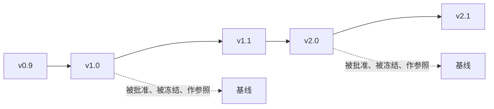
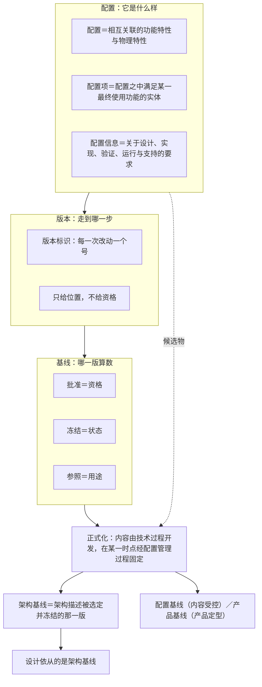

# 第15章 配置管理：让架构判断受控、可复现

## 15.1 引言

上一章把"架构交出去、设计接住"办完了：架构与设计不是粗细两版，是两类工作；交出去的是约束，接住的是依从。本章接的是它留在桌上的最后一句话：设计依从的，到底是哪一版架构。桌上还压着一张更早的工单：第9章说，可复现意识（你不在场，判断还接得住）往后要在**配置与基线**里长成制度。

工程现场对"配置管理"另有一套根深蒂固的说法：它是行政事务，管参数、存档、走流程；版本号标上了，就等于配置管理做好了。本章要办的正是这件事。它把一项能力当成了一道手续：手续可以外包、可以跳过，能力跳不过去——你交出去的每一份判断，凭什么在换个人之后仍然算得出来。

### 15.1.1 误解现场

冰链 M3 二代的项目例会上，接口视角规格挂进项目架构描述框架（architecture description framework，ADF）之后的第三周。

董勐把子系统设计描述摊在桌上，第一页就卡住了："我这层的降级状态分了五级。这个取值，是照水忠那份接口视角规格定的——可规格里没写五级，只写'连续性不得中断'。那我这一版，到底算不算依从那版架构？"

水忠翻出他那份规格："我这版是三月十四号定稿、挂进 ADF 的。你看的是哪一版？"

"我是按挂进去的那版抄的。"董勐说，"不过上周我又问过你一次，你说降级状态那一条你改了个说法。"

会议室安静了两秒。文正把电脑转过来："ADF 里现在有两份：三月十四号那版，和上周那版。设计组手上是后者，架构组的评审纪要写的是前者。"

逸人接了一句："产线上还烧着按三月十四号那版做的样件。"

李旭问的是一句更窄的话："那我们说'二代的设计依从架构'，依从的是哪一版？"

没人答得上来。不是没人知道答案，而是这件事从来没有被谁定下来过：规格有三版、描述有两版、评审纪要和样件各认一版，每一版都真实存在、都能拿得出手，可"哪一版算数"没有落款。

永兵在后排低声说了一句："我们说'设计依从架构'，还怎么站得住。"

### 15.1.2 本章要回答什么

读完本章，下面这些问题你应当答得出来：

1. "配置"是参数文件吗？为什么说它是被记录下来的功能与物理特性？配置项、配置信息又是谁？
2. 什么算配置、什么不算？一条特性凭什么进得来？
3. 版本是什么？它记的为什么只是"刻度"，而"最新版"为什么当不了基线？
4. 基线凭什么算基线？批准、冻结、参照这三样，缺哪一样就散架？
5. 配置基线、产品基线分别立在哪一步？功能基线与分配基线为什么不能当正本讲？
6. 变体与版本是同一件事吗？为什么一个是空间、一个是时间？

7. 草稿与"定下来的那一份"之间，隔着一个什么动作？这个动作为什么不在技术过程里？
8. 架构描述是"定稿之后才交出去管"，还是在过程中就受控？
9. 配置管理平时做哪几件事？"配置审计"与"审核"为什么不是一件事？
10. 改了东西，凭什么说得清"从什么变到什么"？
11. **挑出候选**与定成基线，为什么是两件事、分属两只手？谁有权批这一版，又归谁管？
12. 不做配置管理会坏在哪？"有版本管理、没有配置管理"是哪种坏法？

13. 架构基线到底指哪一版？设计依从的为什么是它？
14. 这件事替架构定义做了什么？它跟第4章的需求变更闭环，边界在哪？

这十四问合起来是一件事：你交出去的那一份判断，凭什么在换个人之后还站得住、还查得下去。答案的一半写在题面副题里：受控、可复现。另一半在过程里——配置管理不改你的架构，它只把"哪一版是定下来的那一份"固定下来，并且一直守得住。

### 15.1.3 本章的骨架

先交代两个反复出现的说法。本章说"**正本**"，指的是库内那几份标准的原文：ISO/IEC/IEEE 15288:2023、ISO 9000:2026、42010:2022、42020:2019。说"**同版同年旁证**"，指的是 INCOSE 系统工程手册 5.0 中文版；它与 15288:2023 同版同年（此说为通行说法，本库不核），可以对着看，但不是标准条文，凡用它都当场标明。

第10章到第14章把"架构"这一侧说完了：架构是什么、怎么被造出来、决策凭什么定、怎么表达成一份交得出去的描述、交出去之后设计怎么接住。可架构描述不是交出去一次就完事的——它会被改，会被迭代，会在多层级上同时被引用。于是"哪一版算数"这个问题，从交出那一刻起就悬在那里。本章办的就是它。

还有一层位置要说清：配置管理与前面各章是并行关系，不是它们的下一步。15288:2023 里，十四个技术过程，每一个都在干同一件事："提供已选定用于基线的关键人工制品"（*Provide key artefacts that have been selected for baselines*；中译：提供已选定用于基线的关键人工制品）。每个过程底下都附一条注，写明"本过程识别基线的候选对象，随后把人工制品提供给配置管理"。这十四个过程点得出名字：业务或任务分析、利益相关方需要与需求定义、系统需求定义、系统架构定义、设计定义、系统分析、实现、集成、验证、转换、确认、运行、维护、处置，一个不缺。架构定义只是这十四个供料口里的一个，它自己能做的只到"提名候选"为止；把这些候选收下、正式化、维护成基线的，是配置管理。

与需求那一章的分工也在这里划清：需求侧的变更闭环，变更请求、影响分析、批准、**再验证**、关闭——归第4章；本章把"冻结、变更、再冻结"这个循环推广到所有配置项，需求只是其中一项（它草稿阶段是产品数据，被批准纳入基线之后才成为配置信息）。

最后一条要交代的：本章说"**能力**"，一律指第9章那份清单里的意思，并且具体落在那份清单的第 ⑥ 项（可复现意识）上——不与第1章的"能力四级"（表征、图式、心智模型、解释框架）混。这两处用的是同一个词，量的是两件事：一处量概念掌握到哪一级，一处量你手里长出了什么。

本章按下面三块走。先把三个词各管什么说清：配置、版本、基线，各就各位，近邻词当场分开（`15.2`）。再把最容易混的地方一条一条拆开：配置不是参数设置，版本不是基线，变体不是版本，没有基线改动就说不清（`15.3`）。最后进过程里看它怎么干：怎么收下判断、怎么守住基线、不做会坏在哪、它替架构定义做了什么（`15.4`）。

---

## 15.2 配置、版本、基线各管什么

三个词各说一件事：**配置**回答"它是什么样"，**版本**回答"走到哪一步"，**基线**回答"哪一版是定下来的那一份"。三句话不重叠，也不能互相顶替，现场九成的混乱，都是拿其中一个去答另一个的问题。

这一块要做的是：把这三个词放到各自的位置上，顺手把它们旁边最像的词分开。

### 15.2.1 配置：记下产品是什么样

现场说"改一下配置"，十有八九指的是改参数：阈值调一调、开关翻一翻、界面上的选项换一换。这个用法在日常里没错，但它不是标准里那个"配置"。

正本给的定义只有一句：配置是"在配置信息中规定的产品（或服务）的相互关联的功能特性和物理特性"（ISO 9000:2026 §3.10.8）。照这条定义，配置是**一套特性**，不是一套设置；它记的是"这东西是什么样"，不是"怎么把它调成别的样子"。阈值是可调的一个数，而"这条通道在 −20℃ 以下仍要保持连续性"是一条特性，前者随时能改，后者一旦定下来，产品就成了那个样子。

围着这句话还有两个词，三个词各有各的所指，不能混着用：

- 配置（§3.10.8），那套相互关联的功能特性和物理特性本身；
- **配置项**（§3.10.9），"配置之中满足某一最终使用功能的实体"，是配置这件东西被切出来的管理单位；
- **配置信息**（§3.10.10），"关于产品或服务的设计、实现、验证、运行和支持的**要求**"，也就是把上面那套特性写下来的那一份。

三个词在正本里是互相引用的：配置用配置信息定义，配置项用配置定义，配置信息又指回配置项。这个环形不是标准写错了，而是三样东西本来就连在一起：**特性、实体、记录**，一个产品被管起来的时候，这三样同时存在。把它们分开看，是为了回答三个不同的问题：这个东西是什么样（配置）、这个单位归谁管（配置项）、凭什么说它就是这样（配置信息）。

> 一条译名提醒：国家标准 GB/T 19000—2016 把 configuration 这一族词译作"**技术状态**"（技术状态项、技术状态信息、技术状态基线）；库内 ISO 9000:2026 中英对照本按本项目说法统一译作"配置"系。看到"技术状态"时，它说的是同一件事。

那么，架构这边到底有什么东西进得来？架构描述是工作产品（42010:2022 §3.3），它连同决策记录、模型、视图和各份清单，都是可以被记录、被标识、被管起来的实体。要注意一句容易说错的话：进配置管理的是"描述"那一份东西，不是架构本身，架构无形而抽象，是被描述出来的；能被选定、被冻结、被引用的，永远是承载它的那份描述。

要判断一样东西算不算"配置"，就问它答的是"**它是什么样**"，还是"**它怎么调**"。答"怎么调"的，是设置；答"是什么样"的，才进得来。

### 15.2.2 什么算配置：不是所有特性都算

上一节说配置是"相互关联的功能特性和物理特性"。这句话有个反过来的读法，同样要紧：不是所有特性都算。

一个产品身上的特性多得很：外观的、成本的、交期的、供应商的、团队习惯的。它们都是事实，但绝大多数不进配置。进不来的理由不是它们不重要，而是"进配置"这个动作本身有代价，一旦进来，改它就要走门、就要留痕、就要通知拿着旧版干活的人。选择本身就是一次判断：哪一组特性值得被这样管起来。

现场拿不准的时候，可以连着问三句：

1. 它是产品自身的特性吗，不是过程的、不是组织的、也不只是某个人的做法？团队习惯换个人就变，它管不住产品。
2. 它在那一组相互关联的特性里吗，孤立的一项不构成配置；"这条通道在 −20℃ 以下保持连续性"要跟供电、报警、记录一起看，才是配置。
3. 它被选定要管了吗？选定的动作必须有人做、有记录，否则"配置"只是心里的名单。

第三问最容易出岔子，因为它把**选择**这件事摆到了台面上：配置项不是从天上掉下来的，是被选出来的。选定之后要有一份配置项清单，清单上每一项都要答得出"它是什么、归谁管"。

架构这一侧的实指：架构描述（AD）连同架构决策记录（ADR）一起纳入配置管理（16 号报告 §6.2）。谁把它们交出去？按正本，架构定义过程只做一半，它"识别基线的候选对象，随后把人工制品提供给配置管理"（15288:2023 §6.4.4.3 e) 6) 与注 12）。也就是说，挑候选的是架构侧，收下候选的是配置管理这一侧。这条分工是本章后半段的一个关键，`15.4.5` 会专门讲它。

一句话答不出"它在不在那份配置项清单上、谁定的"，那它多半还只是某个人的习惯，不是配置。

### 15.2.3 版本：给每一次改动编号

版本回答的是另一个问题：走到哪一步了。

正本没有给"版本"下定义——它把力气花在了一件更硬的事上：架构描述的各样构成物都得有版本标识。42010:2022 在架构视角、架构视图、视图组件这三处的条目下各写了一条："*Each architecture viewpoint shall include version identification as specified by the organization and/or project.*"（中译：每一张架构视角应含由组织和／或项目规定的**版本标识**。）同一组要求另落在架构描述框架（§7.1）与模型种类（§8.2）的条目下——但那两处用的是 should（宜），与上面这三处的 shall 性质不同。

版本最朴素的样子就是编号：给每一次改动一个号，让人一眼看出先后。软件界常见的"主.次.修订"三段式（业界惯例，不是标准条文）就是这种编号法的一个例子：改了不兼容的东西进主号，加了功能进次号，修了缺陷进修订号。这套编号规则怎么定并不重要，重要的是它给出了一件东西：位置。

位置能回答的问题只有一类："这批记录是哪一版采的？""你看的是哪一版描述？"——它答得出先后，答不出资格。最新版不等于算数的那一份：最新版只是"到目前为止走得最远的一版"，它有没有被批准、有没有被冻结、能不能拿来当参照，版本号对这些一个字都不说。

先问"**这批是哪一版**"，再问"**凭什么算数**"。第一问答得上、第二问答不上，就是下节要讲的那种状态，有版本管理，没有配置管理。

### 15.2.4 基线：被批准、被冻结，能当参照

基线回答第三件事：哪一版是定下来的那一份。

正本给了两句话，一句从"版本"那边说，一句从"信息"那边说。15288:2023 §3.8：基线是"配置项不论介质如何、在配置项生存周期内的特定时刻被正式指定并固定的、经正式批准的版本"（该条出处为 IEEE Std 828-2012《系统与软件工程配置管理标准》）。ISO 9000:2026 §3.10.12：配置基线是"经批准的配置信息，它确定产品或服务在某一时间点上的特性，并作为该产品或服务生存周期内各项活动的参照"（正本此句中译作"生命周期"，本书按定译作"生存周期"）。

两句话并排读，基线有三个动作，缺一个就散架：

- **批准**，它得有一个有权威的批准动作。批准给的是**资格**：从这一刻起，这一份可以当依据用。
- **冻结**，它得在某个时间点上被固定住。冻结给的是**状态**：此后任何改动都是"对这一版的偏离"，都得走门。没有冻结，批准只是一句好话。
- **参照**，它得真的被拿去当参照。参照给的是**用途**：别人引用、比对、追溯时指向它。没有参照，冻结也就守不住。

三个动作里最容易漏的是第三个。现场常见的场面是：会开了、字签了、文件归档了，然后大家接着用各自电脑上那份"顺手改过一点"的版本干活，批准和冻结都有，参照没有，基线于是名存实亡。

基线的对象也要说准：被冻结的永远是承载内容的那一份东西，不是内容背后的实体。架构这一侧最硬的一个例子，是把架构交出去时附的那套凭据：接口定义基线、约束条目表、追溯矩阵、基线版本号，这四项凭据合起来必须纳入配置管理，随架构描述那一版基线同版冻结（24 号报告 §7.7）。道理很直白：架构描述一动，照着旧条目做的设计就成了"依从一个已经作废的版本"，双方都觉得自己没错，账却对不上。

还有一条边界必须说清：基线承载的是"明示的"那一部分。评审与验证的判据都长在这条链上，所以基线撑得住它们；确认（validation）撑不住，它问的是"这东西符合不符合它的预期用途"，判据是使用情境，不在链上。所以需求基线之上还得另有一层参照来装确认的判据，连来源指纹（谁提的、谁批的、什么时候）也得挂在那层上（23 号报告 §9.1、§9.2）。这条边界不影响本章的做法，但它挡住了一个很容易犯的错：把基线当成"什么都能判"的东西。

看一样东西是不是基线，就问它有没有一个有权威的批准动作，此后改动是不是**必须过门**。

### 15.2.5 先分清配置基线与产品基线

正本讲基线时用了两个名字，各自对着一前一后两步。

**配置基线**出现在预期结果里："配置基线（包括已批准的配置）得到维护"（15288:2023 §6.3.5.2 b)）。它管的是受控内容本身，配置信息和它的基线被建立起来、被维护住。

**产品基线**出现在活动的末尾："执行配置及配置管理验证活动与审核，以建立产品基线"（§6.3.5.3 e) 4)）。它管的是"能不能定型"：审核做完了，产品这一版才可以建立起来，进入发布。这一条底下还附了一条注，把两种审核点了名，**功能配置审核**（functional configuration audit, FCA）看功能与性能能力，**物理配置审核**（physical configuration audit, PCA）看系统对运行信息部件与配置信息部件的符合性；执行审核的是验证过程（注 22）。

两个名字分别对着"内容受控"和"产品定型"，一步在前、一步在后，不要混着说。

这里还要防一个误读：FCA 与 PCA 不是两种新的验证。它们是在配置管理这一侧对"配置与配置信息"做的审核，执行审核的仍是验证过程（注 22）：审核这一动作归验证，看的对象与判据归配置管理。同一份标准里，验证问的是"它符不符合它的要求"，确认问的是"它符不符合预期用途"；两种配置审核都落在前一件事上，不越到确认那一侧去。

还有一套名字要交代清楚："功能基线、分配基线、产品基线"这三分法是行业惯例，不是本库正本里的术语。这类三分法的出处不在库内：15288 附录仅把 SAE EIA-649 列为配置管理附加指南，属"库外来源·不可核"；四份正本里检索"功能基线""分配基线"，零命中。本章因此不拿它当文本骨架讲；要用，就当场标明来源与状态。讲哪一套，都得先说自己讲的是哪一套的依据。

为什么这个区分对架构这一侧要紧？因为它决定了架构与设计交出去的那几份东西在哪一步被收进去：描述本身走的是配置基线这一步；而产品定型那一步要审的东西，已经不只是描述，还有照它做出来的实物与信息部件。

听人讲"基线"，先问一句：他说的是内容受控的那一步，还是产品定型的那一步。

这一块落到你身上，是两句话。对**架构定义**，配置、版本、基线三样东西合起来回答了一个问题：交出去的那一份，凭什么一直被当作那一份。没有这三个位置，架构判断就只是一次发言，换个场合就要重说一遍。对**你**，这一块量的是第 ⑥ 项可复现意识的第一层：你手上那几份东西，位置摆正了没有。它是什么样（配置）、走到哪一步（版本）、哪一版算数（基线），三问答得出，才谈得上"换个人也接得住"；三问里有一问答不出，能力就还停在你自己手里。

---

## 案例进展①｜冰链：版本标着，基线没有

李旭把一张参数清单拍在桌上："上报间隔、告警阈值、断链判定——客户能改的都在这一页，一条没漏。参数齐了，配置就算清楚了吗？"

文正看了一眼那张纸："参数是配置信息里的条目，不是配置本身：你这一页答"怎么调"，配置答"这台设备是什么样"。"

三个月后，审计员来了，桌上摊着一份疫苗运输记录。

"这批疫苗四月运输，全程温度记录正常。"审计员说，"请你们证明一件事：这批记录，是在哪一版固件下采集的？从那批之后，采集逻辑、断链判定有没有升过级？"

水忠答得很快："查一下这批设备当时跑的固件版本就行。"

查不清。升级记录上只有一句"已推送 v2.3"，没有"哪台设备、什么时间、从哪一版升到哪一版"的明细。更麻烦的是，修那个偶发丢读数的缺陷时改过采集算法——v2.1 采的温度记录和 v2.3 采的，断链判定逻辑不一样：同一条温度记录算不算"断链"，取决于它是哪一版固件采出来的。

逸人翻开产线台账："出厂时每批设备烧的哪版固件，这儿都有。可它们出了厂，App 推送升过几回、哪批升了哪批没升——这边没账。中间那根线，两头没接上。"

水忠觉得冤："我们有版本号啊。v2.1、v2.2、v2.3，都标着；升级也走了流程，李旭也验证过。这怎么就不算配置管理了？"

李旭问的是另一句："这批记录，是拿哪一版固件采的？"

"v2.1 到 v2.3 之间……"水忠停住了。他答不出一个具体版本。

"这就是审计员要的那句话。"李旭说，"版本号给的是位置，基线给的是资格。你的版本号都在，可没有哪一版是被批准、被冻结、被拿来当参照的——查得清改到第几步，查不清哪一版算数。"

文正接了一句："问题不在版本号标得少，在于没有哪一版被落过款。基线是'配置项在生存周期内的特定时刻被正式指定并固定的、经正式批准的版本'（15288:2023 §3.8）——批准给资格、冻结给状态、参照给用途，这三样一样也没有。"

审计结束前，永兵说了一句话："咱们把箱子卖出去的时候，跟客户讲的是'全程可追溯、断链必告警'。今天连自己都追溯不清——这句话还怎么站得住。"

那天下午，水忠在纸上画了一道门，门口写两个问题：谁批的？什么时候？

---

## 15.3 别把配置、版本、基线混着用

上一块把三个词放到了各自的位置上。这一块反过来看：它们各自最容易被谁顶替。四节，四句最容易脱口而出的话，一句一句拆。

### 15.3.1 配置不是参数设置

"改一下配置"——这句话在现场等于"改个参数"。要拆开这一句，只要问一句：你改的是那一个数，还是这台设备的样子。

参数是配置信息里的一个条目，它被记录在案，当然属于受控范围。但配置不是那一个条目，而是那套关联起来的特性：上报间隔、告警阈值、断链判定逻辑、采集算法，它们连在一起，定出这台设备"是什么样"。改一个参数，变的不是那个数，是这台设备的样子，连它采出来的温度记录该怎么读，都跟着变。

顺带说清参数的位置：参数是配置信息里的一条，记下来、控住了；可配置信息不止参数，还有关于设计、实现、验证、运行与支持的那些要求。把配置等于参数，等于只认了这本账里的一页。

所以审计员问"这批记录是哪一版固件采的"，问的不是参数，是**形态**：哪一套采集逻辑与判定逻辑组合出来的行为，采出了这批记录。参数是随时能翻的开关，配置是"它当时是哪副样子"。

这一处同名不同义，会在另一类系统上换个样子再出现一次。平台类产品的现场常说"配置出一堆孤岛"：某个业务域图省事，在**配置里**自建一份他方权威数据的副本，或者引入平台没注册的字段（32 号报告 §C.3.11）。那里的"配置"指的是平台的**参数化配置**——可配置性带来的那一套设置，跟本章讲的"配置"不是同一个东西。同一份产品上，两个"配置"同时存在：一个答"它是什么样"，一个答"它怎么调"。混着说，就会推出"配置管理就是管平台参数"这种结论，而它恰好把最要紧的那一半漏掉了。

把"配置"当参数的人，改完只会说"我把阈值从 3 改成 5 了"；知道配置是什么的人，会补一句"这一版的样子，从今天起变了"。

### 15.3.2 版本不是基线

版本与基线都在时间轴上，这是它们最像的地方，也是这两个词最容易被混着用的原因。分清它们只要看一件事：它回答的是"走到哪儿"，还是"哪一版算数"。

版本顺着时间走，一个一个排下去，像尺子上的刻度；基线是竖直切一刀，把某一刻固定住。一横一竖：

图里那两条虚线是全部差别所在：刻度是连续的、彼此无差别的；基线是从刻度上被挑出来的、带资格的那一个点。所以"最新版"顶不了基线：最新只说明它在最右边，不说明它被批准过。

这两样为什么总被合起来说？因为日常工具把它们摆在了同一个界面上。版本控制工具（Git 这一类）既能记下一次次改动，也能给某一版打个标签，于是很容易滑出一句"我会用版本控制工具，就等于我会配置管理"。工具给的是记录位置的能力，这只是那必要的一半；从位置到资格还差三个动作：有人批准、在某个时刻固定住、此后谁都拿它当参照。工具替你记住走到哪儿，替不了你决定哪一版算数。

拿两个问题连着问。第一问"这批是哪一版"，第二问"哪一版算数"。只答得出第一问，就是有版本管理、没有配置管理。

### 15.3.3 变体不是版本

第三个容易混的词是"变体"。变体与版本的关系不是先后，是两个方向：变体是**空间**，同一时刻并存的好几种形态；版本是**时间**——同一条线上的一次次改动。

M3 有两种机型：一种跑 −20℃ 的冷链，一种跑 2~8℃ 的冷藏。它们是**变体**，同时存在，谁也不是谁的升级。而 −20℃ 那一型从 v2.1 走到 v2.3，走的是版本。把变体当版本，最典型的一句话是"这台是 v2.3、那台是新版本"，其实那台可能是另一个变体的第一版。

混起来会有什么后果？两条线叠成一条，追溯的时候谁也说不清"这台是哪一支上的第几版"。变体各有自己的配置项，各自往下走自己的版本线；基线也各自立：变体管"哪一种"，版本管"哪一次"，基线管"哪一版算数"，三样东西各占一个位置，缺一个，另外两个就顶不住。

问那两样东西是"同时存在"还是"先后出现"。同时存在的，是变体；先后出现的，是版本。

### 15.3.4 没有基线，改动说不清

三个词的边界划完，最后说一件后果：没有基线，"变了什么"这句话就说不出口。

"不做"有两种，它们看起来一样，坏起来不一样。第一种是**全无**：没有版本、没有清单，改动随手就来。这种坏法一眼能看见，所以不常见。第二种更常见也更麻烦：有版本管理、没有配置管理。版本号标得整整齐齐，日志记得清清楚楚，可没有哪一版被批准、被冻结、被拿去当参照。上一节那句"查得清改到第几步，查不清哪一版算数"，说的正是这一种。

第二种为什么更危险？因为它看起来是做完的。查得到版本号、调得出升级记录，谁检查都能过关；可一旦要回答"这批东西是按哪一份做的""改动是从哪一版开始的"，整条链就断在那里。冰链四月那批疫苗记录，坏的就是这一处。

还有一种说法要拆开："我们把东西都存档了，这就算配置管理。" 存档只做了一件事——留了一份副本。配置管理要做的是另外三件：建参照（这份副本从哪一版来、能指回哪一版）、设门（改它必须过哪一道手续）、能追（从任何一份追到"凭什么改成这样"）。存档不建参照，也不能设门，更留不下理由：副本越多反而越难找，谁都能往库里丢一份，追到最后只剩一句"就是这份"。

一句话判断：改它要不要过门？出了问题追不追得到"凭什么"？ 两个都答不出，那只是留了副本。

一眼看上去版本齐全的现场，再问一句"哪一版是**定下来的**那一份，谁批的、什么时候"，答不出，就是第二种。

这一块落到你身上：对架构定义，把三个词分开，等于把"哪一版算数"这句话的前提补齐——前提不齐，后面的正式化（见 `15.4.1`）、冻结、引用都无从谈起。对你，这一块量的是 ⑥ 的第二次机会：你分得清"走到哪一步"和"哪一版算数"吗。分不清的人，会把最新版当依据交出去；分得清的人，交出去的每一份都带着"它凭什么算数"的落款。

---

## 案例进展②｜恒信：另存为 v2

几乎同一段时间，恒信踩进了同一个坑，只是这一次，版本号连样子都没有。

合同审批系统上线半年，运维只有玉杰一个人。每次发布，他的做法是把构建产物扔进按日期命名的文件夹："2026-05-12""2026-05-18"。合同管理模块改一次字段校验，他把新包打进"2026-05-18"，旧的懒得删。

两个月后，一个合同状态流转的缺陷暴露了。万辉："回滚到上上个版本。"玉杰打开"2026-05-18"——里面躺着两个包："合同系统_final.zip"和"合同系统_final_2.zip"，分不清哪个是哪个。

万辉："我们有版本号啊。"

徐漾把两个包的名字并排看："你这里有三个东西被混成了一个：文件名、版本、基线。文件名的先后不是版本——版本要能精确指到'哪一次完整构建'：这份产物由哪个提交编译出来、含哪几条变更。'final_2'既不知道是哪次构建，也不知道有没有经过批准，更不知道和上一版差在哪。它连版本都算不上，更谈不上基线。"

万辉看着那个文件夹："所以出问题要回滚，我连回滚到哪儿都指不出来。"

"对。"徐漾说，"版本是回滚的地址，基线是变更的参照。你只有日期文件夹，地址和参照都没有——两个月前还能说的'变了什么'，两个月以后就说不清了。"

后来恒信补上了发布记录：一个包对应一个版本号、一个提交号、一版需求基线和一份变更记录。从此"上上个版本"在恒信变成了一句可执行的指令。

万辉翻这套文件时自己都笑了，第4章合同需求靠"v2.doc""最终版 v3.doc"管版本，如今系统部署靠"final_2.zip"管版本，同一个毛病换了个文件后缀，又犯了一遍。

---

## 15.4 收下判断，守住基线

前两块把三个词各管什么说清了。这一块进过程里看：一句话怎么从"某人说出来"变成"一份受控的东西"，又靠什么一直守得住。九节，从那个不在技术过程里的动作开始。

### 15.4.1 正式化：把草稿定成基线

正本把这件事说得很直白。15288:2023 §6.3.5.3 b) 4) 底下有一条注：

> 基线在指定时刻或规定情况下捕获系统元素不断演进的配置状态。基线的内容通过技术过程形成，但通过配置管理过程在某一时点予以正式化。基线构成下一次更改的基础。（注 8）

原文是："*The content for the baselines is developed through the technical processes, but is formalised at a point in time through the configuration management process.*"（中译：基线的内容通过技术过程开发，但在某一时点经由配置管理过程予以正式化。）这句话里有一个转折：内容由技术过程开发，**正式化**不在技术过程里。

架构定义过程把内容做出来：概念、原则、属性、视图、决策记录，都是它的产出。它做不到的事只有一件：从哪一刻起，这一份算数。那个动作归配置管理。41 号报告给这个动作定了一个词：正式化（41 号报告 §6.6），它一次含三件事：获批、冻结、作参照。

三件事在 `15.2.4` 讲过，这里要说的是它们的位置：正式化不是技术过程里的一个内部步骤，它是技术过程与配置管理之间的那道交接动作。所以"我们把架构定稿了"和"架构基线建立了"不是同一件事，前者说的是内容做完了，后者说的是这一份被收了、被固定了、可以当依据引了。

同一个动作，宾语可以不同：对一份架构描述正式化，得到架构基线；对一份需求规格书正式化，得到需求基线；对治理指令正式化，得到治理那一层的基线。动作只有一个，收进去的东西各不相同。

顺带划一条界：正式化不等于技术评审。评审评的是内容够不够好，方案对不对、判据全不全、取值有没有依据。正式化管的是这一份东西的资格：从哪一刻起它算数。评审合格是正式化的常见前提，但它不等于正式化——一份评审合格的草稿仍然是草稿，直到有人把它收进受控范围、固定下来。反过来也成立：一份已经被正式化的东西，内容上仍可能在下一轮评审里被推翻，那时走的是"变更"这条路（`15.4.3` 的更改管理），不是"重新正式化"。两件事各有各的判定，混在一起，就会出现"评审过了怎么还不算数"这类反复出现的争论。

问一句"这一份是什么时候、通过哪个过程变成算数的那一份的"。答"写完就发下去了"，说明正式化这个动作从来没发生过。

### 15.4.2 定稿之前就受控

现场有个很常见的想法：先做、做完、定稿，定稿之后再"交给配置管理去管"。这个次序听着合理，但正本给的不是这个。

42020:2019 在架构描述的预期结果里写了一条："架构描述处于配置控制之下，并提供给所有相关方"（§10.2 e)）。同一份标准在架构细化过程里要求：确保架构描述处于适当的变更控制之下（§10.4.2 h)），并以配置管理过程为指南管理架构描述、视图与模型的变更（§10.4.2 n)）。细化过程还要求把产出置入存储库（§10.4.4 m)），而存储库的条目"宜处于配置控制之下"（§3.19 注 1）。

这几条连起来是一个次序：受控与编写同时开始。道理不难想，架构描述在被写的过程中就已经被人引用了：设计那边等你这一版开工，采购那边照着上一版询价，评审那边按某一版出纪要。如果它到定稿才受控，中间那一段里所有的引用都是没有落款的引用。

由此还带出一条纪律：改动不是"定稿之后才需要通知"，而是边写边通知。谁在按这份描述干活，谁就要在改动发生时被通知到；等到定稿再统一发布，等于让所有人先按一个会变的版本干了几个月。

顺带说清一件事：**在过程中受控**不等于"每一处改动都要开会"。受控的对象是那些会被别人引用的东西，控制的方式可以是登记、通知与版本标识，不必事事上升到评审；反过来，凡是已经有人在照着它干活的东西，哪怕它还叫草稿，也得先纳入受控范围。

问一句"这份描述在定稿之前，受不受控"。答"定稿之后才管"，说明中间那一段在受控之外。

### 15.4.3 配置管理平时在做什么

正本给这门过程一句目的："配置管理过程的目的是在系统与系统元素的生存周期内管理其配置"；管理包括"建立并保持一致性、完整性、可追溯性与控制"（15288:2023 §6.3.5.1）。

它成功执行的结果，标准列了六条：系统与系统元素的配置得到管理；配置基线（包括已批准的配置）得到维护；纳入配置管理的项的更改得到控制；配置状态信息可获取；所需的配置审核得以完成；系统发布得到批准（§6.3.5.2 a)~f)）。六条都是当场可以检查的状态，不是态度。

平时做的活，标准归成五项（§6.3.5.3）：

- **准备**：定角色、职责、问责与职权，定要建立哪些基线，定存储的位置与条件，定"何时启动配置控制、何时维护基线"（a) 项下各任务）；
- **配置标识**：把哪些东西选进来、怎么标识、怎么描述（b)）；
- **更改管理**：识别并记录更改请求与偏离请求，协调、评估并处置它们；偏离请求有时也叫偏差、豁免或让步（c) 项与注 13）；
- **配置状态记帐**：记录并报告配置信息、所提议更改的状态、已批准更改的实施状态（15288:2023 §6.3.5.3 d)；该句逐字引自 ISO 9000:2026 §3.10.11）；
- **验证与审核**：验证配置满足要求，监视已批准更改的纳入，并执行审核以建立产品基线（e)）。

这五项不是并排的五个工作包，它们串成一条线。

准备决定这门过程在这里怎么落地：谁有权批准、哪些东西要立基线、存在哪、什么时候开始控制。它最容易被跳过，因为它不直接产出内容；可它一缺，后面四项就都成了临时应付，临时选配置项、临时定门、临时补记录。

**标识**把东西从"大家心里知道"变成"清单上写着"：选进受控范围、给标识、写描述。做完这一步，才有"改的是哪一份"这种说法；没做这一步，讨论改动时连宾语都指不出来。

更改管理是这条线上唯一一门管住入口的活：它不产出内容，它决定内容能不能进来、怎么进来。常规更改与紧急更改走的是同一条门，区别只在时限，不在门槛，紧急请求可以快，但不能绕。

**状态记帐**让"现在是什么状态、曾经是什么状态"随时查得到。它不是给人看的台账，是给追溯用的底账：出了问题要精确召回哪几项，答案就在这一项里；这一项没做，就只剩全量召回。

验证与审核是这条线的收口：内容做完不等于产品能定型。验证配置满足要求、监视已批准更改的纳入，最后执行审核，这才把产品基线建立起来。

两处细节值得单独点出来。第一，更改请求与偏离请求常常处于配置控制委员会（CCB）的正式控制之下，评估包括"需要与影响"的分析（注 15）；准备活动里也写明，更改管理包括已计划的配置控制委员会、常规与紧急更改请求（a) 项 g)）。第二，审核有两种典型：功能配置审核（FCA）聚焦功能与性能能力，物理配置审核（PCA）聚焦系统对运行信息部件与配置信息部件的符合性；执行审核的是验证过程（注 22）。

这里要拆一对最容易混的词：**配置审计**与**审核**不是一件事。前者的对象是配置项与产品，判据是基线与配置信息——问的是"实物与文档对得上吗"（15288:2023 §6.3.5.3 d) 注 19）；后者的对象是组织与体系，判据是审核准则（ISO 9000:2026 §3.12.1）——问的是"体系按不按自己定的规矩在跑"。两个词只共用了中文一个"审"字。

最后记一句译名：同一件事，15288:2023 的中译作"配置状态记帐"，ISO 9000:2026 的中译作"配置状态纪实"；国家标准 GB/T 19000 系把 configuration 一族通译为"技术状态"。本章随 15288 用"记帐"。

把五项活动对着现场点一遍：哪一项没人做，或者只做了个形式，那里就是下一次事故的入口。

### 15.4.4 变化总得跟基线比

"改了"这个词，只有在有一个可指的上一版时才有内容。没有参照，"改了"能指的东西太多：改了什么、改到哪儿、改完之后跟谁对得上，每一问都落空。

41 号报告给了三个可核的问句，合起来就是参照存在的判据：上一版是哪一版？谁批的？什么时候？（41 号报告 §4.1）三问里任何一问答不出，参照就不存在，后面所有关于"变化"的说法都是空转。

基线在过程里的位置也正在这里：它是"下一次更改的基础"（15288:2023 §6.3.5.3 b) 4) 注 8）。这句话两头都管，变了什么要跟它比，变了之后又要以它为新起点。所以基线不是终点，是每一次循环的基准点：冻结、变更、再冻结，一轮一轮往前走。

现场有三种东西常被当成参照，其实都不是。第一种是"最新版"：它给位置，不给资格（`15.3.2` 已拆过）。第二种是"我桌上那份"：一份没批准、没标识的描述，在别人那里根本指不到。第三种最像参照——"会上说过的那版"：纪要写着"原则通过架构描述 v1.4"，可 v1.4 有没有正式化过、改动有没有纳入、纪要之后又改没有，纪要一概不管。

这三种有个共同点：它们都能被人指着说"就按这个"，但都不能被别人指回来。参照之所以是参照，靠的是**双向可指**——你能指着它说"按这个做"，别人也能从它指回来确认"就是这一版"。单向的指认，只是某个人的记忆。

听人说"我们改了"，紧接着问那三问。答得出，变化是事实；答不出，变化只是一个印象。

### 15.4.5 候选是谁挑的，基线是谁定的

这是本章最要紧的一条分工，也是"十四个供料口"那句话着地的地方。

按正本，架构定义过程在做完自己的活之后，还有一件收尾动作：识别基线的候选对象，随后把人工制品提供给配置管理（15288:2023 §6.4.4.3 e) 6) 与注 12）。设计定义过程也一样（§6.4.5.3 注 20）。也就是说：挑候选的是架构与设计，收下并正式化的是配置管理。

这条分工常被读成"架构交出去就不管了"。它其实说的是另一件事：判断与正式化是两件事，分属两只手。架构侧能做的是判断——哪一份够格当候选、哪一份还不够。它做不了的事也只有一件：从这一刻起，这一版算数；那要有批准的权威与受控的记录，属配置管理。分清这一条，现场那句"我们评审通过了，怎么还说不算数"就有答案了。评审过的是它的内容够不够好，正式化管的是那一份东西的资格。内容合格但没被收进基线，它仍然不是别人可以引的依据。

具体递过去的是什么？正本的说法是"已选定用于基线的关键人工制品"（15288:2023 §6.4.4.3 e) 6)）。落到本书讲过的那些东西上，架构这一侧就是：架构描述本身（含各张视图与模型）、架构决策记录与它的理据、各份清单（关切台账、视角清单、对账表这一类）。设计这一侧照同一句式（§6.4.5.3 注 20）：系统设计描述、设计侧的决策与理由、设计特性的取值与依据。

要留意这一递不是"交出去存档"，它是进入受控范围的第一步：递过去的每一份都要先答一句"它够不够格当候选"。不够格的留在过程里继续改；够格的交给配置管理，由那边完成正式化。

那么，谁有权批这一版？这一问本章不答，它与"谁有权建立配置控制机制、谁裁定架构集合中的变更"是同一个问题，归架构治理（42020:2019 §6.4.2 k)），本书在第16章讲。本章只把候选挑出来、递过去：批不批、谁批，由治理那一侧定。

一份东西被拒了，先问它被拒在哪一环，**内容不合格**，还是**没被收进基线**。这两件事的补救办法完全不同。

### 15.4.6 不做配置管理会怎么样

把 `15.4.3` 那六条预期结果一条一条反过来读，就是"不做会怎样"的清单（41 号报告 §7.2 的做法）：

- 配置得不到管理，谁在改、改成什么，没人说得清；
- 基线得不到维护，"哪一版算数"没有答案，引用只能凭记忆；
- 更改得不到控制，改动绕过门口，事后才知道；
- 配置状态信息不可获取，查不到"现在是什么状态"，也查不到"曾经是什么状态"；
- 审核做不了，没有基线，审核没有比对的对象；
- 发布得不到批准，没有可批的那一份，只能是"先发出去再说"。

比"完全没做"更常见的是**做了一半**，而且每一半都能报出成绩。三种典型：

- **有标识、无控制**：清单立起来了、标识也给了，可改动不进这道门，清单上写的"当前版本"随时过期；
- **有控制、无记帐**：改动确实走门了，走完之后没人记录状态，问"现在是什么状态"要靠回忆；
- **有记帐、无审核**：日志记得很全，可没有人对着基线核一遍实物与文档，日志与事实之间缺一道校验。

这三种有个共同特征：对外都说得出一套流程，对内却答不出"当前算数的是哪一版、凭什么是它"。所以现场核对别问"有没有做配置管理"，问那几项活动里哪一项没有真实发生。

上面六条预期结果对应的风险不是并排的，它们有先后。41 号报告把缺位形态归成四类，每一类都指出最先坏掉的一处，并配了一句可以直接拿去问现场的自检（41 号报告 §7.5）：

| 缺位形态 | 最先坏掉的一处 | 一句自检 |
|---|---|---|
| 无标识 | 引用，指不认某一条决策或某一版视图 | "上一轮讨论的是哪一版？" |
| 无基线 | 参照，评审与验证找不到对象 | "上一版谁批的？什么时候？" |
| 无变更控制 | **影响评定**，改动波及哪些下游，没人算 | "这次改动波及哪些下游？" |
| 无状态记帐与审核 | **追责与发现** | "它是怎么变成这样的？谁核过实物？" |

四句话当场问一遍，哪一句答不出来，缺的就是哪一类。

而四类缺位各有一处最先坏掉的地方；落在"无基线"这一类的，是**参照**：一旦"哪一版算数"没有答案，追溯就断了起点，评审没有比对对象，变更没有参照（41 号报告 §7.5）。所以现场核对不必六条全查，**先查起点**。

不做配置管理的现场，第一个症状不是"乱"，是"**说不清**"：每个人手里那份看起来都成立。

### 15.4.7 设计依从的是架构基线

现在可以回答第14章交下来的那一问了。

**架构基线**，就是架构描述被选定并冻结的那一版。这里要把对象说准：被冻结的是描述，不是架构本身——架构无形而抽象，能被选定和冻结的永远是承载它的那份东西。跟着一起进去的还有那份描述所依据的记录：架构描述与架构决策记录一起纳入配置管理（16 号报告 §6.2）。第14章已经说过，架构描述是"可基线化的工作产品"（35 号报告 §十七）。

正本对"基线架构"这个角色有一句很准的话：它"充当同步关键点，用于架构的评审以及将架构作为参考予以提供"（角色依据＝42020:2019 附录 E.4.1.6；"选定并冻结"的资格依据＝15288:2023 §3.8）。两个用途——评审的同步点、对外提供的参考——正好对着"设计依从的是哪一版"这一问题：设计依从的，是那一个同步点上的那一版。

所以第14章那句交接句的答案是：设计依从的是架构基线。这也解释了为什么"最新版"在这里格外危险：设计手里的版本如果比基线新，它可能在依从一个还没被批准的改动；如果比基线旧，它在依从一个已经作废的版本。两种错都不在内容上，而在资格上。

这句话在实践里有个很具体的用法：评审要写清"按哪一版评的"，引用要写清"引的是哪一版"。评审纪要上只写"架构评审通过"，等于把一个同步关键点丢掉了；三个月后有人问"当时是按哪一版评的"，只能靠回忆。基线架构的意义正在这里：它把"当时"固定成一个可以回指的时点；顺着这个时点，追溯与决策记录才有地方可挂。

设计说"我按架构做的"，补一句"按哪一版、那一版是不是基线"。

### 15.4.8 配置管理替架构定义做了什么

按 41 号报告的归纳（§四），配置管理替架构定义做的事是这几样：

- 给判断一个起点，把"某一时点的一组配置信息"变成经批准、被固定、可作参照的基线。没有它，所有涉及"变"的说法都没有参照系；可核的问句就是 `15.4.4` 那三问。
- 给迭代、递归与并发一个交点：技术过程在层级上层层递归、在时间上并发推进，多层级同时改的时候，"父架构是哪一版"必须有答案，否则分配与追溯失去共同对象。
- 补上"交得出去"的另一半：描述内容本身合格，只做到了其中一半；能不能让人确认"拿到的是算数的那一份"，得靠补齐动作：把描述置入存储库（42020:2019 §10.4.4 m)）。
- 给追溯与决策记录一个可核的挂点：架构实体与需求、接口、分析结果、验证方法之间的双向追溯要有地方可挂（15288:2023 §6.4.4.3 e) 5) 与注 11）；决策记录也一样，它得有一版可指的描述作依托。

第四件事值得多说一句，因为它把第12章与本章接上了。第12章讲过，决策必须记录、理据随行，记录里有一套内容项。本章加的是：那份记录本身也要被收进受控范围，跟着某一版描述一起定格。两章之间因此有了一张对照：

| 第12章（架构决策那一侧） | 本章（配置管理这一侧） |
|---|---|
| 决策记录的内容项 | 配置信息；记录本身就是候选物之一 |
| 关键决策的冻结 | 基线；把它固定下来的那个动作 |
| 未决议题与显式推迟 | 变与不变的分离：可变部分外置，留出调整空间 |
| 变更影响分析 | 更改管理；影响分析接的是下游约束那一层 |

表里左边这一列，第12章都讲过；右边这一列是本章在那一侧补上的位置。两章不是一回事，也不互为下一步，它们各管住判断的一面：一面管"凭什么这么定"，一面管"定了之后哪一版算数"。

最后是一笔账，也是这四件事里最实的一笔：精确召回与全量召回（04 号报告 §14.3）。有基线、有状态记帐，出问题时能精确召回受影响的那些项；没有它们，只能全量召回，把某一时段的所有东西一起退回去。两者成本差一个量级，而且全量召回会顺手把不该退的改动一起退掉，制造出新的问题。这笔账不需要说服力，只要算一次。

还有一层是时间尺度。41 号报告把这项作用沿生存周期排过一遍：早期阶段，它的重心偏"控制"，把判断固定住、把改动管住；到了运行与维护阶段，重心转到"取证"，出了问题要能证明"当时是哪一版、谁批的、凭什么"（41 号报告 §11.3）。随之有两条规律。第一条，记录必须比产品存续得更久（15288:2023 §6.3.5.3 d) 注 18）：产品退役了，记录还要在，因为审计与追责往往发生在后头。第二条，同一件记录在不同阶段服务不同的读者：设计阶段服务设计者，运行阶段服务运维与审计（41 号报告 §11.5）。这也是"存档"与配置管理看着像、却不一样的一个地方：存档的寿命通常跟着项目走，配置记录要跨过项目。

这一块落到你身上：对架构定义，这四件事合起来说的是，它把"判断"变成"可以一直被引用的东西"。对你，这是第 ⑥ 项的制度形态：你交出去的每一份判断，都有版本、有基线、改了说得清。第9章留的那个检查点在这里答得上了：你休假两周，这条线停不停？停，说明判断还在你脑子里；不停，说明它已经落在受控的东西上。

### 15.4.9 认知反转

本章要翻的直觉，其实是两个一起翻。

第一个是"配置管理是行政事务"——管参数、存档、走流程，谁做都一样，做不做都行。翻过来是：它是一项能力，具体说就是那道"把内容变成算数的那一份"的动作。这个动作不在技术过程里，技术过程做不了它；它没做的时候，技术过程产出的一切都停在"草稿"这一档上：交不出去、引不了、追不了。把它当手续，赶工期时就会第一个砍掉它；把它当能力，就知道砍掉的是"别人还能不能接着用你的东西"。

第二个是"可复现就是把文档写全"。翻过来是：可复现说的不是文档写得全不全，而是一件东西的状态——它有版本、有基线、改了说得清。文档写得很全但版本对不上，出问题时照样召回不了；文档写得不多但位置摆正了，换个人照样接得住。本章量的从来不是"写得够不够多"，而是"位置摆得对不对"。

顺带翻掉一个更小的直觉："这是配置管理员的事"。配置管理员这门岗确实存在，他管的是这门过程的运转；可本章讲的那些判断——哪一份够格当候选、哪一版该被正式化、这次改动该不该进门——做这些判断的是交出判断的那个人。把"摆正位置"这一步整个交出去，也就把"别人还能不能接着用你的东西"一起交出去了。

两个直觉一起翻过来，本章那句话才立得住：配置管理不改你的架构，它只把"哪一版是定下来的那一份"固定下来；而"固定下来"这件事，正是判断从一个人手里走到组织手里的那一步。

---

## 案例进展③｜冰链：李旭给测试记录加基线栏

审计过去一个月，李旭把测试记录的模板改了一处：在"结论"旁边加了一栏"基线"。

这一栏填三样：对哪一版测的（版本标识）、那一版是谁批的（批准）、测的时候这一版处于什么状态（冻结）。第一次填的时候，测试组有人笑："这不就是多加一道手续。"李旭没解释，只把审计员那句话抄在栏头——"这批记录，是在哪一版固件下采集的？"

三个月后，M3 二代的一次内部评审上，有人问："这批测试结论，是针对评审前那版描述做的，还是评审后改过的那版？"

会议室里安静了一下。上一次这样的问题，答案要翻半个小时的邮件。这一次李旭把测试记录翻开，指着那一栏："三月十四号那版，评审前定的基线，测完没动过。"

"这一栏补的是什么？"有人问。

"第14章问的是'设计依从的是哪一版'，到了测试这儿，同一个问题换了个样子：'这份结论是对哪一版测的'。"李旭说，"基线这一栏补上，这个问题当场就答得出来——也就是第9章那句话：你不在场，它照样接得住。"

文正在会后说了一句："你这一栏补的不是手续，是别人敢不敢用你的结论。"

李旭后来说，他改模板时想的是审计员，改完才发现受益的是自己："'测过了'这三个字，我以前当成结论；现在知道它还缺一半——对哪一版测的，也得写下来。"

那位当初笑他的同事，第二个月把这一栏抄进了自己那份检查表。

---

## 小结

本章讲的是一件不显眼、却决定别人能不能接着用你东西的事。

**配置、版本、基线**各占一个位置：配置回答"它是什么样"，版本回答"走到哪一步"，基线回答"哪一版算数"。位置分不清，现场就会出现两种最常见的坏法：把参数当配置，把最新版当基线。这三个词最容易混的是四处：配置不是参数设置、版本不是基线、变体不是版本，以及没有基线那句"改了"就说不出口。

配置管理这门过程，做的是把内容变成算数的那一份：技术过程开发内容，正式化在某一时点把它固定成基线（15288:2023 §6.3.5.3 b) 4) 注 8）；而受控不是定稿之后才开始，它和编写同时开始（42020:2019 §10.2 e)、§10.4.2 h) n)）。平时做的活是五项，准备、标识、更改管理、状态记帐、验证与审核。架构与设计这一侧只做一半：识别候选、把人工制品递给配置管理；收下、正式化、维护基线的是配置管理；而谁有权批这一版，是第16章治理的事。

它替架构定义做的是四件事：给判断一个起点、给迭代与并发一个交点、补上"交得出去"的另一半、给追溯与决策记录一个可核的挂点。第14章交下来的那一问，答案也落在这里：设计依从的是架构基线，也就是架构描述被选定并冻结的那一版（角色依据＝42020:2019 附录 E.4.1.6；"选定并冻结"的资格依据＝15288:2023 §3.8）。

本章留给你的，是三个问题加一句话。三个问题对着任何一份"v1/v2/final"都能用：它是哪一版？谁批的？什么时候？那一句话是本章的站句：

> 你能让交出去的每一份判断都有版本、有基线、改了说得清——你不在场，它照样接得住。

还有一句要收进来：这件事没有"做完了"的那一天。基线会再被冻结，配置项会再被选进来，记录会一直往下写。你能做到的，是每一轮都让"哪一版算数"答得出来，而不是把一套体系一次性搭完就完事。

本章把判断变成了受控的东西，也把候选递了出去。接下来谁有权批、他凭什么说了算，是下一章的事：架构治理给的不是判断，是效力。你已经把"哪一版是定下来的那一份"固定下来了，接下来要有人能决定这一版能不能被引。

---

## 附录

### A 本章概念总图

图注：横着从左到右，是三个词的位置顺序（配置、版本、基线）；竖着从上到下，是基线那三个动作的顺序（批准、冻结、参照）。虚线那一笔是本章最要紧的一条分工：架构与设计这一侧做的是提名候选，正式化归配置管理。

### B 本章的能力级

主级：第 ③ 级（心智模型），读完能推演：为什么"最新版"不能当基线、为什么受控要和编写同时开始、为什么挑候选与定基线是两只手。底座铺到第 ② 级（图式）：一横一竖那张图、基线的三样、五项活动。第 ① 级（表征）是入场券：配置、配置项、配置信息、版本、版本标识、基线、配置基线、产品基线、正式化、配置状态记帐、功能配置审核、物理配置审核。解释框架不建（归第17、18章）。

本章补充定位：这一级量的是"你手上那几份东西的位置摆正了没有"，不是文档的厚薄。

能力落在两档上：工程能力那一侧，它是第9章第 ⑥ 项可复现意识的落地形态，管好自己交出去的那几份；架构能力那一侧，它是"让整套架构描述与决策记录受控、并让下游必须依据它"那一格。两档不是两件事，是尺度：同一套动作（有版本、有基线、改了说得清），落在一份产物上是习惯，落在一整套描述上就是过程与制度。

再用第1章 §1.4.4 那把尺子量一下：本章站在第 ③ 级（心智模型），它给你的是一套位置——配置回答"它是什么样"、版本回答"走到哪一步"、基线回答"哪一版是定下来的那一份"；拿到任何一份"v1/v2/final"，你都能说出它是哪一版、谁批的、什么时候。

> **能答全四问，才算拥有**——你能让交出去的每一份判断都有版本、有基线、改了说得清；你不在场，它照样接得住。

### C 自查 · 这些说法对吗？

1. "配置就是那个参数设置页。"——不对。配置是相互关联的功能特性与物理特性；参数只是配置信息里的一个条目。
2. "配置项就是我们想管的那几样东西。"——差一步。配置项是被选定、有清单、有归属的那些；"想管"不等于"选定"。
3. "有版本号，配置管理就做好了。"——不对。有版本管理、没有配置管理，正是最常见的坏法。
4. "版本号标到 v3.0，就说明它是最成熟的一版。"——不对。版本只说明位置，成熟与否要靠批准与冻结。
5. "最新版就是基线。"——不对。基线是"被批准、被冻结、作参照"的那一版，最新只说明它在最右边。
6. "基线建好以后就不许改了。"——不对。基线是"下一次更改的基础"：冻结、变更、再冻结，循环往前走。
7. "变体就是高一级的版本。"——不对。变体是空间（同时存在），版本是时间（先后出现）。
8. "配置管理是定稿之后的事。"——不对。架构描述在过程中就处于配置控制之下。
9. "我们评审通过了，它当然就算数了。"——不对。评审过的是内容；算不算数要有正式化这个动作。
10. "配置管理是配置管理员的事。"——不对。它是每一个交出判断的人的事——你交出去的那一份，位置摆没摆正。
11. "配置审计就是内审。"——不对。配置审计的对象是配置项与产品、判据是基线；审核的对象是组织与体系、判据是审核准则。
12. "基线能判的东西最多，什么都能拿它比。"——不对。基线承载的是"明示的"那一部分，确认（validation）那一侧它撑不住。
13. "功能基线、分配基线、产品基线，标准里就这么分的。"——要标依据。这三样是行业惯例，本库正本里没有；四份正本检索"功能基线""分配基线"零命中。
14. "配置管理是架构之后的下一步。"——不对。十四个技术过程都在识别基线候选物并交给配置管理，它与前面各章并行。
15. "有了配置管理，就不会出变更事故了。"——不对。它保证的是"说得清、查得到、追得下去"，不是"不出事"。
16. "可复现就是把文档写全。"——不对。可复现是一件东西的状态：有版本、有基线、改了说得清。

### D 练习

1. 一份设计描述上写着 `V2.3`，评审纪要写着"通过"。它进基线了吗？还缺什么？
2. "这一版改了告警阈值"与"这一版改了断链判定逻辑"，哪一句在说配置变了？为什么？
3. M3 的 −20℃ 机型从 v2.1 升到 v2.3，同时 2~8℃ 机型一直在 v2.0 上。这里有几条版本线、几个变体？
4. 有人问"这批货是按哪份图做的"，现场答"按最新那版"。这个答案缺哪一样？
5. 架构侧评审通过了 AD v1.4，设计手里是 v1.3。设计算不算依从架构？补一句什么话就能判？
6. 恒信的 `final_2.zip` 属于哪一种"不做"？它和"完全没有版本号"坏在哪一处不一样？
7. 一份架构描述在定稿前被三个下游引用了。如果它到定稿才受控，中间那一段的风险是什么？
8. 谁有权批准一份架构基线？本章为什么不答？
9. 有人说"我们评审纪要有、归档也有"，这算配置管理吗？还缺什么？
10. 一份测试记录写着"结论：通过"。它缺哪一栏？为什么那一栏决定别人敢不敢用这个结论？

参考答案：

1. 没进。缺正式化——要有批准的权威、固定下来的时点、此后被当作参照；版本号与评审通过都只是它的前提。
2. 第二句。第一句改的是可调的一个数，第二句改的是设备的形态，形态一变，采出来的记录怎么读都跟着变。
3. 两个变体、两条版本线；−20℃ 这条走到了 v2.3，2~8℃ 那条停在 v2.0。
4. 缺"哪一版、谁批的、什么时候"——没有参照，"最新"不是答案。
5. 判不了，先要问 v1.3 是不是当时的基线、v1.4 有没有正式化。补一句"按哪一版、那一版是不是基线"就能判。
6. 属于"有版本管理、没有配置管理"（前一半还是假的：文件名不是版本）。它比"完全没有版本号"更危险，因为它看起来是做完的。
7. 那三个下游是在按一个会变的版本干活，改动发生时他们不会被告知；等定稿统一发布，等于让他们返工。
8. 因为它是治理的事——"谁有权建立配置控制机制、谁裁定架构集合中的变更"归架构治理，本书第16章讲；本章只把候选递出去。
9. 不算。纪要与归档都只留了副本：缺参照（指不回是哪一版）、缺门（改它不必过手续）、缺理由（追不到"凭什么"）。
10. 缺"基线"一栏——对哪一版测的、谁批的、测的时候是什么状态。没有这一栏，"通过"只对当时在场的人成立。

### E 参考文献

标准（正本，库内）：ISO/IEC/IEEE 15288:2023《系统与软件工程 — 系统生存周期过程》（§3.8 基线、§3.11 配置项、§6.3.5 配置管理过程、§6.4.4 系统架构定义过程、§6.4.5 设计定义过程）｜ISO 9000:2026《质量管理 — 基础和术语》（§3.10.8~§3.10.12 配置家族、§3.5.1 要求、§3.12.1 审核）｜ISO/IEC/IEEE 42010:2022《软件、系统与企业 — 架构描述》（§3.3 工作产品、§6.6~§6.8 版本标识、§5.2.9 AD 元素、§6.10 决策与理由）｜ISO/IEC/IEEE 42020:2019《软件、系统与企业 — 架构过程》（§3.19 存储库、§6.4.2 治理任务、§7.4.4 管理任务、§10.2~§10.4 架构细化、附录 E.4.1.6 基线架构）。

报告（本库）：04 号《配置管理概念研究报告》（概念侧主底本）｜41 号《配置管理作用研究报告》（标准侧主料源）｜16 号《构思定义设计关系及架构活动研究报告》（§6.2 AD 与 ADR 一起纳入配置管理）｜24 号《架构与设计边界研究报告》（§7.7 凭据包随 AD 基线同版冻结）｜35 号《架构定义与视图设计研究报告》（§十七可基线化的工作产品）｜37 号《架构视图口径研究报告》（§7.6 候选方案该记在哪）｜38 号《架构权衡与架构决策研究报告》（决策记录与冻结）｜39 号《架构师职责与产品数据研究报告》（基线候选物）｜40 号《架构治理研究报告》（§6.4.2 k) 配置控制管理机制）｜23 号《判据体系研究报告》（§9.1、§9.2 基线承载什么）。

库外·不可核（只作指引）：ISO 10007:2017《质量管理 — 配置管理指南》（行业出处；库内无正本，**版年与国标对应均库外·不可核**）｜ISO/IEC/IEEE 24748-7、EIA-649、MIL-STD-973（"功能基线／分配基线"的行业出处）｜INCOSE《系统工程手册》第五版中文版（二手；"与 15288:2023 同版同年"为通行说法，**本库不核**；凡引均标印页码）。

引用编号：本章正文的出处均在本章内逐条标注；全书附录 A（术语表）的 T 号与全书附录 D（参考文献总表）的 R 号，随落库批与 `19-附录.md` 同步。

