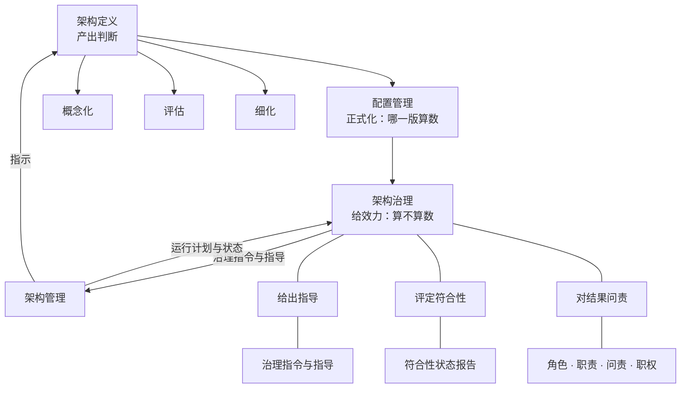

# 第16章 架构治理：立规矩，对结果问责

## 16.1 引言

第15章把判断定成了受控的东西：哪一版是定下来的那一份，答得出来了。可定下来之后还有一问没答——那一份，谁有权改？改它要经过谁、按什么程序？答不上来，基线就只是一份没人签字的文件。本章讲的是那一层：**架构治理**。

### 16.1.1 误解现场

恒信合同审批平台上线八个月，架构基线冻结在去年冬天。这天下午，业务方把一张变更单送到项目组桌上：历史对账记录的查询年限，从两年放到五年。

小事吗？满海（产品）觉得是小事。他在系统里点过，那条查询本来就摆在那儿，把年限改大就行。开发那边也说，改一个配置项，两天的事。

小白（设计）不同意。上个月徐漾拿着九查表一项项问过他，其中一项就是"历史记录归谁管"。他在自己那两栏里抄过一句：数据归属唯一——这条是架构定下的，不是设计能自己改的。他说："这得看架构怎么办。"

万辉（架构）把架构描述翻出来。那一版是去年冬天评审通过、签过字、冻结起来的。改了这条，那一版就不再是那一版了——下游按它做的设计、按它写的测试记录，都得跟着动。他说了一句："我先看看。"

满海等了三天，没等到回话。他跑去问项目经理："这事到底谁说了算？"项目经理说："架构那边的意见。"满海再问："架构那个人是谁？"——没有人答得上来。

这不是谁在推诿。真要往下问，问的是三件事：

- 谁有权改这一版架构——是万辉吗？他手里有**架构描述**，可他不是管审批的那个人。
- 按什么程序改——找谁评估、找谁点头、改完通知谁？组里没有这条规矩。
- 改了之后算不算数——开发照着改了，测试按新的测了，可要是有人问"你们凭什么这么改"，谁拿得出依据？

最后一件最要紧，也最容易被跳过。把一条判断算清楚（这条改动的代价、影响、方案，都能算）和让这条判断算数，是两件事；后者不归算的人管。

### 16.1.2 本章要回答什么

前面十五章里，这个问题被推到过四次，每次都说"后面再讲"。

第11章讲架构定义的过程，写到收尾那一环时留下一句：那位有**职权**者是谁、按什么程序点头，是组织职能的事，归第16章。

第12章讲架构决策，提到恒信那道"六问写不全的不进评审"的关——写不清的进不来。可这道关本身，有没有人能撤？那一句也推给了本章。第13章讲架构描述，说到"决策权属方"那一格，明写那是"治理落下名字的地方"。第15章把判断定成基线，交出来的最后一句话是：接下来谁有权批、他凭什么说了算，是下一章的事——架构治理给的不是判断，是效力。

四处都指向同一个位置。本章要回答的就是它：

你算出来的那些判断，谁给它效力、谁能改它、按什么程序改。

### 16.1.3 本章的骨架

答这一问，先要看清一个位置关系：架构治理不是架构做完之后的第三步。

按 42020:2019 的说法，各架构过程可以并发执行；治理指令与管理指令流向管理，运行计划与状态又流回治理。它是与**架构定义**并着走的那一层——在架构定义的一头一尾朝里伸手（起手为治理做准备，收尾为治理提供支持），同时管着一件架构自己管不了的事：谁能改架构本身。

看清位置之后，本章分三块走：

- 它站哪儿（16.2）——治理是哪种事：它和"管理"差在哪儿，和"架构定义"是什么关系，这个词又是怎么定下来的；
- 它为什么非有不可（16.3）——它保的是"架构还符不符合目的"；这件事一天都不停，所以它是持续的动作，不是一个审批环节；
- 架构判断怎么才算数（16.4）——效力从哪儿来、批完之后谁按着做、符合不符合谁来评、谁能改架构本身。

三块都指向同一句话：治理不替你算，它只决定你算出来的算不算数。

---

## 16.2 治理、管理、架构定义各站哪儿

> 块导读：三块里的第一块，先把位置站对。治理既是组织里那套制度系统，也是那套系统一直在做的动作；它和一个天天被混用的词——"管理"——差在哪儿；它和架构定义又是什么关系；最后，这个词是怎么落到今天这个意思上的。

### 16.2.1 治理：一套制度，一个动作

"治理"在中文里是个老词，到了工程语境里却常被当成新词。它在本书里要担两件事，而这两件事长在同一个词上。

第一件，是一套制度系统。 42020:2019 附录 G.1（资料性）给的说法是：架构治理是在组织范围内对架构进行管理和控制所依循的规程与取向（*the practice and orientation by which architectures are managed and controlled at an organization-wide level*）。

> **先说两个词**："正本"指库内那份标准原文；本库没有原文、只能靠二手转述的，一律标"库外·不可核"。

下面这五样，是本书对"制度系统"的归拢（正本附录 G.1 的定义句只说它是什么，它自己列的是 a)~d) 四条要求）。

五样各有出处。**机构与程序**，是组织结构（§6.4.1 d)、e)）加上治理论坛与程序（i)、k)）。后四样，是正本 §6.5 列出的工作产品：架构治理计划（architecture governance plan）、架构治理指令与指导（architecture governance directives and guidance）、架构治理符合性状态报告（architecture governance compliance status report）、架构集合目标（architecture collection objectives）。

一处名字要说清：§6.4.1 f) 里那条动作叫"建立指导原则、策略与指令"，而 §6.5 给它的产物名是"架构治理指令与指导"——一个说动作、一个说产物，指的是同一件事的两头。

这一套是看得见、查得着的东西：谁在治、拿什么治、治出了什么。它答的是"组织里的治理长什么样"。

这五样各管什么，值得逐一看一眼。

机构与程序是骨架：谁在治（治理机构里坐着谁）、按什么程序治（一条变更从提出到裁决走哪几步）。正本把这一件说得很直——要建立角色、职责、问责、职权和组织结构（§6.4.1 d)、e)）；程序与治理论坛另有落点（i)、k)）。

治理计划是这份骨架一次性的产物：治理工作要覆盖哪些架构、需要什么资源、什么时候收口（内容是 §6.4.1 l) 的 1)~7)；m) 只规定要有这份计划）。它使治理这件事本身也被规划、被检查。

治理指令与指导是治理往外递的东西：指导原则、策略与指令（§6.4.1 f)）。它是下游唯一能拿到手的"规矩"——没有它，治理只存在于会议里。

符合性状态报告把"有没有照办"变成一份可看的记录：哪些指令被执行了、哪些没有、为什么没有（评定在 §6.4.5，未实施原因在 §6.4.6 b)，报告本身是 §6.5 的工作产品）。它使符合性从一个态度变成一个状态。

架构集合目标是治理盯着的那把尺：这一批架构要达成什么、达成到什么水平（§6.4.3）。

五样合起来，才是"制度系统"这个词的实体。只说"我们建了治理机制"，五样里缺一样，这套系统就有一处是空的。

第二件，是一个动作。同一份正本的第 6 章讲的是过程，而过程的日常是一个一个动作：准备并规划、监视、评定和控制、确立架构集合目标、作出治理决策、监视并评定符合性、评审指令与指导的实施。它答的是"这一刻谁拍板、谁裁例外、谁去看有没有照办"。

两件事不是两个概念，是一个词的两面，而且有先后：先有反复地做那个动作，才沉淀出那套制度。正因为一次一次地"作出治理决策"，才留下治理计划与指令；正因为一遍一遍地"评定符合性"，才有符合性状态报告这一份东西。名词义是动词义的沉淀——这一句，是本章后面所有内容的地基。

一处词形上的提醒：英文里有三个词长得像、意思不同，本书一律分开译。

`governing principles` 译管控原则——它是架构的内容之一，归第11章；`governance` 译治理——就是本章这两义；`governs` 译管控——第13章讲视角管视图用的就是它，一个架构视角管控一个或多个架构视图。

还要补两槽：`guiding principles` 按正本译文是指导原则（治理发出去的那一组，§6.4.1 f)），`governing directives` 是管控指令（因架构变更而需要修订的那一组，§6.4.2 b)·c)）。

"管控"这一个词用了两处：作定语时对应 `governing`（管控原则、管控指令——说的是"这套东西是管事的"），作谓语时对应 `governs`（视角管控视图——说的是"谁管谁"）。两者同源、位置不同。几个词读成一个，本章后面会全部跟着歪。

### 16.2.2 治理平时做哪几件事

正本 §6.4 把治理展开成一组活动（准备并规划／监视、评定和控制／确立架构集合目标／作出架构决策／监视并评定符合性／评审指令与指导的实施）。它们平列着摆，读者不容易记住；本章按它自己的落点归成三组——给出指导、评定符合性、对结果问责。

这三组是本书的归拢，正本给的是六项平列，这句话先放在前面。同一套东西，本章统称"三抓手"（后面各节同此名）。

给出指导

- 准备并规划架构治理工作（§6.4.1）：识别应纳入治理的架构集合，建立角色、职责、问责、职权与组织结构，建立指导原则与策略，产出治理计划。
- 确立架构集合目标（§6.4.3）：审查当前与未来的业务需要和任务需要，确立架构战略与架构集合目标。

评定符合性

- 监视、评定和控制架构治理活动（§6.4.2）：盯业内与法规的变化，盯治理工作本身的度量与风险；建立**配置控制管理机制**以管控架构集合中的变更，就在这里（§6.4.2 k)）。
- 监视并评定对治理指令与指导的符合性（§6.4.5）：看架构有没有照着指令与指导走，并让有职权者能直接查证。

对结果问责

- 作出架构治理决策（§6.4.4）：发布治理指令、指派责任、把不属于治理决策的其他决策上报至适当的**企业决策论坛**（治理自认有权限边界，是本书的读法），并复核与传达决定。
- 评审治理指令与指导的实施（§6.4.6）：一轮收尾时评"做了什么、没做什么、为什么没做"，收集教训，并据此修订指令本身——指令自己也会变。

一项区别要先说清：这六项里，活动是"应"（shall）级，任务才是"宜"（should）级，而且活动可以按任何适当的顺序执行（§6.3）。所以治理不是一条流水线，是一组随时可以起用的动作。

这三组在项目里长什么样。恒信那年买回"数据治理平台"，是想解决数据不干净——那是替管理做事。可同一批人从来没做过"给出指导"这一组：没有谁把"数据归属唯一"写成一条指令发下去。到了出事那天，第二组也没人干——工单对不上，没人去评"到底按哪一条才算符合"。第三组更空：登记表上"决策权属方"那一栏，一直写着是空的。三组都缺，治理就只剩一个名字。

冰链那边相反，缺的是第一组的落款。水忠把接口的老规矩一笔一笔写下来，又要求"除我之外还有谁按同一套办法查得出来"。这就是"给出指导"。李旭在测试记录里补上"对哪一版测的、那一版谁批的"，使"评定符合性"第一次有了可看的依据。可那套规格本身，谁改、按什么程序改，一直没人说得清——第一组的最后一步始终没落地。

它们之下另有共 49 条任务（本库回正本逐条核：15／11／5／6／5／7）。这一串数字不必记，要记的是这个：这几项活动里，有三项的名字是"监视……""监视……""评审……"，而"作出决策"只占一项；它名下 6 条任务里，没有一条叫"审批"。把治理等同于开会拍板，是对这份正本最大的误读。

这张表把三层串起来——左边是本书归拢的三抓手，中间是正本展开的那几项活动，右边是它在项目上长什么样。

| 三抓手 | 正本展开的活动 | 在项目上长什么样 |
|---|---|---|
| 给出指导 | §6.4.1 准备并规划架构治理工作 | 把"数据归属唯一"这类架构红线写成指令发下去；把谁有职权、按什么程序定下来 |
| | §6.4.3 确立架构集合目标 | 说清这一批架构要达成什么（"月底账目对得上"），以及达成到什么水平 |
| 评定符合性 | §6.4.2 监视、评定和控制架构治理活动 | 盯业内与法规的变化、盯治理工作本身的风险；把配置控制管理机制建起来 |
| | §6.4.5 监视并评定对治理指令与指导的符合性 | 看合同系统与财务系统到底按哪一条办；让有职权者能直接查证 |
| 对结果问责 | §6.4.4 作出架构治理决策 | 发布指令、指派责任、把够不着的决定往上送，并复核与传达 |
| | §6.4.6 评审治理指令与指导的实施 | 一轮收尾时问"哪条没照办、为什么没照办"；把教训并回指令 |

同一项活动可以同时服务两个抓手。 §6.4.6 既评实施（对结果问责），又据此修订指令（给出指导）。§6.4.1 里既有"建立指导原则、策略与指令"（给出指导），也有"建立角色、职责、问责、职权"（对结果问责）。分组看的是主要落点，不是排他归属。

本书看下来，这几项活动里最容易被跳过的是"确立架构集合目标"（这是本书在两案上的观察，不是正本的判断）。它不产出一条可执行的指令，产物是目标本身——在一个只关心进度的组里，它常常被当成务虚。可没有它，"符合"就没有可比的对象：目标不写下来，评的时候只能凭印象。

同样容易被跳过的还有"评审治理指令与指导的实施"（这也是本书的观察）。一轮做完了，人散会了，谁也不回头问"哪条没照办、为什么没照办"。可治理的指令要能活下去，靠的正是这一问——它是让规矩自己会变的那个动作。

这几项活动里，有几处值得再往里看一层。

§6.4.1 那 15 条任务，开头两条就把范围定死了：识别应纳入某一需要治理监督的架构集合的那些架构，以及识别可能直接适用的现有架构或参考架构。也就是说，治理的第一步不是定规矩，是划范围——哪些架构归它管。范围没划清，"这条要不要上治理"就永远吵不完。

§6.4.4 里有一条不显眼但很要紧：把超出治理权限的决定升级到企业决策论坛。它承认了一件事：治理不是最高层，它自己也有权限边界；够不着的事要往上送，而不是硬扛。

§6.4.1 里的 g)、h) 两条也值得记：识别可复用元素、识别知识资产。这两条把治理从"管住"往"攒下"推了一步——治理的过程本身在给组织积累东西。

§6.4.6 的收尾是整份正本里最反直觉的一条：一轮治理结束时要收集教训、识别并选择要改的地方、把改动并入指令与指导。指令本身是可以被改的，而且改动要有出处。规矩一旦定了就再也不动，那不叫治理，那只是把规矩挂在了墙上，再没人去碰它。

力度分层再说一遍：活动是"应"，任务是"宜"，活动可任意顺序。所以上面这些，不是必须全做完才算治理，而是一组随时可以起用的动作——用到哪几项，取决于你手上这件事动到了什么。

### 16.2.3 治理和管理差在哪儿

这两个词天天连着说，说的却常常是同一件事：开会、审批、协调。要把它们分开，最省事的办法是把正本里那两句目的句并排读。

- 架构治理（42020 §6）：建立并保持架构集合中的架构与企业目标、策略和战略以及与相关架构的一致性。
- 架构管理（42020 §7）：实施架构治理指令，以及时、高效和有效的方式达成架构集合的目标。

前一句动的是"对不对得上"，后一句动的是"做没做到"。再往下推一层，两边的分量落在不同的东西上。

治理守的是不变量：企业的目标、策略、战略，架构的原则与红线。这些东西一动，下游全部要重来，所以不轻易动；治理的活，就是看着它们别被悄悄改掉。

管理调的是框架内的变量（"**守不变量**、调变量"是本书对这两句目的句的读法）：资源怎么排、进度怎么走、哪一版先做、谁先上。这些可以在既定框架里来回调，调错了再调回来就是。

在组织里也查得到——这一条比画面更结实。同一套机制上，两者各占一端。

- 给出与实施：治理建立指导原则、策略与指令（§6.4.1 f)），管理实施它（§7.1 目的句）。
- 评定分两级：治理评的是对治理指令与指导的符合性（§6.4.5），管理在架构集合之内评。
- 问责的设立与承担：治理建立角色、职责、问责、职权（§6.4.1 d)），并让有适当职权者作出决策（§6.2 c) **预期结果**）；管理在架构集合内承担并执行。

一句话：区别在范围与权限，关系是同一条流的两端。

这三条对应还解释了一个常见现象：很多组织的"治理"其实是管理。因为第一端就是断的——指令不是治理发的，是某次管理会议上顺口定的；符合性不是治理评的，是项目经理自己看的；问责没有设立过，出了事只能追到做事的人。端与端之间的分工一旦错位，治理就退化成管理流程上的一个审批格。

恒信那一幕正好是反例。五百万买回来的"数据治理平台"，是拿来做数据清洗的——那是做事；他们缺的是"谁定规矩、谁担责"——那是掌舵。买回来的是一把桨，缺的是舵。

### 16.2.4 治理与架构定义并行

最容易走错的一步，是把治理排在架构之后：先做架构，做完交上去审。

正本把这条堵死了。42020 §5 里有一句逐字的：

> 各架构过程可并发执行，其间存在交互并随时间迭代。同时，治理指令与管理指令从架构治理过程流向架构管理过程，运行计划和状态则从架构管理过程流向架构治理过程。

注意那个流向。不是"架构做完了交给治理"，而是治理发指令给管理、管理把运行计划与状态回流给治理：两条线并着走，还来回走。

在架构定义那一侧，正本还留了两处落点。15288:2023 §6.4.4.3 讲系统架构定义过程。它起手 a) 3) 要求"为支持组织的架构治理与架构管理工作做好准备并作出规划"，收尾 e) 3) 要求"为组织的架构治理与架构管理工作提供支持"。**架构定义一头一尾都朝着治理与管理伸手**，中间那段才由它自己走。

可见两者不是上下两道工序，是并行的两条线。

还有一层位置关系值得记一笔——注意这里的"六"是六个过程，不是 `16.2.2` 列的那几项治理活动，两者不是一回事。42020 把六个架构过程分了组：架构治理与架构管理同在一组，架构概念化、评估、细化是三个核心过程，另有**架构使能过程**。

也就是说，治理不是架在核心过程之上的第四层，而是与核心过程并列的那一组（后半句是本书的读法，正本只给了分组）。本章后面讲"批完之后谁按着做"（16.4.2），靠的就是这一层位置。

### 16.2.5 治理这个词，从哪儿来

先说英文。`governance` 从 `govern` 来，而 `govern` 的老家是拉丁语 `gubernare`，再往上是希腊语 `kybernan`——本义是掌舵。后来它一路扩张：掌船、掌城邦、掌公司，凡是"定方向、划边界、担最终责任"的活都归了它。

中文的"治理"走的是另一条路。它原本就是治国理政的常用词："治"从水，是疏导；"理"从玉，是顺着纹理剖开。两样都指向同一个动作——不是硬掰，是按它的纹理把它导到该去的地方。

这个词在现代中国的政策语境里被重新起用过一次，而且是一次有意的定译。1990 年代，西方发展研究里的 *governance* 进来时译法五花八门；到 2013 年"国家治理体系和治理能力现代化"写进决定，"治理"这个译名就固定下来了。它要跟"管理"拉开距离：管理是执行，治理是定方向、立规矩、担责任。本书用"治理"，用的是这一层。

它在标准里的户口。正本里 `architecture governance` 的定义在 42020:2019 附录 G.1——注意它是资料性的（informative），规范主干是第 6 章那个过程。三件事要说清。

- 架构治理的定义权就在这两处，不在行业框架那儿；TOGAF 只作行业参考（本书早期稿件把定义权挂错过，已改）。
- 讲组织治理的 ISO 37000:2021 与讲 IT 治理的 ISO 38500:2024，本库没有正本；凡引其条款号，一律标"库外·不可核"，只作旁证。
- 正本 §3 是术语条，里面没有 `architecture governance` 这个词条——它的定义在资料性的附录 G.1里。这也是本章要专门把它说清的原因。

## 16.3 治理为什么非有不可

> 块导读：上一块把位置站对了；这一块答的是"它凭什么一直要做"。它保的是架构还符不符合目的——而目的会变、架构会偏，所以它不是一个审批环节，是一个持续的动作；这个动作靠三样东西转起来，转起来之后，它对一个组织的意义也就落到了实处。

### 16.3.1 架构得一直符合目的

正本里第一个该留意的字眼，落在"保持"上。42020 §6.1 给架构治理的目的句是：

> 建立并保持架构集合中的架构与企业目标、策略和战略以及与相关架构的一致性。

"建立"是一次，"保持"是一直。为什么必须"保持"？因为两边都在动。

目的会变。 42030:2019 讲实施架构评估的原因，第一条就是它：

> 确定所关注实体是否已经或正在以使其实现预期目的的方式被架构（或能按适合新目的的方式予以改变）。

这句正本的译文有点绕，意思其实直白：看这个实体是不是照着"它该达成的目的"架构出来的，或者它有没有可能被改造成适合一个新目的的样子。括号里那半句，就是"目的会变"——今天符合目的的架构，明天可能因为业务改了方向而不符合。

架构也会偏。 42020 §10.2 的注（排在 h) 后）把这一层说得更清楚：

> 一致性是架构治理与管理之间、以及概念化与细化之间的共同责任。随着架构视图和模型在细化期间得到精化，这些其他过程早先建立的一致性有可能被削弱。当在细化期间发现不一致时，重要的是将其告知这些其他过程，以确保在可能且适宜时能够采取适当的缓解措施。

注意那句共同责任：一致性不是哪一方单独维持得住的。细化一深、元素一多，早先对齐过的东西就会一点点磨掉——不是有人违规，是没有人看着。

正本把"治理做成了会看到什么"写成了六条预期结果（§6.2）：

- 目标与需要：架构集合目标在满足企业及其客户、供应商当前与预期的业务需求（a)）；关于架构集合的目的、目标与具体目标，关键利益相关方之间保持共识（f)）。
- 决策与职权：架构工作活动与架构决策同企业关注点及语境关注点保持一致（b)）；有理由支撑的架构决策，由具有适当职权者作出并传达给利益相关方（c)）。
- 架构之间：架构集合中的各个架构与组织的目标、具体目标、战略与愿景保持一致（d)）；各架构之间在必要时彼此对齐（e)）。

（六条是正本的平列；本章按"目标与需要／决策与职权／架构之间"归成三条线，这三条线是本书的归拢。）

六条分开看抽象，配上一处现场就清楚了。

- a) 目标与需要——架构集合目标在满足企业及其客户、供应商当前与预期的业务需求：恒信买平台是为了"数据干净"，可它没回答"月底账目对得上"这条业务需要落在架构的哪一条上。
- b) 与关注点一致——架构工作与决策同企业关注点及语境关注点保持一致：冰链断链之后处置那批货，谁也没去对监管那条留档要求。
- c) 决策与职权——有理由支撑的架构决策由具有适当职权者作出并传达：恒信那张纪要写着"会议决定"，没有名字、没有理由、没有传达对象。
- d) 与组织目标战略一致——架构集合中的架构与组织的目标、具体目标、战略与愿景保持一致：合同平台那条编号规则，和"账目对得上"是什么关系，没人说得清。
- e) 架构之间彼此对齐——各架构之间在必要时彼此对齐：合同系统与财务系统的编号规则，正是"该对齐而没对齐"的那一处。
- f) 共识保持——关于架构集合的目的、目标与具体目标，关键利益相关方之间保持共识：满海以为改个年限是小事，小白知道动的是"归属唯一"——两个人对同一件事的认识，从一开始就不在一个层面上。

一处用词：本书早期稿件里说"目的漂移""架构偏移"。

这六条为什么放在一起看。单看每一条都平；六条排在一处，治理的位置就出来了。a) 与 f) 管的是**目标**：上面那条线要一直通着。b) 与 c) 管的是**决策**：谁作出、有没有理由、传达给谁。d) 与 e) 管的是架构之间：对外与组织的目标对齐，对内彼此对齐。（这三条线是本书的归拢，正本给的是六条平列。）

它与前一块的"三抓手"不是一回事：三抓手说的是治理的动作（给出指导／评定符合性／对结果问责），三条线说的是预期结果的三个面（目标／决策／架构之间）。

三条线里，a) 与 f)、d) 与 e) 说的是状态——目标通不通着、架构之间齐不齐；b) 与 c) 说的是动作——决策怎么作出、怎么传达。本章讲的正是第二组（这一层区分是本书的读法；正本把这六条一律写作"预期结果"）。

正本把"决策由具有适当职权者作出并传达"写成预期结果，等于承认：判断要算数，不是判断本身的性质，是有人作出并传达的结果。`drift` 与 `erosion` 在 42020 里一次都没出现；正本说的是"一致性被削弱""不一致（misalignment）"。本章照正本说。

### 16.3.2 给出指导，评定，问责

治理把"保持"这件事做出来，靠的是三样动作——给出指导、评定符合性、对结果问责（合称三抓手；与 `16.2.2` 归的那三组是同一套东西）。三样都能在正本里找到落点。

给出指导。治理先得把规矩递出去：建立指导原则、策略与指令（§6.4.1 f)），由具有适当职权者作出、并传达给利益相关方（§6.2 c)），并落到一份看得见的工作产品上——架构治理指令与指导（§6.5）。递出去之后还不能不管：指令自身也要被评审（§6.4.6），因为它也会过时。

评定符合性。有了规矩，就得看有没有照办。§6.4.5 要求监视并评定对治理指令与指导的符合性，并把结果落到符合性状态报告上（§6.5）。§6.4.2 还要盯治理工作自身：它的度量、它的风险，以及配置控制管理机制有没有建起来。

对结果问责。评出结果之后，得有人担：治理建立角色、职责、问责与职权（§6.4.1 d)），作出架构治理决策（§6.4.4），并由具有适当职权者作出并传达（§6.2 c)）。

这三样凭什么转得起来？ 因为"符合不符合"这件事是可判定的。30 号研究报告把 governs（视角—视图）的实质说成一句话：可判定的符合性；36 号又往前推了一步——可判定的前提是同解：读同一条规则的人，得能读出同一个意思。把这两句从"视角与视图"移到"治理指令与符合性"上来用，是**本书的移用**（30 号自己就提醒过：那个用法与架构治理不是同一回事）。

移过来之后补一句：同解的前提，是被定义的语言。

这一条听着抽象，落到实处就是本章前半块做的事——把"治理""管理""指令""符合性"这些词各自钉住。词不钉住，评出来的"符合"就是各说各话。

### 16.3.3 治理对组织意味着什么

到这儿，治理对架构判断的意义已经说清了：它让判断算数。但它对一个组织的意义还要单说——这一层常被漏掉，漏掉之后，治理就显得像一道多余的手续。

它是一条通路。企业的目标、策略与战略，靠什么落到架构集合上？不是靠号召，是靠指令与指导（§6.4.1 f)）。治理把上面那一层话翻译成架构这一层能执行的规矩，再靠管理去实施。没有这条通路，战略与架构之间是断的。

它让问责有落点。 §6.4.1 d) 要求建立角色、职责、问责、职权与组织结构——这件事的组织含义是："谁点头、谁担责"必须写在纸上有名字。技术权威位不等于治理位：一个人可以是这个领域里最懂的人，但点头的权力不在懂不懂上。正本把这一条写进了预期结果（§6.2 c)），说明它不是本书的发挥。

它让符合性可被评定，因而可审计。一份符合性状态报告（§6.5）使"有没有照办"变成可以查的状态，而不是一个态度。组织的审计、复盘与追责，都要拿这份东西当依据。

它还是组织资产的沉淀处。治理过程中长出来的东西——原则、指令，以及被识别出来可复用的元素（§6.4.1 g)），还有知识资产（§6.4.1 h)）——不会随项目和人员散掉。架构会换、人会走，这一层留下的是组织自己的东西。

一句现场。本仓库自己也有一份这样的东西——`90-治理登记/01-例外与治理机构登记`（登记表 01）。它的抬头就写着：本目录内没有具备否决权的治理机构，所以本表只做"登记、度量、留痕"，一切放行须由本项目治理角色作出。这正是"治理对组织意味着什么"在最小尺度上的样子：它不一定是一个委员会，它可以只是一处把名字、理由和状态写下来的地方。

还有一层要向回接。第5章说过，目的的所有权在业务方（§5.4.2）。治理这条通路的起点正是那条所有权——治理不生产目的，它把已经确立的目的落到架构集合上，并看着它一直被符合。

前三条各配一处现场，就落地了。

通路那一处：恒信那条真正的业务目标是"月底账目对得上"。它要落到架构上，得经过两次翻译——一次是把它写成架构目标（"数据归属唯一""语义唯一"），一次是把架构目标写成设计约束。第一跳归需求，第二跳归架构；而这条通路要有人守，守的人就是治理：它保证每一次翻译之后，上头那句和底下那条还对得上。

问责那一处：满海在选型会上签了"同意"，那是好意——"数据干净了，合同系统用起来才省心"。可这句话落在管理那一边（买什么、什么时候买），不落在治理那一边（谁来定规矩、谁担后果）。好意不能顶替担责；真正的问责栏，那一年一直空着。

可审计那一处：冰链的李旭在测试记录里补了"基线"那一栏——对哪一版测的、那一版谁批的、测时处于什么状态。补完之后，疾控那边再问"你们这版凭什么是这一版"，答得出来了。这就是"可被评定、因而可审计"的样子：不是多写一栏字，是让一个问题第一次有了答案。

## 16.4 架构判断怎么才算数

> 块导读：前面两块把位置站对、把理由说清；这一块落到最实处——你算出来的判断，凭什么算数。效力从哪儿来、批完之后谁按着做、符合不符合谁来评、谁能改架构本身，最后把"假治理"认出来。

### 16.4.1 架构判断的效力：谁来给

先把这个词说准。架构判断的效力（本书读法；正本里没有这个词，它讲"有效性"用的是 effectiveness。下称"效力"），指的是你算出来的那些判断，算不算数。它是两句话：别人必须依据它；谁也不能单方面改它。

为什么"算不算数"要单说？因为把一条判断算清楚，和让这条判断算数，是两件事。前者靠本事：这条改动影响多大、有几个方案、哪个更划算，都算得出来。后者不靠本事——它靠治理那一侧作出。一个组里，最会算的那个人，往往不是说了算的那个人。

把它放进整条链上看，是三段。

1. 判断：架构定义产出判断——这条约束立不立、这个接口定不定、这个取舍选哪个（第11、12章）；
2. 正式化：配置管理把判断定成"哪一版是算数的那一份"（第15章）；
3. 效力：治理给这一份效力——它算不算数、谁能改它（本章）。

前两段做完、第三段没做，会是什么样？第15章已经交过一句话："谁有权批这一版"不归**配置管理**答。那一份被冻结的架构描述，写着日期、写着版本、写着谁解的冻——可没有一处写着"谁有权动它"。

正本在架构定义那一侧还留着一处口子，说明这一步非有不可。15288:2023 §6.4.4.3 讲系统架构定义过程的收尾，e) 2) 那一条英文只有六个词——就架构定义取得一致意见（*Obtain agreement on the architecture definition*）。这个动作的位置值得琢磨：它是架构定义过程自己的一步，可"一致"要跟谁取得，过程里没有说。那正是治理那一侧要接的地方。（16.2.4 引过同一个过程的起手与收尾两句，那里讲的是并行；这里讲的是效力。）

所以本章要答的那一问，答案就落在这一段：**判断算不算数**，不由算的人定，得由治理那一侧作出。

### 16.4.2 架构管理管什么

治理给了效力，往下怎么走？中间还有一层，前面各章都没给它户口：架构管理。

42020 §7.1 给它一句目的：

> 实施架构治理指令，以及时、高效和有效的方式达成架构集合的目标。

一句话里三处值得拆开看：实施治理指令（它是治理的执行端）；达成架构集合的目标（它盯的是一批架构，不是一个项目）；及时、高效和有效（它管的是节奏与代价）。

它的活动有六项（§7.4）：准备并规划架构管理工作、监视、评定并控制架构管理活动、制定架构管理途径、执行架构集合的管理、监视架构工作的有效性、为完成架构管理计划做好准备。名字读起来平，位置却很关键——它站在治理与核心过程之间：

- 往上，它接治理的指令与指导；
- 往下，它给架构概念化、评估、细化这三个核心过程下指示；
- 再往回流：运行计划与状态回到治理那一侧（§5 那句"运行计划和状态则从架构管理过程流向架构治理过程"）。

正本的附录 G.2 把它的活说得更实：架构管理**建立、维护并使用一套连贯的指南、原则和管理制度**，为架构的设计与开发提供方向和指示。它还**识别潜在风险，并按照治理指令去缓解**。

于是链子清楚了：治理定规矩、给效力 → 管理把规矩变成对核心过程的指示 → 核心过程干活 → 计划与状态回流。

六项各做什么，逐一看：

- 准备并规划架构管理工作（§7.4.1）：按相关性、各自的目的与范围、时效、彼此是否一致，把架构归类成一个架构集合。
- 监视、评定并控制架构管理活动（§7.4.2）：看管理活动有没有跑偏，必要时纠正。
- 制定架构管理途径（§7.4.3）：依架构治理方针、指令与指南（正本中译此处作"指南"，与前文的"指导"同是 guidance；**本书统一写"指导"**），识别管理途径、约束、方法、工具与技术，并据此制定适用于架构集合的架构管理计划。
- 执行架构集合的管理（§7.4.4）：最实的一项——架构的变更在这里被管，而以 15288 的配置管理过程为指南（m)）。
- 监视架构工作的有效性（§7.4.5）：看架构工作本身有没有效。
- 为完成架构管理计划做好准备（§7.4.6）：收口。

读这六项，要与治理那六项对着看——有两对活动同名，对象不同（这组对读是本书的读法，正本给的是两项活动名）。

治理的"准备并规划"（§6.4.1）与管理的"准备并规划"（§7.4.1）同名，可一个规划的是治理工作，一个规划的是管理工作；"监视、评定和控制"也同名（§6.4.2 与 §7.4.2），可一个管的是治理活动本身，一个管的是管理活动。

另有两处名字不像、却常被混起来：治理的"监视并评定对治理指令与指导的符合性"（§6.4.5）对的是整个组织，管理的"监视架构工作的有效性"（§7.4.5）对的是架构工作本身。

但别把这条对照读成"管理不评符合性"。管理自己就有一条：§7.4.2 b) 要求"监视并评定架构治理指令与指南是否得到遵循"；§7.2 a) 也把"与治理指令和指导保持一致"列为管理的预期结果。

所以两者的差别不在评不评符合性，而在评的对象与层级：治理评整个组织对指令与指导的符合性（§6.4.5），管理在架构集合之内评（§7.4.2 b)）；此外，§7.4.5 还评架构工作本身有没有效。

名字像，对象不同，这正是 `16.2.3` 那三条对应在条文上的样子。

这一层为什么非有不可？因为治理说的话是给组织的，不是给某个项目的。一条"配置控制管理机制要建起来"，落到合同平台这个项目上，是哪个环节建、什么时候建、谁来建——这是管理的活。没有这一层，治理的指令就停在半空；反过来，只讲管理不讲治理，规矩就没人定。

### 16.4.3 指令发下去，谁看有没有照办

这件事正本叫"监视并评定对治理指令与指导的符合性"（§6.4.5），它有五条任务（a)~e)，可归成三件：

- 监视：用适当的办法盯架构集合的治理状况（a)）；
- 评定：看架构有没有符合外部义务与内部工作惯例（b)），看管理计划与状态有没有符合治理指令与指导（c)），另外按 e) 再看两样：**将来会用到的外部义务**，以及**会影响架构治理的标准**，架构符不符合它们；
- 让人直接查：允许有适当职权者直接访问**按设计构建、而该设计基于架构描述**的实体，核对它符不符合治理指令所确立的义务（d)）。

d) 后面挂着的一个注，是这一节最该记住的一句：

> 仅检查架构的符合性可能不够充分，因为架构特征可能未能恰当转化为该实体的设计或运行。（§6.4.5 注 4）

架构写对了，东西不一定做对。所以符合性要一路查到实物上去。

这里有一个最容易混的地方：不是所有"评"都是同一个评。本章管的是其中一个，另外两个各归各章。

| 评的是什么 | 谁在评 | 出处 |
|---|---|---|
| 符合性——有没有照治理指令与指导办 | 架构治理 | 42020 §6.4.5 |
| 架构本身——这个架构好不好、达没达目的 | 架构评估过程 | 42020 §9 |
| 实物与记录——造出来的东西与记录对不对得上 | 配置审核 | 15288:2023 §6.3.5.2 e)："所需的配置审核得以完成" |

三样各评各的，一个都不能替另一个。把配置审核说成"治理的符合性评定"，或者反过来，都是把两把尺子当成了一把。三样都评过，才谈得上"这件事是受控的"。

三种评定各配一处现场，区别就明显了。

符合性评定：恒信那次工单对不上，谁也没有去评"按哪一条算符合"——因为没有指令可评。这是最典型的治理缺位：不是评错了，是根本没有可评的东西。

架构评估：冰链断链之后做的那件事，是评"这套架构还能不能达成目的"。它评的是架构本身，结论会进架构的下一次细化——这一步归 42020 §9 的架构评估过程（它与本章评的符合性、与配置审核之间的分野，第18章分开讲），不归本章。

配置审核：断链那天，现场那批货与记录对不对得上，是实物与记录的核对。它问的不是"架构对不对"，是"造出来的和记下来的，是不是一回事"。

三样合起来，才叫"这件事受控了"：有指令可评符合性、架构本身评过、实物与记录核过。少一样，说"受控"都是提前说的。

报告之外，还有一步。上面 d) 那条"让人直接查"，完整说法是：允许有适当职权者直接访问按设计构建的实体，而那个设计基于架构描述（§6.4.5 d)）。跟那份符合性状态报告（§6.5 明列为"应产生"的工作产品）比起来，这一步把符合性从"别人告诉我"补成"我自己看得到"；恒信那种"纪要写着会议决定、谁也查不了"的局面，缺的正是这一步。

### 16.4.4 谁能改架构自身

本章最硬的一处在这里。

正本里有两句话长得像，位置却分得很开；读混了，就会把治理读成"日常变更的审批岗"。

第一句在治理那一侧：§6.4.2 k) 要求"建立配置控制管理机制，以管控架构集合中的变更"。注意，它建的是机制——一套规矩：变更怎么识别、怎么评、谁有权定。

第二句在管理那一侧：§7.4.4 m) 要求"以 ISO/IEC/IEEE 15288 中的配置管理过程为指南，管理对架构的变更"。这里动的是过程——一件一件具体的变更，按配置管理那套办法走。

机制不等于过程（这组区别是本书的读法，正本给的是两条分置的任务）。治理建的是机制——这一类变更该由谁定、按什么程序定；执行过程的是管理——这一条变更具体怎么走流程。两句话一混，治理就变成替每一个变更签字——可正本里"作出治理决策"只是一项活动，"审批"这个词一次也没出现过。

那么什么必须由治理定？ **判据本身**。目的、架构原则、治理红线的变更，只能由治理裁决——判据不能自己裁自己。这一条在本书里落在"三层基线"上：

- 治理基线：目的、原则、红线这一层；
- 协议基线：跨团队、跨系统约好的那一层；
- 产品 CM 基线：某个产品上被正式化的那一份（第15章讲的）。

三层里，往上动一层，下面全要跟着动——所以越靠上越难动、越要治理。

三层基线各举一例，位置就清楚了。

- **治理基线**：冰链那条"连续性不得中断"，与第11章讲的管控原则、第12章讲的架构红线是同一层——动它，整套架构的取舍前提都变了。所以这一层的变更只能由治理裁。
- **协议基线**：合同平台与外部对账平台之间的接口约定，是两边团队约好的那一份。它不是哪一方单独说了算的——改它要两边同时动，所以这类变更需要治理出面撮合。
- 产品 CM 基线：那一份架构描述，连同跟着它一起冻结的凭据包——这是第15章讲的"被正式化的那一份"。它是三层里最靠下的，动它的门槛最低（走配置管理的流程），但动它的记录最全。

一句话记住三层的差别：越靠上，改它需要的权力越大；越靠下，改它需要的记录越细。这里必须写清一句："三层基线"是本书的复合词，不是 ISO 术语。正本的术语条只有单数的"基线"（15288:2023 §3.8）；而那一条，正本自注其来源是 IEEE Std 828-2012，属库外·不可核。"配置基线""产品基线"只在任务条文里零散出现，不成其为一套三分法的术语条。

另有一套"功能基线／分配基线／产品基线"，作为一套三分法其出处属库外·不可核，与三层基线是两条不同的轴，不能并着讲。

还有一处容易漏：治理指令自己也是受控的。指令会过时，要评审、要修订（§6.4.6）；修订前后是哪一版，它也进配置管理。规矩本身有版本，"按哪一版规矩办"才答得出来。

还有一处名字值得记住：够得着"改架构"的那些人，正本附录 G.1 给了它一个制度形态的名字——设计权威机构（Design Authority）。它划的是"谁有权按架构原则作判断"这一格；不够时就升级，附录 G.1 明写要有升级的途径。

最后点一句人事。
恒信那年最该建却没建的，正是这一条机制。他们的变更走的是"谁发现问题谁提、项目经理拍板"，没有"这一类变更该由谁定"的规矩——所以同一件事，改编号在开发那儿定，改字段在数据那儿定，两边的判据不一样。这就是缺 k) 的样子：不是没有变更流程，是变更没有权威。

第9章把工程师的能力列成六项，其中第 ④ 项是职业伦理。它讲的是"能力会放大你选择的规模，而方向由这一项定"；它的检查点问的是"压力面前，你会不会为进度悄悄牺牲可靠性"。那一项落到制度上，就是本章这一层：目的、原则、红线写在纸上，改它要走程序、要留名字。没有人看着的红线，等于没有红线。

### 16.4.5 什么样的治理是假的

真治理与假治理，有时候只差一个名字。

第一种假，是名字上的。一件事本来是管理——开会、排期、协调资源——被叫作"治理"；一处日常审批格被叫作"治理委员会"（现场常这么叫；本书统一称治理机构）。判断不难：看它有没有"给出指导"那一半。一个机构只在事后审、从不立规矩，它是过滤器，不是治理机构。

第二种假，是缺位。 41 号研究报告把缺位的三种样子并列在一起，正好当三面镜子：

- 缺配置管理：指令发了，可没有落款、没有版本、没有台账——公告没有牙；
- 缺治理：台账记得很全，条目一条不少，可没有一处写着谁裁的——记录成了档案；
- 缺架构定义：会开得很勤，可没有内容可管——治的是一个空集。

第三种假，是"越早越好"。治理不是把口子卡得越靠前越好。一条改动该不该进治理，看它动不动目的、原则、跨系统的约定；动不动就往上报，等于把治理的精力全耗在日常变更上。

一条能用的体检法。 40 号研究报告把治理那一堆条款压成五个问题，问一次变更就够：

1. 它进范围了吗——这条变更属于受治理的架构吗？
2. 谁有权定——这一栏写得上名字吗？
3. 依据是哪一条——目的、原则、强制项，还是"我熟"？
4. 谁该知道——要传达给谁、记在哪里？
5. 改这条要什么手续——和"改那个字段"是一样的手续吗？

恒信那次对五问的回答，是五个空。

### 16.4.6 认知反转

到这里，本章最反直觉的一句可以说了。

一个组里最会算的人，往往不是说了算的人。这话听着不舒服，但它是分工，不是不信任：算得清是你的本事，算不算数得由另一处作出——因为"算"这件事有个天然的缺口：算的人总偏向自己的结论。让另一处来点头，不是为了压住谁，是为了让那条结论对全组都成立。

所以治理不是多出来的一道手续。真正多出来的那道手续是：会开了、字签了、流程走了，可没人说得清这一版谁有权改。治理要做的恰恰相反——把"算不算数"这件事交回给人：有一个说得清名字的地方，决定这条判断算不算数，并且承担它。

这也是本章标题上那两个字的意思：效力不长在本事上，长在有人愿意担下来上。

判断与效力，从本章起分家。往后你再看到一份"已批准"的架构描述，会多问一句：谁批的？按什么程序？改它要走哪条路？依据是哪一条？

## 案例进展①｜恒信：买回来的是工具，不是规矩

那年恒信的数据出了事：月底对账，合同系统和财务系统对不上。查了三天，查出来的原因是两边的产品编号规则不一样。

满海的方案很直接：买一套数据治理平台。"数据干净了，合同系统用起来才省心。"选型会上他签了"同意"——五百万，配一个季度开一次的委员会。

平台上线半年，效果确实有，数据清洗得比人工干净。可到第二年，玉杰把运维台账拿了出来：负载不到三成。

"我们买的是一套清洗工具，"他说，"它每天在跑，跑的是我们给它的活。可'谁定规矩'这件事，没人接。"顿了一下，他补了一句：

> "桨还是那把桨。"

问题不在平台。这套系统能清洗数据，却答不了"数据归属唯一"由谁定、"编号规则"改了谁批、"两边对不上"按哪一条裁。徐漾在会上把这层点破了：

> "你们买的不是治理，是一把桨。治理要的是舵——谁定方向、谁担最终责任。这两样不在同一个地方买。"

第一种假，恒信有实物：季度开的那个机构，名字叫"数据治理委员会"，议程三条里两条是通报、一条是排期——没有一项是"立规矩"。它不产出指导原则、不产出指令、不产出符合性状态报告。按本章的说法，它是过滤器而不是治理机构：只在事后审，从不事前定。

第三种假，一个组里常见的样子是这样：凡改动都往上报，理由是"稳妥"。三个季度下来，治理会开了十几次，每次都过一堆日常调整——真正该它裁的那条（"归属唯一"要不要动）反而没人提，因为它淹没在琐事里。治理的精力是有限的；把日常变更送上去，等于把治理用废。

## 案例进展②｜冰链：断链不是技术问题

M3 冷链那次断链，第一反应是查技术：温度探头坏了吗？网关掉线了吗？时间戳是不是漂了？查了两周，技术上都对——探头合格、网关在跑、时间戳有校准记录。

报告初稿的结论是四个字：技术问题。

文正把稿子退回来了。他问的不是技术，是三个问题：

> "这次断链，谁知道？""知道之后，谁有权决定这批货怎么办？""这个决定，记在哪一版上？"

三个问题，一个都没有答案。水忠的接口老规矩里写着"连续性不得中断"，可那是给设备定的；断链之后谁拍板放行、谁签字担责，规矩里没有这一条。

于是结论改了：这不是技术问题，是框架级问题——该有人管的那一层，没有人在管。文正在报告末尾添了一句：

> "设备没坏。缺的是那条'谁定、谁裁、谁担'的线。"

水忠后来把这三问抄在自己那本老规矩的首页上。有人问他为什么抄这个，他说：

> "我这一辈子记的都是'怎么查得出来'。这三个问的是'谁说了算'——这两样不是一回事，可它们得在一处。"

那年冬天，冰链的接口视角规格多了一行，是文正加的："本规格的变更，由架构评审组裁定，须记录理由与影响范围。" 一行字，把断链那天缺的那条线补上了。

## 案例进展③｜恒信：会开了，谁定的没说

季度委员会照开。议程三条：数据质量问题通报、下季度清洗重点、遗留事项。

那一年恒信开了四次。到年底，玉杰翻会议纪要，翻出一个规律：每次都有决定，每次都没落款。

比如第三次会议定了一条：合同系统的产品编号以财务系统为准。纪要上写着"会议决定"。可这条决定是谁提的、谁反对过、依据是哪一条、从哪天起生效——都没有写。两个月后两边又对不上：开发按纪要改了，财务说不知道有这回事。

满海去问项目经理："这条到底定了没有？"项目经理翻出纪要，指着"会议决定"四个字说："定了啊。"

"定了"和"算数"，在这里第一次显出区别。会开了、话说了、纪要写了——可没有人有权说"这条从现在起算数"，也就没有人担这条决定的后果。

这件事后来成了 40 号研究报告里五个问题的原型：它进范围了吗、谁有权定、依据是哪一条、谁该知道、改这条要什么手续。恒信那一次，五个空。

第二年开春，恒信把委员会改了。议程从三条改成两条：一是审定架构原则与红线的变更，二是评审符合性状态报告。通报和排期挪出了会议室，回到周会上。

玉杰在改造后的第一次会上说了一句：

> "以前我们开的是进度会，现在开的才是治理会。"

满海散会时多问了一句："那今天定的这条，谁写的？"项目经理把纪要递给他，第一行写着三个字："**裁定人**"——后面是他的名字。

他愣了一下，签了。

## 小结

本章走完，回到那句话：治理不替你算，它只决定你算出来的算不算数。

本章做了三件事。

- 站位置：治理是组织里那套制度系统，也是那套系统一直在做的动作；它守不变量，管理调变量；它与架构定义并行，不在架构之后。
- 说理由：它保的是"架构还符不符合目的"——目的会变、架构会偏，所以它是持续的动作，靠给出指导、评定符合性、对结果问责转起来。
- 给效力：判断算不算数，不由算的人定；判据不能自己裁自己；机制不等于过程。

暗线那一笔：那天下班前，万辉在自己的架构文档扉页上添了一行字——"不可逆的决策，过治理"。他以前以为架构师说了就算；本章之后他明白：他掌舵，但船不是他的。

用第1章 §1.4.4 那把尺子量一下：本章把"判断"这件事从第 ② 级推到第 ③ 级——从"知道治理与架构定义并行"，推到"能推演出判断与效力分家，并说得出效力从哪来"。

## 附录

### A 本章概念总图

> **读这张图注意**：上面那条"架构定义 → 配置管理 → 架构治理"，说的是同一个判断走的三段——产出判断、正式化、给效力——不是三道工序。治理与管理那一层与架构定义并行：指令往下流，运行计划与状态往回走；架构管理再往架构定义（概念化、评估、细化）下指示。

### B 本章的能力级

① 表征：治理、管理、架构治理、架构管理四个词分得开；`governing`／`governance`／`governs` 三槽分得开；§6.5 列出的工作产品报得出来；"架构判断的效力"一句话说得清。

② 图式：画得出"判断 → 正式化 → 效力"三段；画得出治理与管理并行、指令与状态双向流动那两条线；说得出三层基线谁在上、谁在下。

③ 心智模型（本章主级）：推得出——判断算不算数不归算的人定；判据不能自己裁自己；机制不等于过程；符合不是一次达成的。

**能答全四问**，才算拥有——拿到一条"已批准"的架构决定，答得出：谁批的／按什么程序／改它走哪条路／依据是哪一条。

本章的能力落在哪里。第9章把工程师的能力列成六项；本章主要长的是其中的 ④ 职业伦理（目的、原则、红线要有人守，改它要走程序）；⑥ 可复现意识已在第15章长成配置与基线，本章接住它的下半截（谁批的、按什么程序、改它走哪条路、依据是哪一条，都要留得下）。第18章会把这两项接着往上加，合成架构师那一份清单。

### C 自查 · 这些说法对吗？

| 说法 | 病 | 药 | 判据 |
|---|---|---|---|
| "治理就是把管理层升一级" | 把治理当管理 | 治理守不变量、管理调变量；组织侧看"给出与实施、评定两级、问责的设立与承担" | 这话里有没有"给出指导"那一半？没有，那就是管理 |
| "架构定完了，交给治理去审" | 把两条线读成串行 | 正本明写各过程可并发，指令与状态双向流动 | 能指出治理在**架构定义一头一尾**的两处伸手吗 |
| "治理委员会审批变更" | 把治理读成审批岗 | 机制不等于过程；正本那几项活动里没有"审批" | 这条变更按哪一版规矩办？答得出，就不必上治理 |
| "基线就是最新那一版" | 混淆基线与版本 | 基线＝被批准、被冻结、能当参照 | 谁批准的这一版 |
| "架构合格了，系统就合格了" | 漏了实物那一层 | 42020 §6.4.5 注 4：仅检查架构的符合性可能不够充分 | 三种评定各评过了吗 |
| "**三层基线**就是功能／分配／产品基线" | 两套三分法混讲 | 三层基线是本书复合词，正本只有单数"基线" | 说的是"谁有权改"那条轴，还是"成熟到哪一步"那条轴 |
| "配置管理是治理的一只手" | 层级错位 | 配置管理是过程（15288 §6.3.5）；治理建的是机制 | 治理建的机制和实际走的过程，分得开吗 |
| "治理就是多开几个会" | 把动作当成了机构 | 治理的那几项活动里"作出决策"只占一项；日常是看与立 | 上一次治理会产出了哪一条指令 |
| "有版本号就算是受控了" | 把版本当受控 | 受控要的是"谁批的、按什么程序、改它走哪条路、依据是哪一条"答得出来 | 这四句答得出几句 |
| "指令定了就不该再动" | 把规矩当碑 | 正本 §6.4.6 要求一轮收尾时评审并修订指令 | 这条指令上一次被评审是什么时候 |
| "治理越早介入越好" | 把门槛当政绩 | 该不该进治理，看它动不动目的、原则、跨系统约定 | 这条变更动到了哪一层 |
| "架构师既然最懂，就该他拍板" | 把技术权威当治理权 | 技术权威位不等于治理位；正本 §6.2 c) 要的是"具有适当职权者" | 这一栏写的是名字，还是"我们组" |

### D 练习

1. 找一个你们组里"已批准"的技术决定，写出四句：谁批的、按什么程序、改它要走哪条路、依据是哪一条。写不出的那一格，是谁的位置？

2. 翻出最近一次变更评审的纪要，用"五问"（进范围了吗／谁有权定／依据是哪一条／谁该知道／要什么手续）逐条对一遍。

3. "我们建了治理机制"——请为制度系统的五样各举一个实例；举不出的，写明缺哪一样。

4. 找一条"所有产品都要遵守"的规矩，问：这条规矩的判据是谁定的？如果它只是一个项目组自己定的，它算不算架构约束？

5. 你们组里有没有"开完会就定了"的事？判断它属于哪一类：管理决定，还是治理决定。

6. 用自己的话说清"治理"和"管理"的区别——不许用"掌舵""划桨"这类说法。

7. 找一条你们组里"改了但没人通知"的规矩，把该通知的人列出来，并写明依据。

8. 把你们最近一次"升级上报"的决定找出来，写明：为什么要升级（超出谁的权限）、报到了哪里、结果谁传达。

9. 假设你们明天要建一个**治理机构**，写出它的第一条指令；再写出这条指令将来"怎么被改"。

10. 用本章说的那几类假给自己所在的组做一次体检，各举一个可能的例子，并写明判据。

### E 参考文献

标准（正本，库内）：ISO/IEC/IEEE 42020:2019《软件、系统与企业 — 架构过程》（§5 总则与并发流向、§6 架构治理过程、§7 **架构管理**过程、§9 **架构评估**过程、§10.2 预期结果及其注、附录 G 资料性）｜ISO/IEC/IEEE 15288:2023《系统与软件工程 — 系统生存周期过程》（§6.3.5 配置管理过程、§6.4.4 系统架构定义过程）｜ISO/IEC/IEEE 42030:2019《架构评估》（评估原因）｜ISO/IEC/IEEE 42010:2022《架构描述》（§6.10 决策与理由）｜ISO 9000:2026《质量管理 — 基础和术语》（§3.11.2 评审）。

报告（本库）：40 号《架构治理研究报告——从名词与动作到四案对证》｜41 号《配置管理作用研究报告——从两重关系到缺位反读》｜29 号《架构治理研究报告——从标准依据到责任主体》｜28 号《治理概念研究报告——从 ISO 37000 定义到域治理实例》｜08 号《治理概念研究报告——从词源到翻译史》｜17 号《设计与开发边界及三层基线治理研究报告》｜16 号《构思定义设计关系及架构活动研究报告》｜30 号《架构描述核心概念研究报告》｜36 号《架构描述与架构视图价值研究报告》｜38 号《架构权衡与架构决策研究报告》｜39 号《架构师职责与产品数据研究报告》｜10 号《架构设计方法论全景研究报告》。

登记（本库）：`90-治理登记/01-例外与治理机构登记`｜`90-治理登记/02-标准条款号核对表`。
