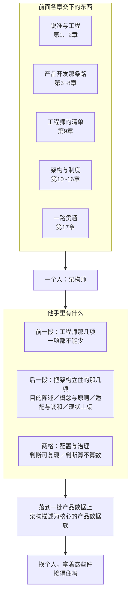

# 第18章 架构师：到底应具备哪些能力

## 18.1 引言

前面十七章，一章讲一件事。每一件都讲清了：它是什么、凭什么这么说、缺了会怎样。可有一件事，十七章都没有正面回答——**这些事合起来，是一个什么样的人。**

这件事难在：答案不在哪一章里。翻遍任何单独一章，都找不到这个人；只有把十七章摆到一起，才看得见他。上一章末尾留了一句：书还没走完，还有一个"物种"没有回答——架构师。本章回答它。本章不新增概念。它只做一件事：把前面各章交下来的东西，合成一个人。

### 18.1.1 误解现场

恒信集团，年度评优会。主持人念颁奖词："年度架构师——万辉。全年产出架构图最多，架构文档最全。"掌声。万辉上台，接过那块牌子。

散会以后，徐漾在走廊上把他叫住："当选架构师，意味着你现在是什么？"万辉张了张嘴。他试着替自己答了三次。

第一次，他想说"我是画架构图的"——可那面墙上挂着的四张图，图下面没有一条决定。第二次，他想说"我管架构"——可真要动架构，得先提理由、再进基线、最后还得有人批；他手里那点权，只够把话说清楚。第三次，他想说"我技术最好"——那是工程师的尺子，量不出架构师。

三条都走到头，没有一条通到他身上。他答不上来。办公室里，三个人替他答了。

开发说："架构师就是更高级的工程师——升上去了嘛。"测试部的同事说："架构师是画架构图的人，图最多的那个。"运维说："架构师是什么都管的人，出了事都找他。"

三句话，三个"架构师"。两年前，两间会议室为"架构"吵得不可开交；两年后，一间办公室为"架构师"各说各话。

三句都错，错法还一样：**第一句错在把职级当成能力，第二句错在把图当成架构，第三句错在把权力当成责任。**三句话说的都是他坐在哪儿、手里拿着什么，没有一句说的是他做得了什么。

### 18.1.2 本章要回答什么

读完本章，你应该能回答：

1. 架构师这份能力清单由哪几项构成？每一项凭什么说有？
2. 前面各章各交下了什么？为什么说它们是同一个人的不同侧面？
3. 为什么"先是一个工程师"？那几项缺一项，会怎么样？
4. 配置管理和架构治理，为什么也算他的能力？
5. 他每天在做的，是哪几件事？
6. 他和工程师，差别到底在哪儿？
7. 为什么说"架构师"不是标准的术语？标准认的是什么？
8. 他不是哪些角色？他和系统工程师，各背哪本账？
9. 评估和认证，各管什么？
10. 他会怎么失败？
11. 一个人怎么长成架构师？"被任命"为什么不算数？
12. 能力最终体现在哪儿？为什么说落在产品数据上？
13. "换个人，能不能接住"——凭什么用这一句量他？

### 18.1.3 本章的骨架

本章的主线是一句话：**前面各章各交下一样东西，本章把它们合成一个人。**围绕它，本章先合出这份清单，再划开他跟别人的界，最后看他怎么长成、拿什么量。

**架构师的能力清单（18.2）**：先把前面各章交下的东西摆成一张表——每一章交下的是什么、落在人身上是哪一项；再逐项点名：先是工程师的那几项，再是他比工程师多出来的那几项；然后说清配置管理和架构治理为什么也在这份清单上。最后两节，看他一整天在做的活，以及这种活跟工程师的活差在哪儿。

**架构师的边界在哪儿（18.3）**：把他跟六个最容易混的角色分开；分清他和系统工程师各背哪本账；说清也不是目的的定义者；把评估和认证这两个常被混进来的动作摆到该在的位置；最后说他会怎么失败。

**架构师怎么长成，拿什么量（18.4）**：从工程师到架构师，变的是什么；被任命为什么不算数；来路不同、功课也不同；再往上走，管的是什么。最后落到一处——**能力终究体现为产品数据**：换个人，拿着他签过字、写下来、守得住的那批产品数据，接不接得住。

三块合起来回答一件事：前面各章讲的，是一个人的不同侧面。

> **术语注**："架构活动"（architecting）用的是 ISO/IEC/IEEE 42010:2022 §3.1 的词条；本书资料库里的中英对照版把 architecting 定名为"架构工作"，本书用"架构活动"（两个译名待统一）。"架构师"这个词，标准没有立条——标准认的是活动，不是职位。本书说的"架构师"，是把这个活动背在身上的人；这一句是全章的名分，18.2.7 展开。

## 18.2 架构师的能力清单

### 18.2.1 每一条能力，都能追到一章

前面十七章，各交下一样东西。把它们摆到一起，就是这一章要给的那份清单。

| 前面各章 | 它交下什么 | 落在人身上是哪一项 |
|---|---|---|
| 第1、2章 | 把词说准的方法；工程是什么、靠什么成立 | 他量自己的方式；科学素养与工程判断的来处 |
| 第3章到第8章 | 一条路：需求 → 设计开发 → 产品数据 → 评审、验证与确认 | 这条路，他每一段都得懂 |
| 第9章 | 工程师的能力清单 | 他的前一段 |
| 第10章到第14章 | 架构是什么、怎么定、怎么取舍、怎么写下来、怎么交给设计 | 他比工程师多出来的那几项 |
| 第15章、第16章 | 配置管理、架构治理 | 其中两项，在他这一层的落地 |
| 第17章 | 一条链上的接缝与缝合 | 他知道每一处缝上有谁 |

这张表里没有新东西。它只是把散在十七章里的东西摆到一处，让人看见：这不是十七章拼起来的一摞，是同一个人的六个面。

摆完就能看出两件事。一件是：清单里每一项都有来处，没有一项是本章新造的。另一件是：**能追到来处的，才是能力；追不到来处的，多半是习惯、是印象，或者干脆是头衔的影子。**

所以本章给的第一条判据，是冲着清单自己来的：

> 判断一份能力清单立不立得住，只看一条：它的每一条能不能指回某一章。

指得回去，这一条就有出处、有判据、有人检验过；指不回去的，要么是本章凭空加的，要么是从别处听来的，两种都不该留在清单上。后面几节逐项点名，每点一项，都按这一条走一遍。

**先把一个词说清**：本章说"能力"，一律指第9章那份清单的意思——先是一个工程师的那几项，再是他比工程师多出来的那几项；不与第1章的"能力四级"（表征、图式、心智模型、解释框架，§1.4.4）混，也不指某一段里临时说的"这项能力"。同一个词，量的是两件不同的事：第1章量的是概念掌握到哪一级，这里量的是他手里长出了什么。

### 18.2.2 工程师的能力：一项都不能少

先把清单的前一段立起来。这一段不是本章的发明：第9章已经逐项论证过，这里只点名，并且给每一项配一句当场能自问的话。

| 能力 | 它管什么 | 当场自问 |
|---|---|---|
| 科学素养 | 判断这个系统靠什么成功 | 我对这个系统的理论是什么？做错什么最致命？ |
| 方法论素养 | 方法不靠人传人 | 我这一套，别人学得会吗？ |
| 实践能力 | 落得了地 | 我最近一次亲手落地，是什么时候？ |
| 职业伦理 | 知道什么不能牺牲 | 压力面前，我有没有为进度悄悄牺牲可靠性？ |
| 工程判断 | 冲突里能取舍 | 我依据什么做这个取舍？ |
| 可复现意识 | 判断换个人也接得住 | 我写架构决策记录（ADR）吗？ |

六项里，前四项来自工程的那几层，第2章逐层立过——科学素养、方法论素养、实践能力、职业伦理；后两项横着穿，工程判断管取舍，可复现意识管传承。

六项一条都不能少，理由不在"多一项总比少一项好"，在**缺哪一项，后面多出来的那几项就都落不了地**。

- 缺科学素养：判断不了系统靠什么成功，理论是空的。
- 缺方法论素养：方法只在他一个人脑子里，人一走就带走了。
- 缺实践能力：判断悬在半空，落不到任何能被造出来的东西上。
- 缺职业伦理：判断越准，破坏越大——能力不是中性的。
- 缺工程判断：取舍没有依据，只能看谁的声音大。
- 缺可复现意识：他做出来的东西换个人接不住，等于每次都从零开始。

> 判据：这六项里任何一项答不上来，先别提后面那几项。架构师先是工程师——这句不是资历上的客气话，是清单上的次序。

### 18.2.3 比工程师多出来的能力

工程师那六项，管的是"把部件做对"。架构师在那六项之上多出来的，是四件事。

第一件，给每个候选写一句目的陈述。摆出三个候选，就要写三句"它为了什么"。正本（标准的正式版本）说得更直白：每个解决方案可能有不同的目的陈述（42020:2019 §8.4.5 e) 及其注 5）。

第二件，把手段立成概念与原则。选出来的做法不能停在"我们打算这么做"，要立成实体的一条概念或属性，或者一条管住它实现与演化的原则（42020:2019 §8.4.7 b)、e)、h)）。立不成，它就只是一次口头约定。

第三件，适配与调和。既有做法不能照搬。按正本，**要把参考架构实例化并加以特化**（42020:2019 附录 E.3.3.2，资料性）；本书的说法是"特化到眼前这个实体"。几套做法撞在一起，还要调和到"适用于当前情形"（42020:2019 §8.4.6 注 3）。

第四件，把"现状"也摆上桌。现状有时就是备选之一（42020:2019 §9.4.7 注 2）。不写下来，它就默认被选中，而且没人知道它是被选中的。

这四件事有一句共同的判据：

> 做完之后，有没有多出一份别人能用的东西。

写不出这份东西，四件事就都停在脑子里，谈不上能力。

边界要说清。多出来的这四件，管的都是"这个实体是什么"那一层：基本概念或属性，加上管住它实现与演化的管控原则。元素、接口、关系不在这里。把系统需求分配到系统元素、把架构实体与关系转化为设计元素，是设计定义过程的任务（15288:2023 §6.4.5.3 b) 1) 与 b) 2)）；架构侧也有分配，架构师分到的是架构实体（15288:2023 §6.4.4.2 c)）。这不是说架构师不碰元素，是说元素不是他这一角色的专责对象。

还有两项要挪出去。"识别后果严重的决策"和"判断不可逆性"，不在这份清单上。影响面广、难逆转、约束硬，这一族在本书里是代理：它有它的正当用途（排序、定决策时机、配治理强度、做回代检查，第10章列过四样），但架构内容的准入只有一条，是"对目的必要"。把它写成能力项，等于让代理坐上准入位——第10章和第12章都为这件事划过界。

把这几处收成一句角色定义，本章后面都用它：

> **架构师对架构（基本概念或属性与管控原则）的成立与守持负专责**；他不背系统成败的终责，那是系统工程师的账（18.3.2 展开）。本章下文说"架构的成立与守持"，都是这一句的简称。

### 18.2.4 配置和治理，也算架构能力

第9章交代过一句：可复现意识会往配置与基线长，职业伦理会往治理长。到本章，这句话要落成清单上的两格。

配置管理那一格。工程师版是"管好自己那几份"；架构师版是"让整套架构描述与决策记录受控，并且让下游必须依据它"。两档之别是尺度，不是两件事——一个人的判断能不能被接住，放大到一整套描述上，就是配置管理。

治理那一格。治理不替你算，它决定你算出来的那份判断算不算数；在这条线上，架构师是出技术判断的那一头，不是签发的那一头。

两格的机制与效力，第15章和第16章各讲了一整章，这里不重讲。本章只确认一件事：**它们在这份清单上有位置**，不是身外的行政事务，也不是只有组织才需要的东西。水忠那页老规矩能被别人拿起来改、拿起来验，就是其中配置那一格在他身上的样子。

> 判据：两格合成两句自问。你不在场，它接得住吗？——这一句问配置。要改它，走哪条路、谁批？——这一句问治理。两句都答得上，这两格才算长在他身上。

### 18.2.5 每天在做的活：从构思到改进

清单回答的是"这个物种长什么样"。还有一面：他每天在做什么。ISO/IEC/IEEE 42010:2022 §3.1 给这件事立了词条（architecting，本书作架构活动）：在所关注实体的整个生存周期内，构思、定义、表达、记录、沟通、认证恰当实现、维护与改进架构。

> **译名注**：这七件事里，两版译名不同的有三处：本书资料库里的中英对照版作"构想／编制文档／证实其正确实施"，本书作"构思／记录／认证恰当实现"；义同，七件事的数量与次序两版一致。

七件事，一件一件点：

| 动词 | 干什么 |
|---|---|
| 构思 | 从关切出发，生成候选 |
| 定义 | 画边界、做选择，收敛到一个 |
| 表达 | 把它翻成一组各有其主的视图 |
| 记录 | 把视图与决策固化成架构描述 |
| 沟通 | 让各利益相关方理解，达成一致 |
| 认证恰当实现 | 查实现符不符合架构 |
| 维护与改进 | 对着腐化，把它守住 |

两点要注意。第一，**这七件事贯穿整个生存周期反复发生，不是串行的七步**。今天在构思，下周在定义，明年还在维护——它们不是一条流水线，是一组反复回来的动作。

第二，它和前面那张清单是两套切法：清单是体检切法，看这个人长什么样；这七件事是工序切法，看他每天在做什么。这两套切法咬在同一处：构思那一件的起点，是各利益相关方的**关切**（标准中译作"关注点"）；沟通那一件对着的，也是他们。两套并行，谁也不吞掉谁。

> 判据：当场能问的一句——我现在做的，是这七件里的哪一件？答不出来的，多半正在做第八件；第八件通常不叫架构活动。

### 18.2.6 架构师和工程师，不一样在哪儿

前面几节说的是他手里有什么；把它们和工程师那六项摆在一起，差的到底是什么，是另一件事。

| | 工程师 | 架构师 |
|---|---|---|
| 面对的东西 | 规定需求：明示的、可验证的 | 关切：可以模糊、可以冲突、没有标准格式 |
| 把关方式 | 测试，对着规定需求 | 评审，对着目的；审的是写下来的理由 |
| 判据锚点 | 规定需求 | 目的 |
| 时间尺度 | 这一版交付得对不对 | 这套东西明年、三年后还立不立得住 |
| 手里最要紧的件 | 契约与证据 | 决策与理由 |
| 出的产品数据 | 那棵树上管叶子的那一段：详细定义 | 那棵树上管干枝的那一段：框架定义与架构描述 |

六行差别的根子是一句话：工程师面对的是规定需求，架构师面对的是**利益相关方**的**关切**——一个是明示、可验的条款，一个是可以模糊、可以冲突、没有标准格式的兴趣点。**这不是做得更多，是做得不一样。**第14章那句"是种类之别，不是粒度之别"，在这里同样作数。同一件事里，工程师竖着往深处做，架构师横着把面铺开。一个现成的例，万辉那三句答不上来，卡的就是这一行：他手里只有图，没有理由。

> 判据：看他交出来的件。交的是"做出来了，证据在这"，他在工程师那一侧；交的是"为什么这么做，理由在这"，他在架构师这一侧。万辉那四张图，图下面没有一条决定——交出去了图，没交出去理由。

### 18.2.7 标准只认架构活动，不认头衔

有一件事必须先说清，否则整份清单都悬着。

ISO/IEC/IEEE 42010:2022 第 3 章一共 19 个词条，从 §3.1 排到 §3.19。**里面没有一条词条叫 `architect`**。以 architect 开头的那八条（§3.1 到 §3.8）讲的全是架构与架构描述，不是人——§3.1 `architecting` 指的是活动。`architect` 在正本里只作过一次角色名，出现在 §3.17 利益相关方词条的举例里：**有角色名，没有词条**。

这不是标准疏忽，是它的立场：**认活，不认职位。**所以本书说的"架构师"，意思是把这个活动背在身上的人；正式名是"**系统架构师**"，本章下文凡说"架构师"，除特别点出模块那一层外，都指这个角色。这一句是本书的主张，不是标准条文——顺带说清一件事：全书唯一给"架构师"这一角色下定义的是 INCOSE《系统工程手册》，那是二手材料，本书只用它作旁证，不作判据。

> 判据：拿一个人来问——构思、定义、表达、认证这些活，他做过哪几件、各留下什么件——不是问他名片上印的什么。

## 案例进展①｜万辉：有头衔，能力没补齐

评优会散了，话题没散。

小白站在那面墙前面。四张图还挂着。"图我们天天看，"她说，"可真做接口的时候，碰上'数据放哪、归谁管'，图上找不着答案。"

玉杰翻出一份变更记录："上回发版，我照例翻变更。'改了什么'有，'为什么改'没有——就一句'按上级要求'。第15章说配置管理管的是'哪一版算数'，可我连它为什么改都不知道；拿这份记录去接别人的班，接不住。"

黄程也接了话。他说得慢："我们业务不看图画得漂不漂亮，只看合同在审批链上别卡壳。'改个编号'这四个字，当年是我随口一提的，我以为是件小事；后来才知道，那是每份合同的唯一身份，台账、审计、签章，整个生存周期都靠它认人。业务规则的每一行，都得有人想清楚它进系统哪块地。"

万辉站在旁边听。三句话他都听懂了，因为每一句都对着他清单上的某一格。

当天下午，他把那四张图从墙上取下来，换成一份决定清单。清单第一栏写"这个实体是什么"，第二栏写管住它实现与演化的那几条原则。写到"这份架构靠什么成功"那一栏时，他停了一会儿——这一栏，他一时填不上。

他做的第二件事，是给自己写了一份体检：照那份清单，一项一项打勾。

科学素养那一栏，他犹豫了，最后写"存疑"：这两年不碰实现，理论有点悬空。方法论素养、实践能力，有。职业伦理，他想起两年前那次"为进度悄悄牺牲可靠性"的记录，账还没还清，但这次他把代价先摆到了桌面上。工程判断，正在长。可复现意识这一栏，他写的是"以前没有，从这次起写决策记录"。

体检单上没打满勾。万辉有头衔，缺的那几项，就是这次没打上勾的。

但写这张单子本身，是他往前走的第一步：他终于拿清单量自己了，而不是拿名片量自己。

## 18.3 架构师的边界在哪儿

### 18.3.1 不是更高级的工程师

回到评优会那句"架构师就是更高级的工程师"。

错在把职级当成物种。职级是组织给的一个位置：管多少人、拿多少钱、在哪个序列上。物种是能力定的：会做什么、做得了什么。第9章立过"头衔不定义工程师"；本章要在这一句上面再加一层：**职级也不定义架构师**。

那么两者的活按什么分？本书一直用一条判据：看谁拥有对该层规定需求的变更权。同一层里，谁有权改那一层的规定需求，那一层就归谁。这是种类之别，不是粒度之别；第14章整章讲的就是这件事，这里不重讲。

**这一条要标清楚**：这条划分是本书的读法。标准不替组织分配谁做工程师、谁做架构师，它只管过程；哪一层的变更权在谁手上，是组织自己定的，再拿这条判据去核。

组织可以把任何人任命为架构师，就像可以把任何人印上工程师头衔。但"是不是在做架构活动"，不由任命决定。

> 判据：拿一个决定来问一句——这一层的谁有权改它？权在谁手上，这个决定就归谁那一层。头衔不参与回答。

### 18.3.2 不是系统工程师：专责和终责

这是全书最容易混的一对，因为两个名字都带"系统"，都像统管的角色。其实两本账分得很清：

- 系统工程师对系统成败负终责。整个系统的账，出了事他担着；这本账不可委托。
- 架构师对架构（基本概念或属性与管控原则）的成立与守持负专责。基本概念或属性、管控原则立不立得住、守没守住，这本账既可以委托出去，做砸了也要追到他头上。

一句话：**架构师搞砸了，追责追到架构师；对外向客户、向监管担责的，是系统工程师。**两者的关系不是指挥与执行，是一个回路：委托、协商、验收。

委托：系统工程师把"架构的成立与守持"委托给架构师，架构师以架构描述回馈，系统工程师评审背书。

协商：架构能改变需求。选了一个架构方案，等于给系统加了一批它本来没有的要求（派生需求），要回流去更新规定需求。所以两者是持续的谈判对手，目标不是"完美的正确解"，而是双方都接受的**协商理解**（negotiated understanding）。这层意思，正本写在 42020:2019 §5.2。协商理解不是谈一次就定死的：需求一回流，它就要跟着更新，下游要依据的正是当下那一版。

验收：拍板权在系统工程师，理由权在架构师。你提方案加理由，我拍板，我担着。

有一处要按正本说准：拍板这件事，通常在架构过程之外（这一句出自 38 号研究报告对 42020:2019 §5.7 与 §8.4.7 注 7 的整理）；15288:2023 §6.4.4.3 e) 2) 给架构定义这一步收口的，是"就架构定义取得一致意见"这句话——它要的是一个答复，不是一个结论。42010:2022 §6.10.1 另有一项**宜加考虑**：架构描述里记录决策权属方或决策责任人。记下它的那一栏，就是治理落下名字的地方（第13章、第16章）。

模块那一级还有一层：系统架构师把模块的架构委托给模块架构师，通常就是模块工程师自己。

> 判据：出事以后问一句——这口锅扣在谁头上？为系统成败担着的，是系统工程师；被追到"你负责的那部分立没立住"的，是架构师。两问指向同一个人，要么是兼任，要么是有一本账没记清。

### 18.3.3 不是技术负责人，也不是项目经理

技术负责人管的是人：代码评审、任务分配、进度、绩效、团队成长。架构师管的是内容：这个实体在概念与属性上是什么、哪些边界与演化规矩必须守住。

两者可以是一个人兼，但问的问题不同：技术负责人问"这个迭代能不能按时交付"，架构师问"这套东西明天改需求还立不立得住"。

这里有一条硬差别：**管理权可以任命，领导力不能任命**。技术负责人靠职位；架构师多半没有职权可依，他要在没有正式职权（或者职权不足）的情况下，靠专业可信度让人自愿地跟着走。可信度积得慢、耗得快，一次判断让人受益，才算攒下一点。万辉被任命那天，拿到的是职位给的那点权；真要动架构，还得先提理由、再进基线、最后有人批。

项目经理管的是日历：里程碑、资源、风险登记、沟通。架构师管的是演化。项目经理说"这个需求排到下个迭代"；架构师说"这个需求会动到那条原则，得先过一遍"。两者冲突时，常常是进度对结构——第2章讲的价值层失守，现场多半就在这一刻。

> 判据：看他在压力下护住哪一样。护住交付，他在技术负责人或项目经理那一侧；护住这套内容立不立得住，他在架构师这一侧。

### 18.3.4 不是领域专家，也不是画图匠

领域专家懂业务：审批规则、法规要求、结算流程。架构师懂系统：这些规则怎么被建模、这些流程的数据怎么流动、系统怎么响应变化。

领域专家说"法务要求合同必须有三个审批节点"；架构师说"这三个节点在系统里怎么表示、数据归谁、改起来要动哪里"。好的架构师不抢领域专家的活——他让领域专家的规则在系统里待得住、改得动。

画图匠这一对最容易混，因为两者都画图。差别只有一条：图是决定的表达，还是决定的替代。第10章立过：架构是那份内容，不是承载它的那份东西。挪到人身上就是——

> **把图全删掉，决定还在，你是架构师；图删掉就什么都不剩，你是画图匠。**

水忠在第11章写下的那页老规矩不是图，是一份清单；万辉那四张图曾经挂满一面墙，图下面没有一条决定。

> 判据：删一次图试试。剩下的东西够不够别人接着干，就是答案。

### 18.3.5 不是目的的定义者

角色边界往上走，最后到一条最上游的界：**目的不由架构师定义。**

系统目的与任务的定义权和问责在业务方（赞助人、产品方）。架构师的职责是让架构忠于目的，不是替目的做主。用 RACI 的说法（A＝最终问责，R＝主责，C＝被咨询）：目的定义，A 在业务方，架构师是 C；架构定义，A 和 R 在架构师，业务方是 C。

不定义，但绝不被动。他对目的有四件事要做：

| 职责 | 做什么 |
|---|---|
| 理解 | 把目的当作判据吃透——它是架构活动的输入总开关 |
| 澄清 | 目的模糊时向上游回溯，推动业务方表达到可判定的粒度 |
| 质疑 | 用可行性、成本、一致性去检验目的——有质询权，没有改写权 |
| 守护 | 全程盯目的漂移；目的变了，就把架构重审一遍 |

这四件事里，"理解"有一份自己的产品数据：《系统目的或任务理解确认单》。这份单子分三部分：一是目的原文照引，业务方的原话只引不改；二是架构师的复述理解；三是业务方签字。它是纯理解、不含一点架构内容：复述里冒出架构语言，就是越界了。这份单子是架构活动的入场券：签字之前，后面的一切产出都没有判据锚点。

还要分清一件事：角色分离不等于人员分离。小团队里，一个人可以同时戴产品方和架构师两顶帽子；但做每个决定时，得知道此刻戴的是哪一顶。两顶帽子在脑子里互相将就，是很多架构失控的起点。

目的不是孤零零一个点。它沿一条链往下展开：目的（为什么存在）→ 目标（达成什么可度量的结果）→ 需求（必须满足什么可验证的条款）。评审和确认，最后都要沿这条链追到目的上去。

> 判据：拿一份目的陈述来问——这句话是谁说的？说得出来源和签字人，它在链上；说不出，它只是房间里的一句共识。

### 18.3.6 评估和认证，各管什么

第8章把评审、验证、确认三个词钉住，末了划出去两个动作：评估和认证，说好留到这里讲。现在补上。

| 动作 | 管什么 | 依据 |
|---|---|---|
| 评审 | 这版材料准备好了吗——人的判断活动 | ISO 9000:2026 §3.11.2；第8章 |
| 验证 | 做出来的东西符不符合规定需求——要客观证据 | 15288:2023 §6.4.9；第8章 |
| 确认 | 是不是用户真正要的东西——在真实用途里管不管用 | 15288:2023 §6.4.11；第8章 |
| 评估 | 架构本身值不值、够不够——对架构所作的分析与价值评定 | 42020:2019 §9 |
| 认证恰当实现 | 实现符不符合架构 | 42010:2022 §3.1；42020:2019 §3.2 注 2 |

五个动作，各有一个对象：评审对着材料，验证对着规定需求，确认对着预期用途，评估对着架构本身，认证对着造出来的东西。

评估和认证这两个，最容易混进评审桌上。它们跟评审的区别就在对象：评审桌上放的是那版方案；评估问的是这套架构值不值；认证问的是实现有没有按这套架构做。

认证还有一层意思，不出那第五个动作之外。正本把这句话说得很直白，**证实架构的正确实施，有时被表述为架构师向客户或用户作出的正式声明，即所构建的系统满足可投入使用准则**（42020:2019 §3.2 注 2）。也就是说，符合性把关不是内部自娱，它的一头对着交付。

还有一处要标清楚：架构师在技术评审里有没有固定席位，是组织分配的，不是标准赐予的。技术评审的参与者名单里并没有单列"系统架构师"，他通常落在"其他技术负责人"这一类（这一条是本书据 INCOSE《系统工程手册》那份名单所作的说明，属本书主张，不是标准条文）。谁坐进评审，由组织定。

另有一个动作要说明归属：审计（audit）查的是"系统对运行信息部件与配置信息部件的符合性"（15288:2023 §6.3.5 注 22），在本书里归配置审核（第15章）与治理的符合性评定（第16章）。本章只点名，不展开。

> 判据：手上这件事，问一句"对着的是什么"——对着材料、对着需求、对着用途、对着架构、还是对着造出来的东西？对象一清，动作就定。

### 18.3.7 失败有哪几种样子

划清边界之后，还有一件要看的事：一个人是怎么从位置上滑下去的。这些失败都不戏剧性，是慢慢掉下去的。

画图匠：图越来越多，决定越来越少。症状是图越画越漂亮、越画越全，可图下面没有一条决定。掉下去的方式不是被免职，是团队发现图不能用来做决定——图上说系统长这样，可真碰上"数据放哪"，没人答得上。于是大家绕开图，各做各的。他缺的是"把手段立成概念与原则"那一件。万辉那四张图正走在这一条上：小白说图天天看，可真做接口时，碰上"数据放哪、归谁管"，还是没人答得上。

什么都管：把该别人定的也定了。每个接口、每行代码、每张表都要过他。看起来非常负责，实际是把专责当成了终责——既背了不该背的账，又把团队判断的能力收走了。精力全花在低价值的决定上，真正重要的那一批反而没人管。

不决策：把决定留给默认。症状不是不管，是不选。不选就是选了默认，而默认往往是最保守、最省事、最像"大家都这么做"的那一条。架构决策躲不掉，只是早晚；不做决定，系统照样会被某个选项塑形，只是你在事后才认识它。他缺的是工程判断。

远离代码：判断失去锚点。升上去以后不再看实现，只开评审会、只画蓝图。他说"这里该微服务化"，可他不知道现在的服务边界在哪；说"数据该统一"，可不知道数据现在在谁手里。理论还在，但已经不落在任何能被造出来的东西上。他缺的是实践能力。

四种姿态：画图匠死于图代替了决定，什么都管死于把专责当终责，不决策死于不选，远离代码死于看不见实现。

> 判据：四种里对号入座——最近一次，你在哪一格里？每一种都能在这份清单上找到对应的那一格；找到那一格，功课就定了。

## 案例进展②｜水忠：没头衔，换个人接不住

磨完边，再量另一个人。水忠的名片上印着"嵌入式硬件工程师"。他就没换过名片。

文正先在评审会上说了话："会是我主持的。可一到'数据归谁、接口怎么切'，话筒就得递给水忠——他答得比需求清单还准。"

李旭说的是另一头："测试最怕一件事：为什么这样测、凭什么说'测过了'，我常说不清。水忠那页老规矩，写明白的地方我能验；没写明白的，我验不了。判断这东西，光在他脑子里不算数——换个人读得懂、照着做得下去，它才是一份能被人验证的东西。"

逸人说得更实："他每动一次数据口径，产线的批次追溯就得重对一遍。第11章那条'断链就是失效'，我拿着能用；可它凭什么这么定，纸上没写——口径一改，我这边就得把三个月的批次重对一遍。"

水忠自己没接话。散会以后，他在楼梯口站了一会儿，才把那页纸从口袋里拿出来看了一眼。

按那份清单量，他缺两格：方法论素养，可复现意识。他是手艺的极致——判断准，落地稳；可那一套在他手里长成了技艺，没有长成别人能接着用的东西。他没有头衔，缺的也不是头衔。

## 18.4 架构师怎么长成，拿什么量

### 18.4.1 从工程师到架构师，变的是什么

绝大多数架构师不是空降的，是从工程师长出来的。这一跳变的不是职级，是管的事换了。水忠就是现成的一例：名片上印着模块岗位，做的事却落在系统那一层。

工程师管"把东西做出来"：这段代码怎么写才清楚，这个模块怎么切才不绕，这一版交付得对不对。架构师管"它是什么、凭什么立得住"：哪些内容是基本概念或属性，哪些规矩必须守住，往后的版本还认不认得出这是同一个东西。

判断的依据也跟着换：从"这段代码有没有毛病"，换到第10章那三个问题——这个系统靠什么成功？最大压力在哪？做错什么最致命？你关心的问题换了，位置就换了。

两个方向同时扩。一个是面：从部件到整机，从一棵子树到整棵树。一个是时间：从这一版交付，到跨版本演化——今天做一个选择，是在给后年留活路，还是把后年堵死。

有一件事要说清：**这不是升职，是分叉。**管理线（技术经理、项目总监）和架构线（系统架构师、首席架构师）是两条并排的路，走哪条都正当。把分叉当成阶梯，才会问出"升不上去才走架构线"这种话。

想换到这条线上，有几个成本不高的入口：先以评审人的身份坐进架构评审，反复问"为什么选 A 不选 B"，直到能替架构师把理由讲圆；动手写决策记录，从记录别人的理由开始；在系统架构师划好的边界里，独立主责一个子系统的架构，把"构思、定义、表达"三件事各走一遍。

> 判据：拿一个架构师来问一句——"如果需求翻一倍，这套东西还成立吗？"答得上来，他在架构这一侧；只会说"现在这样挺好的"，他还在工程师那一侧。

### 18.4.2 被任命不等于成为

评优会上，万辉被任命为"年度架构师"。任命给了他一个名分，名分不给他能力。这听起来不太客气，其实公平：名分是时间的快照，能力是长出来的东西。任命可以明天收回，能力收不走。

所以看一个人，不看任命书写了什么，看那份清单上亮了几格。万辉被点醒以后做的那两件事——把四张图换成一份清单、拿清单给自己打勾——都不是"补画图技术"，是开始补判断。**成为架构师的过程，就是清单一项一项亮起来的过程。**

> 判据：把任命书摆在桌上问一句——它让清单上哪一项变了？一项也没变，它就只是一个名分。

### 18.4.3 来路不同，功课也不同

长成架构师的人，来路不一样。从开发长出来的、空降的、挂名的，各自缺的东西不同，要补的也不同。

从开发长出来（最常见）。实践能力与科学素养通常不缺，工程师那几项已经有一半在身上。缺的是系统级的判断——哪些内容算基本、哪些决定值得按架构决策来对待。功课是把小团队里的代码判断，练成对整棵树的判断。

空降（带着方法进来）。理论、判断、别的行业的经验，往往都有；缺的是对这个系统的实践，以及可复现——他的判断还没被这个系统检验过，别人也接不住。功课是先落地：把一套判断在这个系统上跑通一遍，再谈蓝图。

挂名（组织设了岗位，人没换）。只有头衔，没有清单。功课只有两条路：要么真的开始补，要么承认这只是一个名头——挂着名的架构师，是组织在用名字骗自己。三条路没有高低，只有功课不同。

> 判据：看他最近三个月在补清单上的哪一项。一项也没补，那他不是走在哪条路上，是站在原地。

### 18.4.4 第一次说"不"

一个人真正长成，往往不是学会画一张更大的图，而是学会对一件"做了也没人反对"的事说不。

这种"不"最难的，是它拦下的通常不是错的东西。董勐想给客户开个直连接口，功能上完全做得到，客户还会满意；水忠把它拦下来，理由不是"不行"，是"绕开了追溯域，这条路以后退不回来"（第12章）。万辉想把合同编号字段当"改个字段"改掉，改起来当天就能上。这一次，"不"没来得及在上线前说出来；三个月后连环三爆（第12章）。徐漾事后点破他，理由同样是"这件事改错了以后，代价不在这一版里"。

水忠那次"不"，**拦下的不是错，是没想清楚**。也正因为这样，说这个"不"的人常常不占理——没有一条规定需求可以引，没有一次测试可以证明，只有一句"再等等"。可万辉那次没人说，代价就落在三个月后的三爆里。所以第一次说"不"，说的其实不是别人，是自己：忍住"先上了再说"的冲动。

> 判据：回想你最近一次说"不"。拦下的是错，还是没想清楚？只拦得下前者，说明这把尺子还没长出来。

### 18.4.5 再往上走，管的是组织

架构师是这本书的终点，但不是这个物种的终点。再往上走，不是更深的架构，是关注的东西换了一级：工程师的"用户"是部件，架构师的"用户"是系统，再往上是系统之系统，最后是整个组织。每一次，服务对象换一级，物种也跟着换一次。

系统之系统有一个显眼的特征，这一条是本书的读法：每个子系统都有自己的负责人和生存周期，没有全局负责人。架构师缝的原来是部件之间的缝，再往上缝的是子系统之间、部门之间的缝。

再往上的路，常见的有四条，没有高低，只有管的面大小不同：

- 深度走首席架构师，从"做架构"到"建架构体系"。
- 宽度走企业架构师，从"一个系统"到"系统之系统"；企业架构那几套域划分是行业参考（TOGAF），不是标准条文。
- 组织走技术总监一类的岗位，管的是技术投资与组织能力。
- 权威走首席工程师一类，管的是跨学科的技术裁决。

组织那一层上还有一条分工值得记住：**方向权（目标、政策、战略）在组织层，内容权（原则、架构决策、符合性判断）在架构那一侧**。这一条是本书的读法——标准只说治理在组织的较高层级、向治理机构问责，并没有这一句。

有一件事在这里同样成立：头衔也不定义他。一个人做到技术总监，如果还在用工程师的尺子量自己，他只是换了个更大的名分；反过来，一个人在"系统"这一格上待一辈子，只要那份清单一项项拿得住，他就是这本书说的架构师。

> 判据：看他服务的对象变没变一级。判断、权衡、沟通、担责这几样没换，换的是它们作用的对象有多大。

### 18.4.6 能力最终落在产品数据上

清单上那些东西长在人身上，看不见，也没法直接检验。面试官会看走眼，领导会凭印象打分。所以本领最终要落到一处能被翻、能被查、能被接手的地方：他交出来的产品数据。

第9章给工程师立过一句：能力＝开发出高质量的产品数据。这句话在本章同样作数，只是对象换到了架构这一层。万辉把那四张图换成一份决定清单，换的正是"交出去的产品数据"。六项各落在哪件上，一项一件：

| 能力 | 落到哪件上 |
|---|---|
| 科学素养 | 架构的依据：为什么这么分（容量、性能、约束条件） |
| 方法论素养 | 架构的方法：视角与视图怎么定、怎么评 |
| 实践能力 | 架构的落地：它造得出来，不是纸上楼阁 |
| 职业伦理 | 决策的真实：取舍如实记，账不藏 |
| 工程判断 | 架构的取舍：系统级的权衡与理由 |
| 可复现意识 | 架构的可接住：决策记录写得清，演化路径接得下 |

多出来的那几项，也各有各的件：给候选写的目的陈述，落在架构目标与关键成功准则、问题空间定义报告上；把手段立成的概念与原则，落在基本概念或属性清单、管控原则上；适配与调和，落在架构权衡报告上；把"现状"摆上桌，落在权衡报告的候选行里。

这些件不是一张纸，是一族，以架构描述为核心：基本概念或属性清单、架构描述、管控原则、架构决策记录、接口控制文档、框架定义、派生需求清单、架构权衡报告、架构基线、演化路线图、系统级验证方案。

按标准明文的清单对一遍，还差几件要补进来：

- 架构评估计划、架构评估报告与分析结果、价值评定结果（42020:2019 §9.5，现有清单里只有"架构权衡报告"）。
- 质量模型、问题空间定义报告（42020:2019 §8.5）。
- 架构目标与关键成功准则（15288:2023 §6.4.4.3 b) 2)）。
- 未处理项与不符合项声明（含理由）（42010:2022 §6.7 d) 及注 2）。
- 符合性正式声明（42020:2019 §3.2 注 2）。
- 基线候选物（15288:2023 §6.4.4.3 e) 6)）。
- 评审问题的处置记录（42020:2019 §9.4.10 h)）。

还有一件职责最容易漏：架构符合性把关。架构活动这个定义里本来就带着"认证恰当实现"；正本还补了一句（42020:2019 §3.2 注 2，18.3.6 已引全）：这份符合性正式声明的一头对着客户或用户，也就是对着交付。也就是说，架构师不只写架构，还要查别人做出来的东西有没有按这套架构造；这份查的义务，责任矩阵里不一定有一格写着它。

那么，什么叫高质量？不是图多、不是文档厚，是这五样：**本质立得住、原则守得住、接口可承接、决策如实、换个人接得住。**

> 判据：把他的件摊开问一遍——换个人，拿着这些件，接得下去吗？接得下去，能力就在；接不下去，能力还在他脑子里，不在产品数据里。

### 18.4.7 架构师在生存周期里的位置

前面第17章把一条链走了一遍：从需求到设计，到把关，到上线，到退役。那一章讲的是这条链本身。这一节补的是另一半：在这条链的每一站上，架构师具体做什么。

按 15288:2023 的技术过程排过去，他在每一站的角色可以归成四个记号：

- 接收输入：这一站交给他、他必须接住的东西。是责任上的接收，不是时间上的先后。
- 开发输出：他编制、并对正确性负责的东西。缺了它，这一站跑不动。
- 出意见：他判断别人的东西——评审、符合性判断——但不签放行。
- 无：标准与组织都没有要求。

"开发输出"和"出意见"必须分成两件事：架构描述与"符合性检查意见"不是一类东西，前者他能定，后者只能提。混成一件，等于说他对自己提的意见也有定夺权，那第8章那句"评审通过 ≠ 决策作出"就被抹掉了。

| 过程 | 架构师做什么 |
|---|---|
| 业务或任务分析 | 接收输入：优选解类；开发输出：问题空间的架构视图 |
| 利益相关方需要与需求定义 | 接收输入：需要与需求；开发输出：关切清单、利益相关方与角度台账 |
| 系统需求定义 | 接收输入：派生需求回流；开发输出：架构侧对需求的反约束；出意见：需求对架构的充分性 |
| 架构定义 | 开发输出（主责） |
| 设计定义 | 接收输入：分配与对齐的整合或确认；开发输出：架构实体与关系、架构特性、接口定义；出意见：符合性 |
| 系统分析 | 接收输入：分析结果；开发输出：分析命题与判据 |
| 实现 | 接收输入：实现偏差；开发输出：架构约束；出意见：符合性 |
| 集成 | 开发输出：接口定义、架构对集成顺序的约束；出意见：接口问题 |
| 验证 | 接收输入：异常与验证证据；开发输出：验证方法与判据；出意见：方案覆盖性 |
| 转换 | 接收输入：转换约束 |
| 确认 | 接收输入：确认结果；出意见：确认参与 |
| 运行与维护 | 接收输入：运行与维护反馈；开发输出：架构对运维的约束与演化原则 |
| 处置 | 接收输入：处置约束；开发输出：处置的架构侧约定 |

**这张表要说清**：这张表与"接收输入／开发输出／出意见／无"这四个记号是本书的工作清单，不是标准条文——它们是把 15288:2023 各过程的目的与结果，按"架构师接什么、交什么、评什么"重新读了一遍。

表里"运行与维护"合成了一行：标准中运行（15288:2023 §6.4.12）与维护（§6.4.13）是两个过程，故 14 个技术过程在本表作 13 行。

> 判据：拿到一个过程名，答三句——他接什么输入、交什么输出、给什么意见？三句都答不上，说明这一站上没有人。

### 18.4.8 换个人，能不能接住

全章的清单、边界、成长，最后都收到一句话上。这句话和第9章量工程师的那句是对称的。第9章那句是"换个人、换团队，用同样的需求和约束，能不能交付质量相当的成果"；在这里，对象换成了架构：

> **换个人，拿着他签过字的那些件，接得下去吗？**

接得下去，架构就在；接不下去，再大的图也只是装饰。

这一问还顺手把前面几节的账一起算了。配置管理那一格问"你不在场，它接得住吗"；可复现意识那一项问的是同一件事；架构符合性把关问"别人做出来的东西，还认得出这套架构吗"；专责与终责问"接的人接的是哪一本账"。拿这一问量万辉：那四张图接不住，因为图下面的决定他没写下来；后来换上的那份决定清单，才是能交出去的东西。

> 判据：这一问不必等到出事才问。换一个人，把手上的产品数据交给他一周，看他要问你几次、问的是不是那些产品数据里本该写着的东西。

### 18.4.9 认知反转

回到评优会。

两年前，两间会议室为"架构"两个字吵得不可开交；两年后，一间办公室为"架构师"三个字各说各话。我们终于看清这两场是同一个病：

**人们把一个本该由能力定义的东西，交给了名分去定义。**

名分回答不了"你现在是什么"。能回答的，是那份清单：先是一个工程师（那几项一项都不能少），再在上面长出把架构立住的那几项；配置和治理也是他的能力，只是长在他这一层；他背的是专责，不是终责；而这一切，最后都落在同一处——他签过字、写下来、守得住的那批产品数据。

最后用第1章那把尺子量一遍。对"架构师"这个词，章首的万辉停在"见过"那一级——叫得出头衔、画得出图，却答不上那句"你现在是什么"；到这里，判词把他量到了"拥有"那一级——他能拿清单打勾，认得出自己缺什么。

散会那天，逸人和水忠一起走出会议室。逸人说："水忠，你做的这些，是架构师的活。"

水忠没接话。他手里那页纸写着三条规矩，边角已经磨毛了——那页纸从第11章写下来，到第13章补成规格，到今天还在用。改的人照着它改，验的人照着它验。它不是图，也不是头衔，是这个团队能接着用下去的东西。

两个世界，各开各的会，到这里对上了同一个答案。徐漾从第1章那两间会议室问起的那个问题——"这个产品到底是什么"——问的是系统；今天这一问换到人身上，答案是同一个：这个物种不由头衔认，由他交出去的那批产品数据认。

## 小结

本章没有新增任何概念。它做的是另一件事：把前面各章交下来的东西，合成一个人。

合成之后，那份清单是两段加两格。前一段是工程师那几项，一项都不能少；后一段是他比工程师多出来的那几项，管的是"这个实体是什么"那一层——给每个候选写目的陈述、把手段立成概念与原则、适配与调和、把"现状"也摆上桌。两格是配置管理和治理：一项管判断可复现，一项管判断算不算数。

它给他划了界。他不是更高级的工程师（职级不定义物种）；不是系统工程师（他对架构的成立与守持负专责，系统工程师对系统成败负终责，两本账）；不是技术负责人，也不是项目经理；不是领域专家，也不是画图匠（删掉图，决定还在的才算）；他也不是目的的定义者（目的的定义权在业务方，他有理解、澄清、质疑、守护四件事）。

同一条界上，它还把五个动作分开了：评审对材料，验证对需求，确认对用途，评估对架构，认证对实现。

它讲了成长。从工程师到架构师，变的是管的事，不是职级；被任命不等于成为；来路不同，功课也不同；第一次说"不"，拦下的往往不是错，是没想清楚；再往上走，换的也只是服务对象的大小，判断、权衡、沟通、担责那几样没换。

最后，它把这一切从人身上挪到纸面上：**能力终究体现为产品数据**——本质立得住、原则守得住、接口可承接、决策如实、换个人接得住。拿这句话量两个人：万辉有头衔，缺的那几项没打上勾；水忠没头衔，缺的是方法论素养与可复现意识。两个人都还不是完整的架构师，两个人都走在成为的路上。

而这一章也把这本书回答完了：书名问"架构师是个怎样的物种"，答案不在头衔里，在他签过字、写下来、守得住的那批产品数据上。

## 附录

### A 本章概念总图

> **读这张图注意**：上面那五块不是五摞知识，是同一个人身上的东西。中间那份清单不是本章新造的，它是把上面五块合成之后的样子；下面那一处检验也不是新加的题目，它就是第9章量工程师的那句话换了个对象。

### B 本章的能力级

本章以"全书"为单位清点。前面各章各交一段，本章把它们合成一个人：

① 表征：四个角色名各就各位（系统架构师／系统工程师见 18.3.2；模块架构师／模块工程师见 18.3.2 末）；专责与终责；架构活动那七件事；评审、验证、确认、评估、认证五个动作各对什么。

② 图式：一张合图（前面各章交下什么、落在人身上是哪一项）；一份能力清单（前一段＋后一段＋两格）；一张能力与件的对应表；一张角色在生存周期各过程里的参与形态表。

③ 心智模型：前面各章那些判据，在这里合起来推得动——名分不定义人；专责不是终责；能力最终落在产品数据上；"难逆转"那一族只是筛选与排序的代理，坐在准入位上的是"对目的必要"。

④ 解释框架（本章主级）：第17章给了四句——概念要织成网，要看接缝，要落成产品数据，要长在人身上。本章兑现最后那一句：那四句不是四个要求，是同一个人的四件事。前面各章立的判据，到这里合起来回答一个新的问题：什么样的人，能把这条链守住。

再用第1章 §1.4.4 那把尺子量一下：**本章以第 ④ 级为主**。前面十七章各交一段，本章把它们收回一个人——清单立住之后，那些判据才知道该长在谁身上。

**能答全四问**，才算拥有——拿一个人来，你说得出：这份清单上他亮了几格、他背的是哪本账、他交出去的产品数据换个人接不接得住。

本章的能力落在哪里？第9章那张清单列了六项，第15章长的是第 ⑥ 项（可复现意识），第16章长的是第 ④ 项（职业伦理）。本章不新增能力项：它把前面各章交下的一次合成，给这几项能力一个共同的宿主。

### C 自查 · 这些说法对吗？

| 说法 | 病 | 药 | 判据 |
|---|---|---|---|
| "架构师就是升职后的更高级工程师" | 把职级当物种 | 职级不定义人；分工看那一层的变更权在谁手上 | 拿一个决定问：这一层的谁有权改它 |
| "图画得最多、最全的人，就是架构师" | 把图当架构 | 架构是那份内容，删掉图还在的才算 | 删一次图试试，剩下什么 |
| "架构师应该什么都管" | 把专责当成终责 | 两本账：架构的成立与守持是专责，系统成败是终责 | 出事以后，这口锅扣在谁头上 |
| "图纸都画完了，拍板就是架构师的事" | 把理由权当拍板权 | 拍板权在系统工程师，架构师给理由；拍板通常在架构过程之外 | 这份架构的决策权属方，那一格写了谁 |
| "被任命为架构师，就是架构师了" | 把名分当能力 | 名分是时间的快照，能力是一格一格长出来的 | 这份任命让清单上哪一项变了 |
| "架构师负责把系统的目的定下来" | 越界改写目的 | 目的的定义权在业务方；他有理解、澄清、质疑、守护四件事 | 这份目的陈述，是谁说的、谁签的字 |
| "评估和认证跟评审是一回事" | 把动作的对象混了 | 评审对材料，验证对需求，确认对用途，评估对架构，认证对实现 | 手上这件事，对着的是什么 |
| "能力是虚的，没法量" | 拿印象当检验 | 能力落到产品数据上，件是可以翻、可以查的 | 换个人，拿着这些件接得住吗 |
| "架构师不该再碰实现" | 判断失去锚点 | 实践能力那一项撑着"判断有没有锚" | 最近一次亲手落地，是什么时候 |
| "做到架构师就到头了" | 把分叉当阶梯 | 管理线与架构线是两条并排的路，再往上换的只是服务对象的大小 | 判断、权衡、沟通、担责，这几样换了吗 |
| "标准里给'架构师'立了词条" | 把本书主张当标准条文 | 42010:2022 只给架构活动立条，不给人立条 | 第3章那 19 个词条里，查得到 architect 吗 |
| "配置管理和架构治理是行政事务，跟架构能力无关" | 把清单上的两格看成身外事 | 一项管判断可复现，一项管判断算不算数 | 你不在场，它接得住吗；要改它，走哪条路 |

### D 练习

1. 拿合图量一份简历：把你们团队里最像架构师的那个人的经历，逐条往那张合图上落——哪几块他有证据，哪几块只有头衔。
2. 写一句目的陈述：找一件正在酝酿的事，给两个候选各写一句"它为了什么"。写不出来，说明这件事还没有候选，只有倾向。
3. 把图删一次：把你手上那套架构材料里的图全放到一边，只留文字。剩下的东西够不够别人接着干？
4. 两本账盘一次：在你们最近一个项目里，标出"系统成败的账"和"架构成立与守持的账"各在谁手里。两本账落在同一个人身上，是兼任，还是有一本没人接？
5. 五个动作对号：把你们上个月做过的判定列出来，逐个归到评审、验证、确认、评估、认证里去。归不进去的，多半是"开了个会"。
6. 目的四职责自查：你们系统的目的，最近一次变更谁提的？你当时做的是理解、澄清、质疑，还是直接改了？
7. 失败对号入座：画图匠、什么都管、不决策、远离代码，你更接近哪一种？它对应清单上哪一格？
8. 活数一遍：把你上周做的事，往构思、定义、表达、记录、沟通、认证、维护改进这七件里归。归不进去的，占了多少时间？
9. 换人一周：把手上那批产品数据交给一位同事一周，只回答他提出的问题，不主动补充。一周后看他问的是什么——那些就是产品数据里没写清的。
10. 再往上想一格：如果你现在管的是一个系统，往上一格是系统之系统或组织。写下：判断、权衡、沟通、担责这几样，哪一样要先换？

### E 参考文献

**标准（正本，库内）**：ISO/IEC/IEEE 42010:2022《软件、系统与企业 — 架构描述》（§3.1 架构活动及其七件事；§3.7 架构视图；§3.8 架构视角；§6.7 d) 及注 2 未处理项；§6.10.1 记录决策权属方）｜ISO/IEC/IEEE 15288:2023《系统与软件工程 — 系统生存周期过程》（§6.4.4 系统架构定义过程，含 §6.4.4.2 c) 与 §6.4.4.3 b) 2)、e) 2)、e) 6)；§6.4.5.3 b) 1) b) 2)；§6.4.9 验证；§6.4.11 确认）｜ISO/IEC/IEEE 42020:2019《软件、系统与企业 — 架构过程》（§3.2 注 2；§8.4.5 e) 及注 5；§8.4.6 注 3；§8.4.7；§9 架构评估，含 §9.4.10 h)、§9.4.7 注 2、§9.5；附录 G.1 设计权威机构，资料性）｜ISO/IEC/IEEE 42030:2019《软件、系统与企业 — 架构评估框架》（引言：实施架构评估的原因）｜ISO 9000:2026《质量管理 — 基础和术语》（§3.11.2 评审）。

**报告（本库）**：12 号《工程师与架构师能力研究报告》｜13 号《工程角色谱系研究报告》｜18 号《四角色与型号总师系统研究报告》｜16 号《构思定义设计关系及架构活动研究报告》｜35 号《架构定义与视图设计研究报告》｜37 号《架构视图口径研究报告》｜38 号《架构权衡与架构决策研究报告》｜39 号《架构师职责与产品数据研究报告》｜40 号《架构治理研究报告》｜29 号《架构治理研究报告——从标准依据到责任主体》｜31 号《现代思维工具 100 讲研究报告》｜33 号《工程方法论的哲学地基对话记录》。

**登记（本库）**：`90-治理登记/02-标准条款号核对表`。

> **两处曾误列**：协商理解（negotiated understanding）在库内 **42020:2019 §5.2** 有正本句，**不属"库外·不可核"**；ISO 9000:2026 §3.10.6（competence）本章正文无落点，此前提作悬空引用，已删。

**库外·不可核（只作指引，条款号照录、版本随引）**：INCOSE《系统工程手册》第五版中文版（二手，与 15288:2023 同版同年；"架构师"这一角色的定义只此一处，标印页码）｜TOGAF（企业架构域划分，行业参考）｜IEEE 1028-2008（评审类型）｜NASA Systems Engineering Handbook（首席工程师角色的权威锚点）｜SEBoK（SEBoK 的其余用法）｜Ralph Johnson（"架构关乎重要的东西"）。
