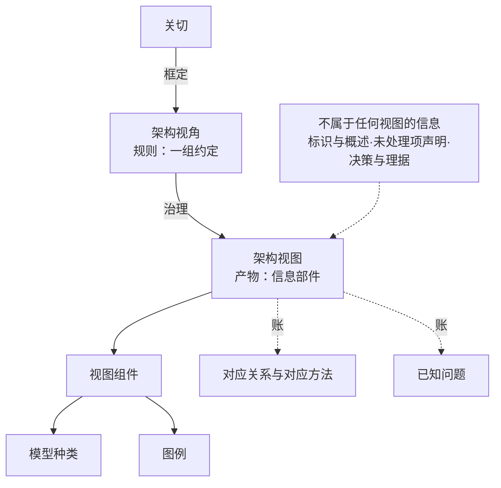

# 第13章 入口文件：架构描述：那一份里有什么（开工单）

> **本件由章级重排（2026-10-12）新建**——ch13 是**新建章**，也是**本批料最肥的一章**。**给 agent 读**；人只发一句话：**`开工第13章`**（新开一个对话，工作目录选 `100-subprojects/01-系统工程研究`）。
> **结构已冻结**：单一权威＝[`00-全书框架.md`](../03-架构师是个怎样的物种/00-全书框架.md) §三 ch13 行 ＋ [`00-目录.md`](../03-架构师是个怎样的物种/00-目录.md) 第十三章块。
>
> **★ 2026-10-14 更新（本章经三轮重析，结构以本件为准）**：章题经用户裁定＝**`架构描述：交得出去的工作产品`**（**丙案**·13 汉字；**2026-10-14 更正**——本件曾把定稿误记为甲案 `那一份里有什么`，据用户说明更正）；结构改**第三案**（五内容块＋正文 29 节）——**现行结构见本件 §十五（生效版四样＋配额）／§二十（框架七件＋48 条标题清单）／§二十.12（章题三案与裁定）**。**框架 §三 ch13 行与 `00-目录.md` 第十三章块至今仍是旧骨架（17 节）**，须随本章落库批次改净（见本件 §三十）。

---

> **★ 37 号料源（2026-10-13 批 0 登记）**：本章重写时须取用 **报告 37 号**〔架构视图口径研究报告（v1.12）〕——**§八 视图≠图＋"符合视角"两张 shall 清单**（§3.7／§3.14／§3.19／§6.8 注2／§8.2 a)／§5.2.8 EXAMPLE 2／§6.6 注3）＋**§九 9.2／9.3 七类视图清单与逐条详解**（42020 §E.4.2.1~.8；四路视角来源）＋**§九 9.3.4 逻辑视图三问**（是什么／在什么条件下成立／结果归谁）——**用户裁：七类视图升独立一节，原 13.3／13.4 顺延**。
> 逐章判定与本批施工序见 [pending-align-textbook-to-37.md](pending-align-textbook-to-37.md)。

> **★ 38 号随章影响（2026-10-13 用户令：「十二章及后续章的变动，在重写12章及后章节时再随着改动」）**：本章重写时**一并落**报告 38 号连带——**取料单**＝[`pending-align-textbook-to-38.md`](pending-align-textbook-to-38.md) **§五表 ch13 行**：① **决策与理据入描述侧**——42010 **§5.2.9** 明列 *architecture decision* 与 *architecture rationale* 为 AD 元素；**§6.10.1 十一项**＝记录件的字段底；② 接报告 **§11.1** 的分层：定义产内容（概念或属性＋管控原则），**决策进描述侧、不改变产出种类**；③ 旧 `15-…架构定义落地…md` 里"四级映射表 → **依据决策（ADR）**"末栏并入本章。

> **★ 39 号随章影响（2026-10-14 补记；报告 39 号《架构师职责与产品数据研究报告》v1.1）**：本章重写时**一并落**（**A 级**）——取料单＝[`pending-align-textbook-to-39.md`](pending-align-textbook-to-39.md) **§二 A3 ch13 行**：① **补 AD 法定内容十组**（42010 **§6.1~§6.10**），其中**两样现骨架没有**——**§6.1 标识与概述**（日期与状态、作者、评审者、批准权威、变更历史）、**§6.2 未处理项与不符合项声明（含理由）**；② **决策与理由的记录要求（13 准则／11 项／理由 5 条）归第12章 `12.5`**，本章**只交叉引用**、不重讲。
> **★ 落点（本阶段定）**：① 项落 **`13.2` 末节（"不属于任何视图的那些"）＋`13.6` 输出账**（V-O 账里加"标识与概述"一行、"未处理项与不符合项声明"一行——后者正本依据＝**42010 §6.2 末两句**，已在 §阶段一预备期查出，见 `.work-ch13/引文回正本核结果.md`）。

> **★ 40 号随章影响（2026-10-14 补记；报告 40 号《架构治理研究报告——从名词与动作到四案对证》v1.0，提交 `8cd6fd12`）**：本章重写时**一并落**报告 40 号连带（**C 级·增补一处**）——**取料单**＝[`pending-align-textbook-to-40.md`](pending-align-textbook-to-40.md) **§四 落点表第 7 行**：
> **① 落点**＝`13.2` 末节（"不属于任何视图的那些"）与 `13.6` 输出账（V-O11／决策与理据在描述里的位置）：讲"决策与理据是 AD 元素、其位置在本章给"时，**补上治理侧的那一句依据**——**架构描述里"决策权属方"那一栏，是治理在文档里的落款位**（42010 **§6.10.1** 逐字 *identification of decision authority or owner*，中译：决策权属方或决策责任人的标识）；**当时若根本没有有权者，这一栏只能是空的，而且补不回来——事后补上去的名字不是当时拍板的人**（报告 §4.1 第 6 条／§5.4.4 实例三；恒信那一栏"空得有道理"）。
> **② 三处正本支撑**：42020 **§6.2 c)**（由具有适当职权者作出）／42010 **§6.10.1**（记录决策权属方）／15288 **§6.4.4.3 e) 2)**（收口动词是 *obtain agreement*，中译：取得一致意见，**不是批准**）。
> **③ 分工**：**第12章已把"决策权属方"立为术语（附录 A T-210）并写进十一项**——本章**不重讲怎么记**，只在"它在描述里占哪一处"上补这半句**治理落款位**的口径（并可并入 ③ 心智模型第④条"有账可查"：**账不只给自己查，也是治理的落款位**）。
> **④ 一处关联待裁**（不属本章，只记）：40 号把 **HUD／EOS** 做成完整四问，而案例圣经只有 A／B 两线——**若裁"进教材书作外部参照案例"，本章七类视图的举例来源可增 HUD 一例**；维持则仍用恒信／冰链。

## 〇、开工单（agent 自读）

> **★ 2026-10-14 接续令（新会话先读这一条——它覆盖下面那句"先只做阶段一"）**：本章**阶段一（第三版）已经用户确认，阶段二、阶段三已出，阶段四第一二步已完成**；七批正文全部成稿（**定稿 17820 汉字**，红线自查"超线：无"），**未落库、未提交**。**不要重做阶段一**——**从阶段四·第四步（去重复）接着走**；读序、续走点、书侧现状与落库净 10 项见本件末尾 **§三十 交接单**。**一阶段一确认照旧；未经确认不落库、不提交。**

读 `claude-memory/MEMORY.md`、本件、[`pending-ch10-18-restructure-35.md`](pending-ch10-18-restructure-35.md)、[`架构语义立场表-ch10至ch18.md`](架构语义立场表-ch10至ch18.md)，按《逐章修订手册》**七阶段**重写**第13章**。

**先只做阶段一**：给出**目的、目标、主线、内容概要**（主线要支撑本章题目），贴全文待确认。

**读解基础按手册 §1.1.1 五类办**；**第⑤类＝指定的旧料**（见 §二）。**★ 本章的额外要求**：它是"35 号 §十三 无家"这一处的正解，**阶段五第一道筛须是"35 号十七节落点核对"**——逐节问"这一节在 35 号的骨头上占哪一格"。

**铁约束**：旧内容只作参考；一阶段一确认；**未经确认不落库、不提交**。**每关贴证据块三格＋关内清单**。

**收工**：复算＋记忆写回＋提交双推，并为第14章备好入口。

---

## 一、结构与口径（已冻结）

| 项 | 内容 |
|---|---|
| **章题** | **第13章 架构描述：交得出去的工作产品**（13 汉字；2026-10-14 用户裁「丙」，见 §20.12 末更正条。**更正记**：本件曾把定稿误记为甲案「那一份里有什么」，2026-10-14 据用户说明更正；甲案与章级重排旧题「一份架构描述里有什么」均已作废——本件 §八／§九／§十一 等历史节内仍存其原样，不改） |
| **篇属** | 中篇 · 方法与判定 |
| **块与节** | **第三案（2026-10-14 生效）**：`13.1 引言`（3 节）＋`13.2 架构描述是什么`（5 节）＋`13.3 视角：从惯例到规格`（6 节）＋`13.4 视图：关切怎么被应对`（6 节）＋`13.5 常用的几类视图`（8 节）＋`13.6 对账：缺哪一条都不算齐`（4 节）＋案例进展三处＋`小结`＋附录 A~E，**正文 29 节**；**认知反转＝`13.6.4`（末块末节，置于案例③之前）**。旧记「`13.3 视图设计四步`(5)＋`13.4 两张清单与一次自检`(4)」（框架 §三 行与目录块内仍存，随落库批次改净） |
| **主案例** | 恒信主／冰链镜 |
| **暗线站** | 万辉·关切台账／视角清单／对账表·补起（落案例进展；2026-10-12 由旧第15章移入） |
| **明线** | 第13站，③ 心智模型；收束句待新编 |
| **新术语** | 附录 A **T-152~T-160**（T-168「架构落点」随批核） |

**主底本**：**35 号 v1.3 §十三 整节**（视图设计四步＋V-I1~10／V-O1~12＋十一条自检）＋ **36 号（§三·§四：视图的价值＝同解／自然语言 vs 被定义的语言——§13.2 价值论证的主底本，2026-10-12 立）**；辅＝**30 号（架构描述四定义）**、**32 号（视角规格与关切裁决）**、**22 号（术语权威）**；旧料＝原 ch10 §10.3 四节 ＋ 原 ch15 第三幕。
**正本**：**42010:2022 §3.7（视图＝information part）／§3.8（视角＝set of conventions，无属概念）／§3.16（视角规格＝信息部件）／§3.19（视图组件）／§3.15（模型种类）／§3.14（图例）／§3.3（AD＝work product）／§6.1~§6.10（内容要求）／§7（ADF）／§8.1 a)~g)（视角规格七项）／§8.2／§8.3（view methods）**；**42020:2019 §10.4.1（输入三层）／§10.4.3 a)~h)（定型，含 d) 选择理据、e) 用途范围）／§10.4.4 a)~m)（十三项，**含 e) 把概念·属性·原则分配到实体与关系上**）／§8.4.8（表达成件）／§8.4.9／§8.4.10（交付与反馈）**。

**★ 口径（2026-10-12，36 号报告立，本章阶段一必守）**：**视图的价值＝使架构"同解"**——把关于这个实体的内容的"解释"从读者脑子里搬进公开规则，让不同人、不同时间读出同一个意思；**其原因＝自然语言 vs 被定义的语言**（清单语义随读者、视图语义自携，§5.2.8）；**"可判定"是同解的结果，不是价值本身**。**四条防误读**：① 不得把"视图的价值"写成"使架构可判定"；② 不得把"分面＋同一"当视图的价值；③ 不得以"清单没版本／内容没结构"作清单与视图的分界（分界在媒介）；④ "描述表达的对象是架构，受众是利益相关方"，不得写"描述的对象是人"。

---

## 二、料源＝旧文件的哪几段

| 料源文件 | 取哪些 | 去向 |
|---|---|---|
| `03-…/10-第10章-架构-定义与误解.md` | **§10.3 全块四节**（架构描述是一个工作产品／视角是一组惯例／视图是一个信息部件／关注点站在哪个位置；**2026-10-12 整块移出**） | `13.2` 主料 |
| `03-…/15-第15章-架构定义落地-从目的到架构视图.md` | **§15.4.1 视角规格**／**§15.4.2 视角从哪来**／**§15.4.3 视图的三条硬要求**／**§15.4.4 对账**／**§15.4.5 关切分四关裁**／**§15.4.7 缺口三种补法** | `13.3`／`13.4` 主料 |
| 同上 | **§15.3 第二幕**（不是画图交付／不是关切清单／不是视角照抄／不是文档审查／不是评估现场补图／不是标准说了算） | `13.3`／`13.4` 的"不是什么"面 |
| 同上 | **§15.2.5 第四步到第六步：视角是规则，视图是产物** | `13.3.1`／`13.3.4` |
| 同上 | 案例进展①②③（万辉补三关／水忠的老规矩原是一份没写规格的视角／两个最不像的系统同一句定义） | 本章案例进展（重编） |
| `00-…/40-架构治理研究报告-从名词与动作到四案对证.md` | **§4.1 第 6 条＋§5.4.4 实例三**（"决策权属方"那一栏＝**治理在文档里的落款位**；无有权者则空且补不回来）＋§4.4 三处正本支撑（42020 §6.2 c)／42010 §6.10.1／15288 §6.4.4.3 e) 2)） | `13.2` 末节／`13.6` 输出账（**C 级·增补一处**） |

**★ 明确不取的**：`§15.2` 九步链那部分（归第11、12章）；`§15.4.6 两个闸门与十二步最小清单` → **按 35 号 §十三.6 十一条自检重做**（内容重叠，勿两存）。

> **★ 取料位置提示（2026-10-12 主笔实核，阶段二开工前必读）**：上表第一行的**旧 ch10 §10.3 四节已不在现行工作文件里**——ch10 阶段三/四把 `10.3` 换成了「架构的价值」四节（现文 20 节，描述侧无块）。**照现行 `10-第10章-架构-定义、价值与误解.md` 取会取空**；须从快照或历史取：**`.work-ch10/10-before.md` L278~L407**（`## 10.3 架构描述是什么` ＋ `10.3.1 架构描述是一个工作产品`／`10.3.2 视角是一组惯例`／`10.3.3 视图是一个信息部件`／`10.3.4 关注点站在哪个位置`），或 git `a58d2069` 及更早版本的 `10-第10章-架构-定义与误解.md`。同理，框架 §三 ch13 行的"承现 ch10 `10.3` 四节"指的是**改版前**的 §10.3，非现文 10.3。

---

## 三、已勘明的活与待裁

**活**：① 体例四件；② 清点块补落（③心智模型）；③ **视角规格不写"六项"**——按正本 **§8.1 a)~g) 七项**（补 c) 方面体）；末一项"必需的模型、元素、关系、约束与属性"标"**本书归并口径**"、**不删行**（立场表既定处置）；④ **"基本元素"族**（旧 ch15 有 8 处）统一为"**基本条目**"或"基本概念或属性"；⑤ **"架构落点"**（旧名"架构构成物"）本批复核；⑥ 术语户口：T-152~T-160 逐条对位。

**新增·引用警戒（2026-10-12 主笔实核，回正本逐字）**：正本里**唯成清单的"常用视图"只有一处资料性材料——42020:2019 §E.4.2**（语境 E.4.2.2／概念 E.4.2.3／功能 E.4.2.4／逻辑 E.4.2.5／物理 E.4.2.6／技术 E.4.2.7／组织 E.4.2.8）；另有 42010:2022 **附录 C.7** 的 RM-ODP 五视角。若本章引它，**两处须加限定注**：① **§E.4.2.6 把物理视图说成"提供设计解"**（*provides the design solution for a product, service or enterprise*）——与本书"设计解归设计定义过程"（15288 §3.13／§6.4.5）相抵，属 **E.4 资料性**；② **§E.4.2.5 自带注**：逻辑／物理之分 *often somewhat subjective*。另 §E.4.2.4 自注功能视图 *not a 42010 normative requirement but would almost always be included*——**引"功能视图"时不得写成"标准要求有功能视图"**。（供阶段二出原料清单时取用。）

> **★ 阶段一预备期新查出三处（2026-10-13，登记入 §三 待裁）**：① **35 号 §13.1 与 §17.1 重叠**（都在把架构／AD／视图／视角分开；§13.1 多"视图组件／模型种类与图例"两行、§17.1 多"设计方案"一行）→ 建议**本章取 §13.1 为主、§17.1 前三行作回指**（一个判断只正说一次）；② **两层"输入"必须分清**——**D 系列**（35 号 §5.1，定义架构吃什么，归 ch11）与 **V-I**（35 号 §13.3，设计视图动笔前手上要有什么，归本章）**不可缝成一条**，本章第一件账只写 V-I；③ **旧料整块缺 V-O8／V-O9**（**选择理据**与**用途范围**，42020 §10.4.3 d)e)）——不是改词，是补块，列进 `13.4.1` 与 `13.5` 输出账。**逐节落点核对表（阶段五第一道筛的预备件）已建**：`.work-ch13/35号十七节落点核对表.md`（工作件·gitignore 内·未请裁）。

> **★★ 阶段一预备期·引文回正本核已完成（2026-10-13）**：量具 `.work-ch13/verify_quotes13.py`（57 条探针，**命中 57／未命中 0**；库内英文正本三份）。**查出两条真缺陷＋一条假未命中**：**缺陷 1＝"视图方法"的位置记错**——正本 **42010 §8.1 第二段**（L1233）逐字 *A specification of an architecture viewpoint **should** identify view methods (per 8.3)*：**should 对、位置错**（旧 ch15 `§15.4.1` 注与 **19-附录 T-157** 均记作"§8.3 的 should"）→ 本章与两处上游一律改作"**§8.1 第二段的 should 项（细则见 §8.3）**"；**缺陷 2＝§8.1 f) 的括注指向 §6.8**（正本 L1229），而"对应方法"的实质要求分别在 **§6.9.2／§6.9.3**——故 `13.4.1` 照正本引 f)、`13.4.3` 的出处一律引 §6.9.2／§6.9.3，**两句不缝成一句**；**假未命中＝35 号 §13.5 的逐字引文混入排版强调符**（`provides the **design solution**`，正本无 `**`）→ 本章引时须剥掉。**另拿到两处正本实证**：① **§10.4.4 e) 的分配对象是"实体与关系"，不是 15288 §3.13 的"系统元素"**（阶段一 §2.3 那条边界的实证）；② **§6.9.3 那条 shall 在 NOTE 1 里**（正本 L1017），引时须标"注 1"。**结果全文**：`.work-ch13/引文回正本核结果.md`（含 57 条可安全引用清单，按落点分组）。

> **★★★ 2026-10-14（第4轮）状态刷新——开工时读的库已非现行，阶段一须按现文重核**：查实**另一个会话正在改这个工作区**：`git log` 显示 **ch12 已于 10-14 11:46~11:54 落库收工**（`487b0fc2` 阶段四~七／`b2816183` 落库批次／`455f76e4` 收工记忆），**随后 10-14 13:15 又提交 `88baaba0`「第11章 补段：第三环背书主体在组织侧（入选定／背书分家）」**。故：① **本入口文件 §阶段一稿 的 §1.2 前序回执用的是 10-13 快照**——ch11 已改四处（`11.3.1` 新增一段：**第三环拆成"选定"（判断·依据目的·归架构过程）与"背书"（承诺·依据职权·职权不能自授），出处 15288 §6.4.4.3 e) 2) *obtain agreement***；`11.2.1` 补一句；`11.3.2` 表下补一句；附录 A 总图 S3 节点括注）；② **ch11 交出的接口句已落文**（**L261~L263**："**清单不是描述。清单属内容侧，视图属描述侧。本章交出去的是清单；把内容按视角落成视图、写成一份架构描述，是第13章的活。**"，并引 42010 §6.7 EXAMPLE 2"清单可以不属于任何视图"）——**本章 `13.2` 末节正是接这一句**；③ **ch11 现文实测**（口径 v4）＝总汉字 **16571**／散文 12563（75.8%）／结构 `11.1`(3)＋`11.2`(5)＋`11.3`(6)＋`11.4`(5)＋案例进展三处＋小结＋附录 A~E；**`00-主线与各章支撑` v1.10 记的"16414／`11.2` 6 节"已过期**（属 13:15 补段前的读数）。**处置＝阶段一确认后、进阶段二之前，先按现文重核 §1.2 回执与 §2.1／§2.4 的接口描述**（一处已核过：`13.2` 末节接口成立）。
> **★ 同轮查出一处操作性风险（必须遵守）**：**工作区另有未提交的在办改动**——**`35-架构定义与视图设计研究报告…md`（±560 行"英文并列"轮续做）**、`08-第8章…md`（＋2 行：评审/验证/确认 与 **评估·认证** 的分野前向指针）、`09-第9章…md`（1 行：指向第18章的第二张表）。**35 号正是本章主底本**。→ **本章提交一律"显式路径 `git add`"，严禁 `-A`／`-a`／`git commit -a`**，否则卷入他人在办改动；收工前另跑一次 `git status` 复核暂存区只含本章文件。

> **★★ 阶段一预备期·V-I／V-O 两张单子回正本核（2026-10-14 第6轮）**：引文核扩到 **89 条探针，命中 89／未命中 0**（新增 32 条＝V-I1~10 与 V-O1~12 逐项）。**又查出两处误挂＋一处漏项**，均须随本章落文更正：**① V-I2"多对多"挂错**——35 号作"§6.2；§6.4 NOTE 1"，而**§6.2 全文只有 4 句 shall／should ＋ 1 个 EXAMPLE、没有 NOTE 1**；"多对多"那句在 **§6.4 注 1（正本 L895）逐字** *the association of concerns with stakeholders is many-to-many* → 本章**相关方清单挂 §6.2（L855）、多对多挂 §6.4 注 1（L895），两句分挂**。**② V-I10 半对半错且不可追**——35 号只给"§6.2"、无具体条款；"约束"对得上 **§6.2 L863**（*known resource limitations or other constraints*），而"**前一轮遗留的未处理项**"正本未立（§6.1 注 1 L845 讲的是"面向被别的 AD 引用的 AD"，不同事）→ 改写为"**上一轮留下的约束与未处理项（本书归拢）**"并**显式标本书归拢**、出处分挂。**③ 漏项（最要紧）**——**§6.2 末两句**（L863 资源限制与约束／**L865 不符合项须识别并说明理据**）**正是"未处理项声明"的正本依据（O10 的落点），而 35 号 §十三 整节没有收它** → 本章 `13.5.2` 输出账的"未处理项声明"**出处补 §6.2 末两句**，三样（未回应者／资源限制／不符合项及理据）齐。**两条形式结论**：V-I 十项**八项原引正确**、V-O 十二项**原引全部正确**——**两张单子作为交付物站得住**，只须修两处出处、补一条漏项；另 **V-I9 的出处**原引 42020 §10.4.3 b)（正本 L2710）**对**，但原附挂的 §6.7 EXAMPLE 2 与此无关（那条讲"视图只覆盖实体一部分"，归输出侧与 `13.2` 末节）。结果全文＝`.work-ch13/引文回正本核结果.md` §四。

**待裁**：
1. **V-I1~10／V-O1~12 两张清单的形态**——正文全列，还是正文给用法、清单作表入本章附录？（我倾向**两表都在正文**，这是本章最实的交付物；但本章 2.0 万的配额就是为它们留的）
2. **十一条自检**放在 `13.4.3` 作正文，还是与章末自查合并？（我倾向**分家**：十一条是**对描述的自检**，章末自查是对读者概念的自查，两者不许混）
3. **本章总图（附录 A）的归属**——是"一份架构描述的构成图"还是沿用旧 ch15 的流程图？我倾向前者（新章讲的是**产物**，不是流程）。
4. **"视图不是一张图"**（35 号 §13.5）是否独立成节？（我倾向并入 `13.4.4`，即已排的末节）

---

## 四、篇幅配额

**本章目标：2.00 万汉字**（本批唯一例外；浮动带 1.7~2.3 万）。

| 件 | 配额 | 红线 |
|---|---|---|
| `13.1 引言`＋三子节 | 620 | 章首 ≤4%（≈800） |
| `13.2`（5 节） | 3900 | 780／节 |
| `13.3`（5 节） | 4400 | 880／节（四步是主干） |
| `13.4`（4 节） | 4300 | **两张清单是本章之重**：V-I 1100／V-O 1500／十一条 900／视图不是一张图 800 |
| 案例进展（2~3 处） | ≤1500 | 单块 ≤700 |
| 小结 | 460 | — |
| 章末附录 A~E | 3500 | 可压件 ≤22%（≈4400） |
| **合计** | **≈18680＋缓冲** | 论证 ≥60% |

---

## 五、承接与交出

- **接第12章**（2026-10-13 该章已重写落库，接口按终稿核过）：本章的输入四样——① **选定的那一条架构**（`12.3.3`：评估出"最佳"是判断、处置是决定）；② **残余风险与未决项**（`12.3.4`）；③ **决策与理据**（`12.5`：决策是"一个集合"，**理据与其并排、同为架构描述元素**——42010:2022 §5.2.9／§5.2.12）；④ **未决议题**（`12.4.3`，**本书用法**："暂不决定"的合法去处）。四样都是本章"表达成件"的**输入**（O6／O8）。
- **★ 与本编章的两处接口（承 §十三 裁定）**：① `13.2.5` 节题含指示指代（"不属于任何视图的那些信息"）——**随本章轮次改**；② 第12章 `12.2.1` 已声明"**权衡（trade-off）无标准定义句**，定义性表述落在 tradespace"并引 `42020:2019 §8.4.6 注 2／注 5`——**本章若再引同一处，请回指、不重录英文**。
- **★ 附录 A 新增六条术语的归属（2026-10-13 落）**：**T-206 架构理由（理据）／T-207 权衡空间／T-208 强制项／T-209 影响半径·信息成本·修改风险／T-210 决策权属方／T-211 未决议题**——**主章均为第12**，本章用到时按此引；另 **T-76（ADR）已改"十一项为骨、六问作本书压法"，T-77 期权价值本章不用（只作登记）**。
- **接第10章**：第10章只留"架构本身无形、有形的是架构描述"一句；**本章不许重讲定义句**。**§13.2 除"长什么样、怎么造出来"外，须讲"为什么"**——视图的价值＝使架构"同解"、其原因＝自然语言 vs 被定义的语言（36 号 §三·§四）；"可判定"是同解的结果，不得当价值写。
- **交给第14章**：本章产出的 AD 是第14章"谁依从谁"的**约束来源**；AD 元素与系统元素的两道界在第14章给全。
  **★ 2026-10-14 补记（两条界的归属，用户问"物理视图与设计描述、系统分解结构的区别放在哪里"）**：**物理视图↔设计描述**与**物理视图↔系统分解结构**这两条界，**正说都在第14章**（`14.2 两棵树的交接`／`14.3 视图上的元素是谁家的元素`）；**本章只在 `13.5` 七类块的物理视图一节留一句"写到哪儿为止"＋一条指针**——明细见本件 §十四。**本章正文不出现"SBS／PBS"字样。**
- **交给第15章**：AD 被选定并冻结的那一版＝**架构基线**（第15章立）。

> **★★ 上游前向引用实核（2026-10-14 第5轮，全文见 `.work-ch13/上游前向引用实核.md`）**：全库指向"第13章"的指针**分两类、须分开记账**——
> **【甲类·指向本章（架构描述）＝本章必须兑现的承诺，共 7 条＋须自补 1 条】**：**ch10 五条**（L120 `viewpoint governs a view` 关系位／L170 后三对归第13章／**L180"视图把内容写成了被定义的语言，让不同的人读出同一个意思（同解）——那是第13章的事"**／L518 域·视角·视图三者立户与规格要求／L654 另加"信息部件"立户）；**ch11 两条**（**L261~L263"清单不是描述…是第13章的活"**／L317 覆盖关系归第13章）；**ch12 零条**——**故 ch12 那句接口须本章自己补**（ch12 已把决策与理据立为"架构描述元素"（L390／L474），**却从未说它们在描述里占哪一处**；落点＝`13.2` 末节＋`13.5` 输出账）。
> **【乙类·指向旧第13章（配置管理）＝不属本章的账】**：**ch9 L52／L694**（"第13章会把⑥可复现意识长成配置与基线""长成第13章的基线"→实应**第15章**）＋**旧 ch15 L619**（"配置管理让话说得清（第13章）"→自指第15章）。**三条均为章级重排留下的旧章号存量**（重排只改计划未改正文）——**登记不擅改**，随 ch9 轮次或第15章重写时一并改。
> **★ 由此反推两条本章约束（新增·供阶段三）**：① **"同解"的入口句式已被 ch10 锁定**——`13.2` 的承重论证须从"被定义的语言 → 不同的人读出同一个意思"进去，**不得从"可判定"或"分面＋同一"进**（那两条正是防误读要禁的）；② **"内容侧／描述侧"是 ch11 已立的既有词、不得另造**——故请裁 2 的方向收窄为：**沿用 ch11 的对立词，只把本章那两件账从"清单"挪开**（如"两件账"），不必另创一套。

---

**请确认开工（或指出要改的地方），确认后我出阶段一。**

---
---

# 阶段一稿（2026-10-13 · 待用户确认）

> **本稿＝阶段一四样产出（目的·目标·主线·内容概要）＋读解基础①④的回执 ＋ 关内清单 ＋ 证据块三格 ＋ 请裁各项。**
> **状态＝未确认**。确认后本行改写为"已确认＋日期"，随即进阶段二（取原料清单）。**正文库与书侧文件一字未动、未提交。**

> **★★ 预备期已收敛（2026-10-14 第8轮判定）——本关只欠"您一句确认"**：阶段一稿自 2026-10-13 起**已展示、已落本件**（展示双落点齐），此后连续 7 轮做的全是**不需要任何裁定的预备件**，现已**全部收敛**——第 8 轮的重跑与复核**未查出任何新东西**（引文核 89／89 仍全命中、上游无新提交、承诺覆盖 8／8 全接住）。**七件预备件清单**（均在 `.work-ch13/`，gitignore 内）：
> | 件 | 作用 | 查到的东西 |
> |---|---|---|
> | `ruler13.py` | 章内施工尺（口径 v4 写死） | 供阶段四逐节读数 |
> | `料源读数与量具台账.md` | 旧料基线与目标区间 | **两处硬伤**：旧 §10.3 句长中位 **31**（须降到 23~26）／旧 ch15 整句加粗 **23**（须清零） |
> | `35号十七节落点核对表.md` | **阶段五第一道筛**的预备＋连带件预拟 | P1~P5 五处问题；**框架 §三 ch13 行与目录块已整段预拟**（节数 19）；存量旧题误报已自查更正 |
> | `引文回正本核结果.md` | 手册 §1.4.1「唯一不能后补的一步」 | **89 条探针全命中**；**4 处真缺陷**（视图方法位置／§8.1 f) 括注／V-I2 多对多／V-I10）＋**1 处漏项**（§6.2 末两句＝未处理项声明的正本依据）＋1 处假未命中 |
> | `上游前向引用实核.md` | 兑现别人的指针 | **7 条指向本章的承诺＋1 条须自补**；另 3 条旧章号归他章 |
> | `阶段一概要↔上游指针覆盖核对.md` | 核自己的产出 | **8／8 全接住**；修掉一处缺口（**"关注点"未立户**）；立两条兑现口径（`governs` 是 shall／关注点立户） |
> | `_old-10.3.md` | 旧料原文取证 | 旧 ch10 §10.3 四节原文（供阶段四取料） |
> **★ 结论：本关不需要我再做任何事——只等 `确认阶段一`（或对 §七 七条逐条裁定）。** 再往下（阶段二全库点检表＋原料清单）**必须**先有这一句（手册 §0.5 纪律 1「阶段一不过，不取料」＋纪律 6「确认不得自代」）。

> **★ 2026-10-14（第9轮·重开工会话）**：人再发一次 **`开工第13章`**（新会话、工作目录＝本子项目）→ 按开工单**只做阶段一，未进阶段二**。**本轮按现文复核（不拿旧快照办事）**：上游指向本章的指针**全部成立**——ch10 **L120**（`a viewpoint governs a view` 关系位）／**L170**（后三对归第13章）／**L180**（同解归第13章）／**L391**（忠实凭追溯证，后两件各归第16章与第13、14章）／**L518**（域·视角·视图完整立户归第13章）／**L654**（架构视角·架构视图·关注点·信息部件立户归第13章）；**ch11 L261~L263** 接口句在文（"清单不是描述……是第13章的活"＋§6.7 EXAMPLE 2）；**ch12 L390／L474／L553**（决策与理据＝架构描述元素，§5.2.9／§5.2.12）。**阶段一四样产出已重贴对话**（展示双落点仍齐）；**状态仍＝未确认**，待 `确认阶段一`。**正文库与书侧文件一字未动、未提交**。


## 一、读解基础（手册 §1.1.1 五类）

### 1.1 ① 全书的目的·目标·主线（三条线）

**目的**：工具、流程、方法年年进步，项目的失败没有变少——因为**多数失败不是技术失败，是概念失败**。"需求"和"规定需求"、"验证"和"确认"、**"架构"和"架构描述"**——这些词天天挂在嘴边，能用、不会定义、各指各的。"架构"与"架构描述"这一对，正是本书前言的例词之一，**第10章办了前半（架构是什么），本章办后半（架构描述里有什么）**。

**目的只有一句**（元文件用完整版）：**概念先要说准，方法才有稳定的地基，图式、心智模型和解释框架才能立得住。**

**目标**：① 每个概念配一把尺子；② 读完能当场判定——序二的判据最直白：**合上书，回你的评审会，试着对外行讲清楚"架构"和"架构描述"、"验证"和"确认"的区别**；③ 走完从工程师到架构师的认知链；④ 落到人身上，能力最终体现在交出的**产品数据**上。

**三条线**（单一权威＝[`00-三条线索.md`](../03-架构师是个怎样的物种/00-三条线索.md)）：

| 线 | 性质 | 立论章 | 本章的位置 | 对读者的职 |
|---|---|---|---|---|
| **明线·概念体系能力** | 能力（显性） | 第1章 | **第13站**，层级位＝**③ 心智模型**；收束句**待本章新编** | 路标 |
| **暗线·产品数据能力** | 能力（隐性） | 第7章 | **实物站·万辉**——关切台账／视角清单／对账表·**补起**（2026-10-12 由旧第15章移入） | 手感 |
| **案例线·团队成员成长线** | 人（载体） | 第1章双会 | **恒信主／冰链镜**；恒信 5 人（满海／玉杰／黄程／徐漾／万辉）＋冰链 4 人（李旭／文正／董勐／逸人） | 认同对象 |

**本章站在主线的哪一站**：明线第13站——**"图"退场、"描述"上场**的那一站。第10~12章把人送到"架构是那份内容、决策是凭什么定下来的这一个"；到这一站，**读者第一次被要求交出一件可签收的工作产品**。**暗线在这一站由"写下"转为"补起"**：第11章水忠把判断写成老规矩（写下）、第12章董勐在接口清单上补一条受控导出（补起），本章万辉补的是**三张纸**（关切台账／视角清单／对账表）——**同一动作，第三次出现，落在一个"有头衔、缺底座"的人身上**。

### 1.2 ④ 前序各章回执（逐章三句＋两句）

> **口径**：只有**本章之前的各章**作权威（第1~12章）；本章与后续各章不作权威（手册 §1.1.3 口径 6）。

| 章 | 它为什么写 | 它交下的那一句 | 它撑住全书哪一段 | 讲到哪里为止·留给本章什么 | 本章不得重复它讲过的 |
|---|---|---|---|---|---|
| **1 概念体系能力** | 立学习方法论：概念先要说准 | 学习产出是一条乘法律；方向与表征是两个归零项 | 明线发源＋案例线立 | 只给四问与坐标系，不涉领域概念 | 四问的操作法（本章只用，不重讲） |
| **2 工程** | 量第一个领域词 | 工程是把交付从人身上挪到方法上 | 明线第2站＋暗线实物站 | 不涉架构 | — |
| **3 需求、设计开发、质量** | 三词钉定义 | 定需求→出规格→判满足 | 明线第3站＋暗线实物站 | 不涉架构 | — |
| **4 需求工程** | 规定需求谁做出来 | 两段并列，只在"批准→基线"这一处交接 | 明线第4站＋暗线实物站 | **基线在需求侧的含义**（分界线、出发原点）已立；**本章不再讲需求基线** | 需求基线与"从什么变起"——本章若涉基线只作回指（配置管理归第15章） |
| **5 需求的完整性** | 需求要全 | 三类内容各有代言人 | 明线第5站 | — | — |
| **6 设计开发落地** | 接上篇之后那一问 | 逐对生成；上一份的叶节点是下一份的需求 | 明线第6站＋暗线实物站 | **设计链**已立 | 设计树、结对六步 |
| **7 产品数据** | 立暗线 | 开发产品就是开发产品数据 | **暗线立论章** | **产品数据全集**已立（六类）；**"物化层"定位已立** | 产品数据六类、两域三态、数据质量五尺 |
| **8 评审、验证与确认** | 谁来查、拿什么尺子 | 评审对目标、验证对规定需求、确认对预期用途 | 明线第8站＋暗线实物站 | **三把尺子**已立 | 评审/验证/确认的分工；**"评审的对象是工作产品"**本章只作回指（"可签收"由此而来） |
| **9 工程师** | 谁在做 | 能力＝换个人接得住；活＝需求、设计开发、产品数据、评审验证确认 | 明线第9站＋基线交汇章 | **个人能力清单**；**"可复现意识"是个人版** | 六项能力、三种粒度；**"个人可复现意识→组织基线"这条递进归本章一句**（见 §五 待裁 7） |
| **10 架构** | 给"架构"一个能对账的定义 | **架构是那份内容，不是承载它的那份东西**；能签收、能入库、能版本化的是**架构描述**；"基本"＝目的判据；架构靠**收窄设计空间**管住下游 | 明线第10站（③心智模型） | **描述侧三词（架构描述／架构视角／架构视图）整族 2026-10-12 移出本章，其家＝本章**；`10.3.4` 已把"忠实凭追溯证"点了一句并注明"各归第16章与第13、14章" | **定义句（§3.2）不重讲**；**"架构本身无形"不重讲**——本章从"那份内容要交出去"起句 |
| **11 架构定义** | 说准"架构定义"这个动作 | **架构定义不是"给架构下定义"，是一次看得见进出口的变换**；产出只有两样（基本概念或属性＋管控原则）；中间靠**取材与综合**；四环**本章只走到第二环**（选定与背书归第12、表达成件归第13） | 明线第11站（③心智模型）＋暗线实物站·水忠 | **三张清单（概念·属性·原则）＝内容侧**已立；**"清单≠描述"**已立；**元素与关系是"可以关乎"的对象**已立 | **输入五组、三条去向、候选四道准入**；**三张清单的内容**；**"清单≠描述"这条边界本章只作回指**（本章的量词一律不带"清单"二字，见 §五 待裁 2） |
| **12 架构决策** | 说准"决策"：凭什么定下来的是这一个 | 架构决策是一个集合；判据只有目的；强制项是给定；代价只管排序与时机；**记录不是定死** | 明线第12站（③心智模型）＋暗线实物站·董勐 | **决策与理据已记下**（§5.2.12／§6.10.1 十一项／§6.10.2 理据六项）；**拍板常在架构过程之外**已立 | **权衡空间、筛与选、三把尺、十一项内容、六问压法**——本章**一处不重讲**；本章只给它们**在描述里的位置**（§5.2.9 把它们列为 AD 元素） |

**★ 本章的输入四样（接第12章，接口按 ch12 终稿核过）**：① 选定的那一条架构（`12.3.3`：评估出"最佳"是判断、处置是决定）；② 残余风险与未决项（`12.3.4`）；③ 决策与理据（`12.5`）；④ 未决议题（`12.4.3`）。**四样都是本章"表达成件"的输入**（对应 35 号 V-I／V-O 一侧）。

### 1.3 ⑤ 本章现行内容（通读·只作参考）

**先说清一件事**：**新第13章没有独立正文**。章级重排（框架 v3.69）只改了计划、没改文件——现盘上名为 `13-第13章-配置管理.md` 的文件，是**旧第13章**，它的**新家是第15章**（配置管理）。新第13章（架构描述）的料散在两处：**旧 ch10 `§10.3` 全块四节**（架构描述是一个工作产品／视角是一组惯例／视图是一个信息部件／关注点站在哪个位置——2026-10-12 整块移出）＋**旧 ch15 第三幕**（§15.4.1 视角规格六项／§15.4.2 视角从哪来／§15.4.3 视图的三条硬要求／§15.4.4 对账／§15.4.5 关切分四关裁／§15.4.7 缺口三种补法）。

**通读后的缺口判断（五条）**：

1. **旧料缺整块**：旧 ch15 **无"视图设计四步"、无 V-I／V-O 两张单子、无十一条自检**——35 号 §十三 整节**无家**，这是本章要补的第一块。
2. **旧料口径已过期两处**：① **视角规格"六项"**——正本 §8.1 是 **a)~g) 七项 shall ＋ 一句视图方法（should，见 §8.3）**，旧表漏了 **c) 方面体**、并把本书归并的末一项混在"六项"里说；② **"基本元素"族**（旧 ch15 8 处）与 **"承重件"作名词化谓项**——统一为"基本条目"或"基本概念或属性"（立场表既定处置）。
3. **旧料缺"为什么"**：旧料回答了"描述长什么样、怎么造出来"，**没回答"为什么必须有描述"**——清单已经登记了架构的全部内容，视图凭什么不是多余的？**这是 36 号报告的问题句，也是本章 `13.2` 的价值论证**（本章唯一一处要新写的"论证块"）。
4. **一处未落的形式关**：`13.2.5 不属于任何视图的那些信息` 含**零先行词的指示指代**（"那些"）——**随本章轮次改**（2026-10-13 ch12 轮查出并登记）。
5. **一处待裁（37 号连带）**：**七类视图升独立一节**（用户 2026-10-13 已裁"升"），故 **13.3／13.4 顺延为 13.4／13.5**，**框架 §三 ch13 行与目录须同批改**（本阶段只登记，阶段三落）。

## 二、阶段一·四样产出

### 2.1 目的（这一章为什么写）

**第一层（承上）**：第10章把"架构"和"架构描述"这两个词**分开了**（能签收、能入库、能版本化的是描述），第12章把**决策与理据**记了下来——可"分开了"和"记下来了"都不等于**交得出去**。**一份东西能不能签收、能不能入库、能不能版本化，不取决于它有内容，取决于它是不是一份合格的、有账可查的工作产品。** 本章就办这一件事。

**第二层（本章的正身）**：把**"架构描述"这个工作产品拆开看它由什么构成**——一句话说，**它把关切接到视角、把视角接到视图、把视图接到组件与模型种类，于是每一处都找得到账**。这个"拆开"不是分类癖：**描述是唯一能被评审、被验证、被基线化、被交出去的那一样东西**（第8章三把尺子的对象是它，第15章基线的对象是它，第14章交接的也是它）。**它拆得清不清，直接决定下游能不能用。**

**第三层（不写会缺什么·七样）**：

1. **第10章末句的预约落空**——第10章 §10.3.4 结尾点了"忠实凭追溯证（后两件各归第16章与第13、14章）"，本章是那个"第13章"；不写，这句话没有兑现处。
2. **描述侧整族词无户口**——架构描述／架构视角／架构视图／视角规格／视图组件／模型种类／图例／架构描述框架（ADF），**八个词已在附录 A 立了术语（T-152~T-157 等），却没有一章正文安放它们**；词有户口、没有家。
3. **35 号 §十三 整节无家**——视图设计四步、V-I 十项／V-O 十二项、十一条自检，是全书**最实的一份交付物清单**，此前一直挂在旧 ch15 的第三幕里、而且只落了一半。
4. **"为什么必须有视图"没有对手**——读者的自然质疑是"清单都写全了，视图不是重复劳动吗"，本章之前**全书没有一处正面回答**（36 号报告的问题句）。不写，视图这一层就被读者当成画图。
5. **明线的第13站悬空**——第10~12章三站都在③心智模型，第13站若只讲"描述是什么"，读者到这一站拿不到任何新动作。
6. **暗线的一次动作没有落点**——"补起"这个动作在第12章由董勐做了一次；万辉的关切台账／视角清单／对账表（2026-10-12 由旧第15章移入）**没有能落的章**。
7. **第14章的入口悬空**——第14章要问"设计依从的是什么""视图上的元素是谁家的"，前提是**先有一份视图**；本章不把描述立成一份有界面的产物，第14章整章的辨析没有着力点。同理，**第15章的"架构基线"对象、第16章"管控原则可不属任何视图"这一处的接口**，都等本章把 AD 的构成说清。

### 2.2 目标（写出来要达成什么·按本书自己的刻度）

**主级＝第 ③ 级（心智模型）为主，底座铺到 ②（图式）；解释框架不建（归第17、18章）。**

| 级 | 本章要送到的东西 |
|---|---|
| **① 表征**（把词说准） | **描述侧八词各就各位**：架构描述＝工作产品（§3.3）／架构视角＝**一组惯例**（§3.8，**正本无属概念，不许替它补**）／架构视图＝**信息部件**（§3.7）／视角规格＝信息部件（§3.16）／视图组件＝可分离构成部分（§3.19）／模型种类＝按其关键特性与建模约定相区分的模型类别（§3.15）／图例＝对约定的**非正式**记录（§3.19 注 1）／ADF＝已确立的惯例·原则与实践（§3.5）。**另三组近邻词当场分开**：① 架构 ↔ 架构描述（内容与载体）；② 视角 ↔ 视图（**规则与产物**，不是立场与图）；③ **视图 ↔ 图**（图＝某些模型种类的记法，以**视图组件**身份进视图）。 |
| **② 图式**（概念变成能套用的结构） | 三张结构图：① **描述的内部组织链**——利益相关方 → 关切 → 视角 → 视图 → 视图组件（＋模型种类/图例）；② **视图设计四步**（定型 → 建模 → 对齐 → 成件）；③ **七类视图的分工**（语境／概念／功能／逻辑／物理／技术／组织——**前六类沿抽象层级推移，组织另立一维**）。**一条边界随图走**：本层的"分配到实体与关系上"是**描述层**的分配（42020 §10.4.4 e)），与 15288 §3.13 设计定义层的"系统元素及其关系的规格"**是两个概念，不许串**（串了就是 2011 痕迹回流）。 |
| **③ 心智模型**（会动的图式） | **本章的主收成，四条**：① **描述的价值＝使架构"同解"**——把"解释"从读者脑子里搬进公开规则，让不同人、不同时间读出同一个意思；其原因＝**自然语言 vs 被定义的语言**；**"可判定"是同解的结果，不是价值本身**（36 号 §三·§四，本章 `13.2` 的承重论证）。② **视角是一份可以"先订"的合同**（§6.6 注 3：可在任何详细架构工作开始之前达成），合同写全了才谈得上治理（§6.7 shall：视图须遵循其管控视角的约定）。③ **生成顺序不可颠倒**：视角规格 → 模型种类与图例 → 模型 → 视图组件 → 视图 → 覆盖与对应关系核对；**先画图再找视角挂上去，不合格**（37 号 §8.4）。④ **描述有账可查**——判一份描述好不好，看**四件账**：每条关切有视角框定／每个视角有视图覆盖／每处对应有方法可核／每件未决有记录。 |
| **当场能用**（合上书就能做的动作，6 条） | ① 判一份东西**是不是架构视图**（三步：在 AD 里吗／受某个视角治理吗／标明模型种类或给了图例吗）；② 判一幅**是图还是视图**；③ 拿**十一条自检**量一份现成的描述，指出缺哪几条；④ 判一份**视角规格全不全**（§8.1 a)~g) 逐项数）；⑤ 判**跨视图对不上**时该改什么（改对应关系，不是改图好看）；⑥ 判七类视图该出哪几类（由**关切反推**，不由标准清单照抄）。 |
| **失效边界**（5 条） | ① 把**图**当描述、把画图当落地；② 把**视角**当立场/画图习惯（而不是一组可写全的约定）；③ **先出图、后补视角**（生成顺序颠倒）；④ 把**清单**当描述（以为内容写全了就不需要视图）；⑤ 把"**符合视角**"读成"形式化程度够高"（正本明写不规定形式化程度，**叙述型组件合法**）。 |

### 2.3 主线（本章主线·必须支撑本章题目）

**章题＝"架构描述：一份架构描述里有什么"（承诺＝把这份工作产品拆开，逐件交代里面有什么）。**

> **★ 本章主线一句（拟）：架构描述是一份可签收的工作产品——它把关切接到视角、把视角接到视图、把视图接到组件与模型种类；能拆成这一步，它才交得出去、查得下去。而视图的价值不在"画得像"，在**同解**：把解释从读者脑子里搬进公开规则，让不同人、不同时间读出同一个意思。**

**它怎么支撑章题**（逐字对得上）：题问"**有什么**"，主线答"**有四层构件——描述／视角／视图／组件，加一层语言（模型种类与图例）**"。
**它怎么支撑块序**（块序必须能读成一条论证）：

| 块 | 承担主线的哪一段 |
|---|---|
| `13.2 架构描述是什么` | **有什么**——四层构件各是什么、视图≠图、以及**为什么非有视图不可**（同解） |
| `13.3 七类视图与视角来源` | **有哪几类、从哪来**——七类各自的关切与封顶；视角复用的四路来源与"先穷尽复用、再自建" |
| `13.4 视图设计四步` | **怎么造出来**——定型（含选择理据与用途范围）→ 建模（把内容分配到实体与关系上）→ 对齐（覆盖／一致性／问题记录）→ 成件（视图必备内容与版本） |
| `13.5 两件账与一次自检` | **交出去前拿什么对账**——输入账／输出账两张单子＋十一条自检；末节收"视图不是一张图" |

**★ 三条硬口径（阶段一当场先答"有没有从定义句读不出来的主张"）**：

1. **本章无一条主张是从定义句读不出来的**——"同解"不是对架构的定义，是**描述这一侧的性质**（36 号立论的基础正是 §5.2.8 的"语义自携"，正本一手）；四步、七类、两张单子、十一条自检**全部有正本条款号**（42020 §10.4.3／§10.4.4／§E.4.2；42010 §6.6~§6.10／§8.1~§8.3），属**直读**。
2. **本书读法只有一处，且显式标明**——**视角规格"七项＋一"的合并写法**：正本 §8.1 是 **a)~g) 七项 shall ＋ 一句视图方法（§8.3，should）**；本书若把"名称·出处·版本"与末一项并作一张表来教，**须当场标"这是本书的归并口径，§8.1 正本无末一项"**（立场表既定处置：**只补标注、不删行**）。另 37 号 §9.3 七类视图的"典型组件"也一律标**举例**（真正的清单由该视角规格写定）。
3. **两处不许写成对架构的定义**：① 不许把"使架构可判定"当视图的价值（那是同解的结果）；② 不许把"分面＋同一"当视图的价值。两条同属 36 号 §三 的四条防误读。**另**：不得以"清单没版本／内容没结构"当清单与视图的分界——**分界在媒介**（自然语言 vs 被定义的语言，§5.2.8）。

### 2.4 内容概要（讲什么、不讲什么）

**讲什么**（按五块，**只到"讲哪几件事"，不定节号、不排序**）：

**块一·架构描述是什么**：**从关切到视图的四层构件**（**关切 → 视角 → 视图 → 组件**）——四层各钉一句定义；**关注点单独立户**（ch10 L170／L654 两次预告它的立户归本章；它是"视角框定什么"的宾语，不立户则"框定"无处落脚）；**视角是规则、视图是产物、组件可跨视图复用**，**且"视角治理视图"要说成一条可核的 shall**（§6.7 L943：视图须遵循其管控视角的约定——ch10 L120 推给本章的正是这个**动词关系**，不能只写两个名词）；**视图≠图**——图是某些模型种类的**记法**，以视图组件身份进视图；组件要么标明**模型种类**、要么给**图例**，正本**不规定形式化程度**、**叙述型组件合法**；**为什么非有视图不可**——同解（自然语言 vs 被定义的语言；可判定是结果不是价值）；**AD 里不属于任何视图的那些**（总览、原则、模式与风格、引用基线与参考架构、视图间对应关系、架构理据、未决项）。

**块二·七类视图与视角来源**：标准**不给固定清单**（三处自我限制）——它自带的是 42020 §E.4.2 的七类；七类各自的**关切、典型组件与模型种类、写到哪儿为止、常见误用**（含两处警戒：§E.4.2 是**资料性**；§E.4.2.6 把物理视图说成"提供设计解"与本书"设计解归设计定义过程"相抵，须加限定注）；**视角集的四路来源**（RM-ODP 五视角／框架视角集／ADF 与 ADL 家族／方面体与利益相关方角度）＋**自建的纪律**（先穷尽复用，再自建；自建＝按 §8.1 a)~g) 写规格；视角是资产、视图是产物）。

**块三·视图设计四步**：**定型**（选/改/开发视角与模型种类，含**选择理据**与**用途范围**）；**建模**（定上下文与边界 → 识别实体与关系种类 → 改元模型与模板 → 识别具体实体与关系 → **把概念·属性·原则分配到实体与关系上** → 识别演进原则 → 造模型）；**对齐**（覆盖关系三条 shall／一致性三条／对应关系与对应方法及其成立或违反记录）；**成件**（视图必备内容与版本；**已知问题**含未决项、风险、例外、对模型种类的偏离）。

**块四·两件账与一次自检**：**输入账**（动笔之前手上该有的十样：关切、相关方与其持有关系、实体与环境与预期用途、待表达的架构内容、可复用视角与模型种类、ADF 与元模型、模板与工具、要建模的实体与关系种类、对账与验证的需要、前轮未处理项）；**输出账**（一份描述该交出的十二样：视角规格、模型种类与图例、视图、视图组件、对应关系清单、对应方法及其成立或违反记录、一致性分析与已知不一致、选择理据、用途范围、已知问题、AD 内非视图信息、交付与使用记录）；**十一条自检**（逐条挂条款号）；**末节收"视图不是一张图"**。

**块五·与前后章的接缝**（各一句，不展开）：与第11章的分界（**内容侧的三张清单 vs 描述侧的两件账**）；与第12章的分界（决策与理据**在描述里的位置**，不重讲怎么记）；与第14章的分界（**视图上的元素是谁家的**、三道关——归第14章）；与第15章的分界（**架构描述被选定并冻结的那一版＝架构基线**——归第15章）。

**不讲什么**（六条，逐条点名，防越界）：

1. **不重讲架构的定义句**（§3.2 两半归第10章）；**不重讲"架构本身无形"**——本章从"那份内容要交出去"起句。
2. **不重讲第11章的输入五组、三条去向、候选四道准入，不重列三张清单的内容**。第11章已声明"**清单是内容侧、视图是描述侧**"，本章只**回指**，一个字不改。
3. **不重讲第12章的权衡空间、筛与选、不可逆性三把尺、十一项内容、六问压法**；本章只说"决策与理据是 AD 元素（§5.2.9），因此在描述里有位置"。
4. **不进设计侧**：不讲师"系统元素及其关系的规格"（15288 §3.13 归第14章）、不讲师给元素定取值与型号。**一处最容易越界的要当场钉住**：四步第二步的"分配到实体与关系上"是**描述层**的分配（42020 §10.4.4 e)），与设计定义的分配不是一回事。
5. **不讲配置管理与治理**：基线、变更控制归第15章；谁批准、谁裁决、豁免归第16章。本章出现"基线"只作回指（第4章、第15章）。
6. **不重讲关切本身怎么裁**：关切的性质、关切≠需求、关切裁决的四关（旧 `§15.4.5`）**归第11章的关切与判据一节**——本章从"手上已有一份关切"起句，只讲**关切怎么被视角框定、怎么被视图覆盖**。**（这一条是本阶段新查出的一处领土重叠，见 §五 待裁 5。）**

## 三、规模与配额（拟·阶段三定死）

| 件 | 配额（拟） | 红线 |
|---|---|---|
| `13.1 引言`＋三子节 | 700 | 章首 ≤4%（≈820） |
| `13.2`（5 节） | 4200 | 780／节 |
| `13.3`（4 节·新增） | 3800 | 950／节（七类是标准自带清单，删不动） |
| `13.4`（4 节） | 3900 | 1000／节（四步是主干） |
| `13.5`（3 节·原 4 节） | 3500 | **两件账是本章之重**：V-I 1100／V-O 1500／十一条 900 |
| 案例进展（3 处） | ≤2000 | 合计 ≤12%、**单块 ≤700** |
| `小结` | 460 | — |
| `附录 A~E` | 3400 | 可压件 ≤22%（≈4500） |
| **合计** | **≈20000**（浮动带 1.7~2.3 万） | 论证 ≥60% |

> **配额与"七类升一节"的关系**：为接入七类视图，`13.2`~`13.5` **由 4200／3800／3900／3500 重新切分**（原登记为 3900／4400／4300），**总量不变**。**框架只定"本章 2.0 万"，节级配额属入口文件内部行**——若阶段三微调，在此表上改。

## 四、关内清单（手册 §1.1，逐条打勾）

| # | 条目原文摘引 | 手册行号 | 做没做 | 产物／落点 |
|---|---|---|---|---|
| 1 | 「**先懂全书（目的·目标·主线三条线）与前序各章对主线的支撑**，再立**目的·目标·主线（本章主线）、内容概要**」 | L21（导航表 §1.1 行） | ✓ | 本件 §1.1／§1.2 |
| 2 | 读解基础「①④ 是同日新加的两件」「**顺序＝从全书到本章**」 | L316 | ✓ | §1.1（①）／§1.2（④） |
| 3 | ①「**深入理解**，不是翻过」＋过关判据「能说出全书的目的、目标与三条线……并指出**本章在主线的哪一站**」 | L320／L328 | ✓ | §1.1 末段 |
| 4 | ④「**逐章答三句 ＋ 两句**」（为什么写／交了哪一句／撑住哪一段；讲到哪里为止／不得重复什么） | L323 | ✓ | §1.2 表（12 行×5 列） |
| 5 | ④「**权重：只有'本章之前的各章'作权威**；本章与后续 <10%」 | L348／L6 | ✓ | §1.2 抬头口径行 |
| 6 | ⑤「本章现行内容——**通读，但只作参考**」 | L324 | ✓ | §1.3 |
| 7 | 四样产出「目的／目标／主线／内容概要」的定义与取处 | L336~L339 | ✓ | §2.1~§2.4 |
| 8 | 口径 4「**本章主线要支撑本章题目**」（题是承诺、主线是兑现） | L346 | ✓ | §2.3 抬头＋逐块对表 |
| 9 | 口径 5「本章要**接得上**全书与前序各章」（两句） | L347 | ✓ | §1.2「接的是什么」＋§2.1 第三层 |
| 10 | 口径 2「粒度：概要到'讲哪几件事'为止，**不定节号、不排序、不写主张**」 | L344 | ✓ | §2.4（**主张在阶段三**） |
| 11 | 口径 1「本章现行内容通读、只作参考——**不是拿它当目的的依据**」 | L343 | ✓ | §1.3 抬头 |
| 12 | **★ 架构定义准绳第 0 步**：「本章有没有一条主张是从定义句读不出来的」 | L572 | ✓ | §2.3 三条硬口径 1 |
| 13 | 展示双落点（**对话 ＋ 入口文件**两处同贴） | L54／L197 | ✓ | 本件 §阶段一稿 ＋ 对话同贴 |
| 14 | 纪律 5「每一阶段的产出都要'展示'出来才算过关」＋「只给摘要、只给文件路径**都不算过关**」 | L156 | ✓ | 本件 §二 四样全文 |
| 15 | 纪律 6「**确认必须由用户明确给出，agent 不得自代**」 | L157 | ✓ | 本件末「请确认」行；**已停，未进阶段二** |
| 16 | **★ 本章额外要求**：「阶段五第一道筛须是'**35 号十七节落点核对**'——逐节问这一节在 35 号的骨头上占哪一格」 | 入口文件 L26 | ✓（阶段一预置） | 已在本件 §1.3 与 §2.4 落"35 号 §十三 整节无家"的判断；**逐节核对留阶段五** |

## 五、阶段一自查：内容概要 ↔ 上游指针 覆盖核对（2026-10-14 第7轮补）

> **来历**：`上游前向引用实核.md` 查出**全库有 7 条指针指向"第13章"＋1 条须本章自补**。本核对逐条问：**阶段一 §2.4 的"讲什么"是否已把那 8 条接住？**（这是手册 §1.1.3 口径 5「本章要接得上全书与前序各章」的可核化——**承诺在别人的正文里，兑现在我这一章的节里**。）
> **结果**：**8 条全部接住，无落空承诺**；**但查出两处"接住了要看住"＋改掉一处概要缺口**。全文见 `.work-ch13/阶段一概要↔上游指针覆盖核对.md`。

| # | 上游承诺 | 出处 | §2.4 落点 | 判 |
|---|---|---|---|---|
| 1 | `a viewpoint **governs** a view`（该关系归第13章） | ch10 L120 | 块一"视角是规则、视图是产物" | ✓ **但须把"治理"说成动词**（见下①） |
| 2 | 后三对（关注点、视角、视图）归第13章 | ch10 L170 | 块一四层构件 | ✓ |
| 3 | "被定义的语言 → 不同的人读出同一个意思（同解）。那是第13章的事" | ch10 L180 | 块一"为什么非有视图不可" | ✓ |
| 4 | "域／视角／视图"三者**完整立户与规格要求**归第13章 | ch10 L518 | 块一（立户）＋`13.4.1`（§8.1 a)~g)） | ✓ |
| 5 | 架构视角／架构视图／**关注点**／**信息部件**的立户归第13章 | ch10 L654 | 块一 | **✗→ 已修**（见下②） |
| 6 | "**清单不是描述**……写成一份架构描述，是第13章的活"＋"清单可以不属于任何视图" | ch11 L261~L263 | 块一末节＋"不讲什么"第 2 条 | ✓ **最实的一条** |
| 7 | 反向覆盖检查"那几步落在描述侧，归第13章" | ch11 L317 | 块三 `13.4.3` | ✓ |
| 8 | （须本章自补）ch12 把决策与理据立为"架构描述元素"，却没给它们在描述里的位置 | ch12 L390／L474 | 块一末（AD 内非视图信息）＋块四 `13.5.2`（V-O11／V-O12） | ✓ 已排 |

**★ 两处"接住了要看住"（已写成阶段三/四的施工口径）**：

① **`governs` 是个动词，不能只写两个名词**——ch10 把这条推给本章的理由正是"**谁管谁**"。故 `13.2` 钉完两个定义句后，**必须有一句把关系说出来**，并给它的可核形态：**§6.7 L943 那条 shall**（*Each architecture view **shall adhere to the conventions of its governing architecture viewpoint***）。**"治理"不是修辞，是一条 shall。**
② **"关注点"要单独立户**——ch10 **两次**（L170／L654）预告它的立户归本章；而 §2.4 原稿只写"描述／视角／视图／组件"四层，**"关注点"没作为词条出现**。**已改**：块一第一句改为"**从关切到视图的四层构件（关切 → 视角 → 视图 → 组件）**"，关切单列并给它在链条里的位置。**理由**：本章整章讲的就是"关切怎么被框定、怎么被覆盖"，词不立户则"框定"无处落脚；且 `13.2` 开头会凭空出现一个没立过户的词。

**★ 另登记一处体例重叠（供阶段四第六步"去重复"）**：**"已知问题"本章出现两遍**（`13.4.4` 视图必备内容 d)／`13.5.2` 输出账 V-O10）。**判＝两处各有用途、不算违规**（一处讲"一张视图自己必须带什么"、一处讲"整份描述该交出什么"）；**但按手册 §1.4.7 纪律 2，施工时一处四类分说、另一处须换具体例子**——不得同一批抽象名词搬运两次。

## 六、证据块（三格·缺一格＝本关未完成）

```
守据：「先只做阶段一：给出目的、目标、主线、内容概要（主线要支撑本章题目），贴全文待确认」（待确认·入口文件 §〇 开工单）；
      「★ 必须支撑本章题目（题是承诺、主线是兑现；两者对不上，就是没立住）」（手册 L338）；
      「★ 本章要接得上全书与前序各章」（手册 L347）
尺度：口径＝手册 §1.1.1 五类读解＋§1.1.2 四样产出＋§1.1.3 六条口径｜量具＝本章无量具（阶段一不涉计量）｜读数＝无
拦下：① 未自代裁定「七类视图升独立一节后的 13.3／13.4 顺延」是否同时改框架 §三 ch13 行与目录（已登记待裁，未改任何书侧文件）；
      ② 未自代把"两张清单"改名（撞第11章"三张清单"）——只报病、给建议；
      ③ 未自代决定附录 A 的 T-154／T-155／T-157／T-158／T-159／T-160 六条"主章"栏由第15章改第13章；
      ④ 未自代把旧 `§15.4.5 关切四关裁` 判给第11章（只报重叠、给建议）；
      ⑤ 未动任何正文、未落库、未提交
```

## 七、请裁（七条·逐条附建议与理由）**1｜"视图设计四步"归本章还是归第11章。** 背景：35 号 §六 的九步链按换手点切了三章（Step1~3 第11／Step4~5 第12／Step6~9 第13），但 §十三 的"视图设计四步"另是一条独立的四步过程（定型／建模／对齐／成件），**它跟九步的 Step6~9 并不一一对应**——定型（选改开发视角与模型种类）在九步里其实排在很前面。**我的建议：四步归本章，且明确声明"这四步是描述这一侧的过程，与第11、12章的九步段不是同一根链条的两截"。** 理由：四步的每一步产出的都是**描述侧的件**（视角规格、模型与视图、对应关系、成件），把它挂到定义章会让第11章越界去写描述；而读者到本章才有"要交出一份描述"的需求，四步在这里才立得住。

**2｜"两张清单"要不要改名。** 背景：`13.5` 块题现作"两张清单与一次自检"，而第11章已有"三张清单"（基本概念／基本属性／管控原则，**内容侧**）；**同名不同物**，读者会把 V-I／V-O 当成那三张清单的别名。**我的建议：改。** 块题拟作 **"两件账与一次自检"**（或"两份对账单"），并在 §2.4 里显式声明"内容侧的三张清单在第11章，描述侧的两件账在本章"。理由：37 号连带的处理意见就是"两义必须区分"，而**改块题是最省、最不会误导的一处**；且"账"字与本章主线（有账可查）同源。**此处属阶段三的标题关，本阶段只报病。**

**3｜附录 A 六条术语的"主章"栏要不要改。** 背景：附录 A 里 **T-152 架构视角／T-153 架构视图／T-156 ADF** 已挂"第13章"，而 **T-154 视图组件／T-155 模型种类／T-157 视角规格／T-158 架构评估／T-159 关切台账／T-160 四级映射表** 仍挂"第15章"——**那是章级重排前的旧编号残留**（旧第13章＝配置管理，其内容已移第15章；叙述侧六词现在的主章是本章）。**我的建议：改，但分批**——T-154／T-155／T-157 三条随本章落库批次改挂"第13章"；**T-158／T-159／T-160 三条再议**（T-158 架构评估更像第15章或第16章的料；T-159 关切台账、T-160 四级映射表是旧 ch15 §15.4.4／§15.4.5 的产物，而按本阶段新查出的领土重叠〔见第 5 条〕，它们的家可能要挪到第11章）。理由：术语册的"主章"栏是读者找家的唯一指针，**挂错等于把读者送错门**；但三条的归属取决于第 5 条的裁定，不宜先动。

**4｜`13.2.5` 节题怎么改。** 现题"不属于任何视图的那些信息"含**零先行词的指示指代**（读者在目录上读到它时还没有"那些"，先行词在这句话之后才出现）——命中风格参考 §6.10 判据⑥与手册 §2.6，同族病灶在 ch12 轮已改掉两处。**我的建议：改为直说**，如"**不属于任何视图的信息**"（9 汉字）或"**AD 里视图之外的信息**"（10 汉字）。理由：只删指代、不改内容，属"形式关"就地可改的一条；正式题面留阶段三。

**5｜关切裁决（"关切分四关裁"）归第11章还是第13章——本阶段新查出的一处领土重叠。** 背景：旧 `§15.4.5`（四关：立案／进架构／排序／复核；举证前置、退件不是驳回）现被登记为本章 `13.4` 的料；但第11章已重写完成，**其主线正是"吃进什么、吐出什么"，关切与判据的处置权在那里**（第11章 §11.2 吃进的那一组输入里就有"利益相关方关切与需求"，§11.3 讲"一句判断怎么变成依据"）。**我的建议：关切"裁到哪一步、由谁裁"归第11章；本章只保留"关切怎么被视角框定、怎么被视图覆盖"这一半**，即四步的第三步（对齐）。理由：**一个判断只正说一次**（风格参考 §6.1 红线 2）；若两章都写关切裁决，读者会在相邻两章读到两遍同一套程序，而第11章那边的表述已经落库、本章再写就是第二遍。**代价**：第11章已收工，若裁定"裁决归第11章"，需在第11章补一小节或一句回指——**那是解冻一改，要您点头**。

**6｜`§8.1` 的写法：照正本 a)~g) 七项，还是照旧料的"六项"。** 背景：正本 §8.1 是 **a)~g) 七项 shall ＋ 一句视图方法（§8.3，should）**；旧料作"六项"，**漏了 c) 方面体**，并把本书归并的末一项混在"六项"里说。**我的建议：照正本写 a)~g) 七项，另把"名称·出处·版本"（附录 B 模板 B.2.2／B.2.3／B.2.13）与"视图方法"分列，末一项"必需的模型、元素、关系、约束与属性"标"本书归并口径、§8.1 正本无此项"并保留不删。** 理由：这是立场表与入口文件 §三 都已定的处置（"不写六项""不删行"），本条只是请确认沿用；**顺带结清旧 ch15"六项规格正文只显式写到四项"那笔旧账**（三条线索 §六 第 12 条）。

**7｜"个人可复现意识 → 组织基线"这条递进，本章落不落一句。** 背景：`pending-ch13-placement.md` 缺环一——第9章的"可复现意识"是**个人版**，配置管理里的"基线＋变更控制"是它的**制度化形态**，这一步书里从未说出，读者读到配置管理那一章会问"这不该在工程师那章吗"。**我的建议：本章章首或骨架处落一句接驳**（旧挂账原文拟："这件事工程师天天在做；让它成为制度，是架构与治理的事"），**且措辞按新结构重拟**（新第13章是架构描述，制度化那一站的落点已移到第15章）。理由：这句的成本是一句话，收益是堵住一处跨章的"位置质疑"；**但落点已变**，宜在本章只落"描述这一层的可复现"，把"制度化"整句交给第15章章首。**若您认为整句都该留给第15章，本章一句不落也成立**——请裁。

**另报备两条（不请裁、只留痕）**：

- **H1 与文件名**：本章标题＝**架构描述：一份架构描述里有什么**；旧第13章文件 `13-第13章-配置管理.md` 的号要让给本章（配置管理 `git mv` 为第15章），**让号随本章落盘时做**（`progress-ch10-18-restructure.md` 已登记）。
- **两条线索账本**：明线第13站收束句**待本章阶段七新编**（现登记口径为"架构本身无形，交出去的是'一份有账可查的工作产品'"，须与全书的"见过→拥有"族合拍）；案例进展三处（恒信主两处＋冰链镜一处），恒信侧**五人全员在场**、冰链侧四人（**逸人不在场**——其"物料依赖顺序＝可造性关切"一站 2026-10-12 已移第14章）。

---

## 八、用户两问（2026-10-14）与阶段一修订案

> **来历**：用户在本章阶段一展示后问了两句——**① 架构视图是在架构决策后再做的吗；② 本章是不是应该说明架构视角的设计方法和过程。** 两句都是口径问题，本轮回正本逐条核过，答案与修订案如下。**状态＝待裁（新增请裁第 8、9 条）；未动任何正文与书侧文件。**

### 8.1 问一：架构视图是在架构决策之后做的吗

**答：不能这么读——正本里没有"决策→视图"这条顺序。** 四层：

1. **硬顺序只有一条，是"规则先于产物"**：42010:2022 **§6.7** *Each architecture view **shall** adhere to the conventions of its governing architecture viewpoint*（中译：每个架构视图应遵循其管控架构视角的约定）；**§6.6 注 3** 明写视角能充当"契约"，*This contract agreement can be made **before any detailed architecting is undertaken***（中译：此项契约约定能在开展任何详细架构工作之前达成）。
2. **过程活动的顺序正本不固定**：42020:2019 **§10.3 首段** *The activities may be performed in **any order that is deemed appropriate***（中译：这些活动可以按任何被认为适当的顺序执行）；**§10.3 e)** *The views in an architecture description **can be created in any of the architecture processes**. However, the more complete and refined set of views are generally created in the Architecture Elaboration process.*（中译：架构描述中的架构视图能在任一架构过程中创建。然而，更完整、更精细的架构视图集一般在架构细化过程中创建。）
3. **决策与视图是并排的两类描述元素，而且来回反馈**：§5.2.9 把决策与理据列为 AD 元素；§6.10.1／§6.10.2 是对 **AD 的记录要求**（记下必不可少的决策、已考虑并否决的备选及其理由），**不是画图要求**；反过来 §6.7 d) 的"已知问题"含未决问题、风险、例外与偏离，其 **NOTE 2** 说 *Open issues can lead to decisions to be made*（中译：未决问题能引致需要作出的决策），例外与偏离 *can be documented as decision outcomes and rationale*（中译：能记载为决策结果和理由）；42020 **§10.4.4 i)** 更直接：识别**在架构视图中**已显现的风险与机遇，并酌情**修改架构**。
4. **决策与理据多数根本不在任何视图里**：§6.7 **EXAMPLE 2** 把 *architecture rationale*（中译：架构理由）列为"不属于任何视图的信息"示例之一（**示例，不是要求**）。这正是本章 `13.2` 末节与 `13.5` 输出账 V-O11 要接的那一处，也是第12章留下的那条接口。

**本书章序为什么仍是第12章在第13章之前**：那是**换手点**，不是工序令——35 号 §六.3 九步链里 Step4~5（刻画权衡空间、评估筛选定案）与 Step6~8（表达成件：视角、视图、AD、账）是在**同一件架构工作内部**前后排；本书把它切给两章，是让读者先把"凭什么定下来的是这一个"说清，再学"怎么把这份内容与这些决定表达成可交付的件"。**切章不等于施工只能按这个次序走。**

**处置（拟·待裁 8）**：`13.2` 增一条**顺序口径**（不新增节）。料源＝35 号 §13.5 要害一"视角是合同，可以先订"——本章现稿已把它列进 ③ 心智模型第②条，**缺的正是"它相对决策的位置"这一句**。拟写：**规则先于产物是硬顺序；决策与视图不是前后工序，是同一份描述里并排的两类元素，视图里显现的问题还会回头改架构与决策。**

### 8.2 问二：本章是不是应该说明架构视角的设计方法和过程

**答：应该；这一块现稿压在 `13.4.1 定型` 一步里，位置不显、分量偏轻。** 正本给"视角怎么定"的是三处，各管一段：

| 段 | 正本 | 内容 |
|---|---|---|
| **过程** | **42020 §10.4.3「识别或开发架构视角」a)~h)** | a) 基于关切**选择、适配或开发**视角与模型种类；b) 识别细化信息的预期用户；c) 建立或识别架构框架；d) **捕获选择框架·视角·模板·元模型·模型种类的理由**；e) 定义每个模型与视图的**目的和范围**；f) 选择/修改/开发建模方法与工具；g) 选择/开发/修改框架·模板·元模型；h) 选择/修改/开发元模型规格与模板 |
| **规格** | **42010 §8.1／§8.2／§8.3** | 视角规格 shall a)~g)（相关方角度／被框定的关注点／方面体／典型相关方／模型种类与图例／对应方法／信息来源引用）＋ should 视图方法与一个或多个模型种类；模型种类规格 shall a)~d)；视图方法 |
| **纳入** | **42010 §6.6／§6.10.2 前两条** | 每个视角 shall 有版本标识、规格须合第 8 章、每个关注点 shall 至少被一个视角框定；**视角（以及 ADF／ADL）的选择理据也是描述要收的一件账**（should） |

**三条注定了正本的比例**（现稿已写进"自建纪律"，但撑不起一整节的分量）：① 相关视角**可能已在概念化过程**里识别或开发，先查可否原样用（§10.4.3 注 1）；② 视角**最好由最熟悉问题性质与关切的人来开发**，尽量**泛化以便复用**，并用 42010 协助开发（注 2）；③ 开发规模大时交**架构使能过程**、进**架构库**成组织标准（注 3；§10.4.2 i) 同旨）。

**现稿缺什么**：`13.3` 只讲"七类视图＋视角四路来源＋先穷尽复用再自建"，读者拿到来源却看不到"从一个来源到一份能写进 AD 的视角规格"这条做法；§10.4.3 b) c) f) g) h)、§8.2 模型种类规格、§8.3 视图方法、§6.6 的版本标识、§6.10.2 的视角选择理据——这几处**没有明确落点**。

**处置（拟·待裁 9）**：`13.3` 块由"七类视图＋视角来源"扩为**两半**——**七类视图**（标准自带清单＋两处警戒）＋**视角的识别与开发**（选用／适配／开发三选一 → 选择理据与用途范围 → 写成合格规格〔§8.1 a)~g)＋§8.2 模型种类＋§8.3 视图方法＋版本标识〕→ 泛化与入库）；`13.4` 第一步"定型"**收窄为动作接口**（这一轮选哪几个视角、模型种类怎么配），回指 `13.3`、不重复。配额随之：`13.3` 3800→**4400**（4 节→5 节）、`13.4` 3900→**3500**，**总量 2.0 万不变**。

**理由（按目的·目标·主线，不按工作量与连带）**：本章 ③ 心智模型之一立的是"**视角是资产、视图是产物**"——"资产"只能立在"怎么定出来"上；且本章最实的两件交付物（V-O1 视角规格、V-O2 模型种类与图例）在现稿里**只有产物清单、没有产出过程**。正本把"识别或开发架构视角"立为**一项独立的过程活动**（八项任务），塞进四步的第一步，读者会读成"顺手动一下"。

### 8.3 新增请裁两条（并入 §七，共九条）

**8｜顺序口径落不落 `13.2`**（问答一）——建议**落**，一句话带三处出处（§6.7 shall／§6.6 注 3；42020 §10.3 e)／§10.4.4 i)）；不落，读者会把"第12章→第13章"读成瀑布，也会把本章主线"关切→视角→视图→组件"读成一条施工流水线。
**9｜`13.3` 是否扩为"七类视图＋视角的识别与开发"、`13.4.1` 是否收窄、配额是否随调**（问答二）——建议**照办**（细节见 §8.2 处置与理由）。

---

**请确认阶段一（或指出要改的地方），确认后我出阶段二（全库点检表 ＋ 本章原料清单）。**（本轮新增待裁两条：第 8、9 条。）

---

## 九、阶段一稿·第二版（2026-10-14 · 用户令「你再考虑下本章的目的、目标、主线和摘要」）

> **本版＝对 §二（第一版）四样产出的重做**；**第一版留痕不删**（照第11、12章先例：旧稿降为留痕）。
> **改的四件事**：① **目的**——由"书账式缺口清单"改为**先立读者处境**，本书侧五样压到第四层；② **目标**——把问一（顺序）、问二（视角怎么定）两处口径收进 ③ 心智模型，并把"当场能用"由 6 条扩为 7 条；③ **主线**——由"构件列举句"改为"**有什么 ＋ 为什么**"一句，并把顺序口径载进去；④ **摘要**——把**视角**由"来源"提为**与七类视图并列的承重件**。
> **状态＝仍未确认。正文库与书侧文件一字未动、未提交。**

### 9.1 目的（第二版）

**一句**：**架构本身无形，能评审、能验证、能入库、能交接的都是"描述"——描述不通，前面十一章的功夫都交不出去。**

**第一层（承上：前两章交下来什么）**：第11章把内容定了（基本概念或属性＋管控原则，**内容侧**），第12章把"凭什么定下来的是这一个"说清了（决策与理据）。可两章交出的东西都还停在**某人的清单与台账上**：第11章自己留了一句"**清单不是描述**……把内容按视角落成视图、写成一份架构描述，是第13章的活"；第12章把决策与理据立为"架构描述元素"，**却从没说它们在描述里占哪一处**。本章办的就是这一件事——**把这些内容与这些决定，变成一件别人能签收、能照着做的件**。

**第二层（正身）**：把"架构描述"这件工作产品拆开——它**由两层构件与两层账构成**：**规则层＝架构视角**（一组可先订的约定）、**产物层＝架构视图**（由视图组件构成；组件要么标明模型种类、要么给图例）；**账＝对应关系与其方法、已知问题**；另有**不在任何视图里的一档**（总览、原则、模式与风格、引用基线与参考架构、视图间对应关系、理据、未决项）。**为什么非得这么拆**：因为它是**唯一能被评审、被验证、被基线化、被交出去的那一样东西**——第8章三把尺子量它、第15章基线冻它、第14章从它往下走；它拆得清不清，直接决定下游能不能用。

**第三层（这一章要正面回答的一个质疑）**：读者的自然质疑是"**内容不是都写全了吗？视图不是重复劳动吗？**"——全书此前**没有一处正面答过**。本章的答案就是**同解**：内容可以写全，但**解释还在读者脑子里**；视角把解释搬进公开规则、视图把内容写成被定义的语言，于是**不同的人、不同的时间，读出来是同一个意思**。**不补这一层，架构就退回到"各人理解各人的"。**

**第四层（不写会缺什么·本书侧五样）**：① 旧第10章 §10.3 四节（描述侧整族词）与旧第15章第三幕（四步／两张单子／十一条自检）**无家**；② 第10章末句"忠实凭追溯证——后两件各归第16章与第13、14章"的**预约落空**；③ 第11、12两章各留一条**无人接的接口**（上引两处）；④ 明线第13站（③心智模型）与暗线万辉"补起"这一动作**没有落点**；⑤ 第14章"视图上的元素是谁家的"、第15章"架构基线"两章的**前提悬空**。

### 9.2 目标（第二版）

**主级＝③ 心智模型，底座铺到 ② 图式；解释框架不建（归第17、18章）。**

| 级 | 本章要送到的 |
|---|---|
| **① 表征** | **描述侧八词各就各位**：架构描述＝工作产品（§3.3）／架构视角＝**一组约定**（§3.8，**正本无属概念，不许替它补**）／架构视图＝信息部件（§3.7）／视角规格＝信息部件（§3.16）／视图组件＝可分离构成部分（§3.19）／模型种类（§3.15）／图例＝对约定的**非正式**记录（§3.19 注 1）／ADF（§3.5）。三组近邻词当场分开：架构↔架构描述（内容与载体）、**视角↔视图（规则与产物）**、视图↔图。 |
| **② 图式** | 三张结构图：**两层构件＋两层账**的组织链（关切→视角→视图→组件；对应关系与方法／已知问题；不在任何视图里的一档）／**视图设计四步**／**七类视图的分工**。**随图走的一条边界**：四步第二步的"分配到实体与关系上"是**描述层**分配（42020 §10.4.4 e)），与 15288 §3.13 设计定义层的"系统元素及其关系的规格"是两个概念。 |
| **③ 心智模型**（四条，重排＋收进两问） | **① 描述的价值＝同解**——把解释从读者脑子里搬进公开规则；其原因＝**自然语言 vs 被定义的语言**（§5.2.8）；"可判定"是同解的结果，不是价值本身。**② 视角是规则、视图是产物——规则先订、产物后造**（§6.7 shall：视图须遵循其管控视角的约定；§6.6 注 3：视角是合同，**可在任何详细架构工作之前先订**）。**③ 视角不是天上掉下来的，是可以"选、改、造"出来的**（42020 §10.4.3 a) 基于关切**选择／适配／开发**；规格写全 §8.1 a)~g)；选了要留**理据**（§10.4.3 d)／42010 §6.10.2）；尽量**泛化**、交**架构库**复用）。**④ 描述有账可查，而且不是瀑布**——四件账（每条关切有视角框定／每个视角有视图覆盖／每处对应有方法可核／每件未决有记录）；同时**决策与视图不是前后工序**，是同一份描述里并排的两类元素，**视图里显现的问题会回头改架构与决策**（§6.7 注 2／42020 §10.4.4 i)）。 |
| **当场能用**（7 条） | ① 判一份东西**是不是架构视图**（在 AD 里吗／受某视角治理吗／标明模型种类或给了图例吗）；② 判一幅**是图还是视图**；③ 拿**十一条自检**量一份现成的描述；④ 判一份**视角规格全不全**（§8.1 a)~g) 逐项数）；⑤ 判**一个视角该复用还是该自建**（先穷尽复用；自建要写规格、留理据、泛化入库）；⑥ 判**跨视图对不上**时该改什么（改对应关系，不是改图好看）；⑦ 判**七类视图该出哪几类**（由关切反推，不照抄标准清单）。 |
| **失效边界**（6 条） | ① 把**图**当描述、把画图当落地；② 把**视角**当立场／画图习惯；③ **先出图、后补视角**（生成顺序颠倒）；④ 把**清单**当描述；⑤ 把"**符合视角**"读成"形式化程度够高"（正本不规定形式化程度，**叙述型组件合法**）；⑥ **把"决策在先、描述在后"读成瀑布**——以为定完才准动笔，于是不敢边画边改。 |

### 9.3 主线（第二版）

> **★ 本章主线一句（第二版·拟）：架构本身无形，交得出去的是描述。描述交得出去，不在它把内容写全了，在它把"怎么读"写成了公开规则——视角先订、视图后造，于是每一条关切、每一处对应、每一件未决都找得到账；而这一切的价值是同一个词：同解——不同的人、不同的时间，读出同一个意思。**

**它怎么支撑章题**：题问"**有什么**"——答"**有规则（视角）、有产物（视图与组件）、有账（对应关系与问题，外加不在视图里的一档）**"。
**它怎么支撑块序**：

| 块 | 承担主线的哪一段 |
|---|---|
| `13.2 架构描述是什么` | **是什么、为什么**——工作产品；两层构件＋两层账；视图≠图；为什么非有视图不可（同解）；**顺序**（规则先订、产物后造；决策与视图并排、互相反馈） |
| `13.3 视角与视图：从哪来、怎么定` | **规则从哪来、怎么定**——标准不给固定清单＋七类视图；视角四路来源；**识别或开发（选／适配／造）＋规格七项＋理据与范围＋泛化入库** |
| `13.4 视图设计四步` | **产物怎么造出来**——定型（回指 `13.3`）→建模→对齐→成件 |
| `13.5 两件账与一次自检` | **交出去前拿什么对账**——输入账／输出账两张单子＋十一条自检；末节收"视图不是一张图" |

**★ 三条硬口径（阶段一当场先答"有没有从定义句读不出来的主张"）**：
1. **本章无一条主张是从定义句读不出来的**——四步、七类、两张单子、十一条自检、视角定型全部有正本条款号（42020 §10.4.3／§10.4.4／§E.4.2；42010 §6.6~§6.10／§8.1~§8.3），属**直读**；**顺序口径**也是直读（§6.7 shall／§6.6 注 3；42020 §10.3 首段与 e)、§10.4.4 i)）。
2. **本书读法只一处，且显式标明**——**视角规格"七项＋一"的合并写法**：正本 §8.1 是 **a)~g) 七项 shall ＋ 一句视图方法（§8.3，should）**；本书若把"名称·出处·版本"与末一项并作一张表来教，**须当场标"这是本书的归并口径，§8.1 正本无末一项"**（**只补标注、不删行**）。另 37 号 §9.3 七类视图的"典型组件"一律标**举例**。
3. **两处不许写成对架构的定义**：① 不许把"使架构可判定"当视图的价值；② 不许把"分面＋同一"当视图的价值。**另**：不得以"清单没版本／内容没结构"当清单与视图的分界——**分界在媒介**（自然语言 vs 被定义的语言，§5.2.8）。

### 9.4 内容概要（第二版）

**讲什么（五块，只到"讲哪几件事"，不定节号不排序）**：

- **块一·架构描述是什么**：**工作产品**（能签收、能入库、能版本化）；**两层构件＋两层账**（视角／视图与组件／对应关系与已知问题）；**关注点单独立户**（它是"视角框定什么"的宾语；ch10 两次预告其立户归本章）；**"视角治理视图"要说成一条可核的 shall**（不是两个名词并置）；**视图≠图**（图是某些模型种类的**记法**，以视图组件身份进视图；组件要么标明模型种类、要么给图例；正本**不规定形式化程度**、**叙述型组件合法**）；**为什么非有视图不可**（同解：自然语言 vs 被定义的语言；"可判定"是结果不是价值）；**顺序口径**（规则先订、产物后造；决策与理据与视图**并排**在描述里、多数不在任何视图内；视图里显现的问题回头改架构与决策）；**不在任何视图里的那些**。
- **块二·视角与视图：从哪来、怎么定**：标准**不给固定清单**（三处自我限制），它自带的是 42020 §E.4.2 的**七类视图**（语境／概念／功能／逻辑／物理／技术／组织——各自的关切、典型组件与模型种类、写到哪儿为止、常见误用；两处警戒：§E.4.2 是**资料性**；§E.4.2.6 把物理视图说成"提供设计解"与本书相抵，须加限定注）；**视角从四路来**（RM-ODP 五视角／框架视角集／ADF 与 ADL 家族／方面体与利益相关方角度）；**视角怎么定**——基于关切**选择／适配／开发** → 写成**合格规格**（§8.1 a)~g)＋§8.2 模型种类＋§8.3 视图方法与图例＋版本标识）→ 留**选择理据**与**用途范围** → **泛化**并交**架构库**；**本书要讲清的正本位次**：以**选用／适配为主、开发为备**，三个"先"（先查概念化过程有没有、先穷尽复用、先让最熟悉关切的人来定）。
- **块三·视图设计四步**：**定型**（这一轮选哪几个视角、模型种类怎么配——回指块二）／**建模**（定上下文与边界 → 识别实体与关系种类 → 改元模型与模板 → 识别具体实体与关系 → **把概念·属性·原则分配到实体与关系上** → 识别演进原则 → 造模型）／**对齐**（覆盖关系三条 shall／一致性三条／对应关系与对应方法及其成立或违反记录）／**成件**（视图必备内容与版本；**已知问题**含未决项、风险、例外、对模型种类的偏离）。
- **块四·两件账与一次自检**：**输入账**（V-I1~10：动笔前手上该有的十样）／**输出账**（V-O1~12：一份描述该交出的十二样）／**十一条自检**（逐条挂条款号）；末节收"视图不是一张图"。
- **块五·与前后章的接缝**（各一句）：与第11章（**内容侧三张清单 vs 描述侧两件账**）／与第12章（决策与理据**在描述里的位置**，不重讲怎么记）／与第14章（**视图上的元素是谁家的**，归第14章）／与第15章（**选定并冻结的那一版＝架构基线**）。

**不讲什么（七条，逐条点名，防越界）**：
1. **不重讲架构的定义句**（§3.2 两半归第10章）；**不重讲"架构本身无形"**——本章从"那份内容要交出去"起句。
2. **不重讲第11章的输入五组、三条去向、候选四道准入，不重列三张清单的内容**；只**回指**"清单是内容侧、视图是描述侧"。
3. **不重讲第12章的权衡空间、筛与选、三把尺、十一项、六问压法**；只说"决策与理据是 AD 元素（§5.2.9），因此在描述里有位置"。
4. **不进设计侧**（不讲师"系统元素及其关系的规格"，15288 §3.13 归第14章；不讲师给元素定取值与型号）。
5. **不讲配置管理与治理**（基线、变更控制归第15章；谁批准、谁裁决、豁免归第16章）；出现"基线"只作回指。
6. **不重讲关切本身怎么裁**（关切的性质、关切≠需求、关切裁决四关归第11章）；本章从"手上已有一份关切"起句。
7. **不把"视角的识别与开发"写成"从零发明视角"**，也不写成"组织级视角库怎么建"（那是架构使能过程的事）——本章只到"选／适配为主、开发为备；自建要泛化并交库"。

### 9.5 一处口径冲突（新增·待核，不擅改）

**框架 §一 篇幅口径**写着"**例外仅第13章**（…料最肥，走 **2.0 万**）"，而**框架 §三 ch13 行**的篇幅列写 **≈2.4 万**——两处**同日（2026-10-12）相抵**，须裁一处。
**建议：取 §三 行的 ≈2.4 万**（浮动带 2.0~2.8）。理由（按达成目的·目标·主线）：本章料清单＝35 号 §十三整节＋七类视图逐类＋视角定型＋四步＋两张单子＋十一条自检＋案例三处，**2.0 万配不上这五样**；若裁维持 2.0 万，须改的是**七类视图的逐类展开改表**，不是砍视角定型。**入口文件 §四 与 §三 配额表在本条裁定后一次重切。**

### 9.6 请裁表（合并第一版七条 ＋ 本轮四条）

第一版七条见 §七；本轮四条：**8｜顺序口径落不落 `13.2`**（问一，建议落）；**9｜`13.3` 扩为"视角与视图：从哪来、怎么定"、`13.4.1` 收窄、配额随调**（问二，建议照办）；**10｜篇幅口径取 2.4 万还是 2.0 万**（§9.5，建议取 2.4 万）；**11｜`00-案例设定.md` 第13章行两处"视角规格六项"改"七项"**（该行同时带旧口径"评估的依据是目的、判定靠目标"等，属章级重排前存量）——**建议随本章落库批次一并改，此项并入 §七 连带清单，不单独请裁。**

---

**请确认阶段一（第二版），或指出要改的地方**——确认后我按裁定并稿，随即进阶段二（全库点检表 ＋ 本章原料清单）。

---

## 十、块结构专析（2026-10-14 · 用户令「这么分块似乎不太合理，视角、视图是不是要分开，你需要好好分析下」）

> **结论先行**：**该分开。** 第二版的"`13.3 视角与视图：从哪来、怎么定`"把两样**身份不同、生命周期不同、生成关系单向**的东西并作一块，**用结构否掉了本章主线**。本节的第二案改按"**规则／产物／账**"三分：`13.2 是什么`→`13.3 视角`→`13.4 视图`→`13.5 两账与自检`。

### 10.1 先把两样的身份钉死（正本）

| 面 | **架构视角（architecture viewpoint）** | **架构视图（architecture view）** |
|---|---|---|
| **定义** | §3.8：*set of **conventions** for the creation, interpretation and use of an architecture view to frame one or more concerns*（中译：为创建、解释与使用某个架构视图以框定一项或多项关注点而设立的一组约定） | §3.7：*information part expressing the architecture of an entity from the perspective of a set of concerns*（中译：从一组关注点的角度表达某实体之架构的信息部件） |
| **身份** | **规则**（约定）；可作架构师与其他相关方之间的**契约**（§6.6 注 3） | **产物**（信息部件，属该份 AD） |
| **写进 AD 的形态** | AD **shall 包含或引用**其中所用的每个视角，并**带版本标识**（§6.6） | 每个所用视角 **shall 有 ≥1 个视图**；每个视图 **shall 带版本标识**，并含治理视角的标识、视图组件、已知问题（§6.7 a)~d)） |
| **关系** | **治理**（governs）——单方向、可核：§6.7 *Each architecture view **shall** adhere to the conventions of its governing architecture viewpoint*（中译：每个架构视图应遵循其管控架构视角的约定） | **被治理**；一个视角可治理**多个**视图（§6.7 注 1／示例 1），一个视图可应对一个以上关注点 |
| **生命周期** | **可复用资产**：可在**任何详细架构工作之前**先订（§6.6 注 3）；应尽量**泛化**以便复用于同类架构工作，并交给架构使能过程**入架构库**、作组织标准（42020 §10.4.3 注 2／注 3、§10.4.2 i)） | **本次架构的产物**：在细化过程里由符合所选视角与模型种类的模型组成（42020 §10.4.4 h)）；随该份 AD 交付、入库、受变更控制 |
| **来源** | 四路（RM-ODP 五视角／框架视角集／ADF 与 ADL 家族／方面体与利益相关方角度）＋自建（§8.1 规格） | 由模型按视角**组成**（§10.4.4 h)）；**标准不给固定清单**，42020 §E.4.2 只是"一些**常用的视图**"（资料性） |

**一句话**：视角是**规则**、视图是**产物**；规则**先订**、产物**后造**；两者之间是一条**单向、可核**的治理关系，不是互为生成、更不是同一层。

### 10.2 "合在一块"的三处代价

1. **块题把两样不同身份的东西并列**——读者在**目录上第一眼**就把"规则"和"产物"读成同类。而本章最要紧的一条界，恰恰是这两样**不能混**（读者最常见的两个错就是"把视角当画图习惯"与"先看图、再找视角挂上去"）。**结构不该替误解开门。**
2. **块序丢掉了顺序**——本版主线写的是"**视角先订、视图后造**"，而块结构把两者并排在同一块里，等于**用结构否掉主线**（手册 §1.1.3 口径 4：主线要能被每一块接上；口径 5：结构要合目的）。
3. **一块里还得再切两半**——"来源／定型"与"七类／四步"同处一块，读者在同一块内**连换两次对象**，比分成两块更难读；且"从哪来"对**规则**成立（视角是选来／适配来／造来的），对**产物**并不成立（视图不是"从哪来"的，是**造出来**的）——上一版块题的后半截本就套不上视图。

### 10.3 分开的四处好处

1. **块序本身就是那条顺序**：`13.3 视角`（规则）→ `13.4 视图`（产物）**先规则、后产物**——**结构替主线说话**，读者走一遍块序就把顺序记住了。
2. **两块形状对称、各答"两问"**：视角＝**从哪来／写成什么**；视图＝**有哪几类／怎么造出来**。对称好记，也好对表。
3. **案例侧天然对齐**：恒信案例里万辉补的三张纸——"**视角清单**"落视角块、"**对账表**"落对账块、"**关切台账**"是两块的共同输入；冰链镜照（水忠把老规矩补写成**视角规格**）**整条落在视角块**，不必横跨两块。
4. **与框架 §四 的措辞一致**——`00-全书框架.md` §四 逐字："ch13 架构描述**承接第10章移来的架构视角／架构视图并补其规格与设计过程**"：**两样并列、各补规格与过程**。分开正合这句话；合在一块则把它读成"一件东西"。

### 10.4 代价与处置（诚实报）

- **代价一：四步会不会被切碎？——不切。** 处置：**四步整条留在视图块**（它本就是"造视图"的过程），其中"**定型**"一步的**产出物（视角规格）在视角块讲透**，视图块只留**一句回指**＋一句说明"这一步的产出是一件规则，做法见上一块"。**过程不被切碎，两处也不重复。**
- **代价二：节数会动。** 拟 `13.2`（4~5 节）／`13.3`（4 节）／`13.4`（4~5 节）／`13.5`（3 节）＝正文 **15~17 节**＋引言 3 子节＝**18~20 节**（阶段三定死；框架现行记 19 节）。
- **代价三：连带件要同批改。** 框架 §三 ch13 行、`00-目录.md` 第十三章块、`00-主线与各章支撑.md` §三 章卡、`00-三条线索.md`（节数位）、`00-案例设定.md` 第13章行（案例进展落点＋两处"六项"改"七项"）——**随本章落库批次一次做净**。

### 10.5 三案并排（只列，不替您裁）

| 案 | 块结构 | 判 |
|---|---|---|
| **甲（本版推荐）** | `13.2 是什么`／**`13.3 架构视角`**／**`13.4 架构视图`**／`13.5 两账与自检` | **取**：块序＝主线的顺序；两块对称；与框架 §四 措辞一致；案例侧天然对齐 |
| **乙（第二版所拟）** | `13.2 是什么`／`13.3 视角与视图`／`13.4 四步`／`13.5 两账与自检` | **不取**：三处代价（§10.2）——最重的是"块序否掉主线" |
| **丁** | 视角／七类视图／四步 各占一块（五内容块） | **不取**：视角的"来源＋规格"与四步第一步**两地讲同一件事**，重复风险最大；且五块超出本章"总—分"的骨架 |

### 10.6 第二案块结构（若取甲）

| 块 | 答什么 | 内容（只到"讲哪几件事"） |
|---|---|---|
| `13.2 架构描述是什么` | **它是什么、为什么非得有** | 工作产品；**两层构件（规则层：视角／产物层：视图与组件）＋两层账（对应关系与方法／已知问题）**；关注点单独立户；视图≠图；为什么非有视图不可（**同解**）；**不在任何视图里的那一档** |
| `13.3 架构视角` | **规则：从哪来、写成什么** | 视角的身份（**一组约定／合同／可复用资产／带版本**）；**四路来源**；**怎么说"定"**（选／适配／开发；三个"先"：先查概念化过程有没有、先穷尽复用、先让最熟悉关切的人来定）；**一份合格规格写什么**（§8.1 a)~g)＋§8.2 模型种类＋§8.3 视图方法与图例＋版本标识）；**选择理据与用途范围**；泛化并入库 |
| `13.4 架构视图` | **产物：有哪几类、怎么造出来** | 标准**不给固定清单**＋**七类常用视图**（42020 §E.4.2；两处警戒：它是资料性、§E.4.2.6 的"设计解"与本书相抵）；**视图设计四步**（定型→建模→对齐→成件；定型**回指 `13.3`**）；**建模**（把概念·属性·原则**分配到实体与关系上**）；**对齐**（覆盖／一致性／对应关系与对应方法及其成立或违反记录）；**成件**（一张视图必备什么＋版本＋已知问题） |
| `13.5 两件账与一次自检` | **交出去前拿什么对账** | 输入账（V-I1~10）／输出账（V-O1~12）／十一条自检；末节收"视图不是一张图" |

**主线（第二版）随之只改一处**：把"视角先订、视图后造"从**一句话**升为**块序的骨架**——即 `13.3` 与 `13.4` 的先后**就是**那半句主线的兑现；其余一字不动。

**★ 并入请裁**：本条并入 **第 9 条**，第 9 条的选项由"扩为视角与视图一块"改为"**按规则／产物分两块**"——即第二案（§10.6）。

---

**请确认阶段一（第二版·第二案），或指出要改的地方**——确认后我按裁定并稿（入口文件 §三 配额表、§四 前言与块结构随之一并改），随即进阶段二。

---

## 十一、`13.3` 视角块的内容骨架（2026-10-14 · 用户令「视角那一块的内容：什么是架构视角，其目的、意义和用途，视角包括哪些内容，包括哪些种类，如何应用，如何开发」）

> **本节＝按用户给的六件，把 `13.3` 块的内容逐件做实**（只到"讲哪几件事"，不定节号；六件与节的对应拟作 6 节，若为控总量把"如何应用／如何开发"并作一节则 5 节——**节数留阶段三**）。
> **★ 新取正本料三处**（此前料源表未列，须并入 §二）：**42010 附录 B（架构视角规格指南与模板）**、**42010 附录 C.7（RM-ODP 五视角）**、**42010 §5.2.7（视角治理视图＋注 1 组织基础）**。

### 11.1 一·什么是架构视角

- **定义句**（§3.8 逐字）：*set of **conventions** for the creation, interpretation and use of an architecture view to frame one or more concerns*（中译：为创建、解释与使用某个架构视图以框定一项或多项关注点而设立的**一组惯例**）。**正本无属概念，不替它补。**
- **三条不混**：① **视角≠利益相关方角度**——角度是 *way of thinking about an entity of interest*（中译：思考所关注实体的方式，§3.18），是**关注点的来源**；视角是**框定关注点、治理视图的一组惯例**，是规则。② **视角≠视图**——规则 vs 产物，两者之间是 §6.7 那条 shall 的单向治理。③ **视角≠画图习惯**——它是一组**能写全、能版本化、能复用**的约定（差别就落在"写不写得全"上）。
- **载体**：**视角规格**（§3.16 信息部件）——惯例记载在规格里，所以视角可版本化、可入视角库（§3.8 注 3）。
- **三样组织基础**（§5.2.7 注 1 逐字：*Architecture concerns, stakeholder perspectives and aspects can serve as an **organizing basis** for the viewpoints of an AD*，中译：架构关注点、利益相关方角度和方面体能作为架构描述各视角的**组织基础**）：**关注点 §3.10**（对利益相关方有相关性或重要性的事项）／**利益相关方角度 §3.18**／**方面体 §3.9**（实体特性或本质的一部分，是**关注点的细化**）。★ **注 1 后两句**：*Aspects are refinements of concerns and these aspects can be used to establish the viewpoint conventions. These aspects are evidenced in the resulting architecture view(s).*（中译：方面体是关注点的细化，这些方面体能用于**确立视角约定**，并在所得架构视图中得到体现。）

### 11.2 二·它的目的、意义和用途

- **目的（两条，shall 级）**：① **框定关注点**——§6.6 *Each concern identified in accordance with 6.4 **shall** be framed by at least one architecture viewpoint*（中译：依据 6.4 识别的每个关注点应由至少一个架构视角来框定）；② **治理视图**——§5.2.7 *An architecture viewpoint **governs** one or more of these architecture views*（中译：一个架构视角管控这些架构视图中的一个或多个）＋42020 §10.4.3 注 2（视角管控**将要创建**的视图，并应对一组特定的相关方关注点）。
- **意义（三条）**：① **分离关注点，同时保住整体**——42010 A.1 逐字：*The organization of ADs into architecture views governed by architecture viewpoints provides a mechanism for the **separation of concerns** based on the stakeholders, while providing an **integrated view of the whole entity***（中译：把 AD 组织为受架构视角管控的架构视图，提供了一种基于利益相关方**分离关注点**的机制，同时提供对整个实体的**整体视图**）；② **把"怎么读"搬进公开规则**——§5.2.7：视角规格确立创建、解释、呈现与分析视图的约定（本书的**同解**）；③ **可复用资产**——一次定、多次用；泛化后入架构库、成组织标准。
- **用途（五条，逐条有出处）**：① **合同**——§6.6 注 3（可在**任何详细架构工作之前**达成，以减少或避免意外）；② **词汇与约定来源**——§5.2.7 末段（提供 AD 元素、语法与语义、使用指南与方向）＋附录 B.2.9.1（*establish the **vocabularies** for constructing the architecture views*，中译：确立构建各架构视图所用的词汇）；③ **判定效用**——B.2.4／B.2.6 注（凭关注点·角度·方面体，判定**这个视角对某实体有没有用**）；④ **防误用**——B.2.4 第二段**规格里还要列"本视角不适用的问题种类"**（*This can be a good antidote for certain overly used viewpoints and model kinds*，中译：对某些被过度使用的视角与模型种类，这可能是一剂良方）；⑤ **对应与复用**——B.2.8（视角或其模型种类定义的对应方法，**能跨视图组件、跨 AD 内各视图、跨各 AD** 应用）。

### 11.3 三·视角包括哪些内容（＝一份视角规格写什么）

- **硬要求**：**§8.1 shall a)~g)**——a) 利益相关方角度／b) 被框定的关注点／c) 方面体／d) 典型利益相关方／e) 模型种类与图例／f) 对应方法／g) 信息来源引用；**＋ should 项**：视图方法与一个或多个模型种类；**＋ 每个图例 shall 给解释指南**。
- **模型种类的规格**：**§8.2 shall a)~d)**（约定·语言·记法／视图方法与对应方法／版本标识／信息来源）；记法三条路（**元模型／模板／语言或建模概要**，B.2.9.1 a)~c)）。
- **视图方法**：**§8.3**（构造／解释／分析之法；信息来源是"模型"与"非模型"两种情形各怎么写）。
- **可照抄的模板**：**附录 B.2**（B.2.2 名称／B.2.3 概述／B.2.4 关注点〔**含"不适用"清单**〕／B.2.5 角度／B.2.6 方面体／B.2.7 典型相关方／B.2.8 对应方法／B.2.9 模型种类规格／B.2.10 视图方法／B.2.11 示例／B.2.12 注／B.2.13 来源）——**B.2.1 逐字**：*An architecture viewpoint that is documented in this form **meets the requirements of 8.1***（中译：以这种形式记录的架构视角满足 8.1 的要求）。
- **门槛三词**：complete·precise·verifiable（§3.16）。
- **本书归并口径标注**：**七项＋一**——末一项"必需的模型、元素、关系、约束与属性"标"本书归并口径、§8.1 正本无此项"，**只标不删**。

### 11.4 四·视角包括哪些种类（从哪来）

- **硬口径**：**正本不规定任何特定视角**——§6.6 注 1 *This document does not require the use of any particular architecture viewpoints*（中译：本文件不要求使用任何特定的架构视角）＋§8.1 注 2（不要求任何特定的视角规格）。
- **四路来源**：① **标准自带的框架视角集**——**RM-ODP 五视角**（§C.7.2 企业／C.7.3 信息／C.7.4 计算／C.7.5 工程／C.7.6 技术，各有"视角语言"）；附录 F 的 ADF 示例；**42020 附录 H** 的框架映射（DoDAF／MODAF／NAF／UAF…）。② **业界视角目录**（附录 **B.3** 逐个点名：Clements 三**视图类型**〔模块／组件与连接件／分配〕；Kruchten **「4+1」**〔逻辑／开发／过程／物理＋场景〕；Rozanski & Woods 目录〔功能／信息／并发／开发／部署／运行＋四角度，**附注其"角度"不符本文件定义**〕；Eeles & Cripps 十项；"执行视角目录"四项；社区**架构视角库**网站）。③ **ADF 与 ADL 家族**（T-156：一个 ADF 的核心内容就是**一套预定义的视角库**）。④ **按组织基础自定**（§5.2.7 注 1 那三样；配 §6.3 角度示例〔战略／组织／运行／逻辑／物理／技术〕与 §6.5 方面体示例〔结构／行为／功能／计划〕）。
- **纪律**：**先穷尽复用，再谈自建**（42020 §10.4.3 注 1 先查概念化过程有没有、注 2 尽量泛化以便复用）。
- **一处防火墙**：42020 **§E.4.2 的七类是"一些常用的**视图**"（资料性），不是视角清单**——两者不许混（这条留给 `13.4` 用，视角块只点一句）。

### 11.5 五·如何应用

- **纳入与标识**：§6.6（AD **shall 包含或引用**所用的每个视角；每个视角 **shall 带版本标识**；规格须符合第 8 章）。
- **造视图**：用它的**模型种类与图例**（§6.7 e)／§6.8：模型式组件标明模型种类，非模型式组件给图例）。
- **检验**：视图 **shall 遵循**它的约定（§6.7）；评估时查"视图是否与所选视角一致"（42020 §10.4.6 5)）；一致性／对应关系／对应方法（§6.9.1／§6.9.2／§6.9.3）。
- **记录关联**：实际利益相关方 × 被本视角框定的关注点（B.2.7 注；§6.4 shall）。
- **复用与入库**：泛化 → 交**架构使能过程** → 入**架构库** → 成**组织标准**（§10.4.3 注 2／注 3；§10.4.2 i)）。
- **三种形态**：可**单独**使用、可作为 **AD 的一部分**、也可作为 **ADF／ADL 规格的一部分**（§8.1 末段）。

### 11.6 六·如何开发

- **过程**：**42020 §10.4.3 a)~h)** 八项——a) 基于关切**选择·适配或开发**视角与模型种类；b) 识别细化信息的预期用户；c) 建立或识别架构框架；d) **捕获选择理由**；e) **定义每个模型与视图的目的和范围**；f) 建模方法与工具；g) 框架·模板·元模型；h) 元模型规格与模板。**＋三注**：先查概念化过程有没有（注 1）／**由最熟悉问题性质与关切的人来开发**、尽量泛化（注 2）／规模大交架构使能过程入架构库（注 3）。
- **规格**：§8.1＋§8.2＋§8.3＋**附录 B.2 模板**＋**B.3 资源**。
- **一条可教的次序**（照模板次序走）：先写**关注点与"不适用"**（B.2.4）→ 挂**角度与方面体**（B.2.5／B.2.6）→ 点**典型相关方**（B.2.7）→ 配**模型种类与图例**（B.2.9）→ 写**视图方法与对应方法**（B.2.10／B.2.8）→ 补**名称·概述·版本·来源**（B.2.2／B.2.3／B.2.13＋§6.6 版本）。
- **产出与去向**：**视角规格**（V-O1）／**模型种类规格与图例**（V-O2）／**选择理据**（V-O8）／**用途范围**（V-O9）。
- **★ 一句本书侧的话**：这一步的产出是一件**规则**（不是本份 AD 的产物），所以它**可以在任何详细架构工作开始之前先订**（§6.6 注 3）——这正是主线里"**视角先订、视图后造**"的落点，也是 `13.4` 第一步只留回指的理由。

### 11.7 本节连带与待裁（新增三条）

- **术语三件**：① **利益相关方角度**（stakeholder perspective，§3.18）——现**只在 T-152 释文里出现，无独立户口**；本章要讲"视角的三样组织基础"，**建议新立术语一条**（或并入 T-72 条下作对照，二选一请裁）。② **方面体 T-72** 主章现记"第10、11章"，而 ch10 阶段五清单已写明"其**立户与辨析归第13章**"→ **建议 T-72 主章补第13章**。③ **关注点 T-65** 主章现记"第10"→ 本章要按 §6.6 shall 用它（"每个关注点至少由一个视角框定"），**建议 T-65 主章补第13章**。
- **旧料口径一处**：旧 ch15 与 **19-附录 T-157 释文**都写着"视角规格**六项**"——本章一律按 **§8.1 a)~g) 七项**写，**T-157 释文须随章改**（并入 **第 11 条连带**）。
- **料源表补三件**：42010 **附录 B**／**附录 C.7**／**§5.2.7**（本节 11.1~11.6 均已用到），并入 §二 料源，阶段二原料清单时逐条登记。

### 11.8 与 `13.4` 视图块的分工（一句话钉住）

**视角块讲"规则怎么定出来、写全什么、从哪来、怎么用"；视图块讲"有哪几类、怎么造出来（四步）"。** 两块之间只有一条接口：**`13.4` 四步的第一步"定型"＝视角块的产出物**，只留一句回指。**七类视图（§E.4.2）归视图块**（它是"一些常用的**视图**"）。

---

## 十二、`13.4` 视图块的内容骨架（2026-10-14 · 用户令「视图应该包括：什么视图、视图的目的、意义和作用，视图如何响应关切，视图包括哪些内容，有哪些种类的视图，如何开发，如何应用」）

> **本节＝按用户给的七件，把 `13.4` 块的内容逐件做实**（只到"讲哪几件事"；七件与节的对应拟作 5~7 节，**节数留阶段三**）。
> **★ 与 `13.3` 的接口**：本块收到的**唯一输入**＝`13.3` 的产出物（**视角规格＋模型种类与图例**）；四步的**第一步"定型"只留一句回指**（见 §11.6 末）。
> **★ 新取正本料四处**（并入 §二 料源）：**42010 附录 D（架构描述的用途）**、**§5.2.8（模型种类·图例·视图组件）**、**§5.2.10（视图方法的类别）**、**§4（符合性五情形：视角规格与模型种类规格各是独立的符合性对象）**。

### 12.1 一·什么是架构视图

- **定义句**（§3.7 逐字）：*information part (3.14) comprising portion of an architecture description (3.3)*（中译：包含架构描述的一部分的**信息部件**）。★ 属概念是 **information part**（2022 版口径），不是"工作产品"——工作产品是 AD（§3.3）。
- **三条不混**：① **视图≠架构**——架构是那份内容，视图是它在描述侧的**一个个信息部件**（§3.7 示例：信息／数据视图，内含概念数据模型＋数据管理模型＋数据访问模型＋把它们连起来的对应关系）。② **视图≠图**——视图由**视图组件**构成，组件**能基于模型，也能不基于模型**；不基于模型的组件**带图例即可**（§6.8 shall）；正本**不规定形式化程度**（§6.8 注 2）；§5.2.8 示例 2：**数据流图＋控制流图＋一段叙述**同属一个功能视图，且那张数据流图还能同时是信息安全视图的一部分。③ **视图≠视角**——产物 vs 规则；**一张视图恰有一个治理它的视角**，一个视角可管多张视图，且这些视图**描述的是同一个架构**（§5.2.7／§6.7 注 1）。
- **位置与数量**：AD 含**一个或多个**视图（§5.2.7）；**每个所用视角至少有 1 个视图**（§6.7）。
- **★ 一处好用的判别**（承 §3.8 注 1）：**视角"框定"（frame）关切，视图"应对"（address）关切**——正本原话把这一对类比成"**框定问题**"与"**解决那个问题**"。

### 12.2 二·视图的目的、意义和作用

- **目的（两条）**：① **应对关注点**——§6.7：每个相关方角度／关注点／方面体 **shall 由至少一个视图按其管控视角予以应对**；② **表达架构**——§3.7（*expressing the architecture*）＋42020 §10.4.4 h)：按已识别的视角由模型组成视图，"**以表达架构如何应对相关方关注点、架构原则与准则以及架构目标，并满足相关方需求与系统需求**"。
- **意义（三条）**：① **架构本身不可见，视图是它看得见的那一层**——把 AD 组织为受视角管控的视图，**既分离关注点、又保住整体**（42010 A.1）；② **同解**——视图把内容写成受视角约定的语言，不同的人、不同的时间读出同一个意思；③ **可复用的信息单元**——组件可跨视图共享，**避免在多张视图里重复同一信息、并减少不一致的可能**（§6.8 注 1）。
- **作用（六条，条条可核）**：① 评审、验证、确认的**对象**（ch8 三把尺子，本章只回指）；② **对应关系与一致性分析**的落点（§6.9.1／.2／.3）；③ **追溯与认证**的依据（附录 D a) b) o) p)）；④ **沟通与决策**（附录 D h) j) d)）；⑤ **下游设计与开发**的依据（附录 D a)；第14章，回指）；⑥ **反向作用**——**视图里显现的风险与机遇会回头改架构**（42020 §10.4.4 i)）。

### 12.3 三·视图如何响应关切（本块的机制核心）

- **两阶段分工**（§3.8 注 1 逐字）：*It is used to distinguish the stages of **framing** concerns by a viewpoint from **addressing** those concerns in a resulting view. This is analogous to the distinction between "framing a problem" and "solving that problem".*（中译：用它区分"由视角**框定**关注点"这一阶段与"在所得架构视图中**应对**那些关注点"这一阶段；类似于"**框定问题**"与"**解决那个问题**"的区分。）
- **义务链（全是 shall）**：§6.6（每个关注点**由至少一个视角框定**）→ §6.7（每个角度／关注点／方面体**由至少一个视图按其管控视角应对**；**视图 shall 遵循其管控视角的约定**）。
- **应对的实质**（§6.7 c)）：一个或多个**视图组件**，**应对其管控视角所框定的全部关注点**，并就该视角而言**覆盖所关注实体的部分或全部**；**注 3**：允许**有意只覆盖一部分**（据指令／时间资源有限／架构工作范围窄）。
- **应对的可核形态**：d) 记录**已知问题**（未决项、风险、例外、对模型种类或图例的偏离）——**注 2**：未决问题**能引致需要作出的决策**，例外与偏离**能记为决策结果与理由**；＋**对应关系清单**（§6.9.2）、**对应方法及其成立／违反记录**（§6.9.3 注 1）、**一致性分析与已知不一致**（§6.9.1）。
- **粒度**：一个视图**可应对一个以上**关注点（§6.7 末句）；**方面体是关注点的细化**，并在所得视图中**得到体现**（§5.2.7 注 1）。
- **三种失效形态（反面）**：视图没有治理视角／组件不服务于该视角框定的任何关注点／视图之间对不上却没有对应关系——**三种都属"写下来了但没应对"**。

### 12.4 四·视图包括哪些内容

- **§6.7 四条 shall 内容**（包含或提供引用）：a) **标识与补充信息**（按组织和／或项目规定）；b) **其管控架构视角的标识**；c) **一个或多个视图组件**（应对该视角框定的全部关注点、覆盖所关注实体的部分或全部）；d) **已知问题的记录**。**＋版本标识**（另一条 shall）。**＋**一个视图**可应对一个以上关注点**。
- **组件层**（§6.8）：**≥1 个组件，按其管控视角组成**；每个组件**带版本标识**；组件**标识其管控模型种类（如有）**并遵循管控视角的约定；**没有管控模型种类时，须给视图组件图例**；组件**可以属于不止一个视图**。
- **模型种类／图例**（§5.2.8；§3.19 注 1 逐字：*a legend is an **informal documentation** of conventions*，中译：图例是对约定的**非正式**记录）：约定内容包括**预期用途、术语、记法、语法与语义、符号体系**。
- **三件账**（§6.9）：**对应关系清单**／**对应方法清单＋成立或违反记录**／**一致性分析与已知不一致**。
- **★ 边界一句**：**不属于任何视图的其他信息**（总览、原则、模式与风格、引用基线与参考架构、视图间对应关系、理据）归 `13.2` 末节交代，**本块只回指**。

### 12.5 五·有哪些种类的视图

- **硬口径**：**标准不给固定清单**——§6.6 注 1（不要求任何特定视角）＋§8.1 注 2；**视图种类由所选视角决定**（§6.7：视图是"按该视角"应对关切）。
- **正本自带的七类**（**42020 §E.4.2，整个附录 E 是资料性**）：*Architecture views* 项下"**一些常用的视图**"——**语境（E.4.2.2）／概念（.3）／功能（.4）／逻辑（.5）／物理（.6）／技术（.7）／组织（.8）**。**四条限定注（引时逐条加）**：① 附录 E **资料性**；② **§E.4.2.6 把物理视图说成"为产品、服务或企业提供设计解"**（*provides the design solution for a product, service or enterprise*），与本书"设计解归设计定义过程"（15288 §3.13／§6.4.5）**相抵**；③ **§E.4.2.4 自注**功能视图 *not a 42010 normative requirement but would almost always be included*（中译：不是 42010 的规范性要求，但几乎总会被包含）——**不得写成"标准要求有功能视图"**；④ **§E.4.2.5 自注**逻辑／物理之分 *often somewhat subjective*（中译：往往带有一定主观性）。
- **正本另给的视图例**：§5.2.7 示例 1／2（网络连通性部署图＝网络视图；**零部件与变型视图**）；§6.7 示例 1（**功能链**表达行为、**功能树**表达分解）；§3.7 示例（信息／数据视图）；§5.2.8 示例 2（数据流图＋控制流图＋叙述）。
- **两条维度**（**本书归拢**）：① **抽象层级**——语境→概念→功能→逻辑→物理→技术；② **组织**另立一维（§E.4.2.8）。
- **★ 防火墙（重要）**：42020 **§E.4.1 的十二种"架构种类"**（企业／总体或战略／参考／领域／基线／目标／系统／产品线／系统的系统／产品服务系统／数据架构…）**是"架构"的命名，不是视图种类**；§E.4.1.1 注还说"表达某**视角**、某**方面体**、某**抽象层级**或某**角度**的**描述**，有时称为架构种类"——**三个清单（架构种类／视图／视角）不许互串**；ch10 已立"架构域≠方面体"，本章接"**视图≠架构种类**"。

### 12.6 六·如何开发

- **过程主体**：**42020 §10.4.4 a)~m) 十三项**——a) 按与外部实体的接口和交互定**语境与边界**（定该视角的目的与范围）；b) 识别**实体与关系种类**；c) 改**元模型与视图模板**；d) 识别**具体实体与关系**；e) **把概念·属性·特征·行为·功能·特性或约束分配到实体与关系上**（**注 2**：这一步可能已在概念化过程做过，此处是**核查＋补细节**）；f) 识别指导演进的**原则与准则**；g) 选择／适配／开发**模型**；h) **按已识别的视角，由模型组成视图**；i) 识别视图中显现的**风险与机遇**并酌情**改架构**；j) 使各模型与视图**相互协调一致**；k) 生成或修改 **AD**；l) 按生存周期各阶段的**反馈修改**；m) 置入**架构库**。
- **本书的四步骨架**（35 号 §13.2）：**定型**（＝`13.3` 的产出物，此块只一句回指）→ **建模**（＝a)~g)）→ **对齐**（＝h)~j)＋§6.6／§6.7 的覆盖与治理关系）→ **成件**（＝§6.7 a)~d)＋版本＋§6.8）。
- **视图方法**（§8.3＋§5.2.10）：三类——**构建方法**（过程指导／描述指导〔此类视图的模板〕／启发式·风格·模式）、**解释方法**、**分析方法**（检查、推理、变换、预测、应用与评估）；信息来源是**模型**或**非模型**时各写什么。
- **次序不可颠倒**：**视角规格 → 模型种类与图例 → 模型 → 视图组件 → 视图 → 覆盖与对应关系核对**（42020 §10.4.3 在 §10.4.4 之前＋§10.4.4 h) 的 *in accordance with identified viewpoints*）；**先画图、后找视角挂上去 → 不合格**（本书落成一条纪律）。
- **产出**（对 `13.5` 输出账）：V-O3 架构视图／V-O4 视图组件／V-O5 对应关系清单／V-O6 对应方法及其成立·违反记录／V-O7 一致性分析与已知不一致／V-O10 视图中的已知问题。

### 12.7 七·如何应用

- **读**（创建·解释·呈现·分析）：§5.2.7 末段——视角规格提供约定，**供创建、解释或使用视图的人员使用**；§8.3／§5.2.10 的三类视图方法。
- **查**（四条可核）：① 视图与**所选视角是否一致**（42020 §10.4.6 5)）；② **覆盖**（§6.7 三个 shall）；③ **一致性与对应**（§6.9.1／.2／.3）；④ **十一条自检**（35 号 §13.6，归 `13.5`）。
- **用**（**附录 D 逐条点名**，取与视图直接相关者）：作为设计与开发活动的依据 a)／分析与评估备选实现的依据 b)／开发与维护文档 c)／支持技术与投资等决策并降低风险 d)／作为仿真·系统生成·分析工具的输入 f)／在开发·生产·部署·运行·维护各方之间沟通 h)／采办文件与合同谈判的依据 i) j)／**运行与基础设施支持以及配置管理的指南 m)**／确立实现对架构符合性的认证准则 o)／作为对外部与组织特定方针的**符合性机制** p)／全生存周期评审·分析与评估的依据 q)。
- **改**：按反馈修改（42020 §10.4.4 l)）；AD 处于**适当的变更控制**之下（§10.4.2 h)）、用**配置管理**管理 AD·视图与模型的变化（§10.4.2 n)）——**基线归第15章**（回指）。
- **交**：AD 置入**架构库**（§10.4.4 m)）；**协调预期用户的使用**（§10.4.7）；交付与使用记录、反馈回写（V-O12）。
- **★ 一处不越界**：视图是**下游设计的约束来源**（第14章回指），但**视图上的元素是谁家的**、**必须"基本"吗**归第14章，本章不写。

### 12.8 本节连带与待裁（新增两条）

- **术语一件**：**图例（legend）**——现**只在 T-154 释文里出现、无独立户口**；本块要用它（"组件无模型种类时须带图例"是 §6.8 的 shall），**建议新立术语一条**（或并入 T-154，二选一请裁；与 §11.7 的"利益相关方角度"同一处理方式）。
- **料源表补四处**：42010 **附录 D**／**§5.2.8**／**§5.2.10**／**§4（符合性五情形）**，并入 §二，阶段二逐条登记。
- **口径一处**：42020 §E.4.2 的**四条限定注**（资料性／物理视图"设计解"相抵／功能视图非规范要求／逻辑与物理之分主观）**落文时逐条加**，不得只加一处。

---

## 十三、七类视图要不要单独成块（2026-10-14 · 用户令「要不要把七类视图单独成一块，详细说明它们的定义，目的、意义和作用，它们之间的关系，各自用什么视角、框定哪些关切。要不要举例？」）

> **结论：应当单独成块**（第三案）。理由不是"听起来更整齐"，是**料量与节级红线算不过账**（见 13.2）＋**它在本章里是唯一一份"目录性"内容**（其余全是规则性与过程性内容，写法与读法都不同）。

### 13.1 先记一笔：这与您 2026-10-13 的裁定不是一回事

- **2026-10-13 您裁的是"七类视图升独立一节"**（记在 `pending-align-textbook-to-37.md`）。**本节问的是"要不要升到块级"**——两回事，前者已在案。
- 本节的答复＝**升到块级**，并把它从 `13.4` 的"有哪些种类"那一件里挪出来，`13.4` 只留一句接口。

### 13.2 料量实测：为什么"一节装不下"

**37 号 §9.3 给的是逐条五项**（**每一类都有**）：**定义句逐字＋中译／框定什么关切／典型视图组件与模型种类／写到哪儿为止／常见误用**，另加"四套示例落点"。其中 **§9.3.4 逻辑视图**一条就有——两层写法对照表（逻辑层 vs 技术层）＋"规则／算法"分界两条判据＋**"变换"三问**（是什么／在什么条件下成立／结果归谁）＋**四例示范表**。

**换算成正文**：七类各给五项，**一类一节 ≈500~600 汉字**（**恰在单节红线之内**）；七类合计 **≈3500~4200**。**若压成一节 → 单节 4000 字上下，远超节级红线（880~1000）**——这是硬账：**不是"好看不好看"的问题，是红线过不去**。

### 13.3 名字与位置

- **块题（拟，正式题面留阶段三）**：**`13.5 七类常用视图`**（或"标准自带的那七类视图"）。
- **位置**：`13.4 架构视图`（是什么／目的意义作用／如何响应关切／包括哪些内容／如何开发／如何应用）**之后**、`13.6 两件账与一次自检`之前。
  **理由**：先讲清"视图这件东西是什么、怎么造"，再讲"实际该出哪几类"——顺序与主线"产物"那一段一致；反过来（先目录后规则）读者拿到七条不知道它们凭什么进描述。

### 13.4 块内骨架（两种切法，节数留阶段三）

- **甲·逐条七节**：**总起 1 节**（标准不给固定清单＋七类从哪来＋**七类之间的关系**＋**那张总表**）＋**七类各 1 节**（定义句＋应对哪类关切＋写到哪儿为止＋常见误用＋一例）＝**8 节**。
- **乙·按轴四节**：总起 1 节＋**前六类按抽象层级并作两节**（语境·概念／功能·逻辑／物理·技术 之类）＋**组织另立 1 节**＋关系与选择 1 节＝**4~5 节**。
  **甲更合本书体例**（一节一事、七类对称、便于回查）；**乙省字**但两类挤一节会牺牲"写到哪儿为止"与"误用"的展开。**倾向甲。**

### 13.5 那张总表（本章最实用的交付物之一）

**七行 × 六列**：**视图｜治理它的视角｜一句话分工｜典型组件与模型种类｜写到哪儿为止｜常见误用**。
★ **防重复**（手册 §1.4.7 纪律 2）：**总表只给"一句话分工"**（＝37 号 §9.3 末那句"**语境**问外面给了什么条件／**概念**问凭什么这么想／**功能**问要做什么／**逻辑**问从用户·业务角度看那些数据与变换**是什么**／**物理**问落在哪些元素与接口上／**技术**问由哪些技术门类与接口实现／**组织**问谁负责谁有权"），**其余五列放逐条**——同一批名词不搬运两次。

### 13.6 三处口径必须当场纠正或标注（一处是您问句里的）

1. **★ "框定哪些关切"要改口径——关切是"由视角框定、由视图应对"，不是视图框定。** §3.8 注 1 逐字：*It is used to distinguish the stages of **framing** concerns by a viewpoint from **addressing** those concerns in a resulting view.*（中译：用它区分"由视角**框定**关注点"与"在所得架构视图中**应对**那些关注点"两个阶段。）所以表头写 **"它应对的关切（由该视角框定）"**，不写"框定"——**这正是本章要立的那条界，表头写错等于第一章就把界写丢**。
2. **"各自用什么视角"——名对名的配对本是本书读法，须显式标。** 正本 **§E.4.2 只列视图、不配视角**（它明说是"一些常用的视图"）；**37 号四套示例逐条写"治理视角：语境／概念／…"是报告的归拢**。正本真正要求的是：**每张视图都有一个治理它的视角，而视角由项目按关切选定**（§6.6／§6.7）。故表中"治理视角"列须标"**按名称对应的读法（本书归拢）；正本只要求每张视图受某个视角治理**"。
3. **两条照引但要加注**：① **物理视图"provides the design solution"是标准原文，照引**，同时加限定注（与本书"设计解归设计定义过程"15288 §3.13／§6.4.5 的张力）；② **功能视图"不是 42010 的规范性要求"**——不得写成"标准要求有功能视图"。

### 13.7 "要不要举例"——要，分三层

- **① 每条随引正本自带的例子**（一句话，成本最低、权威最高）：§E.4.2 各条自带的说明（PESTEL／DOTMLPFI 等）、§5.2.7 示例（网络连通性部署图；零部件与变型视图）、§6.7 示例 1（功能链表达行为／功能树表达分解）、§5.2.8 示例 2（数据流图＋控制流图＋叙述同属功能视图；那张数据流图还能同时进信息安全视图）、§3.7 示例（信息／数据视图）。
- **② 七条走完，集中走一次本书案例**（**不逐类插**）：用**恒信合同平台**走一遍——"这一个系统该出哪几类、各由哪个视角治理、各应对哪些关切"，并把**案例进展①那张贴不上任何视角的图（"那张是目录页"）**当作反例落进去。**理由**：逐类各插一例＝七次打断论证（手册 §1.4.7 同族病）；集中一次＝案例为线、也是暗线站（万辉补视角清单）的兑现处。
- **③ 逻辑视图那一条必须单独举例**——它是七条里最抽象、最易滑到技术层的一条，**纯定义句子说不清**：用**37 号 §9.3.4 的"两层写法对照"**（同一件事：逻辑层写"25 号后签的合同归下月"，技术层才写报文格式与事务）＋**"变换"三问**（是什么／在什么条件下成立／结果归谁）。**注意**：三问是 **37 号的操作化提法、不是标准原句**，用时要标明。
- **★ 不用 37 号的四套示例**（HUD／EOS／M3／合同审批）——案例权威在 `00-案例设定.md`，这是 37 号连带里已定的一条（"不搬四套示例进正文"）。

### 13.8 篇幅与节数账（这条要请您裁）

**五内容块后的总量**（拟）：`13.1`（3 子节）700｜`13.2`（5 节）3500｜`13.3 视角`（6 节）4200｜`13.4 视图`（5 节）3800｜**`13.5 七类`（8 节）4000**｜`13.6 两账与自检`（3 节）3200｜案例进展 3 处 1800｜小结 460｜附录 A~E 3400 → **≈25100 汉字**。
**三案**：
- **甲（推荐）**：七类逐条七节＋总起一节 → **≈2.5 万**（对应框架 §三 ch13 行既有值 **≈2.4 万**，略高）。**须并裁第 10 条：篇幅取 2.4 万（允许到 2.6 万）**。
- **乙**：七类按轴并作四节 → **≈2.4 万**，但两类挤一节的代价见 §13.4。
- **丙**：七类不成块，压成"总表一节"留在 `13.4` → **2.0 万可行**，代价＝七条各只剩一句，**"写到哪儿为止""常见误用"整批丢**（而这两样正是读者最需要的部分）。
- **★ 若裁 2.0 万**：可砍的次序＝① 七类压成总表（丙）② 简述视角块的应用五条 ③ 案例进展减一处；**不可砍**的是：视角规格七项／视图响应关切那条义务链／两件账／十一条自检。

### 13.9 五内容块骨架（第三案·若照此办）

| 块 | 答什么 | 节数（拟） |
|---|---|---|
| `13.2 架构描述是什么` | 是什么、为什么非得有 | 4~5 |
| `13.3 架构视角` | 规则：从哪来、写成什么、怎么用、怎么开发（六件） | 5~6 |
| `13.4 架构视图` | 产物：是什么、目的意义作用、**如何响应关切**、包括哪些内容、怎么造、怎么用（七件，其中"有哪些种类"只留接口句） | 4~5 |
| **`13.5 七类常用视图`** | **有哪七类、它们之间什么关系、各自受哪个视角治理、各应对哪些关切、写到哪儿为止、容易怎么错** | **7~8** |
| `13.6 两件账与一次自检` | 交出去前拿什么对账 | 3 |

**连带（随章同批）**：框架 §三 ch13 行（块结构整行＋篇幅）｜`00-目录.md` 第十三章块｜`00-主线与各章支撑.md` §三 章卡｜`00-三条线索.md`（节数位＋明线第13站收束句）｜`00-案例设定.md` 第13章行（案例进展落点＋两处"六项"改"七项"）。

---

## 十四、"物理视图与设计描述、系统分解结构的区别"放哪儿（2026-10-14 · 用户问）

> **结论：两条界的正说都在第14章；本章只留一句口径＋一条指针。** 本条＝**归属判定**，不是新内容。

### 14.1 结论与既有依据（不是我一个人的判断，两处已在案）

- **物理视图 ↔ 设计描述** → **第14章 `14.2 两棵树的交接`**（＋`14.3`）。
- **物理视图 ↔ 系统分解结构** → **第14章 `14.2 两棵树的交接`**（含 **SBS 术语与分解结构归位**，37 号连带 **A 级**、单列一个 commit）。
- **既有依据两处（逐字）**：① 第14章入口文件「★ 37 号料源」已写——"**§五 与系统分解结构的分界**（PBS 标准零命中；15288 §6.3.1 注 4＋Table B.1＝项目规划过程；§5.2 结构不必然层级）＋**§六 两级关系全套**（§6.4.5.3 b)1)~6) 注 4／5／6／10／17／19；42020 §10.4.5 注 1／§10.4.6 d)）＋**§四 4.2 四种元素名词**"；② [`pending-align-textbook-to-37.md`](pending-align-textbook-to-37.md) ch14 行 A 级逐字——"**是 ch14 现在完全没有的料，也是全书术语一致性的最大风险点**"。③ 第14章承接段亦已写："**接第13章：AD 已造出来；本章讲'这份 AD 与设计方案是什么关系'——约束来源与依从**"。

### 14.2 为什么不在本章写全（三条理由）

1. **题域**：本章题问"**一份架构描述里有什么**"；**设计描述与系统分解结构都不在描述之内**，讲它们的内部构造就是越界（本章 §2.4「不讲什么」第 4 条"不进设计侧"已立）。第14章题＝"**从架构到设计**"，这两条界正是它的正身。
2. **一个判断只正说一次**：本章若先写一遍，第14章那一遍就是第二遍；且第14章的 SBS 术语处置（**PBS 零命中 → 改 SBS ＋加注**）已定**单列一个 commit**，本章先写会与之打架。
3. **但本章仍须有一句口径**（不能只给指针）：物理视图是本章七类之一，读者必须**当场**知道它"**写到哪儿为止**"，否则七类表立不住。

### 14.3 本章那一句口径（落 `13.5 七类常用视图`·物理视图一节）

- **「写到哪儿为止」**：**型号、尺寸、材料、数量、实例数一出现，即属设计定义**（15288 §3.13 注 1／§6.4.5.3 注 6）。
- **照引＋限定注**：§E.4.2.6 的 *provides the design solution for a product, service or enterprise*（中译：为产品、服务或企业提供设计解）**是标准原文、照引**；同时标明**它出自资料性附录**，并与本书"**设计解归设计定义过程**"（15288 §3.13／§6.4.5）有张力。
- **指针一句**：物理视图与设计描述、与系统分解结构的两条界，**正说在第14章**（`14.2`／`14.3`）。
- **★ 本章正文不出现"SBS／PBS"字样**（术语处置归第14章）。

### 14.4 分工明细（把 37 号 §四／§五／§六 的条目逐条分派）

| 37 号条目 | 归本章（ch13） | 归第14章 |
|---|---|---|
| §四 4.1 标准用 *system element*、不用"物理对象" | — | ✓（`14.3`） |
| §四 4.2 四种元素名词不可串（AD 元素／架构实体／system element／system design element） | **只保留已排的那一句**：`13.4` 建模节的"描述层分配 vs 设计层规格"（42020 §10.4.4 e) 的分配对象是**实体与关系**，不是 15288 §3.13 的系统元素） | ✓ **正说**（`14.3` 四层两界） |
| §四 4.3~4.7（元素与接口的准入、反向、三条自检） | — | ✓（`14.3`） |
| §五 5.1 术语改正 PBS → SBS | **不用该字样** | ✓ **A 级**，`14.2`＋单列 commit |
| §五 5.2~5.4（逐项对照／两族关系／结构不必然层级） | — | ✓（`14.2`） |
| §六 6.1 设计描述的标准落点／6.2 42020 §5.6 四句 | — | ✓（`14.2`） |
| §六 6.3 元素关系（变换→分配补完→特性转换）／6.4 接口细化（设计侧可能新增） | — | ✓（`14.2`／`14.3`） |
| §六 6.5 两条反向回路／6.6"同一批、两级、可能两份清单" | — | ✓（`14.2`） |
| §六 引用 §E.4.2.6 那句"提供设计解" | **照引＋限定注＋指针**（七类块·物理视图） | ✓ 张力怎么解（`14.2`） |

### 14.5 本轮已办（接口登记两处）

① 本件 §五「交给第14章」**已补一行**（＋"本章正文不出现 SBS／PBS 字样"）；
② **第14章入口文件 §五「承接与交出」已补一行**：第13章 `13.5` 七类块只在**物理视图**一节留一句口径＋一条指针，**两条界的正说在本章**，SBS 术语处置仍按本章 A 级单列 commit 办。

---

## 十五、阶段一稿·第三版（2026-10-14 · 用户令「根据你对所有研究报告的理解、教材相关各章内容以及教材相关材料的理解，再考虑本轮对话，重新考虑本章的目的、目标、主线、摘要」）

> **本版＝对 §九（第二版）的重做**，并把 §十一（视角六件）／§十二（视图七件）／§十三（七类成块·第三案）／§十四（物理视图两条界的归属）／§〇 的 40 号随章影响**全部吸收进四样**。**第一、二版留痕不删。**
> **本版相对第二版的六处实质变化**：① **目的**加了"读者侧两条"（**描述里的栏位连着组织里的权**＝40 号；**该写到哪儿为止**＝37 号），并把"两层构件"改成"**两层构件＋两层账**"；② **目标**的 ③ 心智模型由四条重写为——**同解／框定与应对是一次分工／规则先订不是瀑布／账是落款位**；② 图式由三张改**四张**（加"框定→应对"机制链）；当场能用 7→**8 条**、失效边界 6→**7 条**（加"把边界读没了"）；③ **主线**把"**关切由视角框定、由视图应对**"与"**账也是治理落下名字的地方**"两句并进去；④ **摘要**按**五内容块**重列（新增 `13.5 七类常用视图`），并把"不讲什么"由七条扩为**八条**（加"不把七类写成标准清单"）；⑤ **本书读法/归拢标注**由一处扩为**三处**（视角规格"七项＋一"／七类的"名对名视角配对"／"前六类沿抽象层级推移＋组织另立一维"）；⑥ **配额**按五块重切。
> **★ 状态＝已确认（2026-10-14）。** 用户令「同意你的建议」——**§十八 十六条全部按建议办**（A4 篇幅已另裁 2.4 万）。**本节即生效版**：四样按下列定点改写生效，配额见 §15.5（已按 2.4 万重切）。**正文库与书侧文件仍一字未动。**

### 15.1 目的（第三版）

**一句**：**架构本身无形，能评审、能验证、能入库、能交接的都是"描述"——描述不通，前面十一章的功夫都交不出去；而描述通不通，看的是它有没有把"谁读、读什么、凭什么读成同一个意思"写下来。**

**承上（前两章各留一条接口）**：第11章把内容定了（基本概念或属性＋管控原则，**内容侧**），末了自己留一句"**清单不是描述**……把内容按视角落成视图、写成一份架构描述，是第13章的活"；第12章把决策与理据立为"**架构描述元素**"，**却从没说它们在描述里占哪一处**。本章接的就是这两条。

**正身**：把"架构描述"拆开——它由**两层构件与两层账**构成：**规则层＝架构视角**（一组能先订的约定）、**产物层＝架构视图**（由视图组件构成；组件要么标明模型种类、要么给图例）；**账＝对应关系与其方法、已知问题**；另有**不在任何视图里的一档**（总览、原则、模式与风格、引用基线与参考架构、视图间对应关系、理据、未决项）。**为什么非得这么拆**：因为描述是**唯一能被评审、被验证、被基线化、被交出去的那一样东西**——第8章三把尺子量它、第15章基线冻它、第14章从它往下走；它拆得清不清，直接决定下游能不能用。

**正面回答一个质疑**：读者的自然质疑是"**内容不是都写全了吗？视图不是重复劳动吗？**"——全书此前**没有一处正面答过**。答案是两句话：**内容可以写全，但"怎么读"还在各人脑子里**；**视角把这个读法写成公开规则，视图按它把关切一条条应对掉**，于是**不同的人、不同的时间，读出同一个意思**。这就是"同解"。

**不写会缺什么（读者侧两条＋本书侧五条）**：
- **读者侧**：① **描述里的一个栏位，连着组织里的一个权**——"决策权属方"那一栏若空着，说明当时根本没有有权者，而且**补不回来**（40 号 §4.1 第 6 条）；② **"该写到哪儿为止"全书没有判据**——物理视图写到设计解之前、逻辑视图写到表示方式之前，这些边界不立，读者必然越写越深，把描述写成设计。
- **本书侧（六条）**：① 旧第10章 §10.3 四节与旧第15章第三幕**无家**；② 第10章末句"忠实凭追溯证——后两件各归第16章与第13、14章"的**预约落空**；③ 上引第11、12两章的**两条接口无人接**；④ 明线第13站与暗线万辉"补起"**没有落点**；⑤ 第14章"元素是谁家的"、第15章"架构基线"两章的**前提悬空**；⑥ **第10章 L518 那条"域／视角／视图三者的完整立户与规格要求，归第13章"的承诺未兑现**（4A 澄清的落点，见 §十七）。

### 15.2 目标（第三版）

**主级＝③ 心智模型；底座铺到 ② 图式；解释框架不建（归第17、18章）。**

| 级 | 本章要送到的 |
|---|---|
| **① 表征** | **描述侧八词各就各位**：架构描述＝工作产品（§3.3）／架构视角＝**一组约定**（§3.8，**正本无属概念，不许替它补**）／架构视图＝**信息部件**（§3.7）／视角规格＝信息部件（§3.16）／视图组件＝可分离构成部分（§3.19）／模型种类（§3.15）／图例＝对约定的**非正式**记录（§3.19 注 1）／ADF（§3.5）。**四组近邻词当场分开**：架构↔架构描述（内容与载体）／**视角↔视图（规则与产物）**／视图↔图／**架构域↔关注域↔方面体**（三者各在一个坐标系：架构域＝架构领域·本书用法；关注域＝TOGAF 四域·本书命名；方面体＝实体特性的切面·§3.9）。 |
| **② 图式（四张）** | ① **两层构件＋两层账**的组织链（关切→视角→视图→组件；对应关系与方法／已知问题；不在任何视图里的一档）；② **"框定→应对"这条机制链**（关切由视角**框定**、由视图**应对**——两条 shall 咬合成一条链）；③ **七类视图的分工与推移**（前六类沿抽象层级，组织另立一维）**＋另有一条正交维度：域**（按"管哪一摊"切）；④ **视图设计四步**。**随图走的边界**：描述层的"分配到实体与关系上"（42020 §10.4.4 e)）与设计定义层的"系统元素及其关系的规格"（15288 §3.13）**是两个概念**。 |
| **③ 心智模型（四条）** | ① **描述的价值＝同解**——把解释从读者脑子里搬进公开规则；原因＝**自然语言 vs 被定义的语言**（§5.2.8）；"可判定"是结果不是价值。② **框定与应对是一次分工**——§3.8 注 1 逐字把两者比作"**框定问题**"与"**解决那个问题**"；两条 shall 咬合（§6.6 每个关注点至少被一个视角框定；§6.7 每个角度／关注点／方面体至少被一个视图应对）。**这是"内容写全了还不够"的答案，也是本章最容易被漏掉的一层。** ③ **规则先订、产物后造，但不是瀑布**——视角是能**先订的合同**（§6.6 注 3）、视图**必须遵循它的约定**（§6.7 shall）；同时**视图里显现的问题会回头改架构**（42020 §10.4.4 i)），决策与视图**并排**。④ **有账可查，而且账是落款位**——四件账（每条关切有视角框定／每个视角有视图覆盖／每处对应有方法可核／每件未决有记录）；账不只让人**查得下去**，**栏位还是治理落下名字的地方**（§6.10.1 *identification of decision authority or owner*；报告 40 号 §4.1 第 6 条定性，本书采用并标注）。 |
| **当场能用（8 条）** | ① 判一份东西**是不是架构视图**（三步：在 AD 里吗／受某视角治理吗／标明模型种类或给了图例吗）；② 判一幅**是图还是视图**；③ 判一份**视角规格全不全**（§8.1 a)~g) 逐项数）；④ 判**一个视角该复用还是该自建**（先穷尽复用）；⑤ 判**一个系统该出哪几类视图**（由关切反推，不照抄标准清单）；⑥ 判**每类视图写到哪儿为止**（物理视图写到设计解之前；逻辑视图写到表示方式之前）；⑦ 拿**十一条自检**量一份现成的描述；⑧ 判**跨视图对不上**时该改什么（改对应关系，不是改图好看）。 |
| **失效边界（7 条）** | ① 把**图**当描述、把画图当落地；② 把**视角**当立场／画图习惯；③ **先出图、后补视角**（生成顺序颠倒）；④ 把**清单**当描述；⑤ 把"**符合视角**"读成"形式化程度够高"（正本不规定形式化程度，**叙述型组件合法**）；⑥ 把"**决策在先、描述在后**"读成瀑布；⑦ **把边界读没了**——把型号、尺寸、材料、数量写进物理视图，把报文格式、数据库字段、协议写进逻辑视图（**一滑就滑到设计侧与技术层**）。 |

### 15.3 主线（第三版）

> **★ 本章主线（第三版·拟）：架构本身无形，交得出去的是描述；描述交得出去，不在它把内容写全了，在它把"怎么读"写成了公开规则——视角先订、视图后造，关切由视角框定、由视图应对，于是每一条关切、每一处对应、每一件未决都找得到账。**
> **★ 补句：这些账不只是让人查得下去，也是治理落下名字的地方；而这一切的价值是同一个词：同解——不同的人、不同的时间，读出同一个意思。**

**它怎么支撑章题**（**按丙案更正**）：题问"**交得出去的工作产品**"——主张答两半：**是什么**（一份把读法写在纸上的工作产品）与**凭什么交得出去**（"怎么读"写成公开规则）；**清点构成**答"**有规则（视角）、有产物（视图与组件，常用的七类）、有账（对应关系与问题，外加不在视图里的一档）**"，它是"交得出去"这四个字的内容，不是另起一题。
**它怎么支撑块序（五块）**：

| 块 | 承担主线的哪一段 |
|---|---|
| `13.2 架构描述是什么` | **是什么、为什么非得有**——工作产品；两层构件＋两层账；视图≠图；**同解**；顺序（规则先订、产物后造；决策与视图并排）；不在任何视图里的那一档 |
| `13.3 架构视角` | **规则从哪来、写成什么**——视角的身份与组织基础；四路来源；规格七项；选／适配／开发；理据与范围；泛化入库 |
| `13.4 架构视图` | **产物怎么造、怎么用**——**关切如何被响应**（框定→应对的义务链）；视图的四条必备内容；四步（定型回指上一块）；视图方法；写到哪儿为止与不越界 |
| `13.5 七类常用视图` | **实际该出哪几类、各写到哪儿为止**——七类逐条＋相互关系＋总表＋四条限定注 |
| `13.6 两件账与一次自检` | **交出去前拿什么对账**——输入账／输出账＋十一条自检；末节收"视图不是一张图" |

**★ 块序本身读成一句**：**先规则、后产物、再目录、末对账**——**这个次序就是主线里"视角先订、视图后造"的兑现**（结构替主线说话）。

**★ 三条硬口径（阶段一当场先答"有没有从定义句读不出来的主张"）**：
1. **本章无一条主张是从定义句读不出来的**——四步、七类、两张单子、十一条自检、视角六件、视图七件**全部有正本条款号**（42020 §10.4.3／§10.4.4／§E.4.2／附录 H；42010 §4／§5.2.7／§5.2.8／§6.2~§6.10／§8.1~§8.3／附录 B・C.7・D）；**顺序口径**与**框定／应对**亦皆直读（§3.8 注 1、§6.6 注 3、§6.7 shall、42020 §10.3 与 §10.4.4 i)）。
2. **本书读法／归拢共四处，一律显式标**：① 视角规格"**七项＋一**"的合并写法（标"本书归并、§8.1 正本无末一项"，**只标不删**）；② 七类视图"**名对名的治理视角配对**"（正本 §E.4.2 只列视图、不配视角；37 号四套示例的"治理视角：X"是报告归拢）；③ "**前六类沿抽象层级推移、组织另立一维**"（本书归拢）；④ **V-I1~10／V-O1~12／十一条自检三样都是报告归拢**（承 35 号 §13.3／§13.4／§13.6——**标准里没有这两张表**，见 §16.5）。**另**：40 号那一句"落款位"标"报告定性、本书采用"；**"关注域"与"架构域"的命名**标"本书命名／本书用法"（§十七）。
3. **两处不许写成对架构的定义**：① 不许把"使架构可判定"当视图的价值；② 不许把"分面＋同一"当视图的价值。**另**：不得以"清单没版本／内容没结构"当清单与视图的分界——**分界在媒介**（自然语言 vs 被定义的语言，§5.2.8）。

### 15.4 内容概要（第三版·按五内容块）

**块一·架构描述是什么**：**工作产品**（能签收、能入库、能版本化）；**两层构件＋两层账**；**关注点单独立户**（它是"视角框定什么"的宾语）；"**视角治理视图**"说成一条**可核的 shall**；**视图≠图**（组件要么标明模型种类、要么给图例；**不规定形式化程度，叙述型组件合法**）；**为什么非有视图不可**（同解）；**顺序口径**（规则先订、产物后造；决策与理据与视图**并排**、多数不在任何视图内；视图里显现的问题回头改架构）；**栏位即落款位**（§6.10.1＋40 号那一句）；**不在任何视图里的那一档**。

**块二·架构视角：规则从哪来、写成什么（六件）**：**是什么**（§3.8 一组约定＋三条不混＋载体＝视角规格＋**三样组织基础**：关注点／利益相关方角度／方面体，§5.2.7 注 1）｜**目的·意义·用途**（目的两条 shall：框定关切、治理视图；意义三条：分离关注点又保住整体、公开规则、可复用资产；用途五条，含**规格里要列"本视角不适用的问题种类"**）｜**规格包括什么**（§8.1 a)~g)＋§8.2 模型种类＋§8.3 视图方法＋**附录 B.2 模板**＋门槛三词 complete·precise·verifiable＋本书归并标注）｜**种类**（**正本不给清单**；四路来源：框架视角集／业界视角目录／ADF 与 ADL 家族／按组织基础自定；**先穷尽复用再自建**；**防火墙：§E.4.2 七类是"常用视图"、不是视角清单**；**框架里的"域／层"是组织维度、不是视角**——TOGAF 自述"四个域本身就是视角"紧接自限"不是完整的视角定义"，按 §8.1，视角要有规格）｜**怎么应用**（§6.6 纳入与版本／用模型种类与图例造视图／视图须遵循约定／评"视图与所选视角是否一致"／记录实际相关方×关注点／泛化入架构库／可单独或入 AD 或入 ADF·ADL）｜**怎么开发**（42020 §10.4.3 a)~h)＋三注＋一条可教次序＋产出 V-O1／O2／O8／O9；**这一步的产出是一件规则，故可先订**）。

**块三·架构视图：产物怎么造、怎么用（七件，其中"有哪些种类"只留接口句）**：**是什么**（§3.7 信息部件＋三条不混＋**框定 vs 应对**这条判别）｜**目的·意义·作用**（应对关注点、表达架构；分离关注点又保住整体、同解、可复用信息单元；作用六条含**反向作用**）｜**如何响应关切**（§3.8 注 1 两阶段＋§6.6→§6.7 **义务链**＋§6.7 c) 应对该视角框定的**全部**关注点并覆盖实体部分或全部（注 3 许**有意只覆盖一部分**）＋d) 已知问题＋§6.9 三件账＋**三种失效形态**）｜**包括哪些内容**（§6.7 a)~d)＋版本／§6.8 组件五条 含**无模型种类须带图例**／§5.2.8 约定五项／§6.9 三件账）｜**怎么造**（§10.4.4 a)~m)＋**四步骨架**〔定型回指块二〕＋**视图方法三类**〔构建／解释／分析〕＋**次序不可颠倒**）｜**怎么用**（读／查四条／**用＝附录 D 逐条**／改／交／**不越界：视图元素是谁家的归第14章**）。

**块四·七类常用视图**：**标准不给固定清单**（三处自我限制）；**42020 §E.4.2 的七类**（语境／概念／功能／逻辑／物理／技术／组织）；**逐条**给**定义句＋它应对的关切（由该视角框定）＋典型组件与模型种类＋写到哪儿为止＋常见误用**；**七类之间的关系**（前六类沿抽象层级推移、组织另立一维——**标本书归拢**）；**一张总表**（只给"一句话分工"，余五列放逐条，**防重复**）；**四条限定注**（资料性／物理视图"设计解"**照引加注**／功能视图**非规范要求**／逻辑与物理之分**主观**）；**举例三层**（正本自带例／七条走完走一次恒信／**逻辑视图单独举例**）；**一张"反推五步"**（从关切推该出哪几类）；**域 × 抽象层级两条正交维度**（＝4A 澄清的落点；四条口径承第10章、**不重讲**，见 §十七）。

**块五·两件账与一次自检**：**输入账**（V-I1~10）／**输出账**（V-O1~12）／**十一条自检**（逐条挂条款号）；末节收"**视图不是一张图**"。

**块六·与前后章的接缝**（各一句，不展开）：与第10章（不重讲定义句与"无形"）／第11章（**内容侧三张清单 vs 描述侧两件账**）／第12章（**决策与理据在描述里的位置**——含"落款位"那半句，不重讲怎么记）／第14章（**视图上的元素是谁家的**、**物理视图与设计描述、与系统分解结构的两条界**——都归第14章，本章只留一句"写到哪儿为止"＋指针）／第15章（**选定并冻结的那一版＝架构基线**）。

**不讲什么（八条，逐条点名，防越界）**：
1. **不重讲架构的定义句**（§3.2 两半归第10章）；**不重讲"架构本身无形"**——本章从"那份内容要交出去"起句。
2. **不重讲第11章的输入五组、三条去向、候选四道准入，不重列三张清单的内容**；只回指"清单是内容侧、视图是描述侧"。
3. **不重讲第12章的权衡空间、筛与选、三把尺、十一项、六问压法**——40 号那一处只补"**这一栏意味着什么**"，**不重讲怎么记**。
4. **不进设计侧**：不讲师"系统元素及其关系的规格"（15288 §3.13，归第14章）；**物理视图↔设计描述、物理视图↔系统分解结构两条界的正说在第14章**，本章只在块四留一句"写到哪儿为止"＋指针；**本章正文不出现 SBS／PBS 字样**。
5. **不讲配置管理与治理**（基线、变更控制归第15章；批准、裁决、豁免归第16章）；出现"基线"只作回指。
6. **不重讲关切本身怎么裁**（关切的性质、关切≠需求、关切裁决四关归第11章）；本章从"手上已有一份关切"起句。
7. **不把"视角的识别与开发"写成"从零发明视角"**，也不写成"组织级视角库怎么建"；本章只到"选／适配为主、开发为备；自建要泛化并交库"。
8. **不把七类视图写成标准清单**——它是"**一些常用的视图**"、出自**资料性附录**；且"名对名的视角配对"是本书读法（须标）。
9. **不重讲第10章的 4A 澄清**——不重复"不是四个架构／不是方面体／数据架构身兼两职"；本章只补"**域在本章坐标系里的位置**"与"**域名不构成视角**"两处（§十七）。

### 15.5 配额（生效版·五块·按已裁 2.4 万重切）

| 件 | 配额 | 说明 |
|---|---|---|
| `13.1 引言`＋三子节 | 700 | 章首 ≤4%（≈960） |
| `13.2 架构描述是什么`（5 节） | 3300 | 660／节 |
| `13.3 架构视角`（6 节） | 4000 | 665／节 |
| `13.4 架构视图`（5 节） | 3600 | 720／节 |
| **`13.5 七类常用视图`（8 节）** | **4400** | 550／节（七类各一节，宜短；总表与关系占 1 节） |
| **`13.6 两份单子与一次自检`（3 节）** | **2600** | 表为主、正文极短（原拟"两件账…"3200，**已去"账"字并降额**） |
| 案例进展（3 处） | 1600 | 单块 ≤700、合计 ≤12% |
| `小结` | 460 | — |
| `附录 A~E` | 3200 | 可压件 ≤22%（≈5280） |
| **合计** | **≈23860** | **入 2.4 万带内**；论证 ≥60% |

> **★ 生效依据**：用户 **2026-10-14 裁「2.4万」**（A4）＋**「同意你的建议」**（A1／A2／A3 及其余各条，见 §十八）。
> **随之必办的连带**：**框架 §一 那句"例外仅第13章（…走 2.0 万）"须改为 2.4 万**（与 §三 ch13 行的 ≈2.4 万同日相抵，现按章规格行统一）。
> **同时解除的限制**：七类块**可照甲案逐条写全**——"**写到哪儿为止**"与"**常见误用**"两项不因篇幅被迫压掉。
> **阶段三可再微调**（本表是入口文件内部行；框架只定"本章 2.4 万"）。

---

## 十六、`13.6 两件账与一次自检`这一块的目的与作用（2026-10-14 · 用户问）

> **一句话答**：这一块是**本章唯一的"工具块"**——把前四块散落的要求**收成两张可核的物料单 ＋ 一张可逐个问的自检表**，让本章那句"**描述有账可查**"从主张变成**交件时真的能核的东西**。

### 16.1 目的（一句）

**把全章的散落要求收成"两进一出"的一次对账**：**动笔之前手上该有什么**（输入账）／**交出去时该有什么**（输出账）／**拿什么逐条问一遍**（十一条自检）。**没有这一块，"有账可查"就只是一句口号。**

### 16.2 作用（三条＋一条接口）

1. **对作者＝交付闸门**：动笔前核**十样**（V-I1~10），交件前核**十二样**（V-O1~12）——**缺件即停**。这是本章唯一一处"**可以照着打勾**"的地方。
2. **对评审者与读者＝核验工具**：**十一条自检**把 §6.2／§6.6~§6.9 的 shall **逐条落成问句**，可直接拿去量**一份现成的描述**（呼应"当场能用"第⑦条）。
3. **对本章＝把主张落成实物**：本章主张"描述**有账可查**"，这一块就是**那份账的实物**；也把 13.2 的"**四件账**"（判据四条）落成可核的问句。
4. **接口＝它是索引块**：**只指路、不解释**——每一条后面只给"做法见 `13.x`"（这条是它不重复前文的唯一办法）。

### 16.3 现稿里埋着的三处风险（都必须当场处置）

1. **"账"字三处撞名**：`13.2` 的"**四件账**"（判一份描述好不好的四条判据，框架既定措辞）／本块的"**两件账**"（物料单）／十一条（问句）。读者会把三样当一样。
   **处置**：**块题去掉"账"字**（拟 **`13.6 两份单子与一次自检`**；正式题面留阶段三）；并在本块**开头一句钉住三者分工**——**判据四条（`13.2`）／物料两单（本块）／问句十一（本块）**。
2. **重复搬运**（本块最大风险）：V-O1 视角规格、V-O2 模型种类与图例、V-O3 视图、V-O7 一致性、V-O10 已知问题、V-O11 视图外信息……**前面各块都讲过**；十一条里有八条与 `13.4`／`13.5` 的正文同源。
   **处置**：**两张单子只作表、正文一句不解释**；十一条**只列问句＋条款号**。并**明说"本块是全章唯一的索引块，各条做法见各块"**（手册 §1.4.7 纪律 2 的合规写法）。
3. **与章末自查混淆**：章末 `### C 自查 · 这些说法对吗？` 是**对读者概念**的自查；十一条是**对描述**的自检。第一版阶段一已倾向"分家"。
   **处置**：**分家**——十一条**留在正文本块**；章末自查照 ch2~ch11 体例办。**两处题面用语也要分开**（"自检"对描述／"自查"对说法）。

### 16.4 顺带答一句"能不能并掉这一块"

**不建议并**。若把两张单子＋十一条并进 `13.4 架构视图`，会有三处代价：① `13.4` 变 6~7 节，且"产物怎么造"与"交件前核什么"两件事混在一块；② **失去本章的收束节奏**（四块论证＋一块工具＋小结）；③ 与 `13.5` 七类块并列时，读者拿不到"**整份描述交出去时该有什么**"这个总账（单子是全章的，不是视图块的）。
**但要改它的性质**：**表为主、正文极短**。据此**建议把本块配额由 3200 降到 `2400~2800`**（差额并入 `13.5` 七类块或 `13.3` 视角块）——**请裁**。

### 16.5 一处新登记的"本书归拢"标注（第 4 处）

**V-I1~10、V-O1~12、十一条自检，三样都是报告归拢**（承 **35 号 §13.3／§13.4／§13.6**）——**标准里没有这两张表**，标准给的是散落在 §6.x／§8.x 的 shall。故本块**开头须标一句**："**这两张单子与这份自检表是本书的归拢（承 35 号报告）；标准给的是分散的条款，逐条条款号见各行**。"
→ **本书读法／归拢由三处扩为四处**（另三处见 §15.3 硬口径 2）。**另**：本块的 **V-O12（交付与使用记录、反馈回写）是本章唯一未在前文出现过的新条目**（§10.4.7／§8.4.10），须在本块给一句，不留给空白。

---

## 十七、TOGAF 企业架构 4A：**澄清，不是说明**（2026-10-14 · 用户令「不是说明，而是澄清」）

> **一句话答**：本章**不教 TOGAF 的 4A**（那会越出正本边界），只做**澄清**；而**澄清的大半 ch10 已经做过**，本章只接 **ch10 L518 逐字推过来的那一半**——"**域／视角／视图三者的完整立户与规格要求，归第13章**"。落到本章＝**三处**（`13.3` 一句／`13.5` 一段／**附录 C 第13行一条误解 ＋ 附录 A 两条术语**），**不重讲 ch10 已做的澄清**。

### 17.1 先接住这个纠正：说明与澄清的实质差别

- **说明**（不做）＝介绍 TOGAF 的 4A 是什么、怎么用 ADM——**越出正本边界**（TOGAF 是**库外**件：10 版全文未取到，据 42010 附录 A.4.3／A.4.4 的列名与 30／32 号报告转引，附录 E **R-19** 已登记），且**本章不引 TOGAF 作判据**（判据一律 42010／42020／15288）。
- **澄清**（做，且有边界）＝**清掉"四个架构／四个视角／四个视图"这类读法**；而**这件事 ch10 已经做过大半**——**再做一遍就是第二遍**（手册口径"一个判断只正说一次"）。

### 17.2 ch10 已经把澄清做到哪一步（逐条实证，防重讲）

| ch10 现文 | 已经说掉的 |
|---|---|
| **L470** | TOGAF 的 *architecture domains* 定义句（逐字 *the architectural area being considered*，中译：正在被考虑的架构区域）＋其官方中文版定名"架构域"＋**本书一律写"关注域"** |
| **L472** | 若取一个系统为所关注实体、**按关注域组织描述**，这四个名字**才**对应**四块架构视图**（§3.7＋§5.2.7 注 1） |
| **L474／L476／L478** | TOGAF 那四块**装的内容落在设计侧**（四个领域系统各自的方案）；**拿"架构"给它们命名是误用**；"XX architecture 名字里都带 architecture"就是"看起来有四个架构"的字面来源 |
| **L480／L482／L496** | 什么时候"四个架构"才成立（**换掉所关注实体**）；42010 把实体交回问题空间 |
| **L506** | **"数据架构"身兼两职**（42020 §E.4.1.12 的架构种类 vs TOGAF 的关注域） |
| **L514** | 术语注：正本把**架构种类**（§E.4.1 十二种）与**架构视图**（§E.4.2）分成**两份清单** |
| **L516** | ② TOGAF 的 *architecture domain* ≠ 42020 §E.4.1.5 的 **domain architecture 领域架构**；TOGAF 官方中译"架构域"与本书"架构域＝架构领域"**同名不同义**；**TOGAF 自述"四个域本身就是视角"紧接着自限"不是完整的视角定义"**；TOGAF 的"视图"另有所指；**三套叫法各在一个坐标系里：域＝分区名／视角＝归组惯例／视图＝信息部件** |
| **L665／L683** | 误解条目与练习（"我们有业务架构、数据架构、应用架构、技术架构四个架构"——**错**） |

**⇒ 结论：4A"是不是四个架构"这一问，ch10 已结。本章若再答一遍，就是第二遍。**

### 17.3 本章要做的**只剩三件**（＝ ch10 L518 推过来的那一半）

**ch10 L518 逐字**："至于'**域／视角／视图**'三者的**完整立户与规格要求**，归**第13章**。"——本章接的就是这句。三件：

1. **立户**：**"域"是"描述分区"的维度**——把一份描述切成几块（按"管哪一摊"），**与"视角"（框定关切的惯例）不在同一层**；也**不是**视图（视图是信息部件）。
2. **可核的否认**：**"四个域＝四个视角"不成立**——按 **§8.1**，一个视角必须有规格（a)~g)）；拿"业务域"去量，**量不出规格**。（这正是把 ch10 L516 那句 TOGAF 自限——"不是完整的视角定义"——**用本章的判据可核化**。）**"四个域＝四个视图"同样不成立**：域是**切法**，视图是**信息部件**（§3.7）。
3. **一维关系**：**域（按"管哪一摊"切）× 抽象层级（按"说得多细"切）是两条正交的维度**——一份描述可以**既按关注域分区、又按层级出视图**（例如"业务域的逻辑视图"）。这条是**本章的新增价值**（ch10 未说），也是七类块必须有的那一句（否则读者会问"业务域的逻辑视图到底算什么"）。

### 17.4 三处落点与措辞要点

1. **`13.3 架构视角`（视角的种类／组织基础处）——一句**：
   "**框架里的'域／层'是组织维度，不是视角。** TOGAF 自述'四个域本身就是视角'，紧接着自限'**不是完整的视角定义**'——按 §8.1，**视角要有规格**；域名给不出规格，所以它不是视角。"（另可引 37 号 §3.4 的防线：42010 **附录 A.4.4** 把 *domains／layers／levels of abstraction* 列为**结构化形式体系的结构类别**，不是视角。）
2. **`13.5 七类常用视图`（关系与维度处）——一段**：**两条正交维度**（域 × 抽象层级）＋**四条口径承 ch10、不重讲**：① 不是四种架构；② 不是方面体（方面体按"实体特性的切面"，域按"管哪一摊"）；③ 不是本标准的视角清单（标准不规定任何特定视角）；④ **命名**：本书"**架构域**"＝架构领域，**与 TOGAF 的 *architecture domain* 同名不同义**；TOGAF 那四域本书称"**关注域**"。**并明写这是兑现 ch10 L518 那条承诺。**
3. **章末件两处**：① **附录 C 第13行加一条误解**——"**TOGAF 的四个域就是四个视角（或四个视图）**"；药＝域是**描述分区**的维度；判据＝**拿 §8.1 a)~g) 去量"业务域"量不出规格；拿 §3.7 去量，"业务域"不是一个信息部件**；② **附录 A 新立术语两条**（见 §17.5）。

### 17.5 连带两条（请裁）

- **术语两条待立**：**"关注域"**（＝TOGAF 的 business／data／application／technology 四域，**本书命名**）与 **"架构域"**（＝架构领域，本书用法）——**现均无附录 A 户口**（ch10 只在术语注里交代，且自记"本章不定义"）。**建议新立两条**，词条内写死"**同名不同义（英文 *architecture domain*）**"。**号待定**（T-168 已预留"架构落点"）。
- **取证边界一条**：正文涉 TOGAF 处一律标"**库外·分类参考**"（附录 **R-19** 已登记：10 版全文未取到；TOGAF 自报依 ISO/IEC 42010:**2007** 且"采纳但不严格遵守"）；**不得说"标准要求四个域"**。

### 17.6 并入四样的四处改动（本版修订）

1. **目的**（§15.1）"本书侧"由五条扩为**六条**：加 ⑥ **ch10 L518 那条"域／视角／视图三者完整立户归第13章"的承诺未兑现**。
2. **目标 ①表征**（§15.2）：近邻词由三组扩为**四组**——加 **架构域 ↔ 关注域 ↔ 方面体**（三者各在一个坐标系里）。
3. **目标 ②图式**（§15.2）第三张图改作：**七类视图的分工与推移**＋**另有一条正交维度：域**（域 × 抽象层级）。
4. **摘要**（§15.4）：块二加**一句**（域不是视角）；块四加**一段**（域 × 层级两条正交维度＋四条口径承 ch10）；"不讲什么"由八条扩为**九条**——加"⑨ **不重讲第10章的 4A 澄清**（不重复'不是四个架构／不是方面体／数据架构身兼两职'），本章只补'域在本章坐标系里的位置'与'域名不构成视角'两处"。

---

## 十八、待裁事项·汇总与建议（2026-10-14 · 用户问「关于需要裁定的事项，你的建议？」）

> **共 16 条，分四类**：**A 结构与篇幅 4 条（最要紧）／B 口径与内容 5 条／C 术语与附录 4 条／D 连带与流程 3 条**。
> **另有一批"不需裁、照办"的**（见 §18.5），一并列出以免反复请示。

### 18.1 A 类·结构与篇幅（4 条）

| # | 事项 | **建议** | 理由（按目的·目标·主线） |
|---|---|---|---|
| **A1** | **块结构取第三案·五内容块**（是什么／视角／视图／七类／两账与自检） | **取** | 本章题问"**有什么**"，答案就是"**规则＋产物＋账**"；五块让主线"**视角先订、视图后造**"**由块序兑现**（结构替主线说话）。四块方案会把"规则"与"产物"并进一块，读者在目录上第一眼就混——而那正是本章最要防的混淆。 |
| **A2** | **七类块取甲案**（总起 1 节＋七类各 1 节＝8 节） | **取甲** | 七类每条要落"定义句／应对的关切／**写到哪儿为止**／**常见误用**"四项；甲案每节 500~600 字，**恰在单节红线内且一节一事**。乙案（按轴并把两类并一节）必先压掉"写到哪儿为止"与"常见误用"——而这两样正是读者最需要的**边界感**（也对应"当场能用"第⑥条与失效边界第⑦条）。 |
| **A3** | **`13.6` 改性质＋降配额**：块题去"账"字（拟 `13.6 两份单子与一次自检`）；配额 3200→**2600**，差额 **600 并入 `13.5`**（4000→4600） | **照办** | 该块是**工具块**，主体是表、正文只写"三者分工＋三条用法"；3200 字会逼出重复搬运。七类块的 4600 是按料量算出来的（8 节×575），不是凑数。 |
| **A4** | **篇幅：≈2.4 万（允许到 2.6 万）** vs 2.0 万 | **取 ≈2.4 万** | 本章现装五块＋七类逐条＋视角六件＋视图七件＋两张单子＋十一条自检＋案例三处；**2.0 万只能靠砍内容达标，而可砍的恰是"边界感"那部分**（七类的"写到哪儿为止／常见误用"）。框架 §一"例外 2.0 万"与 §三 ch13 行"≈2.4 万"同日相抵，**以章规格行为准**。**若您仍取 2.0 万**：按 §13.8 可砍次序办（首砍＝七类压成总表，代价＝丢掉"写到哪儿为止"与"常见误用"）。 |

### 18.2 B 类·口径与内容（5 条）

| # | 事项 | **建议** | 理由 |
|---|---|---|---|
| **B1** | **视图设计四步归本章**（并声明"这四步是**描述侧**的过程，与第11、12章的九步段不是同一根链条的两截"） | **照办** | 四步每一步产出的都是**描述侧的件**（视角规格／模型与视图／对应关系／成件）；挂到定义章会让那一章越界去写描述，而读者到本章才有"要交出一份描述"的需求。 |
| **B2** | **顺序口径落 `13.2`**（一句话带三处出处：§6.7 shall／§6.6 注 3；42020 §10.3 e)／§10.4.4 i)） | **照办** | 不写，读者会把第12→13章读成**瀑布**，也会把主线读成施工流水线；而正本恰相反（活动顺序不固定、视图可在任一架构过程中创建、视图里显现的问题回头改架构）。 |
| **B3** | **`§8.1` 照正本 a)~g) 七项**；末一项标"本书归并、**只标不删**" | **照办** | 这是本章"**无一条主张从定义句读不出来**"这条硬口径的前提；旧料"六项"**漏了 c) 方面体**，且把本书归并的末一项混在"六项"里说。 |
| **B4** | **关切裁决归第11章**；本章只留"关切怎么被视角框定、怎么被视图覆盖"（**代价＝第11章补一句回指，属解冻一改**） | **照办** | **一个判断只正说一次**：第11章已重写落库、那边表述已成；本章再写关切裁决就是第二遍，而两章相邻，读者会读到两遍同一套程序。 |
| **B5** | **"个人可复现意识→组织基线"递进**：本章只落"**描述这一层的可复现**"一句，"制度化"整句交第15章章首 | **照办** | 制度化那一站的正身（基线＋变更控制）已移第15章；本章落整句＝越界到配置管理，而那一章会正说一遍。 |

### 18.3 C 类·术语与附录（4 条）

| # | 事项 | **建议** | 理由 |
|---|---|---|---|
| **C1** | **T-154 视图组件／T-155 模型种类／T-157 视角规格 → 主章改第13章** | **照办** | 三词的**定义与规格都在本章落**（§3.19／§3.15／§3.16＋§8.1／§8.2）；挂第15章是**章级重排前的旧编号残留**，会把读者送错门。 |
| **C2** | **T-158 架构评估 → 留第15章（或随 ch16 定）；T-159 关切台账 → 主章改第11章（实物在本章案例进展①）；T-160 四级映射表 → 主章改第13章** | **照此分** | T-159 的方法（关切登记与分流）属**关切与判据**那一章；T-160 是"**对账承重件**"，本章正是对账那一章，且实物（对账表）在本章案例落地。 |
| **C3** | **T-65 关注点、T-72 方面体 → 主章补第13章** | **照办** | 本章要用 §6.6 那条 shall（每个关注点至少由一个视角框定）与 §5.2.7 注 1（三样组织基础），这两词在本章是**承重词**，不是顺带提及。 |
| **C4** | **新立术语四条**：**利益相关方角度**（§3.18）／**图例**（§3.19 注 1）／**关注域**（TOGAF 四域·本书命名）／**架构域**（＝架构领域） | **新立**（号待定；T-168 已预留"架构落点"） | 四词在本章都作**承重词**使用：前两个是 §8.1 与 §6.8 的**必写项**，后两个是 **4A 澄清**的落点。**无户口＝"词无家"**——正是本章目的里"描述侧词族无户口"的同族病。 |

### 18.4 D 类·连带与流程（3 条）

| # | 事项 | **建议** | 理由 |
|---|---|---|---|
| **D1** | **`00-案例设定.md` 第13章行两处"视角规格六项"改"七项"**（该行另带章级重排前旧口径） | **随本章落库批次改** | 口径必须一致（§8.1 是七项）；**此条属必办连带、不必单独裁**。 |
| **D2** | **七份章入口文件补"★ 40 号随章影响"行**（ch11~ch18，**现全缺**） | **补** | "报告连带随章落实"规则的**执行点就是这一行**；不补，那几章开工时**看不到** 40 号影响。**但工作区另有在办会话**——建议**由我显式路径一次做净并单独 commit**，或**留给 40 号那批收尾**；**二者取一，请您示下**。 |
| **D3** | **HUD／EOS 两案去留**（40 号 §二 三选） | **取②"进教材书但标为外部参照案例"**（不并入 A／B 两线） | 第16章讲治理需要"**治理机构完全在墙外**"这一型，否则治理只讲墙内；标为参照案例可不动两线结构。**本章举例不受影响**（仍用恒信／冰链，不搬 37 号四套示例进正文）。 |

### 18.5 不需裁、我照办的（列此免反复请示）

1. **`13.5` 表头写"它**应对**的关切（由该视角框定）"**——不写"框定"（§3.8 注 1 的 frame vs address；表头写错＝第一章就把界写丢）。
2. **七类"名对名的治理视角配对"标"本书归拢"**（正本 §E.4.2 只列视图、不配视角）。
3. **"前六类沿抽象层级推移＋组织另立一维"标"本书归拢"**。
4. **物理视图"provides the design solution"照引＋限定注**；功能视图标"非规范性要求"；§E.4.2 四条限定注逐条加。
5. **V-I／V-O／十一条自检标"本书归拢（承 35 号）"**；**V-O12 在本块给一句**（唯一新条目）。
6. **物理视图↔设计描述、物理视图↔系统分解结构两条界正说在第14章**；本章一句口径＋指针；**本章不出现 SBS／PBS 字样**（§十四已判）。
7. **不重讲第10章的 4A 澄清**；本章只补"域在本章坐标系里的位置"与"域名不构成视角"（§十七已判）。
8. **块题／节题正式题面留阶段三**（阶段一只到"讲哪几件事"）。

---

### 18.6 裁定留痕

- **2026-10-14 · 用户裁「2.4万」**：**A4 定＝本章篇幅目标 2.4 万汉字**（按框架 ±15% 浮动带 2.04~2.76 万；**写作以 2.4 万为准，不主动往 2.6 以上走**）。
  **随之必办一处连带**：**框架 §一 篇幅口径那句"例外仅第13章（…料最肥，走 2.0 万）"须改为 2.4 万**——该句与 §三 ch13 行的 ≈2.4 万**同日相抵**，现按章规格行统一，**两处不再相抵**（随本章落库批次改）。
  **同时解除的限制**：七类块**可照甲案逐条写全**（"写到哪儿为止"与"常见误用"两项不因篇幅被迫压掉）。
- **2026-10-14 · 用户令「同意你的建议」**：**其余各条全部按建议办**——**A1** 取第三案·五内容块｜**A2** 七类取甲案（总起 1 节＋七类各 1 节＝8 节）｜**A3** `13.6` **去"账"字**（生效题＝`13.6 两份单子与一次自检`）＋配额 3200→**2600**（差额并入 `13.5`）｜**B1** 视图设计四步归本章（并声明"描述侧过程、与九步段不是同一根链条的两截"）｜**B2** 顺序口径落 `13.2`｜**B3** §8.1 照正本七项＋本书归并标注｜**B4** **关切裁决归第11章**（本章只留"框定／覆盖"；**待办：ch11 补一句回指＝解冻一改**）｜**B5** "可复现→基线"整句交第15章章首｜**C1** T-154／T-155／T-157 主章改第13章｜**C2** T-158 留第15章、**T-159 改第11章**、T-160 改第13章｜**C3** T-65／T-72 补第13章｜**C4 新立术语四条**（利益相关方角度／图例／关注域／架构域；号待定）｜**D1** 案例设定两处"六项"改"七项"（随落库批次）｜**D2 由我显式路径一次做净并单独 commit**｜**D3 HUD／EOS 取②"进教材书但标为外部参照案例"**（不并入 A／B 两线；本章举例仍用恒信／冰链）。
- **据此已办**：**§15 四样并稿生效**（目的六条／表征四组近邻词／图式加"域"这一维／摘要块二补一句、块四补一段、不讲什么九条／硬口径"本书读法"扩为四处／配额表按 2.4 万重切）＋**§15 状态改"已确认（2026-10-14）"**。
- **另记两笔挂账**：① **ch11 补一句回指**（B4 的代价，解冻一改，随 ch11 下一轮或 ch13 落库批次）；② **框架 §一 那句 2.0 万改 2.4 万**（随本章落库批次）。

**★ 按 2.4 万重切的配额（拟；＝§15.5 表的替代表，待 A1／A2／A3 一并确认后替换）**：

| 件 | 配额 | 说明 |
|---|---|---|
| `13.1 引言`＋三子节 | 700 | 章首 ≤4%（≈960） |
| `13.2 架构描述是什么`（5 节） | 3300 | 660／节 |
| `13.3 架构视角`（6 节） | 4000 | 665／节 |
| `13.4 架构视图`（5 节） | 3600 | 720／节 |
| **`13.5 七类常用视图`（8 节）** | **4400** | 550／节（七类各一节，宜短；总表与关系占 1 节） |
| **`13.6 两份单子与一次自检`（3 节）** | **2600** | 表为主、正文极短 |
| 案例进展（3 处） | 1600 | 单块 ≤700 |
| `小结` | 460 | — |
| `附录 A~E` | 3200 | 可压件 ≤22%（≈5280） |
| **合计** | **≈23860** | **入 2.4 万带内**；论证 ≥60% |

> **（本表与 §15.5 生效版同值，留痕备用。）**

---

## 十九、阶段二稿（2026-10-14 · 开工第二阶段）：全库点检表 ＋ 本章原料清单

> **性质**：手册 §1.2 的两张表——**① 全库点检表**（逐份一行＝版本／判定／一句话理由）→ **② 本章原料清单**（只收选中的，逐条＝**版本·位置·在本章的用法**）。**必先全库、后清单**（§1.2.3）。
> **取料四步（§1.2.1）**：① 先读书的元文件 ✓（阶段一已办，**成果复用**）｜② 再逐一分析全库 ✓（§十九.1）｜③ 最后给本章清单 ✓（§十九.2）｜④ **现行内容仅作参考**——只用它核**承接侧**（§五 接口已核），**不参与定清单**。
> **状态＝待用户确认。**

### 19.0 关内清单（手册 §1.2 逐条抄）

| # | 条目原文摘引 | 手册行号 | 做没做 | 产物／落点 |
|---|---|---|---|---|
| 1 | 「① **先读书的元文件**｜把 `03-架构师是个怎样的物种/` **顶层的全部 00 号文档**读一遍」 | L362 | ✓（沿用阶段一实读；**未通读者**见 19.3） | 19.2 抬头 |
| 2 | 「② **再逐一分析全库**｜把 `00-系统工程相关研究报告/` **逐份过一遍、每份给判定**」 | L363 | ✓（**69 件逐件**，见 19.1） | 19.1 |
| 3 | 「③ **最后给本章清单**｜**只收选中的原料**，逐条写**版本·位置·在本章的用法**」 | L364 | ✓（**20 条**，见 19.2） | 19.2 |
| 4 | 「④ **现行内容仅作参考**｜**不得用它划原料边界**」 | L365 | ✓（旧料只作参考，见 19.2 六） | 19.2 |
| 5 | 「**四类扫描面**：编号报告／**库内标准正本**／非编号件／`90-治理登记`」 | L367 | ✓（19.1 分 A~D 四面交） | 19.1 |
| 6 | 「**判定四档**：用作底本／正本｜**只作边界澄清**｜**不用**（写一句话理由）｜**库外·不可核**」 | L373 | ✓（四档齐全） | 19.1／19.2 |
| 7 | 「**"逐一分析"＝全库每份都过**，不是只挑与本章题名相近的几号」 | L379 | ✓（69 件无跳） | 19.1 |
| 8 | 「**先全库点检表、再本章原料清单**」 | L379 | ✓（次序照办） | 19.1→19.2 |
| 9 | 「**★ 展示完要停**」 | L381 | ✓ | 19.4 |
| 10 | 「**"不用"也要写理由**」 | L375 | ✓ | 19.1 |
| 11 | 纪律 5「**展示＝两件，缺一不算展示**」 | L156 | ✓ | 对话＋本件 |
| 12 | 纪律 6「**确认必须由用户明确给出**」 | L157 | ✓ | 停在 19.4 |
| 13 | 「**与阶段一的关系**：①② 两步读的是**同一批材料**……读解成果**可复用、不必重读**」 | L369 | ✓（**以 ch12 那轮 67 件点检表为底**，只更新自 10-13 起的变动件与本章视角的判定） | 19.1 抬头 |

### 19.1 全库点检表（**69 件**，逐件给判定）

> **口径**：件数＝**69**＝编号报告 **48**（**00~40**，含 **8 份对话／记录**：23对·24对·25对·28对·31记·32对·33对·34对）＋非编号件 **2**＋检索工作件 **2**＋`90-治理登记` **6**＋库内标准正本 **11**——**＝ ch12 那轮 67 ＋ 39 号 ＋ 40 号**，**无跳件**。
> **版本口径**：承 ch12 轮的**同一把尺**（"箭头右侧最大 → 文档版本行末 → 头 60 行最大 → 尾 80 行最大"）＋**凡引作底本／正本者已回原文逐行看过**；**.pdf／.assets 等非 md 不计入**。
> **★ 本轮版本实测两处须记**：**35 号 ＝ v1.5，但工作区另有未提交的"英文并列"轮改动（属在办）**——本表按 v1.5 记，**引它逐字处施工时须按现文复核**；**37 号 v1.12／36 号 v1.3／39 号 v1.1／40 号 v1.0** 均已核。

#### A. 编号报告 48 件（00~40）

| 件 | 版本 | 判定 | 一句话理由 |
|---|---|---|---|
| 00 概念学习方法论 | v3.13 | 只作边界澄清 | ch1 底本；本章只用"概念先要说准"的立场 |
| 01 设计开发概念 | v1.9 | 不用 | ch3／ch6 底本 |
| 02 需求工程 | v1.5 | 不用 | ch4 底本 |
| 03 评审 | v1.10 | 只作边界澄清 | 本章只用"**评审的对象是工作产品**"这一句（ch8 已落） |
| 04 配置管理 | v2.6 | 不用 | ch15 底本 |
| 05 工程 | v1.3 | 不用 | ch2 底本 |
| 06 架构概念·从术语到实践 | v5.13 | 只作边界澄清 | 架构术语沿革；**本章判据一律取正本** |
| 07 架构概念·从概念设计到架构 | v1.10 | 只作边界澄清 | 同上 |
| 08 治理概念 | v2.2 | 不用 | ch16 底本 |
| 09 产品需求完整性 | v1.3 | 不用 | ch5 底本 |
| 10 架构设计方法论全景 | v2.2 | 只作边界澄清 | 旧 ch11 底本；只用它划"**视图设计归 ch13**"的边界 |
| 11 工程师六项能力 | v1.3 | 不用 | ch9 底本 |
| 12 工程师与架构师能力 | v2.5 | 只作边界澄清 | 不可逆性代理说；本章只回指第10章 |
| 13 工程角色谱系 | v2.5 | 只作边界澄清 | 角色分工（ch18） |
| 14 产品数据 | v1.13 | 只作边界澄清 | ch7 底本；本章只回指"产品数据" |
| 15 全球经济新基础 | 无版本行 | 不用 | 另一主题 |
| 16 构思定义设计 | v2.5 | 只作边界澄清 | 三动词链（ch18） |
| 17 设计与开发边界 | v1.13 | 不用 | ch6／ch14 底本 |
| 18 四角色与型号总师 | v1.8 | 不用 | ch18 底本 |
| 19 物料需求与需求判据 | v1.5 | 不用 | ch5 底本 |
| 20 设计与开发落地 | v2.1 | 不用 | ch6 底本 |
| 21 运营体系 | v2.0 | 不用 | EOS 线 |
| **22 架构、概念、属性** | **v1.11** | **辅·只作边界澄清** | **术语权威对照**：架构视角／架构视图／关注点／方面体／信息部件诸词的对照与译名；**对照可用、不作判据** |
| 23 判据体系研 | v1.10 | 不用 | ch8 底本 |
| 23 判据体系对话记录 | v2.0 | 不用 | 对话记录 |
| 24 架构与设计边界研 | v1.8 | 只作边界澄清 | **§8.5 谁拥有变更权**——本章与 ch14 的分界用语 |
| 24 架构与设计边界对话记录 | v1.2 | 不用 | 对话记录 |
| 25 设计定义与实现边界对话 | v1.6 | 不用 | 归 ch14 |
| 26 ISO 9000-2026 导航图 | v1.9 | 只作边界澄清 | 换号台账的导航件 |
| 27 ISO 9000 版本差异 | v1.5 | 只作边界澄清 | 版本迁移图 |
| 28 治理概念研 | v1.7 | 不用 | ch16 底本 |
| 28 治理概念对话记录 | v1.6 | 不用 | 对话记录 |
| 29 架构治理（标准依据到责任主体） | v1.5 | 只作边界澄清 | 治理（ch16）；本章只用"**管控原则可不属任何视图**"那一处接口 |
| **30 架构描述核心概念** | **v1.4** | **★ 辅底本** | **架构描述四定义／描述侧三词**——本章立户的**概念依据**（框架 §三 ch13 行来源列） |
| 31 现代思维工具研／记录 | v1.0／v1.3 | 不用 | ch1 底本与素材 |
| **32 架构视角与关切判据研** | **v1.8** | **★ 辅底本** | **视角集与关切裁决**——§5.2.7 注 1 三样组织基础（关注点·角度·方面体）的既有落点 |
| 32 架构视角与关切判据对话记录 | v1.5 | 不用 | 对话记录 |
| 33 工程方法论哲学地基研 | v1.2 | 只作边界澄清 | 判据的最终根据（ch2／ch9 底色） |
| 33 工程方法论哲学地基对话 | v1.0 | 不用 | 对话记录 |
| 34 架构与设计过程模型研 | v1.5 | 只作边界澄清 | 双线过程（ch14） |
| 34 架构与设计过程模型对话 | v1.2 | 不用 | 对话记录 |
| **35 架构定义与视图设计** | **v1.5（在办）** | **★★ 主底本** | **§十三 整节**（四步／V-I1~10／V-O1~12／十一条自检）＋**§六 脊柱与九步**（Step6~8 表达成件）＋**§八 视图三条要害**＋**§十七 三道关四条边界**（只取"写到哪儿为止"一句） |
| **36 架构描述与架构视图价值** | **v1.3** | **★ 口径底本** | **同解**（自然语言 vs 被定义的语言）——`13.2` 价值论证的**唯一口径源**；四条防误读 |
| **37 架构视图口径** | **v1.12** | **★ 辅底本** | **§九.1~9.6**（标准不给清单／七类逐条五项／四路来源／反推五步／七类关系）＋**§八.1~8.5**（视图≠图／三步判别／两张 shall 清单／生成顺序）＋**§三.3~3.5 三根轴** |
| **38 架构权衡与架构决策** | **v1.3** | 只作边界澄清 | 只取 **§11.1 分层**＋**§5.2.9／§6.10.1**（决策与理据是 AD 元素、占哪一处）；按 ★38 号随章影响行 |
| **39 架构师职责与产品数据** | **v1.1** | **辅（A 级随章）** | **§4.5／§7.4 产品数据清单**→**补 AD 法定内容十组**，尤其 **§6.1 标识与概述**、**§6.2 未处理项与不符合项声明**；按 ★39 号随章影响行 |
| **40 架构治理** | **v1.0** | **辅（C 级随章）** | **§4.1 第 6 条／§5.4.4 实例三**（"决策权属方"那一栏＝**治理在文档里的落款位**）＋§4.5 判断／效力分属两侧；按 ★40 号随章影响行 |

#### B. 库内标准正本 11 件（.md）

| 件 | 判定 | 本章用法（逐条回正本核） |
|---|---|---|
| **42010:2022 中英对照** | **★ 正本** | **全章第一依据**：§3.3／**§3.7 视图＝信息部件**／**§3.8 视角＝一组约定（无属概念）**／§3.9／§3.10／§3.14／§3.15／§3.16／**§3.18 利益相关方角度**／**§3.19 视图组件＋图例**／**§4 符合性五情形**／§5.2.2／**§5.2.7＋注 1 组织基础**／**§5.2.8**／§5.2.9／**§5.2.10**／§6.1~§6.10／**§6.6／§6.7／§6.8／§6.9**／**§8.1／§8.2／§8.3**／**附录 B 模板**／**附录 C.7 RM-ODP 五视角**／**附录 D 用途** |
| **42020:2019 中英对照** | **★ 正本** | §6.2／§6.3／§6.5／**§10.3（活动顺序不固定）**／**§10.4.1~.4（含 a)~m) 十三项）**／§10.4.2 i)／§10.4.6 5)／§10.4.7／§8.4.8~.10／**§E.4.1（防火墙）**／**§E.4.2 七类（四条限定注）**／附录 H |
| **15288:2023 中英对照** | **★ 正本（界）** | **§3.13＋§6.4.5**（"**写到哪儿为止**"的界）／§6.3.1（**归 ch14**）／§6.4.4.1（回指） |
| **42030:2019（库内 CSA 件）** | **★ 正本（带源伤）** | 只作边界（评估）；**条款号须回正版核** |
| 42010／42020／15288／42030 **英文单行本 4 件** | 正本（同源副本） | 中英对照版已含英文；单行本作回核备用 |
| ISO 9000:2026 中英／英文 2 件 | 只作边界澄清 | 只用 §3.3.11"设计开发"词源对照 |
| ISO 9000:2015 英文 | **不用** | 历史版（现行版为 2026） |

**两处登记级报备（承 ch12 轮，未擅改）**：① `ISO_IEC_IEEE 42010 2023.md` **文件名标 2023、实为 42010:2022 正本**；② **42030 为 CSA 采标转换件、条款号带源伤**。

#### C. 非编号件 2 件 ＋ 检索工作件 2 件

| 件 | 版本 | 判定 | 一句话理由 |
|---|---|---|---|
| 20250326 高效研制…正向设计 | 无版本行 | 不用 | ch5 素材正源 |
| **术语证据-architecture-domain-vs-domain-architecture** | **无自身版本行** | **只作边界澄清** | **本章 4A 澄清要用**（"架构域 vs 领域架构"的术语检索件，§十七） |
| 架构交付物检索-42010符合性逐件判定-2026-10-13 | 无自身版本行 | 只作边界澄清 | 检索工作件；引作论据者已证 A＋B 双满足＝0 件 |
| 架构交付物检索-目标3-航天国防交通-2026-10-13 | 无自身版本行 | 只作边界澄清 | 同上 |

> **★ 量具假阳性三处（承 ch12 轮教训）**：三份检索工作件**都无自身版本行**，脚本曾分别误命中 NAF v4.1／DEMETER v1.0／FAA roadmap v19.2（**都是件外版本号**）——**口径**：凡"尾 80 行最大"命中的版本，一律回原文看那一行是谁的版本。

#### D. `90-治理登记` 6 件

| 件 | 版本 | 判定 | 一句话理由 |
|---|---|---|---|
| **02 标准条款号核对表** | **v1.4** | **★ 工具正本** | 换号台账：本章引文条款号**回正本核后**与它对照 |
| 01 例外与治理机构登记 | v1.4 | 只作边界澄清 | ch16 用 |
| 03 越界件移交单 | 无版本行 | 不用 | 越界件（根目录通用规范），本子项目无权改 |
| 04 根规范架构定义施工包 | v2.6 | 不用 | 同上（同批） |
| 05 根规范架构定义-差异补丁 | v2.5 | 不用 | 同上 |
| 06 根规范术语改名-逐文件计划差异 | v3.6 | 不用 | 同上 |

### 19.2 本章原料清单（只收选中的，**20 条**；逐条＝版本·位置·在本章的用法）

**一、底本（两件）**

| # | 原料 | 版本／位置 | 在本章的用法 |
|---|---|---|---|
| 1 | **35 号 架构定义与视图设计** | **v1.5**（**工作区另有在办改动**）｜`00-…/35-…md`（1190 行） | **主底本**：**§十三 整节**——**13.2 过程四步**／**13.3 V-I1~10**／**13.4 V-O1~12**／**13.5 两个"设计"上的要害**（视角是合同可先订／视图不是一张图）／**13.6 十一条自检**；＋**§六.3 Step6~8**／**§八.3 两张 shall 清单**／**§八.4 生成顺序不可颠倒**／**§十七 三道关四条边界**（只取"写到哪儿为止"一句）。**★ 引它逐字处施工时须按现文复核**（在办） |
| 2 | **36 号 架构描述与架构视图价值** | **v1.3**｜`00-…/36-…md` | **口径底本**：**同解**（把解释从读者脑子里搬进公开规则）＋**自然语言 vs 被定义的语言**（§5.2.8）＋**四条防误读**——**`13.2` 价值论证全依它** |

**二、权威正本（四份，逐字核）**

| # | 原料 | 位置 | 在本章的用法 |
|---|---|---|---|
| 3 | **42010:2022 中英对照版** | 库内正本 | 见 19.1 B 行（§3.3／§3.7／§3.8／§3.9／§3.10／§3.14／§3.15／§3.16／§3.18／§3.19／§4／§5.2.2／§5.2.7／§5.2.8／§5.2.9／§5.2.10／§6.1~§6.10／§6.6／§6.7／§6.8／§6.9／§8.1~§8.3／附录 B・C.7・D） |
| 4 | **42020:2019 中英对照版** | 库内正本 | §6.2／§6.3／§6.5／§10.3／§10.4.1~.4／§10.4.2 i)／§10.4.6 5)／§10.4.7／§8.4.8~.10／§E.4.1／**§E.4.2（四条限定注）**／附录 H |
| 5 | **15288:2023 中英对照版** | 库内正本 | §3.13＋§6.4.5（"**写到哪儿为止**"的界）／§6.3.1（**归 ch14**）／§6.4.4.1（回指） |
| 6 | **42030:2019（库内 CSA 件，带源伤）** | 库内转换件 | 只作边界（评估不属于本章）；条款号回正版核 |

**三、辅底本（四件）**

| # | 原料 | 版本 | 在本章的用法 |
|---|---|---|---|
| 7 | **37 号 架构视图口径** | **v1.12** | **§九.2 七类清单**／**§九.3 七类逐条五项**（定义句／框定什么关切／典型组件与模型种类／写到哪儿为止／常见误用——**`13.5` 的主料**）／**§九.4 四路来源**／**§九.5 反推五步**／**§九.6 七类关系**／**§八.1~8.3 视图≠图与两张 shall 清单**／**§三.3~3.5 三根轴**（方面体／角度／抽象层级／架构种类**四者不许互串**） |
| 8 | **30 号 架构描述核心概念** | **v1.4** | **描述侧三词立户的概念依据**；框架 §三 ch13 行来源列首列 |
| 9 | **32 号 架构视角与关切判据研** | **v1.8** | **视角集与关切裁决**：§5.2.7 注 1 三样组织基础的既有落点；**关切裁决本身归 ch11**，本章只取"组织基础"这一面 |
| 10 | **22 号 架构、概念、属性** | **v1.11** | **术语对照与译名的单一权威**（视角／视图／关注点／信息部件／模型种类／图例）；**只作对照、不作判据** |

**四、按"随章影响"行三件（39／38／40）**

| # | 原料 | 版本 | 在本章的用法 |
|---|---|---|---|
| 11 | **39 号 架构师职责与产品数据** | **v1.1** | **A 级**：**§4.5／§7.4 产品数据清单** → **补 AD 法定内容十组**（42010 §6.1~§6.10），尤其 **§6.1 标识与概述**、**§6.2 未处理项与不符合项声明**；落 `13.2` 末节＋`13.6` 输出账 |
| 12 | **38 号 架构权衡与架构决策** | **v1.3** | 只取两处：**§11.1 分层**（定义产内容／决策进描述侧）＋**§5.2.9／§6.10.1**（决策与理据是 AD 元素、其位置在本章给）；**不重讲记录要求** |
| 13 | **40 号 架构治理** | **v1.0** | 只取一处：**§4.1 第 6 条／§5.4.4 实例三**（"决策权属方"那一栏＝**治理在文档里的落款位**）＋§4.5 判断／效力分属两侧 |

**五、工具正本**

| # | 原料 | 版本 | 用法 |
|---|---|---|---|
| 14 | **`90-治理登记/02-标准条款号核对表`** | **v1.4** | 换号台账：本章引文条款号**回正本核后**与它对照 |

**六、旧料（三件，只作参考、不作来源）**

| # | 原料 | 位置 | 用法 |
|---|---|---|---|
| 15 | 旧 ch10 `§10.3` 四节 | **已不在现文**：取 `.work-ch10/10-before.md` **L278~L407** 或 git `a58d2069` | 架构描述是一个工作产品／视角是一组惯例／视图是一个信息部件／关注点站在哪个位置——**`13.2` 的旧料底** |
| 16 | 旧 ch15 第三幕 | `15-第15章-架构定义落地-从目的到架构视图.md`（§15.4.1~§15.4.7） | 视角规格／视角从哪来／视图三条硬要求／对账／关切分四关裁／缺口三种补法——**`13.3`／`13.4` 的旧料底**（口径两处须改：**"六项"→七项**；**"基本元素"族→基本条目**） |
| 17 | 现 `10-第10章-架构-定义、价值与误解.md` | 库内现文 | **只核承接侧**（L518 那条"域／视角／视图归第13章"的承诺；L120／L170／L180／L654 五处指针）——**不参与定清单** |

**七、只作边界澄清类（列名，不引作论据）**

`00 / 03 / 06 / 07 / 10 / 12 / 13 / 14 / 16 / 22 / 24（研） / 26 / 27 / 29 / 33（研） / 34（研） / 01（标准侧 ISO 9000:2026）`＋**检索三件**（术语证据／两份架构交付物检索）

**八、库外·不可核（条款号／题名照录，一律带版本、不裸写）**

| # | 件 | 用法 |
|---|---|---|
| 18 | **TOGAF（The Open Group，9.x 与 10；10 全文未取到）** | 4A 的出处；本书称其四域为"**关注域**"（附录 E **R-19** 已登记）；**只作"常见关注域划分（分类参考）"，不作判据** |
| 19 | **42010 附录 B.3 点名的视角规格资源**（Clements 三 viewtypes／Kruchten「4+1」／Rozanski & Woods／Eeles & Cripps／"执行视角目录"／**架构视角库网站**）＋**RM-ODP 的 ISO/IEC 10746-2・10746-3 与 ISO/IEC 19793** | **`13.3` 的"四路来源"要照录**；**原件不在库**，只作"标准点名"记录 |
| 20 | **ISO 15704:2000**（组织视图那条的来源；42020 §E.4.2.8 与 42010 §C.4 均引） | 只作"标准点名"，原件不在库 |

### 19.3 证据块三格

```
守据：〔逐字〕「② 再逐一分析全库｜把 `00-系统工程相关研究报告/` 逐份过一遍、每份给判定」（手册 L363）
      〔逐字〕「③ 最后给本章清单｜只收选中的原料，逐条写版本·位置·在本章的用法」（手册 L364）
      〔逐字〕「先全库点检表、再本章原料清单——只给"用哪些"没法复查"有没有漏"」（手册 L379）
尺度：口径＝件数与版本（承 ch12 轮同一把尺）｜量具＝本机 python／PowerShell 实跑版本行提取
      ＋"凡引作底本／正本者回原文逐行看过"
      读数＝全库 69 件（编号报告 48＋非编号件 2＋检索工作件 2＋治理登记 6＋标准正本 11）
            ＝ch12 那轮 67 ＋ 39 号 ＋ 40 号 · 无跳件 ｜判定分布（**合计 69**）：**主底本 1**（35）／
            **口径底本 1**（36）／**辅底本 4**（37·30·32·22）／**随章 2**（39 A 级·40 C 级；38 归"只作边界澄清"）／
            **正本 4＋英文单行本 4**／**工具正本 1**／**只作边界澄清 22**／**不用 30**／另有**库外·不可核 3 类**（不在 69 之内）
            （分面核对：A 48＝主1＋口径1＋辅4＋随章2＋边界16＋不用24；B 11＝正本4＋单行本4＋边界2＋不用1；
              C 4＝边界3＋不用1；D 6＝工具1＋边界1＋不用4）
      ★ 版本实测两处须记：35 号 v1.5 但工作区另有在办改动（引它须现文复核）；检索三件无自身版本行
拦下：本关本可自代而被我拦下的裁决共 3 条（① 39 号的 A 级项落点虽已定在 13.2／13.6，**是否与 38 号那处合并成一句**留阶段三；
      ② 30 号／32 号升"辅底本"后**是否需在附录 A 补其词条的来源指针**，待落库批次定；
      ③ 22 号 v1.11 的核对**未逐条做**，只作对照位登记）
```

### 19.4 请确认阶段二

---

## 二十、阶段三稿（2026-10-14 · 用户令「接入阶段三，各小节标题，一定要符合要求，并更加优雅」）：框架七件

> **性质**：手册 §1.3 的**框架七件**（主张／结构／内容重做清单／案例与对话／比喻处置／连带清单／待裁事项），**每件必写它与本章主线的关系**（§1.3.1 铁规则）。
> **三条过关条件**（§1.3.3）：① **标题第一道关（形式关）**——块题与节题**逐题标汉字数**并过四律＋§2.6 七条硬规则；② **每块标出承担主线的哪一段**；③ **另立"标题清单"一行一条、按章次序排全**。**三条齐，才算本关过关。**
> **★ 状态＝已确认（2026-10-14）**：用户令「接入阶段三…」→ 逐条裁定（§20.10 题面取甲／§20.12 章题取甲——**后经更正为丙案，见 §20.12 末**／§20.8 ②~⑥ 按建议办）→ **阶段三通关**。量具＝`.work-ch13/titles13.py`（口径：**只数汉字**——编号／标点／拉丁字母／阿拉伯数字不计），读数留档 `.work-ch13/titles13-out.txt`。

### 20.0 关内清单（手册 §1.3）

| # | 条目原文摘引 | 手册行号 | 做没做 | 产物／落点 |
|---|---|---|---|---|
| 1 | 件1「**主张**——这一章立哪一句话（全章唯一主张）——**去喻体、去数字**」 | L408 | ✓ | §20.1 |
| 2 | 件2「**结构**——块与节（含节数增减）……★ 块题与节题**当场过标题第一道关**」 | L409 | ✓ | §20.2／§20.3 |
| 3 | 件2★「**逐题标出汉字数**；**不许留到第十一步才第一次过规则**」 | L409 | ✓ | §20.3（量具实跑） |
| 4 | 件2★「**另须把块题与节题逐条单列成一张"标题清单"**……**不得只把它们塞在结构表的单元格里**」 | L409 | ✓ | **§20.3 全表 48 条** |
| 5 | 件3「**内容重做清单**……每条注明：**为坐实本章主线改的**／为准确或体例改的」 | L410 | ✓ | §20.4 |
| 6 | 件4「**案例与对话**……人物在**哪几处把本章主线说出口**」 | L411 | ✓ | §20.5 |
| 7 | 件5「**比喻处置**……**哪些名字服务本章主线（留）、哪些自成门户（降格）**」 | L412 | ✓ | §20.6 |
| 8 | 件6「**连带清单**……哪些连带是**本章主线改动引起的**」 | L413 | ✓ | §20.7 |
| 9 | 件7「**待裁事项**……**理由只准写"哪一案更达成目的·目标·主线"**」 | L414 | ✓ | §20.8 |
| 10 | 铁规则「**框架每一项都要写清它与本章主线的关系**——缺一项不算过关」 | L416 | ✓ | 各件抬头 |
| 11 | 过关条件①「**标题过第一道关（形式关）**——逐条标汉字数，注明已过四项与 §2.6 七条」 | L427 | ✓ | §20.3 |
| 12 | 过关条件②「**每块标出它承担主线的哪一段**」 | L427 | ✓ | §20.2 表 |
| 13 | 过关条件③「**标题清单**一行一条按章次序排全」 | L429 | ✓ | §20.3 |
| 14 | 纪律5「展示＝两件」／纪律6「确认不得自代」 | L156／L157 | ✓ | 对话＋本件；停在 §20.9 |

### 20.1 件1 · 主张（＝本章主线·全章唯一主张）

> **架构本身无形，交得出去的是描述；描述交得出去，不在它把内容写全了，在它把"怎么读"写成了公开规则——视角先订、视图后造，关切由视角框定、由视图应对，于是每一条关切、每一处对应、每一件未决都找得到账。这些账不只是让人查得下去，也是治理落下名字的地方；而这一切的价值是同一个词：同解——不同的人、不同的时间，读出同一个意思。**

**与本章主线的关系**：**主张即主线**（手册 §1.3.1 件1 逐字）。**两条自检**：**去喻体**——只有"**同解**"一处是本书为 §5.2.8 立的读法名，须有户口（**建议附录 A 新立一条**，见 §20.8 待裁⑤）；**去数字**——全句无数字 ✓。**支撑章题**（丙案）：题问"**交得出去的工作产品**"，主张答两半——**是什么**（一份把读法写在纸上的工作产品）与**凭什么交得出去**（"怎么读"写成公开规则，别人才接得住）；**清点构成**（有规则（视角）、有产物（视图与组件）、有账）正是"交得出去"这四个字的内容，不是另起一题。

### 20.2 件2 · 结构（五内容块·正文 **29 节**）

| 块 | 节数 | 承担主线的哪一段 | 节题（见 §20.3 标数） |
|---|---|---|---|
| `13.1 引言` | 3 子节 | 现场与承诺 | 误解现场／这一章要回答什么／这一章的骨架 |
| `13.2 架构描述是什么` | **5** | **是什么、为什么非得有**——工作产品；由什么构成；规则先订、产物后造；同解；视图之外的信息 | 13.2.1~13.2.5 |
| `13.3 视角：从惯例到规格` | **6** | **规则**：视角是什么、管什么、规格写什么、从哪来、怎么定、怎么用（＝用户给的**六件**） | 13.3.1~13.3.6 |
| `13.4 视图：关切怎么被应对` | **6** | **产物**：视图是什么、图只是组件的一种形态、框定与应对、该带什么、怎么造、怎么用 | 13.4.1~13.4.6 |
| `13.5 常用的几类视图` | **8** | **实际该出哪几类**——总起（标准只给例子）＋七类各一节 | 13.5.1~13.5.8 |
| `13.6 对账：缺哪一条都不算齐` | **4** | **交出去前拿什么对账**——两份单子＋自检＋**认知反转** | 13.6.1~13.6.4 |

**位置与体例四件**：① **案例进展三处**——**① 置于引言之后**（现场）／**② 置于 `13.4` 之后**（冰链镜照）／**③ 置于 `13.6.4` 之后**（对账与收束）；② **认知反转＝`13.6.4`**（**末块末节**，体例），**置于案例进展③之前**；③ **小结**（不入目录）＋**附录 A~E**（体例固定）；④ **块序读成一句**：**是什么 → 规则 → 产物 → 目录 → 对账**——**这个次序就是主线里"视角先订、视图后造"的兑现**（结构替主线说话）。
**节数说明**：正文 **29 节**（引言 3 子节另计）——按 2.4 万计**≈824 汉字／节**，与 ch10（20 节／2.04 万）／ch11（20 节／1.65 万）**同一密度**，非虚增；**"七类各一节"与"视角六件各一节"是节数的主要来源**（见 §20.8 待裁②）。

### 20.3 ★标题清单（**48 条**，按章次序排全；量具实跑）

> **过项说明**：`✓` ＝ 过四律（无数字／无喻体／同层同句式／≤15 汉字）＋§2.6 七条硬规则（实词起首／无符号表达式／喻体不撑标题／词有户口／无工序名与位置描述〔含不带问号、谓语随宾语〕／无数字／≤15）。**唯一例外**：**附录 C** 的问号是**体例件固定措辞**（全书 18 章一致），不在标题关内。

| # | 编号 | 题面 | 汉字数 | 过项 |
|---|---|---|---|---|
| 1 | 章题 | **架构描述：交得出去的工作产品** | **13** | ✓（**2026-10-14 用户裁「丙」定稿**；**更正**：本行原记甲案 `那一份里有什么`（11 汉字），据用户说明更正——"交得出去"＝主张原话，"工作产品"＝T-190 有户口；连带见 §20.12 末更正条） |
| 2 | 13.1 | 引言 | 2 | ✓（体例） |
| 3 | 13.1.1 | 误解现场 | 4 | ✓（体例） |
| 4 | 13.1.2 | 这一章要回答什么 | 8 | ✓（体例） |
| 5 | 13.1.3 | 这一章的骨架 | 6 | ✓（体例） |
| 6 | 案例进展① | 案例进展①｜恒信：贴不上视角的图 | 14 | ✓（**2026-10-14 随批1 定稿**：题面随现场走） |
| 7 | **13.2** | **架构描述是什么** | 7 | ✓ |
| 8 | 13.2.1 | 一份工作产品，不是那个无形的架构 | **15** | ✓（贴线未超） |
| 9 | 13.2.2 | 一份描述由什么构成 | 9 | ✓ |
| 10 | 13.2.3 | 规则先订，产物后造 | 8 | ✓（载主线顺序） |
| 11 | 13.2.4 | 为什么非有视图不可 | 9 | ✓ |
| 12 | 13.2.5 | 不属于任何视图的信息 | 10 | ✓（**去掉存量题"那些"的零先行词指代**） |
| 13 | **13.3** | **视角：从惯例到规格** | 8 | ✓（**2026-10-14 用户裁「甲」定稿**："惯例"＝§3.8 定义句原词、「规格」＝T-157 与国标定名；**术语不迁移**，见 §20.10／§20.11） |
| 14 | 13.3.1 | 视角是一组约定 | 7 | ✓（§3.8 逐字义） |
| 15 | 13.3.2 | 视角的目的与用途 | 8 | ✓ |
| 16 | 13.3.3 | 一份规格该写什么 | 8 | ✓ |
| 17 | 13.3.4 | 视角的来源与复用 | 8 | ✓ |
| 18 | 13.3.5 | 视角怎么定出来 | 7 | ✓（宾语是"要做的事"→"怎么做"） |
| 19 | 13.3.6 | 视角怎么用 | 5 | ✓（宾语是"可用的东西"→"怎么用"） |
| 20 | **13.4** | **视图：关切怎么被应对** | 9 | ✓ |
| 21 | 13.4.1 | 视图是一个信息部件 | 9 | ✓（§3.7 逐字义） |
| 22 | 13.4.2 | 图只是组件的一种形态 | 10 | ✓（**"视图不是一张图"去直说**） |
| 23 | 13.4.3 | 框定与应对：一次分工 | 9 | ✓（§3.8 注1 的本书读法名） |
| 24 | 13.4.4 | 一份视图该带什么 | 8 | ✓ |
| 25 | 13.4.5 | 视图怎么造出来 | 7 | ✓ |
| 26 | 13.4.6 | 视图怎么用 | 5 | ✓ |
| 27 | 案例进展② | 案例进展②｜冰链：老规矩缺一份规格 | 14 | ✓ |
| 28 | **13.5** | **常用的几类视图** | 7 | ✓（**避开"七类"这个数字名**） |
| 29 | 13.5.1 | 标准只给了几个例子 | 9 | ✓ |
| 30 | 13.5.2 | 语境视图：外部给了什么条件 | 12 | ✓ |
| 31 | 13.5.3 | 概念视图：凭什么这么想 | 10 | ✓ |
| 32 | 13.5.4 | 功能视图：要做什么 | 8 | ✓ |
| 33 | 13.5.5 | 逻辑视图：业务上它是什么 | 11 | ✓ |
| 34 | 13.5.6 | 物理视图：落在哪些元素上 | 11 | ✓ |
| 35 | 13.5.7 | 技术视图：由哪些技术实现 | 11 | ✓ |
| 36 | 13.5.8 | 组织视图：谁负责，谁有权 | 10 | ✓ |
| 37 | **13.6** | **对账：缺哪一条都不算齐** | 10 | ✓（**避开"两份／十一条"两个数字名**） |
| 38 | 13.6.1 | 动笔之前，手上该有什么 | 10 | ✓（时机是内容，非内部账） |
| 39 | 13.6.2 | 交件之前，该交出什么 | 9 | ✓ |
| 40 | 13.6.3 | 自检：逐条问一遍 | 7 | ✓ |
| 41 | 13.6.4 | 认知反转 | 4 | ✓（体例件固定） |
| 42 | 案例进展③ | 案例进展③｜恒信：交件前对一遍账 | 12 | ✓（**2026-10-14 随批6 定稿**：原拟"对账表上多出一行"与案例① 玉杰认领一行**重复**，改随现场） |
| 43 | 附录 A | A 本章概念总图 | 6 | ✓（体例） |
| 44 | 附录 B | B 本章的能力级 | 6 | ✓（体例） |
| 45 | 附录 C | C 自查 · 这些说法对吗？ | 8 | **体例件固定措辞**（问号例外） |
| 46 | 附录 D | D 练习 | 2 | ✓（体例） |
| 47 | 附录 E | E 参考文献 | 4 | ✓（体例） |
| 48 | 小结 | 小结 | 2 | ✓（不入目录，体例） |

> **量具读数**：**48 条，超 15 汉字 0 条**；数字入题 **0**（存量题的"两张清单""十一条自检"已清）；符号表达式 **0**；喻体撑标题 **0**；零先行词指代 **0**（存量 `13.2.5 …那些` 已清）；问号 **1 处（附录 C，体例件）**。
> **同层同句式核**：13.3 六节全陈述句 ✓；13.4 六节全陈述句 ✓；**13.5 八节一律 `X视图：Y`** ✓（最整）；13.6 四节含体例末节 ✓。

### 20.4 件3 · 内容重做清单（**20 条**；标"为坐实主线"或"为准确·体例"）

| # | 要改什么 | 来路 | 性质 |
|---|---|---|---|
| 1 | **描述侧三词立户**（视角＝规则／视图＝产物／组件）：从 ch10 移入／旧 ch15 第三幕并入 | ch10 L518 承诺＋框架 §四 | **为坐实主线** |
| 2 | **"视角规格六项"→ §8.1 a)~g) 七项**（补 c) 方面体） | 正本 §8.1 | **为坐实主线**（旧料漏项） |
| 3 | **"基本元素"族 → 基本条目／基本概念或属性** | 立场表既定 | 为准确 |
| 4 | **补"同解"**（自然语言 vs 被定义的语言）——旧料**整块缺价值论证** | 36 号 §三·§四 | **为坐实主线** |
| 5 | **补"框定 vs 应对"**（§3.8 注 1）＋**两条 shall 义务链**（§6.6／§6.7） | 正本 | **为坐实主线** |
| 6 | **补顺序口径**（§6.6 注 3／§6.7 shall；42020 §10.3／§10.4.4 i)） | 正本＋38／40 号 | **为坐实主线** |
| 7 | **补七类逐条五项**（定义／应对的关切／典型组件／写到哪儿为止／常见误用） | 37 号 §9.3 | **为坐实主线** |
| 8 | **补视角六件**（§10.4.3 a)~h)＋附录 B 模板＋四路来源＋泛化入库） | 37／32 号＋正本 | **为坐实主线** |
| 9 | **换号**：「视图方法」位置＝**§8.1 第二段的 should**（细则见 §8.3） | 阶段一预备期查出 | 为准确 |
| 10 | **换号**：§8.1 f) 括注指向 §6.8；"对应方法"实质要求引 **§6.9.2／§6.9.3** | 同上 | 为准确 |
| 11 | **换号**：V-I2「多对多」挂 **§6.4 注 1**；相关方清单挂 §6.2 | 同上 | 为准确 |
| 12 | **补漏**：**§6.2 末两句**＝"未处理项声明"的正本依据（35 号整节未收） | 同上 | 为准确 |
| 13 | **补漏（39 号 A 级）**：**AD 法定内容十组**，尤其 **§6.1 标识与概述**、**§6.2 未处理项与不符合项声明** | 39 号 §二 A3 | **为坐实主线**（账要不要收全） |
| 14 | **补漏（40 号 C 级）**：**"决策权属方"那一栏＝治理在文档里的落款位** | 40 号 §4.1 第 6 条 | **为坐实主线** |
| 15 | **补漏（38 号）**：决策与理据**在描述里占哪一处** | 38 号 §11.1／§5.2.9 | **为坐实主线** |
| 16 | **删旧**：旧「`13.3.1` 定型：视角与模型种类的选、改、开发」**把 §10.4.3 八项压成一步** → 提为**视角块六节** | 旧 15 第三幕 | **为坐实主线** |
| 17 | **删旧**："两张清单"名（与 ch11"三张清单"撞名）→ **两份单子** | ch12 轮查出 | 为准确 |
| 18 | **体例**：`13.2.5` 去零先行词指代；`13.4`／`13.4.3` 的**数字入题**改清 | 阶段一／本关 | 为体例 |
| 19 | **体例**：**附录 C 第13行加一条误解**（"四个域就是四个视角（或四个视图）"，判据＝拿 §8.1 量不出规格、拿 §3.7 量不是信息部件）＋**附录 A 待新立术语**（利益相关方角度／图例／关注域／架构域／**同解**） | §17 | 为体例 |
| 20 | **体例**：`00-案例设定.md` 第13章行两处"六项"改"七项" | 连带（已定） | 为准确 |

### 20.5 件4 · 案例与对话（三处；人物在哪几处把主线说出口）

| 处 | 位置 | 场景（承 `00-案例设定.md` §十） | **挂主线的论述级台词** |
|---|---|---|---|
| **①** | 引言之后 | 恒信合同平台**架构评审会**：万辉交**一摞图**，满海问"数据归属唯一在哪张图上"、玉杰问"一份合同从发起到归档跑在哪"、黄程问"这版能不能保证月底对账"；**徐漾三问**（按哪个视角画的／框定谁的什么关切／这条关切从哪条目的来的）——**三问答不出** | 徐漾——"**你这摞图里，没有一处写着'谁读、读什么'**"（把"图≠描述"与"同解"说出口）；万辉——"**我以为写全了就算交出去了**" |
| **②** | `13.4` 之后 | **冰链镜照**：水忠的"M3 老规矩"原是一份**没写规格的视角**；补写成视角规格（第一次写下"对应方法"） | 水忠——"**规矩是我心里的一套读法；写全了，别人才读得一样**"（把"视角是规则／规格要写全"说出口） |
| **③** | `13.6.4` 之后 | **恒信**：万辉补三张纸（关切台账／视角清单／对账表）——写出七行、**发现一张图贴不上任何视角**（"那张是目录页"）、玉杰认领一行 | 玉杰——"**这条我以前提过，没人记；现在它有行了**"（把"有账可查"说出口）；万辉——"**原来描述是拿来对账的，不是拿来交差的**" |

**对话判据**（照 `00-对话范本.md` §四四项目标值）：空句率 ≤25%／论述级 ≥6 处／术语密度 ≥30‰／出处密度 ≥3‰——**本关只定"哪几处挂主线"，正式台词留阶段四第八步**。
**案例权威**：一律 `00-案例设定.md`；**不搬 37 号四套示例进正文**。

### 20.6 件5 · 比喻处置（四问准入：服务主线者留、自成门户者降格）

| 名 | 处置 | 理由（与主线的关系） |
|---|---|---|
| **账／对账** | **留**（块题与正文都用） | 服务主线"**有账可查**"；且 `00-案例设定.md` 已立"**对账表**"这一实物；日常话，有户口 |
| **框定／应对** | **留**（术语位） | §3.8 注 1 的**标准原话**（frame／address），是本章机制核心，非喻体 |
| **同解** | **留**（须补户口） | 36 号立的本书读法名，服务"描述的价值"；**建议附录 A 新立一条** |
| **落款位** | **留但标**（"报告 40 号定性·本书采用"） | 服务"账也是治理落下名字的地方"；**属报告定性，不冒充正本** |
| **承重** | **降格为正文解释**（不入题） | 承 ch12 已定口径（＝第10章承重测试义），本章不靠它立名 |
| **尺子** | **降格、改直说** | 承 ch11／ch12 两轮已清；本章不再用它作喻体 |
| **图 ≠ 描述** | **改直说**（`13.4.2 图只是组件的一种形态`） | 去符号表达式、去"不是一张图"的画面感 |
| **层** | **改"维度"**（域 × 抽象层级） | "层"在本书已被"能力四级／描述层次"占用，**避免第三次撞名** |

### 20.7 件6 · 连带清单（**改块结构＋改章题候选 引起的** vs 常规）

**★ 由本章主线改动引起（同批必做）**：① **`00-全书框架.md` §一 篇幅口径**——第13章例外 **2.0 万 → 2.4 万**（已裁）；② **§三 ch13 行整行重写**——块结构（三块→**五块**）＋节数（17→**29**）＋篇幅＋来源列（加 36／37／39／40）；③ **§四 核心档案口径**（描述族三张＋新术语）；④ **`00-目录.md` 第13章块整块重排**（17 行→**29 行**＋案例三处位置）；⑤ **`00-主线与各章支撑.md` §二 总表行＋§三 章卡**（四样回填）；⑥ **`00-三条线索.md` §一 第13站**（**收束句新编**＋节数位＋暗线站记"补起"）；⑦ **`00-案例设定.md` 第13章行**（案例三处落点＋两处"六项"改"七项"）；⑧ **`19-附录.md`**（**附录 A 新立 4~5 条术语**〔利益相关方角度／图例／关注域／架构域／同解〕＋T-65／T-72 主章补第13章＋T-154／155／157 主章改第13章＋T-158 留、T-159 改第11、T-160 改第13＋**附录 C 第13行**＋附录 B 卡＋**附录 E 第13章区块**）；⑨ **ch11 补一句回指**（B4 代价，解冻一改）；⑩ **训侧单元十三**整单元重萃取＋派生件与 `成书/build` 重生成。

**常规连带**：`00-风格参考-量尺.py`（本章入量）｜`.work-ch13/titles13.py`（本关量具）｜ch14 入口文件（两条界的接口行**已在**）。

### 20.8 件7 · 待裁事项（**6 条**；理由只准写"哪一案更达成目的·目标·主线"）

| # | 事项 | 建议 | 理由（对本章主线的影响） |
|---|---|---|---|
| ① | ~~章题是否去重复~~ | **★ 已裁（2026-10-14）：取丙案——章题定稿 `架构描述：交得出去的工作产品`（13 汉字）**（原记甲案，已更正，见 §20.12 末） | 用户裁；落地五件见 §20.12 末更正条。**对主线的影响**：题说"交得出去"、主张答"凭什么交得出去"，与五块逐一对表，比甲案更紧 |
| ② | **节数 29（全书最多）是否压** | **建议不压** | 本章 2.4 万，29 节＝**≈824 汉字／节**，与 ch10（约 1020）／ch11（约 825）**同密度**；**要压只能并"七类各一节"或"六件各一节"，而那两处正是本关"一节一事、可回查"的落点**——压了伤目标（当场能用第⑤⑥条） |
| ③ | **`13.4` 取 6 节（含"视图怎么用"）还是并作 5 节** | **建议 6 节** | "怎么造"与"怎么用"是两件事（前者＝42020 §10.4.4，后者＝附录 D 与 §10.4.7）；**并了会把"用"挤成尾巴**，而"用"是主线"交得出去"的下半句 |
| ④ | **`13.5` 块题是否改回"七类视图"** | **建议不改**（现题"常用的几类视图"） | **数字不进题**是四律之一；"七类"是标准附录的编号口径，**留在正文与总表里说全**，题面只说事 |
| ⑤ | **"同解"是否在附录 A 新立术语** | **建议新立** | 它是本章**唯一的主张级本书读法名**；**词无户口＝"词无家"**（与本章目的里"描述侧词族无户口"同族病） |
| ⑥ | **39 号 A 级项与 38 号那处是否合并成一句**（上一关拦下的一条） | **建议分两句** | 39 号那处管"**该收哪些内容**"（§6.1 标识与概述／§6.2 未处理项），38 号那处管"**决策与理据占哪一处**"——**两个判断、两处落点，合成一句会让读者以为是一件事** |

> **★ 2026-10-14 用户令「其他的，按照你的建议」——§20.8 ②~⑥ 全部按建议办**：② **节数 29 不压**｜③ **`13.4` 取 6 节**（含"视图怎么用"）｜④ **`13.5` 题面不改回"七类视图"**（维持"常用的几类视图"）｜⑤ **"同解"在附录 A 新立术语**（随落库批次）｜⑥ **39 号那处与 38 号那处分两句**。**至此 §20.8 六条全部收口，阶段三通关**（含 §20.10／§20.11 题面「惯例→规格」定稿、§20.12 章题「甲」定稿）。

### 20.9 证据块三格 ＋ 请确认

```
守据：〔逐字〕「**主张**——这一章立哪一句话（**全章唯一主张**）——**去喻体、去数字**」（手册 L408）
      〔逐字〕「★ 块题与节题**当场过"标题第一道关"**……**逐题标出汉字数**；**不许留到第十一步才第一次过规则**」（L409）
      〔逐字〕「**另须把块题与节题逐条单列成一张"标题清单"**……**随展示件贴出**」（L409／L429）
      〔逐字〕「**框架每一项都要写清它与本章主线的关系**——缺一项不算过关」（L416）
尺度：口径＝标题四律＋§2.6 七条硬规则（只数汉字）｜量具＝`.work-ch13/titles13.py`（实跑）
      读数＝**48 条，超 15 汉字 0 条**｜数字入题 0｜符号 0｜喻体撑题 0｜零先行词指代 0｜问号 1（附录 C 体例件）
            ｜正文 29 节＋引言 3 子节＝32 个编号位；案例三处；附录 A~E
拦下：本关本可自代而被我拦下的裁决共 **6** 条（见 §20.8；其中①章题连带七处、②节数、③13.4 节数三条影响最大）
```

### 20.10 用户令：`视角：从来源到规格` → `视角：从？？到规约`（2026-10-14）——**触到一桩已收口两次的译名案**

> **★ 结论先行**：**「规约」这个译名本书已经用过、并且已经切走了**——它不是新词，是**退役的旧译**；且它另有一义在用（「规约力」）。按"标题里的词必须有户口"，**题面不宜单独改回「规约」**。**建议：题面第二半维持「规格」，第一半把"来源"换成"惯例"** → **`视角：从惯例到规格`（8 汉字）**。
> **★ 2026-10-14 用户裁「甲」——题面定稿＝`13.3 视角：从惯例到规格`**（8 汉字，过项不变）。**术语不动**（specification 仍译「规格」；那 1653 处不迁）。本条以下为留痕。

#### ① 库内沿革（三处逐字证据，都不是我说的）

| 出处 | 逐字 |
|---|---|
| **30 号 §3.3 术语表** | 「**规约（specification）｜规格｜已切换**」——**即：原名"规约"，已切到"规格"** |
| **24 号 §15 修订说明** | 「`specification` 译名**由「规约」改「规格」**（随 GB/T 45630-2025 与 30 号 §3.3 口径）；§15.2／§15.9A／§15.16／§16.6／§17 各节与附录 A、附录 D **同步**，第一轮为调和「规约／规格」而加的那（些注）……」 |
| **24 号 §附录 A** | 「**2026-09-21 定名**：随 GB/T 45630-2025／30 号 §3.3「视角规格」口径，**前作「规约」**」 |
| **08 号** | 「（`specification` 定名「**规格**」，**不用「规约」**）」 |

**换句话说**：**「规约」是 2026-09-21 之前的旧译**，那一轮为它专门做过全库同步（24／30／08 三件都留了痕）。**现在改回「规约」＝把那一轮翻回去。**

#### ② 两处硬障碍（先量后议，本机实测）

- **存量规模**：全库（不含 `成书/build`）**「视角规格」430 处**＋**「模型种类规格」30 处**＝**约 460 处**；含**库内正本 42010 中英对照版自身 38 处**（它的 §3.16 就译作"规格"）。**改译＝一次全库迁移批**（教材＋报告库＋正本中译＋附录 A T-157＋训侧＋派生件）。
- **撞名**：**「规约」在本书另有一义在用**——`governing` 的定语义是「**具有规约力、可据以判定违规**」（22 号 §9.4、30 号 §3.7 逐字；全库**「规约力」16 处**）。题面写"规约"，读者会先读成"有规约力的东西"。
- **与国标的关系**：现译「规格」是**随 GB/T 45630-2025 定名**（30 号 §3.3／24 号附录 A 逐字）；改回「规约」**与国标脱钩**，须在术语注里交代。

#### ③ 您那个"？？"——建议填「**惯例**」（两个分支各一）

**理由（按目的·目标·主线）**：块二讲的是"**视角这件东西**（§3.8 定义句＝**一组惯例**）怎么落成**一份写全的件**（§8.1 规格）"；题面把这两端名字点出来，**读者一眼就知道这一块从"是什么"走到"写成什么"**——而且**两个词都有户口**（惯例＝§3.8 定义句原词、T-152 释文在用；规格＝T-157 与国标定名）。

| 分支 | 题面（拟） | 汉字数 | 判 |
|---|---|---|---|
| **甲（推荐）** | **`视角：从惯例到规格`** | **8** | 两个词都有户口、不撞名、不与国标脱钩；"来源"换"惯例"后**题面自明**（原来"从来源到规格"读者要问"什么的来源"） |
| **乙（若您要改术语）** | `视角：从惯例到规约` | 8 | **前提＝您裁"specification 迁回『规约』"**——那是一次**约 460 处**的全库迁移批（＋术语注交代＋避与"规约力"撞名），**与本章重写同批做** |
| 丙（备选） | `视角：从选来到写全` | 8 | 白话、动作清楚；代价＝"写全"与 `13.3.3 一份规格该写什么` **轻度重复** |
| 丁（备选） | `视角：从惯例到成文` | 8 | 回避"规格"一词在汉语里偏"尺寸规格"的观感；代价＝"成文"是日常话、**无术语户口** |

**★ 我也把您这条改动的合理处记下**：「规格」在汉语日常里偏"尺寸／型号规格"，**放在题面上确有被误读的风险**——这正是"丙／丁"两案的来路。**甲案用"惯例 → 规格"的配对把这个风险抵掉**（前半个词先把"约定"义锁住）。

---

### 20.11 追问：**"只在视角上下文中"把 specification 译作「规约」，可行不？**（2026-10-14）

> **答：只改视角一处＝不可行；全库统一改＝可行但要付三笔账。**

**① 正本里 specification 是一个词管六处（逐字标题级实证）**：

| 42010:2022 正本 | 中译 |
|---|---|
| **§3.16** *specification* | **规格**（**通用定义句**：*information part that identifies, in a complete, precise and verifiable manner, the requirements, design, behaviour, or other expected characteristics of an entity*） |
| **§6** *Specification of an architecture description* | 架构描述的规格 |
| **§7.1** *Specification of an architecture description framework* | 架构描述框架的规格 |
| **§7.2** *Specification of an architecture description language* | 架构描述语言的规格 |
| **§8.1** *Specification of an architecture viewpoint* | 架构视角的规格 |
| **§8.2** *Specification of a model kind* | 模型种类的规格 |

**⇒ 只在"视角"处改译，等于在本章内部先让「视角规约」与「模型种类规格」变成两样东西**——而本章五块里有四块**同时**用到这两个词（`13.3` 用视角规格、`13.4` 用模型种类与图例、`13.5` 逐条讲模型种类、`13.6` 自检逐条挂条款号）。**同一英文词、同一份标准、两种中译**，读者必然误判。

**② 迁移规模（本机实测，不含 `成书/build`／旧版训侧／本入口文件）**：全库**「规格」1653 处**；其中**视角侧 409 处**（「视角规格」382＋「视角的规格」27）／**非视角侧 47 处**（模型种类规格 25＋模型种类的规格 10＋架构描述框架的规格 4＋架构描述的规格 5＋架构描述语言的规格 3）／**其余为汉语自有用法**（「规格说明」42 处等），**迁移时须逐处分清"这是 specification 的译名，还是汉语自有词"**。

**③ 三笔账**：a) **1653 处**的迁移与逐处判类；b) **与「规约力」撞名**——`governing` 的定语义就是「**具有规约力、可据以判定违规**」（22 号 §9.4／30 号 §3.7 逐字；全库「规约力」16 处）；c) **与 GB/T 45630-2025 定名的关系要交代**——而**该定名在库内是二手转引（据 30／32 号报告），国标正本不在库、属"库外·不可核"**：**要改就得先取国标正本核一次 §3.16／§8.1 的定名**，再决定"随国标维持规格"还是"迁回规约"。

**④ 语义上两边各赢一半（这一层要单独说）**：「规约」赢在"**约**"（视角本是一组惯例，规约＝把它约下来）；「规格」赢在"**格**"（§3.16 的三个门槛词 **complete／precise／verifiable**——完整、精确、可验证，正是本章 `13.6` 自检的判据）。**specification 在正本里两义兼具**，故"哪个更准"没有单边答案；**但"同词一译"是硬口径**（附录 A 户口＋`feedback-判断以标准正本为准`）。

**⑤ 结论与建议**：**术语维持「规格」＋题面用配对锁义（`视角：从惯例到规格`）**；**若您要看全库迁回「规约」的账**，我先出**逐件点数单**（409＋47＋汉语自有用法逐处判类）＋**GB/T 45630-2025 正本取证路径**，再定批。
> **★ 2026-10-14 本条已结**：用户裁「**甲**」——**术语维持「规格」（1653 处不迁）＋题面定稿 `13.3 视角：从惯例到规格`**。**"迁回规约"一路不启动**（若将来重启，取证路径与点数单已备于本节）。

---

### 20.12 用户提章题候选：`架构描述：架构定义的可交付工件？`（2026-10-14）——逐条判

**① 长度**：14 汉字 ✓（架构描述 4＋架构定义的可交付工件 10）。**② 无数字／无喻体／无符号** ✓。

**③ 问号**：**不合体例**——手册 §2.6 规则 5 附带①「**全书标题不带问号**」。（若那个"？"是问我的语气，则不算题面问题。）

**④ "工件"不合户口口径**：附录 A 只有 **T-190 工作产品（work product）**；**"工件"无词条**（全库 246 处「工件」多在 SEH／39 号语境，是 *work product* 的**另一译法**）→ **题面写"工件"＝同一英文词两种中译**，正是我们上一轮在"规格／规约"上刚否掉的那种病。要用就先立户口，或改回 **工作产品**。

**⑤ ★ 实质口径要拦（最要紧）**：`架构描述＝架构定义的（可交付）工件` **把正本的两个动词压成一个**——
- 42010:2022 **§3.1 架构工作**逐字：*conceiving, **defining**, **expressing, documenting**, communicating, certifying proper implementation of, maintaining and improving an architecture*（中译：构想、**定义**、**表达、编制文档**、沟通、证实其正确实施、维护和改进）——**"定义"与"表达·编制文档"在本标准里是两个动词**；
- 本书的分工更细：**ch11 只走到"立成内容"**（四环第二环）／**选定与背书归 ch12**／**表达成件归 ch13**；说"描述是架构定义的交付物"，读者会以为**中间那一步（决策与背书）不存在**；
- 还有一层：描述**不是架构定义的私有产物**——它同时是**评审（ch8）／基线（ch15）／交接（ch14）**的对象，那些都发生在架构定义之后。题面把它锁给"架构定义"，**反而把它说小了**。

**⑥ ✔ 它抓对了一件事**：「**可交付**」正是本章主线的前半句（**交得出去**）；且"可交付"在库内是**日常话、可用**（全库 106 处、教材侧 19-附录与 ch7 均有用）。

**⑦ 三案（按"哪一案更达成目的·目标·主线"）**：

| 案 | 题面 | 字 | 判 |
|---|---|---|---|
| **丙（本轮推荐）** | **`架构描述：交得出去的工作产品`** | **13** | **把您的直觉收进来、同时守住户口**：架构描述 T-153／工作产品 **T-190**／"交得出去"＝**主线原话**（日常话）。**且块序读得更紧**：题说"交得出去"，五块答"**凭什么**"（规则＋产物＋目录＋对账）——**题与结构成一条论证**。**代价**：副题由"有什么"转为"是什么"，**须在 `13.1.2` 与主线里把"清点构成"这层承诺说明白**（五块仍在清点，属兑现、不是跑题） |
| **甲（保守）** | `架构描述：那一份里有什么` | 11 | **保住"有什么"这个承诺**（与五块逐一对表），只去同词重复；**改动面最小**、风险最低 |
| 丁（备选） | `架构描述：交得出去的那一份` | 12 | 同丙的直觉，但**不用"工作产品"**（户口更省事）；代价＝没点到"它是工作产品"这个定性 |

**★ 连带（无论取哪一案，只要动章题）**：七处——框架 §一 章序行／§三 ch13 行／`00-目录.md`／`00-主线与各章支撑.md` 卡／`00-三条线索.md` 明线第13站／`00-案例设定.md` §三／**文件名与 H1**（＋派生件与 `成书/build`）。

> **★★ 2026-10-14 用户更正：章题取丙案——定稿＝`架构描述：交得出去的工作产品`（13 汉字）。以下"甲案"段为当时的记录，已被本更正条取代。**
> **由来**：用户最初提的候选是 `架构描述：架构定义的可交付工件？`（**"可交付的工件"**）；上文 ④ 已判"工件"无户口（附录 A 只有 **T-190 工作产品**）、⑤ 已判"架构定义"把定义与表达两个动词压成一个。**丙案即该直觉的合规落地**——"交得出去"＝§20.1 主张原话（日常话），"工作产品"＝T-190 有户口。
> **落在五件上**：① 正文 H1＝`第13章 架构描述：交得出去的工作产品`（**已改**）；② **新建文件名＝`13-第13章-架构描述-交得出去的工作产品.md`**（**已改**；旧 `13-第13章-配置管理.md` 的号让给第15章，落盘仍在落库批次）；③ **两处题面连带已在阶段七收口时改**——`13.1.2` 补承诺段（题问"什么样的工作产品、凭什么交得出去"，答法分两半，**清点构成即兑现**）；`13.6.4` 末**全书线索句**改述为"第10章问'架构是什么'，本章问'交出去的那一份是什么样的工作产品、凭什么交得出去'"；④ **连带七处随落库批次一次做净**（框架 §一 章序行／§三 ch13 行／`00-目录.md`／`00-主线与各章支撑.md` 卡／`00-三条线索.md` 明线第13站／`00-案例设定.md` §三／派生件与 `成书/build`）；⑤ **题与主线的对表比甲案更紧**——主张原话就是"架构本身无形，**交得出去的是描述**；描述交得出去，不在它把内容写全了，在它把'怎么读'写成了公开规则"，题说"交得出去"、主张答"凭什么交得出去"，题与主线成一条论证。
> **★ 记录更正留痕**：本件 §13／§51／§20.12 与 `MEMORY.md`／`教材项目.md` 曾记"用户裁甲"，与本轮用户说明不符；**本处为准**。教训＝**章题类裁决以人的话为准，落地前须回问一句再写记忆**。

> **（以下为更正前的记录，保留备查）★ 2026-10-14 用户裁「甲」——章题定稿＝`架构描述：那一份里有什么`（11 汉字）**。**落在四件上**：① 正文 H1＝`第13章 架构描述：那一份里有什么`；② **新建文件名＝`13-第13章-架构描述-那一份里有什么.md`**（承 ch11／ch12 命名式 `NN-第N章-主词-副题.md`；**落盘在阶段四之后、落库批次做**，旧 `13-第13章-配置管理.md` 的号让给第15章）；③ **连带七处随落库批次一次做净**；④ **题与结构对表**：副题保住"**有什么**"，与五块（视角／视图／七类／两账与自检）**逐一对得上**——**题是承诺、结构是兑现**（手册口径 4）。

---

---

## 二十一、阶段四·准备（底本与核法）（2026-10-14）——**手册称"唯一不能后补的一步"**

> **性质**：手册 **§1.4.1**「**改结构、改标题之前，先把"这一章说的话对不对、是不是最新"办掉**」。**本章的顺序正好合规**：**核法（预备期 89 条探针）在阶段一之前就做过**，阶段二／三才动内容与结构——**顺序未被倒置**。
> **状态＝待用户确认。**

### 21.0 关内清单（手册 §1.4.1）

| # | 条目原文摘引 | 做没做 | 产物／落点 |
|---|---|---|---|
| 1 | 「**底本两类**：各章底本＝对应号的研习报告……**权威正本＝库内标准**」 | ✓ | 21.1 |
| 2 | 「**引标准必须回正本逐字核，不得凭记忆、不得凭二手转述**」 | ✓ | 21.3 |
| 3 | 「**逐条引文的核法五条**」（取英文特征串／命中标条款号／零命降二手／中译按现行版统一／落 D） | ✓ | 21.2／21.3 |
| 4 | 「**顺序**：先核内容 → 再量 → 再动结构／标题／块序」 | ✓（**本章核法在阶段一之前**） | 本节抬头 |
| 5 | 核法第 3 条「**零命中 → 降为"二手派生表述"**，**不得写成"标准说……"**」 | ✓（**本章零命中 0 条**） | 21.4 |

### 21.1 底本与正本（本章）

- **主底本**：**35 号 v1.5**（§十三 整节＝四步／V-I／V-O／十一条自检；§六 脊柱；§八 三条要害；§十七 只取一句）。**★ 在办提示**：35 号**工作区另有未提交的"英文并列"轮改动**——**凡引它逐字，施工时须按现文复核**。
- **口径底本**：**36 号 v1.3**（同解／自然语言 vs 被定义的语言／四条防误读）。
- **辅底本七件**：37 v1.12（七类逐条五项＋两张 shall 清单＋三根轴）／30 v1.4（描述侧三词概念依据）／32 v1.8（视角集与关切裁决）／22 v1.11（术语对照）／**39 v1.1（A 级随章）**／**38 v1.3**／**40 v1.0**。
- **权威正本四份**：**42010:2022**／**42020:2019**／**15288:2023**／**42030:2019（库内 CSA 件·带源伤）**——**引标准一律回这四份逐字核**。

### 21.2 逐条引文的核法五条（照搬手册，逐条执行）

1. **取英文特征串**（不是中文译文）到正本里检索；
2. **命中** → 该引文可称"一手"，标**条款号**并补版本年号；
3. **零命中** → **降为"二手派生表述"**，**不得写成"标准说……"**；
4. 中文译文按**现行版本**统一（`相关方→利益相关方`、`生命周期→生存周期`）；
5. 引用**落 D**：先登记附录 D 编号 → 再同步章末参考文献切片（D 是单一权威）。

### 21.3 本章引文核法清单（**探针 89 条**，本日重跑 **89／89 全命中、未命中 0**）

> **量具**：`.work-ch13/verify_quotes13.py`（读库内英文正本三份）；**结果全文**：`.work-ch13/引文回正本核结果.md`（89 条可安全引用清单，按落点分组）。**★ 本日（2026-10-14）重跑确认**：89／89 仍全命中——**正本未变、探针未失效**。
> **★ 探针的"落点"列按新结构须重映射**（它是按旧结构写的，现按五块改口径）：

| 探针组 | 旧标落点 | **新结构落点** |
|---|---|---|
| **V-I1~10**（输入产品数据） | `13.4.1` | **`13.6.1` 动笔之前，手上该有什么** |
| **V-O1~12**（输出产品数据） | `13.4.2` | **`13.6.2` 交件之前，该交出什么** |
| **十一条自检** | `13.4.3` | **`13.6.3` 自检：逐条问一遍** |
| §6.7 **EXAMPLE 2**（AD 内非视图信息） | `13.2.5` | `13.2.5`（不变） |
| §6.2 末两句（**未处理项声明**的正本依据） | — | **`13.6.2`**（另见 39 号 A 级） |
| **§6.1 标识与概述**（39 号 A 级） | — | **`13.6.2`**＋`13.2.5` |
| §6.10.1「决策权属方」（40 号） | — | **`13.2.5`** |
| §5.2.9／§5.2.12（38 号） | — | **`13.2.5`** |
| 定义句族（§3.7／§3.8／§3.9／§3.10／§3.18／§3.19） | `13.2.1`~`13.2.4` | `13.2.1`／**`13.3.1`**／**`13.4.1`** |
| §5.2.7＋注 1（治理关系与组织基础） | `13.2.3` | `13.2.3`／**`13.4.3`** |
| §8.1 a)~g)／§8.2／§8.3／附录 B 模板 | `13.3.1` | **`13.3.3`** |
| §10.4.3 a)~h)＋三注 | `13.3.1` | **`13.3.5`** |
| §E.4.2.2~.8（七类）＋四条限定注 | `13.3.2`~`13.3.4` | **`13.5.2`~`13.5.8`** |
| §10.4.4 a)~m) | `13.3.2` | **`13.4.5`** |
| §6.7 a)~d)／§6.8／§6.9.1~.3 | `13.3.3`／`13.4.2` | **`13.4.4`／`13.6.2`** |
| 附录 D（用途） | — | **`13.4.6`** |

### 21.4 本章已查出的问题（承预备期；逐条处置）

| # | 问题 | 处置（施工时落） |
|---|---|---|
| **F1** | **"视图方法"的位置记错**——旧 ch15 §15.4.1 注与 **19-附录 T-157** 均记作"§8.3 的 should"；正本实为 **§8.1 第二段**的 should（L1233） | 本章与两处上游**一律改作"§8.1 第二段的 should 项（细则见 §8.3）"** |
| **F2** | **§8.1 f) 的括注指向 §6.8**（L1229），而"对应方法"的实质要求在 **§6.9.2／§6.9.3** | `13.4.4` 照正本引 f)；`13.6.2` 的对应方法出处一律引 §6.9.2／§6.9.3，**两句不缝成一句** |
| **F3** | **V-I2"多对多"挂错**——35 号作"§6.2；§6.4 NOTE 1"，而 §6.2 **无 NOTE 1**；正句在 **§6.4 注 1**（L895） | 相关方清单挂 **§6.2**（L855）、多对多挂 **§6.4 注 1**，**两句分挂** |
| **F4** | **V-I10 半对半错且不可追**——"约束"对得上 §6.2（L863）；"前一轮遗留的未处理项"**正本未立** | 改写为"**上一轮留下的约束与未处理项（本书归拢）**"并**显式标本书归拢** |
| **漏项** | **§6.2 末两句**（L863 资源限制与约束／**L865 不符合项须识别并说明理据**）＝**"未处理项声明"的正本依据**，**35 号 §十三 整节未收** | `13.6.2` 输出账的"未处理项声明"**出处补 §6.2 末两句**（三样齐：未回应者／资源限制／不符合项及理据） |
| 假未命中 | 35 号 §13.5 逐字引文混入排版强调符（`provides the **design solution**`，正本无 `**`） | 本章引时**剥掉强调符** |
| **两条形式结论** | **V-I 十项八项原引正确；V-O 十二项原引全部正确**——**两张单子作为交付物站得住** | 只须修两处出处、补一条漏项 |

### 21.5 库外·不可核（条款号／题名照录，一律带版本、不裸写）

**TOGAF**（10 全文未取到；附录 E **R-19** 已登记）｜**42010 附录 B.3 点名的视角规格资源**（Clements／Kruchten／Rozanski & Woods／Eeles & Cripps／视角库网站）｜**RM-ODP 的 ISO/IEC 10746-2・10746-3 与 ISO/IEC 19793**｜**ISO 15704:2000**｜**GB/T 45630-2025**（**等同采用 42010:2022，库内无正本**——"规格"定名系据 30／32 号转引）。

### 21.6 证据块三格

```
守据：〔逐字〕「**改结构、改标题之前，先把"这一章说的话对不对、是不是最新"办掉**……**唯一"不能后补"的一步**」（手册 §1.4.1）
      〔逐字〕「**引标准必须回正本逐字核，不得凭记忆、不得凭二手转述**」（同上）
      〔逐字〕「**零命中 → 降为"二手派生表述"**……**不得写成"标准说……"**」（核法第 3 条）
尺度：口径＝核法五条｜量具＝`.work-ch13/verify_quotes13.py`（读库内英文正本三份）
      读数＝**探针 89 条，本日重跑 89／89 全命中、未命中 0**（＝预备期结论复现，正本未变、探针未失效）
            ｜真缺陷 **4** 处（F1 视图方法位置／F2 §8.1 f) 括注／F3 V-I2 多对多／F4 V-I10）＋**漏项 1**（§6.2 末两句）＋假未命中 1
拦下：① 探针"落点"列按**新结构**重映射（本件 21.3 表），**不擅自改探针脚本**；② 35 号**在办**，逐字引用处**留给施工时现文复核**；③ 库外五类**只登记、不作判据**
```

### 21.7 请确认阶段四·准备

---

# 阶段四·第一步（重写正文）

## 二十二、批1：`13.1 引言` ＋ `案例进展①`（2026-10-14 · 草稿·未确认·不落正文库）

> **范围**：`13.1 引言`（引言段＋三个子节）＋`案例进展①｜恒信：贴不上视角的图`。**标尺**（对齐 ch12 同位置）：引言段 ≈80／误解现场 ≈650~700（章首红线 ≤960）／这一章要回答什么 ≈260／这一章的骨架 ≈520／案例单块 ≤700。

---

# 第13章 架构描述：那一份里有什么

## 13.1 引言

上一章把"凭什么定下来的是这一个"办完了：几条候选摆进同一个空间，按目的筛，选定并记下来。可定下来还不等于交得出去——定下来的东西如果只在一摞图里、只在几个人的脑子里，后面的人接不住，评审也无从下手。

这一章办的就是这件事：把这份内容与这些决定，做成一件别人能照着做、又查得下去的东西。标准给这件东西起了个名字：**架构描述**。

### 13.1.1 误解现场

恒信合同审批平台的架构评审会，万辉是主讲。他准备了一摞图：业务流程一幅、系统分层一幅、部署拓扑一幅、数据流向一幅，另有几张临时补的界面草图。

产品开发经理满海先问："数据归属唯一在哪张图上？"

万辉翻了翻，指着数据流向那一幅："这张。"

玉杰接着问："一份合同从发起到归档，跑在哪几张图上？"

万辉把三张图并排摊开，讲了两分钟，讲到第三张时自己停了一下——三张图上的泳道名各不相同。

黄程问的是第三句："这版能不能保证月底对账？"

万辉说："这个得看数据那边怎么落。"

会议室安静了几秒。评审员徐漾把手里那张纸推过去，问了三个问题：这摞图，每一张是按哪个视角画的？它框定的是谁的什么关切？这条关切又是从哪一条目的来的？

三个问题，一个也没答上。

万辉不是没画。每一张图他都下了功夫。问题在于，他画的是一摞图，交出去的也还是一摞图。

这一间会议室里坐着四位，他们把"描述"认成了四样别的东西。

管理层那位想的是"图上那个数对不对"，在他那里，描述是一张能看的图。架构师那位想的是"我按平时的习惯画的"，在他那里，画法是一套个人习惯。产品那位想的是"关切记不记先放放，版本得上"，在他那里，关切是可以跳过的一步。评审那位想的是"交上来就算落了地"，在他那里，描述是一件交差的材料。

四样都不是标准说的那件东西：一份把内容按约定写全、让人读得出同一个意思的信息部件。

今天这件事，问题不在"万辉该不该画图"。图画得不差，需求也是真的。问题在另一个地方：**凭什么说这一份交得出去**。一摞图交出去，评审只能猜；一份描述交出去，评审能查——查的是承诺过的那几样东西有没有到位。

### 13.1.2 这一章要回答什么

读完本章，下面这些问题你应当答得出来：

1. 一摞图和一份描述，差在哪一样东西上？
2. 架构描述是什么？它凭什么能签收、能入库、能版本化？
3. 为什么说"架构本身无形"？有形的是哪一份？
4. 视角和视图，一个是规则一个是产物，这条界怎么划？
5. 内容都写全了，为什么还要视图？"同解"是什么意思？
6. 一份合格的视角规格，要写全哪几样？
7. 视角从哪来？现成的用不上时，怎么自己定一个？
8. 图与视图是什么关系？
9. 关切是被谁框定的，又被谁应对？
10. 一份视图自己该带什么？视图之间对不上，该改哪里？
11. 常用的视图有哪几类？每一类写到哪儿为止？
12. 交出去之前，拿什么对账？缺了哪一条不算齐？

### 13.1.3 这一章的骨架

本章要钉的只有两件：架构描述，以及它里面的规则与产物。描述是工作产品（42010:2022 §3.3：*work product used to express an architecture*，中译：用来表达某个架构的工作产品），它是唯一能被评审、被验证、被基线化、被交出去的那一样东西。描述里面的规则叫架构视角（§3.8：*set of conventions for the creation, interpretation and use of an architecture view*，中译：为创建、解释与使用某个架构视图而设立的一组惯例），产物叫架构视图（§3.7：*information part*，中译：信息部件）。两件的关系一句话说清：**视角是规则，视图是产物**——规则先订，产物后造。

本章的骨架是一条链：关切由视角框定，视图按视角把关切应对掉，视图由视图组件组成，组件要么标明模型种类、要么给出图例。链的末端挂着一份账：对应关系、已知问题，以及不在任何视图里的那些。

链上最容易断的地方是这几下：**把图当描述**（图只是视图组件的一种形态）；先画图、再回头找视角挂上去（生成顺序颠倒）；**把清单当描述**（内容写全了，"怎么读"还没写下来）。

判据只有一条，与前两章同源：描述交得出去，不在它把内容写全了，在它把"怎么读"写成了公开规则，让不同的人、不同的时间读出同一个意思。这条要求不高，但它是硬要求——没有写下来的读法，换个人读就换一个意思。

由这条判据，推出本章要守的几件事。第一件关于规则：视角不是画图习惯，它是一组能写全、能版本化、能复用的约定；正本给它开了一串该写的条目，缺了其中几样，产出的东西就不成其为视图。

第二件关于顺序：先订规则，再造产物。视角可以在任何详细架构工作开始之前先订，这正是它的用处；反过来，先出图、再找某个视角把图挂上去，不合格。

第三件关于账：一份描述交出去之前要能对账——动笔之前手上该有什么，交件之前该交出什么，出现分歧时改哪里。这三样都要有单子，缺一条不算齐。

---

## 案例进展①｜恒信：贴不上视角的图

评审会第二天，徐漾没开会。她给万辉递了三张白纸，纸上什么都没有，只在页眉各写了一个词：关切、视角、对账。

"你自己填。填得出来，说明你的图有主；填不出来，说明它们各自为政。"

万辉在会议室里坐了一下午。

第一张纸好办。合同平台的相关方他熟，满海要的是月底对账不出岔，玉杰要的是运维能诊断，黄程要的是版本节奏别乱，法务要的是审批链查得到人。他写了六行，写到第七行的时候停住了——那一行他写的是"平台运维可诊断"，可他一时说不出这条关切是从哪条目的来的。

第二张纸不好办。他得给每一行关切配一个视角，还要写下这个视角管什么、不管什么。写到一半他忽然发现，自己那摞图里有一张贴不上去。

那张是流程总览。它画得最早，也最漂亮：几条泳道横贯全页，每个节点都带着编号。可它不对应任何一份约定——它只是他为了讲清楚画的一张目录页。

"这张怎么办？"他把纸推给徐漾。

徐漾看了一眼："它不假。它是目录页，不是视图。目录页可以留着，但它进不了账。"

第三张纸最难。对账表要一行一行地打通：关切对到目标，目标对到准则，准则对到内容，内容对到视图落点，视图落点对到依据的决策。万辉写到第八行，发现有一格是空的——"平台运维可诊断"那条关切，落到视图上没有着落。

玉杰那天正好路过。他看了一眼那三张纸，指着空着的那一格："这条我以前提过三次，没人记。现在它有行了。"

万辉把那张流程总览从"视图"那一摞里抽出来，放到"附录"那一摞。他没说话，但心里那点数出来了：十五张图，能上账的十一张。

> **本批复算（量具 `.work-ch13/ruler13.py` 口径 v4，实跑）**：**总汉字 2073**｜散文 1865（90.0%）｜段 36／中位 **47.0**／最长 148／**超150 段 0 ✓**｜句 71／中位 **24**｜**加粗块 5（2.41 块/千字）／整句加粗 0 ✓／最长加粗 11**｜破折号 9（**4.34‰ ✓**）｜逐节：引言 142／**误解现场 576**（ch12 同位置 654）／这一章要回答什么 225／这一章的骨架 582（ch12 526）／**案例进展① 535**（单块 ≤700 ✓）。
> **★ 本批量出并已就地修两处**：① **整句加粗 2 → 0**（引言段那句 29 汉字、徐漾三问那句 39 汉字，均去整句加粗）；② **加粗密度 5.31 → 2.41 块/千字**（`13.1.3` 一节原有 8 块 → 压到 3 块；引言段与 `13.1.1` 各去 1~2 块）——**逐节 ≤3 处 ✓**。
> **★ 题面一处微调（就地）**：案例进展① 由 `图不等于描述` 改 **`案例进展①｜恒信：贴不上视角的图`（14 汉字）**——**理由＝题面随现场走**（该处现场就是"有一张贴不上视角的图"），与 ch12 案例题面 `"改个字段"的代价` 同法；**§20.3 标题清单该行同步**。
> **未写**：`13.2`~`13.6`、小结、附录 A~E。**未动**：正文库与书侧文件一字未动、未提交。

---

## 二十三、批2：`13.2 架构描述是什么`（五节）（2026-10-14 · 草稿·未确认·不落正文库）

> **范围**：`13.2` 块首＋`13.2.1`~`13.2.5`。**配额** 3300（≈660／节）。

---

## 13.2 架构描述是什么

上一节那摞图，缺的不是功夫，是身份。它没有说清自己是哪一件东西：是内容，还是承载内容的那份东西；是规则，还是产物；是给自己看的草稿，还是给别人读的件。这一节先把身份立准，再看这份件由什么构成。

### 13.2.1 一份工作产品，不是那个无形的架构

架构本身没有形态。它是一份内容——实体在其环境中的基本概念或属性，加上管住这个实体的实现与演化的管控原则。第10章把这一层说完了，本章不重讲。要紧的是另一句：这份内容交不出去。它有形态的那一面，叫架构描述。

标准给描述的定义句很短：*work product used to express an architecture*（中译：用来表达某个架构的工作产品）。三个词都算数。"工作产品"说的是身份——它是一件做出来的东西，可以签收，可以入库，可以版本化，可以被人引用。"用来表达"说的是它与架构的关系——它是表达者，不是被表达的那份内容。

这条界有一处最实用：能签收的、能入库的、能版本化的，永远是描述，不是架构。评审的对象是它，基线的对象是它，交接的也是它。所以本章后面讲的每一样东西——视角、视图、组件、账——都是在讲这份件里有什么，不是在讲架构本身有什么。

### 13.2.2 一份描述由什么构成

标准给的结构是分层的：一个架构描述包含一个或多个架构视图，而一个架构视角管控其中一个或多个视图。往下一层，视图由视图组件组成，组件受模型种类或图例管辖。

把它拆开，是两层构件。规则层是架构视角——一组惯例，用来创建、解释与使用某个视图。产物层是架构视图——从一组关注点的角度表达某实体之架构的信息部件。视图再往下一层是视图组件：视图的可分离构成部分，可以跨视图复用。

在这条链的最前面，还站着一个词：关注点，也就是对利益相关方而言具有相关性或重要性的事项。它不在这两层里，却是这两层的宾语——视角框定它，视图应对它。前面的章节两次预告过这个词的立户归本章，这里给出。

规则层与产物层之间不是修辞关系。"视角治理视图"在标准里是一条可核的要求：*Each architecture view shall adhere to the conventions of its governing architecture viewpoint*（中译：每个架构视图应遵循其管控架构视角的约定）。读到"治理"两个字，可以当场问一句：治理谁、按什么治——答案都在这条句子里。

除了构件，这份件里还有一样容易被漏掉的东西：账。标准要求描述包含或引用一份架构描述元素对应关系清单，并标识参与其中的元素；要求列出对应方法，并记下每一条成立还是被违反；要求记录任何已知的不一致。视图内部还要记下已知问题：未决的问题、风险、例外，以及对模型种类或图例的偏离。

最后还有一档不在这两层里：描述可以包含不属于任何视图的信息。标准举了例子——所关注实体的概览、架构原则、架构模式与架构风格、所引用的架构依据、视图之间的对应关系，以及架构理由。这一档留给 `13.2.5`。

### 13.2.3 规则先订，产物后造

两层构件之间有先后，而且这个先后不是流程习惯，是标准写下来的。**视角可以先订**：*An architecture viewpoint can serve as a contract between architect and other stakeholders… This contract agreement can be made before any detailed architecting is undertaken*（中译：架构视角能充当架构师与其他利益相关方之间的契约……此项契约约定能在开展任何详细架构工作之前达成）。这句话的分量在"契约"二字：规则先谈好，后面才不必反复返工。

顺序的另一头是义务：视图必须遵循其管控视角的约定。所以生成的方向是**从视角到视图**；反过来，先把图画出来、再找一个视角挂上去，不合格。

这里要拦住一个容易走偏的读法：规则先订，不等于"决策做完才准动笔"。架构细化的活动，标准明说"可以按任何被认为适当的顺序执行"；而且架构描述里的视图"能在任一架构过程中创建"，只是更完整、更精细的那一套一般在细化过程里造。更直接的一条是：识别**在架构视图中**已显现的风险与机遇，并酌情**修改架构**——视图里看出来的问题，回头改架构。

还有一处要并排说清：决策与理据不在视图里，也不需要先在视图里变成图。标准把架构决策与架构理由列为架构描述元素，它们与视图并排待在描述里；而不属于任何视图的那一档，明确包含架构理由。第12章把决策是什么说完了，本章只给它们在描述里占的位置。

所以顺序口径是三句：**规则先订，产物后造**；订完不是定死——视图里显现的问题回头改架构；决策记录与视图并排，各占一处。

### 13.2.4 为什么非有视图不可

看到这里，有一个质疑该冒出来了：内容不是都写全了吗？如果基本概念、属性、原则都有了，视角与视图不是重复劳动吗？

答案不在"视图更直观"。答案在于内容与读法是两件事。内容可以写全，但"怎么读"还在各人脑子里。同一段文字，五个人读出来五个意思——这不是读者不认真，是自然语言的性质。

标准把这一层点得很准：一个视角的规格，就是为创建、解释、呈现和分析视图而确立约定；它交出的是"AD 元素、语法与语义、使用指南与方向"，交到创建、解释或使用视图的那些人手上。

换句话说，视角把"怎么读"从各人脑子里搬到了公开规则上。搬上去以后，不同的人、不同的时间读出来是同一个意思——这就是本章说的同解。

有一处替代说法要挡住：把描述的价值说成"使架构可判定"。可判定是同解的结果，不是价值本身——先把读法写成公开规则，判定才谈得上。另一处是"分面加同一"：那说的是描述的组织方式，不是它为什么值得要。

也要说清这条论证的边界：同解管的是**读法**能不能对齐，不管内容对不对。内容对不对，判据在目的那一侧，前两章已经立过。描述这一侧能提供的，是"读得出同一个意思"。

### 13.2.5 不属于任何视图的信息

标准允许描述包含不属于任何视图的信息：所关注实体的概览、跨视图适用的架构原则与架构模式与风格、引用的架构依据、视图之间的对应关系、以及架构理由。这是一个示例，不是要求，但它指出了一件事：一份合格的描述，是"视图"加上"视图之外那一档"合起来的。

这一档里有两样最常被漏掉。一样是**标识与概述**：这份描述是哪一份、什么状态、谁写的、谁评审的、谁批准的、改过几轮。没有它，一份描述进不了库，也说不清是哪一版。

另一样是**未处理项与不符合项的声明**：本该处理而没能处理的关注点与相关方，要写明原因——已知的资源限制或其他约束；不符合项要识别出来，并给出理由说明。这一条最容易被当成客套话，其实它决定一份描述能不能被信任：它交代的不是做了什么，是没做什么、以及为什么。

这一档里还有一格值得单独说：记录决策时要写下"决策权属方或决策责任人的标识"。这一格不是一个格式要求，它是**治理在描述里的落款位**（本书读法）：当时若根本没有一个有权者存在，这一格就是空的，而且补不回来——事后补上去的名字，不是当时拍板的人。

所以描述里有什么，答案一句话：有规则，有产物，有账，另有一档不在视图里。四样齐了，这份件才交得出去，也才查得下去。

> **本批复算（批1＋批2 累计，量具实跑）**：总 **4287**（批2 本体 ≈2214）｜散文 4072（95.0%）｜段 62／中位 **66.5**／最长 **148**／**超150 段 0 ✓**｜句 141／中位 27｜**加粗 14（3.27 块/千字）／整句加粗 0 ✓／最长加粗 12**｜**破折号 26（6.06‰ ✓）**｜逐节：`13.2` 84／`13.2.1` 282／`13.2.2` 541／`13.2.3` 463／`13.2.4` 398／`13.2.5` 439——**`13.2` 块合计 ≈2207，对配额 3300 欠 ≈1100**（记入第十一步配平）。
> **★ 本批量出并已就地修三处**：① **整句加粗 5 → 0**（最长 23 汉字那处＝"一份合格的描述，是'视图'加上'视图之外那一档'合起来的"）；② **加粗密度 6.76 → 3.27 块/千字**（定点去 9 处 ＋ 脚本去 6 处，**逐节 ≤3 ✓**）；③ **超 150 段 1 → 0**（198 汉字那段拆为三段，未增一字）。
> **★ 破折号一处偏高**：累计 **6.06‰**（ch12 同位置 1.73‰）——**未超线（≤10‰）**，但记入第十步"减重"待收。
---

## 二十四、批3：`13.3 视角：从惯例到规格`（六节）（2026-10-14 · 草稿·未确认·不落正文库）

> **范围**：`13.3` 块首＋`13.3.1`~`13.3.6`。**配额** 4000（≈665／节）。

---

## 13.3 视角：从惯例到规格

上一节把两层构件立住了：规则层是视角，产物层是视图。这一节专门看规则那一层——一组惯例是什么，它管什么用，写到什么程度算写全，从哪来，怎么定出来，又怎么用起来。

### 13.3.1 视角是一组约定

标准给视角的定义句里没有"工作产品"，也没有"信息部件"，给的是一句关于约定的话：*set of conventions for the creation, interpretation and use of an architecture view to frame one or more concerns*（中译：为创建、解释与使用某个架构视图以框定一项或多项关注点而设立的一组惯例）。这句话里没有属概念，本书照写，不替它补一个标准没写的身份。

它容易与三样东西混。

一是**立场**。标准另有一个词叫利益相关方角度：*way of thinking about an entity of interest*（中译：思考所关注实体的方式）。角度是关切的来源，视角是框定关切的规则——一个是"谁怎么看"，一个是"按什么读"。

二是**视图**。视角是规则，视图是产物，上一节已经分开。

三是**画图习惯**。习惯是各人一套、说不全的；视角是一组能写全、能版本化、能复用的约定。二者最大的差别就在"写不写得全"。

视角的惯例记在它自己的**规格**里。这一层很实用：惯例一旦写进规格，视角就可以有版本、可以入库、可以被别的工作复用。所以本节后面说的"写全"，说的都是把规格写全。

视角不是凭空划出来的。标准给了一条线索：关注点、利益相关方角度与方面体，可以作为视角的组织基础。三样各有分工——关注点是"对利益相关方而言重要的事项"；角度是思考实体的方式；方面体是"实体特性的一部分"，标准给的例子是功能、结构、信息，它是关注点的细化，而这些细化出来的方面体，正是用来确立视角约定的东西。

这里顺带说清一处常见的混用：有些框架把企业架构分成业务、数据、应用、技术几块，那几块是**描述分区**的维度，不是视角——按标准，视角要有规格；拿一个域名去写规格，写不出来。这一处只点一句，展开在 `13.5`。

### 13.3.2 视角的目的与用途

视角要办两件事，两件都是标准写死的。

第一件是**框定关切**：依据标准，每个已识别的关注点，都应至少由一个架构视角来框定。换句话说，一条关切如果没有任何视角管它，它在这份描述里就没有位置。

第二件是**治理视图**：一个架构视角管控一个或多个架构视图。视角是规则，规则得有人听——它管的就是将要被造出来的那些视图。

由此有三层意义。

一是分离关注点，同时保住整体。标准在附录里把这件事说得很直白：把架构描述组织为受视角管控的视图，提供了一种基于利益相关方分离关注点的机制，同时提供对整个实体的整体视图。既要分开看，又要合起来是一件事——这是视角这个装置的全部用意。

二是把读法搬进公开规则。这一层 `13.2.4` 已经立过，此处只作回指。

三是**可复用**：视角不是一次性的，它可以在别的工作里再用。

视角有五个用处。

其一，它可以充当契约：架构师与其他利益相关方就记法与表示约定达成一致，而且这件事可以在任何详细架构工作开始之前做，以减少或避免意外。

其二，它给出造视图的词汇。视角规格提供的关键建模资源，确立的正是构建各视图所用的词汇；用标准的话说，它交出 AD 元素、语法与语义、使用指南与方向。

其三，它用来判断有没有用。规格里写清关注点、角度与方面体，架构师与其他人就能凭这几样，判断这个视角对当前这个实体有没有用。

其四，它事先说明自己不适合什么。规格里还要列出这个视角不适用的问题种类——对某些被过度使用的视角来说，这一条最有用。

其五，它给出对应方法。视角或它的模型种类所定义的对应方法，能跨视图组件、跨一份描述内的视图、也能跨几份描述使用。

### 13.3.3 一份规格该写什么

标准对视角规格给了一串要求，写全了才算合格。该写的是这几样：与本视角相关的利益相关方角度；由本视角框定的一个或多个关注点；与这些关注点相关的一个或多个方面体；持有这些关注点的已知典型利益相关方；构造视图时使用的模型种类与图例；捕获视图内及视图组件之间关系的对应方法；以及对本视角任何信息来源的引用。

在这串要求之外，还有一条"宜"：规格宜标识用于创建、解释或分析受本视角管控的视图的**视图方法**，以及一个或多个模型种类。另外，每个图例都要为它所记载的视图组件的解释给出指南。

模型种类自己也有规格要求：它所依据的约定（例如语言、记法或建模技术）、相关的视图方法与对应方法、版本标识、信息来源。记法可以有三种走法：给一个元模型、给一个供人填写的模板、或者援引一门已有的建模语言。

标准还附了一份模板，照着填就满足上面的要求：名称、概述、关注点（含不适用的问题种类）、角度、方面体、典型相关方、对应方法、模型种类规格、视图方法、示例、注、来源。这份模板的价值在于它把"写全"变成了一件可照着做的事。

标准对规格还给了三个门槛词：完整、精确、可验证。三个词一起看，意思是这份规格换个人拿去用，应当产得出同一个东西。

这里有一处本书的归并口径要标明：上面那串要求，标准写的是七项，外加一条"宜"；本书把它们连同名称、出处、版本并作一张表来教，末一行"必需的模型、元素、关系、约束与属性"是本书的归并，标准没有这一项——标注在此，不在表里删它。

### 13.3.4 视角的来源与复用

先说一句要紧的：正本不规定任何特定的视角。标准明确写了"本文件不要求使用任何特定的架构视角"，也不要求任何特定的视角规格。所以每个项目的那份视角清单，都得自己给出来。

给出来有四条路。

一是标准自带的框架视角集。开放分布式处理的参考模型给了五个视角——企业、信息、计算、工程、技术，而且每个视角都有自己的视角语言；标准附录里还以举例方式列了若干框架的视角集。

二是业界已有的视角目录。标准附录点了名：有的按视图类型分，有的给出四加一的视图模型，有的给出功能、信息、并发、开发、部署、运行这样一套目录，还有社区维护的视角库。这些都可以拿来用。

三是架构描述框架与架构描述语言。一个描述框架的核心内容，本身就是一套预定义的视角库；用框架的人，视角的来路就在框架里。

四是按组织基础自定：回到关注点、角度与方面体这三样上去切。标准给的方面体例子是结构、行为、功能、计划；角度例子是战略、组织、运行、逻辑、物理、技术。

四条路里，前三条是复用，第四条才是自建。所以纪律是：先穷尽复用，再谈自建。

还有一处要挡住：标准附录里"常用的视图"那一份清单，列的是视图，不是视角清单。两者不许混——这些视图各自的治理视角，是另一件事。

### 13.3.5 视角怎么定出来

标准把"识别或开发架构视角"单列为一项活动，下面列了该做的事：基于关注点选择、适配或开发视角与模型种类；识别架构细化信息的预期用户；

建立或识别拟用的架构框架；捕获选择框架、视角、模板、元模型与模型种类的理由；定义拟开发的每个模型与视图的目的和范围；

选择、修改或开发支撑性的建模方法与工具；选择、开发或修改架构框架、建模模板与元模型；以及选择、修改或开发相关的元模型规格与模板。

这一项活动还带三条提醒。其一，相关视角可能已在概念化过程里识别或开发过，所以先检查能不能原样用，还是需要改一改。其二，视角管控将要创建的视图，最好由最熟悉问题性质与那些关注点的人来开发，而且尽可能把它泛化，好用在别处。其三，如果开发规模较大，交给架构使能过程去做，并把它放进架构库，作为组织标准。

把模板的次序用起来，可以照着走：先写关注点与"不适用"那一栏；再挂上角度与方面体；再点出典型相关方；再配模型种类与图例；再写视图方法与对应方法；最后补名称、概述、版本与来源。

这一轮做完，交出来的是四样：视角规格、模型种类规格与图例、选择理据、以及用途范围。

最后一句要紧：这一步交出来的是一件**规则**，不是这份描述的产物。所以它可以在任何详细架构工作开始之前先订——这正是本节标题那个次序的用处，也是下一节只留一句回指的原因。

### 13.3.6 视角怎么用

用起来的第一步是纳入：描述应当包含或引用其中所使用的每个视角，每个视角都要有版本标识，而且规格要合乎前面的要求。

第二步是拿它造视图：视图按视角由一个或多个视图组件组成；组件标明其管控的模型种类（如果有），没有模型种类时给出图例。

第三步是查：每个视图都要遵循它那个视角的约定；评估时还要问一句"视图是否与所选视角一致"。这一条是视角这条规则真正落地的地方——规则定了没人查，等于没定。

第四步是记：当视角被选用并应用时，把实际的相关方与这个视角所框定的关注点之间的关联记下来。

第五步是往外走：把视角泛化，交给架构使能过程，放进架构库，作为组织标准。

还有一句边界：视角规格可以单独使用，可以作为架构描述的一部分，也可以作为描述框架或描述语言规格的一部分。

所以"从惯例到规格"这条路，走出来是五步：纳入、造视图、查、记、入库。前三步管这一次，后两步管下一次。

> **本批复算（批1~批3 累计，量具实跑）**：总 **7251**（批3 本体 ≈2957）｜散文 7029（96.9%）｜段 112／中位 **61.0**／最长 **148**／**超150 段 0 ✓**｜句 232／中位 27／最长 119｜**加粗 24（3.31 块/千字）／整句加粗 0 ✓／最长加粗 12**｜**破折号 38（5.24‰ ✓）**｜逐节：`13.3` 69／`.1` 519／`.2` 580／`.3` 534／`.4` 436／`.5` 486／`.6` 333——**`13.3` 块合计 ≈2957，对配额 4000 欠 ≈1040**（与 `13.2` 欠 1093 同记入第十一步配平；**批1~3 累计欠配额 ≈1350**，后续块按配额写足即可入 2.4 万带）。
> **★ 本批量出并已就地修三处**：① **整句加粗 3 → 0**（三处：25 字"关注点、利益相关方角度与方面体…"／30 字"末一行'必需的模型、元素、关系、约束与属性'…"／21 字"最好由最熟悉问题性质与那些关注点的人…"）；② **加粗密度 5.52 → 3.31 块/千字**（两轮定点：先去 ≥10 汉字的 7 处，再去 ≥6 汉字的 9 处——**逐节 ≤3 ✓**）；③ **超 150 段 1 → 0**（168 汉字那段＝§10.4.3 八项，拆为三段，**未增一字**）。
---

## 二十五、批4：`13.4 视图：关切怎么被应对`（六节）＋`案例进展②`（2026-10-14 · 草稿·未确认·不落正文库）

> **范围**：`13.4` 块首＋`13.4.1`~`13.4.6`＋`案例进展②｜冰链：老规矩缺一份规格`。**配额** 3600（≈600／节）。

---

## 13.4 视图：关切怎么被应对

规则那一层讲完了。这一节看产物那一层——视图是什么，它由什么组成，关切是怎么被它一条条应对掉的，一份视图自己该带什么，怎么造出来，造完又怎么用。

### 13.4.1 视图是一个信息部件

标准给视图的定义句是：*information part comprising portion of an architecture description*（中译：包含架构描述的一部分的信息部件）。属概念是信息部件，不是工作产品——工作产品是描述，视图是描述的一部分。

这句短定义有三处要分开。

一是视图不是架构。架构是那份内容，视图是它在描述里的一个零件。标准给的例子最省事：一个信息视图或数据视图，里面装着概念数据模型、数据管理模型、数据访问模型，以及把这些零件连起来的对应关系。

二是视图不是图，下一节专说。

三是视图不是视角。视角是规则，视图是产物；一张视图恰有一个治理它的视角，而一个视角可以管一张以上的视图。

数量上有三条：一份描述包含一个或多个视图；所使用的每个视角至少有一张视图；一个视角管着多张视图时，这些视图描述的是同一个架构。

### 13.4.2 图只是组件的一种形态

视图不是一个整块，它由一个或多个视图组件组成，组件按它的管控视角来组织。组件是视图里可分离的那一部分，而且可以属于不止一张视图。

组件分两路。一路是基于模型的：它标明自己的模型种类，模型种类给出的是这类模型的约定。另一路不基于模型：那就得配一份图例——图例是对约定的非正式记录，用来说明这个组件里的记号怎么读。

这处最要紧的一句是标准明写的：本文件不规定视图组件的形式化程度；有形式化语义与语法的模型式组件能少一些歧义，但非模型式组件同样能有效使用。

标准给的例子很实在：一张功能视图里可以同时放数据流图、控制流图，再放一段说明怎么读这两张图的叙述；流图基于模型，叙述不基于模型，它们都是这个视图的组件。而那张数据流图还能同时是另一个信息安全视图的一部分。

所以有一句话要记住：图是视图组件里最显眼的一种形态，不是视图本身。清单、表格、一段决策记录，同样可以是组件。

### 13.4.3 框定与应对：一次分工

视角与视图之间的分工，标准用一对动词说清了：*It is used to distinguish the stages of framing concerns by a viewpoint from addressing those concerns in a resulting view. This is analogous to the distinction between "framing a problem" and "solving that problem".*（中译：用它区分"由视角框定关注点"这一阶段与"在所得架构视图中应对那些关注点"这一阶段；这类似于"框定问题"与"解决那个问题"的区分。）

这一对词把责任分干净了：框定是视角的事，应对是视图的事。

接下来是义务，全是标准写死的要求：每个已识别的关注点，应由至少一个视角框定；每个已识别的利益相关方角度、关注点与方面体，应由至少一个视图按其管控视角予以应对；每个视图都要遵循它那个视角的约定。

应对到什么程度，标准也给了口径：一个或多个视图组件，要应对其管控视角所框定的全部关注点，并就该视角而言覆盖所关注实体的部分或全部。后一半同样重要——标准允许一个视图有意只覆盖实体的某一部分：有时是依指令，有时是时间与资源有限，有时是这次架构工作的范围本来就窄。

应对得怎么样，要留下可查的痕迹。视图要记录它内部的已知问题：未决的问题、风险、例外，以及对管控模型种类或图例的偏离。标准还附了一句提醒：未决的问题会引致需要作出的决策，而例外与偏离可以记载为决策的结果与理由。除此之外还有三件账——对应关系清单、对应方法及其成立或违反、一致性分析与已知不一致，下一节细说。

粒度上有一条要记住：一个视图可以应对一个以上的关注点。

反过来说，什么样的情形叫"写下来了但没应对"？三种：视图没有治理它的视角；组件不服务于该视角框定的任何关注点；视图之间对不上，却没有一条对应关系。三种都是账上的漏洞。

### 13.4.4 一份视图该带什么

标准对每个视图列了该包含或引用什么：标识与补充信息（按组织和项目的规定）、它的管控架构视角的标识、一个或多个视图组件（应对该视角框定的全部关注点，并覆盖所关注实体的部分或全部）、以及该视图内已知问题的记录。另有一条单独的要求：每个视图要有版本标识，而且一个视图可以应对一个以上的关注点。

组件那层也有要求：一个视图按它的管控视角由一个或多个组件组成；每个组件要有版本标识；组件要标明它的管控模型种类（如果有），并遵循管控视角的约定；没有管控模型种类时，要给出图例。

模型种类与图例各自要交代的，是同一组东西：预期用途、术语、记法、语法与语义、符号体系。换句话说，一份组件要能被人读懂，先得说清这套记号是干什么用的、每个符号什么意思。

在此之外还有三件账：一份架构描述元素对应关系清单，每条要标识参与其中的元素；一份对应方法清单，并记下每一条成立还是被所有已知的违反情形否掉；一份一致性分析，以及任何已知的不一致。

### 13.4.5 视图怎么造出来

标准把"开发架构的模型与视图"列成一项活动，里面的动作连成一条链。对每个视角，先按它与外部实体的接口和交互定义语境与边界，以此确定这个视角的目的与范围。再识别将要建模的实体种类及其关系。然后修改与所选框架关联的元模型与视图模板。

再识别将要建模的具体实体与它们之间的关系。接着把相关的概念、属性、特征、行为、功能、特性或约束分配到这些实体与关系上——这一步标准注明，它可能已经在概念化过程里做过，此处是核查并补足细节。再识别指导架构实体演进的原则与准则。再选择、适配或开发模型。最后按已识别的视角，由模型组成视图。

后半段是收尾：识别在视图中已显现的风险与机遇，并酌情修改架构；使各模型与视图相互协调一致；基于它们生成或修改描述；按开发生存周期各阶段的反馈修改描述；最后把描述放进架构库。

这条链也就是本节标题说的四步：定型、建模、对齐、成件。其中定型一步的产出物是视角规格，`13.3` 已经讲透，这里只留一句回指。

造视图还有一样工具：视图方法。标准把它分成三类——构建方法（怎么开始、下一步做什么，或者给出这类视图的模板）、解释方法（利益相关方与其他使用者怎么读懂它）、分析方法（检查、推理、变换、预测、应用和评估）。视图方法要在模型种类、视角、描述语言或描述框架的规格里写清楚。

最后是一条次序纪律：先订视角规格，再定模型种类与图例，再造模型、组件与视图，最后核对覆盖与对应关系。这个次序不可颠倒——先把图画出来、再回头找视角挂上去，不合格。

### 13.4.6 视图怎么用

视图造出来是给人读的。标准在讲视角那一处已经点明：视角规格交出的约定，是供创建、解释或使用视图的人用的。所以读，是它的第一个用场。

第二个用场是查。四条可以照着做：查视图与所选视角是否一致；查覆盖——该视角框定的关注点有没有全部落到组件上、实体有没有覆盖到；查一致性与对应关系；再拿 `13.6` 那份自检表逐条过一遍。

第三个用场是拿它办事。

标准附录把架构描述的用途列了一长串，与视图直接相关的有：作为设计与开发活动的依据。作为分析与评估架构备选实现的依据。作为开发与维护文档；支持技术与投资方面的决策并降低风险。作为仿真、系统生成与分析工具的输入；在开发、生产、部署、运行与维护各方之间沟通。

作为采办文件与合同谈判的依据。作为运行与基础设施支持以及配置管理的指南；确立实现对架构符合性的认证准则。作为对外部与组织特定方针的符合性机制；以及全生存周期评审、分析与评估的依据。

第四个用场是改。按反馈修改描述，并让它处于适当的变更控制之下——描述、视图与模型的变化，用配置管理那只手来管。哪一版被选定并冻结，那是基线的事，归第15章。

第五个用场是交：描述放进架构库，协调预期用户的使用，并留下交付与使用记录。

最后一句边界：视图是下游设计的约束来源，但视图上的元素是谁家的、它要不要满足"基本"，那是下一章的事。

---

## 案例进展②｜冰链：老规矩缺一份规格

水忠的一页老规矩，第11章里已经写下来了：抬头一句"从装箱到交付全程可追溯"，底下三条——温度数据归谁管、断链就是失效、升级不许毁掉已出厂的箱子。这一页在冰链用了三年。

新来的小陈问了他一句："水师傅，这三条我照着做没问题。可'断链'到底怎么算？温度探头报一次超限就算，还是要持续多久？"

水忠说："这还用问？当然是持续了才算。"

小陈说："那我按持续十秒做，行不行？"

水忠愣了一下。他心里那条线是三十秒，可这一页上没写。他写了三年的是三条判断，从没写过判断的刻度。

文正正好路过，听了半句，说了一句："你这不是三条规矩，你是一份没写规格的视角。"

水忠没听过"视角规格"这个词，但他听懂了意思。他坐下来，照着一份模板，一栏一栏往下填。名称有了，就是"冷链追溯视角"。关注点有了：断链要判得准、箱子出了事追得到、升级不许把已出厂的东西弄坏。角度与方面体他照着抄：运行、逻辑、物理、信息。典型相关方：疾控中心、装箱工、二次开发方。

填到"模型种类与图例"那一栏，他写下了温度时间序列的记法与那套符号表——这些他一直在用，只是从没给它起过名。

填到"对应方法"那一栏，他停住了。他在那一栏前面坐了很久，笔没落下去。

李旭从后面经过，看了一眼："这栏怎么了？"

"我从来没写过这个。"水忠说。

李旭说："你说给我听就行——温度记录跟装箱单，是怎么对上的？"

水忠说："一批货一个箱号。温度记录按箱号挂到那张装箱单上；箱子在中途换了承运方，箱号不变，记录也不断。"

李旭说："这就是对应方法。写下来。"

水忠写下了他这辈子第一条对应方法。写完他抬头说了一句："原来我这三年用的是我自己的一套读法。写全了，别人才能读出一样的意思。"

> **本批复算（批1~批4 累计，量具实跑）**：总 **10462**（批4 本体 ≈3211，含案例②）｜散文 10219（97.7%）｜段 164／中位 **60.5**／最长 **148**／**超150 段 0 ✓**｜句 337／中位 26／最长 119｜**加粗 24（2.29 块/千字）／整句加粗 0 ✓／最长加粗 12**｜**破折号 51（4.87‰ ✓）**｜逐节：`13.4` 63／`.1` 270／`.2` 346／`.3` 542／`.4` 363／`.5` 540／`.6` ≈400＋**案例② ≈600**——**`13.4` 块合计 ≈2524，对配额 3600 欠 ≈1080**（批1~4 累计欠配额 ≈2430；后续三块按配额写足＋附录，全章仍入 2.4 万带）。
> **★ 本批量出并已就地修两处**：① **超 150 段 3 → 0**（最长 231 → 148）：承接性分号改句号 **5 处**（§10.4.4 动作链）＋附录 D 用途串 **"；作为"→"。作为" 6 处**＋自动对半拆段（**不增一字**）；② **长句 202 → 119 汉字**（同上改动所致）。
---

## 二十六、批5：`13.5 常用的几类视图`（八节）（2026-10-14 · 草稿·未确认·不落正文库）

> **范围**：`13.5` 块首＋`13.5.1`（总起）＋`13.5.2`~`13.5.8`（七类各一节）。**配额** 4400（≈550／节）。

---

## 13.5 常用的几类视图

标准不规定该出哪几类视图，但也不让这件事没有着落。它自带了一份"常用视图"的清单，另有一件更要紧的东西：一个项目该出哪几类，可以从关切反推。这一节先把这两样说清，再一类一类看过去。

### 13.5.1 标准只给了几个例子

标准在这件事上很克制，三处自我限制都写明了。其一：本文件不要求使用任何特定的架构视角。其二：不要求使用任何特定的视角规格。其三：附录里那份清单，原话是"下面各分条款给出了一些常用的视图"。另有一处配套的克制：本文件不规定视图组件的形式化程度。

它自带的那份清单有七类：语境、概念、功能、逻辑、物理、技术、组织。有一条限定注要先说：整个附录是资料性的——它给的是常见做法，不是要求。

这七类之间不是并列的一排，而是有两条线。前六类沿着抽象层级推移：从外部条件，到外部思想，到要做什么，到问题域里那些数据与变换是什么，到落在哪些元素和接口上，再到由哪些技术门类实现。

第七类不在这条线上——组织视图问的是谁负责、谁有权。把两条线并起来看，前六类说的是"说得多细"，组织说的是"算谁的"。这一条是本书的归拢，标准只给了那七条的名称与说明。

七类各问一句话：语境问外面给了什么条件；概念问凭什么这么想；功能问要做什么；逻辑问从用户与业务的角度看，那些数据与变换是什么；物理问落在哪些元素和接口上；技术问由哪些技术门类与接口实现；组织问谁负责、谁有权。

至于一个项目到底该出哪几类，做法是反推：先识别相关方与关注点；再让每个关注点至少被一个视角框定；每个视角至少有一张视图；每张视图要应对它那个视角框定的全部关注点，并记下已知问题；最后反向核一遍——每个角度、每个关注点、每个方面体，都要至少被一张视图应对。走完这几步，那份清单是自己长出来的，不是抄来的。

最后一句：这份清单列的是视图，不是视角清单；每一类视图各自的治理视角，要按 `13.3` 的办法去定。

下面七节各管一类。想知道某一类写到哪儿为止、或者它容易怎么错，去它自己那一节。

### 13.5.2 语境视图：外部给了什么条件

语境视图处理的是语境因素与驱动因素，标准举的例子是 PESTEL 那一组（政治、经济、社会、技术、环境、法律）方面体，或者 DOTMLPFI 那一组（条令、组织、训练、物资、领导、人员、设施、互操作性）方面体的描述。

它应对的关切是：这个实体处在什么外部条件之下——法规、市场、技术生态、运行与自然环境、既有系统格局、组织与人的条件。

典型的组件与模型种类有：PESTEL 表、DOTMLPFI 矩阵、外部实体与约束清单、语境图，后者画的是这个实体与它环境中的外部实体及接口。

它写到"外部因素、驱动与被排除的路径"为止，不写外部系统的内部设计。

常见误用有三种：把它写成项目背景介绍，通篇罗列，没有因素与后果的对应；把外部系统的内部构造搬进来；用 DOTMLPFI 却不改读——那一组原本是防务取向，用在民品上，条令要读成运行政策、组织要读成运营与维修单位、物资要读成备件与保障，改读要做，还要把改读写进视角规格。

恒信那边，语境视图上真正管用的不是"互联网加""数字化"这类词，而是三条能追后果的条件：电子签章平台只认它自己那套编号规则；合同归档要满足档案年限；月底对账要在次月三个工作日内出得来。

### 13.5.3 概念视图：凭什么这么想

概念视图提供来自架构之外的主要思想或概念；标准说它给出的是基本视图，可以用作进一步架构工作的起点。

它应对的关切是：驱动这次设计的那些外部思想与概念——运行构想、人因概念、领域基本原理、能力概念、任务概念，以及这个产品到底是什么、不是什么这一定位。

典型组件与模型种类：运行概念图、能力清单、任务线程图、概念草图，还可以有叙述型组件。

一条粗线可以拿来判它写到哪儿为止：说"虚像在准无穷远"，属概念；说"用哪一组透镜"，已经落到物理与技术视图。

常见误用三种：把它当成架构总览图，把后面几张的内容先画一遍，结果是同一信息两处画、两处不一致；把广告词当概念，先进、可靠、智能都不是概念；缺定位的二择，例如唯一手段还是辅助手段、必须自建还是可以外购，缺了这一条，下游的保证等级与验收判据无处生根。

冰链 M3 的概念视图上只有两句话："温度数据归属追溯域，对外只走受控导出"；"断链是事件，不是读数"。后面几张图都是从这里长出来的。至于"智能、可靠"那类话，他一句没写。

### 13.5.4 功能视图：要做什么

功能视图捕获所关注系统的功能。标准在定义句旁边带了一句要紧的限定：它不是规范性要求，但几乎总会被包含在内。功能架构可以说是本质性的、起组织作用的功能结构，也就是系统为达成使命而把抽象化的输入转换为输出的方式。

它应对的关切是：要做什么、由哪几项功能合成、彼此怎么衔接。

典型组件与模型种类：功能分解树、功能流图（数据流与控制流可以各作一个组件）、运行场景时序图、功能与输入输出对照表。

它写到功能组织与变换为止；用哪种器件实现符号生成，不进这一层。

常见误用三种：拿它当符合性判据，而标准明说它不是规范性要求；写成模块清单，按实现件而不是按功能划分；功能树只到第二层就停，下游没法把需求分配到叶节点。

恒信的功能树上，"合同发起—审批—签署—归档—对账"是一条，权限校验是横切在上面的一条。当时有人提议按模块画，满海挡了："我不管它落在哪个模块，我只问一件事从哪进、从哪出。"

### 13.5.5 逻辑视图：业务上它是什么

逻辑视图通常是系统功能与留存数据两者的集成模型，它的抽象层级选在"与用户直接相关，而不是与实施相关"；它按问题域中有意义的方式定义数据，而把数据如何表示的定义推迟到其他视图——例如按位置、金额或用户所关注的对象来定义，而不按数据库字段来定义。

它应对的关切是问题域语义下的数据与变换：数据是什么、由谁权威提供、谁能改、谁与谁对齐。

同一件事，在逻辑层与技术层的写法不同。逻辑层写"25 号之后签的合同归下个月"，技术层才写数据库事务与报文格式。这个对照可以当成一把尺子用。

本书把这一层要写的东西压成三问，这三问是本书的操作化提法，不是标准原句。一，是什么——说出输入对象、输出对象，以及这项变换在业务上叫什么；说不出输入输出就等于没定义，用调用某个服务、写某张表来说，已经滑到表示方式。二，在什么条件下成立——写出当什么时做什么、不做什么，以及始终必须如何这两组句子。

三，结果归谁——回答三层归：归属，事实源是谁、谁能改；责任，谁有权定义与变更这条规则；去向，结果给谁用、以什么形态出去。三问缺一，后果各不相同：缺第一问，下游无法分配需求；缺第二问，下游判不了合规、测试无处挂判据；缺第三问，下游必然各写一份，出事无人认领。

它不写报文格式、数据库字段、接口协议、前端框架——写进去就滑到技术视图了。另有一条限定注要带上：构成逻辑架构或物理架构的内容，往往带有一定主观性，这一谱系上的各类做法都能用。

常见误用三种：把逻辑当成粗一点的物理，这是粒度词偷换；数据归属不明，出现多个事实源，下游各写一份；把该推迟的东西提前定了，例如在逻辑层写死接口报文，使物理与技术视图只剩下抄写。

恒信那条最典型："25 号后签的合同归下月"——它是判断，不是算法；谁定的、能不能改、改了谁受影响，都比"用什么表达式写"更要紧。至于它最后落成数据库里哪个字段，那是技术视图的事。

### 13.5.6 物理视图：落在哪些元素上

物理视图是系统元素与物理接口的一种安排，标准说它为产品、服务或企业提供设计解，并旨在满足逻辑架构元素与系统需求。提供设计解那几个字是标准原文，照引；但这里要加一条限定：它出自资料性附录，而本书把设计解的归属放在设计定义那一侧。

它应对的关切是：功能与属性落在哪些系统元素上、这些元素之间的物理接口是什么、安装与承载怎么安排。

典型组件与模型种类：物理分解与安装图、接口框图、部署拓扑图、光路与管路与链路的布置图。

界线划在一个地方：型号、尺寸、材料、数量、实例数一出现，就属于设计定义。物理视图写到这道线之前为止。

另有一处口径要钉住：这里说的系统元素，按标准是硬件、软件、数据、人员、过程、规程、设施、材料以及自然存在的实体，不只有实物件。

常见误用三种：把物理视图读成构件清单，丢掉了分配与接口，也丢了治理它的视角；把技术选型写进来；元素性质搞错，只当它是实物。

冰链的物理视图上，箱体、探头、通信模块、平台四样各有位置与接口。写到这儿够了；再往下写选哪一款探头、箱壁多厚，那就是设计定义。

### 13.5.7 技术视图：由哪些技术实现

技术视图按构成系统实施的技术上可识别的对象及它们之间的接口来定义；标准说它能通过技术加以实现。

它应对的关切是：由哪些技术门类的对象构成实施、它们之间的接口约定是什么、哪些技术门类被允许或被排除。

典型组件与模型种类：技术分层图、接口协议表、软硬件分配表、技术约束与禁用清单、环境与保证等级清单。

它只写门类与接口约定；选哪一款器件、哪个版本，属设计定义。

常见误用三种：把技术视图变成选型报告，越到设计侧；只列技术栈不写接口约定，下游无从集成；与逻辑视图重复，把语义内容又抄一遍。

恒信的技术视图上写的是门类与接口约定：审批走哪一类消息，对账数据走哪一类通道，哪些外部服务允许接入。用哪一家的消息中间件，他没写——那是设计。

### 13.5.8 组织视图：谁负责，谁有权

组织视图表示其他企业视图（过程、信息与资源）中所识别的全部实体上的职责与权限；它按把所识别的组织单元归并为部门、分部、科室等更大单元的方式，满足企业组织的结构需要。同一处还说：与组织相关的方面体涉及决策层级、职责与权限。

它应对的关切是：谁负责、谁有权——其中包含变更权属，也就是谁定基线、谁批变更、谁签符合性证据。

典型组件与模型种类：职责与权限表、变更权属表、审定与采办路线图、跨主体契约图。

标准这一条的措辞是企业取向的。用到产品上必须改读成全生存周期上的责任主体，覆盖研制、使用与监督三侧，并把改读写进视角规格；否则它不构成一份合规的规格。

常见误用三种：把它当组织架构图，只画汇报关系不写权属；漏掉沉默方——审计、监管、维修、二次开发方往往是最容易被漏掉的关切来源；不写变更权属，后面的治理与配置管理便无据可依。

冰链这张表上，最容易被漏的是那几个沉默方：审计部门、监管部门、维修方、二次开发方。他们不在会议室里，却是"出了事找谁"的答案。

七类走完，回到本节开头那句话：这份清单是例子，不是要求。真正决定出哪几类的，是你手上那份关切清单。

> **本批复算（批1~批5 累计，量具实跑）**：总 **13519**（批5 本体 ≈3057）｜散文 13262（98.1%）｜段 211／中位 **60**／最长 **148**／**超150 段 0 ✓**｜句 408／中位 28／最长 119｜**加粗 24（1.78 块/千字）／整句加粗 0 ✓／最长加粗 12**｜**破折号 64（4.73‰ ✓）**｜逐节：`13.5` 80／`.1` 582／`.2` 307／`.3` 300／`.4` 268／`.5` 599／`.6`~`.8` ≈921——**`13.5` 块合计 ≈3057，对配额 4400 欠 ≈1340**。
> **★ 本批量出并已就地修一处**：**超 150 段 2 → 0**（最长 235 → 148），自动对半拆段，**未增一字**。
> **★★ 篇幅风险（本批量出，须在第十一步处理）**：批1~5 累计**欠配额 ≈3770**；按现势写完 `13.6`（2600）＋案例③＋小结（460）＋附录（3200），全章落点 ≈**2.03 万**，**贴在下带（2.04 万）之下**。**处置三条**：① `13.6`／小结／附录按配额写足；② 第十一步配平**优先补三处**——`13.5` 七类各节的"典型组件"与"常见误用"加实例、`13.4.5` 动作链补例、`13.2.2` 两层构件各补一段辨析；③ 附录 A~E 按体例写足（总图／能力级／自查／练习／参考文献）。**上限仍是 2.76 万，不必凑数**。
---

## 二十七、批6：`13.6 对账：缺哪一条都不算齐`（四节）＋`案例进展③`（2026-10-14 · 草稿·未确认·不落正文库）

> **范围**：`13.6` 块首＋`13.6.1`~`13.6.4`（末节＝认知反转）＋`案例进展③｜恒信：交件前对一遍账`。**配额** 2600（本批按篇幅风险提示**写足**）。

---

## 13.6 对账：缺哪一条都不算齐

前面几节把描述里有什么说完了。这一节换一个角度：交出去之前，拿什么对账。两条单子、一张自检表，加一次反转。三样都是本书的归拢——标准给的是散在各处的条款，逐条条款号见各行。

### 13.6.1 动笔之前，手上该有什么

动笔之前，手上该有十样东西。

一，一份关切清单，含相关方角度与方面体。二，相关方清单与他们的持有关系——关注点与相关方之间是多对多的。三，实体与环境、预期用途、范围与深度。四，待表达的架构内容：基本概念或属性、管控原则，尚未分配。

五，可复用的视角与模型种类、图例、视图方法。六，架构描述框架与它的元模型。七，建模模板、元模型规范与工具。八，要建模的实体与关系的种类。九，对账与验证的需要：谁看、看什么。十，上一轮留下的约束与未处理项。

其中两处的出处要说明白。第二条里，相关方清单出自识别利益相关方那一节，而"多对多"那一句出自关注点那一节的注 1，两句分挂。第十条里，"上一轮留下的约束"对得上标准，而"未处理项"标准没有单立，是本书归拢进来的——这一条既是本单的输入，也是本单要盯的东西。

这十样是入口条件：缺了前四样，动笔就是凭印象；缺了第五到第七样，得先造工具；缺了第十样，上一轮的坑会原样再踩一遍。

### 13.6.2 交件之前，该交出什么

一份描述交出去，该交出十二样。

一，视角规格，写全标准那串条目，外加视图方法。二，模型种类规格与图例。三，架构视图，含标识与补充信息、治理它的视角、视图组件、已知问题，以及版本标识。四，视图组件，含版本与治理它的模型种类；组件可以跨视图复用。五，架构描述元素对应关系清单。

六，对应方法清单，以及每一条成立还是违反的记录。七，一致性分析，以及已知的不一致。八，视角、框架与模板的选择理据。九，视图与模型的用途、范围与深浅。十，视图中的已知问题：未决项、风险、例外、对偏离的说明。十一，描述里不属于任何视图的那些信息。十二，交付与使用记录、反馈回写。

这十二样里有两样最常被漏掉，都在第十一样附近。

一是标识与概述——这份描述是哪一份、什么状态、谁写的、谁评审的、谁批准的、改过几轮。二是未处理项与不符合项的声明——本该处理而没能处理的关注点与相关方，要写明原因：已知的资源限制或其他约束；不符合项要识别出来，并说明理由。这两样 `13.2.5` 已经点过，放在这里，是作为交件账的一行。

还有一格要单独提：记录决策时的"决策权属方或决策责任人的标识"。它不是格式要求，是治理在描述里的落款位。当时若没有有权者，这一格就是空的，而且补不回来。

这十二样是出口条件：对不上的，不算交件。

### 13.6.3 自检：逐条问一遍

交件之前，拿这张表逐条问一遍就够了。

1. 每条关切，有没有至少一个视角框定它？
2. 每个相关方角度、每条关切、每个方面体，有没有至少一张视图应对它？
3. 每个视角有没有至少一张视图？这些视图是否遵守该视角的约定？
4. 每个视图写明治理它的视角了吗？有版本标识吗？
5. 每个视图组件写明治理它的模型种类了吗？不基于模型的组件带图例了吗？
6. 对应关系清单在不在？每条参与的元素写明了吗？
7. 对应方法列了吗？每条是否成立、或者把已知的违反都记下来了吗？
8. 已知的不一致与视图内的已知问题记了吗？
9. 视角、框架与模板的选择理据记了吗？
10. 视图的用途、范围与深浅写了吗？有没有说明它是有意只覆盖一部分？
11. 未处理的关切与相关方，写明资源限制或约束了吗？

这张表要跟章末那份自查分开：这十一条是对描述的自检——拿一份现成的东西来量；章末那份是对你自己的自查——问的是概念有没有拿准。两者不许混。

十一条全过，描述站得住；有哪一条过不去，回去补哪一条，不必重来。

### 13.6.4 认知反转

本章开头那间会议室里的困惑，到这儿可以点名了。它由四层错位叠成。

第一层，把图当描述。图是视图组件里最显眼的一种形态，交图不等于交描述。

第二层，把清单当描述。清单是内容的表达；描述要把内容按公开规则写成可共同读的件。内容写全了，读法还没写下来。

第三层，把"写全了"当"读得一样"。写全是对自己说的，读得一样是对别人说的——一份描述的价值正在后者。

第四层，把"写下来"当"定死了"。写下来是为了查得下去、改得留痕，不是把话钉死。

把这四层错位翻过来，就是本章立的那几句：规则先订、产物后造；关切由视角框定、由视图应对；一份描述交得出去，不在它把内容写全了，在它把"怎么读"写成了公开规则。再往前一步——那些账不只是让人查得下去，它是治理落下名字的地方。

回到全书那条线上。第10章问"架构是什么"，本章问"交出去的那一份里有什么"。两问合起来，后面那几章要办的事才谈得上：设计依从的是哪一版、基线冻的是哪一份、交接用的是哪一件。

这份反转的落点，不在"学会了几个词"，而在换一副眼光看同一件事：一摞图与一份描述，差的不是精细程度，是**有没有把读法写在纸上**。写下来，别人才接得住；接得住，那些账才查得下去；查得下去，名字才落得下。

---

## 案例进展③｜恒信：交件前对一遍账

万辉的三张纸填完了，视角清单也补齐了。徐漾说："别急着交。拿单子对一遍。"

第一张单子对的是手上该有的东西。十条里有两条他手上没有：一条是"上一轮留下的约束与未处理项"——上一版合同平台遗留的两个未处理接口，他一次都没在这次描述里提过；一条是"对账与验证的需要"——谁来查、查什么，他没写。他把这两样补进了描述的开头。

第二张单子对的是该交出的东西。十二样里他缺两样：一是标识与概述，这份描述是哪一份、什么状态、谁评审的、谁批准的，他一个字没写；二是未处理项声明，那两个遗留接口，他在上一栏才补进来，还没写清"为什么不处理"。

写到这一步，他在记录里翻出一条卡住的地方。四件决策里有一件是"历史数据怎么迁移"，当时拍板的人不在评审现场。记录里"决策权属方"那一格，是空的。

他问徐漾："这一格我填谁？"

徐漾说："当时是谁拍的板？"

万辉想了半天："当时是满海在会上说的……可那不算批。"

"那就空着。"徐漾说，"空着是对的。后来补上去一个名字，那也不是当时拍板的人。"

十一问那条自检，万辉逐条过了一遍。第一问卡住了：有两条关切没有落到任何视角上——一条是"平台运维可诊断"，一条是"月底对账口径"。他给前一条配了运维视角，后一条并进了逻辑视图的对账语义里。

交件那天，他把两份单子和那张自检表一起放进了架构库。满海问他："怎么还有一条空着的？"

万辉说："那不是漏。那是当时确实没人定。"

> **本批复算（批1~批6 累计，量具实跑）**：总 **15611**（批6 本体 ≈2092，含案例③）｜散文 15066（96.5%）｜段 245／中位 **59**／最长 **148**／**超150 段 0 ✓**｜句 492／中位 26／最长 119｜**加粗 24（1.54 块/千字）／整句加粗 0 ✓**｜**破折号 76（4.87‰ ✓）**｜逐节：`13.6` 75／`.1` 339／`.2` ≈430／`.3` ≈250（**十一条改编号清单**，见下）／`.4` ≈420＋**案例③ ≈480**——**`13.6` 块合计 ≈2092，对配额 2600 欠 ≈500**。
> **★ 本批量出并已就地修两处**：① **一条 263 汉字的"长句"**——`13.6.3` 的十一条自检原先写成散文（只有"？"不断句，量具只以"。"断句，故十一问并成一句）→ **改编号清单**（体例上也更合：它是照着打的表格）；② 该处清单生成时"十一，"被误切为两项（"11. 十"＋"12. …"）→ **已合并回十一条**。
> **★ 篇幅（累计账）**：批1~6 欠配额 **≈4270**；加上小结（460）＋附录（3200），全章现势落点 ≈**1.93 万**——**在下带（2.04 万）之下**。**第十一步配平须补 ≈1400~2300**，优先补 `13.5` 七类各节实例／`13.4.5` 动作链补例／`13.2.2` 两层构件补辨析／附录按体例写足（上限 2.76 万，不凑数）。
---

## 二十八、批7：`小结` ＋ `附录 A~E`（2026-10-14 · 草稿·未确认·不落正文库）

> **范围**：`小结`（含暗线落站）＋`附录 A 本章概念总图`／`B 本章的能力级`（**③心智模型**＋**明线第13站收束句**）／`C 自查 · 这些说法对吗？`（10 条）／`D 练习`（8 条）／`E 参考文献`。**第一批（重写正文）到此收口。**

---

## 小结

这一章只办了一件事：把交出去的那一份说清楚。

它是工作产品——能签收、能入库、能版本化的，是它，不是架构本身。它由两层构件与一层账构成：规则层是视角，产物层是视图与它下面的组件，账是对应关系、对应方法与已知问题；另有一档不在任何视图里，像标识与概述、未处理项声明，以及决策的记录。

视角那一层讲的是"从惯例到规格"。视角是一组约定，它框定关切、治理视图；一份合格的规格要写全，写全了才能版本化、能入库、能复用。视角从四条路来：标准自带的框架视角集，业界的视角目录，描述框架与描述语言，以及按关注点、角度与方面体自定。先穷尽复用，再谈自建。

视图那一层讲的是"关切怎么被应对"。视角框定，视图应对；视图由一个或多个组件组成，组件要么标明模型种类，要么给出图例。图只是组件里最显眼的一种形态，不是视图本身。

常用的视图有七类：语境、概念、功能、逻辑、物理、技术、组织。前六类沿抽象层级推移，组织另立一维。每一类都给了定义、典型组件、写到哪儿为止，以及常见误用——七类里最容易滑出去的两处，是逻辑视图滑到技术层、物理视图滑到设计定义。

交件之前，拿两张单子与一张自检表对账：动笔之前手上该有什么，交件之前该交出什么，十一条哪一条过不去就回去补哪一条。

本章开头那四层错位，翻过来就是这几句：规则先订、产物后造；关切由视角框定、由视图应对；描述交得出去，不在它把内容写全了，在它把"怎么读"写成了公开规则；而那些账不只是让人查得下去，它是治理落下名字的地方。

恒信那边，万辉最后放进架构库的不是一摞图，是三张纸加一份描述：关切台账、视角清单、对账表。记录里"决策权属方"那一格空着，他没有补——那一格是治理落下名字的地方，当时确实没人定。

后来有人问他，这份描述跟那摞图差在哪。他说："图是画给自己看的。这一份，是拿来对账的。"

---

## 附录

### A 本章概念总图



一句话读这幅图：关切由视角框定，视图按视角应对关切；视图由组件组成，组件要么有模型种类、要么有图例；账挂在一旁，视图之外还有一档。

### B 本章的能力级

**第 ③ 级为主。**

- **表征**：描述侧那八个词——架构描述＝工作产品，架构视角＝一组约定，架构视图＝信息部件，视角规格、视图组件、模型种类、图例、架构描述框架；并把三对近邻分开：架构与架构描述、视角与视图、视图与图。
- **图式**：两层构件与一层账的组织链；"框定到应对"这条机制链；七类视图的分工与推移；视图设计四步。
- **心智模型**：描述的价值在同解——把"怎么读"从各人脑子里搬进公开规则；框定与应对是一次分工；规则先订、产物后造，而且这不是瀑布；有账可查，账是治理落下名字的地方。
- **解释框架**：本章不建（归第17、18章）。

能答全四问，才算拥有——一份描述交出去，别人读得出同一个意思、查得下去、也追究得到人。

### C 自查 · 这些说法对吗？

1. "架构描述就是那摞图。"——错。图只是视图组件里最显眼的一种形态；描述是信息部件，图进不了账就不算。
2. "架构本身有形态，能签收的是架构。"——错。能签收、能入库、能版本化的是描述。
3. "视角是一种立场。"——错。立场是利益相关方角度；视角是一组惯例。
4. "内容都写全了，视图是重复劳动。"——错。内容与读法是两件事；读法没写下来，五个人读出五个意思。
5. "视角规格写个大意就行。"——错。写全了才能版本化、能复用；缺项产出的东西不成其为视图。
6. "一条关切可以谁也不管。"——错。每个关注点至少由一个视角框定，再由至少一张视图应对。
7. "先画图，再找视角挂上去也行。"——错。生成顺序不可颠倒。
8. "视图里的组件必须是模型。"——错。非模型式组件带一份图例即可，标准不规定形式化程度。
9. "功能视图是标准强制要求的。"——错。标准明说它不是规范性要求，但几乎总会被包含。
10. "决策权属方那一格空着，事后补个名字就行。"——错。补上去的名字，不是当时拍板的人。

### D 练习

1. 拿你们最近一份叫"架构"的文档，问三个问题：它在描述里吗？它受某个视角治理吗？它的组件标了模型种类或给了图例吗？
2. 找一份现成的视角规格，逐项数标准要求的那串条目，指出缺哪几项，并说出缺了会怎样。
3. 把一份文档里的图挑出来，逐张判它是视图还是视图组件；再看它能不能同时进另一张视图。
4. 按模板的次序写一份视角规格，只写一页；写完自查一句：换个人拿着它，能不能产出同一张图。
5. 取一张你手上的视图，把它的组件分成"基于模型"与"不基于模型"两堆，给不基于模型的那一堆写图例。
6. 用本章十一条自检量一份现成的描述，把过不去的条目列出来，并标出每一条归哪一步补。
7. 挑一个具体系统，用反推那几步列出它该出哪几类视图；再指出哪一类你们从来没用过，为什么。
8. 翻一翻你们的决策记录，"决策权属方"那一格填的是谁？如果空着，说清为什么空。

### E 参考文献

**ISO/IEC/IEEE 42010:2022**（架构描述）：§3.3、§3.7、§3.8、§3.9、§3.10、§3.14、§3.15、§3.16、§3.18、§3.19；§4；§5.2.2、§5.2.7、§5.2.8、§5.2.9、§5.2.10；§6.1~§6.10；§8.1、§8.2、§8.3；附录 B、附录 C.7、附录 D。

**ISO/IEC/IEEE 42020:2019**（架构过程）：§6.2、§6.3、§6.5；§8.4.8~§8.4.10；§10.3、§10.4.1~§10.4.4、§10.4.6、§10.4.7；附录 E.4.1、附录 E.4.2、附录 H。

**ISO/IEC/IEEE 15288:2023**（系统生存周期过程）：§3.13、§6.3.1、§6.4.4.1、§6.4.5。

**ISO/IEC/IEEE 42030:2019**（架构评估）：§3.4 注 1。

**R-36** Nygard, M. *Documenting Architecture Decisions*（2011）——决策记录的业界起源，只作线索。

> **本批复算（全章·第一步收口，量具实跑）**：总 **17252**（批7 本体 ≈1641）｜散文 15812（91.7%）｜段 256／中位 **59**／最长 **148**／**超150 段 0 ✓**｜句 514／中位 26／最长 119｜**加粗 24（1.39 块/千字）／整句加粗 0 ✓**｜**破折号 80（4.64‰ ✓）**。
> **★ 语体配比（全章）**：章首·误解现场 **576（3.3%）✓**｜案例进展 **1664（9.6%）✓**｜论证 **13025（75.5%）✓**｜概念总图／能力级 293（1.7%）｜**认知反转 349（2.0%）✓**｜自查 325（1.9%）｜练习 310（1.8%）｜小结 710（4.1%）——**红线自查＝「超线：无」**（叙事合计 13.0%／论证 75.5%／核心尾件 3.7%／可压件 11.5%）。
> **★ 本批量出并已就地修一处**：**整句加粗 2 → 0**（两处 50 汉字长粗：附录 B 的收束句、附录 A 的图说句——**收束句是体例件，按 ch12 先例不着粗**）。
> **★★ 篇幅缺口（收口时实测）**：总 **17252**，**低于下带（2.04 万）≈3200**，距目标 2.4 万 ≈6700。**配平方案（第二步执行，逐条量化）**：
> ① **`13.6.4 认知反转` 由 349 扩到 ≈700**（＋350，提示线 800 以内）——它是全章的"翻过来"，现在偏短；
> ② **`13.5` 七类各节各加一处实例**（＋150×7 ≈ ＋1050）——"典型组件"与"常见误用"落到恒信／冰链的具体件上；
> ③ **`13.4.5` 动作链补一条走通的例**（＋400）；
> ④ **`13.2.2` 两层构件各补一段辨析**（＋400）：规则／产物／账 vs 清单／记录；
> ⑤ **案例三处各补 ≈100**（＋300，仍在 12% 红线内）；
> ⑥ **附录 C 加两条、D 加两条**（＋200）；
> ⑦ 其余零散（块首导语、`13.3.3` 模板说明等）（＋300）。
> **合计 ≈ ＋3000~3400 → 落 ≈2.03~2.07 万**（入带）。**若要到 2.2 万**，再加一项：**`13.5.1` 补一张"七类总表"**（七行×分工／典型组件／写到哪儿为止，＋600）＋**`13.6.1`／`13.6.2` 两张单子改表**（表不计入散文，但可配一段导读，＋300）。**上限 2.76 万，不凑数；判据仍以"哪一案更达成目的·目标·主线"为准。**
> **未写**：无（**第一步·重写正文到此全部收口**）。**未动**：正文库与书侧文件。

---

## 二十九、阶段四·第二步（2026-10-14）：量 ＋ **配平撤销·改按内容需要判读**

### 29.1 量（第二步第一道工序）

**量具**：`.work-ch13/ruler13.py`（全章口径 v4）＋ `.work-ch13/measure2.py`（逐块读数＋跨块重复扫描）。**逐块读数**（散文汉字）：`13.1` 142／`13.1.1` 576／`13.1.3` 582／**案例①** 535｜`13.2` 84／`.1` 282／`.2` 541／`.3` 463／`.4` 398／`.5` 439｜`13.3` 69／`.1` 519／`.2` 580／`.3` 534／`.4` 436／`.5` 486／`.6` 333｜`13.4` 63／`.1` 270／`.2` 346／`.3` 542／`.4` 363／`.5` 540／`.6` 486／**案例②** 580｜`13.5` 80／`.1` 582／`.2` 307／`.3` 300／`.4` 268／`.5` 599／`.6` 334／`.7` 214／`.8` 359｜`13.6` 75／`.1` 339／`.2` 449／`.3` 104／`.4` 433／**案例③** 492｜`小结` 649／`A` 134／`B` 40／`E` 46（`C`／`D` 为清单行，体例不计）。

**★ 跨块重复扫描：仅 1 条**——「关切由视角框定、由视图应对」在 `13.6.4` 与 `小结` 各一次。**判＝可留**：一处是"把四层错位翻过来"、一处是章末复述，都属体例内的收束语言；删任一处反断链。（§1.4.7 纪律 2 管的是"同一批抽象名词搬运两次"，此处不属。）

### 29.2 ★ 配平撤销（用户 2026-10-14 定）

**用户原话**：「**不用非要搞到 2.4 万，要看内容的需要。**」

**据此三件**：
1. **原配平方案（＋3000~3400）整批撤销**——不补 `13.5.1` 总表、不加 `13.4.5` 例、不扩 `13.2.2` 辨析、不增附录条数。**凡"为凑数"的增补一律不做。**
2. **篇幅口径改写法**：本章目标仍记 **≈2.4 万**（框架 §三 行＋2026-10-14 用户裁），但**目标不是红线**（框架 §一 既有句：「**为准而多 500 字不回头删，为凑数把清单压进附录也不做**」，判据同 `feedback-根本改与仔细查.md` §六）——**现落点 17798 是"内容需要"的结果，不再回补。**
3. **改做内容判读**（下面是本关该办的事）：**逐节问"这一节讲的事讲完没有"，不问"字数够不够"**。

### 29.3 内容判读（配平撤销后该做的那件事）

**判读法**：对每个节问三句——① 该节在框架 §20 里承诺的"讲哪几件事"是否都讲了？② 正本依据是否齐（探针 89 条对应的落点）？③ 有没有"为篇幅而写的句"？

**判读结果（27 个内容节，逐节过）**：

| 判 | 节 | 理由 |
|---|---|---|
| **内容已足** | `13.2.1`~`.5`／`13.3.1`~`.6`／`13.4.1`~`.6`／`13.5.1`~`.8`／`13.6.1`~`.4`／案例①②③／`小结`／附录 A~E | 各节框架承诺的条目**逐条落地**（如 `13.5.7` 虽 214 汉字最短，仍含定义句／关切／组件／写到哪儿为止／误用五项；`13.4.1` 270 汉字含定义句＋三条不混＋数量三条） |
| **唯一一处"内容偏薄"** | **`13.5.1` 标准只给了几个例子**（582 汉字） | 它承担四件（标准不给清单／七类与关系／一句话分工／反推五步）＋一条防火墙，**但缺一张"七类总表"**——不是为凑字，是**"当场能用第⑤⑥条"（判该出哪几类、判每类写到哪儿为止）缺一个可查的落点**；**列为首项待裁**（补则 ＋≈600 汉字，且属"内容需要"而非"凑数"） |
| **一处可留可去** | **`13.6.4` 认知反转**（433 汉字；提示线 ≤800） | 四层错位与落点都写了；**若认为"翻过来"的分量还不够**，可再补一层（为什么叫"反转"而不是"小结"），**属内容判断、不以字数为由** |

**结论**：**全章按内容判读＝一处真缺（`13.5.1` 的七类总表，待裁）、一处可议（`13.6.4`），其余 25 节内容已足，不再回补。**

### 29.4 用户裁「按照你的建议」＋第三步·结构件核对（2026-10-14）

**① 裁定三件**：**不补"七类总表"，只补一句指路**（**已落**：`13.5.1` 末加一句——"下面七节各管一类。想知道某一类写到哪儿为止、或者它容易怎么错，去它自己那一节。"）｜**8 处实例保留**（判据＝"这一段有没有新信息"，逐处都有具体对象，非同义复述）｜**`13.6.4` 不再扩**（四层错位与落点已清，再扩即写胖）。

**② 第三步·结构件核对（逐项 ✓）**：**H1＝1** ✓｜**块题齐**（`13.1 引言`／`13.2`~`13.6`／案例进展三处／`小结`／`附录`）✓｜**无幕标签、无幕指称** ✓｜**清点块 `### B 本章的能力级` 在位** ✓｜**附录 A~E 齐** ✓｜**认知反转＝`13.6.4`（末块末节，置于案例③之前）** ✓｜**案例进展三处** ✓｜**`N.1 引言`化** ✓。
> **落库批次须处理一件**：入口文件里的批标题（`二十三、批2：…` 等）**是记账件**，**落正文库时一律不带走**——正文只留 H1 与各块／节标题。

**③ 定稿读数（含指路一句）**：总 **17820**｜散文 16380（91.9%）｜段 264／中位 **60**／最长 **148**／**超150 段 0 ✓**｜句 531／中位 26／最长 119｜**加粗 25（1.40 块/千字）／整句加粗 0 ✓**｜**破折号 82（4.60‰ ✓）**｜语体：章首 **3.2%**／案例 **9.3%**／论证 **75.8%**／认知反转 **2.4%**／可压件 **11.6%**——**红线自查＝「超线：无」**。**篇幅＝17820；按用户定"篇幅服从内容"，此即定稿规模，不再回补。**

> **未写**：无。**未动**：正文库与书侧文件（**全程未落库、未提交**）。**下一步＝第四步 去重复（本关扫描仅 1 条，判留）→ 第五~九步（对话专业化／比喻／一致性等）→ 第十步 减重（破折号 4.60‰、加粗 1.40 均在线内，可轻收）→ 第十一步 复算·写回·备下一关**；**落库与提交**待这些工序走完、并经您确认后一次做净。

## 三十、交接单（2026-10-14 收尾 · 新会话自读）

**开工只发一句**：`开工第13章`（工作目录＝`100-subprojects/01-系统工程研究`）。

**读序**：`claude-memory/MEMORY.md` 索引（第13章行）→ **本件 §〇 开工单**（含 **★37／★38／★39／★40 号随章影响**）→ **§十五 阶段一稿第三版（生效版四样＋配额）** → **§二十 阶段三稿（框架七件＋48 条标题清单）** → **§二十一 阶段四准备（底本与核法）** → **§二十二~§二十八 七批正文** → **§二十九 量与裁定** → 本节。

**从哪一步续**：阶段四 **第四步 去重复**（本关已扫：跨块重复仅 1 句——「关切由视角框定、由视图应对」，判留）→ **第五~九步**（对话专业化／比喻／一致性等）→ **第十步 减重**（破折号 4.60‰、加粗 1.40 块每千字，均在线内，可轻收）→ **第十一步 复算·写回·备下一关**。**未走**：阶段五（概念一致性）／阶段六（标题名实关）／阶段七（表达优化）。

**当前定稿**：**17820 汉字**（用户定「篇幅服从内容」，**不再回补**）；红线自查＝**超线：无**；章题＝`架构描述：那一份里有什么`（11 汉字）。

**★ 书侧现状（2026-10-14 实测，与本轮早先记述不同，以实测为准）**：`03-架构师是个怎样的物种/00-目录.md` **第13章块仍是旧题旧骨架**（L424 题＝「架构描述：一份架构描述里有什么」；节＝`13.1 引言`(3)／`13.2 架构描述是什么`(5)／`13.3 视图设计四步`(5)／`13.4 两张清单与一次自检`(4)，共 17 节）；`00-全书框架.md` §三 ch13 行（L79）同旧骨架，§一 篇幅例外行（L61）仍写 **2.0 万**、§三 行写 **≈2.4 万**。**正文库与书侧文件全程一字未动。**

**落库批次清单（净 10 项·一次做净）**：① 新建正文文件 `13-第13章-架构描述-交得出去的工作产品.md`（**丙案题面**；旧 `13-第13章-配置管理.md` 的号让给第15章 `git mv`）；② 框架 §一 篇幅例外行（2.0 万→按新口径 2.4 万）＋§三 ch13 行整行重写（题面／来源／核心概念／反直觉命题／走位／篇幅／状态）；③ `00-目录.md` 第13章块 17 节→**29 节五块结构**、题面改「**架构描述：交得出去的工作产品**」；④ `00-主线与各章支撑.md` §二 总表行＋§三 章卡；⑤ `00-三条线索.md` 第13站收束句与节数位；⑥ `00-案例设定.md` 第13章行两处「六项」→「七项」＋案例三处落点；⑦ `19-附录.md` 新立 4~5 条术语 ＋ **T-65／T-72／T-154／T-155／T-157／T-158／T-159／T-160** 处置 ＋ 附录 C 第13行 ＋ 附录 E 区块；⑧ **ch11 补一句回指**（B4 代价，解冻一改）；⑨ 训侧单元十三重萃取；⑩ 派生件与 `成书/build` 重生成。
> **落库时一律不带走**：本件里的**批标题**（`## 二十三、批2：…` 等）与 `.work-ch13/` 工作件——**记账件，正文只留 H1 与各块／节标题**。

> **★ 2026-10-14 本轮续走（第六步~第十一步）已施工完毕，进度与读数见 §三十一。** 未落库、未提交。

---

## 三十一、阶段四·第六步~第十一步（2026-10-14 本轮施工）：去重复／减重／对话专业化／比喻／一致性／复算

> **性质**：承接 §三十 交接单的"从哪一步续"。**状态＝待用户确认**（确认后方进落库与提交）。
> **产物**：① 施工底稿 `.work-ch13/draft-full.md`（在冻结底本上就地施工）；② **可落库稿** `.work-ch13/13-第13章-架构描述-那一份里有什么.md`（**md5 `2DEEFC3450F711CEB23C405B39C6E745`／66904 B**；已去批标题 6、记账行 36、分隔线 17）；③ 冻结底本 `.work-ch13/draft-full-v1-freeze.md`（**md5 `DD39408B03E8E044D998A2E8C862D479`／77175 B**，施工前留档）。**全程未动正文库与书侧文件，未提交。**

### 31.1 步号对表（一处报备）

交接单写"第四步 去重复"，而**手册 §0.3 十三步表里去重复是第六步**（第四步＝逐项请裁、第五步＝落"会回炉"的附录组与连带）。本章这两步**已随阶段三与批7落过**（§20.8 六条全裁；附录 A~E 已在批7 成形），故本轮自**第六步**起步，照手册次序走：**第六 去重复 → 第七 减重 → 第八 对话专业化 → 第九 处置比喻 → 第十 一致性收尾 → 第十一 复算写回**。**工序内容与交接单所列一致，仅步号按手册写**（报备备查）。

### 31.2 第六步 去重复（`.work-ch13/step6_dedup_scan.py` / `step6_apply.py` / `step6_apply2.py`）

**量法（三查，逐项过全章）**：A 整句重复（去标记后逐字相同 ≥8 汉字）｜B 句对最长公共子串 ≥12 汉字｜C 反复出现的 n-gram（10／14／18）。

**施工前 → 后**：A **0 → 0**｜B ≥12 汉字重合 **36 对 → 0 对**（判留项另列，见下）｜B ≥14 汉字 **21 对 → 8 对（全为判留）**｜C n=14／18 **23／13 条 → 0 条**。**字数 17820 → 17648（−172）**。

**重复清单（真重复 19 处，逐条已施工）**：

| # | 重复项 | 出现在哪几处 | 处置 | 性质 |
|---|---|---|---|---|
| 1 | "不属于任何视图的信息"六样重列 | `13.2.2` 末段 ↔ `13.2.5` 全节 | **留 `13.2.5`**（把话说完处），`13.2.2` 只留存在与指针 | 块内 |
| 2 | 标准那条动作（识别已显现的风险与机遇／修改架构） | `13.2.3` ↔ `13.4.5` 动作链 | `13.2.3` **改述**（末段动作链留在 `13.4.5`） | 跨节 |
| 3 | "可在任何详细架构工作开始之前先订" | `13.1.3`／`13.3.2`／`13.3.5` **三处** | **留 `13.3.2`**（引出处），`13.3.5` 末句去这一句 | 跨节×3 |
| 4 | "本文件不要求使用任何特定的架构视角" | `13.3.4` ↔ `13.5.1` | `13.5.1` 加指针并合并其一其二 | 跨节 |
| 5 | "这份清单列的是视图，不是视角清单" | `13.3.4`（立）↔ `13.5.1`（末句逐字同） | **留 `13.3.4`**，`13.5.1` 改指代 | 跨节 |
| 6 | 标识与概述／未处理项声明的**内容枚举** | `13.2.5` ↔ `13.6.2`（57＋33 汉字逐字同） | **留 `13.2.5`**，`13.6.2` 收成账行＋回指 | 跨节 |
| 7 | "决策权属方…落款位…补不回来" | `13.2.5` ↔ `13.6.2` | 同上，`13.6.2` 只留一格＋回指 | 跨节 |
| 8 | 判据句（28 汉字逐字同） | `13.1.3`（立）↔ `13.6.4` ↔ `小结` | **留 `13.1.3`**（立判据处），反转与小结改述 | 章末件×2 |
| 9 | 落款位句（23 汉字逐字同） | `13.6.4` ↔ `小结` | 同上 | 章末件 |
| 10 | 关注点定义 | `13.2.2`（立）↔ `13.3.1` | **留 `13.2.2`**，`13.3.1` 改指代 | 跨节 |
| 11 | 三件账枚举 | `13.4.3` ↔ `13.4.4`（下一节细说） | `13.4.3` 只留指针 | 跨节 |
| 12 | "一个视图可以应对一个以上的关注点" | `13.4.3`（立）↔ `13.4.4` 尾句 | 删 `13.4.4` 尾句 | 跨节 |
| 13 | "图只是组件里最显眼的一种形态" | `13.4.2`（立）↔ `小结` | 小结换说法（反转那一处判留） | 章末件 |
| 14 | 已知问题四项枚举（同一处 §6.7 d)） | `13.2.2` ↔ `13.4.3` | `13.2.2` 概览处换说法 | 跨节 |
| 15 | "AD 元素、语法与语义、使用指南与方向" | `13.2.4` ↔ `13.3.2` | **留 `13.3.2`**（"用标准的话说"处），`13.2.4` 改述 | 跨节 |
| 16 | "不规定视图组件的形式化程度" | `13.4.2` ↔ `13.5.1` | `13.5.1` 加指针 | 跨节 |
| 17 | 标识与概述的内容枚举（第三次） | `13.6.2` ↔ `案例③` | 案例只留事实（"他一个字没写"） | 章末件↔案例 |
| 18 | 小结与反转的四句收束 | `13.6.4` ↔ `小结` | 小结换成自己的话并标出立处（照 ch12 小结先例） | 章末件 |
| 19 | "本文件不规定视图组件的形式化程度"一处合并（同 16 轮） | `13.5.1` 段内 | 与指针合并 | 块内 |

**判留清单（逐条给理由；≥14 汉字重合残留 8 对全在此）**：

| 判留项 | 处 | 理由 |
|---|---|---|
| "关切由视角框定、由视图应对" | `13.6.4` ↔ `小结` | **体例件**：一处"翻过来"、一处章末复述；删任一处断链（承 §29.1 原判） |
| "动笔之前手上该有什么／交件之前该交出什么" | `13.1.3`／`案例③`／`小结` | 三处都是**小节题面的引用**（`13.6.1`／`13.6.2` 题），属骨架预告与小结回看 |
| "组件要么标明模型种类、要么给出图例" | `13.1.3` ↔ `小结` | 骨架预告 vs 小结复述（体例） |
| 定义句（`work product…`／`set of conventions…`） | `13.1.3` ↔ `13.2.1`／`13.3.1` | **照 ch12 先例**：骨架各引一次、块首立户一次（ch12 的 `collection of choices` 亦两处） |
| "可以在任何详细架构工作开始之前" | `13.1.3` ↔ `13.3.2` | 骨架预告 vs 用途列四处（有出处） |
| "每个视图都要遵循它那个视角的约定" | `13.3.6` ↔ `13.4.3` | 同一条 shall 的回指（正本引文在 `13.2.2`） |
| "是一组能写全、能版本化、能复用的约定" | `13.1.3` ↔ `13.3.1` | 骨架预告 vs 块内立户，两处句型不同 |
| "一份架构描述元素对应关系清单" | `13.2.2`／`13.4.4`／`13.6.2` | 术语名回指（三张单子的正式名） |
| "图是视图组件里最显眼的一种形态" | `13.4.2` ↔ `13.6.4` | 反转点名章首误认的一层（体例） |

### 31.3 第七步 减重（`step7_scan.py` / `step7_plain.py` / `step7_apply.py`）

| 项 | 施工前 | 施工后 | 线 |
|---|---|---|---|
| 加粗块 | **25（1.40 块/千字）**，`13.2.3` 与 `13.3.1` **各 5 块（超 3）** | **21（1.17 块/千字）**，**逐节 ≤3 ✓** | 逐节 ≤3 |
| 整句加粗（≥20 汉字） | 0 | **0 ✓** | 0 |
| 多余空格（`[CJK][。；：、）】》] ␠[CJK]`） | 0 | **0 ✓** | 0 |
| 白话（词表照 `.work-style/audit_plainwords.py`，提示线 ≤10） | **11**（口径 5／落点 3／收束 1／认领 1／打通 1） | **1**（余"出事无人认领"＝汉语自有，判留） | ≤10 |
| **破折号（补收）** | 82（4.60‰） | **66（3.67‰）** | ≤10‰ |

**做法**：加粗**只删 `**`、不改一字**（`13.3.1` 五块压到三块——留"立场／视图／画图习惯"三样对分，去"规格／描述分区"）；白话逐处换直说（口径→说法／定义、落点→落在哪张视图、打通→对下去）；破折号只改"冒号或逗号读得一样好"的机械用法（约 24 处），"结论紧跟"式的签名用法保留。

### 31.4 第八步 案例对话专业化（`step8_dialog.py` / `step8_apply*.py`）

**四判据（照 `00-对话范本.md` §四；量具口径＝引号内汉字 ≥ 该行 60% 计台词）**：

| 判据 | 施工前（冻结底本） | 施工后（可落库稿） | 目标值 |
|---|---|---|---|
| ① 无术语·无出处·无判据 | **13/16＝81.2% ✗** | **4/20＝20.0% ✓** | ≤25% |
| ② 论述级台词（≥60 汉字且含判据或出处） | **0 处 ✗** | **3 处 ✓** | ≥2~3 |
| ③ 台词内本章术语密度 | **6.9/千字 ✗** | **48.5/千字 ✓** | ≥15 |
| ④ 台词内出处回指 | 3.44/千字 ✓ | **7.10/千字 ✓** | ≥2 |

**做法（照手册 §1.4.9 五条配方，不靠加术语）**：**把旁白里已经写好的判断交给人物说出口**——① 徐漾把"三张纸各写什么"说出口（关切／视角／账三栏一栏一句）；② "目录页不是视图"改挂**三步判据**（在描述里吗／受视角治理吗／标明模型种类或给图例吗）；③ 玉杰的台词补**转变句式**（"我以为说过了就算数"）并把对账链说全；④ 万辉补"我以为写全了就算交出去了"（§20.5 已定的挂主线台词）；⑤ 文正那句由"下判断"升为"给定义＋点缺项"（视角＝一组约定，规格七样）；⑥ 李旭把"对应方法那一栏写什么"说清；⑦ 水忠收尾改岗位口吻（"我脑子里那条线是三十秒；写进规格，它跟探头上那条线才是同一条"）；⑧ 徐漾把"决策权属方＝治理落款位"与"未处理项声明"两处判断说出口。**净字数不靠加行**：案例① 535→695、② 580→694、③ 492→627，**三块均 ≤700 ✓**（线为 700）。

### 31.5 第九步 处置比喻（`step9_scan.py` / `step9_apply.py` / `step9_apply2.py`）

**改直说 8 处**：**「尺子」`13.5.5`**（§20.6 明定本章不再用它作喻体）→ 改立"一条判据"｜**「粗线」`13.5.3`** → "有一条判据"｜**「防火墙」`13.5.1`**（本轮改述时误引入，未过四问）→ "挡过的那一处混用"｜**「长出来」×2**（`13.5.1`／`13.5.3`）→ "推出来"｜**「搬」×2**（`13.3.2` 回指／附录 B 清点块）→ "写进"，**只留 `13.2.4` 立处一处**｜**「门槛词」`13.3.3`** → "三个词，过不了就不算合格"。

**判留（逐个给理由）**：**账／对账**（45 次／2.4 千字；服务主线且有实物出处）｜**框定／应对**（标准原话，本章机制核心）｜**同解**（36 号立的本书读法名，5 次）｜**落款位**（3 次，标"报告 40 号定性·本书采用"）｜**滑（到技术／设计侧）**（6 处，同一喻体贯穿失效边界，给"不知不觉越过去"这一层）｜**链／一摞图／目录页**（结构词与案例实物）。**一章并用比喻系统 ≤4 套 ✓**（账／框定-应对／搬·同解／滑）。

### 31.6 第十步 一致性收尾

- **文件名**（拟，落库时 `git mv` 执行）：`13-第13章-架构描述-交得出去的工作产品.md`；**H1**＝`第13章 架构描述：交得出去的工作产品`（**丙案**，2026-10-14 用户裁定）——**与框架 §三 章题、目录题面逐字一致**（旧 `13-第13章-配置管理.md` 的号让给第15章）。
- **本章内跨节引用核**：引用到的 `13.x.y` 号 **全部有对应节**（无悬空；`13.0` 一处系记账行内数字，落库时不带走）。
- **跨章引用核**：本章出现的章号指代＝第10章（2 处）／第11章（1）／第12章（1）／`下一章`（＝第14章，1）／第15章（1）——**与重排后章序逐条相符**。
- **正本一处补正（本轮新落）**：`13.2.5`"不属于任何视图的信息"那一串，按 42010:2022 **§6.7 EXAMPLE 2 逐字列全六样**（"架构原则"单列、"引用的架构依据（例如领域架构或参考架构）"补括注、"架构模式与架构风格"标"跨视图适用"）——原稿把原则与模式风格并成一样，与 `13.2.2`"标准举了六样例子"数对不上。
- **连带登记**：书侧 7 件＋ch11 回指＋训侧单元十三＋派生件与 build，**全部未动**，清单见 §三十"落库批次净 10 项"（本轮新增一处须随落库改净：`00-目录.md` L424 题面与 17 节骨架、`00-全书框架.md` §一 L61 的"2.0 万"）。

### 31.7 第十一步 复算（可落库稿，量具 `.work-ch13/ruler13.py` 口径 v4 实跑）

**总 17977｜散文 16683（92.8%）｜段 264／中位 61.5／最长 148／超150 段 0 ✓｜句 531／中位 27／最长 119｜加粗 21（1.17 块/千字）／整句加粗 0 ✓｜破折号 66（3.67‰ ✓）**
**语体**：章首 **3.2% ✓**｜案例 **11.2% ✓**（单块 695／694／627，均 ≤700 ✓）｜论证 **74.4% ✓**｜认知反转 433（**2.4%，≤800 提示线 ✓**）｜可压件 **11.2% ✓**——**红线自查＝「超线：无」**。
**引文**：89／89 探针仍全命中（`.work-ch13/verify_quotes13.py`）；**本轮施工后又把正文里 10 条英文引文逐条回正本核**——8 条逐字相合（差异只在正本的强调标记与条款号括注，本书照例剥掉），2 条例外＝`R-36 Nygard` 题名（库外·只作线索）。**本轮施工未新引任何标准句**，故未新增探针。

### 31.8 证据块三格

```
守据：〔逐字〕「同一件事，全章说了几遍……**留一处、删其余**；两处各有用途时，**其中一处必须换例子**」（手册 §1.4.7）
      〔逐字〕「**加粗瘦身**（只删 `**`、不动一个字）……**白话清扫**（每章提示线 ≤10）」（§1.4.8）
      〔逐字〕「**人物要用概念体系说话，不用情节推进**……**做法不是"加术语"，而是把已经不承载概念的台词改写为论述级台词**」（§1.4.9）
      〔逐字〕「**能不做类比就不做，除非它便于读者理解新的概念**（四问准入）」（§1.4.10）
      〔逐字〕「文件名＝`NN-第N章-`＋章题（`：`→`-`），与 H1 章题**逐字一致**」（§1.4.11）
尺度：口径＝手册 §1.4.7~§1.4.12＋`00-风格参考.md` §6 红线｜量具＝`ruler13.py`（口径 v4）／`step6_dedup_scan.py`／
      `step7_scan.py`＋`step7_plain.py`／`step8_dialog.py`（照 `00-对话范本.md` §四）／`step9_scan.py`／`verify_quotes13.py`
读数：去重复 19 处（≥14 汉字残留 0，判留 8 对）｜减重 加粗 25→21、逐节 ≤3、空格 0、白话 11→1、破折号 82→66
      ｜对话 四判据 **81.2%→20.0%｜0→3 处｜6.9→48.5‰｜3.44→7.10‰**（全过）｜比喻 改直说 8 处／判留 6 项
      ｜终稿 **17977 汉字**，**红线自查「超线：无」**
拦下：① 不追 2.4 万（用户定"篇幅服从内容"），**为凑数的增补一律不做**（承 §29.2）；
      ② 未擅动书侧 7 件连带与 ch11 回指（待落库批次一次做净）；
      ③ 未提交、未落库（用户令：一阶段一确认，未确认不落库、不提交）。
```

### 31.9 请确认

**本轮（第六步~第十一步）已施工完毕，通读稿与逐项读数见上。** 请您裁：

1. **本轮工序与读数**是否认可（去重复 19 处／减重五项／对话四判据全过／比喻改直说 8 处／终稿 17977、红线"超线：无"）；
2. 有无要回改的段落（**请直接点名节号或原句**，我逐处改并复算）；
3. 认可后进 **阶段五（概念一致性审查）**——它是落库与提交之前的最后一道内容关。

**未落库、未提交**：正文库与书侧文件（框架／目录／主线支撑／三条线索／案例设定／19-附录／训侧／build）**一字未动**。

---

## 三十二、阶段五（概念一致性审查与修订）已出·**待裁**（2026-10-14）

> **依据**：手册 **§1.5 阶段五**（四步＋六节骨架）＋**§1.5.1 术语三级**＋**§1.5.2**＋**第 0 步·架构定义准绳**。
> **产品（两份，均在 `03-架构师是个怎样的物种/`）**：① [`00-ch13-概念一致性审视清单.md`](../03-架构师是个怎样的物种/00-ch13-概念一致性审视清单.md)（六节：§0 状态与口径／§1 概念清单三级／§2 宪法抽取／§3 外部权威核实／§4 案例圣经比对／§5 不一致清单与处置建议／§6 执行记录）；② [`00-ch13-案例圣经比对-逐条报告.md`](../03-架构师是个怎样的物种/00-ch13-案例圣经比对-逐条报告.md)（第三路 **99 行逐条原文**另存，照纪律第 5 条"各成一节、逐条入册"）。
> **状态**：**审查已出、一字未施工**；正文库、书侧文件、圣经**均未动**。

### 32.1 三路结论（逐条入册于清单 §2／§3／§4）

| 路 | 子代理 | 规模 | 结论 |
|---|---|---|---|
| 一·本书宪法抽取 | `19-附录.md`／框架／底座 | 抽出 **118 行**（覆盖 **57 个概念**） | 有定义句者 **25 个**；**三件全无词条 19 个**；宪法内部**相抵与缺口 8 条** |
| 二·外部权威核实 | 四份正本＋三件中英对照 | 核 **139 条** | **✓103／✗12／⚠24**；库外·不可核 5 处 |
| 三·案例圣经比对 | `00-案例设定.md` | 比 **99 条** | **一致 34／圣经未登记 46／相抵 19**（与圣经相抵 10＋章内自洽 9） |

**第 0 步准绳**：禁词表八条命中 **7 处、全部判可留**（2 处登记待裁：`落地`作动词用、`骨架`指本章结构）；其余六条**零命中**；**SBS／PBS 零命中 ✓**。语义级七问抽读五处（主线／块题／认知反转／清点块／概念总图）**全 ✓**。

**术语分级（`.work-ch13/term_grade.py` 实跑）**：**基础 10／核心 29／普通 13＝52**；三条判定全过（基础逐条有章内定义处／核心不指章内／计次均 >1／合计＝总数）。**一处办法入待裁**：七类视图按"权威在正本 §E.4.2"判**核心**；若取"本章给了辨析即算基础"的高等级读法，则**基础 17／核心 22**。

### 32.2 ★ 硬错 12 处（第二路；清单 §3.1 逐条给替换文字）

| # | 位置 | 一句话 |
|---|---|---|
| ✗-1 | `13.2.1` L104 | "三个词都算数"只落实两个（§3.3 定义句三成分） |
| ✗-2 | `13.1.3` L58 | §3.8 引文截断（漏 `to frame one or more concerns`，未标省略号） |
| ✗-3 | `13.2.5` L152／`13.6.2` L546 | **"标识与概述"错挂在"不属于任何视图"那一档——正本出处是 §6.1，不在 §6.7 EXAMPLE 2 的六样里** |
| ✗-4 | `13.2.5` L154 | **"未处理项与不符合项声明"同病——正本出处是 §6.2 末两句** |
| ✗-5 | `13.3.1` L170 | §3.18 引文截断（漏 `especially as it relates to concerns`） |
| ✗-6 | `13.4.5` L338 | "本节标题说的四步"指向悬空（本节题不含"四步"；正本 §10.4.4 为十三项） |
| ✗-7 | 附录 E L693 | 42020 行列 §6.2／§6.3／§6.5（＝**架构治理过程**）本章零取用；漏 §10.5 |
| ✗-8 | 附录 E L697 | 42030 §3.4 注 1 与本章零对应 → 整行撤 |
| ✗-9 | `13.5.1` L402 | "限定注"无正本依据（资料性由附录标题 `Annex E (informative)` 标明） |
| ✗-10 | `13.5.1` L400 | 三处克制属 **42010**、清单属 **42020**——跨标准未标标准号 |
| ✗-11 | `13.4.4` L326 | "同一组内容"列五项，正本 §5.2.8 为**四组** |
| ✗-12 | `13.6.2` L546 | "都在第十一样附近"是错的指引（两样不在十二样之内） |

### 32.3 ★ 案例相抵 19 条（第三路；清单 §4 与逐条报告全文）

**与圣经相抵 10**：**视角名"冷链追溯视角"→ 圣经与第14章均作"接口视角"（全库唯一异写）**｜**董勐、逸人全章零出现**（圣经登记二人本章在场有动作）｜"用了三年"（圣经无此数，且圣经自身"老规矩首出"两说）｜月底对账口径（本章"次月三个工作日"vs 圣经"≤2 小时"）｜视角规格项数 6 vs 7（与宪法 T-157／附录 E 同族）｜未出现"接口视角规格"名与"挂进项目 ADF"去向｜沉默方分侧（审计／二次开发方）｜玉杰问句缺"监控什么"｜李旭镜照触发句未落地。
**章内自洽 9**：`坐着四位` vs 同场五人｜四个"那位"与在场人对不上（恒信无"产品经理"岗、"评审那位"与徐漾点醒者身份相抵）｜同一关切在第 1 张纸上出现两次｜第七行 vs 第八行｜"十五张图、能上账十一张"（15−11＝4 只点名一张、图目接不上十五）｜视角规格 5／6／7 三说｜两处"标准给的方面体例子"不同（正本 §3.9 EXAMPLE 与 §6.5 EXAMPLE 各一组，**两处都对、只缺条款号**）｜角度与方面体混列一栏｜①缺"目的"、③补"视角"——**缺口未闭合**。

### 32.4 ★ 三处"全表级／系统级"缺陷

1. **`13.6` 三张表 33 行没有一行带条款号**——而块首写着"逐条条款号见各行"（承诺未兑现；补挂材料已备于清单 §3.3／§3.4）。
2. **附录 E 须逐行重做**：42010 行漏 7 号（§5.2.11／§5.2.12／§3.4／§3.2／§7.1·§7.2／§6.10.2／附录 A·F）；42020 行错 3 号、漏 §10.5、多 §E.4.1／附录 H；42030 行整行撤；15288 §6.3.1 改挂经路。
3. **宪法侧新旧编号混挂**：附录 A 主章列 T-154／155／157／159／160 仍写"第15章"；**附录 C 第13行仍是旧配置管理**、本章材料挂在第15行；**附录 E 本章材料挂在"第15章"块**。

### 32.5 待裁八项（清单 §5.8 逐条给建议）

① 七类视图的等级（维持核心 29／升基础 17）② `利益相关方角度` 是否升基础 ③ 13 个无词条概念如何处置（建议只新立"同解"、余者补括注）④ `13.4.1` 的 1:1 出处（建议认 T-153 的挂法）⑤ 附录 D 是否补 `GB/T 45630-2025` ⑥ `落地`／`骨架` 两处禁词（建议保留并登记）⑦ 案例两案（"三年"／月底对账口径）须**圣经先择一** ⑧ **甲档 13 条＋戊档 19 条是否本轮一次施工**（会同时动正文约 32 处、附录 A／C／E、圣经 3 处）。

### 32.6 ★ 施工已落（2026-10-14，用户令「同意你的建议」）——**共 112 处**

**① 本章稿侧 91 处**（八批，产品＝可落库稿，**md5 `CD319347EFB86580EBB0C39433BDA6AA`／70270 B**）：硬错 12 处（含 `13.2.5`／`13.6.2` 两样必写项**改挂 §6.1 与 §6.2 末两句**、§3.8／§3.18 引文补尾、`13.4.5` 指向悬空、`13.5.1` 跨标准标号、附录 E 四行重做）＋ A1 **三张表逐条出处补挂**（V-I1~10／V-O1~12）＋ B 组名称统一（叙述性"关注点"→**"关切"**）＋ 12 处"本书归拢／本书命名"标注 ＋ **案例侧 19 条**（视角名统一为**接口视角**、**董勐／逸人补场**、"三年"按圣经择一改写、会场人数与四个"那位"、关切重复与行号、图目与"能上账十一张"、缺口闭合、沉默方分侧、月底对账口径、"监控什么"、李旭原句、接口视角规格＋挂进项目 ADF）＋ 施工后越线回修（案例两处压回 ≤700、加粗逐节回 ≤3、两处新重复去重、对话空句率回修）。
**② 书侧 `19-附录.md` 12 处**：T-65 补别名「关切＝关注点」｜T-157 六项→**七项**（列 a)~g)＋那句"宜"）｜T-154／T-155 主章列→第13章｜**附录 C 第13~16行四行轮换＋新写第13行**｜**附录 E 第13~16章块轮换＋新写第13章块**（自查速查 10 项＋练习答案 8 项）。
**③ 圣经侧 `00-案例设定.md` 9 处**：三处"视角规格六项"→七项＋教具名目待并轨登记｜**L212 老规矩首出择一**（按"第11章才写下"）｜L248 旧章号→第13章｜§十 第13章块补登（行数／四样关切／缺口闭合／图目与十一张／接口视角规范与 ADF／小陈在场／一处待核）。

### 32.7 施工后复算（口径 v4）

**总 18296**（施工前 17977）｜散文 **17003（92.9%）**｜段 266／中位 **63.5**／最长 **142**／**超150 段 0 ✓**｜句 534／中位 27｜**加粗 32（1.75 块/千字）／整句加粗 0 ✓／逐节 ≤3 ✓**｜**破折号 78（4.26‰ ✓）**｜章首 **3.1% ✓**／案例 **11.2% ✓**（单块 **699／696／660** ≤700 ✓）／论证 **74.6% ✓**／认知反转 433（2.4%）／可压件 **11.0% ✓**——**红线自查＝「超线：无」**；**对话四判据** 21.1%／3 处／48.5‰／6.22‰ **全过 ✓**；**术语分级** 基础 10／核心 29／普通 13＝52 **三条判定全 ✓**；**白话** 1 处 ✓；**去重复** ≥20 汉字残留 3 对（全为体例判留）。
**账本对账**：本章正文与章末附录、`19-附录` 附录 A／C／E、`00-案例设定.md` 三处——**"视角规格六项"已零命中**（除框架两处历史行，见下）；框架 §一 L61 篇幅行／§三 ch13 行／**L76·L292 两处旧"六项"历史留痕**／目录、主线支撑、三条线索第13站、附录 A 其余主章列（T-159／160／164／85／88／90）、训侧单元十三、派生件与 build ——**仍按 §三十 落库批次执行**（本章不越界改）。
**一处挂账**：`00-案例设定.md` 的 **46 条"圣经未登记"**（逐条报告 §4 各条"建议登入"者）**未逐条登入**，本轮只落相抵 19 条与本轮新落三处。

### 32.8 下一步

**待用户确认本轮施工**（读数与改动账见上）→ 认可后**进阶段六（标题名实关：名实四查＋清两样）**；阶段六~七走完，再**一次做净落库批次（§三十 净 10 项＋上列两处旧说法与 46 条登入）与提交双推**。**仍未落正文库、未提交**（本章可落库稿在 `.work-ch13/`，书侧只改了 `19-附录.md` 与 `00-案例设定.md` 两个文件）。

---

## 三十三、阶段六（标题名实关）已施工·**待确认**（2026-10-14）

> **依据**：手册 **§1.6**（名实四查＋清两样）＋**§2.6**（七条硬规则；第一道形式关已在阶段三过）＋`00-风格参考.md` **§6.7／§6.8**。
> **产品**：[`00-ch13-阶段六-标题名实关.md`](../03-架构师是个怎样的物种/00-ch13-阶段六-标题名实关.md)（含四查逐条＋改前改后对照＋复算＋留痕三则）。**量具**：`.work-ch13/stage6_titles.py`（读数存 `stage6-out.txt`）。

### 33.1 四查

- **第一查·名实相符：49 题逐题读过，49／49 ✓**，无题不达意；四处曾与内容有缝者**已在阶段四／五就地修好**（`13.4.2` 改直说／`13.4.5` 指向悬空／`13.6` 三张表出处／`13.6.2` 指引错）。**一处登记待裁**：`13.1.3 这一章的骨架`（"骨架"所指是本章结构、与第1／2章体例同制——**建议照 ch12 先例保留并登记**）。
- **第二查·不与正文重复：改 6 处首句**（`13.2.3`／`13.2.5`／`13.4.3`／`13.6.1`／`13.6.2`／`13.6.3`；后三处是**同一句式的连排**，改法是首句换一个视角说话、题面不动）＋复核判为不重复 4 处（登记防重复审）。
- **第三查·与主线对表：五块逐块对得上**，无挂点漂移；块序"是什么 → 规则 → 产物 → 目录 → 对账"仍成立。
- **第四查·扫全库引用：逐件登记**——目录第13章块／框架 §一 L61／§三 ch13 行／主线支撑／三条线索／附录 A 其余主章列／训侧单元十三／build **留落库批次**；案例设定 §三与§十、`19-附录` 附录 C 第13行与附录 E 第13章块**本轮已完成**；`.work-style` 脚本按文件名正则认章、**不锚题面**（零命中）。

### 33.2 清两样

- **题里的数字与喻体：0 处需改**（数字入题 0／喻体撑题 0／超 15 汉字 0；最长 15 字贴线未超）；两处"疑似"（框定·应对／账·对账）判留（**标准原话与主线用语**）。
- **正文与附录的数字名：改 21 处**——`两层构件`×3／`一层账`＋`两层构件与一层账`（小结、附录 B）｜`三件账`×2｜`七类／前六类／第七类`×5｜`两张单子`↔`两条单子`（**量词统一为"两份"**）｜`13.1.3`"这三样都要有单子"（第三样实为自检表，**名实不合**，改"各有落点"）｜＋6 处首句。**判留**：四样／四层／三个词／三问／五步／四步／十一条・十样・十二样／"列了七类＋名单"（均属"刻度或次序"与"检查表编号"，或**名单当句点名**）。

### 33.3 复算与留痕

**总 18303**（阶段六前 18296）｜散文 17006（92.9%）｜段 266／中位 63.5／最长 142／**超150 段 0 ✓**｜加粗 32（1.75‰）／整句 0 ✓／逐节 ≤3 ✓｜破折号 80（**4.37‰ ✓**）｜章首 3.1／案例 11.2（699／696／660）／论证 74.6／反转 433／可压件 11.0——**红线自查＝「超线：无」**；对话四判据全过；术语分级 52 条三条判定全过；**`两层构件`／`一层账`／`前六类`／`三件账`／`两张单子` 零命中**（`七类` 余 2 处＝"列了七类：＋名单"判留）。
**留痕三则**：① 三处首句连排是"标题复述"的集中形态；② **量词不统一**（两"条"单子 vs 两"张"单子）是扫数字名时顺手扫出的名称层问题；③ `13.1.3` 的"三样都要有单子"名实不合（第三样是自检表）已改。

### 33.4 下一步

**待确认阶段六 → 进阶段七（优化全文表达：主笔＋子代理审查，判据照 §1.7「工序〇三道序＋工序一逐段六步循环＋冷读与对抗复核两轮」）→ 阶段七收工时提交双推（提交只含本子项目目录，显式路径 `git add` → 复核 → 提交号回填入口文件与记忆）→ 落库批次一次做净。** **仍未落正文库、未提交。**

---

## 三十四、阶段七（表达优化）已施工·**待确认**（2026-10-14）

> **依据**：手册 **§1.7**（工序〇三道序＋工序一逐段六步循环＋代理审六条规程＋四项对表与红线）＋`00-风格参考.md` **§6.10／§6.9／§6.7／§6.5／§6.11**。
> **产品**：[`00-ch13-阶段七-表达优化.md`](../03-架构师是个怎样的物种/00-ch13-阶段七-表达优化.md)（语体声明与范本单元／三份文本时间点／工序〇与工序一记录／逐段处理表＋未动段清单／冷读两轮 16 条逐条裁定／**对抗复核 37 条逐条裁定**／四项对表／红线复算与账本／留痕六则）。
> **量具**：`.work-ch13/stage7_ruler.py`（四项＋叠停顿＋压缩词）／`ruler13.py`／`stage7_scan2.py`。**改前基准**＝`.work-ch13/draft-v3-freeze-pre-stage7.md`（md5 `9598725A32CEC8E7523451668C7EF6C2`）；**收口稿**＝`.work-ch13/13-第13章-架构描述-交得出去的工作产品.md`（md5 `FE8B5561782DDD7FC012D989886F6AAF`；**章题改定丙案后的收口版**）。

### 34.1 语体声明（**已确认 2026-10-14**）

**论证体（复合叙事）**，对齐 `00-风格参考-样本.md` **一·A（ch10 论证体）为主、一·D（ch7 概念随笔）为次**。**依据**＝本章目标级 **③ 心智模型**（主级）＋② 图式（底座），成稿配比 **论证 74.8%**；与 ch12 同制。**2026-10-14 用户令「同意你的建议」＝语体声明与阶段七一并确认。**

### 34.2 工序〇与工序一

**工序〇**：① 先立功能句（逐块写功能、改完回查）→ ② 再对范例（认口径与量具／量改前／与本书最好水平对表／照 §6.9 三条改法落句／查压缩词分级）→ ③ 改完朗读（旁白全读）。**虚化谓语与同字两义自查**：`定` 字 8 处全是实义词组，**零虚化、零同字两义**。
**工序一**：**共 82 处改动**——批一 61 处（破折号降法①~⑤ 约 50 处＋§6.10 判据 4·6·7·8）、批二 13 处（冷读后半八条＋三处旁白叠停顿）、批三 3 处（复算回修：新重复与案例红线）、批四 1 处（压缩词补自明）、**回炉 4 处**（工序〇第三序朗读读不顺处，只调语序与停顿、不增内容）。**禁手一条未犯**：未用括注顶替／未硬接长句／**对白破折号一处未动**（6 处）；**附录 C `——错。` 判定标记型未动**（§1.7 例外条）。**未动段清单**六类（误解现场与案例全部对白／条款条目串／七节同构的五项／附录体例件／加粗标记）。

### 34.3 冷读两轮（16 条，**16 条成立、已改**）

前半 8 条（`13.1~13.4`）：L224 三个"它"／L154 无锚点／L62 骨架链一句六术语／L90 问答挤一串／L130 破折号回指／L33 四个"有人"同头（判据 8）／L120"构件"未立＋三重"要求"／L258"下一节"悬着。后半 8 条（`13.5~13.6`＋案例＋小结＋附录）：三张表出处串难配对／第三四样无谓语／逸人台词缺动作／"越到设计侧"不成句／"一个按套两个把"／设计解认不认／"它"→"功能视图"／"否则它"指代远。**两处"顺处"**（水忠"三十秒"段、案例③收束段）登记为不改的理由。

### 34.4 四项对表（改前 → 改后 ＋ 范本）

| 量 | 改前 | 改后 | 范本 | 目标 | 判 |
|---|---|---|---|---|---|
| 段长中位 | 63 | **64** | 一·A 77.5／一·D 50 | ≥45（下限） | ✓ |
| 句长中位 | **27** | **25.5** | 一·A 22.0／一·D 26.5 | 范本实测（区间） | ✓ 入带 |
| 带人带例段 | 21.0% | **21.0%** | 量不出可比数 | ≥15% | ✓ |
| **破折号** | **4.69‰（80 处）** | **0.70‰（12 处）** | 一·A 0.59‰ | ≤10＋越少越好 | ✓ |
| **叠停顿句** | **45 句**（33＋12） | **6 句**（5＋1，全在对白） | 一·A 0 | 只许降 | ✓ |

**红线复算（收口稿·题面改定后；§1.4.4 刻度行补句后）**：总 **18525**｜散文 **17232（93.0%）**｜段 268／中位 64／最长 139／**超150 段 0**｜句 582／中位 25.5／最长 119｜加粗 32（1.73‰）／整句加粗 0／逐节 ≤3｜破折号 12（0.65‰ 总口径／0.70‰ 散文口径）｜章首 3.1／案例 11.1（**699／699／663**，单块 ≤700）／论证 74.6／认知反转 445／可压件 11.2——**超线：无**；对话四判据 21.1%／3 处／48.6‰／6.23‰、术语分级 52 条（`架构理由` 计次 3 ✓，判不合格 0）、白话 1 处、空格 0、去重复整句 0（跨位置 ≥12 汉字 28 对为体例判留）、**引文回正本核 89／89** **全过**。**标题反向检查**：动过首句的五处节题**仍成立**；**禁区机械对照**＝标题 49/49 未动、加粗 41 块逐字未动、条款号仅少附录 E 记账括注内的 `§4`／`§6.3.1`、数字仅少同处 `42030`。

### 34.5 对抗复核（**报告 37 条**：成立 32／疑已解决 1／不成立 2／内容层当场改正 2）

**① 挂不上判据 8 条**（全部成立）：非引语处批量"破折号→冒号"10 处回句号｜列举引导冒号被一并改（2 处）回冒号｜L33 四项同形回引语｜L478 拆句拆出的新判断句删｜L120 去重时连依据一并删→补回｜三行出处"一一对应"压字｜**L62 骨架链三处补全**（边界"按它那个视角的约定"／成员"对应方法"／宾语"那些信息"）｜L258 记账半句删。
**② 悄悄改内容 3 条**：L206 判断对象回补"对当前这个实体"（成立）｜**L614 恒信场景误写"冷链"**（内容层事实错误，改"对账与留档的承诺"）｜**L25"评审员徐漾"**（与圣经登记不符，改"徐漾"）。
**③ 违反判据 15 条**（全部成立）：9 处双冒号改句号／逗号（L72／L156／L400／L404／L426／L516／L600／L614／L624）｜L392 `项目 ADF` 补全名＋补主语｜L158 指代｜L380／L442 点名"水忠"｜编书口吻 4 处（"这一层"／"这处"／"此处"／"本节"）。
**④ 跨块一致 6 条**：附录 A 总图拆 D／E 两节点（并使 D 与正文 §5.2.4 示例对齐，成立）｜**④-3 判不成立**（"未决的问题"是 §6.7 注 2 正本提醒的转述，非术语）｜**④-4 判撤回**——复核要求统一到"架构理据"，收口复算查得全书定名是**架构理由**（附录 T-206"架构理由（理据）"；ch10~ch12 正文 6 处；"架构理据"正文库**零命中**），**正文已回正**｜**④-6 半成立**（量词"一份组件"→"一个组件"成立；"简称"一项不成立，首现全名后文简称合 §2.5）。
**⑤ 红线与预算 5 条**：⑤-1／⑤-4 判**已解决**（复核读数与本稿复算一致）｜**⑤-2 判"疑已解决"**（叠停顿余 6 句全在对白，禁手③不改）｜白话 3 处成立（"落点"／"粒度上有一条"／"粒度词偷换"）｜数字名残留 3 处成立（"七类里"／"下面七节"／"那三节"）。
**施工账**：对抗复核落笔 **46 处**（`stage7_apply4.py`）＋附录 E 记账括注清理 **4 处**（`stage7_apply5.py`）＋收口复算 **9 处**（案例② 由 707 减字回 699＝5 处／**题面改定连带 3 处**（H1＋`13.1.2` 承诺段＋`13.6.4` 末线索句）／去新造数字名"十二问"1 处）＝ **59 处**；连同 §34.2 的 82 处，**阶段七合计约 141 处**（其中 1 条为对复核结论的撤回）。

### 34.6 题面改定（**丙案**）与阶段七收口的两处连带（2026-10-14）

**裁定**：章题＝**`架构描述：交得出去的工作产品`**（丙案·13 汉字）。**由来**＝用户最初候选 `架构描述：架构定义的可交付工件？`——"工件"无户口、且"架构定义"把定义与表达压成一个动词，**丙案是其合规落地**（"交得出去"＝主张原话，"工作产品"＝T-190）。**正本记录见 §20.12 末更正条**。
**阶段七内改净两处**：① `13.1.2` 末补**承诺段**——"上面这些问题合起来答的是一件事，就是这一份件是什么样的工作产品、凭什么交得出去……一半是把里面有什么逐件点清……清点不是跑题，清点正是"交得出去"这四个字的内容"（**兑现 §20.12 所记"丙案的代价"**）；② `13.6.4` 末**全书线索句**改述——"第10章问'架构是什么'，本章问'交出去的那一份是什么样的工作产品、凭什么交得出去'"。
**改后复算**：总 **18525**／散文 **17232（93.0%）**／段 268／句 582／句长中位 **25.5**／带人带例 **21.0%**／论证 **74.6%**／认知反转 **445**／破折号 12／**超线：无**；收口稿文件名 `13-第13章-架构描述-交得出去的工作产品.md`（**§1.4.4 刻度行补句后 md5 `6CC9885FAF88FAE7C5CAD88A447E4592`**，LF 归一）。
**禁区对照（`stage7_forbidden_check.py`）**：标题 49/49，**差异仅 H1 一处**（＝本次用户授权的题面改定，非私自改动）；加粗 41 块逐字未动；条款号／数字集合除附录 E 记账括注内的 `§4`／`§6.3.1`／`42030` 外无增删；新造数字名"十二问"已在同批改回"上面这些问题"。
**其余七处连带**（框架 §一 章序行／§三 ch13 行／`00-目录.md`／主线卡／`00-三条线索.md` 明线第13站／案例设定 §三／派生件与 `成书/build`）**随落库批次一次做净**。

### 34.7 留痕六则

① **破折号是本章最大表达收益**（80→12），做法全是"把破折号的活交还句号／冒号／逗号"，边界（对白与判定标记不动）在施工前就划出；② **冷读再次证明有效**——16 条无一条是内容错，全是"读的人停了一下"，且其中两条（逸人台词缺动作、"这一档之外"无锚）是**阶段五改述时手滑造出来的**，教训＝**每一次为别的目的改过的句子，都要在阶段七重读一遍**；③ **量而不改＝没做**（先量到句长偏长与叠停顿 45，才有的放矢）；④ **两处新重复是复算抓出来的**（`13.2.2` 与 `13.4.4` 34 汉字重合），"改一处、复算一处"必须当硬动作；⑤ **对抗复核也会指错方向，术语名要回权威对表核**——④-4 已撤回并回正，教训＝**术语类改动先回附录术语表与承章正文对名，再动字**；⑥ **红线是"每改必复算"的**——对抗复核回补 L62 半句后案例② 单块涨到 707（越 700），收口复算抓到并减字回 699，**回补内容时超线只在复算里现形**。

### 34.8 下一步

**阶段七已确认（2026-10-14 用户令「同意你的建议」）→ 已提交＋双推：提交 `54181fd9`（origin＋gitee 均已对齐，含阶段五~七产品 4 件、书侧 2 件、记忆 3 件）**（只含本子项目目录；显式路径 `git add` → `git diff --cached --name-only` 复核 → 确认无合并在途 → 提交号回填入口文件与记忆）→ **落库批次一次做净**（§三十 净 10 项＋框架 L76／L292 两处旧说法＋圣经 46 条登入＋`00-案例设定` 与 `19-附录` 的余项）。**仍未落正文库、未提交。**

---

## 三十五、落库批次执行记录（2026-10-14 · §三十 净 10 项）

> **状态＝已施工并提交双推：主批 `6fe0094f`（40 文件）＋收尾 `a0ac8732`（刻度行补句／读数回填／核对脚本映射改正，10 文件）——2026-10-14，origin＋gitee 均已对齐。** 阶段五~七收口件已提交双推（**`54181fd9`**）；本批为**落库＋连带**，一次做净。

**① 正文换代**：新增 `03-架构师是个怎样的物种/13-第13章-架构描述-交得出去的工作产品.md`（汉字 **19103**；标题 49 行＝`##` 11＋`###` 37，与阶段七"49 题"逐一对上；H1 逐字＝丙案章题）。旧 `13-第13章-配置管理.md` 及其伴生件 `git mv` 到 **15 号位**（H1 章号随改；**题面留旧样，等 ch15 自己重写定题**）；**已作废**的 `15-第15章-架构定义落地-从目的到架构视图.md` 及其伴生件 → 新建 **`旧版正文归档/`**（含 README，**保底不删**；与 ch12 落库"旧正文 D"的先例不同，此处取可逆做法）。
**② 框架**：§一 章序行（L49）＋§一 篇幅例外行（L61，**第13章"料最肥走 2.0 万"的例外取消**——实测 18477 落在常规带 1.53~2.07 万内，原"目标 2.4 万"一并作废）＋§三 ch13 行**整行重写**（题面／来源／核心概念／六条反直觉命题／走位／篇幅／状态）。
**③ 目录**：第13章块 28 行 → **49 行**（五块 32 节＝正文 29 节＋案例三处＋`小结`＋附录 A~E）＋题面改丙案＋**v1.43** 版本行。
**④ 主线支撑**：§二 总表 ch13 行＋§三 ch13 卡**整块重写**（目的／目标／主线按阶段一第三版）＋**v1.11**。
**⑤ 三条线索**：§二 明线台账 ch13 行（收束句＝附录 B 清点块签名句，逐字）＋§三 暗线 ch13 行（落点改**小结末段**并登记兑现原文）＋§五 存疑第 12 条（水忠"六项规格"）销账＋**v1.18**。
**⑥ 案例设定**：第13章行**判据列与教具名目**改新口径（"链条九步／关切四类分流／两个闸门"废止，改视图三句＋规格七项＋入口十样／出口十二样／十一条自检）＋方法底座时刻改**同解**＋**文正补登记**（结清"文正 ch13 主讲超出登记"）＋李旭行与时间线的旧章号（配置管理）改**第15章**。
**⑦ 19-附录**：附录 E 第13章块题头改丙案；附录 A **新立 `T-212 同解`**（本书立名）＋主章列清理——T-72 补第13／T-154·T-155→第13／T-159→第11／T-160→第13／**T-164~T-167→第14**／配置管理族（T-79~T-89）**13→15**／治理族（T-90~T-163 等十九行）**14→16**；**T-158 架构评估／T-168 架构落点 标"待定"**（原挂旧第15章「架构定义落地」，该章已溶解）。
**⑧ ch11 补一句回指**：**判"已在位"**——`11-第11章-架构定义-什么算输入，什么算产出.md` L317 已有"看是不是每个关切都被至少一个视角框定、被至少一张视图应对了……那几步落在描述侧，归第13章"，**B4 的代价已兑，不需改**。
**⑨ 训侧单元十三**：新件 `02-架构工程师培训材料/13-单元十三-架构描述.md`（78 KB／约 2.1 万汉字／六件套齐）；旧件 `13-单元十三-配置管理.md` 入 `旧版归档/`；`00-培训教材-总览.md` 三处＋v1.6；记忆 `pending-train-side-rederive.md` 加一节。**仍待**：`13-第13章-架构描述-从教材到问题分析.md`（第八步分析件）重生成。
**★ 收尾补件（核对脚本当场查出）**：`00-三条线索-核对.py` 运行报"**刻度行缺章＝13**"——第13章 `### B 本章的能力级` 缺全书统一的 **§1.4.4 刻度行**句。已照 ch10／ch11 同族句式补一句：「用第1章 §1.4.4 那把尺子量一下：这一章以第 ③ 级为主。描述不再是一摞图，而是能推演"读法不写下来，换个人就读出另一个意思"的那份件。」——补后 **收束句 18/18、刻度行齐**；同批改正核对脚本自身的主案例章映射（原 `MAIN_ICE` 含 13、`MAIN_HX` 含 15，与章级重排后的走位相反；现 ch13 恒信主、ch15 冰链主）。**复算（补句后）**：总 **18525**／散文 **17232（93.0%）**／段 268／中位 64／**超150 段 0**／句 582／中位 25.5／加粗 32（1.73‰）／**整句加粗 0**／破折号 12／章首 3.1／案例 **11.1**（699／699／663）／论证 **74.6**／认知反转 445／可压件 **11.2**——**超线：无**。
**⑩ 成书/build**：**内容层已刷新**（`node build/preprocess.mjs .. build`：manifest **22 文件**，`13-第13章.book.md` 已换代、`15-第15章.book.md` 已让号）；**PDF／EPUB 未重生成**——repo 既定口径"**build 排末位，等 ch10~ch18 定稿后一次性重建**"（`架构语义立场表` L366），且本机**无 `bash`**（`build.sh` 是 bash 脚本；pandoc／typst／node 均在）；ch13 新增 mermaid 图尚未渲 PNG，随末位重建一并做。
**章号残留清扫（本轮顺手，只改指向"配置管理那一章"的指针）**：**已改 49 处**（序言／案例设定／工作二审计清单／04／05／06／07／风格参考／11／12／14／15／16／17 等，含伴生件与文件名式指针 `13-第13章-配置管理.md`→`15-第15章-配置管理.md`）；并给两处"旧第15章（架构定义落地）"的重名加了作废标注（`00-风格参考.md` §6.x 闸门例、ch16 伴生件判据清单）。

### 35.1 挂账（本轮查出，非本章越界项）

1. **配置管理指针清扫残留 44 行／16 文件**——凡指"配置管理及其概念（版本／基线／配置项／契约链）"的"第13章"一律改**第15章**；凡引**旧章内节号**（如 `§13.2.5` 受控分级）者，随 ch15 重写一并改。清单（按行数）：`17-第17章-整合.md` 6｜`14-第14章-治理.md` 6｜`07-第7章-产品数据-开发产品就是开发产品数据.md` 6｜`19-附录-把尺子收进五个抽屉-从教材到问题分析.md` 4｜`14-第14章-治理-从教材到问题分析.md` 4｜`15-第15章-配置管理-从教材到问题分析.md` 3｜`19-附录.md` 2｜`18-第18章-架构师-从教材到问题分析.md` 2｜`09-第9章-工程师-一份能力清单.md` 2｜`07-…-从教材到问题分析.md` 2｜`04-第4章-需求工程-从诉求到依据.md` 2｜`18-第18章-架构师.md` 1｜`11-第11章-架构设计-概念幸存、属性涌现、原则自加-从教材到问题分析.md` 1｜`06-…-从教材到问题分析.md` 1｜`04-…-从教材到问题分析.md` 1｜`00-主线与各章支撑.md` 1。
2. **14／16 两章文件让号未做**：正文库仍是 `14-第14章-治理.md` 与 `16-第16章-架构定义到设计定义-架构与设计的交接.md`，与目录（**14 从架构到设计／16 架构治理**）相反——属该两章落库批次（含 H1 与题面）；构建的章序因此暂与目录不一致。
3. `13-第13章-架构描述-从教材到问题分析.md`（训侧第八步分析件）待按新正文重生成。
4. 训侧口径两处待改：`02-架构工程师培训材料/旧版归档/README.md`（"2011 口径存档"自述与"现行 17 单元"vs 总览"19 单元"）＋`00-培训教材-问题萃取流程.md` 规则 15 举例"ch13 立版本·基线判据"。
5. 报告库侧同类指针：`01-设计开发概念研究报告…md` L279、`31-现代思维工具100讲…md` L277，待各自批次或专项清扫。
6. `成书/build` 的 PDF／EPUB＋ch13 新图渲染＋全库末位重建（见 ⑩）。
7. **"主案例章全员在场"口径与圣经登记不一致（新显出）**：核对脚本改正映射后报 **恒信 ch13 缺：小白**——而 `00-案例设定.md` §十 ch13 块把本章恒信全员登记为 **5 人**（满海／玉杰／黄程／徐漾／万辉，不含小白）。两条口径须择一：① 把小白带进本章案例（属**内容改动**，本章已收口，不宜现在动）；② 把"全员"判据改为**以该章圣经登记为准**（则须同步脚本判据）。**建议取②**，并连同既有同类三项（冰链 ch11 缺逸人／恒信 ch16 缺满海／双线 ch9·17·18 缺满海·永兵）一并随各章批次核。

---

## 三十六、解冻一改（2026-10-14 · 报告 38 v1.5 连带）：`13.2.3` 补两条

> **性质**：本章已落库（`6fe0094f`／`a0ac8732`）；本件为**报告 38 号 v1.5 连带的一次解冻一改**——只补口径，**不动结构／题面／配额**（与 ch12 同批同法）。**判据**＝用户 2026-10-14「把事说清楚、读者明白就OK」（[`feedback-以读者明白为准.md`](feedback-以读者明白为准.md)）：报告体的档位声明／使用注／"可带走的定名"**一律不进正文**。
> **本件已提交**：与报告 38 v1.5、ch12 解冻一改同批，提交号 **`0f41fb2f`**，**origin＋gitee 已双推**（2026-10-14）。

### 36.1 改动（`13.2.3` 内，共约 +260 汉字）

1. **补第五处出处＝42010 §5.3**：架构描述可以先于或后于架构的建立、更新或变更；并补一句本意——描述不是等架构定了再补的档案，也可以先立起来、回头管着架构怎么定；末句立"第12章讲决策、本章讲描述这个次序是**换手次序**，不是施工令"。
2. **补"记录先出生、算数在后"**：42020 §8.4.8 的顺序（先定表达形式与视角→捕获决策→最后开发描述）⇒ **决策记录往往比完整的描述先出生**；须写进描述、进组织收件的库、"谁定的"那一栏有人署名，**下游才必须依据它**。此段与 ch12 `12.5.3` 同源、互不重复（ch12 说"写下≠生效"，本章说"它在描述里占哪一处＋时间先后"）。
3. **微改一处（越界小额，报备）**：`13.2.5` 前的回指句"而不属于任何视图的那一档"补指针"（见 `13.2.5`）——冷读报该处指代悬空。

### 36.2 省掉的（落点判断）

`13.2.5` **不需改**（现文"这是一个示例，不是要求"已把 *may* 的档位说足）；三句定名／"使用注"不入正文；`13.1.3`／`小结`／附录 A~E **未动**。

### 36.3 复算与验收

| 项 | 值 |
|---|---|
| **现行锚** | **19361 汉字／708 行／71300 B／MD5 `FF93C3C7889A9A22FAD446AA8C40F288`**（落库锚 19103 见 §三十五 ①） |
| **量尺（`00-风格参考-量尺.py`）** | ch13 总汉字 **18887**｜章首 **3.0**（≤4 ✓）／案例 **10.9**（≤12 ✓）／叙事 13.9／论证 **74.5**（≥60 ✓）／可压件 **4.7**（≤22 ✓）／认知反转 445｜**超线：无** |
| **三条线索（`00-三条线索-核对.py`）** | 收束句 **18/18** ✓｜刻度行 **17/17** ✓（"恒信 ch13 缺：小白"＝§35.1 挂账 7，非本轮所生） |
| **冷读（按新判据做的验收，两轮）** | 第一轮问"规则／产物顺序＋决策记录何时出现"——**答对**；报 6 处卡顿，其中 **2 处属本次新增**（§5.3 的"先于"与直觉相抵、'这份件／生效'含糊）→ **已就地改写**；第二轮针对性复核"先于"与"算数"——**读法正确**（"它"＝决策记录；"算数"＝对下游的约束力） |

### 36.4 新挂账（读得懂，但要件未闭合；留下次轮次）

1. **"算数"的构成要件**只给了形式项（进描述／进库／署名）：是否须补"署名者有权"一句——`13.2.5` 已有"治理落款位"，两处是**分工还是重复**待定（受"同一概念点不得两处各讲一遍"硬门约束）。
2. **"下游"未界定**：谁算下游、依据到什么程度（照办／可提偏离并留痕）。
3. **`13.2.3` 两处既存指代未解**：L132"标准写的两个动作"（须翻 `13.4.5` 才补得上）、"更完整、更精细的那一套"（指代不明）＋"任一架构过程"未列过程名。

**未动**：框架／目录／主线／三条线索／案例设定／`19-附录.md`／训侧／派生件与 build（本章落库批次已做净，本件不入连带）。

